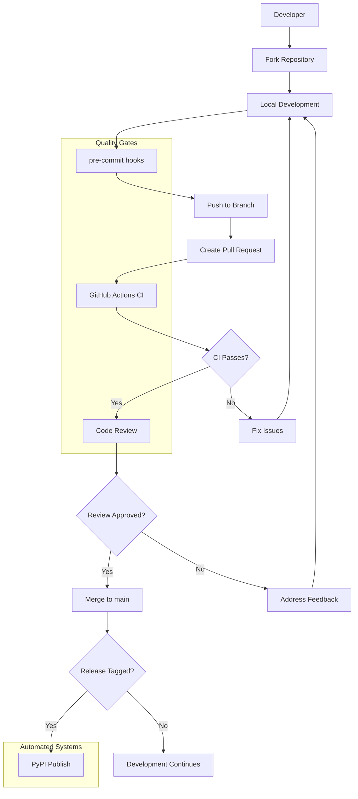
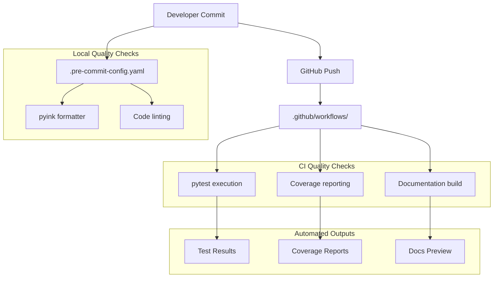

<!-- source: DeepWiki mcp.deepwiki.com · repo google-deepmind/PGMax · page 5 Development and Contributing · fetched 2026-10-26 -->

# Development and Contributing

Relevant source files

The following files were used as context for generating this wiki page:

- [CONTRIBUTING.md](CONTRIBUTING.md)

This page provides an overview of PGMax's development processes, contribution workflows, and quality assurance systems. It covers the essential information developers need to understand how the project is structured and maintained, from initial contribution through automated deployment.

For detailed contribution guidelines and processes, see [Contributing Guidelines](#5.1). For comprehensive coverage of the CI/CD pipeline and testing infrastructure, see [Development Infrastructure](#5.2). For documentation build processes and maintenance, see [Documentation System](#5.3).

## Development Workflow Overview

PGMax follows a structured development workflow that emphasizes code quality, automated testing, and streamlined contributions. The project maintains high standards through multiple quality gates and automated processes.

### Development Process Flow

Sources: [CONTRIBUTING.md:15-20]()

### Code Quality Pipeline

The project implements a multi-layered quality assurance system that runs both locally and in continuous integration:

Sources: [CONTRIBUTING.md:15-20]()

## Contributing Requirements

### Contributor License Agreement

All contributions require a signed Contributor License Agreement (CLA). The CLA ensures proper licensing while allowing contributors to retain copyright over their work.

| Requirement | Description |
|-------------|-------------|
| CLA Submission | Required for all contributors via https://cla.developers.google.com/ |
| Frequency | One-time requirement across Google projects |
| Purpose | Grants permission to use and redistribute contributions |

Sources: [CONTRIBUTING.md:3-13]()

### Code Review Process

All submissions undergo mandatory code review through GitHub pull requests, including contributions from project members.

**Review Requirements:**
- GitHub pull request submission
- Automated CI checks must pass  
- Manual code review and approval
- Adherence to community guidelines

Sources: [CONTRIBUTING.md:15-20]()

## Quality Assurance Systems

### Testing Framework

The project uses `pytest` as the primary testing framework with comprehensive coverage reporting. Tests run automatically on pull requests and provide detailed feedback on code changes.

### Code Formatting

Code formatting is enforced through `pyink` formatter via pre-commit hooks, ensuring consistent code style across the project.

### Documentation Integration

Documentation builds automatically integrate with the development workflow, ensuring that documentation remains current with code changes.

## Development Environment

### Repository Structure

The development environment relies on several key configuration files that control project behavior:

| File | Purpose |
|------|---------|
| `CONTRIBUTING.md` | Contribution guidelines and requirements |
| `.pre-commit-config.yaml` | Local code quality checks |
| `.github/workflows/` | CI/CD automation |
| `pyproject.toml` | Project configuration and dependencies |

### Community Standards

The project follows Google's Open Source Community Guidelines, establishing clear expectations for contributor behavior and project participation.

Sources: [CONTRIBUTING.md:22-24]()

## Development Infrastructure Integration

PGMax's development process integrates with multiple automated systems:

- **Continuous Integration**: GitHub Actions provide automated testing and quality checks
- **Package Distribution**: Automated PyPI publishing for tagged releases  
- **Documentation**: Automated ReadTheDocs builds and deployment
- **Code Quality**: Pre-commit hooks and automated formatting enforcement

For detailed information about specific development infrastructure components, see [Development Infrastructure](#5.2). For documentation build processes and deployment, see [Documentation System](#5.3).

---

