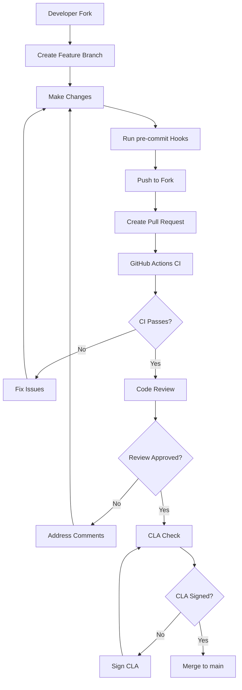
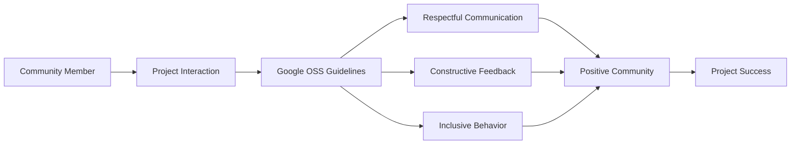
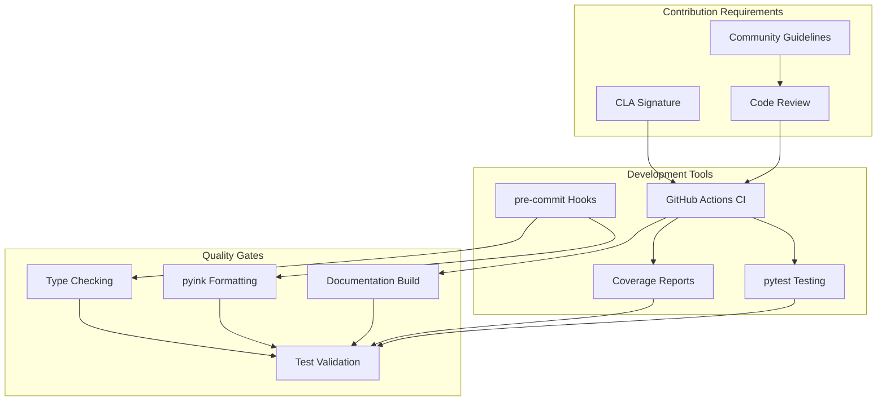

<!-- source: DeepWiki mcp.deepwiki.com · repo google-deepmind/PGMax · page 5.1 Contributing Guidelines · fetched 2026-10-26 -->

# Contributing Guidelines

Relevant source files

The following files were used as context for generating this wiki page:

- [CONTRIBUTING.md](CONTRIBUTING.md)

This document covers the formal requirements and processes for contributing code, documentation, and other improvements to the PGMax project. It explains the legal requirements, review processes, and community standards that all contributors must follow.

For information about the technical development infrastructure, testing frameworks, and CI/CD systems that support the contribution process, see [Development Infrastructure](#5.2). For details about building and maintaining documentation, see [Documentation System](#5.3).

## Overview

PGMax follows Google's standard open source contribution model, requiring a Contributor License Agreement (CLA) and mandatory code reviews for all submissions. The project maintains high standards for code quality and community interaction through automated tooling and established guidelines.

## Contributor License Agreement

All contributions to PGMax must be accompanied by a signed Contributor License Agreement (CLA). This legal requirement ensures that Google DeepMind can redistribute contributions while preserving the contributor's copyright ownership.

The CLA process involves:

| Requirement | Details |
|-------------|---------|
| **CLA Signing** | Complete agreement at `https://cla.developers.google.com/` |
| **Scope** | Covers all contributions to the project |
| **Frequency** | One-time requirement per contributor |
| **Reuse** | Valid across multiple Google open source projects |

Contributors retain full copyright to their contributions. The CLA simply grants Google DeepMind permission to use and redistribute the code as part of the PGMax project.

**Sources:** [CONTRIBUTING.md:3-13]()

## Code Review Process

All submissions require review before merging, including contributions from project maintainers. The review process uses GitHub's pull request system with specific workflow requirements.

### Pull Request Workflow

### Review Requirements

| Stage | Requirement | Verification |
|-------|-------------|--------------|
| **Legal** | CLA signature | Automated check |
| **Technical** | Passing CI/CD pipeline | GitHub Actions |
| **Quality** | Code review approval | Manual review |
| **Standards** | Community guidelines compliance | Manual review |

**Sources:** [CONTRIBUTING.md:15-20]()

## Community Guidelines

PGMax follows Google's Open Source Community Guidelines, which establish standards for respectful and productive collaboration. These guidelines apply to all project interactions including:

- Code reviews and pull request discussions
- Issue reporting and feature requests  
- Community forums and communication channels
- Documentation contributions

### Enforcement and Standards

The guidelines emphasize:
- **Respectful communication** in all project contexts
- **Constructive feedback** that helps improve code quality
- **Inclusive behavior** that welcomes contributors from all backgrounds
- **Collaborative problem-solving** focused on technical merit

**Sources:** [CONTRIBUTING.md:22-24]()

## Integration with Development Infrastructure

The contribution process integrates tightly with PGMax's automated development infrastructure to ensure code quality and consistency.

This integration ensures that all contributions meet the project's technical and legal standards before integration into the main codebase. The automated tools reduce review burden while maintaining high quality standards.

**Sources:** [CONTRIBUTING.md:1-24]()

---

