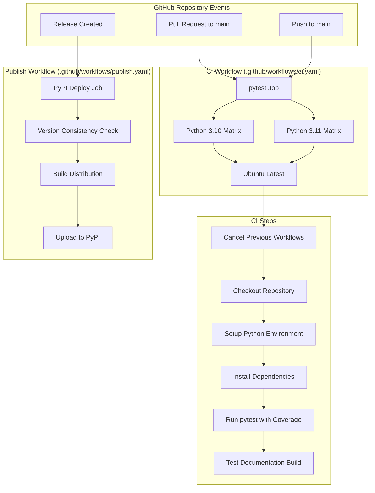
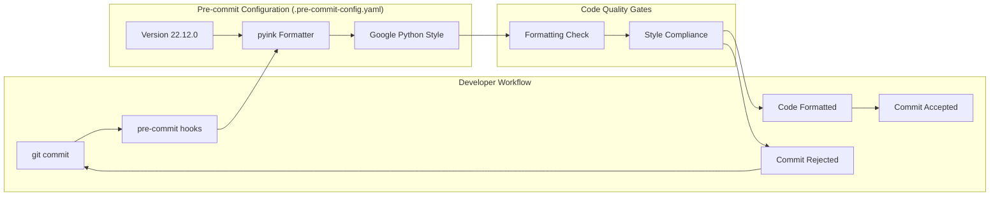
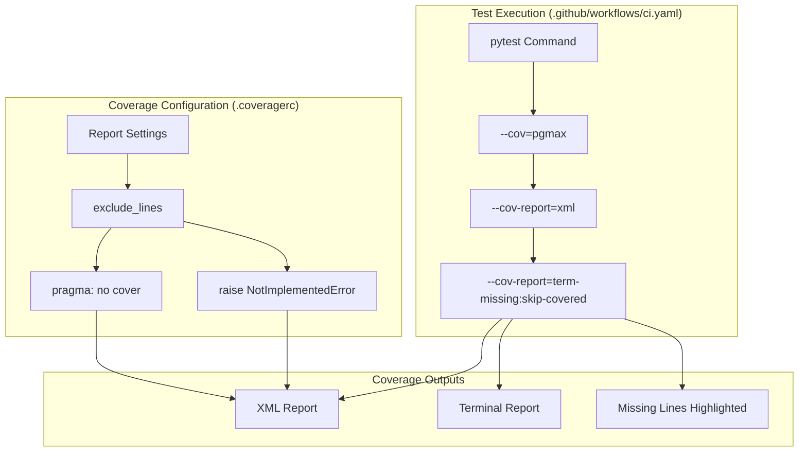
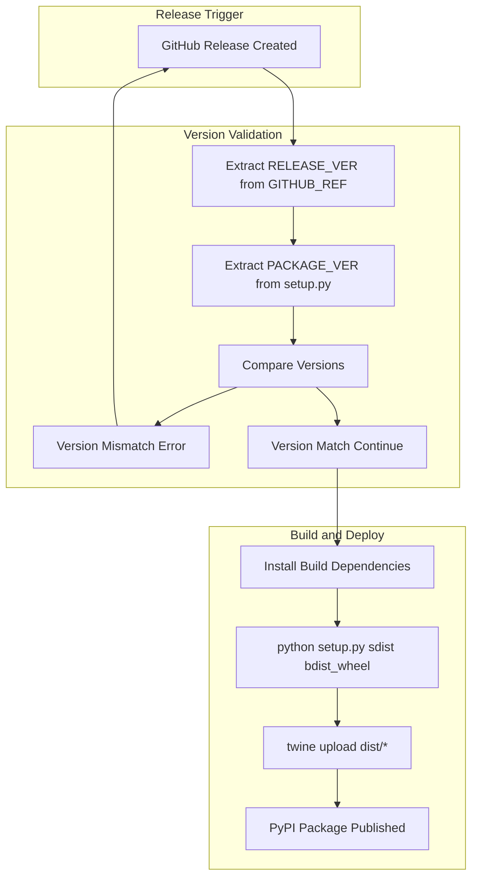

<!-- source: DeepWiki mcp.deepwiki.com · repo google-deepmind/PGMax · page 5.2 Development Infrastructure · fetched 2026-10-26 -->

# Development Infrastructure

<details>
<summary>Relevant source files</summary>

The following files were used as context for generating this wiki page:

- [.coveragerc](.coveragerc)
- [.github/workflows/ci.yaml](.github/workflows/ci.yaml)
- [.github/workflows/publish.yaml](.github/workflows/publish.yaml)
- [.pre-commit-config.yaml](.pre-commit-config.yaml)

</details>


This document covers the automated development infrastructure that supports code quality, testing, and deployment for the PGMax project. This includes the CI/CD pipeline, code quality tools, test execution framework, and automated publishing system.

For information about contributing guidelines and development processes, see [Contributing Guidelines](#5.1). For documentation build systems, see [Documentation System](#5.3).

## CI/CD Pipeline Architecture

The PGMax project uses GitHub Actions to implement a comprehensive continuous integration and deployment pipeline with multiple quality gates and automated workflows.



Sources: [.github/workflows/ci.yaml:1-84](), [.github/workflows/publish.yaml:1-49]()

## Code Quality and Pre-commit Infrastructure

The project enforces code quality through automated formatting and pre-commit hooks that run before code is committed to the repository.



Sources: [.pre-commit-config.yaml:1-20]()

## Testing and Coverage Framework

The project uses `pytest` as its testing framework with comprehensive coverage reporting configured through multiple tools and configuration files.

### Test Execution Pipeline



Sources: [.github/workflows/ci.yaml:74-76](), [.coveragerc:1-8]()

### Test Matrix Configuration

The CI system runs tests across multiple Python versions and operating systems to ensure compatibility:

| Configuration | Python Versions | Operating System | Test Command |
|--------------|----------------|------------------|--------------|
| test-ubuntu | 3.10, 3.11 | ubuntu-latest | `pytest --cov=pgmax --cov-report=xml --cov-report=term-missing:skip-covered` |

Sources: [.github/workflows/ci.yaml:26-33]()

## Automated Publishing System

The project includes an automated PyPI publishing workflow that triggers on GitHub releases and includes version consistency validation.

### Publishing Workflow Steps



Sources: [.github/workflows/publish.yaml:17-49]()

### Publishing Configuration

The automated publishing system requires the following secrets and environment variables:

| Secret/Variable | Purpose | Usage |
|----------------|---------|--------|
| `PYPI_USERNAME` | PyPI account username | Authentication for package upload |
| `PYPI_PASSWORD` | PyPI account password | Authentication for package upload |
| `GITHUB_REF` | GitHub reference for release | Version extraction and validation |

Sources: [.github/workflows/publish.yaml:44-45](), [.github/workflows/publish.yaml:32-37]()

## Development Environment Setup

The CI pipeline demonstrates the standard development environment setup process through its dependency installation steps:

### Installation Sequence

1. **Python Environment**: Set up Python 3.10 or 3.11 using `actions/setup-python`
2. **Package Tools**: Upgrade `pip`, `setuptools`, and `wheel`
3. **Package Installation**: Install PGMax in editable mode with `pip install -e .`
4. **Dependency Verification**: Print installed packages with `pip freeze`

Sources: [.github/workflows/ci.yaml:54-70]()

### CI Job Cancellation Strategy

The CI system includes intelligent job cancellation to prevent resource waste:

- **Trigger**: Configured to cancel previous workflow runs when new commits are pushed
- **Condition**: Only applies to non-main branches (`${{github.ref != 'refs/head/main'}}`)
- **Tool**: Uses `styfle/cancel-workflow-action@0.8.0`

Sources: [.github/workflows/ci.yaml:37-41]()

## Documentation Integration

The CI pipeline includes documentation build validation as part of the quality gates:

```bash
cd docs
make html SPHINXOPTS="-W"
```

This step ensures that documentation builds successfully with warnings treated as errors (`-W` flag), preventing documentation regressions from reaching the main branch.

Sources: [.github/workflows/ci.yaml:80-83]()

---

