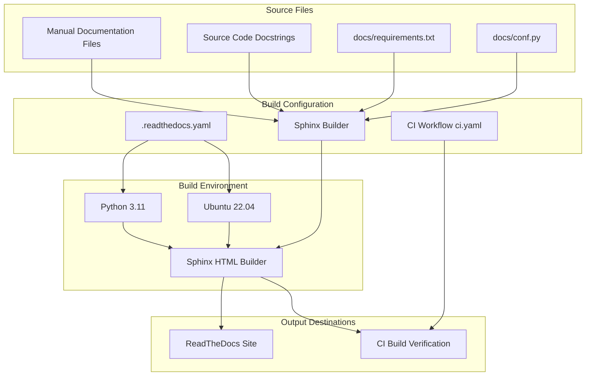
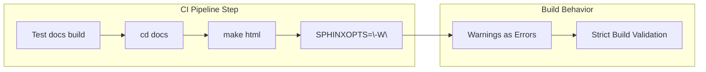
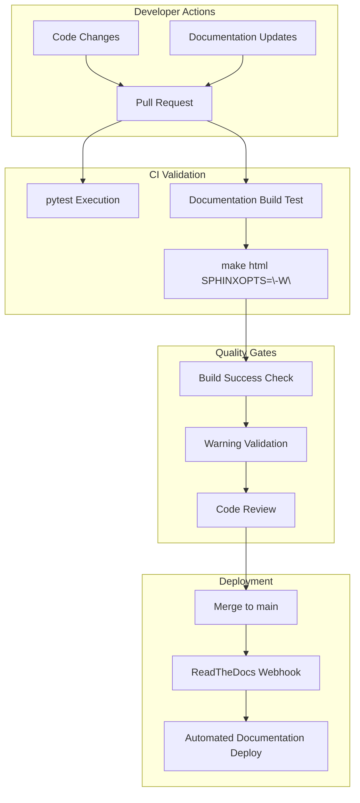

<!-- source: DeepWiki mcp.deepwiki.com · repo google-deepmind/PGMax · page 5.3 Documentation System · fetched 2026-10-26 -->

# Documentation System

Relevant source files

The following files were used as context for generating this wiki page:

- [.github/workflows/ci.yaml](.github/workflows/ci.yaml)
- [.readthedocs.yaml](.readthedocs.yaml)

## Purpose and Scope

This document explains the documentation build process, ReadTheDocs integration, and automated documentation deployment for the PGMax project. It covers how documentation is generated from source code, built via Sphinx, tested in CI, and deployed to ReadTheDocs. For information about contributing to documentation content, see [Contributing Guidelines](#5.1). For details about the broader development infrastructure, see [Development Infrastructure](#5.2).

## Documentation Architecture

The PGMax documentation system uses a multi-stage architecture that integrates Sphinx documentation generation with automated testing and deployment.

### Documentation Build Pipeline

**Sources:** [.readthedocs.yaml:19-34](), [.github/workflows/ci.yaml:80-83]()

## ReadTheDocs Configuration

The documentation deployment is controlled by the ReadTheDocs configuration file, which specifies the build environment and process.

### Configuration Structure

| Setting | Value | Purpose |
|---------|--------|---------|
| `version` | `2` | ReadTheDocs configuration format version |
| `build.os` | `ubuntu-22.04` | Operating system for build environment |
| `build.tools.python` | `"3.11"` | Python version for documentation build |
| `sphinx.builder` | `html` | Output format for generated documentation |
| `sphinx.configuration` | `docs/conf.py` | Path to Sphinx configuration file |
| `sphinx.fail_on_warning` | `false` | Whether to fail build on Sphinx warnings |

The Python installation requirements are specified in `docs/requirements.txt` and installed during the ReadTheDocs build process.

**Sources:** [.readthedocs.yaml:19-34]()

## CI Documentation Testing

The continuous integration pipeline includes documentation build verification to ensure changes don't break the documentation generation process.

### Documentation Build Step

The CI system executes the documentation build with strict warning treatment (`SPHINXOPTS="-W"`), which differs from the ReadTheDocs configuration that allows warnings (`fail_on_warning: false`). This provides early detection of documentation issues during development while maintaining deployment flexibility.

**Sources:** [.github/workflows/ci.yaml:80-83]()

## Documentation Workflow

The documentation system integrates with the overall development workflow to ensure documentation quality and availability.

### End-to-End Documentation Process

This workflow ensures that documentation changes are validated before deployment and that the live documentation site stays synchronized with the main branch.

**Sources:** [.github/workflows/ci.yaml:17-84](), [.readthedocs.yaml:19-34]()

## Build Environment Specifications

The documentation build environment is carefully controlled to ensure reproducible builds across different stages of the pipeline.

### Environment Differences

| Environment | OS | Python | Warning Treatment | Purpose |
|-------------|----|---------|--------------------|----------|
| CI Testing | `ubuntu-latest` | `3.10, 3.11` | Warnings as errors (`-W`) | Development validation |
| ReadTheDocs | `ubuntu-22.04` | `3.11` | Warnings allowed | Production deployment |

The CI environment uses a matrix strategy testing multiple Python versions, while ReadTheDocs uses a single, pinned environment for consistent production builds.

**Sources:** [.github/workflows/ci.yaml:31-32](), [.readthedocs.yaml:22-24]()

---

