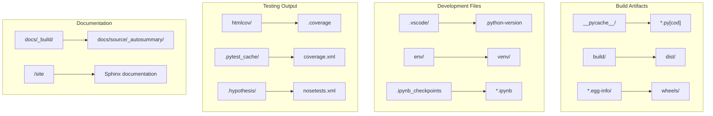
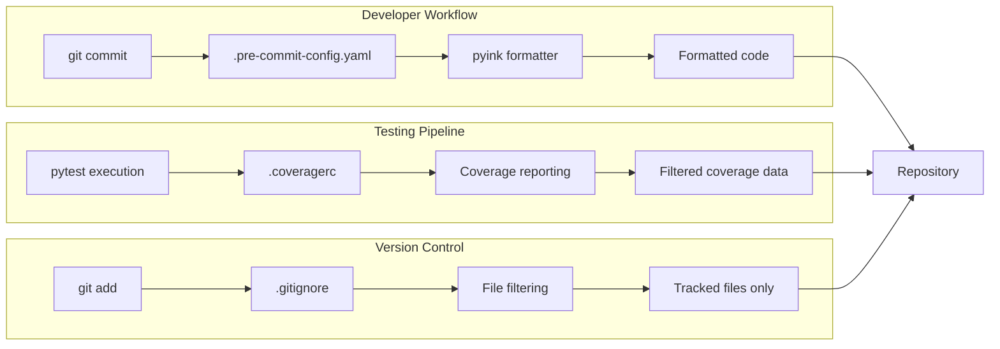

<!-- source: DeepWiki mcp.deepwiki.com · repo google-deepmind/PGMax · page 6 Project Configuration · fetched 2026-10-26 -->

# Project Configuration

Relevant source files

The following files were used as context for generating this wiki page:

- [.coveragerc](.coveragerc)
- [.gitignore](.gitignore)
- [.pre-commit-config.yaml](.pre-commit-config.yaml)

This document covers the configuration files that control project behavior, development tooling, and version control settings in the PGMax repository. These files define how various development tools operate, what files are tracked by version control, and how code quality is maintained. For information about the development infrastructure and CI/CD pipeline that uses these configurations, see [Development Infrastructure](#5.2).

## Code Quality Configuration

The project includes several configuration files that control code quality tools and testing frameworks to maintain consistent code standards across the codebase.

### Coverage Configuration

The `.coveragerc` file configures the Python coverage tool to control how code coverage is measured and reported during testing. The configuration excludes specific types of code lines from coverage calculations:

| Configuration | Purpose | Lines Excluded |
|---------------|---------|----------------|
| `pragma: no cover` | Manual coverage exclusion | Code marked with coverage pragma comments |
| `raise NotImplementedError` | Defensive code exclusion | Abstract method implementations and placeholder code |

This configuration ensures that coverage reports focus on meaningful code paths while ignoring defensive assertions and intentionally uncovered code sections.

**Sources:** [.coveragerc:1-8]()

### Pre-commit Hook Configuration

The `.pre-commit-config.yaml` file defines automated code formatting that runs before each commit. The configuration uses a single hook:

- **Repository**: `https://github.com/google/pyink`
- **Version**: `22.12.0`
- **Hook ID**: `pyink`

The `pyink` tool is Google's Python formatter based on Black, which automatically formats Python code according to Google's style guidelines. This ensures consistent code formatting across all contributions without manual intervention.

**Sources:** [.pre-commit-config.yaml:15-20]()

## Version Control Configuration

### Git Ignore Patterns

The `.gitignore` file defines comprehensive exclusion patterns to prevent generated files, build artifacts, and development-specific files from being tracked in version control. The patterns are organized into logical categories:

Key exclusion categories include:

| Category | Purpose | Example Patterns |
|----------|---------|------------------|
| Python Bytecode | Compiled Python files | `__pycache__/`, `*.py[cod]` |
| Build Artifacts | Distribution and packaging files | `build/`, `dist/`, `*.egg-info/` |
| Virtual Environments | Python environment directories | `env/`, `venv/`, `.venv` |
| IDE Configuration | Editor-specific settings | `.vscode/`, `.spyderproject` |
| Test Output | Coverage and test result files | `.coverage`, `htmlcov/`, `.pytest_cache/` |
| Documentation | Generated documentation files | `docs/_build/`, `docs/source/_autosummary/` |
| Jupyter Notebooks | Notebook files and checkpoints | `*.ipynb`, `.ipynb_checkpoints` |

The configuration specifically excludes Jupyter notebook files (`*.ipynb`) from version control, which aligns with the project's approach of using Colab notebooks for examples that are maintained separately from the main codebase.

**Sources:** [.gitignore:1-135]()

## Configuration Integration

The configuration files work together to create a cohesive development environment that maintains code quality and project organization:

This configuration system ensures that:

1. **Code Quality**: Pre-commit hooks enforce consistent formatting before code enters the repository
2. **Clean Repository**: Git ignore patterns prevent development artifacts from cluttering version control
3. **Accurate Testing**: Coverage configuration provides meaningful test coverage metrics
4. **Reproducible Environment**: Configuration files can be shared across development environments to maintain consistency

**Sources:** [.pre-commit-config.yaml:15-20](), [.coveragerc:1-8](), [.gitignore:1-135]()

---

