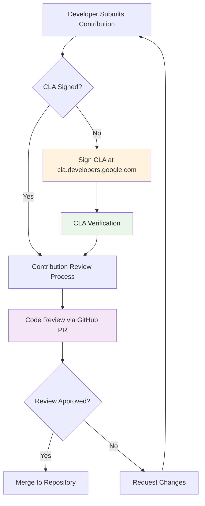
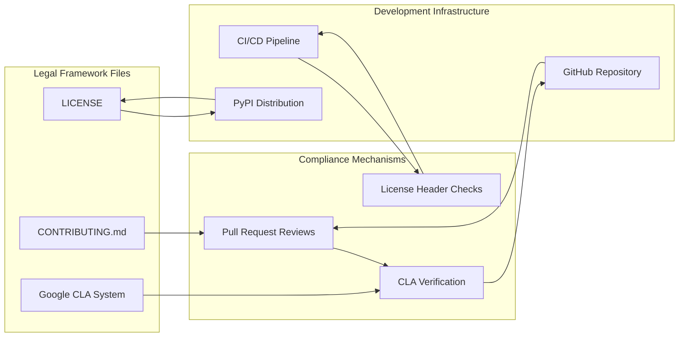

<!-- source: DeepWiki mcp.deepwiki.com · repo google-deepmind/PGMax · page 7 Legal and Licensing · fetched 2026-10-26 -->

# Legal and Licensing

<details>
<summary>Relevant source files</summary>

The following files were used as context for generating this wiki page:

- [CONTRIBUTING.md](CONTRIBUTING.md)
- [LICENSE](LICENSE)

</details>


This page covers the legal framework governing PGMax, including license terms, copyright information, contributor agreements, and community guidelines. This information is essential for understanding usage rights, contribution requirements, and legal obligations when using or contributing to PGMax.

For information about the contribution process and development workflow, see [Contributing Guidelines](#5.1). For details about the project's development infrastructure, see [Development Infrastructure](#5.2).

## License Overview

PGMax is distributed under the Apache License 2.0, a permissive open-source license that allows for both commercial and non-commercial use. The complete license text is contained in the [`LICENSE`]() file at the repository root.

### Key License Provisions

The Apache License 2.0 provides the following permissions and requirements:

| Permission | Description |
|------------|-------------|
| **Use** | Use the software for any purpose, including commercial applications |
| **Modify** | Create derivative works based on the original code |
| **Distribute** | Share copies of the software with others |
| **Private Use** | Use the software privately without disclosure |
| **Patent Grant** | Receive patent protection for contributions made by other contributors |

| Requirement | Description |
|-------------|-------------|
| **License Notice** | Include the original license in any distribution |
| **State Changes** | Document any modifications made to the original files |
| **Preserve Notices** | Maintain copyright, patent, and attribution notices |

Sources: [LICENSE:1-202]()

## Copyright Information

The project follows standard Apache License copyright practices. When contributing code, developers retain copyright to their contributions while granting usage rights to the project.

### Copyright Notice Format

For new files, the standard Apache License copyright header should be applied as shown in the license appendix [LICENSE:179-202](). The format includes:

```
Copyright [yyyy] [name of copyright owner]

Licensed under the Apache License, Version 2.0 (the "License");
you may not use this file except in compliance with the License.
```

Sources: [LICENSE:179-202]()

## User Rights and Obligations

### Permitted Uses

Users may:
- Use PGMax in commercial and non-commercial projects
- Modify the source code for their specific needs
- Distribute modified or unmodified versions
- Include PGMax as a dependency in other projects
- Create derivative works based on PGMax

### User Obligations

When distributing PGMax or derivative works, users must:
- Include the Apache License 2.0 text [LICENSE:90-96]()
- Provide attribution notices from the original work [LICENSE:101-105]()
- Mark any modified files with change notices [LICENSE:98-100]()
- Preserve existing copyright and patent notices [LICENSE:101-105]()

Sources: [LICENSE:90-130]()

## Contributor License Agreement

### CLA Requirement

All contributions to PGMax must be accompanied by a signed Contributor License Agreement (CLA). This requirement applies to all contributors, including project members.



**CLA Process Integration with Development Workflow**

Sources: [CONTRIBUTING.md:3-13]()

### CLA Details

The Contributor License Agreement:
- Allows contributors to retain copyright to their contributions [CONTRIBUTING.md:5-6]()
- Grants the project permission to use and redistribute contributions [CONTRIBUTING.md:6-8]()
- Is typically signed once and applies across multiple Google projects [CONTRIBUTING.md:11-13]()
- Can be managed through the Google CLA system at `https://cla.developers.google.com/` [CONTRIBUTING.md:8]()

### Legal Entity Contributions

For contributions made by employees on behalf of their employer, the employer must sign the CLA rather than the individual contributor [CONTRIBUTING.md:5-6]().

Sources: [CONTRIBUTING.md:3-13]()

## Community Guidelines

PGMax follows Google's Open Source Community Guidelines, which establish standards for respectful and productive collaboration.

### Code Review Requirements

All contributions, regardless of contributor status, must undergo code review:
- Submissions are reviewed through GitHub pull requests [CONTRIBUTING.md:17-19]()
- Both external contributors and project members must participate in the review process [CONTRIBUTING.md:16-17]()
- Reviews follow the guidelines established in GitHub's pull request documentation [CONTRIBUTING.md:18-20]()

### Community Standards

The project adheres to Google's Open Source Community Guidelines, accessible at `https://opensource.google/conduct/` [CONTRIBUTING.md:24](). These guidelines cover:
- Respectful communication practices
- Inclusive collaboration principles
- Conflict resolution procedures
- Enforcement mechanisms

Sources: [CONTRIBUTING.md:15-24]()

## Legal Framework in Development Process

The legal framework integrates with PGMax's development infrastructure through several mechanisms:



**Legal Compliance Integration with Technical Systems**

### Automated Compliance

The development infrastructure incorporates legal compliance through:
- License headers in source files
- Automated PyPI publishing that includes license information
- GitHub's built-in CLA verification for pull requests
- Pre-commit hooks that can verify license compliance

### Distribution Compliance

When PGMax is distributed through PyPI, the distribution includes:
- The complete Apache License 2.0 text
- Proper attribution information
- Copyright notices as required by the license terms

Sources: [LICENSE:1-202](), [CONTRIBUTING.md:1-24]()

## Patent Considerations

### Patent Grant

The Apache License 2.0 includes explicit patent protections:
- Contributors grant patent licenses for their contributions [LICENSE:74-88]()
- Patent licenses are irrevocable except in case of patent litigation [LICENSE:84-88]()
- Patent grants apply only to claims necessarily infringed by the contributions [LICENSE:80-84]()

### Patent Termination

Patent licenses terminate automatically if a licensee initiates patent litigation alleging that PGMax or its contributions infringe patents [LICENSE:84-88]().

Sources: [LICENSE:74-88]()

## Warranty and Liability Disclaimers

### No Warranty

PGMax is provided "AS IS" without warranties of any kind [LICENSE:144-152]():
- No warranties of merchantability or fitness for purpose
- No guarantees of title or non-infringement
- Users assume all risks of use

### Limitation of Liability

Contributors are not liable for damages arising from use of PGMax [LICENSE:154-165]():
- Limitation applies to all forms of damages
- Applies even if contributors are aware of potential damages
- Covers both direct and indirect damages

Sources: [LICENSE:144-165]()

## Compliance Best Practices

### For Users

When using PGMax in projects:
1. Include the Apache License 2.0 text in distributions
2. Maintain attribution notices
3. Document any modifications made to PGMax code
4. Understand patent grant implications

### For Contributors

When contributing to PGMax:
1. Sign the required CLA before submitting contributions
2. Follow community guidelines during collaboration
3. Ensure contributions are original work or properly licensed
4. Participate in the code review process

### For Redistributors

When redistributing PGMax:
1. Include complete license and notice files
2. Preserve all copyright and attribution notices
3. Document changes if the code has been modified
4. Ensure compliance with Apache License 2.0 requirements

Sources: [LICENSE:90-130](), [CONTRIBUTING.md:3-24]()