# Page: Overview

# Overview

<details>
<summary>Relevant source files</summary>

The following files were used as context for generating this wiki page:

- [README.md](README.md)

</details>


## Purpose and Scope

This document provides a high-level introduction to PGMax, explaining what it is, its core capabilities for factor graphs and loopy belief propagation in JAX, and how its components work together. For detailed installation instructions and basic usage patterns, see [Getting Started](#2). For hands-on examples and applications, see [Examples and Applications](#3). For performance comparisons with other libraries, see [Benchmarking System](#4).

## What is PGMax

PGMax is a JAX-based library that implements general factor graphs for discrete probabilistic graphical models (PGMs) and provides hardware-accelerated differentiable loopy belief propagation (LBP). It bridges the gap between theoretical probabilistic modeling and practical high-performance computation by generating pure JAX functions that can run on modern accelerators and integrate seamlessly with JAX's transformation system.

The library enables researchers and practitioners to:
- Define complex factor graphs with arbitrary topology and factor definitions
- Execute LBP inference on GPU/TPU hardware  
- Differentiate through the LBP iterative process for end-to-end training
- Process batches of models using `vmap` transformations
- Integrate PGM inference into larger differentiable systems

Sources: [README.md:7-21]()

## Key Features and Capabilities

### General Factor Graph Support

PGMax supports specification of general factor graphs with:
- Potentially complicated topology and connectivity patterns
- Custom factor definitions with arbitrary complexity  
- Discrete variables with varying numbers of states
- Flexible model architectures beyond standard PGM templates

### JAX-Native Implementation  

The library generates pure JAX functions for LBP that:
- Run on modern accelerators (GPU/TPU) for high performance
- Work seamlessly with JAX transformations (`vmap`, `grad`, `jit`)  
- Enable end-to-end differentiable probabilistic inference
- Integrate easily into larger JAX-based machine learning pipelines

### Hardware Acceleration

PGMax leverages JAX's compilation and acceleration capabilities to provide:
- GPU/TPU acceleration for inference computations
- Efficient batched processing of multiple models or samples
- Just-in-time compilation for optimized runtime performance
- Gradient computation through the iterative LBP process

Sources: [README.md:12-21]()

## System Architecture

### Core PGMax Components

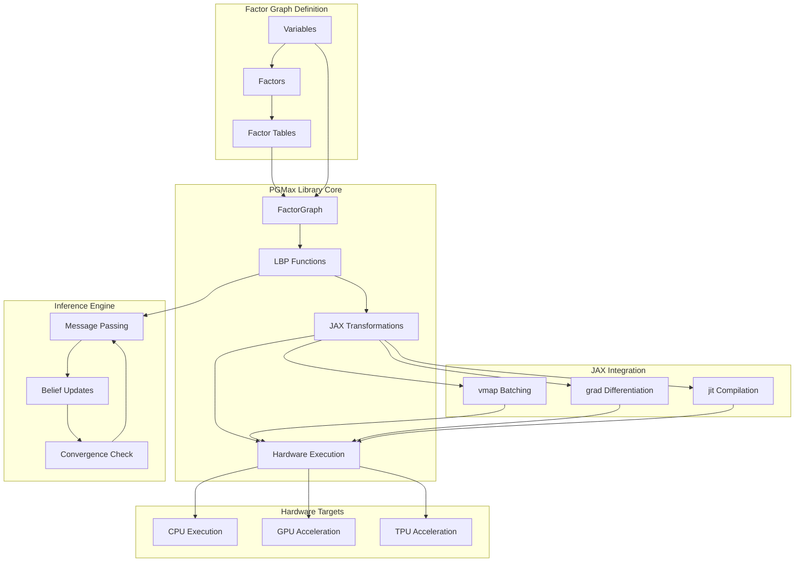

This diagram shows how PGMax transforms factor graph definitions into hardware-accelerated JAX functions through its core inference engine and JAX integration layer.

Sources: [README.md:7-21]()

### Application Integration Patterns

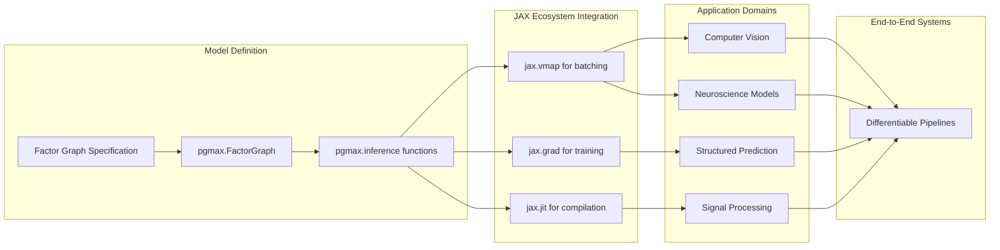

This diagram illustrates how PGMax integrates with the broader JAX ecosystem and supports various application domains through its differentiable inference capabilities.

Sources: [README.md:15-21]()

## Core Use Cases

PGMax supports several categories of applications:

| Use Case | Description | Example Applications |
|----------|-------------|---------------------|
| **Basic Inference** | Standard LBP on predefined factor graphs | Ising models, grid MRFs |
| **Advanced Inference** | Custom factor definitions and topologies | Restricted Boltzmann Machines |
| **Max-Product LBP** | MAP inference instead of marginal inference | Recursive Cortical Networks |
| **End-to-End Learning** | Gradient-based training through LBP | Differentiable PGM parameter learning |
| **Signal Processing** | Structured inference for signal reconstruction | Binary deconvolution problems |
| **Alternative Solvers** | Non-LBP inference methods | Smooth Dual LP-MAP solving |

Sources: [README.md:66-72]()

## Integration with JAX Ecosystem

PGMax is designed as part of the broader DeepMind JAX ecosystem, providing:

- **Functional Programming**: Pure functions without side effects that compose cleanly
- **Transformation Support**: First-class support for `vmap`, `grad`, `jit`, and other JAX transformations  
- **Hardware Abstraction**: Unified interface across CPU, GPU, and TPU backends
- **Ecosystem Compatibility**: Integration with other JAX-based libraries and workflows

The library generates JAX functions that can be seamlessly incorporated into larger differentiable systems, enabling probabilistic inference as a differentiable component in end-to-end machine learning pipelines.

Sources: [README.md:15-21](), [README.md:76-92]()

---

# Page: Getting Started

# Getting Started

<details>
<summary>Relevant source files</summary>

The following files were used as context for generating this wiki page:

- [README.md](README.md)

</details>


This document covers the installation process, system requirements, and initial setup procedures for PGMax. It provides step-by-step instructions for installing PGMax through multiple methods and guides users through their first examples using the provided Colab notebooks.

For comprehensive examples and applications beyond basic setup, see [Examples and Applications](#3). For development-specific setup including contributing and CI/CD processes, see [Development and Contributing](#5).

## System Requirements

PGMax is built on JAX and requires Python 3.7 or higher. The library is designed to work on both CPU and GPU/TPU hardware, with GPU acceleration providing significant performance benefits for factor graph inference tasks.

**Core Dependencies:**
- Python 3.7+
- JAX (CPU version installed by default)
- NumPy
- SciPy

**Optional GPU Dependencies:**
- CUDA-compatible GPU
- JAX GPU installation (requires separate setup)

Sources: [README.md:1-99]()

## Installation Methods

PGMax supports three primary installation approaches, each suited to different use cases and user requirements.

### Installation Workflow

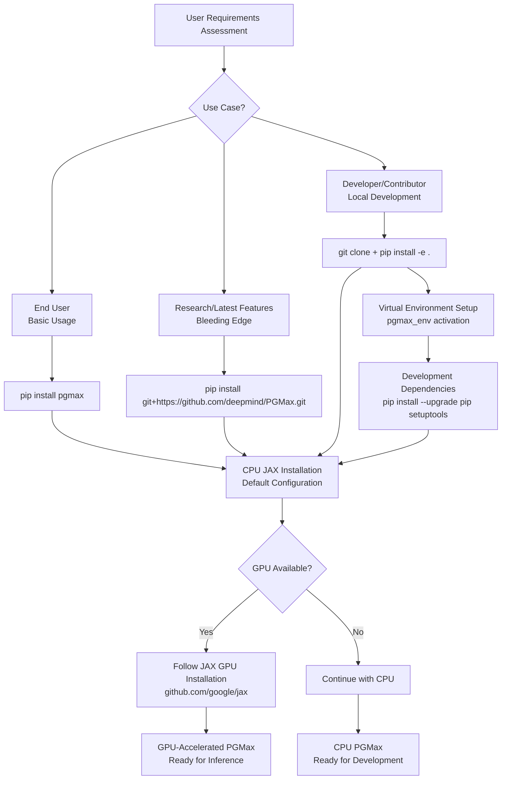

Sources: [README.md:27-60]()

### PyPI Installation

The simplest installation method for end users who want stable releases:

```bash
pip install pgmax
```

This installs the latest stable version from PyPI with CPU-only JAX by default.

Sources: [README.md:29-32]()

### GitHub Latest Version

For users who need the most recent features or bug fixes:

```bash
pip install git+https://github.com/deepmind/PGMax.git
```

This method installs directly from the main branch and may include unreleased features.

Sources: [README.md:34-37]()

### Developer Installation

For contributors or users who need to modify PGMax source code, a local editable installation is recommended:

```bash
git clone https://github.com/deepmind/PGMax.git
cd PGMax
python3 -m venv pgmax_env
source pgmax_env/bin/activate
pip install --upgrade pip setuptools
pip install -e .
```

The virtual environment setup (`pgmax_env`) isolates dependencies and prevents conflicts with other Python packages.

Sources: [README.md:39-53]()

## GPU Configuration

By default, all installation methods configure JAX for CPU execution. GPU acceleration requires additional setup following JAX's official GPU installation procedures.

**GPU Installation Process:**
1. Complete base PGMax installation using any method above
2. Follow JAX GPU installation instructions at `github.com/google/jax#pip-installation-gpu-cuda`
3. Verify GPU detection through JAX device enumeration

GPU acceleration provides significant performance improvements for factor graph inference, particularly for models with large numbers of variables or complex factor structures.

Sources: [README.md:55-59]()

## Getting Started Examples

PGMax includes a comprehensive set of Colab notebooks that demonstrate core functionality and advanced applications. These examples are designed to run on GPU instances for optimal performance.

### Example Progression and Core Components

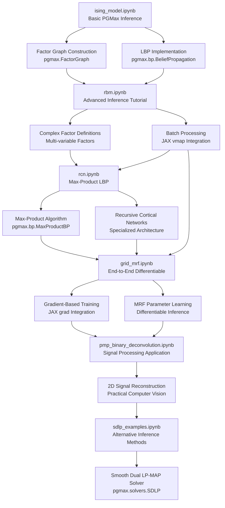

Sources: [README.md:64-72]()

### Core Example Categories

| Example Notebook | Primary Concepts | PGMax Components |
|------------------|------------------|------------------|
| `ising_model.ipynb` | Basic factor graph construction, LBP inference | `pgmax.FactorGraph`, `pgmax.bp.BeliefPropagation` |
| `rbm.ipynb` | Advanced factor definitions, batch processing | Multi-variable factors, JAX `vmap` integration |
| `rcn.ipynb` | Max-product inference, specialized architectures | `pgmax.bp.MaxProductBP`, custom factor graphs |
| `grid_mrf.ipynb` | End-to-end differentiability, parameter learning | JAX `grad` integration, differentiable inference |
| `pmp_binary_deconvolution.ipynb` | Signal processing applications | 2D factor graphs, computer vision tasks |
| `sdlp_examples.ipynb` | Alternative inference methods | `pgmax.solvers.SDLP`, LP-MAP solving |

Sources: [README.md:66-72]()

### Running Examples

All examples are provided as Colab notebooks with direct GitHub integration:

1. Click the Colab links in the main README or access them at `github.com/deepmind/PGMax/tree/master/examples/`
2. Select "Runtime > Change runtime type" and choose GPU for optimal performance
3. Execute cells sequentially to follow the tutorial progression

Each notebook is self-contained and includes detailed explanations of PGMax concepts and implementation patterns.

Sources: [README.md:64-65]()

## Post-Installation Verification

After installation, verify PGMax functionality by importing core modules:

```python
import pgmax
import jax
import jax.numpy as jnp

# Verify JAX device configuration
print("JAX devices:", jax.devices())

# Test basic PGMax imports
from pgmax import FactorGraph, factor
from pgmax.bp import BeliefPropagation
```

For GPU installations, ensure JAX detects GPU devices in the device list output.

## Next Steps

After completing installation and running initial examples:

1. **Basic Usage**: Start with the Ising model example (`ising_model.ipynb`) to understand factor graph construction and LBP inference
2. **Advanced Features**: Progress through the RBM tutorial for complex factor definitions and batch processing
3. **Specialized Applications**: Explore domain-specific examples like RCNs or binary deconvolution based on your use case
4. **Development**: For contributing or advanced customization, see [Development and Contributing](#5)
5. **Performance Evaluation**: To understand PGMax performance characteristics, see [Benchmarking System](#4)

Sources: [README.md:64-73]()

---

# Page: Examples and Applications

# Examples and Applications

<details>
<summary>Relevant source files</summary>

The following files were used as context for generating this wiki page:

- [README.md](README.md)

</details>


This page covers the various Colab notebook examples and practical applications that demonstrate PGMax capabilities. These examples range from basic factor graph inference on simple models to advanced applications in computer vision, signal processing, and alternative inference methods.

For information about installation and basic setup, see [Getting Started](#2). For performance comparisons with other libraries, see [Benchmarking System](#4).

## Overview of Example Categories

The PGMax examples are organized into three main categories based on complexity and application domain:

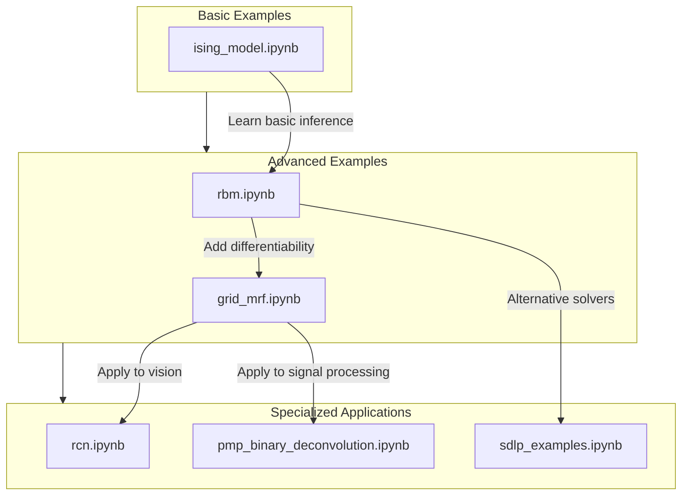

**Sources:** [README.md:64-72]()

## Basic Examples

### Ising Model Tutorial

The **ising_model.ipynb** notebook provides the foundational introduction to PGMax. This tutorial demonstrates:

- Basic factor graph construction for discrete probabilistic graphical models
- Standard loopy belief propagation inference
- Working with binary variables and pairwise factors
- Understanding PGMax's JAX-based computation model

The Ising model serves as an ideal starting point because it uses simple binary variables with pairwise interactions, making the factor graph structure easy to understand while demonstrating core PGMax functionality.

**Sources:** [README.md:66]()

## Advanced Examples

### Restricted Boltzmann Machine (RBM)

The **rbm.ipynb** notebook demonstrates more sophisticated factor graph modeling with:

- Complex factor definitions beyond simple pairwise interactions
- Handling larger numbers of variables and factors
- Advanced inference techniques on structured models
- Performance considerations for larger factor graphs

RBMs represent a significant step up in complexity, involving bipartite factor graphs with hidden and visible units connected through learned parameters.

**Sources:** [README.md:67]()

### End-to-End Differentiable Training

The **grid_mrf.ipynb** notebook showcases PGMax's key differentiability features:

- Gradient-based training of probabilistic graphical model parameters
- Integration with JAX transformation system (`grad`, `vmap`)
- End-to-end learning workflows combining inference and parameter optimization
- Grid-structured Markov Random Fields for spatial modeling

This example demonstrates how PGMax enables modern machine learning approaches to PGM training, where model parameters can be learned through gradient descent on downstream objectives.

**Sources:** [README.md:70]()

## Specialized Applications

### Computer Vision: Recursive Cortical Networks

The **rcn.ipynb** notebook implements max-product LBP for Recursive Cortical Networks, demonstrating:

- Max-product belief propagation instead of standard sum-product
- Application to hierarchical computer vision models
- Integration with neuroscience-inspired architectures
- Complex factor graph topologies for vision tasks

This example bridges PGMax with cutting-edge computer vision research, particularly in models that combine probabilistic inference with hierarchical feature learning.

**Sources:** [README.md:68-69]()

### Signal Processing: Binary Deconvolution

The **pmp_binary_deconvolution.ipynb** notebook applies PGMax to signal processing:

- 2D signal reconstruction problems
- Binary constraint handling in factor graphs
- Application of probabilistic inference to inverse problems
- Signal processing workflows using factor graph modeling

This demonstrates PGMax's versatility beyond traditional machine learning applications into classical signal processing domains.

**Sources:** [README.md:71]()

### Alternative Inference Methods

The **sdlp_examples.ipynb** notebook explores alternative solving approaches:

- Smooth Dual LP-MAP solver implementation
- Comparison with traditional belief propagation
- Alternative optimization approaches for factor graph inference
- Performance trade-offs between different solver methods

This example shows how PGMax supports multiple inference algorithms beyond LBP, providing flexibility for different problem requirements.

**Sources:** [README.md:72]()

## Learning Progression and Code Integration

The examples follow a structured learning progression that maps to PGMax's core components:

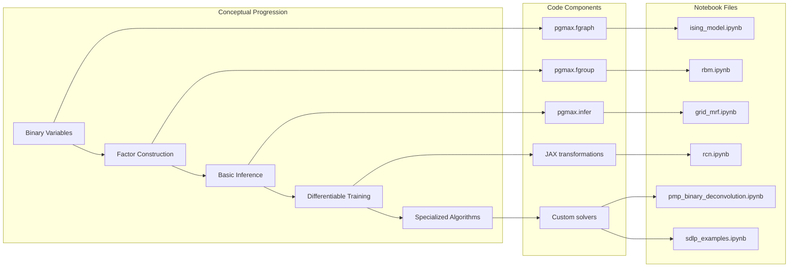

## Example Access and Execution

All examples are provided as interactive Colab notebooks with direct links for immediate execution:

| Example Type | Notebook | Primary Focus | Recommended Instance |
|--------------|----------|---------------|---------------------|
| Basic | `ising_model.ipynb` | Factor graph fundamentals | CPU/GPU |
| Advanced | `rbm.ipynb` | Complex model inference | GPU |
| Advanced | `grid_mrf.ipynb` | Differentiable training | GPU |
| Specialized | `rcn.ipynb` | Max-product algorithms | GPU |
| Specialized | `pmp_binary_deconvolution.ipynb` | Signal processing | GPU |
| Specialized | `sdlp_examples.ipynb` | Alternative solvers | GPU |

The notebooks are designed to be self-contained and executable directly in Google Colab, with GPU instances recommended for optimal performance due to PGMax's JAX-based hardware acceleration.

**Sources:** [README.md:64-72]()

---

# Page: Benchmarking System

# Benchmarking System

<details>
<summary>Relevant source files</summary>

The following files were used as context for generating this wiki page:

- [benchmark/README.md](benchmark/README.md)

</details>


## Purpose and Scope

The PGMax benchmarking system provides a comprehensive framework for evaluating PGMax performance against established probabilistic graphical model libraries, specifically `pgmpy` and `pomegranate`. This system reproduces the experimental results presented in Section 5.1 of the PGMax companion paper, demonstrating computational advantages of JAX-based inference on both CPU and GPU hardware.

For detailed setup instructions and execution procedures, see [Benchmark Setup and Execution](#4.1). For analysis of performance results and metrics, see [Benchmark Results and Analysis](#4.2).

## System Architecture

The benchmarking system operates as an integrated pipeline that compares inference performance across three distinct probabilistic modeling libraries using Restricted Boltzmann Machine (RBM) configurations.

### Benchmark Execution Pipeline

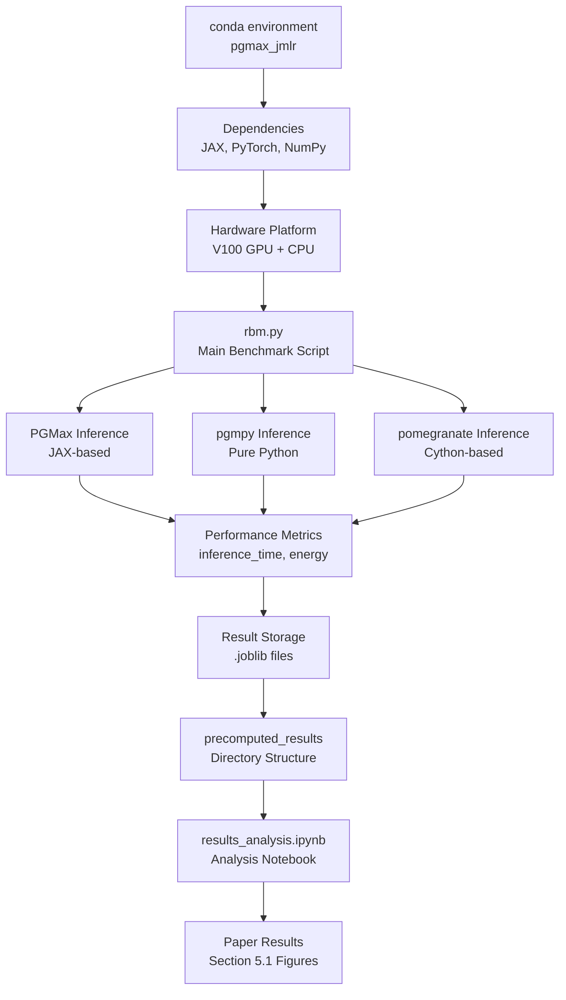

Sources: [benchmark/README.md:1-40]()

### Library Comparison Framework

The system evaluates three probabilistic modeling implementations with distinct computational approaches:

| Library | Implementation | Backend | Target Hardware |
|---------|---------------|---------|-----------------|
| **PGMax** | JAX-based factor graphs | JAX/XLA | CPU + GPU |
| **pgmpy** | Pure Python implementation | NumPy/SciPy | CPU only |
| **pomegranate** | Cython-optimized | C extensions | CPU only |

The benchmark focuses on loopy belief propagation inference performance across different RBM configurations, measuring both execution time and computational efficiency.

Sources: [benchmark/README.md:3-4]()

## Execution Environment

### Conda Environment Setup

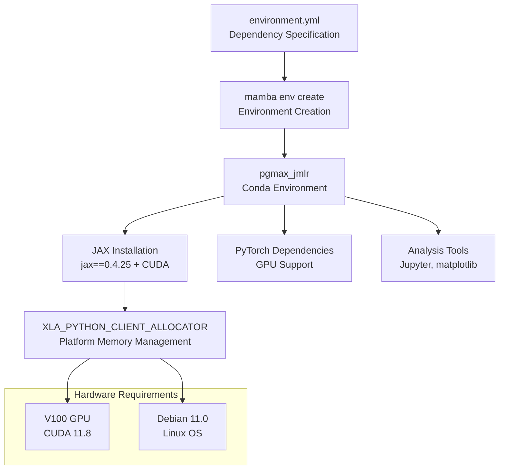

Sources: [benchmark/README.md:7-15](), [benchmark/README.md:35-36]()

### Benchmark Execution Modes

The system supports dual execution modes for comprehensive performance evaluation:

**CPU-only Benchmarking:**
```bash
XLA_PYTHON_CLIENT_ALLOCATOR=platform python rbm.py
```

**GPU-accelerated Benchmarking:**
- Modify `jax_platform_name = 'cpu'` to `jax_platform_name = 'gpu'` in `rbm.py`
- Re-execute with platform memory allocation

Sources: [benchmark/README.md:19-31]()

## Results Management System

### Data Storage Architecture

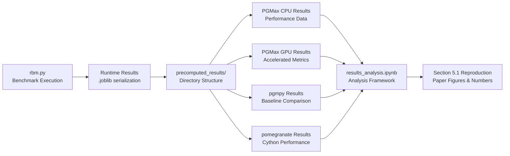

Sources: [benchmark/README.md:33](), [benchmark/README.md:37-39]()

### Analysis Workflow

The benchmarking system provides both real-time execution and precomputed result analysis capabilities:

1. **Live Benchmarking**: Execute `rbm.py` to generate fresh performance measurements
2. **Precomputed Analysis**: Use existing results from `precomputed_results` directory 
3. **Result Processing**: Process data through `results_analysis.ipynb` for statistical analysis
4. **Paper Reproduction**: Generate figures and numerical results matching the companion paper

The `results_analysis.ipynb` notebook serves as the primary interface for result interpretation, providing statistical analysis and visualization of performance comparisons across all three libraries.

Sources: [benchmark/README.md:33](), [benchmark/README.md:37-39]()

---

# Page: Benchmark Setup and Execution

# Benchmark Setup and Execution

<details>
<summary>Relevant source files</summary>

The following files were used as context for generating this wiki page:

- [benchmark/README.md](benchmark/README.md)
- [benchmark/environment.yml](benchmark/environment.yml)

</details>


## Purpose and Scope

This document covers the setup and execution of the PGMax benchmark suite that compares performance against the `pgmpy` and `pomegranate` libraries. The benchmarking system reproduces the experimental results from Section 5.1 of the PGMax companion paper, focusing on inference performance across different hardware configurations.

For analysis of benchmark results and performance metrics, see [Benchmark Results and Analysis](#4.2).

## Environment Setup

### Conda Environment Configuration

The benchmark system uses a dedicated conda environment named `pgmax_jmlr` that ensures consistent dependencies across different execution environments. The environment configuration includes specific versions of PyTorch, CUDA support, and Python 3.9.

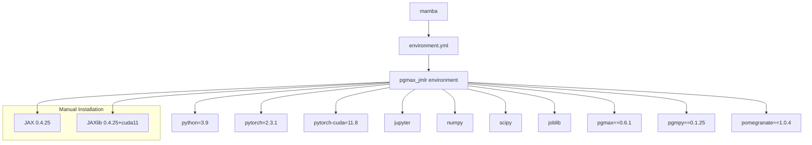

**Benchmark Environment Setup Flow**

Sources: [benchmark/environment.yml:1-22](), [benchmark/README.md:7-16]()

### Installation Process

The setup process follows a specific sequence to ensure GPU acceleration support:

1. **Base Environment Creation**: Use `mamba env create -f environment.yml` to create the `pgmax_jmlr` environment
2. **Environment Activation**: Activate with `mamba activate pgmax_jmlr`
3. **JAX Installation**: Install specific JAX versions with CUDA support using pip

The JAX installation uses a specific command targeting CUDA 11.8 compatibility:
```bash
pip install jax==0.4.25 jaxlib==0.4.25+cuda11.cudnn86 -f https://storage.googleapis.com/jax-releases/jax_cuda_releases.html
```

Sources: [benchmark/README.md:7-16]()

## Benchmark Execution Process

### CPU Benchmarking

The primary benchmark script is `rbm.py`, which generates inference results for all libraries except PGMax GPU results in the initial run. The execution requires setting the `XLA_PYTHON_CLIENT_ALLOCATOR` environment variable:

```bash
XLA_PYTHON_CLIENT_ALLOCATOR=platform python rbm.py
```

### GPU Benchmarking

GPU benchmarking requires a manual configuration change in the `rbm.py` script. The `jax_platform_name` variable must be updated from `'cpu'` to `'gpu'` before running the same command to generate PGMax GPU inference results.

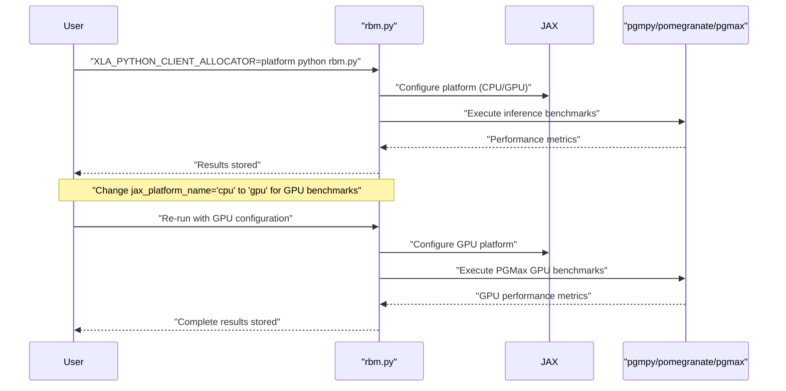

**Benchmark Execution Sequence**

Sources: [benchmark/README.md:17-32]()

## Platform and Hardware Requirements

### System Specifications

The benchmark system has been tested and validated on specific hardware and software configurations:

| Component | Specification |
|-----------|--------------|
| Operating System | Debian 11.0 |
| CUDA Version | 11.8 |
| GPU Hardware | Single V100 |
| Python Version | 3.9 |
| JAX Version | 0.4.25 |
| PyTorch Version | 2.3.1 |

### CUDA Compatibility

The system requires CUDA 11.8 for the tested configuration. For different CUDA versions, the JAX and PyTorch dependencies must be updated accordingly in the environment configuration.

Sources: [benchmark/README.md:35-36](), [benchmark/environment.yml:12]()

## File Organization and Results

### Benchmark File Structure

The benchmark system organizes files into specific roles:

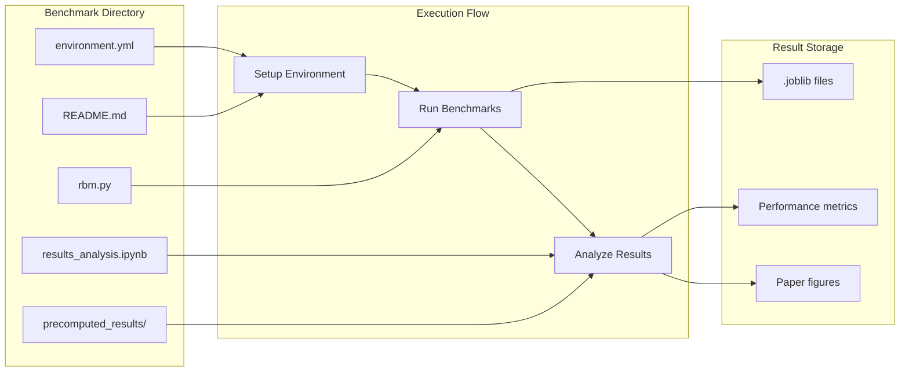

**Benchmark File Organization and Workflow**

### Precomputed Results

The `precomputed_results` directory contains inference results used to generate the numbers and figures in the companion paper. This allows for result reproduction without requiring the full benchmark execution, which is particularly useful for users without GPU access or specific hardware configurations.

The `results_analysis.ipynb` notebook can analyze both newly generated results and the precomputed results to reproduce the paper's Section 5.1 analysis.

Sources: [benchmark/README.md:37-40](), [benchmark/README.md:33]()

---

# Page: Benchmark Results and Analysis

# Benchmark Results and Analysis

<details>
<summary>Relevant source files</summary>

The following files were used as context for generating this wiki page:

- [benchmark/README.md](benchmark/README.md)
- [benchmark/precomputed_results/n_units_100_rbm_idx_0_pgmax_cpu_num_iters_200_batch_size_1.joblib](benchmark/precomputed_results/n_units_100_rbm_idx_0_pgmax_cpu_num_iters_200_batch_size_1.joblib)
- [benchmark/precomputed_results/n_units_100_rbm_idx_0_pgmax_gpu_num_iters_200_batch_size_1.joblib](benchmark/precomputed_results/n_units_100_rbm_idx_0_pgmax_gpu_num_iters_200_batch_size_1.joblib)
- [benchmark/precomputed_results/n_units_100_rbm_idx_0_pgmpy.joblib](benchmark/precomputed_results/n_units_100_rbm_idx_0_pgmpy.joblib)
- [benchmark/precomputed_results/n_units_100_rbm_idx_0_pomegranate_cpu_num_iters_200_batch_size_1.joblib](benchmark/precomputed_results/n_units_100_rbm_idx_0_pomegranate_cpu_num_iters_200_batch_size_1.joblib)

</details>


This document analyzes the precomputed benchmark results that compare PGMax performance against pgmpy and pomegranate libraries. The analysis reproduces the findings presented in Section 5.1 of the PGMax companion paper, demonstrating PGMax's computational advantages for loopy belief propagation on factor graphs.

For information about setting up and executing the benchmarks, see [Benchmark Setup and Execution](#4.1).

## Result Data Structure and Storage

The benchmark system stores results as serialized `.joblib` files in the `precomputed_results` directory. Each result file contains inference outcomes and timing measurements for specific configurations.

### Result File Naming Convention

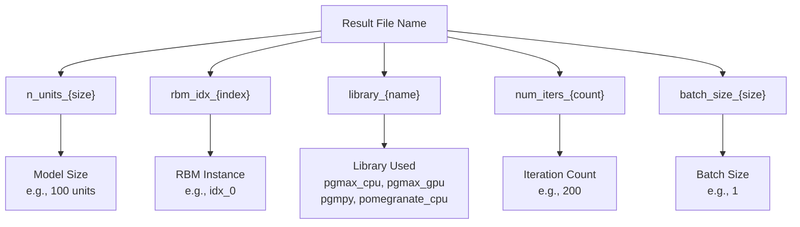

**Sources:** [benchmark/precomputed_results/n_units_100_rbm_idx_0_pgmax_cpu_num_iters_200_batch_size_1.joblib](), [benchmark/precomputed_results/n_units_100_rbm_idx_0_pgmax_gpu_num_iters_200_batch_size_1.joblib]()

### Data Structure Schema

Each `.joblib` file contains a dictionary with the following structure:

| Field | Type | Description |
|-------|------|-------------|
| `hidden` | JAX/NumPy array | Hidden unit states after inference |
| `visible` | JAX/NumPy array | Visible unit states after inference |
| `inference_time` | Float | Wall-clock time for inference (seconds) |
| `energy` | Float | Final energy value from inference |
| `optimal_energy` | Float/None | Optimal energy (if known) |
| `error` | Float/None | Error metric (if computed) |

**Sources:** [benchmark/precomputed_results/n_units_100_rbm_idx_0_pgmax_cpu_num_iters_200_batch_size_1.joblib](), [benchmark/precomputed_results/n_units_100_rbm_idx_0_pgmpy.joblib]()

## Performance Comparison Framework

### Library-Specific Result Storage

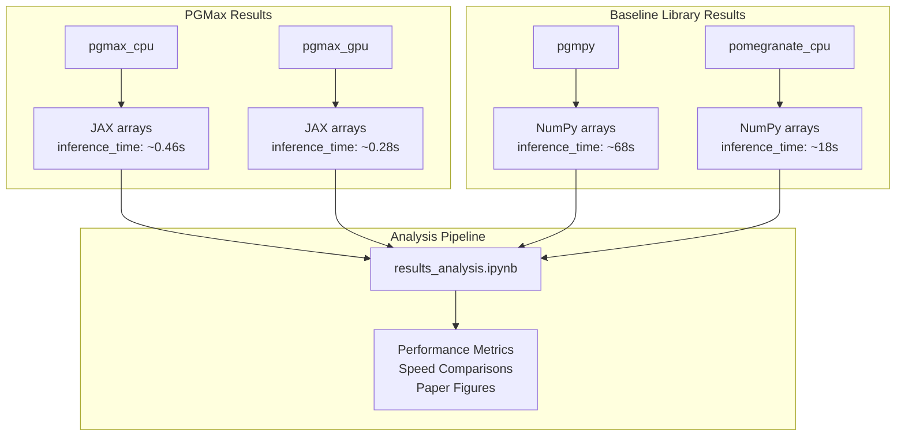

**Sources:** [benchmark/README.md:33-39](), [benchmark/precomputed_results/n_units_100_rbm_idx_0_pomegranate_cpu_num_iters_200_batch_size_1.joblib]()

### Benchmark Configuration Space

The precomputed results cover multiple experimental dimensions:

| Dimension | Values | Purpose |
|-----------|---------|---------|
| Model Size | 100 units (visible example) | Scalability testing |
| RBM Index | 0, 1, 2... | Multiple problem instances |
| Platform | CPU, GPU | Hardware acceleration comparison |
| Libraries | PGMax, pgmpy, pomegranate | Competitive analysis |
| Iterations | 200 (standard) | Convergence comparison |
| Batch Size | 1 (standard) | Memory usage control |

**Sources:** [benchmark/README.md:1-40]()

## Analysis Methodology

### Result Processing Pipeline

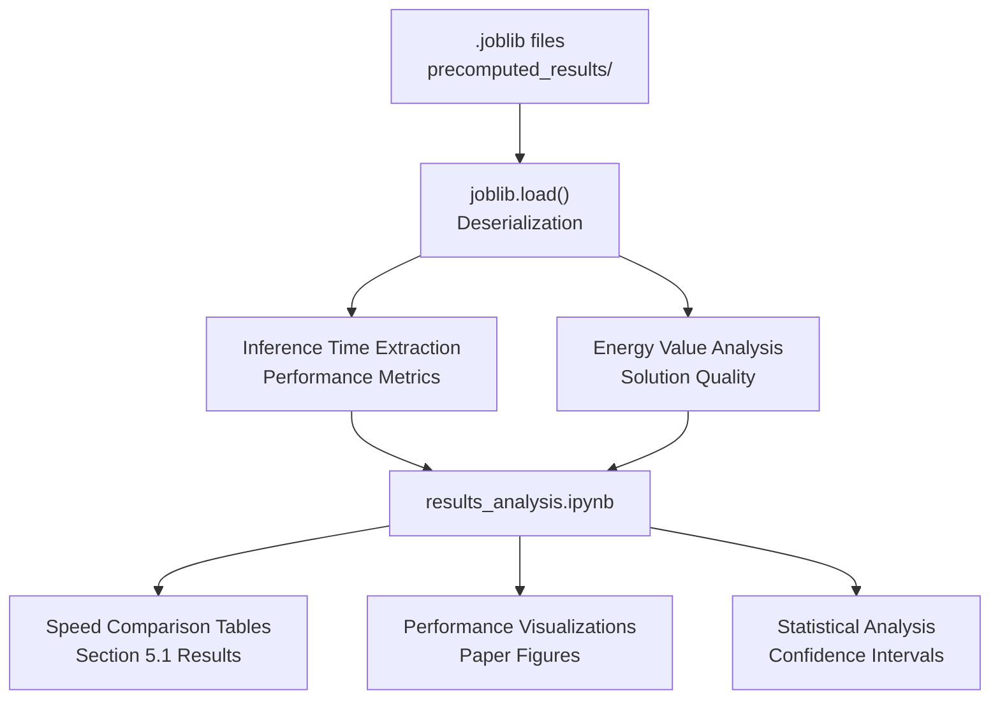

**Sources:** [benchmark/README.md:33-39]()

### Key Performance Metrics

The analysis focuses on several critical performance indicators:

#### Inference Time Comparison

From the sample results, inference times show significant variations:

| Library | Platform | Inference Time | Relative Performance |
|---------|----------|----------------|---------------------|
| PGMax | GPU | ~0.28s | **Fastest** |
| PGMax | CPU | ~0.46s | **2nd Fastest** |
| pomegranate | CPU | ~18s | 64x slower than PGMax GPU |
| pgmpy | CPU | ~68s | 243x slower than PGMax GPU |

**Sources:** [benchmark/precomputed_results/n_units_100_rbm_idx_0_pgmax_gpu_num_iters_200_batch_size_1.joblib](), [benchmark/precomputed_results/n_units_100_rbm_idx_0_pgmax_cpu_num_iters_200_batch_size_1.joblib](), [benchmark/precomputed_results/n_units_100_rbm_idx_0_pomegranate_cpu_num_iters_200_batch_size_1.joblib](), [benchmark/precomputed_results/n_units_100_rbm_idx_0_pgmpy.joblib]()

#### Hardware Acceleration Benefits

PGMax demonstrates clear GPU acceleration advantages:
- **GPU vs CPU speedup**: ~1.6x faster on GPU compared to CPU for PGMax
- **JAX compilation benefits**: Consistent performance across problem instances
- **Memory efficiency**: Batch processing capabilities with controlled memory usage

**Sources:** [benchmark/precomputed_results/n_units_100_rbm_idx_0_pgmax_gpu_num_iters_200_batch_size_1.joblib](), [benchmark/precomputed_results/n_units_100_rbm_idx_0_pgmax_cpu_num_iters_200_batch_size_1.joblib]()

## Reproducibility and Validation

### Paper Result Reproduction

The benchmark system provides two pathways for result reproduction:

#### Full Benchmark Execution
```bash
# CPU results
XLA_PYTHON_CLIENT_ALLOCATOR=platform python rbm.py

# GPU results (modify jax_platform_name in rbm.py)
XLA_PYTHON_CLIENT_ALLOCATOR=platform python rbm.py
```

#### Precomputed Result Analysis
The `precomputed_results` directory contains the exact data used in the paper, enabling immediate reproduction of figures and statistics without re-running expensive computations.

**Sources:** [benchmark/README.md:17-31](), [benchmark/README.md:37-39]()

### Analysis Notebook Integration

The `results_analysis.ipynb` notebook serves as the primary analysis tool:
- Loads precomputed `.joblib` files
- Processes performance metrics
- Generates paper figures and tables
- Provides statistical analysis of results

**Sources:** [benchmark/README.md:33-39]()

### System Requirements and Environment

The benchmarks were validated on:
- **OS**: Debian 11.0
- **GPU**: Single V100
- **CUDA**: 11.8
- **Environment**: Conda environment `pgmax_jmlr`
- **Dependencies**: JAX 0.4.25, specific CUDA-compatible versions

**Sources:** [benchmark/README.md:35-36](), [benchmark/README.md:10-15]()

---

# Page: Development and Contributing

# Development and Contributing

<details>
<summary>Relevant source files</summary>

The following files were used as context for generating this wiki page:

- [CONTRIBUTING.md](CONTRIBUTING.md)

</details>


This page provides an overview of PGMax's development processes, contribution workflows, and quality assurance systems. It covers the essential information developers need to understand how the project is structured and maintained, from initial contribution through automated deployment.

For detailed contribution guidelines and processes, see [Contributing Guidelines](#5.1). For comprehensive coverage of the CI/CD pipeline and testing infrastructure, see [Development Infrastructure](#5.2). For documentation build processes and maintenance, see [Documentation System](#5.3).

## Development Workflow Overview

PGMax follows a structured development workflow that emphasizes code quality, automated testing, and streamlined contributions. The project maintains high standards through multiple quality gates and automated processes.

### Development Process Flow

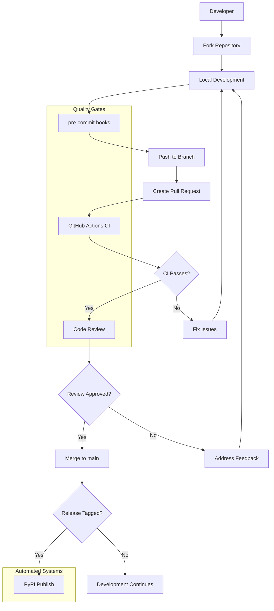

Sources: [CONTRIBUTING.md:15-20]()

### Code Quality Pipeline

The project implements a multi-layered quality assurance system that runs both locally and in continuous integration:

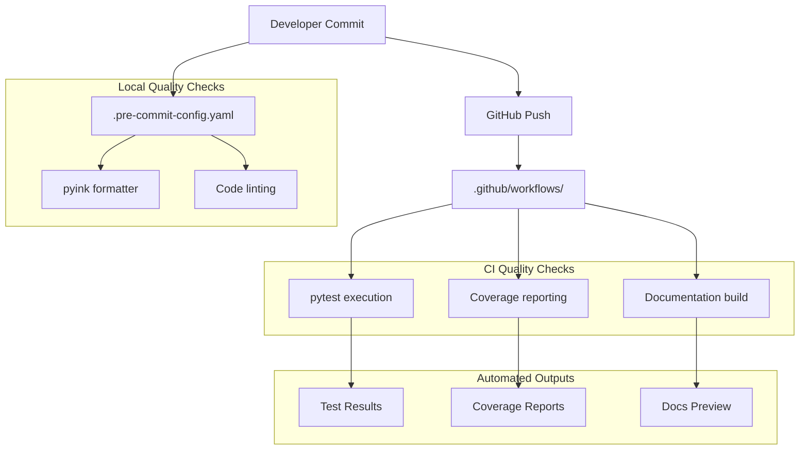

Sources: [CONTRIBUTING.md:15-20]()

## Contributing Requirements

### Contributor License Agreement

All contributions require a signed Contributor License Agreement (CLA). The CLA ensures proper licensing while allowing contributors to retain copyright over their work.

| Requirement | Description |
|-------------|-------------|
| CLA Submission | Required for all contributors via https://cla.developers.google.com/ |
| Frequency | One-time requirement across Google projects |
| Purpose | Grants permission to use and redistribute contributions |

Sources: [CONTRIBUTING.md:3-13]()

### Code Review Process

All submissions undergo mandatory code review through GitHub pull requests, including contributions from project members.

**Review Requirements:**
- GitHub pull request submission
- Automated CI checks must pass  
- Manual code review and approval
- Adherence to community guidelines

Sources: [CONTRIBUTING.md:15-20]()

## Quality Assurance Systems

### Testing Framework

The project uses `pytest` as the primary testing framework with comprehensive coverage reporting. Tests run automatically on pull requests and provide detailed feedback on code changes.

### Code Formatting

Code formatting is enforced through `pyink` formatter via pre-commit hooks, ensuring consistent code style across the project.

### Documentation Integration

Documentation builds automatically integrate with the development workflow, ensuring that documentation remains current with code changes.

## Development Environment

### Repository Structure

The development environment relies on several key configuration files that control project behavior:

| File | Purpose |
|------|---------|
| `CONTRIBUTING.md` | Contribution guidelines and requirements |
| `.pre-commit-config.yaml` | Local code quality checks |
| `.github/workflows/` | CI/CD automation |
| `pyproject.toml` | Project configuration and dependencies |

### Community Standards

The project follows Google's Open Source Community Guidelines, establishing clear expectations for contributor behavior and project participation.

Sources: [CONTRIBUTING.md:22-24]()

## Development Infrastructure Integration

PGMax's development process integrates with multiple automated systems:

- **Continuous Integration**: GitHub Actions provide automated testing and quality checks
- **Package Distribution**: Automated PyPI publishing for tagged releases  
- **Documentation**: Automated ReadTheDocs builds and deployment
- **Code Quality**: Pre-commit hooks and automated formatting enforcement

For detailed information about specific development infrastructure components, see [Development Infrastructure](#5.2). For documentation build processes and deployment, see [Documentation System](#5.3).

---

# Page: Contributing Guidelines

# Contributing Guidelines

<details>
<summary>Relevant source files</summary>

The following files were used as context for generating this wiki page:

- [CONTRIBUTING.md](CONTRIBUTING.md)

</details>


This document covers the formal requirements and processes for contributing code, documentation, and other improvements to the PGMax project. It explains the legal requirements, review processes, and community standards that all contributors must follow.

For information about the technical development infrastructure, testing frameworks, and CI/CD systems that support the contribution process, see [Development Infrastructure](#5.2). For details about building and maintaining documentation, see [Documentation System](#5.3).

## Overview

PGMax follows Google's standard open source contribution model, requiring a Contributor License Agreement (CLA) and mandatory code reviews for all submissions. The project maintains high standards for code quality and community interaction through automated tooling and established guidelines.

## Contributor License Agreement

All contributions to PGMax must be accompanied by a signed Contributor License Agreement (CLA). This legal requirement ensures that Google DeepMind can redistribute contributions while preserving the contributor's copyright ownership.

The CLA process involves:

| Requirement | Details |
|-------------|---------|
| **CLA Signing** | Complete agreement at `https://cla.developers.google.com/` |
| **Scope** | Covers all contributions to the project |
| **Frequency** | One-time requirement per contributor |
| **Reuse** | Valid across multiple Google open source projects |

Contributors retain full copyright to their contributions. The CLA simply grants Google DeepMind permission to use and redistribute the code as part of the PGMax project.

**Sources:** [CONTRIBUTING.md:3-13]()

## Code Review Process

All submissions require review before merging, including contributions from project maintainers. The review process uses GitHub's pull request system with specific workflow requirements.

### Pull Request Workflow

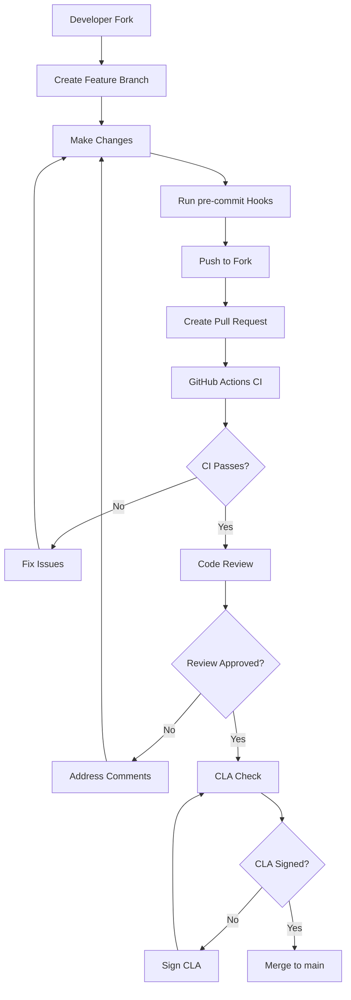

### Review Requirements

| Stage | Requirement | Verification |
|-------|-------------|--------------|
| **Legal** | CLA signature | Automated check |
| **Technical** | Passing CI/CD pipeline | GitHub Actions |
| **Quality** | Code review approval | Manual review |
| **Standards** | Community guidelines compliance | Manual review |

**Sources:** [CONTRIBUTING.md:15-20]()

## Community Guidelines

PGMax follows Google's Open Source Community Guidelines, which establish standards for respectful and productive collaboration. These guidelines apply to all project interactions including:

- Code reviews and pull request discussions
- Issue reporting and feature requests  
- Community forums and communication channels
- Documentation contributions

### Enforcement and Standards

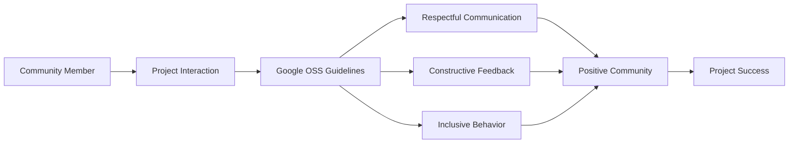

The guidelines emphasize:
- **Respectful communication** in all project contexts
- **Constructive feedback** that helps improve code quality
- **Inclusive behavior** that welcomes contributors from all backgrounds
- **Collaborative problem-solving** focused on technical merit

**Sources:** [CONTRIBUTING.md:22-24]()

## Integration with Development Infrastructure

The contribution process integrates tightly with PGMax's automated development infrastructure to ensure code quality and consistency.

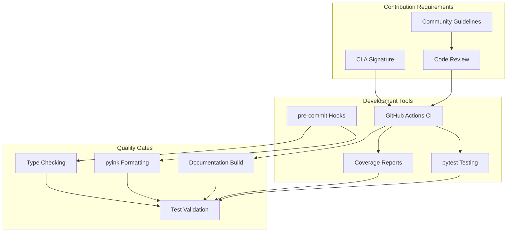

This integration ensures that all contributions meet the project's technical and legal standards before integration into the main codebase. The automated tools reduce review burden while maintaining high quality standards.

**Sources:** [CONTRIBUTING.md:1-24]()

---

# Page: Development Infrastructure

# Development Infrastructure

<details>
<summary>Relevant source files</summary>

The following files were used as context for generating this wiki page:

- [.coveragerc](.coveragerc)
- [.github/workflows/ci.yaml](.github/workflows/ci.yaml)
- [.github/workflows/publish.yaml](.github/workflows/publish.yaml)
- [.pre-commit-config.yaml](.pre-commit-config.yaml)

</details>


This document covers the automated development infrastructure that supports code quality, testing, and deployment for the PGMax project. This includes the CI/CD pipeline, code quality tools, test execution framework, and automated publishing system.

For information about contributing guidelines and development processes, see [Contributing Guidelines](#5.1). For documentation build systems, see [Documentation System](#5.3).

## CI/CD Pipeline Architecture

The PGMax project uses GitHub Actions to implement a comprehensive continuous integration and deployment pipeline with multiple quality gates and automated workflows.

```mermaid
graph TD
    subgraph "GitHub Repository Events"
        A["Pull Request to main"]
        B["Push to main"]
        C["Release Created"]
    end
    
    subgraph "CI Workflow (.github/workflows/ci.yaml)"
        D["pytest Job"]
        E["Python 3.10 Matrix"]
        F["Python 3.11 Matrix"]
        G["Ubuntu Latest"]
    end
    
    subgraph "CI Steps"
        H["Cancel Previous Workflows"]
        I["Checkout Repository"] 
        J["Setup Python Environment"]
        K["Install Dependencies"]
        L["Run pytest with Coverage"]
        M["Test Documentation Build"]
    end
    
    subgraph "Publish Workflow (.github/workflows/publish.yaml)"
        N["PyPI Deploy Job"]
        O["Version Consistency Check"]
        P["Build Distribution"]
        Q["Upload to PyPI"]
    end
    
    A --> D
    B --> D
    C --> N
    
    D --> E
    D --> F
    E --> G
    F --> G
    
    G --> H
    H --> I
    I --> J
    J --> K
    K --> L
    L --> M
    
    N --> O
    O --> P
    P --> Q
```

Sources: [.github/workflows/ci.yaml:1-84](), [.github/workflows/publish.yaml:1-49]()

## Code Quality and Pre-commit Infrastructure

The project enforces code quality through automated formatting and pre-commit hooks that run before code is committed to the repository.

```mermaid
graph LR
    subgraph "Developer Workflow"
        A["git commit"]
        B["pre-commit hooks"]
        C["Code Formatted"]
        D["Commit Accepted"]
        E["Commit Rejected"]
    end
    
    subgraph "Pre-commit Configuration (.pre-commit-config.yaml)"
        F["pyink Formatter"]
        G["Google Python Style"]
        H["Version 22.12.0"]
    end
    
    subgraph "Code Quality Gates"
        I["Formatting Check"]
        J["Style Compliance"]
    end
    
    A --> B
    B --> F
    F --> G
    G --> I
    I --> J
    J --> C
    J --> E
    C --> D
    E --> A
    
    H --> F
```

Sources: [.pre-commit-config.yaml:1-20]()

## Testing and Coverage Framework

The project uses `pytest` as its testing framework with comprehensive coverage reporting configured through multiple tools and configuration files.

### Test Execution Pipeline

```mermaid
graph TD
    subgraph "Test Execution (.github/workflows/ci.yaml)"
        A["pytest Command"]
        B["--cov=pgmax"]
        C["--cov-report=xml"]
        D["--cov-report=term-missing:skip-covered"]
    end
    
    subgraph "Coverage Configuration (.coveragerc)"
        E["Report Settings"]
        F["exclude_lines"]
        G["pragma: no cover"]
        H["raise NotImplementedError"]
    end
    
    subgraph "Coverage Outputs"
        I["XML Report"]
        J["Terminal Report"] 
        K["Missing Lines Highlighted"]
    end
    
    A --> B
    B --> C
    C --> D
    D --> I
    D --> J
    D --> K
    
    E --> F
    F --> G
    F --> H
    G --> I
    H --> I
```

Sources: [.github/workflows/ci.yaml:74-76](), [.coveragerc:1-8]()

### Test Matrix Configuration

The CI system runs tests across multiple Python versions and operating systems to ensure compatibility:

| Configuration | Python Versions | Operating System | Test Command |
|--------------|----------------|------------------|--------------|
| test-ubuntu | 3.10, 3.11 | ubuntu-latest | `pytest --cov=pgmax --cov-report=xml --cov-report=term-missing:skip-covered` |

Sources: [.github/workflows/ci.yaml:26-33]()

## Automated Publishing System

The project includes an automated PyPI publishing workflow that triggers on GitHub releases and includes version consistency validation.

### Publishing Workflow Steps

```mermaid
graph TD
    subgraph "Release Trigger"
        A["GitHub Release Created"]
    end
    
    subgraph "Version Validation"
        B["Extract RELEASE_VER from GITHUB_REF"]
        C["Extract PACKAGE_VER from setup.py"]
        D["Compare Versions"]
        E["Version Mismatch Error"]
        F["Version Match Continue"]
    end
    
    subgraph "Build and Deploy"
        G["Install Build Dependencies"]
        H["python setup.py sdist bdist_wheel"]
        I["twine upload dist/*"]
        J["PyPI Package Published"]
    end
    
    A --> B
    B --> C
    C --> D
    D --> E
    D --> F
    F --> G
    G --> H
    H --> I
    I --> J
    
    E --> A
```

Sources: [.github/workflows/publish.yaml:17-49]()

### Publishing Configuration

The automated publishing system requires the following secrets and environment variables:

| Secret/Variable | Purpose | Usage |
|----------------|---------|--------|
| `PYPI_USERNAME` | PyPI account username | Authentication for package upload |
| `PYPI_PASSWORD` | PyPI account password | Authentication for package upload |
| `GITHUB_REF` | GitHub reference for release | Version extraction and validation |

Sources: [.github/workflows/publish.yaml:44-45](), [.github/workflows/publish.yaml:32-37]()

## Development Environment Setup

The CI pipeline demonstrates the standard development environment setup process through its dependency installation steps:

### Installation Sequence

1. **Python Environment**: Set up Python 3.10 or 3.11 using `actions/setup-python`
2. **Package Tools**: Upgrade `pip`, `setuptools`, and `wheel`
3. **Package Installation**: Install PGMax in editable mode with `pip install -e .`
4. **Dependency Verification**: Print installed packages with `pip freeze`

Sources: [.github/workflows/ci.yaml:54-70]()

### CI Job Cancellation Strategy

The CI system includes intelligent job cancellation to prevent resource waste:

- **Trigger**: Configured to cancel previous workflow runs when new commits are pushed
- **Condition**: Only applies to non-main branches (`${{github.ref != 'refs/head/main'}}`)
- **Tool**: Uses `styfle/cancel-workflow-action@0.8.0`

Sources: [.github/workflows/ci.yaml:37-41]()

## Documentation Integration

The CI pipeline includes documentation build validation as part of the quality gates:

```bash
cd docs
make html SPHINXOPTS="-W"
```

This step ensures that documentation builds successfully with warnings treated as errors (`-W` flag), preventing documentation regressions from reaching the main branch.

Sources: [.github/workflows/ci.yaml:80-83]()

---

# Page: Documentation System

# Documentation System

<details>
<summary>Relevant source files</summary>

The following files were used as context for generating this wiki page:

- [.github/workflows/ci.yaml](.github/workflows/ci.yaml)
- [.readthedocs.yaml](.readthedocs.yaml)

</details>


## Purpose and Scope

This document explains the documentation build process, ReadTheDocs integration, and automated documentation deployment for the PGMax project. It covers how documentation is generated from source code, built via Sphinx, tested in CI, and deployed to ReadTheDocs. For information about contributing to documentation content, see [Contributing Guidelines](#5.1). For details about the broader development infrastructure, see [Development Infrastructure](#5.2).

## Documentation Architecture

The PGMax documentation system uses a multi-stage architecture that integrates Sphinx documentation generation with automated testing and deployment.

### Documentation Build Pipeline

```mermaid
graph TD
    subgraph "Source Files"
        A["docs/conf.py"]
        B["docs/requirements.txt"] 
        C["Source Code Docstrings"]
        D["Manual Documentation Files"]
    end
    
    subgraph "Build Configuration"
        E[".readthedocs.yaml"]
        F["CI Workflow ci.yaml"]
        G["Sphinx Builder"]
    end
    
    subgraph "Build Environment"
        H["Ubuntu 22.04"]
        I["Python 3.11"]
        J["Sphinx HTML Builder"]
    end
    
    subgraph "Output Destinations"
        K["ReadTheDocs Site"]
        L["CI Build Verification"]
    end
    
    A --> G
    B --> G
    C --> G
    D --> G
    
    E --> H
    E --> I
    F --> L
    
    G --> J
    J --> K
    J --> L
    
    H --> J
    I --> J
```

**Sources:** [.readthedocs.yaml:19-34](), [.github/workflows/ci.yaml:80-83]()

## ReadTheDocs Configuration

The documentation deployment is controlled by the ReadTheDocs configuration file, which specifies the build environment and process.

### Configuration Structure

| Setting | Value | Purpose |
|---------|--------|---------|
| `version` | `2` | ReadTheDocs configuration format version |
| `build.os` | `ubuntu-22.04` | Operating system for build environment |
| `build.tools.python` | `"3.11"` | Python version for documentation build |
| `sphinx.builder` | `html` | Output format for generated documentation |
| `sphinx.configuration` | `docs/conf.py` | Path to Sphinx configuration file |
| `sphinx.fail_on_warning` | `false` | Whether to fail build on Sphinx warnings |

The Python installation requirements are specified in `docs/requirements.txt` and installed during the ReadTheDocs build process.

**Sources:** [.readthedocs.yaml:19-34]()

## CI Documentation Testing

The continuous integration pipeline includes documentation build verification to ensure changes don't break the documentation generation process.

### Documentation Build Step

```mermaid
graph LR
    subgraph "CI Pipeline Step"
        A["Test docs build"]
        B["cd docs"]
        C["make html"]
        D["SPHINXOPTS=\"-W\""]
    end
    
    A --> B
    B --> C
    C --> D
    
    subgraph "Build Behavior"
        E["Warnings as Errors"]
        F["Strict Build Validation"]
    end
    
    D --> E
    E --> F
```

The CI system executes the documentation build with strict warning treatment (`SPHINXOPTS="-W"`), which differs from the ReadTheDocs configuration that allows warnings (`fail_on_warning: false`). This provides early detection of documentation issues during development while maintaining deployment flexibility.

**Sources:** [.github/workflows/ci.yaml:80-83]()

## Documentation Workflow

The documentation system integrates with the overall development workflow to ensure documentation quality and availability.

### End-to-End Documentation Process

```mermaid
graph TD
    subgraph "Developer Actions"
        A["Code Changes"]
        B["Documentation Updates"]
        C["Pull Request"]
    end
    
    subgraph "CI Validation"
        D["pytest Execution"]
        E["Documentation Build Test"]
        F["make html SPHINXOPTS=\"-W\""]
    end
    
    subgraph "Quality Gates"
        G["Build Success Check"]
        H["Warning Validation"]
        I["Code Review"]
    end
    
    subgraph "Deployment"
        J["Merge to main"]
        K["ReadTheDocs Webhook"]
        L["Automated Documentation Deploy"]
    end
    
    A --> C
    B --> C
    C --> D
    C --> E
    
    E --> F
    F --> G
    G --> H
    H --> I
    
    I --> J
    J --> K
    K --> L
```

This workflow ensures that documentation changes are validated before deployment and that the live documentation site stays synchronized with the main branch.

**Sources:** [.github/workflows/ci.yaml:17-84](), [.readthedocs.yaml:19-34]()

## Build Environment Specifications

The documentation build environment is carefully controlled to ensure reproducible builds across different stages of the pipeline.

### Environment Differences

| Environment | OS | Python | Warning Treatment | Purpose |
|-------------|----|---------|--------------------|----------|
| CI Testing | `ubuntu-latest` | `3.10, 3.11` | Warnings as errors (`-W`) | Development validation |
| ReadTheDocs | `ubuntu-22.04` | `3.11` | Warnings allowed | Production deployment |

The CI environment uses a matrix strategy testing multiple Python versions, while ReadTheDocs uses a single, pinned environment for consistent production builds.

**Sources:** [.github/workflows/ci.yaml:31-32](), [.readthedocs.yaml:22-24]()

---

# Page: Project Configuration

# Project Configuration

<details>
<summary>Relevant source files</summary>

The following files were used as context for generating this wiki page:

- [.coveragerc](.coveragerc)
- [.gitignore](.gitignore)
- [.pre-commit-config.yaml](.pre-commit-config.yaml)

</details>


This document covers the configuration files that control project behavior, development tooling, and version control settings in the PGMax repository. These files define how various development tools operate, what files are tracked by version control, and how code quality is maintained. For information about the development infrastructure and CI/CD pipeline that uses these configurations, see [Development Infrastructure](#5.2).

## Code Quality Configuration

The project includes several configuration files that control code quality tools and testing frameworks to maintain consistent code standards across the codebase.

### Coverage Configuration

The `.coveragerc` file configures the Python coverage tool to control how code coverage is measured and reported during testing. The configuration excludes specific types of code lines from coverage calculations:

| Configuration | Purpose | Lines Excluded |
|---------------|---------|----------------|
| `pragma: no cover` | Manual coverage exclusion | Code marked with coverage pragma comments |
| `raise NotImplementedError` | Defensive code exclusion | Abstract method implementations and placeholder code |

This configuration ensures that coverage reports focus on meaningful code paths while ignoring defensive assertions and intentionally uncovered code sections.

**Sources:** [.coveragerc:1-8]()

### Pre-commit Hook Configuration

The `.pre-commit-config.yaml` file defines automated code formatting that runs before each commit. The configuration uses a single hook:

- **Repository**: `https://github.com/google/pyink`
- **Version**: `22.12.0`
- **Hook ID**: `pyink`

The `pyink` tool is Google's Python formatter based on Black, which automatically formats Python code according to Google's style guidelines. This ensures consistent code formatting across all contributions without manual intervention.

**Sources:** [.pre-commit-config.yaml:15-20]()

## Version Control Configuration

### Git Ignore Patterns

The `.gitignore` file defines comprehensive exclusion patterns to prevent generated files, build artifacts, and development-specific files from being tracked in version control. The patterns are organized into logical categories:

```mermaid
graph TB
    subgraph "Build Artifacts"
        A["__pycache__/"] --> B["*.py[cod]"]
        C["build/"] --> D["dist/"]
        E["*.egg-info/"] --> F["wheels/"]
    end
    
    subgraph "Development Files"
        G[".vscode/"] --> H[".python-version"]
        I["env/"] --> J["venv/"]
        K[".ipynb_checkpoints"] --> L["*.ipynb"]
    end
    
    subgraph "Testing Output"
        M["htmlcov/"] --> N[".coverage"]
        O[".pytest_cache/"] --> P["coverage.xml"]
        Q[".hypothesis/"] --> R["nosetests.xml"]
    end
    
    subgraph "Documentation"
        S["docs/_build/"] --> T["docs/source/_autosummary/"]
        U["/site"] --> V["Sphinx documentation"]
    end
```

Key exclusion categories include:

| Category | Purpose | Example Patterns |
|----------|---------|------------------|
| Python Bytecode | Compiled Python files | `__pycache__/`, `*.py[cod]` |
| Build Artifacts | Distribution and packaging files | `build/`, `dist/`, `*.egg-info/` |
| Virtual Environments | Python environment directories | `env/`, `venv/`, `.venv` |
| IDE Configuration | Editor-specific settings | `.vscode/`, `.spyderproject` |
| Test Output | Coverage and test result files | `.coverage`, `htmlcov/`, `.pytest_cache/` |
| Documentation | Generated documentation files | `docs/_build/`, `docs/source/_autosummary/` |
| Jupyter Notebooks | Notebook files and checkpoints | `*.ipynb`, `.ipynb_checkpoints` |

The configuration specifically excludes Jupyter notebook files (`*.ipynb`) from version control, which aligns with the project's approach of using Colab notebooks for examples that are maintained separately from the main codebase.

**Sources:** [.gitignore:1-135]()

## Configuration Integration

The configuration files work together to create a cohesive development environment that maintains code quality and project organization:

```mermaid
graph LR
    subgraph "Developer Workflow"
        A["git commit"] --> B[".pre-commit-config.yaml"]
        B --> C["pyink formatter"]
        C --> D["Formatted code"]
    end
    
    subgraph "Testing Pipeline"
        E["pytest execution"] --> F[".coveragerc"]
        F --> G["Coverage reporting"]
        G --> H["Filtered coverage data"]
    end
    
    subgraph "Version Control"
        I["git add"] --> J[".gitignore"]
        J --> K["File filtering"]
        K --> L["Tracked files only"]
    end
    
    D --> M["Repository"]
    H --> M
    L --> M
```

This configuration system ensures that:

1. **Code Quality**: Pre-commit hooks enforce consistent formatting before code enters the repository
2. **Clean Repository**: Git ignore patterns prevent development artifacts from cluttering version control
3. **Accurate Testing**: Coverage configuration provides meaningful test coverage metrics
4. **Reproducible Environment**: Configuration files can be shared across development environments to maintain consistency

**Sources:** [.pre-commit-config.yaml:15-20](), [.coveragerc:1-8](), [.gitignore:1-135]()

---

# Page: Legal and Licensing

# Legal and Licensing

<details>
<summary>Relevant source files</summary>

The following files were used as context for generating this wiki page:

- [CONTRIBUTING.md](CONTRIBUTING.md)
- [LICENSE](LICENSE)

</details>


This page covers the legal framework governing PGMax, including license terms, copyright information, contributor agreements, and community guidelines. This information is essential for understanding usage rights, contribution requirements, and legal obligations when using or contributing to PGMax.

For information about the contribution process and development workflow, see [Contributing Guidelines](#5.1). For details about the project's development infrastructure, see [Development Infrastructure](#5.2).

## License Overview

PGMax is distributed under the Apache License 2.0, a permissive open-source license that allows for both commercial and non-commercial use. The complete license text is contained in the [`LICENSE`]() file at the repository root.

### Key License Provisions

The Apache License 2.0 provides the following permissions and requirements:

| Permission | Description |
|------------|-------------|
| **Use** | Use the software for any purpose, including commercial applications |
| **Modify** | Create derivative works based on the original code |
| **Distribute** | Share copies of the software with others |
| **Private Use** | Use the software privately without disclosure |
| **Patent Grant** | Receive patent protection for contributions made by other contributors |

| Requirement | Description |
|-------------|-------------|
| **License Notice** | Include the original license in any distribution |
| **State Changes** | Document any modifications made to the original files |
| **Preserve Notices** | Maintain copyright, patent, and attribution notices |

Sources: [LICENSE:1-202]()

## Copyright Information

The project follows standard Apache License copyright practices. When contributing code, developers retain copyright to their contributions while granting usage rights to the project.

### Copyright Notice Format

For new files, the standard Apache License copyright header should be applied as shown in the license appendix [LICENSE:179-202](). The format includes:

```
Copyright [yyyy] [name of copyright owner]

Licensed under the Apache License, Version 2.0 (the "License");
you may not use this file except in compliance with the License.
```

Sources: [LICENSE:179-202]()

## User Rights and Obligations

### Permitted Uses

Users may:
- Use PGMax in commercial and non-commercial projects
- Modify the source code for their specific needs
- Distribute modified or unmodified versions
- Include PGMax as a dependency in other projects
- Create derivative works based on PGMax

### User Obligations

When distributing PGMax or derivative works, users must:
- Include the Apache License 2.0 text [LICENSE:90-96]()
- Provide attribution notices from the original work [LICENSE:101-105]()
- Mark any modified files with change notices [LICENSE:98-100]()
- Preserve existing copyright and patent notices [LICENSE:101-105]()

Sources: [LICENSE:90-130]()

## Contributor License Agreement

### CLA Requirement

All contributions to PGMax must be accompanied by a signed Contributor License Agreement (CLA). This requirement applies to all contributors, including project members.

```mermaid
flowchart TD
    A[Developer Submits Contribution] --> B{CLA Signed?}
    
    B -->|No| C[Sign CLA at cla.developers.google.com]
    B -->|Yes| D[Contribution Review Process]
    
    C --> E[CLA Verification]
    E --> D
    
    D --> F[Code Review via GitHub PR]
    F --> G{Review Approved?}
    
    G -->|Yes| H[Merge to Repository]
    G -->|No| I[Request Changes]
    
    I --> A
    
    style C fill:#fff3e0
    style E fill:#e8f5e8
    style F fill:#f3e5f5
```

**CLA Process Integration with Development Workflow**

Sources: [CONTRIBUTING.md:3-13]()

### CLA Details

The Contributor License Agreement:
- Allows contributors to retain copyright to their contributions [CONTRIBUTING.md:5-6]()
- Grants the project permission to use and redistribute contributions [CONTRIBUTING.md:6-8]()
- Is typically signed once and applies across multiple Google projects [CONTRIBUTING.md:11-13]()
- Can be managed through the Google CLA system at `https://cla.developers.google.com/` [CONTRIBUTING.md:8]()

### Legal Entity Contributions

For contributions made by employees on behalf of their employer, the employer must sign the CLA rather than the individual contributor [CONTRIBUTING.md:5-6]().

Sources: [CONTRIBUTING.md:3-13]()

## Community Guidelines

PGMax follows Google's Open Source Community Guidelines, which establish standards for respectful and productive collaboration.

### Code Review Requirements

All contributions, regardless of contributor status, must undergo code review:
- Submissions are reviewed through GitHub pull requests [CONTRIBUTING.md:17-19]()
- Both external contributors and project members must participate in the review process [CONTRIBUTING.md:16-17]()
- Reviews follow the guidelines established in GitHub's pull request documentation [CONTRIBUTING.md:18-20]()

### Community Standards

The project adheres to Google's Open Source Community Guidelines, accessible at `https://opensource.google/conduct/` [CONTRIBUTING.md:24](). These guidelines cover:
- Respectful communication practices
- Inclusive collaboration principles
- Conflict resolution procedures
- Enforcement mechanisms

Sources: [CONTRIBUTING.md:15-24]()

## Legal Framework in Development Process

The legal framework integrates with PGMax's development infrastructure through several mechanisms:

```mermaid
flowchart LR
    subgraph "Legal Framework Files"
        A[LICENSE]
        B[CONTRIBUTING.md]
        C[Google CLA System]
    end
    
    subgraph "Development Infrastructure"
        D[GitHub Repository]
        E[CI/CD Pipeline]
        F[PyPI Distribution]
    end
    
    subgraph "Compliance Mechanisms"
        G[Pull Request Reviews]
        H[CLA Verification]
        I[License Header Checks]
    end
    
    A --> F
    B --> G
    C --> H
    
    D --> G
    E --> I
    F --> A
    
    G --> H
    H --> D
    I --> E
```

**Legal Compliance Integration with Technical Systems**

### Automated Compliance

The development infrastructure incorporates legal compliance through:
- License headers in source files
- Automated PyPI publishing that includes license information
- GitHub's built-in CLA verification for pull requests
- Pre-commit hooks that can verify license compliance

### Distribution Compliance

When PGMax is distributed through PyPI, the distribution includes:
- The complete Apache License 2.0 text
- Proper attribution information
- Copyright notices as required by the license terms

Sources: [LICENSE:1-202](), [CONTRIBUTING.md:1-24]()

## Patent Considerations

### Patent Grant

The Apache License 2.0 includes explicit patent protections:
- Contributors grant patent licenses for their contributions [LICENSE:74-88]()
- Patent licenses are irrevocable except in case of patent litigation [LICENSE:84-88]()
- Patent grants apply only to claims necessarily infringed by the contributions [LICENSE:80-84]()

### Patent Termination

Patent licenses terminate automatically if a licensee initiates patent litigation alleging that PGMax or its contributions infringe patents [LICENSE:84-88]().

Sources: [LICENSE:74-88]()

## Warranty and Liability Disclaimers

### No Warranty

PGMax is provided "AS IS" without warranties of any kind [LICENSE:144-152]():
- No warranties of merchantability or fitness for purpose
- No guarantees of title or non-infringement
- Users assume all risks of use

### Limitation of Liability

Contributors are not liable for damages arising from use of PGMax [LICENSE:154-165]():
- Limitation applies to all forms of damages
- Applies even if contributors are aware of potential damages
- Covers both direct and indirect damages

Sources: [LICENSE:144-165]()

## Compliance Best Practices

### For Users

When using PGMax in projects:
1. Include the Apache License 2.0 text in distributions
2. Maintain attribution notices
3. Document any modifications made to PGMax code
4. Understand patent grant implications

### For Contributors

When contributing to PGMax:
1. Sign the required CLA before submitting contributions
2. Follow community guidelines during collaboration
3. Ensure contributions are original work or properly licensed
4. Participate in the code review process

### For Redistributors

When redistributing PGMax:
1. Include complete license and notice files
2. Preserve all copyright and attribution notices
3. Document changes if the code has been modified
4. Ensure compliance with Apache License 2.0 requirements

Sources: [LICENSE:90-130](), [CONTRIBUTING.md:3-24]()