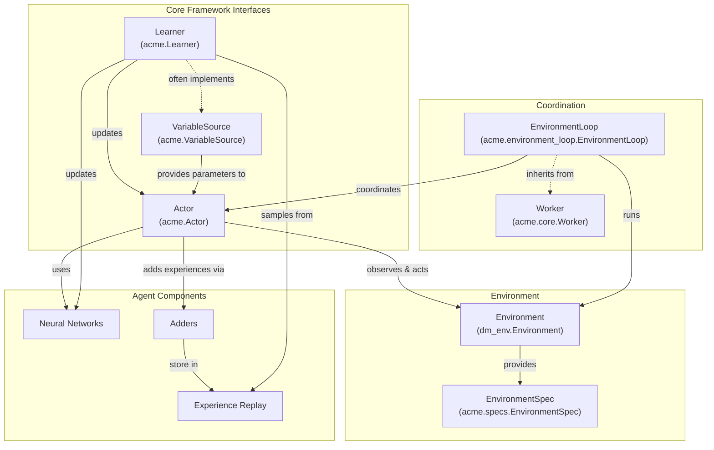
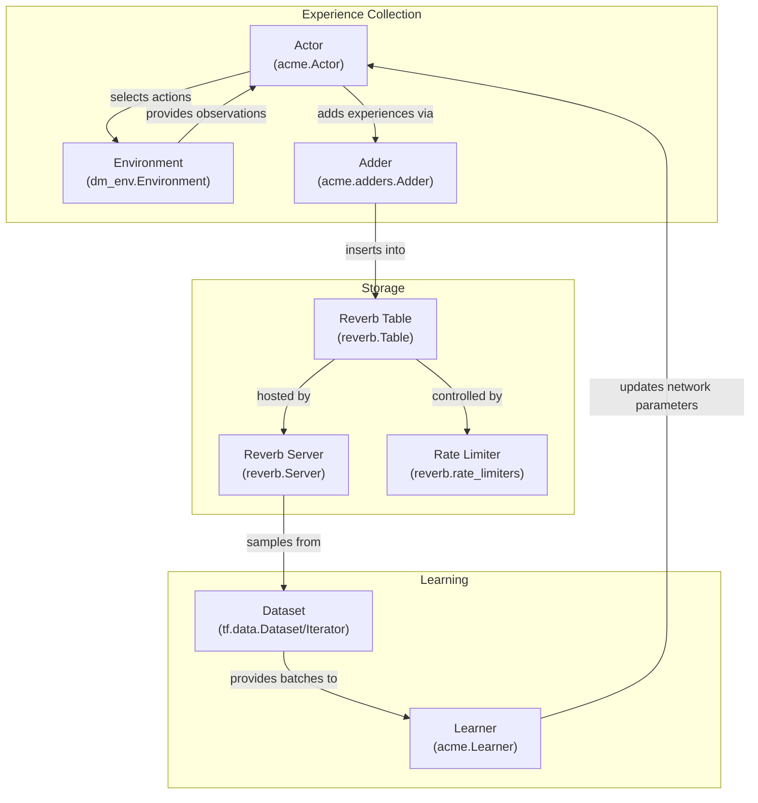
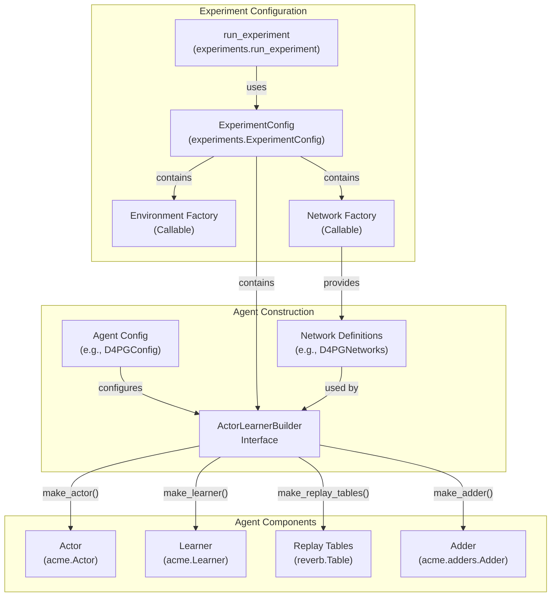
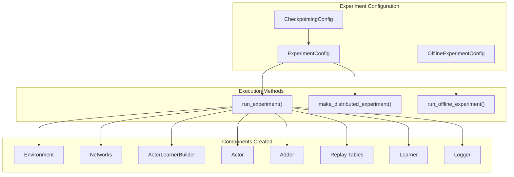
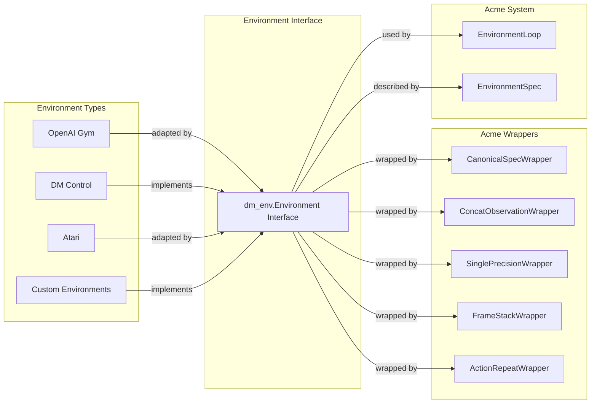
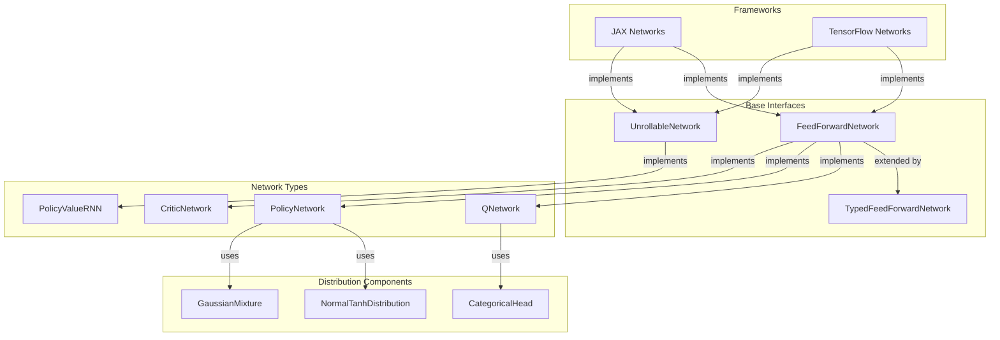

<!-- source: DeepWiki mcp.deepwiki.com · repo google-deepmind/acme · page 1 Overview · fetched 2026-10-26 -->

# Overview

<details>
<summary>Relevant source files</summary>

The following files were used as context for generating this wiki page:

- [.github/workflows/ci.yml](.github/workflows/ci.yml)
- [README.md](README.md)
- [docs/imgs/configure-and-run-experiments.png](docs/imgs/configure-and-run-experiments.png)
- [examples/README.md](examples/README.md)
- [examples/baselines/offline_rl/README.md](examples/baselines/offline_rl/README.md)
- [examples/baselines/rlfd/README.md](examples/baselines/rlfd/README.md)
- [examples/quickstart.ipynb](examples/quickstart.ipynb)
- [examples/tutorial.ipynb](examples/tutorial.ipynb)
- [setup.py](setup.py)
- [test.sh](test.sh)

</details>


Acme is a library of reinforcement learning (RL) agents and agent building blocks that strives to expose simple, efficient, and readable agents. These agents serve both as reference implementations of popular algorithms and as strong baselines, while providing enough flexibility to do novel research. The design of Acme provides multiple entry points to the RL problem at differing levels of complexity.

The framework is distributed as the `dm-acme` package and supports both JAX and TensorFlow backends for neural network computation.

For information about installing and setting up Acme, see [Installation and Setup](#1.2).

Sources: [README.md:16-24](), [setup.py:106-113](), [setup.py:143-146]()

## Framework Design Philosophy

Acme's design offers multiple entry points to reinforcement learning at different levels of abstraction:

1. **High-level experiment runners** - For quickly configuring and running experiments
2. **Mid-level agent implementations** - For using specific RL algorithms
3. **Low-level components** - For building custom agents from reusable pieces

The framework focuses on clarity and readability while maintaining flexibility for research. Acme provides a common, stable interface to environments and agents, which enables consistent experimentation across a variety of algorithms.

Sources: [README.md:25-35](), [README.md:38-41]()

## Core Architecture

The following diagram shows Acme's high-level architecture:



Sources: [acme/__init__.py:27-31](), [acme/environment_loop.py:33-75](), [examples/tutorial.ipynb](), [examples/quickstart.ipynb]()

## Key Components

### Core Interfaces

- **Actor**: Interacts with the environment by selecting actions based on observations
- **Learner**: Performs parameter updates to improve agent behavior
- **VariableSource**: Provides network parameters to actors (many Learners implement this interface)
- **Worker**: Base interface for components that can be run (e.g., EnvironmentLoop)

Sources: [acme/__init__.py:27-31](), [acme/environment_loop.py:33-75]()

### EnvironmentLoop

The `EnvironmentLoop` is a core component that coordinates the interaction between an Actor and an Environment. It handles the flow of actions, observations, and rewards, and keeps track of metrics like episode return and steps per second.

```mermaid
sequenceDiagram
    participant Loop as EnvironmentLoop
    participant Env as Environment
    participant Actor
    participant Counter
    participant Logger

    Loop->>Env: reset()
    Env-->>Loop: first_timestep
    Loop->>Actor: observe_first(timestep)
    
    loop Until episode ends
        Loop->>Actor: select_action(observation)
        Actor-->>Loop: action
        Loop->>Env: step(action)
        Env-->>Loop: timestep
        Loop->>Actor: observe(action, timestep)
        alt should_update is True
            Loop->>Actor: update()
        end
    end
    
    Loop->>Counter: increment(episodes, steps)
    Loop->>Logger: write(results)
```

The environment loop also supports running for a specified number of episodes or steps, making it easy to coordinate training and evaluation.

Sources: [acme/environment_loop.py:76-204](), [acme/environment_loop_test.py]()

### Experience Collection and Replay

Acme uses a system for collecting and replaying experience data through the following components:



The adders take different forms depending on the agent's needs:
- **NStepTransitionAdder**: Adds n-step transitions (used in D4PG, DQN)
- **SequenceAdder**: Adds fixed-length sequences (used in R2D2)
- **EpisodeAdder**: Adds entire episodes (used for some offline methods)

Sources: [examples/tutorial.ipynb:558-563](), [examples/tutorial.ipynb:307-455]()

## Agent Building System

Acme provides a builder pattern to facilitate the construction of agents:



This pattern makes it easy to configure and run experiments with different agents, environments, and networks.

Sources: [examples/quickstart.ipynb:153-171](), [examples/quickstart.ipynb:223-229]()

## Experiment Execution System

Acme's experiment system standardizes the process of setting up and running RL experiments:



The experiment system provides:
- A consistent way to configure experiments
- Support for both online and offline RL
- Easy transition between local and distributed execution
- Common logging and checkpointing functionality

Sources: [examples/quickstart.ipynb:216-261]()

## Implemented Agents

Acme includes implementations of many RL algorithms:

| Agent | Type | Action Space | Key Features |
|-------|------|-------------|--------------|
| DQN Family | Value-based | Discrete | Q-learning with neural networks |
| D4PG | Policy Gradient | Continuous | Distributed, deterministic policy with distributional critic |
| IMPALA | Actor-Critic | Both | Importance-weighted actor-learner architecture |
| R2D2 | Value-based | Discrete | Recurrent replay distributed DQN |
| PPO | Policy Gradient | Both | Proximal policy optimization |
| SAC | Policy Gradient | Continuous | Soft actor-critic with entropy regularization |

Sources: [README.md:18-24](), [acme/agents/tf/r2d2/agent.py:36-43](), [examples/README.md:28-33](), [examples/README.md:42-48]()

## Environment Integration

Acme works with environments following the `dm_env` interface and provides wrappers for adapting common environment formats:



These wrappers help standardize environment interfaces, process observations, and handle different action spaces.

Sources: [examples/quickstart.ipynb:90-103](), [examples/tutorial.ipynb:145-158](), [acme/specs.py:32-48]()

## Neural Network System

Acme provides a flexible system for defining neural networks for RL agents:



This system allows for flexible definition of neural network architectures for RL, with support for both JAX and TensorFlow.

Sources: [examples/tutorial.ipynb:209-246](), [examples/quickstart.ipynb:137-144]()

## Getting Started

To use Acme, you typically:

1. Define an environment (or environment factory)
2. Create network definitions for your chosen agent
3. Configure the agent with appropriate hyperparameters
4. Use the experiment system to run the agent

A simplified example:

```python
# 1. Define environment factory
def make_environment():
    return wrappers.SinglePrecisionWrapper(
        wrappers.CanonicalSpecWrapper(
            wrappers.ConcatObservationWrapper(
                dm_suite.load('cartpole', 'balance'))))

# 2. Define networks
def network_factory(spec):
    return d4pg.make_networks(
        spec,
        policy_layer_sizes=(256, 256),
        critic_layer_sizes=(256, 256))

# 3. Configure the agent
d4pg_config = d4pg.D4PGConfig(learning_rate=3e-4, sigma=0.2)
d4pg_builder = d4pg.D4PGBuilder(d4pg_config)

# 4. Configure and run the experiment
experiment_config = experiments.ExperimentConfig(
    builder=d4pg_builder,
    environment_factory=make_environment,
    network_factory=network_factory,
    seed=0,
    max_num_actor_steps=50_000)

experiments.run_experiment(experiment=experiment_config)
```

For more detailed examples and usage patterns, see the tutorial and quickstart notebooks provided in the examples directory.

Sources: [examples/quickstart.ipynb](), [examples/tutorial.ipynb](), [examples/README.md:3-15]()

---

