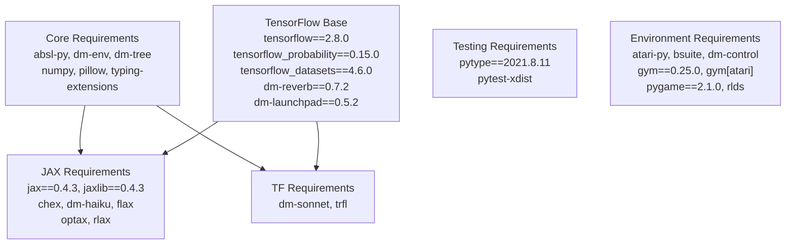
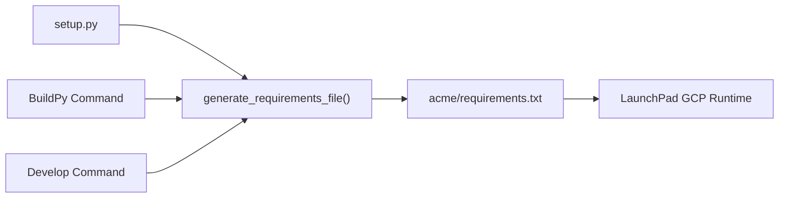
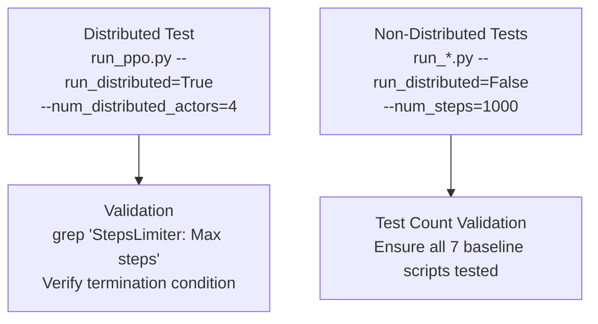
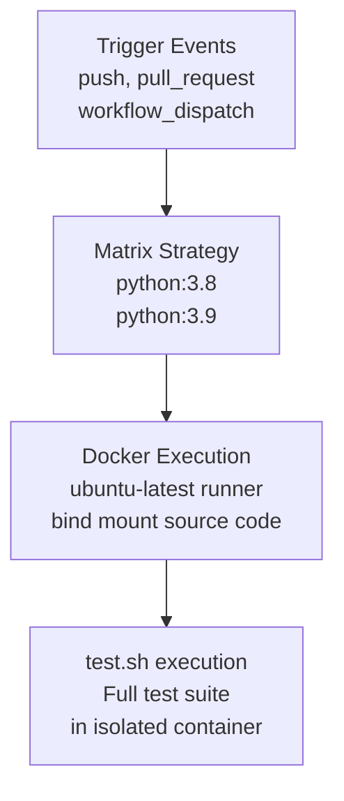

<!-- source: DeepWiki mcp.deepwiki.com · repo google-deepmind/acme · page 1.2 Installation and Setup · fetched 2026-10-26 -->

# Installation and Setup

<details>
<summary>Relevant source files</summary>

The following files were used as context for generating this wiki page:

- [.github/workflows/ci.yml](.github/workflows/ci.yml)
- [examples/baselines/offline_rl/README.md](examples/baselines/offline_rl/README.md)
- [examples/baselines/rlfd/README.md](examples/baselines/rlfd/README.md)
- [setup.py](setup.py)
- [test.sh](test.sh)

</details>


This document covers the installation procedures, dependency management, and development setup for the Acme reinforcement learning framework. It provides guidance on package installation, testing infrastructure, and the continuous integration pipeline used to ensure code quality.

For information about the core architectural concepts and framework components, see [Key Concepts and Architecture](#1.1). For details on experiment configuration and execution, see [Experiment Management and Execution](#6).

## Package Installation

The Acme framework is distributed as the `dm-acme` Python package with a modular dependency structure that allows users to install only the components they need.

### Core Installation

The base installation provides the core framework interfaces and utilities:

```bash
pip install dm-acme
```

This installs the core requirements defined in [setup.py:47-54](), which include essential libraries like `absl-py`, `dm-env`, `dm-tree`, `numpy`, and `pillow`.

### Backend-Specific Installations

Acme supports both JAX and TensorFlow backends through optional dependency groups:

**JAX Backend (Recommended):**
```bash
pip install dm-acme[jax]
```

**TensorFlow Backend:**
```bash
pip install dm-acme[tf]
```

**Full Installation with All Components:**
```bash
pip install dm-acme[jax,tf,testing,envs]
```

Sources: [setup.py:47-84](), [setup.py:155-161]()

## Dependency Architecture

The dependency structure is organized into distinct groups, each serving specific functionality within the framework.



### Version Constraints

The framework maintains strict version pinning for compatibility, particularly between TensorFlow and Reverb components. The `tensorflow` dependency list in [setup.py:39-45]() ensures that Reverb (the distributed replay system) remains compatible with the specified TensorFlow version.

Sources: [setup.py:34-84]()

## Development Setup

### Local Development Environment

For development work, the repository includes a comprehensive setup script that creates an isolated testing environment:

```bash
# Create virtual environment and install all dependencies
./test.sh --deps_only
```

This script performs the following setup operations defined in [test.sh:40-47]():

1. Creates a Python virtual environment named `acme_testing`
2. Upgrades core packaging tools (`pip`, `setuptools`, `wheel`)
3. Installs Acme with all optional dependency groups
4. Includes additional development tools like `xmanager`

### Requirements File Generation

The setup system automatically generates a consolidated requirements file for deployment scenarios:



The `generate_requirements_file()` function in [setup.py:87-104]() creates a unified requirements file by combining all dependency groups, which is used by LaunchPad for distributed deployment scenarios.

Sources: [test.sh:40-47](), [setup.py:87-140]()

## Testing Infrastructure

### Test Execution Framework

The testing system provides comprehensive validation across multiple dimensions:

**Static Type Checking:**
```bash
# Run pytype across all modules
pytype -k -j "${N_CPU}" acme
pytype -k -j "${N_CPU}" examples/
```

**Unit Test Execution:**
```bash
# Run pytest with parallel execution
pytest --ignore-glob="*/*agent*_test.py" --durations=10 -n "${N_CPU}" acme
```

### Test Categories

The test suite is organized into several categories as defined in [test.sh:55-99]():

| Test Category | Scope | Execution Method |
|---------------|--------|------------------|
| Static Analysis | Type checking with `pytype` | Parallel across CPU cores |
| Unit Tests | Core framework components | Parallel `pytest` execution |
| Integration Tests | Baseline algorithm examples | Sequential execution |
| Distributed Tests | Multi-actor scenarios | LaunchPad coordination |

### Example Integration Testing

The testing framework validates baseline implementations by running abbreviated training sessions:



The integration tests in [test.sh:66-99]() verify that baseline algorithms can execute successfully with minimal training steps, ensuring the complete pipeline from environment setup to learning updates functions correctly.

Sources: [test.sh:52-99]()

## Continuous Integration Pipeline

### GitHub Actions Workflow

The CI system uses a matrix strategy to validate compatibility across Python versions:



### CI Configuration Details

The GitHub Actions workflow in [.github/workflows/ci.yml:1-17]() implements the following strategy:

- **Trigger Events**: Executes on push, pull request, and manual dispatch
- **Python Versions**: Tests against Python 3.8 and 3.9 in separate matrix jobs
- **Isolation**: Uses Docker containers to ensure consistent, reproducible builds
- **Mount Strategy**: Bind mounts the source code to `/tmp/acme` within containers

### Build Commands Integration

The setup system includes custom build commands that integrate requirements generation:

```python
class BuildPy(setuptools.command.build_py.build_py):
  def run(self):
    generate_requirements_file()
    setuptools.command.build_py.build_py.run(self)

class Develop(setuptools.command.develop.develop):
  def run(self):
    generate_requirements_file()
    setuptools.command.develop.develop.run(self)
```

These custom commands in [setup.py:124-140]() ensure that the requirements file is regenerated during both package building and development installation, maintaining consistency between local development and deployment environments.

Sources: [.github/workflows/ci.yml:1-17](), [setup.py:124-140]()

---

