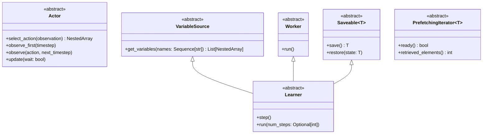
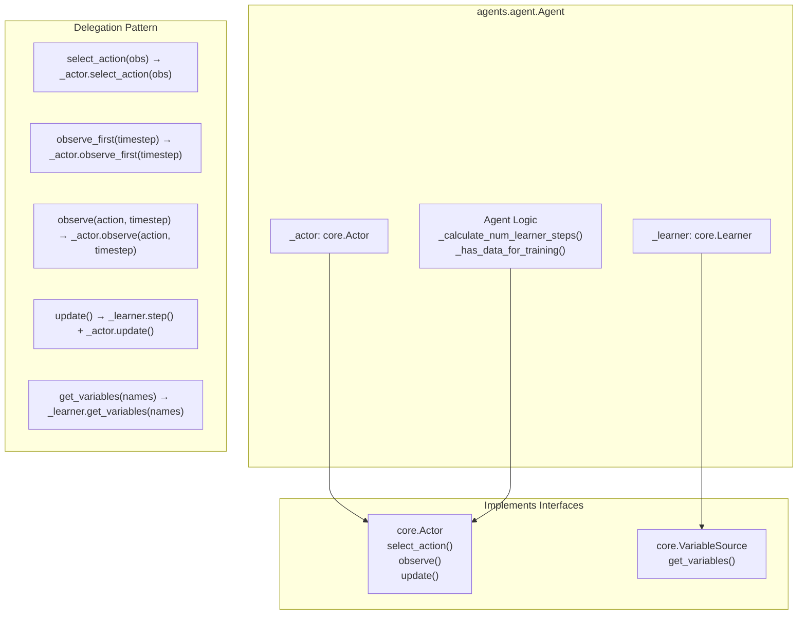
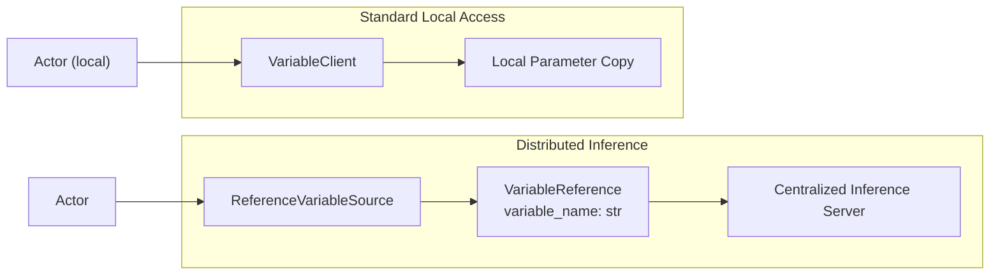
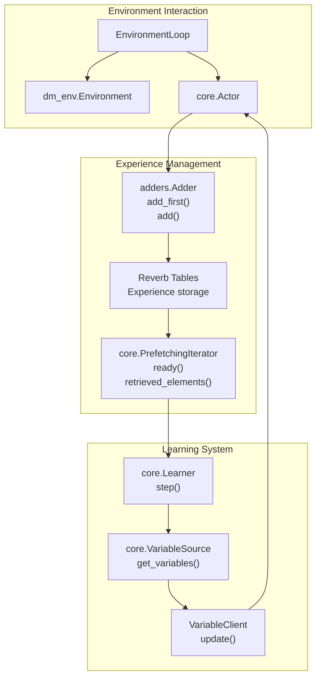
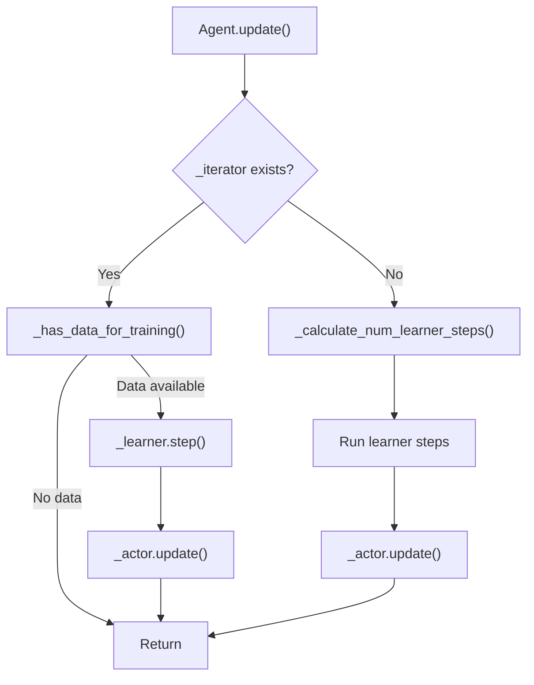
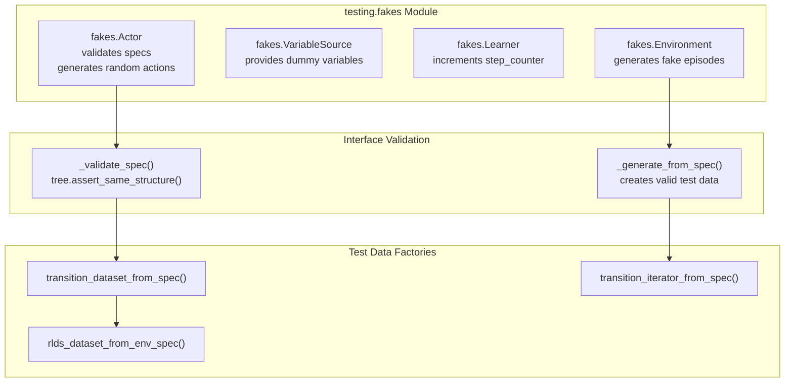
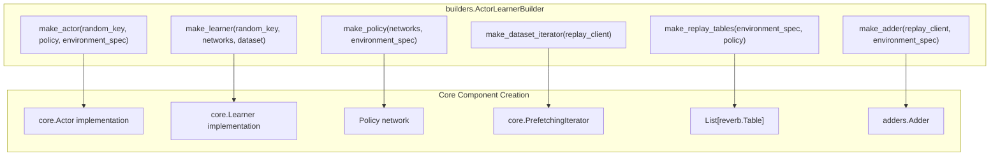

<!-- source: DeepWiki mcp.deepwiki.com · repo google-deepmind/acme · page 2 Core Framework Components · fetched 2026-10-26 -->

# Core Framework Components

<details>
<summary>Relevant source files</summary>

The following files were used as context for generating this wiki page:

- [acme/agents/agent.py](acme/agents/agent.py)
- [acme/agents/jax/ail/builder.py](acme/agents/jax/ail/builder.py)
- [acme/core.py](acme/core.py)
- [acme/jax/variable_utils.py](acme/jax/variable_utils.py)
- [acme/jax/variable_utils_test.py](acme/jax/variable_utils_test.py)
- [acme/testing/fakes.py](acme/testing/fakes.py)

</details>


## Purpose and Scope

This document provides a deep dive into the fundamental building blocks of the Acme reinforcement learning framework. These core framework components establish the architectural foundation that enables modular composition of RL agents, distributed execution, and systematic experimentation.

The framework is built around key abstractions that separate concerns: `Actor` for policy execution, `Learner` for parameter updates, and `VariableSource` for parameter sharing. These interfaces compose into complete agents through the `Agent` class and integrate with environment interaction via `EnvironmentLoop`.

This page provides an overview of the core framework architecture. For detailed coverage of specific components, see:
- Core Interfaces and Agent Composition (page 2.1)
- Environment Loop and Execution (page 2.2) 
- Actor System and Policy Execution (page 2.3)
- Experience Collection and Replay (page 2.4)

## Framework Architecture Overview

The Acme framework separates reinforcement learning into distinct, composable components. The architecture enables both single-process and distributed deployments through clean interface abstractions.

### Core Framework Components

```mermaid
graph TB
    subgraph "Core Interfaces"
        Actor["core.Actor<br/>select_action()<br/>observe()<br/>update()"]
        Learner["core.Learner<br/>step()<br/>get_variables()"]
        VariableSource["core.VariableSource<br/>get_variables()"]
        Worker["core.Worker<br/>run()"]
        Saveable["core.Saveable<br/>save()<br/>restore()"]
    end
    
    subgraph "Agent Composition"
        Agent["agents.agent.Agent<br/>Combines Actor + Learner"]
        EnvironmentLoop["environment_loop.EnvironmentLoop<br/>Actor-Environment orchestration"]
    end
    
    subgraph "Parameter Synchronization"
        VariableClient["variable_utils.VariableClient<br/>Async parameter updates"]
        ReferenceVariableSource["variable_utils.ReferenceVariableSource<br/>Parameter references"]
    end
    
    subgraph "Experience Management"
        Adder["adders.Adder<br/>Experience collection"]
        PrefetchingIterator["core.PrefetchingIterator<br/>Async data loading"]
    end
    
    Learner --|"inherits"| VariableSource
    Learner --|"inherits"| Worker  
    Learner --|"inherits"| Saveable
    Agent --|"implements"| Actor
    Agent --|"implements"| VariableSource
    Agent --> Actor
    Agent --> Learner
    EnvironmentLoop --> Actor
    VariableClient --> VariableSource
    Actor --> Adder
    Learner --> PrefetchingIterator
```

Sources: [acme/core.py:31-177](), [acme/agents/agent.py:43-136](), [acme/jax/variable_utils.py:31-154]()

## Core Interface Definitions

The framework defines abstract interfaces that establish contracts between components. These interfaces enable modular composition and support both local and distributed deployments.

### Primary Interfaces



### Interface Responsibilities

| Interface | File Location | Primary Methods | Purpose |
|-----------|---------------|-----------------|---------|
| `core.Actor` | [acme/core.py:32-87]() | `select_action()`, `observe()`, `update()` | Policy execution and environment interaction |
| `core.Learner` | [acme/core.py:132-165]() | `step()`, `run()`, `get_variables()` | Parameter learning and training loops |
| `core.VariableSource` | [acme/core.py:89-109]() | `get_variables()` | Parameter access and sharing |
| `core.Worker` | [acme/core.py:112-118]() | `run()` | Distributed execution coordination |
| `core.Saveable` | [acme/core.py:120-130]() | `save()`, `restore()` | State persistence and recovery |

Sources: [acme/core.py:31-177]()

## Agent Composition Patterns

The framework provides several composition patterns to combine core interfaces into functional agents.

### Agent Class Composition



The `Agent` class implements the composition pattern by:
- Delegating `Actor` methods to an internal `_actor`
- Delegating `VariableSource` methods to an internal `_learner`
- Coordinating the learning-acting cycle in `update()`
- Managing data availability through `PrefetchingIterator` integration

Sources: [acme/agents/agent.py:43-136]()

## Parameter Synchronization Architecture

The framework provides mechanisms for transferring parameters between distributed components, enabling asynchronous learning and acting.

### VariableClient Integration Pattern

```mermaid
sequenceDiagram
    participant Actor as "core.Actor"
    participant VC as "VariableClient"
    participant VS as "VariableSource<br/>(Learner)"
    participant Device as "JAX Device"
    
    Actor->>VC: update(wait=False)
    VC->>VC: Check update_period
    alt Update period reached
        VC->>VS: get_variables(key)
        VS-->>VC: List[NestedArray]
        VC->>Device: jax.device_put(params)
        Device-->>VC: device_params
        VC->>VC: _params = device_params
    end
    Actor->>VC: params (property access)
    VC-->>Actor: current parameters
```

### Variable Reference System

For distributed inference, the framework provides reference-based parameter access:



Sources: [acme/jax/variable_utils.py:31-154]()

## Data Flow Integration

The framework integrates experience collection, learning, and parameter synchronization into a unified data flow.

### Experience Collection and Learning Pipeline



### Agent Update Control Logic

The `Agent` class implements sophisticated control logic for balancing data collection and learning:



Sources: [acme/agents/agent.py:94-134]()

## Framework Testing and Validation

The framework provides comprehensive testing infrastructure through fake implementations that validate interface contracts.

### Testing Components Architecture



The testing framework ensures:
- Spec validation for observations, actions, rewards, and discounts
- Interface compliance testing for all core components
- Consistent data generation for testing agent implementations
- Integration testing support through complete fake environments

Sources: [acme/testing/fakes.py:36-475]()

## Framework Extension Patterns

The core framework supports extension through well-defined patterns that maintain interface compatibility while enabling algorithm-specific customizations.

### Builder Pattern Integration



### Component Lifecycle Management

The framework manages component lifecycles through standardized patterns:

| Component | Initialization | Runtime | Cleanup |
|-----------|---------------|---------|---------|
| `VariableClient` | Configure update period, device placement | Async parameter fetching via `ThreadPoolExecutor` | Executor shutdown |
| `core.Learner` | Initialize optimizers, networks | `step()` calls with data batching | `save()` state persistence |
| `core.Actor` | Load initial parameters | `select_action()`, `observe()` calls | Final `update()` call |

Sources: [acme/agents/jax/ail/builder.py:151-332](), [acme/jax/variable_utils.py:46-154]()

## Summary

The core components of Acme provide a modular framework for building reinforcement learning agents:

| Component | Purpose | Key Interfaces |
|-----------|---------|----------------|
| Actor | Policy execution and environment interaction | `select_action`, `observe`, `update` |
| Learner | Parameter updates and training | `step`, `run`, `get_variables` |
| VariableSource | Parameter access | `get_variables` |
| VariableClient | Parameter synchronization | `update`, `update_and_wait` |
| EnvironmentLoop | Agent-environment interaction orchestration | `run_episode`, `run` |

These components can be combined in various ways to create different types of agents, supporting both simple single-process deployments and complex distributed systems.

Sources: [acme/core.py](acme/core.py), [acme/environment_loop.py](acme/environment_loop.py), [acme/jax/variable_utils.py](acme/jax/variable_utils.py)

---

