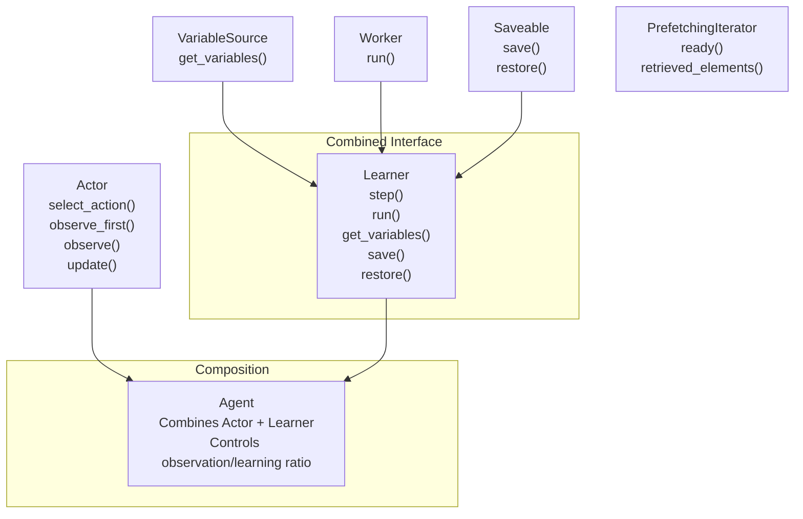
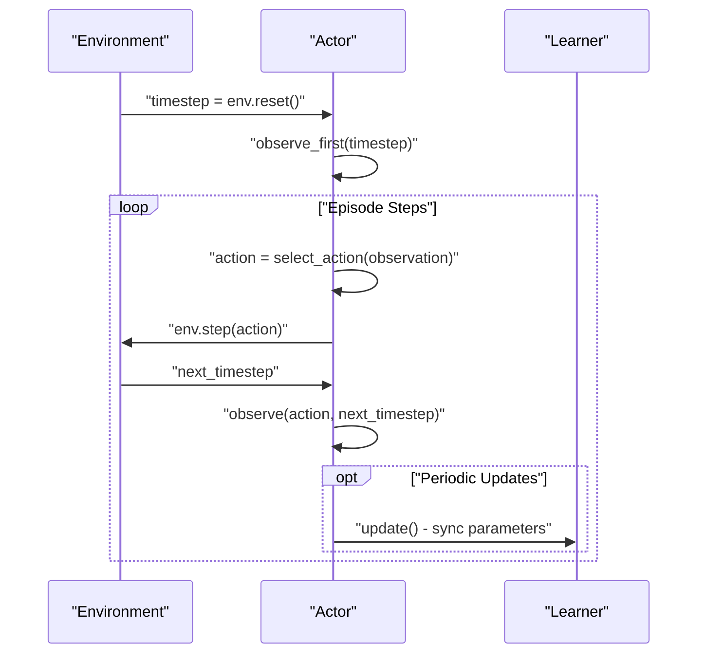
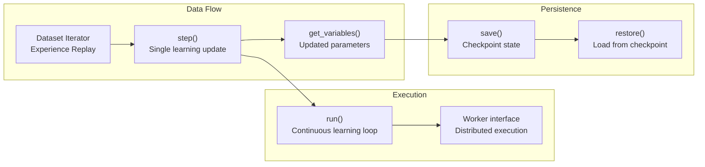
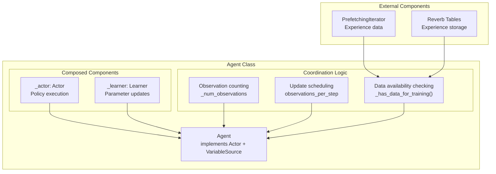
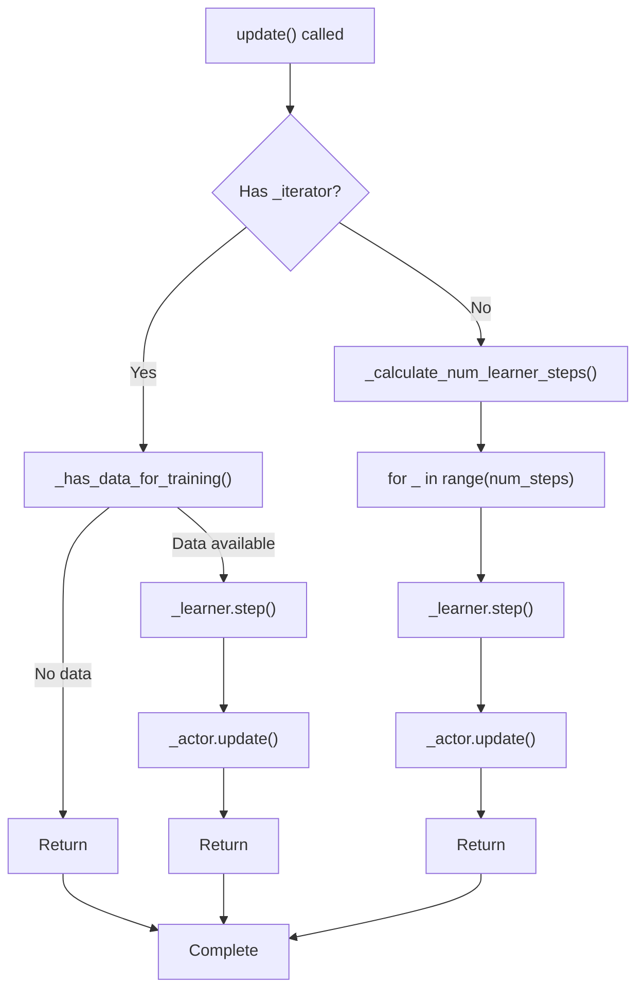
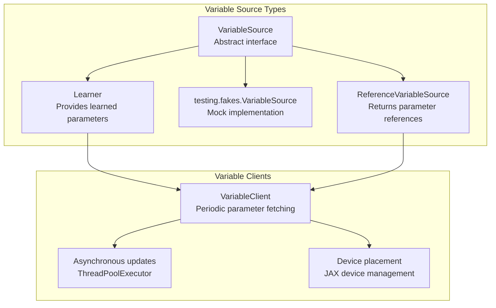
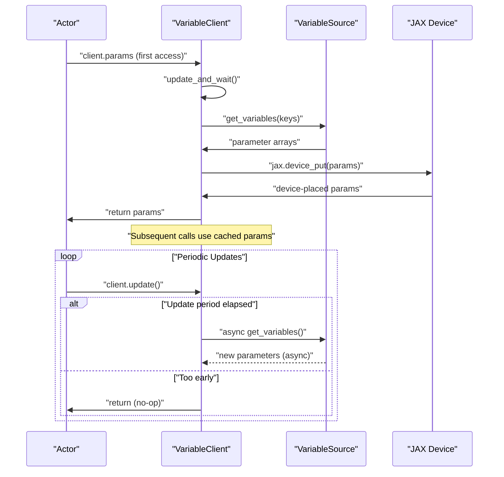
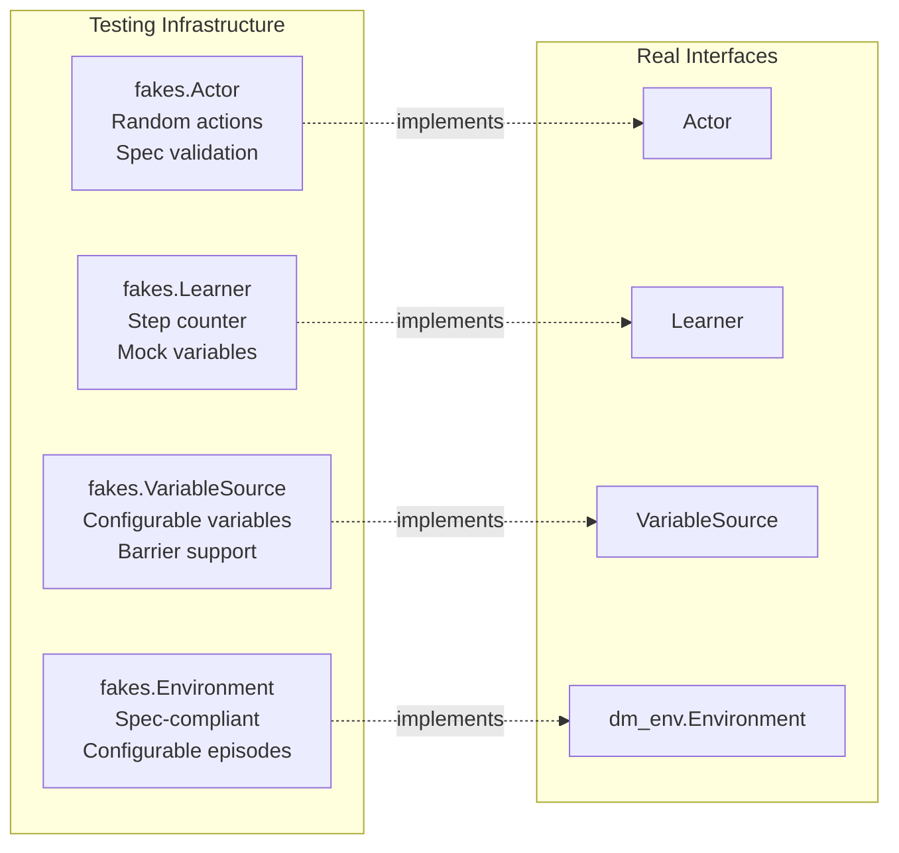
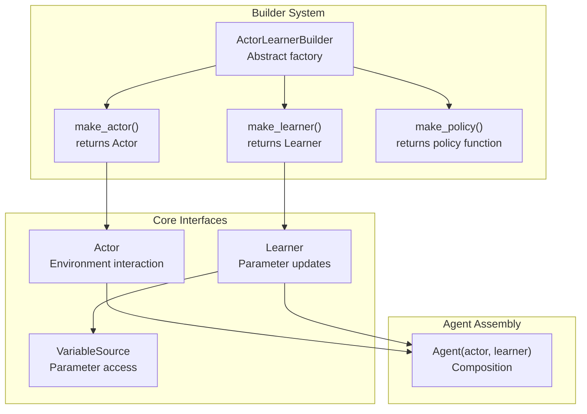

<!-- source: DeepWiki mcp.deepwiki.com · repo google-deepmind/acme · page 2.1 Core Interfaces and Agent Composition · fetched 2026-10-26 -->

# Core Interfaces and Agent Composition

Relevant source files

The following files were used as context for generating this wiki page:

- [acme/agents/agent.py](acme/agents/agent.py)
- [acme/agents/jax/ail/builder.py](acme/agents/jax/ail/builder.py)
- [acme/core.py](acme/core.py)
- [acme/jax/variable_utils.py](acme/jax/variable_utils.py)
- [acme/jax/variable_utils_test.py](acme/jax/variable_utils_test.py)
- [acme/testing/fakes.py](acme/testing/fakes.py)

This document covers the fundamental interfaces that define Acme's architecture and how they compose to form complete reinforcement learning agents. It explains the `Actor`, `Learner`, `VariableSource` abstractions and the `Agent` class that combines them into a cohesive system.

For environment interaction mechanics, see [Environment Loop and Execution](#2.2). For specific actor implementations, see [Actor System and Policy Execution](#2.3). For learning algorithm implementations, see [Reinforcement Learning Agents](#4).

## Core Interface Hierarchy

Acme's architecture is built around several key abstract interfaces that define clean separation of concerns for reinforcement learning components.

### Primary Interfaces

The core interfaces form a hierarchy of capabilities:

**Sources:** [acme/core.py:32-177]()

| Interface | Purpose | Key Methods |
|-----------|---------|-------------|
| `Actor` | Policy execution and environment interaction | `select_action()`, `observe()`, `update()` |
| `VariableSource` | Provides access to model parameters | `get_variables()` |
| `Worker` | Defines runnable components | `run()` |
| `Saveable` | Checkpointing and persistence | `save()`, `restore()` |
| `Learner` | Combines learning, variables, and execution | `step()`, inherits from above |

### Actor Interface

The `Actor` interface defines the contract for policy execution:

**Sources:** [acme/core.py:32-87](), [acme/testing/fakes.py:36-62]()

The `Actor` interface methods serve specific purposes:
- `select_action()`: Sample actions from the current policy
- `observe_first()`: Initialize trajectory recording
- `observe()`: Record environment transitions  
- `update()`: Synchronize with learner parameters

### Learner Interface

The `Learner` combines multiple interfaces to provide learning functionality:

**Sources:** [acme/core.py:132-165](), [acme/testing/fakes.py:84-95]()

## Agent Composition Pattern

The `Agent` class demonstrates Acme's composition-over-inheritance approach by combining `Actor` and `Learner` instances.

### Agent Architecture

**Sources:** [acme/agents/agent.py:43-137]()

### Agent Method Delegation

The `Agent` class delegates interface methods while adding coordination logic:

| Method | Implementation | Purpose |
|--------|----------------|---------|
| `select_action()` | `return self._actor.select_action(observation)` | Direct delegation |
| `observe_first()` | `self._actor.observe_first(timestep)` | Direct delegation |
| `observe()` | Increment counter + `self._actor.observe()` | Adds observation counting |
| `update()` | Complex logic coordinating actor/learner | Controls learning frequency |
| `get_variables()` | `return self._learner.get_variables(names)` | Direct delegation |

**Sources:** [acme/agents/agent.py:75-136]()

### Update Coordination Logic

The `Agent.update()` method implements sophisticated coordination between acting and learning:

**Sources:** [acme/agents/agent.py:94-134](), [acme/agents/agent.py:27-41]()

## Variable Synchronization System

Acme provides a sophisticated system for sharing parameters between distributed components.

### VariableSource Implementations

**Sources:** [acme/core.py:89-109](), [acme/jax/variable_utils.py:31-44](), [acme/jax/variable_utils.py:46-155](), [acme/testing/fakes.py:64-82]()

### Variable Client Pattern

The `VariableClient` implements efficient parameter synchronization:

**Sources:** [acme/jax/variable_utils.py:88-155]()

## Interface Implementation Patterns

### Fake Implementations for Testing

Acme provides comprehensive fake implementations that demonstrate interface contracts:

**Sources:** [acme/testing/fakes.py:36-95](), [acme/testing/fakes.py:97-304]()

The fake implementations serve multiple purposes:
- **Contract validation**: Ensure proper interface compliance
- **Testing infrastructure**: Enable isolated component testing  
- **Development aids**: Provide working examples of interface implementation
- **Specification documentation**: Show expected behavior patterns

### Builder Pattern Integration

The core interfaces integrate with Acme's builder pattern for agent construction:

**Sources:** [acme/agents/jax/ail/builder.py:151-332]()

This demonstrates how the core interfaces provide the foundation for Acme's modular agent construction system, enabling flexible composition of different algorithms and components while maintaining clean abstractions.

---

