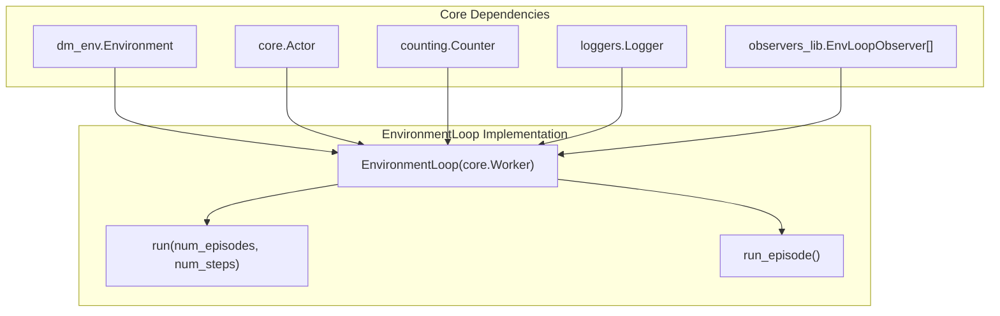
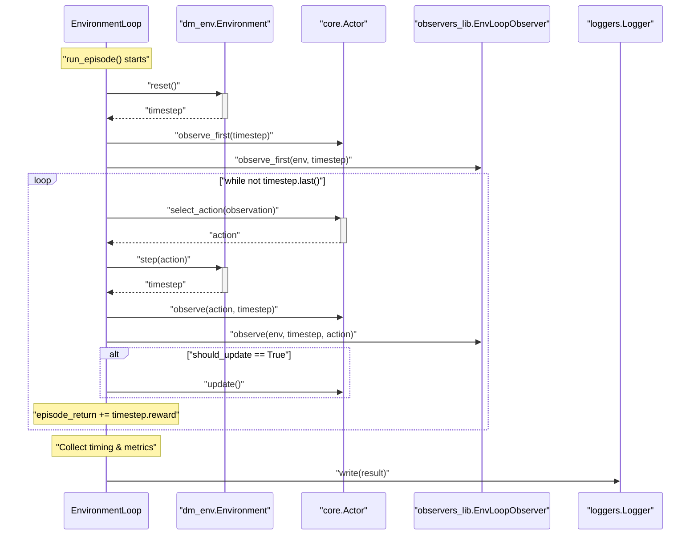
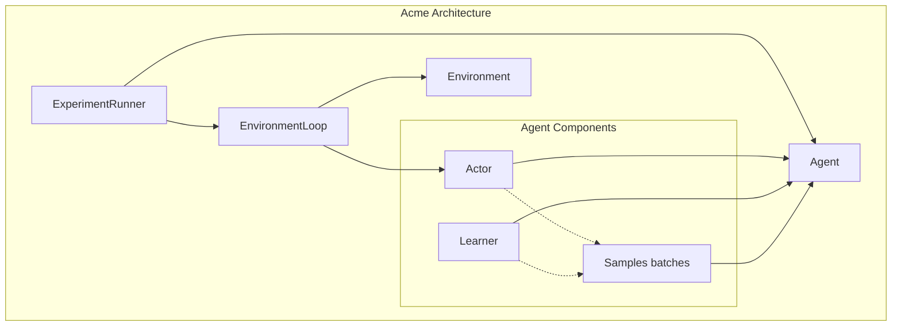
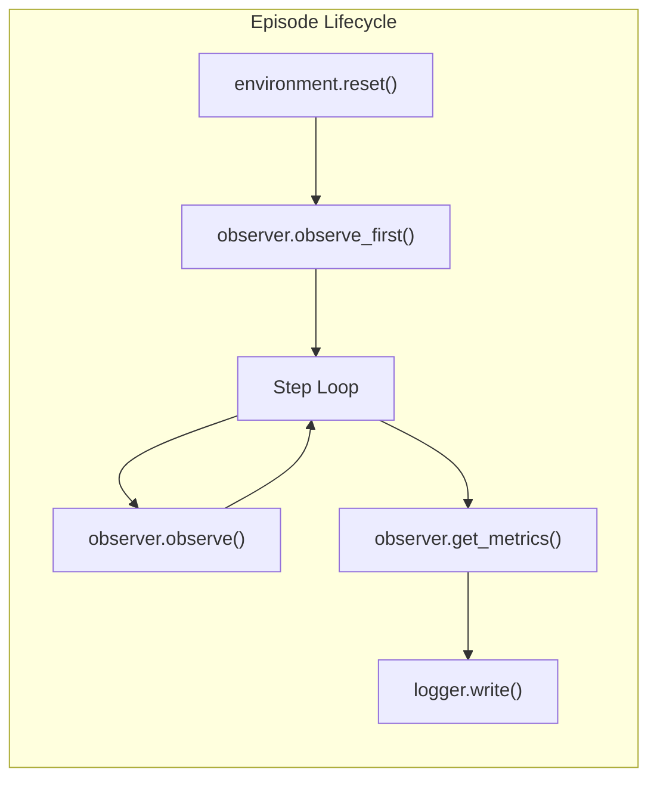

<!-- source: DeepWiki mcp.deepwiki.com · repo google-deepmind/acme · page 2.2 Environment Loop and Execution · fetched 2026-10-26 -->

# Environment Loop and Execution

<details>
<summary>Relevant source files</summary>

The following files were used as context for generating this wiki page:

- [acme/__init__.py](acme/__init__.py)
- [acme/_metadata.py](acme/_metadata.py)
- [acme/agents/tf/r2d2/agent.py](acme/agents/tf/r2d2/agent.py)
- [acme/agents/tf/r2d2/agent_test.py](acme/agents/tf/r2d2/agent_test.py)
- [acme/agents/tf/r2d2/learning.py](acme/agents/tf/r2d2/learning.py)
- [acme/environment_loop.py](acme/environment_loop.py)
- [acme/environment_loop_test.py](acme/environment_loop_test.py)
- [acme/specs.py](acme/specs.py)

</details>


The `EnvironmentLoop` class is a core execution component in Acme that coordinates the interaction between `Actor` and `dm_env.Environment` instances. It implements the standard reinforcement learning loop with comprehensive timing metrics, episode management, and extensible observation patterns.

This page covers the `EnvironmentLoop` implementation, execution patterns, and metrics collection. For information about experiment frameworks that utilize environment loops, see [Experiment Management and Execution](#6).

## Core Concepts

The Environment Loop implements the standard reinforcement learning loop where:

1. The environment provides an observation
2. The agent selects an action based on that observation
3. The environment transitions based on the action, providing a new observation and reward
4. The agent observes this transition (and optionally updates its policy)
5. Steps 2-4 repeat until episode termination

This cycle is essential for any reinforcement learning agent to learn and improve its performance over time.

## Architecture

The Environment Loop connects an environment with an agent (actor) and manages their interaction.

### EnvironmentLoop Class Architecture



Sources: [acme/environment_loop.py:33-74]()

### Episode Execution Sequence



Sources: [acme/environment_loop.py:96-157]()

## Usage in Acme Architecture

The Environment Loop is typically used as part of the broader Acme architecture:



Sources: [examples/tutorial.ipynb](https://github.com/google-deepmind/acme/blob/master/examples/tutorial.ipynb), [examples/quickstart.ipynb](https://github.com/google-deepmind/acme/blob/master/examples/quickstart.ipynb)

## Using the Environment Loop

### EnvironmentLoop Construction

The `EnvironmentLoop` constructor requires a `dm_env.Environment` and `core.Actor`:

```python
from acme import EnvironmentLoop

# Minimal construction  
loop = EnvironmentLoop(environment, actor)
```

Full constructor with optional components:

```python
loop = EnvironmentLoop(
    environment=environment,
    actor=actor,
    counter=counter,                    # counting.Counter for metrics
    logger=logger,                      # loggers.Logger for output
    should_update=True,                 # Enable actor.update() calls
    label='environment_loop',           # Logger label
    observers=observers                 # Sequence[EnvLoopObserver]
)
```

Sources: [acme/environment_loop.py:57-74]()

### Running Episodes

There are two main methods to run the Environment Loop:

#### `run_episode()` Method

The `run_episode()` method executes a single episode and returns comprehensive metrics:

```python
result: loggers.LoggingData = loop.run_episode()
# Returns dict with keys: episode_length, episode_return, steps_per_second, 
# env_reset_duration_sec, select_action_duration_sec, env_step_duration_sec
```

#### `run(num_episodes=None, num_steps=None)` Method

The `run()` method executes multiple episodes with termination control:

```python
# Run exactly 10 episodes
total_steps: int = loop.run(num_episodes=10)

# Run until at least 1000 steps (completing current episode)
total_steps: int = loop.run(num_steps=1000)
```

The method enforces mutual exclusion: exactly one of `num_episodes` or `num_steps` must be `None`. It uses `signals.runtime_terminator()` for graceful shutdown handling.

Sources: [acme/environment_loop.py:76-157](), [acme/environment_loop.py:159-205]()

## Environment Loop Parameters

### Constructor Parameters

| Parameter | Type | Description |
|-----------|------|-------------|
| `environment` | `dm_env.Environment` | Environment with which the agent interacts |
| `actor` | `acme.core.Actor` | Agent that interacts with the environment |
| `counter` | `counting.Counter` | Optional counter for metrics |
| `logger` | `loggers.Logger` | Optional logger for metrics |
| `should_update` | `bool` | Whether to update the agent after each step |
| `label` | `str` | Label for the default logger if none provided |
| `observers` | `Sequence[observers_lib.EnvLoopObserver]` | Optional observers for additional metrics |

Sources: [acme/environment_loop.py:57-74](https://github.com/google-deepmind/acme/blob/master/acme/environment_loop.py)

### Metrics Collection

The `EnvironmentLoop` collects detailed performance and timing metrics:

| Metric | Type | Description |
|--------|------|-------------|
| `episode_length` | `int` | Number of environment steps in episode |
| `episode_return` | `tree structure` | Cumulative reward (matches reward_spec shape) |
| `steps_per_second` | `float` | Environment interaction rate |
| `env_reset_duration_sec` | `float` | Time for environment.reset() |
| `select_action_duration_sec` | `float` | Mean time for actor.select_action() |
| `env_step_duration_sec` | `float` | Mean time for environment.step() |
| `episode_duration` | `float` | Total episode execution time |
| `episodes` | `int` | Counter: total episodes completed |
| `steps` | `int` | Counter: total steps executed |

Additional metrics from observers are merged via `observer.get_metrics()`.

Sources: [acme/environment_loop.py:88-157](), [acme/environment_loop.py:155-156]()

## Examples

### Basic Usage

```python
# Create environment and actor
environment = ...  # A dm_env.Environment instance
actor = ...       # An acme.core.Actor instance

# Create the loop
loop = EnvironmentLoop(environment, actor)

# Run for 10 episodes
loop.run(num_episodes=10)
```

### With Logging

```python
from acme.utils import loggers

# Create a logger
logger = loggers.InMemoryLogger()

# Create the loop with the logger
loop = EnvironmentLoop(environment, actor, logger=logger)

# Run episodes
loop.run(num_episodes=10)

# Access logged data
for entry in logger.data:
    print(entry)
```

Sources: [examples/tutorial.ipynb:645-653](https://github.com/google-deepmind/acme/blob/master/examples/tutorial.ipynb), [examples/tutorial.ipynb:677](https://github.com/google-deepmind/acme/blob/master/examples/tutorial.ipynb)

### In Experiment Context

Within the broader experiment framework, the Environment Loop is typically created and run by an experiment runner:

```python
from acme.jax import experiments

# Configure the experiment
experiment_config = experiments.ExperimentConfig(
    builder=agent_builder,
    environment_factory=make_environment,
    network_factory=network_factory,
    logger_factory=logger_factory,
    max_num_actor_steps=50_000
)

# Run the experiment (which creates and runs the environment loop)
experiments.run_experiment(experiment_config)
```

Sources: [examples/quickstart.ipynb:223-261](https://github.com/google-deepmind/acme/blob/master/examples/quickstart.ipynb)

## Observer Pattern Integration

### EnvLoopObserver Interface

The `observers_lib.EnvLoopObserver` protocol enables custom metric collection:

| Method | Signature | Purpose |
|--------|-----------|---------|
| `observe_first` | `(env, timestep) -> None` | Initialize observer state at episode start |
| `observe` | `(env, timestep, action) -> None` | Record step-level observations |
| `get_metrics` | `() -> Dict[str, Any]` | Return metrics dict for logging |

### Observer Integration Points



Observers receive full environment access, enabling domain-specific monitoring beyond standard RL metrics.

Sources: [acme/environment_loop.py:101-104](), [acme/environment_loop.py:123-126](), [acme/environment_loop.py:155-156]()

## Summary

The Environment Loop is a central component in the Acme framework that orchestrates the interaction between agents and environments. It follows the standard reinforcement learning loop paradigm and provides flexible options for running experiments, collecting metrics, and monitoring performance. By understanding how to create and use Environment Loops, you can effectively set up and run reinforcement learning experiments with the Acme framework.

---

