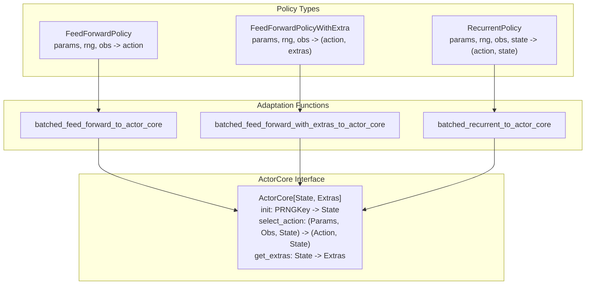
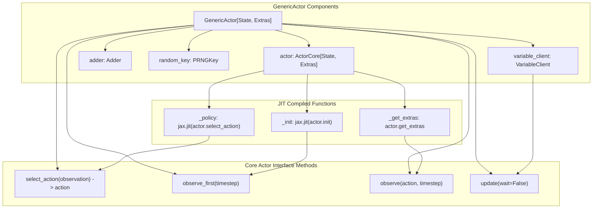

<!-- source: DeepWiki mcp.deepwiki.com · repo google-deepmind/acme · page 2.3 Actor System and Policy Execution · fetched 2026-10-26 -->

# Actor System and Policy Execution

<details>
<summary>Relevant source files</summary>

The following files were used as context for generating this wiki page:

- [acme/agents/jax/__init__.py](acme/agents/jax/__init__.py)
- [acme/agents/jax/actor_core.py](acme/agents/jax/actor_core.py)
- [acme/agents/jax/actors.py](acme/agents/jax/actors.py)
- [acme/agents/jax/actors_test.py](acme/agents/jax/actors_test.py)

</details>


This document covers the actor system implementation in Acme's JAX framework, focusing on the `GenericActor` class, the `ActorCore` interface, and policy adaptation patterns that enable different types of neural network policies to work within the actor-learner framework. For information about the abstract `Actor` interface and agent composition patterns, see [Core Interfaces and Agent Composition](#2.1). For details on how actors interact with environments through the coordination layer, see [Environment Loop and Execution](#2.2).

## ActorCore Interface and Adaptation Layer

The `ActorCore` interface serves as an adaptation layer that standardizes different types of neural network policies into a common interface that can be used by the `GenericActor` implementation.

### ActorCore Structure

The `ActorCore` interface defines three pure functions that encapsulate algorithm-specific actor functionality:

| Function | Purpose | Signature |
|----------|---------|-----------|
| `init` | Initialize actor state | `Callable[[PRNGKey], State]` |
| `select_action` | Select action given params, observation, state | `SelectActionFn` |
| `get_extras` | Extract extras from current state | `Callable[[State], Extras]` |

The interface is generic over two type parameters:
- `State`: The internal state of the actor (e.g., RNG keys, recurrent state)
- `Extras`: Additional data to be stored with experiences (e.g., action values, core states)



Sources: [acme/agents/jax/actor_core.py:41-46](), [acme/agents/jax/actor_core.py:51-64]()

### Policy Adaptation Patterns

The framework provides three main adaptation patterns to convert different policy types into the `ActorCore` interface:

**Feed-Forward Policy Adaptation**
- Function: `batched_feed_forward_to_actor_core`
- Converts policies that take `(params, rng, observation) -> action`
- State type: `PRNGKey` 
- Extras type: `Tuple[()]` (empty)
- Handles batch dimension addition/removal and RNG splitting

**Feed-Forward with Extras Adaptation**  
- Function: `batched_feed_forward_with_extras_to_actor_core`
- Converts policies that return `(action, extras)` tuples
- State type: `SimpleActorCoreStateWithExtras`
- Extras type: `Mapping[str, jnp.ndarray]`
- Preserves additional information like action values for experience replay

**Recurrent Policy Adaptation**
- Function: `batched_recurrent_to_actor_core`
- Converts policies with internal recurrent state (e.g., LSTM)
- State type: `SimpleActorCoreRecurrentState[RecurrentState]`
- Extras type: `Mapping[str, jnp.ndarray]` with core state
- Manages both RNG state and recurrent network state

Sources: [acme/agents/jax/actor_core.py:67-86](), [acme/agents/jax/actor_core.py:113-134](), [acme/agents/jax/actor_core.py:143-170]()

## GenericActor Implementation

The `GenericActor` class provides a concrete implementation of the `core.Actor` interface built on top of the `ActorCore` abstraction. It handles parameter synchronization, experience collection, JIT compilation, and state management.

### GenericActor Architecture



Sources: [acme/agents/jax/actors.py:30-36](), [acme/agents/jax/actors.py:38-73]()

### Key Features and Configuration

**JIT Compilation**
- Optional JIT compilation of `init` and `select_action` functions for performance
- Configurable backend selection (`'cpu'` by default)
- Controlled via `jit` and `backend` constructor parameters

**Variable Synchronization Modes**
- **Continuous Update**: Parameters updated on every `update()` call (default)
- **Per-Episode Update**: Parameters updated once per episode via `per_episode_update=True`
- Synchronization handled through `VariableClient` integration

**Experience Collection Integration**
- Optional `Adder` for automatic experience replay integration
- Extras from `ActorCore` automatically included in stored experiences
- Seamless integration with Reverb-based replay systems

Sources: [acme/agents/jax/actors.py:44-46](), [acme/agents/jax/actors.py:66-73](), [acme/agents/jax/actors.py:87-99]()

## Actor Execution Flow

The following diagram illustrates how the `GenericActor` executes during environment interaction, showing the integration between policy execution, state management, parameter updates, and experience collection:

```mermaid
sequenceDiagram
    participant EnvLoop as "EnvironmentLoop"
    participant Actor as "GenericActor"
    participant ActorCore as "ActorCore"
    participant VarClient as "VariableClient"
    participant Adder as "Adder"
    
    Note over EnvLoop: Episode Start
    EnvLoop->>Actor: observe_first(timestep)
    Actor->>Actor: split random_key
    Actor->>ActorCore: init(rng) -> state
    Actor->>Adder: add_first(timestep)
    
    alt per_episode_update=True
        Actor->>VarClient: update_and_wait()
    end
    
    loop Environment Steps
        EnvLoop->>Actor: select_action(observation)
        Actor->>VarClient: get params
        Actor->>ActorCore: select_action(params, obs, state)
        ActorCore-->>Actor: (action, new_state)
        Actor->>Actor: to_numpy(action)
        Actor-->>EnvLoop: action
        
        EnvLoop->>Actor: observe(action, next_timestep)
        Actor->>ActorCore: get_extras(state)
        Actor->>Adder: add(action, timestep, extras)
        
        alt per_episode_update=False
            EnvLoop->>Actor: update()
            Actor->>VarClient: update(wait=False)
        end
    end
```

Sources: [acme/agents/jax/actors.py:79-99](), [acme/agents/jax/actors.py:84-95]()

## State Management and Batching

The `ActorCore` interface and its adaptations handle the complexity of managing different types of actor state while providing consistent batching behavior:

### State Types and Management

| Adaptation Pattern | State Type | State Contents | Batch Handling |
|-------------------|------------|----------------|----------------|
| Feed-Forward | `PRNGKey` | Random number generator state | Auto-batching via `utils.add_batch_dim` |
| Feed-Forward + Extras | `SimpleActorCoreStateWithExtras` | RNG + extras mapping | Batch dimension handling in select_action |
| Recurrent | `SimpleActorCoreRecurrentState` | RNG + recurrent network state | Batch/unbatch recurrent state automatically |

**Batch Dimension Management**
The adaptation functions automatically handle batch dimension addition and removal, allowing policies to be written assuming batched inputs while the `GenericActor` works with unbatched observations from the environment.

**Unvectorized Operation**
The `unvectorize_select_action` utility function can convert batched `ActorCore` implementations to work with unbatched inputs, providing flexibility in how policies are implemented and used.

Sources: [acme/agents/jax/actor_core.py:89-93](), [acme/agents/jax/actor_core.py:137-141](), [acme/agents/jax/actor_core.py:95-110]()

## Integration Patterns

The actor system integrates with several other framework components through well-defined interfaces:

**Variable Synchronization**
- Uses `VariableClient` for parameter synchronization with learners
- Supports both immediate and lazy parameter updates
- Thread-safe parameter access through the client abstraction

**Experience Collection** 
- Integrates with Reverb through the `Adder` interface
- Automatically includes extras from `ActorCore` in experience data
- Supports different adder types (N-step, sequence, episode-based)

**Network Integration**
- Works with JAX/Haiku neural networks through the adaptation layer
- Supports both stateless and stateful (recurrent) network architectures
- Automatic JIT compilation for performance optimization

Sources: [acme/agents/jax/actors.py:40-43](), [acme/agents/jax/actors.py:92-95](), [acme/agents/jax/actors.py:66-71]()

---

