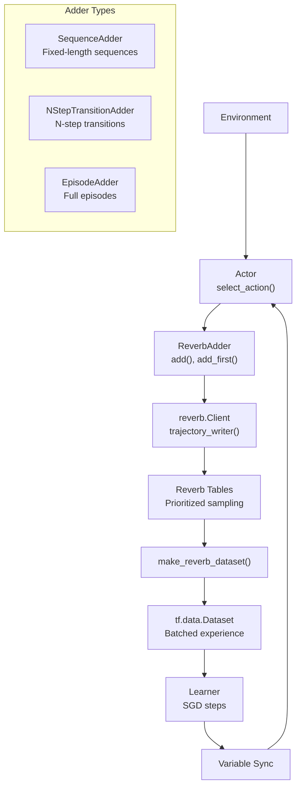
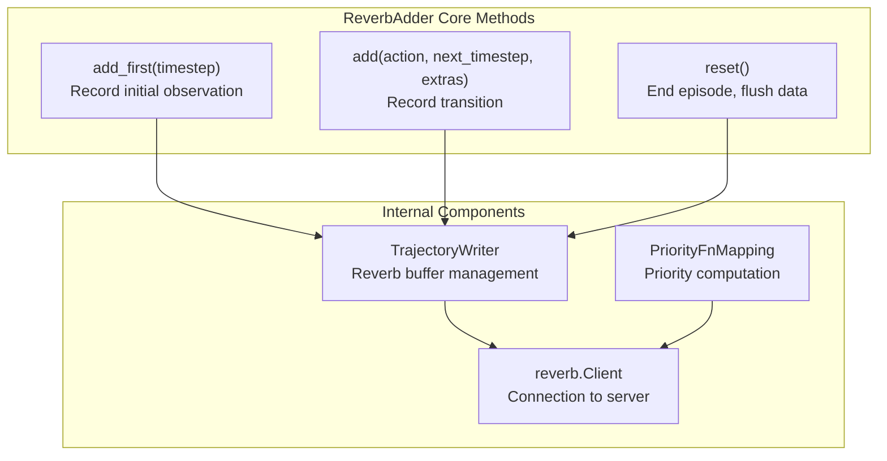
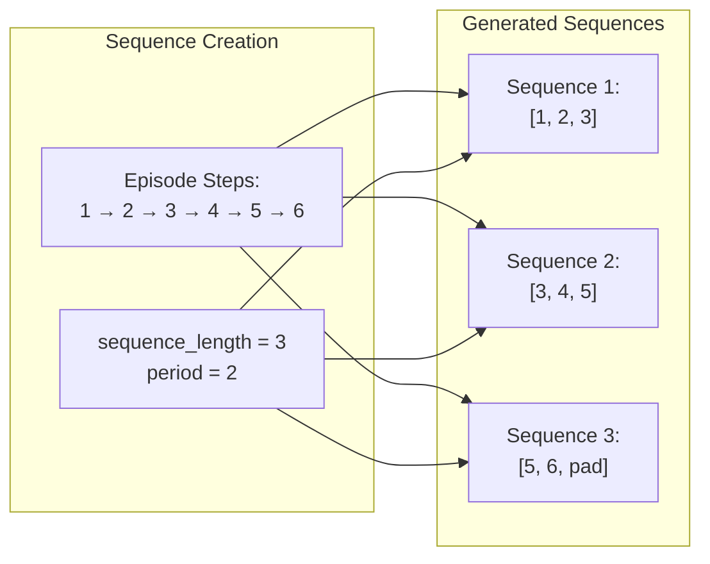
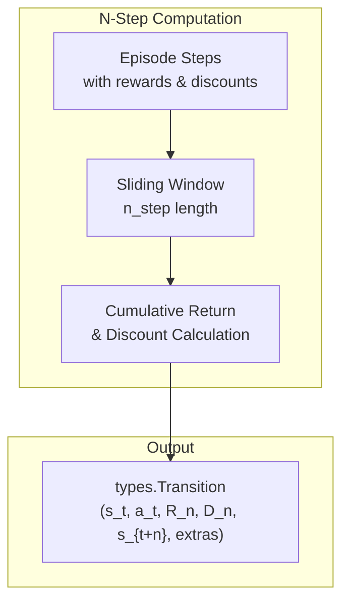
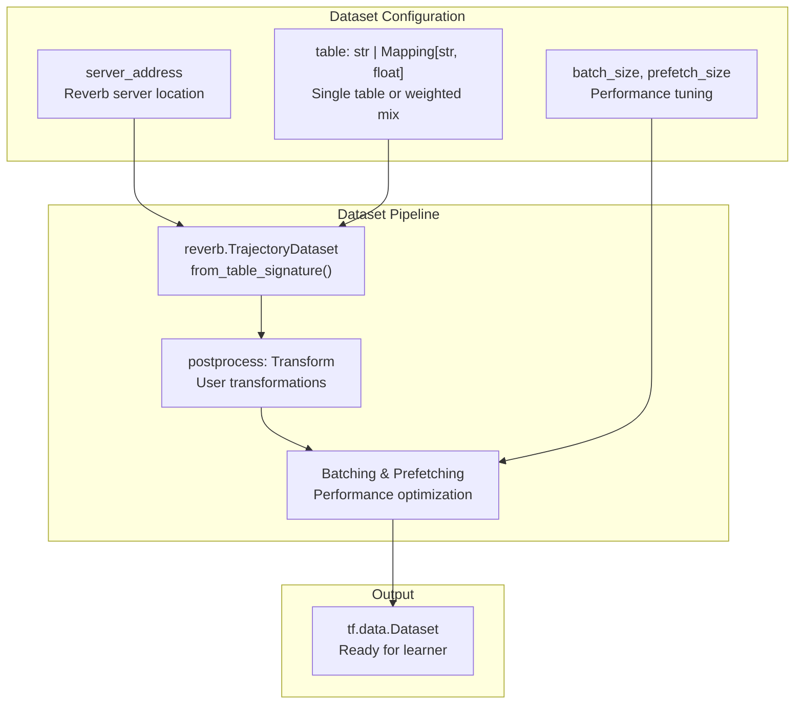

<!-- source: DeepWiki mcp.deepwiki.com · repo google-deepmind/acme · page 2.4 Experience Collection and Replay · fetched 2026-10-26 -->

# Experience Collection and Replay

<details>
<summary>Relevant source files</summary>

The following files were used as context for generating this wiki page:

- [acme/adders/reverb/base.py](acme/adders/reverb/base.py)
- [acme/adders/reverb/episode.py](acme/adders/reverb/episode.py)
- [acme/adders/reverb/episode_test.py](acme/adders/reverb/episode_test.py)
- [acme/adders/reverb/sequence.py](acme/adders/reverb/sequence.py)
- [acme/adders/reverb/sequence_test.py](acme/adders/reverb/sequence_test.py)
- [acme/adders/reverb/test_cases.py](acme/adders/reverb/test_cases.py)
- [acme/adders/reverb/test_utils.py](acme/adders/reverb/test_utils.py)
- [acme/adders/reverb/transition.py](acme/adders/reverb/transition.py)
- [acme/adders/reverb/transition_test.py](acme/adders/reverb/transition_test.py)
- [acme/adders/reverb/utils.py](acme/adders/reverb/utils.py)
- [acme/datasets/reverb.py](acme/datasets/reverb.py)

</details>


This page covers the experience collection and replay system in Acme, which manages the storage and retrieval of agent experience for reinforcement learning. The system consists of **adders** that collect and structure experience data, and **dataset factories** that create training data iterators for learners.

For information about how actors interact with environments and generate experience, see [Actor System and Policy Execution](#2.3). For details about learner components that consume this data, see [Core Interfaces and Agent Composition](#2.1).

## System Overview

The experience collection and replay system bridges the gap between online environment interaction and offline learning. It uses [Reverb](https://github.com/deepmind/reverb) as the backend storage and prioritized sampling system.

## Experience Collection and Replay Flow



Sources: [acme/adders/reverb/base.py:71-255](), [acme/datasets/reverb.py:30-157]()

## Reverb Adders

Adders are responsible for collecting agent experience and writing it to Reverb tables in structured formats. All adders inherit from the `ReverbAdder` base class.

### Base ReverbAdder Class

The `ReverbAdder` class provides the core functionality for all experience collection:



Key features:
- **Trajectory Writing**: Uses `reverb.TrajectoryWriter` to buffer experience before writing to tables
- **Priority Functions**: Optional `PriorityFnMapping` to compute sampling priorities for experiences
- **Automatic Flushing**: Manages in-flight items and flushes data when buffers are full
- **Signature Generation**: Provides `signature()` class methods for Reverb table creation

Sources: [acme/adders/reverb/base.py:71-255]()

### Sequence Adder

The `SequenceAdder` creates fixed-length sequences of consecutive timesteps with configurable overlap.



**End-of-Episode Behaviors**:
- `ZERO_PAD`: Pad incomplete sequences with zeros
- `TRUNCATE`: Write incomplete sequences without padding
- `CONTINUE`: Continue sequences across episode boundaries
- `WRITE`: Only write complete sequences

Sources: [acme/adders/reverb/sequence.py:71-296]()

### N-Step Transition Adder

The `NStepTransitionAdder` creates transitions with N-step returns, computing cumulative rewards and discounts over multiple timesteps.

**N-Step Transition Structure**:
- **State**: Initial observation `s_t`
- **Action**: Action taken `a_t` 
- **N-Step Return**: `R_{t:t+n} = r_t + γ*d_t*r_{t+1} + ... + γ^{n-1}*∏d_i*r_{t+n-1}`
- **N-Step Discount**: `D_{t:t+n} = γ^{n-1}*∏d_i` 
- **Next State**: Arrival state `s_{t+n}`



Sources: [acme/adders/reverb/transition.py:35-308]()

### Episode Adder  

The `EpisodeAdder` stores complete episodes as single trajectory sequences, with optional padding to fixed lengths.

Key features:
- **Whole Episodes**: Writes entire episodes as single items
- **Padding Support**: Optional `padding_fn` to extend short episodes
- **Deferred Writing**: Only writes to Reverb at episode end

Sources: [acme/adders/reverb/episode.py:36-152]()

## Dataset Creation

The dataset creation system converts stored Reverb data into `tf.data.Dataset` objects for learner consumption.

### make_reverb_dataset Function



**Key Parameters**:
- `table`: Single table name or mapping of `{table_name: weight}` for mixing multiple tables
- `postprocess`: Optional transformation function applied to each sample
- `num_parallel_calls`: Controls parallelism for dataset creation
- `max_in_flight_samples_per_worker`: Reverb-specific performance tuning

Sources: [acme/datasets/reverb.py:30-157]()

## Integration Patterns

### Priority Functions

Priority functions compute sampling priorities for experiences stored in Reverb:

```python
PriorityFn = Callable[['PriorityFnInput'], float]
PriorityFnMapping = Mapping[str, Optional[PriorityFn]]
```

The `PriorityFnInput` provides structured access to experience data for priority computation.

### Signature Management

All adders provide `signature()` class methods that generate `tf.TensorSpec` signatures for Reverb table creation:

```python
signature = SequenceAdder.signature(
    environment_spec=env_spec,
    extras_spec=extras_spec, 
    sequence_length=10
)
```

These signatures ensure type safety and shape compatibility between adders and datasets.

### Multi-Table Support

The system supports multiple Reverb tables with different sampling strategies:

```python
dataset = make_reverb_dataset(
    server_address="localhost:8000",
    table={
        "priority_table": 0.8,    # 80% from priority table
        "uniform_table": 0.2      # 20% from uniform table  
    },
    batch_size=32
)
```

Sources: [acme/adders/reverb/base.py:62-64](), [acme/adders/reverb/utils.py:68-97](), [acme/datasets/reverb.py:98-113]()

# Experience Collection and Replay

This page covers the experience collection and replay system in Acme, which manages the storage and retrieval of agent experience for reinforcement learning. The system consists of **adders** that collect and structure experience data, and **dataset factories** that create training data iterators for learners.

For information about how actors interact with environments and generate experience, see [Actor System and Policy Execution](#2.3). For details about learner components that consume this data, see [Core Interfaces and Agent Composition](#2.1).

## System Overview

The experience collection and replay system bridges the gap between online environment interaction and offline learning. It uses [Reverb](https://github.com/deepmind/reverb) as the backend storage and prioritized sampling system.

## Experience Collection and Replay Flow


Sources: [acme/adders/reverb/base.py:71-255](), [acme/datasets/reverb.py:30-157]()

## Reverb Adders

Adders are responsible for collecting agent experience and writing it to Reverb tables in structured formats. All adders inherit from the `ReverbAdder` base class.

### Base ReverbAdder Class

The `ReverbAdder` class provides the core functionality for all experience collection:


Key features:
- **Trajectory Writing**: Uses `reverb.TrajectoryWriter` to buffer experience before writing to tables
- **Priority Functions**: Optional `PriorityFnMapping` to compute sampling priorities for experiences
- **Automatic Flushing**: Manages in-flight items and flushes data when buffers are full
- **Signature Generation**: Provides `signature()` class methods for Reverb table creation

Sources: [acme/adders/reverb/base.py:71-255]()

### Sequence Adder

The `SequenceAdder` creates fixed-length sequences of consecutive timesteps with configurable overlap.


**End-of-Episode Behaviors**:
- `ZERO_PAD`: Pad incomplete sequences with zeros
- `TRUNCATE`: Write incomplete sequences without padding
- `CONTINUE`: Continue sequences across episode boundaries
- `WRITE`: Only write complete sequences

Sources: [acme/adders/reverb/sequence.py:71-296]()

### N-Step Transition Adder

The `NStepTransitionAdder` creates transitions with N-step returns, computing cumulative rewards and discounts over multiple timesteps.

**N-Step Transition Structure**:
- **State**: Initial observation `s_t`
- **Action**: Action taken `a_t` 
- **N-Step Return**: `R_{t:t+n} = r_t + γ*d_t*r_{t+1} + ... + γ^{n-1}*∏d_i*r_{t+n-1}`
- **N-Step Discount**: `D_{t:t+n} = γ^{n-1}*∏d_i` 
- **Next State**: Arrival state `s_{t+n}`


Sources: [acme/adders/reverb/transition.py:35-308]()

### Episode Adder  

The `EpisodeAdder` stores complete episodes as single trajectory sequences, with optional padding to fixed lengths.

Key features:
- **Whole Episodes**: Writes entire episodes as single items
- **Padding Support**: Optional `padding_fn` to extend short episodes
- **Deferred Writing**: Only writes to Reverb at episode end

Sources: [acme/adders/reverb/episode.py:36-152]()

## Dataset Creation

The dataset creation system converts stored Reverb data into `tf.data.Dataset` objects for learner consumption.

### make_reverb_dataset Function


**Key Parameters**:
- `table`: Single table name or mapping of `{table_name: weight}` for mixing multiple tables
- `postprocess`: Optional transformation function applied to each sample
- `num_parallel_calls`: Controls parallelism for dataset creation
- `max_in_flight_samples_per_worker`: Reverb-specific performance tuning

Sources: [acme/datasets/reverb.py:30-157]()

## Integration Patterns

### Priority Functions

Priority functions compute sampling priorities for experiences stored in Reverb:

```python
PriorityFn = Callable[['PriorityFnInput'], float]
PriorityFnMapping = Mapping[str, Optional[PriorityFn]]
```

The `PriorityFnInput` provides structured access to experience data for priority computation.

### Signature Management

All adders provide `signature()` class methods that generate `tf.TensorSpec` signatures for Reverb table creation:

```python
signature = SequenceAdder.signature(
    environment_spec=env_spec,
    extras_spec=extras_spec, 
    sequence_length=10
)
```

These signatures ensure type safety and shape compatibility between adders and datasets.

### Multi-Table Support

The system supports multiple Reverb tables with different sampling strategies:

```python
dataset = make_reverb_dataset(
    server_address="localhost:8000",
    table={
        "priority_table": 0.8,    # 80% from priority table
        "uniform_table": 0.2      # 20% from uniform table  
    },
    batch_size=32
)
```

Sources: [acme/adders/reverb/base.py:62-64](), [acme/adders/reverb/utils.py:68-97](), [acme/datasets/reverb.py:98-113]()

---

