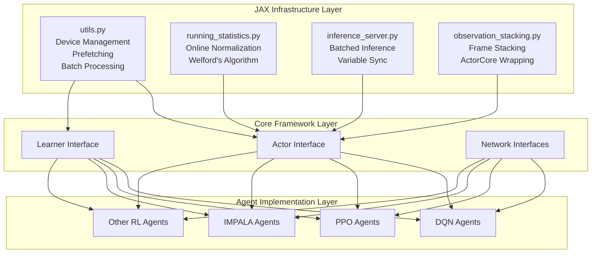
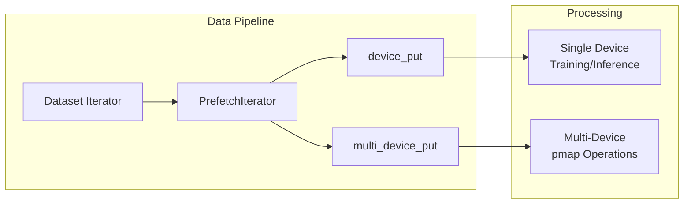
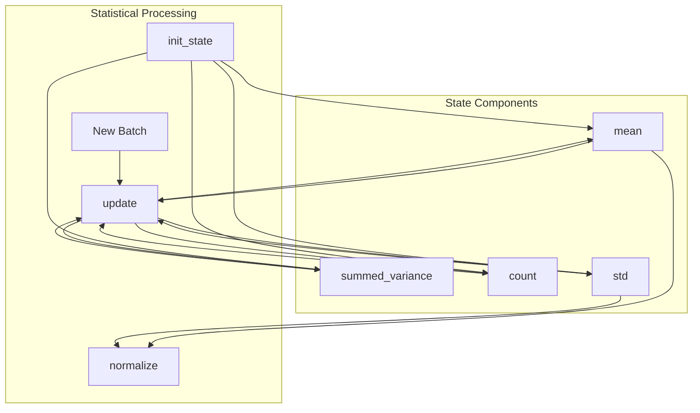
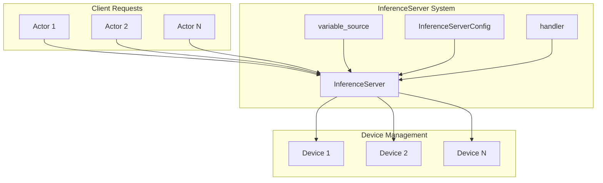
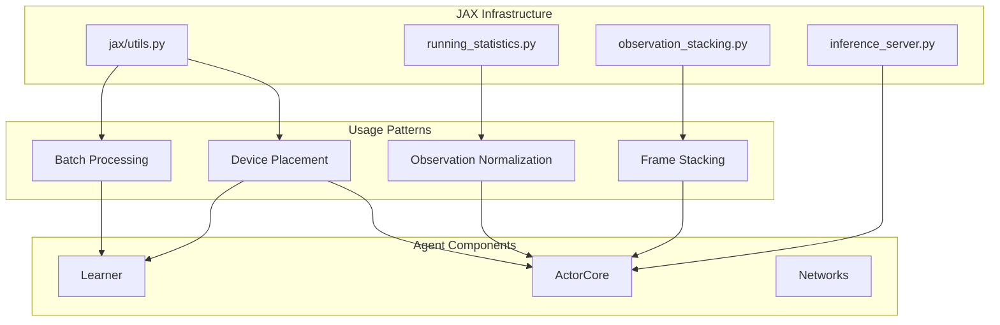
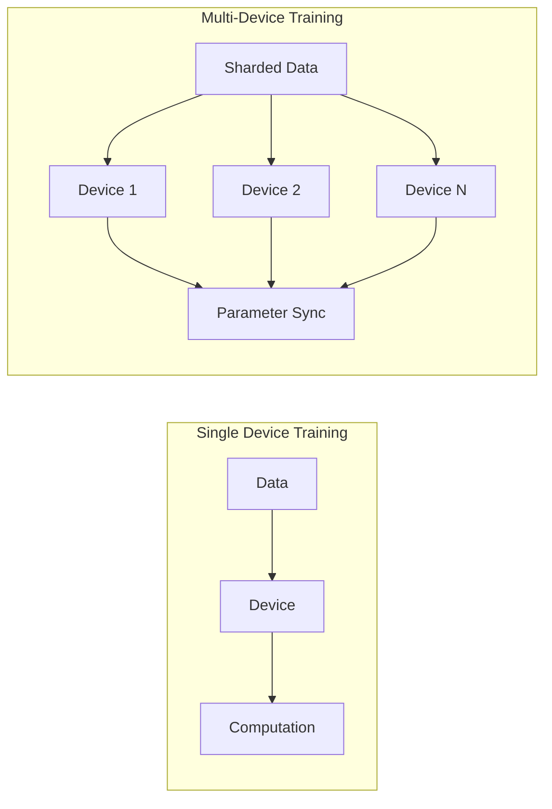
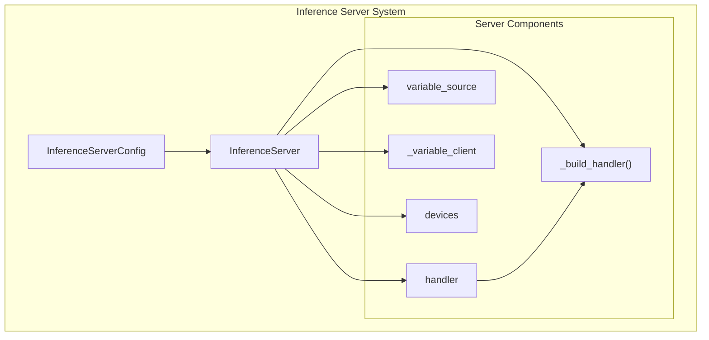

<!-- source: DeepWiki mcp.deepwiki.com · repo google-deepmind/acme · page 3 JAX Infrastructure and Utilities · fetched 2026-10-26 -->

# JAX Infrastructure and Utilities

<details>
<summary>Relevant source files</summary>

The following files were used as context for generating this wiki page:

- [acme/jax/inference_server.py](acme/jax/inference_server.py)
- [acme/jax/observation_stacking.py](acme/jax/observation_stacking.py)
- [acme/jax/running_statistics.py](acme/jax/running_statistics.py)
- [acme/jax/running_statistics_test.py](acme/jax/running_statistics_test.py)
- [acme/jax/utils.py](acme/jax/utils.py)
- [acme/jax/utils_test.py](acme/jax/utils_test.py)
- [acme/utils/reverb_utils.py](acme/utils/reverb_utils.py)
- [acme/utils/reverb_utils_test.py](acme/utils/reverb_utils_test.py)
- [acme/wrappers/multigrid_wrapper.py](acme/wrappers/multigrid_wrapper.py)

</details>


The JAX Infrastructure provides the foundation for high-performance reinforcement learning in Acme through specialized numerical computing utilities, device management systems, and distributed computing infrastructure. This infrastructure enables efficient training and inference of RL agents using JAX's just-in-time compilation and automatic differentiation capabilities across single and multi-device setups.

## Infrastructure Overview

The JAX infrastructure in Acme provides a comprehensive ecosystem for high-performance reinforcement learning that addresses several key computational challenges:

1. **Device Management and Data Flow**: Efficient placement and movement of data across CPUs, GPUs, and TPUs
2. **Numerical Computing**: Specialized utilities for array operations, batch processing, and statistical computations
3. **Distributed Training**: Infrastructure for scaling training across multiple devices and machines
4. **Network Architectures**: Modular neural network components optimized for RL tasks
5. **Inference Systems**: Centralized batched inference for efficient policy evaluation

### JAX Infrastructure Architecture



Sources: [acme/jax/utils.py:15-40](), [acme/jax/running_statistics.py:15-28](), [acme/jax/inference_server.py:15-26](), [acme/jax/observation_stacking.py:15-30]()

### Core Infrastructure Components

The JAX infrastructure is organized into several specialized modules, each documented in detail in the following sections:

| Component | Purpose | Key Classes/Functions |
|-----------|---------|----------------------|
| **JAX Utilities and Device Management** (Section 3.1) | Device placement, prefetching, batch operations | `PrefetchIterator`, `device_put`, `multi_device_put` |
| **Neural Network Architectures** (Section 3.2) | Network interfaces and implementations | `FeedForwardNetwork`, `UnrollableNetwork` |
| **Running Statistics and Normalization** (Section 3.3) | Online statistics computation | `RunningStatisticsState`, `update`, `normalize` |
| **Distributional Networks and Advanced Components** (Section 3.4) | Advanced network heads and loss functions | Distributional heads, MPO loss implementations |

Sources: [acme/jax/utils.py:1-50](), [acme/jax/running_statistics.py:1-50](), [acme/jax/inference_server.py:1-50](), [acme/jax/observation_stacking.py:1-50]()

## Key Infrastructure Patterns

The JAX infrastructure implements several critical patterns that enable high-performance RL training and inference:

### Data Flow and Device Management Pattern



### Statistical Computation Pattern

The infrastructure uses Welford's algorithm for numerically stable online computation of statistics:



Sources: [acme/jax/utils.py:151-388](), [acme/jax/running_statistics.py:91-251]()

## Distributed Computing Infrastructure

The JAX infrastructure provides comprehensive support for distributed training and inference across multiple devices and machines.

### Centralized Inference System



The `InferenceServer` class provides centralized, batched inference capabilities with:
- Automatic batching of inference requests
- Parameter synchronization across devices
- Round-robin device selection for load balancing
- Timeout handling for incomplete batches

### Multi-Device Training Support

The infrastructure supports both single-device and multi-device training scenarios through specialized utilities in `utils.py`:

| Pattern | Key Functions | Use Case |
|---------|---------------|----------|
| **Single Device** | `device_put`, `prefetch` | Development, small models |
| **Multi-Device (pmap)** | `multi_device_put`, `sharded_prefetch` | Production training |
| **Device Replication** | `replicate_in_all_devices` | Parameter sharing |
| **Data Extraction** | `get_from_first_device` | Checkpoint saving |

Sources: [acme/jax/inference_server.py:48-149](), [acme/jax/utils.py:184-388]()

## Integration with RL Agents

The JAX infrastructure integrates seamlessly with Acme's RL agents through well-defined interfaces and patterns.

### Agent Integration Pattern



### Common Usage Patterns in Agents

The infrastructure supports several common patterns used across different RL algorithms:

1. **Observation Processing**: Using `running_statistics.py` for normalization and `observation_stacking.py` for frame stacking
2. **Distributed Training**: Using `utils.py` device management for multi-device setups
3. **Efficient Inference**: Using `inference_server.py` for centralized policy evaluation
4. **Batch Processing**: Using `utils.py` batch utilities for efficient gradient computation

Sources: [acme/jax/utils.py:391-500](), [acme/jax/observation_stacking.py:132-177](), [acme/jax/running_statistics.py:253-297]()

## Performance and Optimization

The JAX infrastructure is designed with performance as a primary consideration, implementing several optimization strategies:

### Memory and Computation Efficiency

| Optimization | Implementation | Benefit |
|--------------|----------------|---------|
| **Prefetching** | `PrefetchIterator` with threading | Overlaps data loading with computation |
| **Device Placement** | `device_put`, `multi_device_put` | Minimizes data movement |
| **Batch Processing** | `process_multiple_batches`, `mapreduce` | Amortizes function call overhead |
| **Online Statistics** | Welford's algorithm in `running_statistics` | Numerically stable streaming computation |

### Distributed Training Optimizations



The infrastructure automatically scales from single-device development to multi-device production training through consistent APIs and transparent device management.

Sources: [acme/jax/utils.py:518-602](), [acme/jax/running_statistics.py:129-251]()

## Detailed Component Documentation

The JAX infrastructure components are documented in detail across the following sections:

### Section 3.1: JAX Utilities and Device Management
Covers core array operations, device placement, prefetching systems, and batch processing utilities. This includes the fundamental `utils.py` module that provides the building blocks for efficient JAX-based RL training.

### Section 3.2: Neural Network Architectures  
Details the network interfaces and implementations used throughout Acme's JAX-based agents, including feed-forward networks, recurrent networks, and modular network components.

### Section 3.3: Running Statistics and Normalization
Focuses on the `running_statistics.py` module, which provides numerically stable online computation of statistics for observation normalization and other preprocessing tasks.

### Section 3.4: Distributional Networks and Advanced Components
Covers advanced network architectures including distributional reinforcement learning heads, specialized loss functions, and other sophisticated network components used in state-of-the-art RL algorithms.

Sources: [acme/jax/utils.py:1-50](), [acme/jax/running_statistics.py:1-50](), [acme/jax/observation_stacking.py:1-50](), [acme/jax/inference_server.py:1-50]()

## Inference Server

The inference server module provides a centralized inference system for efficient batch processing, particularly useful in distributed settings.



| Class | Description |
|-------|-------------|
| `InferenceServer` | Server for centralized, batched inference |
| `InferenceServerConfig` | Configuration for the inference server |

The inference server provides efficient batched inference by:
1. Managing parameters across devices
2. Handling batching of inference requests
3. Updating parameters from a variable source
4. Supporting parallel execution across multiple devices

Sources: [acme/jax/inference_server.py:15-149](acme/jax/inference_server.py:15-149)

## Utility Functions

Several other utility functions are provided for common operations:

| Function | Description |
|----------|-------------|
| `weighted_softmax` | Computes weighted softmax over inputs |
| `sample_uint32` | Returns an integer uniformly distributed in 0..2^32-1 |
| `maybe_recover_lstm_type` | Recovers the type hk.LSTMState if needed |

Sources: [acme/jax/utils.py:503-516](acme/jax/utils.py:503-516), [acme/jax/utils.py:131-149](acme/jax/utils.py:131-149)

## Usage Patterns

The JAX utilities are used throughout the Acme framework to support reinforcement learning agents. Common usage patterns include:

1. **Normalizing observations**: Using `running_statistics` to compute and apply normalization
   ```python
   # Initialize state
   state = running_statistics.init_state(environment_spec.observations)
   
   # Update running statistics with new observations
   state = running_statistics.update(state, observations)
   
   # Normalize observations using current statistics
   normalized_observations = running_statistics.normalize(observations, state)
   ```

2. **Efficient data loading**: Using prefetching to load data in parallel
   ```python
   # Create a prefetching iterator
   prefetched_iterator = utils.prefetch(
       dataset_iterator, buffer_size=5, num_threads=1)
   
   # For multi-device training
   sharded_iterator = utils.sharded_prefetch(
       dataset_iterator, num_threads=1, devices=jax.local_devices())
   ```

3. **Device management**: Placing data on specific devices
   ```python
   # Replicate data across all devices
   replicated_data = utils.replicate_in_all_devices(data)
   
   # Get data from first device
   first_device_data = utils.get_from_first_device(sharded_data)
   ```

These utilities form the foundation for efficient JAX-based reinforcement learning in the Acme framework, providing essential functionality for data handling, normalization, and device management.

---

