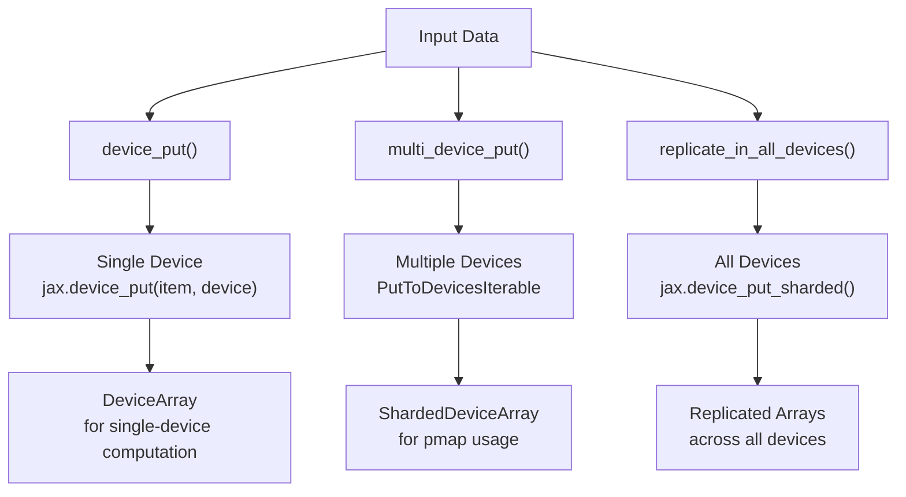
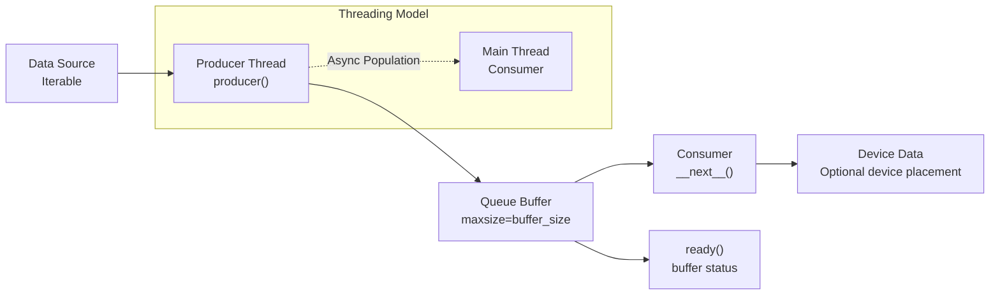
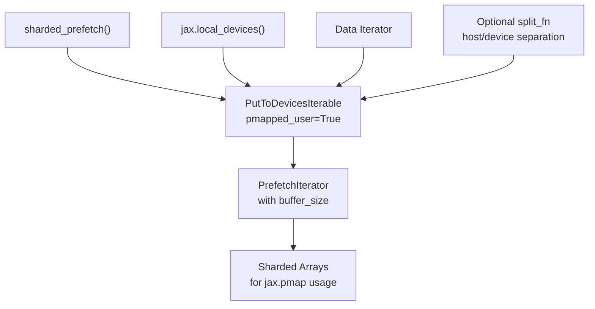
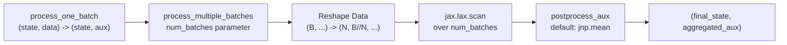
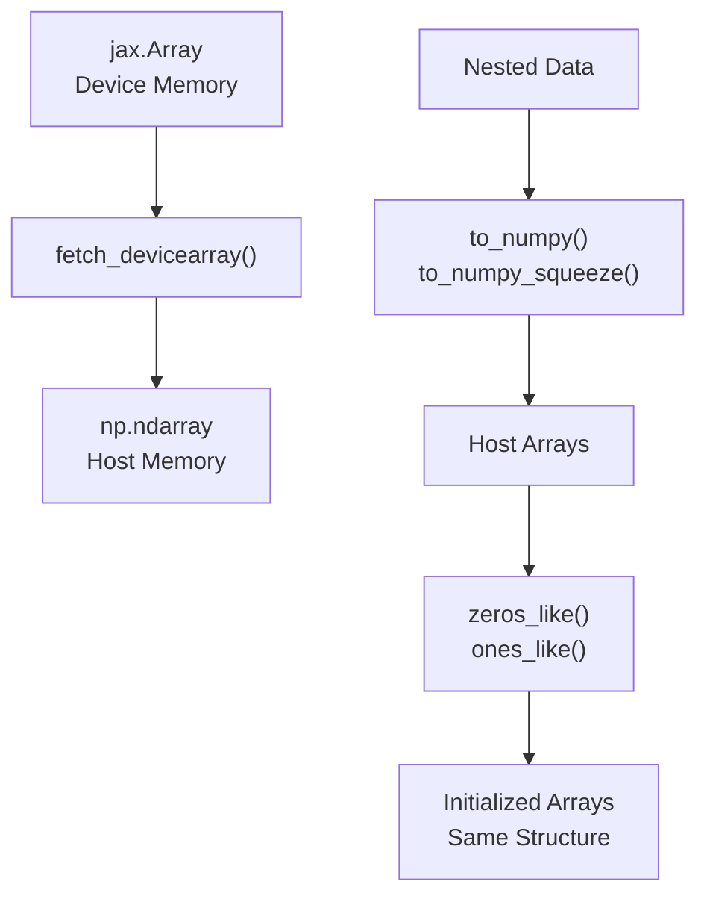
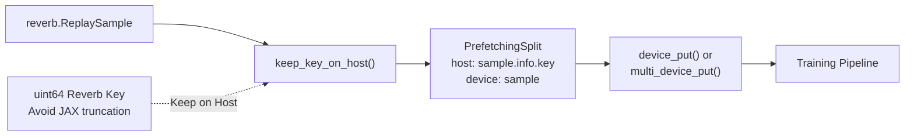

<!-- source: DeepWiki mcp.deepwiki.com · repo google-deepmind/acme · page 3.1 JAX Utilities and Device Management · fetched 2026-10-26 -->

# JAX Utilities and Device Management

<details>
<summary>Relevant source files</summary>

The following files were used as context for generating this wiki page:

- [acme/jax/inference_server.py](acme/jax/inference_server.py)
- [acme/jax/observation_stacking.py](acme/jax/observation_stacking.py)
- [acme/jax/running_statistics.py](acme/jax/running_statistics.py)
- [acme/jax/running_statistics_test.py](acme/jax/running_statistics_test.py)
- [acme/jax/utils.py](acme/jax/utils.py)
- [acme/jax/utils_test.py](acme/jax/utils_test.py)
- [acme/utils/reverb_utils.py](acme/utils/reverb_utils.py)
- [acme/utils/reverb_utils_test.py](acme/utils/reverb_utils_test.py)
- [acme/wrappers/multigrid_wrapper.py](acme/wrappers/multigrid_wrapper.py)

</details>


This document covers the JAX-specific utilities and device management infrastructure in Acme. These utilities provide efficient data placement, prefetching, batch processing, and distributed computing capabilities that form the computational backbone of JAX-based agents and learners.

For neural network architectures and network-specific utilities, see [Neural Network Architectures](#3.2). For running statistics and normalization, see [Running Statistics and Normalization](#3.3).

## Purpose and Scope

The JAX utilities system provides:
- **Device Management**: Functions for placing data across multiple devices and managing distributed computation
- **Prefetching Infrastructure**: Asynchronous data loading and buffering for training pipelines  
- **Batch Processing**: Utilities for processing multiple batches efficiently with proper aggregation
- **Array Transformations**: Helper functions for common tensor operations and data format conversions
- **Distributed Computing Support**: Integration with JAX's parallelization primitives

## Device Management and Data Placement

The core device management functionality centers around three main operations: single-device placement, multi-device distribution, and device replication.

### Core Device Functions

The `device_put` function places data on a specific device, while `multi_device_put` distributes data across multiple devices for parallel processing. The `replicate_in_all_devices` function creates identical copies across all available devices.



Sources: [acme/jax/utils.py:184-207](), [acme/jax/utils.py:365-371](), [acme/jax/utils.py:373-389]()

### PutToDevicesIterable Architecture

The `PutToDevicesIterable` class handles the complex logic of distributing data samples across devices, supporting both single-device and multi-device (pmapped) usage patterns.

| Mode | Usage | Output Format |
|------|-------|---------------|
| `pmapped_user=False` | Single device | `DeviceArray` on specified device |
| `pmapped_user=True` | Multiple devices | `ShardedDeviceArray` across devices |
| With `split_fn` | Host/device split | `PrefetchingSplit` with separate host/device data |

The class supports optional splitting of data between host and device memory using a `split_fn` parameter, commonly used with Reverb samples to keep keys on host while moving data to devices.

Sources: [acme/jax/utils.py:209-320](), [acme/jax/utils.py:170-182]()

## Prefetching and Asynchronous Data Loading

The prefetching system provides efficient asynchronous data loading with configurable buffering to prevent training pipelines from waiting on data.

### PrefetchIterator Implementation



The `PrefetchIterator` uses producer threads to populate a queue buffer asynchronously, allowing the main thread to consume data without blocking. The `ready()` method enables checking buffer status for adaptive scheduling.

Sources: [acme/jax/utils.py:518-602]()

### Sharded Prefetching

The `sharded_prefetch` function combines device distribution with prefetching for distributed training scenarios. It creates `PutToDevicesIterable` instances and wraps them with prefetching capabilities.



Sources: [acme/jax/utils.py:322-363]()

## Batch Processing Utilities

### MapReduce Pattern

The `mapreduce` decorator transforms single-example functions into batch-processing functions using JAX's `vmap` and a configurable reduction operation.

```python
# Transform signature: [H, W] -> [N] becomes [B, H, W] -> [N]
@mapreduce
def loss_fn(example):
    return compute_loss(example)

# Equivalent to: jnp.mean(jax.vmap(loss_fn)(batch), axis=0)
```

The default reduction is `jnp.mean` over the batch axis, but custom reduction functions can be provided.

Sources: [acme/jax/utils.py:391-422]()

### Multi-Batch Processing

The `process_multiple_batches` and `process_many_batches` functions enable processing several batches in a single step, useful for gradient accumulation and stability.



The `process_many_batches` variant provides stronger typing using `TrainingStepOutput` containers.

Sources: [acme/jax/utils.py:431-501]()

## Array and Tensor Utilities

### Data Format Transformations

| Function | Purpose | Usage |
|----------|---------|-------|
| `add_batch_dim` | Add leading batch dimension | Converting single examples to batch format |
| `squeeze_batch_dim` | Remove leading batch dimension | Converting batch back to single examples |
| `batch_concat` | Flatten and concatenate nested arrays | Creating flat feature vectors |
| `batch_to_sequence` | Transpose batch and sequence dims | Converting B×T format to T×B format |

### Type Conversion and Device Transfer

The utilities handle conversion between JAX arrays, NumPy arrays, and device placement:



The `fetch_devicearray` function specifically handles JAX's `Array` types, while `to_numpy` variants provide general conversion utilities.

Sources: [acme/jax/utils.py:43-102](), [acme/jax/utils.py:103-112]()

### Specialized Operations

The utilities include several specialized operations for neural network and RL-specific use cases:

- `tile_array` and `tile_nested`: Replicate arrays along new dimensions for ensemble methods
- `maybe_recover_lstm_type`: Handle LSTM state deserialization issues with Haiku
- `weighted_softmax`: Compute weighted softmax with numerical stability
- `sample_uint32`: Generate random integers for seeding

Sources: [acme/jax/utils.py:120-149](), [acme/jax/utils.py:503-516]()

## Integration with Acme Framework

### Reverb Integration

The device management utilities integrate closely with Reverb replay buffers through the `keep_key_on_host` function and `PrefetchingSplit` mechanism:



This pattern prevents truncation of 64-bit Reverb keys while efficiently moving training data to accelerators.

Sources: [acme/jax/utils.py:170-182]()

### Learner and Actor Integration

The utilities support the distributed actor-learner architecture by providing device-aware data loading and batch processing:

- **Learners** use `sharded_prefetch` and `process_multiple_batches` for efficient training
- **Actors** use `device_put` and `replicate_in_all_devices` for inference
- **Variable synchronization** uses `get_from_first_device` to extract parameters

Sources: [acme/jax/utils.py:322-363](), [acme/jax/utils.py:431-501](), [acme/jax/utils.py:373-389]()

---

