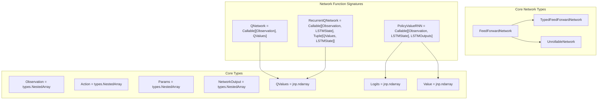
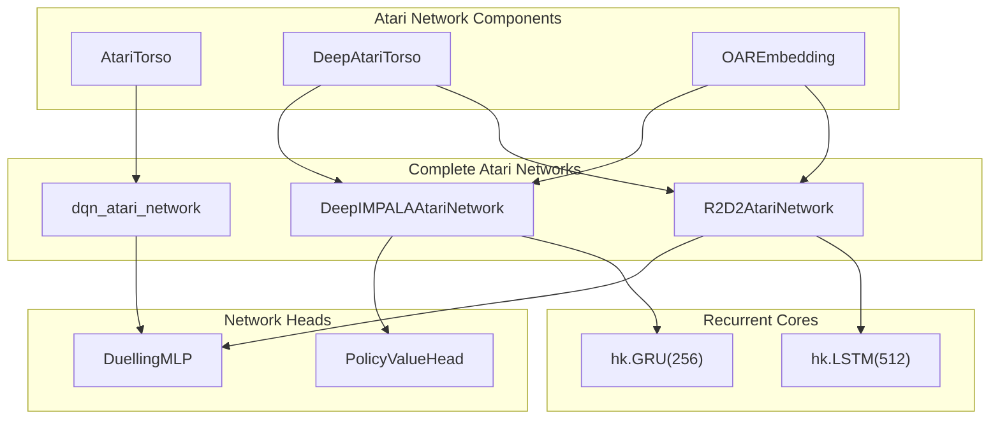
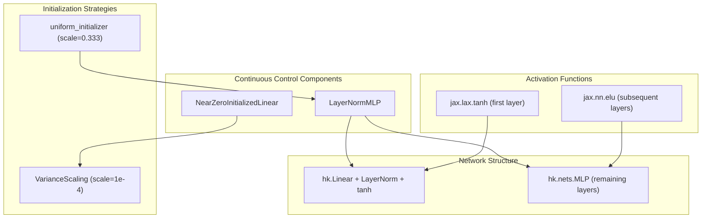
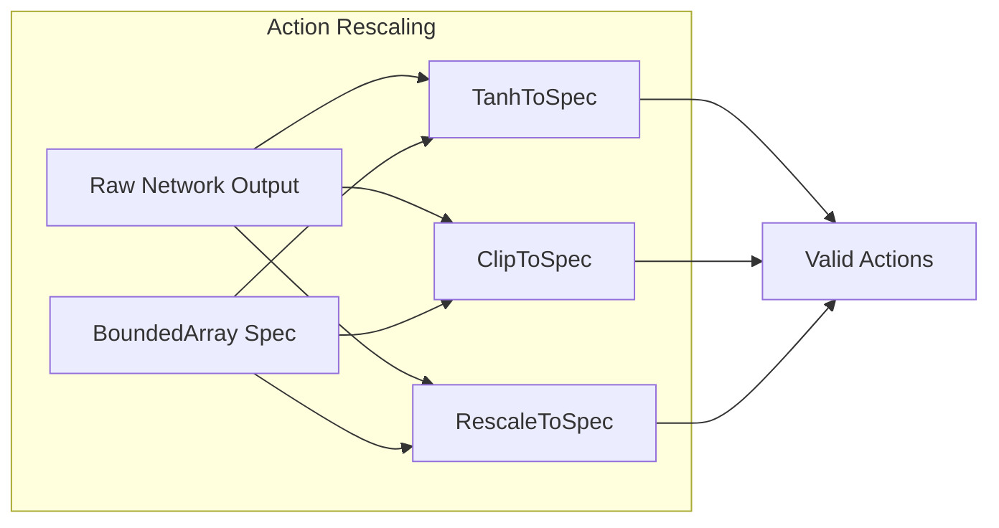
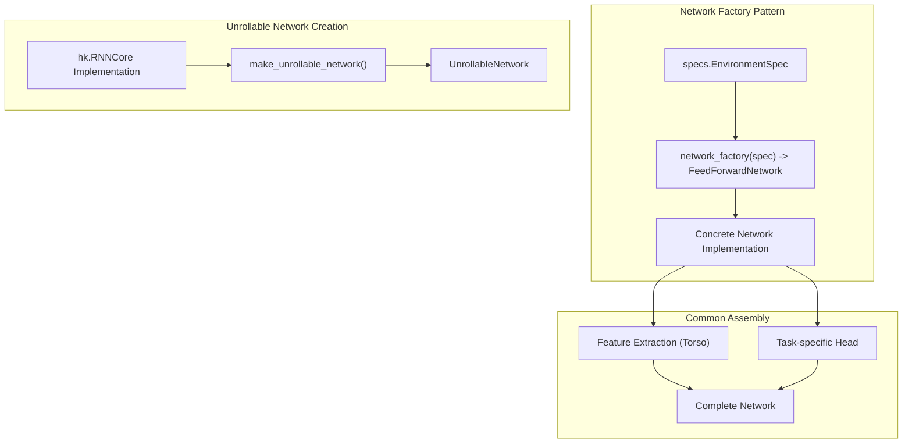

<!-- source: DeepWiki mcp.deepwiki.com · repo google-deepmind/acme · page 3.2 Neural Network Architectures · fetched 2026-10-26 -->

# Neural Network Architectures

Relevant source files

The following files were used as context for generating this wiki page:

- [acme/jax/networks/__init__.py](acme/jax/networks/__init__.py)
- [acme/jax/networks/atari.py](acme/jax/networks/atari.py)
- [acme/jax/networks/base.py](acme/jax/networks/base.py)
- [acme/jax/networks/continuous.py](acme/jax/networks/continuous.py)
- [acme/jax/networks/duelling.py](acme/jax/networks/duelling.py)
- [acme/jax/networks/embedding.py](acme/jax/networks/embedding.py)
- [acme/jax/networks/policy_value.py](acme/jax/networks/policy_value.py)
- [acme/jax/networks/rescaling.py](acme/jax/networks/rescaling.py)

This document covers the neural network architectures and components provided by Acme's JAX implementation. The networks module provides a comprehensive set of base interfaces, domain-specific architectures (Atari, continuous control), and modular components that can be composed to build complex reinforcement learning networks.

For information about JAX utilities and device management, see [JAX Utilities and Device Management](#3.1). For details about distributional network heads and advanced components, see [Distributional Networks and Advanced Components](#3.4).

## Base Network Interfaces

Acme defines several core interfaces that standardize how neural networks are constructed and used across different algorithms. The fundamental building blocks include `FeedForwardNetwork`, `TypedFeedForwardNetwork`, and `UnrollableNetwork`.

**Title: Core Network Interface Hierarchy**

The `FeedForwardNetwork` dataclass holds pure functions for initialization and forward passes:

| Component | Type | Purpose |
|-----------|------|---------|
| `init` | `Callable[..., Params]` | Initialize network parameters |
| `apply` | `Callable[..., NetworkOutput]` | Forward pass computation |

The `UnrollableNetwork` extends this for recurrent networks with sequence processing capabilities, including `unroll` and `init_recurrent_state` functions.

**Sources:** [acme/jax/networks/base.py:55-67](), [acme/jax/networks/base.py:119-130]()

## Atari Network Architectures

Acme provides specialized network architectures optimized for Atari environments, ranging from simple convolutional stacks to deep recurrent networks for distributed training.

**Title: Atari Network Architecture Components**

### AtariTorso

The basic `AtariTorso` implements the standard convolutional architecture commonly used for Atari games:

| Layer | Configuration | Output Shape |
|-------|--------------|--------------|
| Conv2D | 32 filters, 8x8, stride 4 | `[B, H/4, W/4, 32]` |
| Conv2D | 64 filters, 4x4, stride 2 | `[B, H/8, W/8, 64]` |
| Conv2D | 64 filters, 3x3, stride 1 | `[B, H/8, W/8, 64]` |
| Flatten | - | `[B, D]` |

### Deep Networks

The `DeepAtariTorso` provides a deeper architecture based on ResNet blocks for more complex learning, as used in IMPALA. The `DeepIMPALAAtariNetwork` combines this with GRU recurrence and policy-value heads for distributed actor-critic training.

The `R2D2AtariNetwork` uses LSTM recurrence with duelling Q-value heads, designed for distributed Q-learning with experience replay.

**Sources:** [acme/jax/networks/atari.py:41-63](), [acme/jax/networks/atari.py:78-107](), [acme/jax/networks/atari.py:109-145](), [acme/jax/networks/atari.py:147-185]()

## Continuous Control Networks

For continuous control tasks, Acme provides specialized MLP architectures with layer normalization and careful initialization schemes.

**Title: Continuous Control Network Architecture**

The `LayerNormMLP` implements a feedforward network with initial layer normalization:

1. **First Layer**: Linear → LayerNorm → tanh activation
2. **Subsequent Layers**: Standard MLP with ELU activation (default)
3. **Initialization**: Uniform scaling with careful variance control

This architecture is particularly effective for continuous control environments where input normalization and stable gradients are important.

**Sources:** [acme/jax/networks/continuous.py:33-77](), [acme/jax/networks/continuous.py:26-31]()

## Modular Network Components

Acme provides a rich set of modular components that can be composed to build complex network architectures.

### Network Heads

| Component | Purpose | Input/Output |
|-----------|---------|--------------|
| `DuellingMLP` | Q-value estimation with advantage decomposition | `[B, D]` → `[B, A]` |
| `PolicyValueHead` | Joint policy and value estimation | `[B, D]` → `(logits, value)` |
| `CategoricalHead` | Distributional value heads | `[B, D]` → `[B, A, N_atoms]` |

### Rescaling and Action Adaptation

**Title: Action Space Rescaling Components**

### Embedding Modules

The `OAREmbedding` module processes observation-action-reward tuples commonly used in recurrent agents:

1. **Observation Processing**: Applied through configurable torso network
2. **Action Embedding**: One-hot encoding for discrete actions  
3. **Reward Processing**: Tanh normalization to `[-1, 1]` range
4. **Concatenation**: All embeddings combined along final dimension

**Sources:** [acme/jax/networks/duelling.py:26-61](), [acme/jax/networks/policy_value.py:23-37](), [acme/jax/networks/rescaling.py:24-58](), [acme/jax/networks/embedding.py:25-62]()

## Network Assembly Patterns

Networks in Acme follow consistent assembly patterns that enable flexible composition and reuse across different algorithms.

**Title: Network Assembly and Factory Patterns**

### Standard Assembly Flow

1. **Environment Specification**: Networks are created based on `specs.EnvironmentSpec`
2. **Torso Selection**: Choose appropriate feature extraction (AtariTorso, LayerNormMLP, etc.)
3. **Head Selection**: Add task-specific output layers (DuellingMLP, PolicyValueHead, etc.)
4. **Transformation**: Convert to appropriate network interface (`FeedForwardNetwork`, `UnrollableNetwork`)

The `make_unrollable_network` function automatically handles the transformation from Haiku RNN modules to the standard `UnrollableNetwork` interface, managing state initialization and sequence unrolling.

**Sources:** [acme/jax/networks/base.py:132-160](), [acme/jax/networks/__init__.py:15-61]()

---

