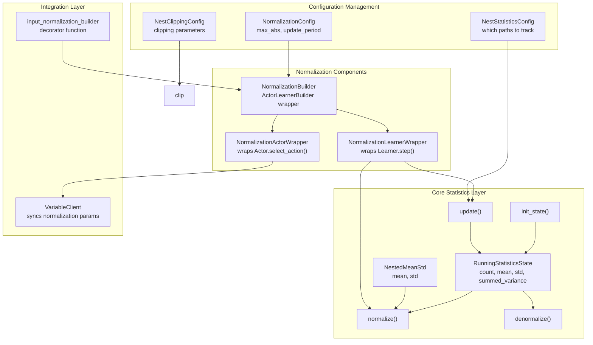
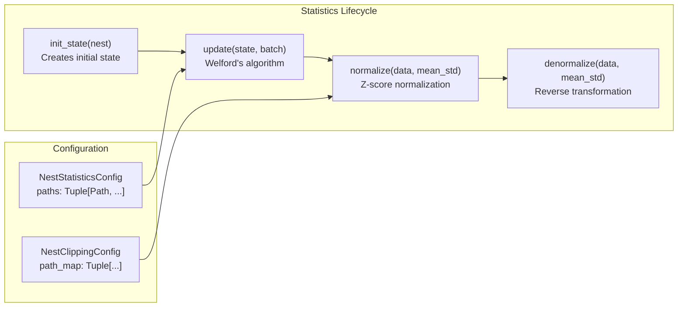
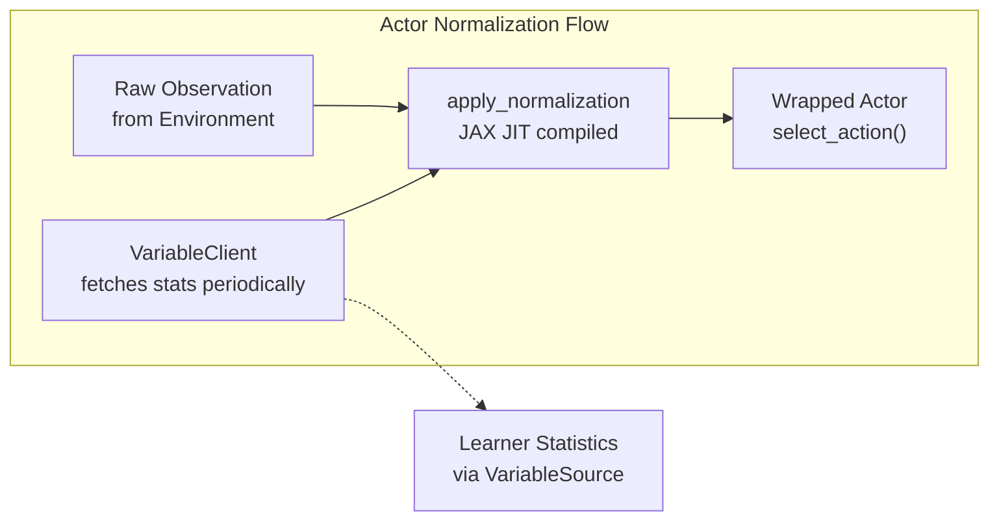
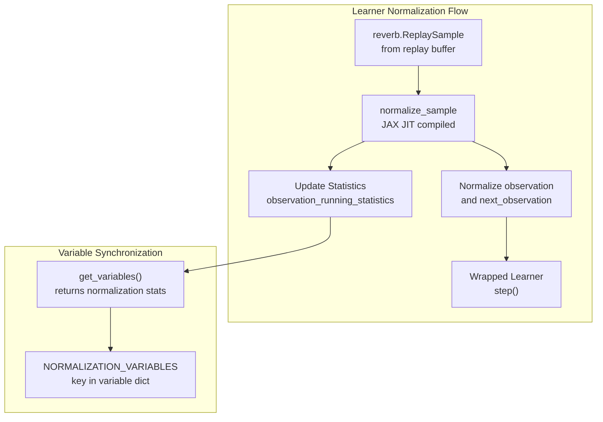

<!-- source: DeepWiki mcp.deepwiki.com · repo google-deepmind/acme · page 3.3 Running Statistics and Normalization · fetched 2026-10-26 -->

# Running Statistics and Normalization

<details>
<summary>Relevant source files</summary>

The following files were used as context for generating this wiki page:

- [acme/agents/jax/builders.py](acme/agents/jax/builders.py)
- [acme/agents/jax/normalization.py](acme/agents/jax/normalization.py)
- [acme/agents/jax/pwil/builder.py](acme/agents/jax/pwil/builder.py)
- [acme/agents/jax/rnd/builder.py](acme/agents/jax/rnd/builder.py)
- [acme/agents/jax/sqil/builder.py](acme/agents/jax/sqil/builder.py)
- [acme/jax/inference_server.py](acme/jax/inference_server.py)
- [acme/jax/observation_stacking.py](acme/jax/observation_stacking.py)
- [acme/jax/running_statistics.py](acme/jax/running_statistics.py)
- [acme/jax/running_statistics_test.py](acme/jax/running_statistics_test.py)
- [acme/jax/types.py](acme/jax/types.py)
- [acme/jax/utils.py](acme/jax/utils.py)
- [acme/jax/utils_test.py](acme/jax/utils_test.py)
- [acme/utils/reverb_utils.py](acme/utils/reverb_utils.py)
- [acme/utils/reverb_utils_test.py](acme/utils/reverb_utils_test.py)
- [acme/wrappers/multigrid_wrapper.py](acme/wrappers/multigrid_wrapper.py)

</details>


This document covers Acme's JAX-based infrastructure for computing running statistics and performing observation normalization in reinforcement learning agents. These utilities enable online computation of mean and variance statistics during training, which are essential for normalizing observations to improve training stability and convergence.

For general JAX device management and batch processing utilities, see [3.1](#3.1). For neural network architectures that may use normalized inputs, see [3.2](#3.2).

## Core Components Overview

The running statistics and normalization system consists of three main layers: core statistical computation, normalization wrappers, and configuration management.



Sources: [acme/jax/running_statistics.py:65-101](), [acme/agents/jax/normalization.py:44-82](), [acme/agents/jax/normalization.py:168-244]()

## Running Statistics Computation

The core statistical computation is implemented using Welford's online algorithm for numerically stable calculation of running mean and variance over batches of data.

### State Management

The `RunningStatisticsState` dataclass maintains the complete state needed for online statistics computation:

| Field | Type | Description |
|-------|------|-------------|
| `count` | `int` or `jnp.ndarray` | Total number of data points processed |
| `mean` | `types.NestedArray` | Running mean of the data |
| `std` | `types.NestedArray` | Running standard deviation |
| `summed_variance` | `types.NestedArray` | Accumulated variance for Welford's algorithm |

The simpler `NestedMeanStd` container holds only mean and standard deviation, used for variable synchronization between distributed components.

### Core Operations



The `update` function implements Welford's algorithm with support for:
- Weighted samples via the `weights` parameter
- Distributed training via `pmap_axis_name`
- Nested data structures with selective path-based statistics
- Numerical stability controls (`std_min_value`, `std_max_value`)

Sources: [acme/jax/running_statistics.py:129-251](), [acme/jax/running_statistics.py:253-271](), [acme/jax/running_statistics.py:91-102]()

## Normalization Infrastructure

The normalization infrastructure provides wrapper components that integrate running statistics with Acme's actor-learner architecture.

### Actor-Side Normalization

The `NormalizationActorWrapper` applies normalization to observations before they reach the policy network:



The wrapper maintains a `VariableClient` that periodically synchronizes normalization parameters from the learner, ensuring actors use up-to-date statistics.

### Learner-Side Statistics Collection

The `NormalizationLearnerWrapper` computes and maintains running statistics during training:



Sources: [acme/agents/jax/normalization.py:44-82](), [acme/agents/jax/normalization.py:90-166]()

## Integration Patterns

### Builder Pattern Integration

The `NormalizationBuilder` wraps existing `ActorLearnerBuilder` implementations to add normalization capabilities:

| Method | Behavior |
|--------|----------|
| `make_learner()` | Creates `NormalizationLearnerWrapper` around base learner |
| `make_actor()` | Creates `NormalizationActorWrapper` around base actor |
| `make_policy()`, `make_adder()` | Delegates to wrapped builder unchanged |

### Decorator Pattern for Agent Configuration

The `input_normalization_builder` decorator provides a clean way to add normalization to existing agent builders:

```python
@input_normalization_builder
class MyAgentBuilder(ActorLearnerBuilder):
    # Existing builder implementation
```

The decorator checks the agent configuration for `input_normalization` settings and conditionally wraps the builder with normalization capabilities.

Sources: [acme/agents/jax/normalization.py:168-244](), [acme/agents/jax/normalization.py:271-344]()

## Configuration and Customization

### Path-Based Statistics Configuration

The `NestStatisticsConfig` allows selective statistics computation for nested observation structures:

```python
# Only compute statistics for 'image' observations
config = NestStatisticsConfig(paths=(('image',),))

# Compute statistics for multiple observation types  
config = NestStatisticsConfig(paths=(('image',), ('vector',)))
```

### Clipping Configuration

The `NestClippingConfig` defines per-path clipping limits for normalized values:

```python
# Clip 'image' observations to [-5, 5] after normalization
config = NestClippingConfig(path_map=((('image',), 5.0),))
```

### Runtime Parameters

Key normalization parameters include:

| Parameter | Default | Description |
|-----------|---------|-------------|
| `max_abs_observation` | `10.0` | Maximum absolute value after normalization |
| `statistics_update_period` | `100` | How often actors fetch updated statistics |
| `std_min_value` | `1e-6` | Minimum standard deviation to prevent division by zero |
| `std_max_value` | `1e6` | Maximum standard deviation for numerical stability |

Sources: [acme/jax/running_statistics.py:71-81](), [acme/jax/running_statistics.py:300-360](), [acme/agents/jax/normalization.py:246-257]()

---

