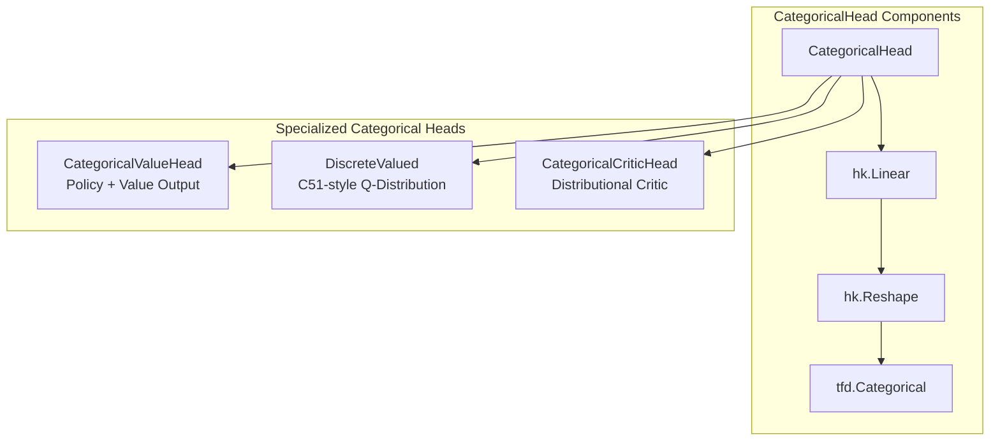
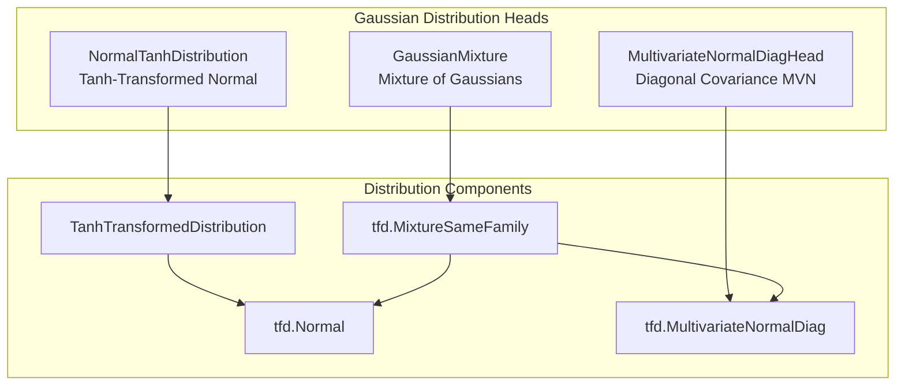
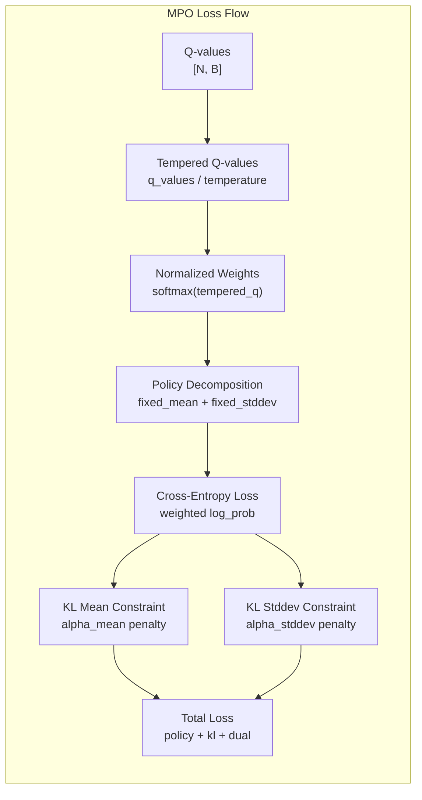
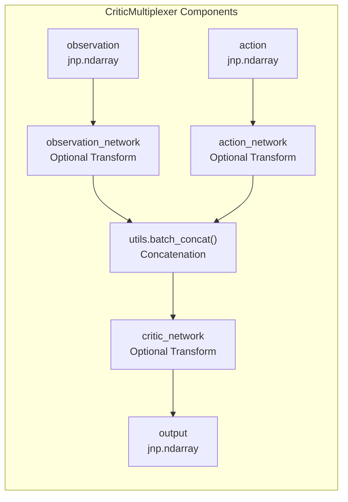
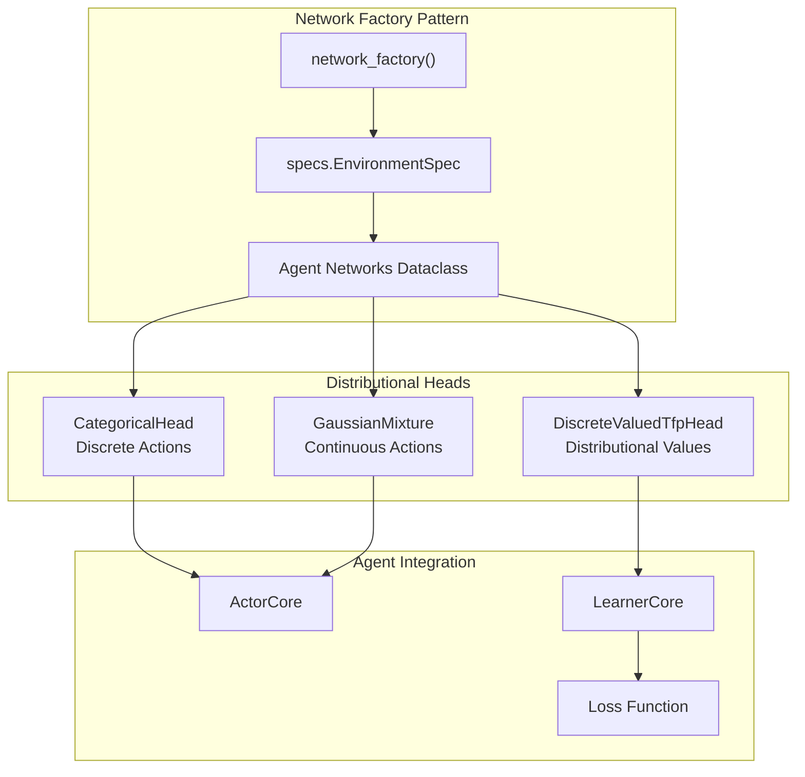

<!-- source: DeepWiki mcp.deepwiki.com · repo google-deepmind/acme · page 3.4 Distributional Networks and Advanced Components · fetched 2026-10-26 -->

# Distributional Networks and Advanced Components

<details>
<summary>Relevant source files</summary>

The following files were used as context for generating this wiki page:

- [acme/jax/losses/__init__.py](acme/jax/losses/__init__.py)
- [acme/jax/losses/mpo.py](acme/jax/losses/mpo.py)
- [acme/jax/networks/distributional.py](acme/jax/networks/distributional.py)
- [acme/jax/networks/multiplexers.py](acme/jax/networks/multiplexers.py)
- [examples/baselines/rl_continuous/run_wpo.py](examples/baselines/rl_continuous/run_wpo.py)

</details>


This document covers the specialized neural network components and advanced loss functions in Acme's JAX infrastructure, focusing on distributional reinforcement learning network heads, sophisticated policy optimization losses like MPO, and advanced network utilities. These components enable implementation of state-of-the-art algorithms that work with probability distributions rather than point estimates.

For basic neural network architectures and standard network interfaces, see [Neural Network Architectures](#3.2). For JAX device management and basic utilities, see [JAX Utilities and Device Management](#3.1).

## Distributional Network Heads

The distributional networks module provides Haiku-based network heads that output TensorFlow Probability distributions, enabling distributional reinforcement learning approaches.

### Categorical Distribution Heads

The `CategoricalHead` class creates discrete categorical distributions for policy networks or Q-value distributions.



Sources: [acme/jax/networks/distributional.py:33-52](), [acme/jax/networks/distributional.py:300-315](), [acme/jax/networks/distributional.py:318-346](), [acme/jax/networks/distributional.py:349-370]()

The `CategoricalValueHead` combines policy and value outputs for actor-critic methods:

| Component | Purpose | Output |
|-----------|---------|--------|
| `_logit_layer` | Action logits | `tfd.Categorical` |
| `_value_layer` | State value | Scalar value |

The `DiscreteValued` head implements C51-style distributional Q-learning:

| Parameter | Default | Purpose |
|-----------|---------|---------|
| `num_actions` | - | Number of discrete actions |
| `num_atoms` | 51 | Distribution support size |
| `v_min` | -1.0 | Minimum value |
| `v_max` | 1.0 | Maximum value |

### Gaussian Distribution Networks

Multiple classes handle continuous action spaces with Gaussian distributions:



Sources: [acme/jax/networks/distributional.py:55-176](), [acme/jax/networks/distributional.py:237-265](), [acme/jax/networks/distributional.py:268-297]()

The `GaussianMixture` class supports both univariate and multivariate mixture components:

| Parameter | Purpose |
|-----------|---------|
| `num_components` | Number of mixture components |
| `multivariate` | Whether to use multivariate normal components |
| `init_scale` | Initial scale for components |
| `transformation_fn` | Optional transformation (e.g., Tanh) |

### Discrete-Valued Distribution Infrastructure

The `DiscreteValuedTfpDistribution` extends categorical distributions to support arbitrary real-valued supports:

```mermaid
graph TB
    subgraph "DiscreteValuedTfpDistribution"
        DVTD["DiscreteValuedTfpDistribution"]
        Values["values: chex.Array<br/>Support Values"]
        Logits["logits: chex.Array<br/>Log Probabilities"]
    end
    
    subgraph "Categorical Base"
        TfdCategorical["tfd.Categorical<br/>Base Distribution"]
        Methods["sample()<br/>mean()<br/>variance()"]
    end
    
    subgraph "Head Integration"
        DVTHead["DiscreteValuedTfpHead"]
        LinearLayer["hk.Linear"]
        ReshapeLayer["hk.Reshape"]
    end
    
    DVTD --> TfdCategorical
    TfdCategorical --> Methods
    
    DVTHead --> LinearLayer
    LinearLayer --> ReshapeLayer
    ReshapeLayer --> DVTD
    
    DVTD --> Values
    DVTD --> Logits
```



Sources: [acme/jax/networks/distributional.py:373-414](), [acme/jax/networks/distributional.py:417-494]()

## Advanced Loss Functions: MPO Implementation

The Maximum a Posteriori Policy Optimization (MPO) loss implements sophisticated policy optimization with KL constraints and dual variable adaptation.

### MPO Architecture and Components

```mermaid
graph TB
    subgraph "MPO Class Structure"
        MPO["MPO<br/>Main Loss Class"]
        MPOParams["MPOParams<br/>log_temperature<br/>log_alpha_mean<br/>log_alpha_stddev<br/>log_penalty_temperature"]
        MPOStats["MPOStats<br/>Diagnostics and Metrics"]
    end
    
    subgraph "Core Computations"
        WeightsTemp["compute_weights_and_temperature_loss()<br/>Importance Weights"]
        CrossEntropy["compute_cross_entropy_loss()<br/>Policy Loss"]
        KLPenalty["compute_parametric_kl_penalty_and_dual_loss()<br/>KL Constraints"]
    end
    
    subgraph "Configuration"
        Epsilon["epsilon: KL constraint"]
        EpsilonMean["epsilon_mean: Mean constraint"]
        EpsilonStddev["epsilon_stddev: Stddev constraint"]
        PerDimConstraining["per_dim_constraining: bool"]
        ActionPenalization["action_penalization: bool"]
    end
    
    MPO --> MPOParams
    MPO --> MPOStats
    
    MPO --> WeightsTemp
    MPO --> CrossEntropy
    MPO --> KLPenalty
    
    MPO --> Epsilon
    MPO --> EpsilonMean
    MPO --> EpsilonStddev
    MPO --> PerDimConstraining
    MPO --> ActionPenalization
```



Sources: [acme/jax/losses/mpo.py:74-173](), [acme/jax/losses/mpo.py:42-72]()

### MPO Loss Computation Pipeline

The MPO loss implements a multi-stage optimization process:

| Stage | Function | Purpose |
|-------|----------|---------|
| **Importance Weighting** | `compute_weights_and_temperature_loss()` | Convert Q-values to normalized importance weights |
| **Policy Decomposition** | Internal logic | Split online policy into fixed-mean and fixed-stddev components |
| **Cross-Entropy Loss** | `compute_cross_entropy_loss()` | Compute policy gradient from weighted samples |
| **KL Penalty** | `compute_parametric_kl_penalty_and_dual_loss()` | Apply KL constraints with dual variables |



Sources: [acme/jax/losses/mpo.py:174-332](), [acme/jax/losses/mpo.py:335-447]()

### Dual Variable Management

MPO uses dual variables to automatically adapt constraint strengths:

| Dual Variable | Constraint | Transform |
|---------------|------------|-----------|
| `log_temperature` | Q-value tempering | `softplus()` |
| `log_alpha_mean` | Mean KL constraint | `softplus()` |
| `log_alpha_stddev` | Stddev KL constraint | `softplus()` |
| `log_penalty_temperature` | Action penalization | `softplus()` |

The `clip_mpo_params()` function prevents numerical instabilities:

```python
# Minimum values prevent underflow
_MIN_LOG_TEMPERATURE = -18.0
_MIN_LOG_ALPHA = -18.0
```

Sources: [acme/jax/losses/mpo.py:450-461](), [acme/jax/losses/mpo.py:34-36]()

## Network Multiplexers and Composition

### CriticMultiplexer Architecture

The `CriticMultiplexer` enables flexible composition of critic networks with observation and action preprocessing:



Sources: [acme/jax/networks/multiplexers.py:28-71]()

The `CriticMultiplexer` supports optional transformations at each stage:

| Component | Type | Purpose |
|-----------|------|---------|
| `observation_network` | `Optional[ModuleOrArrayTransform]` | Preprocess observations |
| `action_network` | `Optional[ModuleOrArrayTransform]` | Preprocess actions |
| `critic_network` | `Optional[ModuleOrArrayTransform]` | Process concatenated inputs |

## Integration Patterns and Usage

### Distributional RL Integration

Distributional network heads integrate with standard Acme patterns:



Sources: [acme/jax/networks/distributional.py:1-495]()

### MPO Loss Integration

The MPO loss integrates with agent learners through parameter management:

| Integration Point | Component | Purpose |
|------------------|-----------|---------|
| **Initialization** | `MPO.init_params()` | Create initial dual variables |
| **Training Step** | `MPO.__call__()` | Compute loss and statistics |
| **Parameter Updates** | `clip_mpo_params()` | Prevent numerical issues |
| **Diagnostics** | `MPOStats` | Monitor constraint satisfaction |

Sources: [acme/jax/losses/mpo.py:145-172](), [acme/jax/losses/mpo.py:174-332](), [acme/jax/losses/__init__.py:18-20]()

The advanced components in this module enable implementation of sophisticated RL algorithms that leverage distributional representations, automatic constraint adaptation, and flexible network composition patterns essential for modern reinforcement learning research.

---

