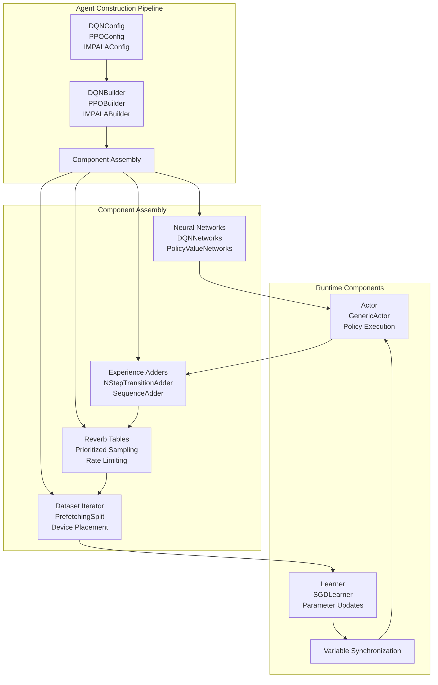
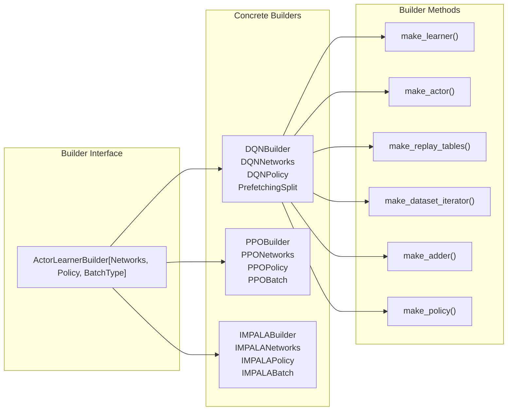
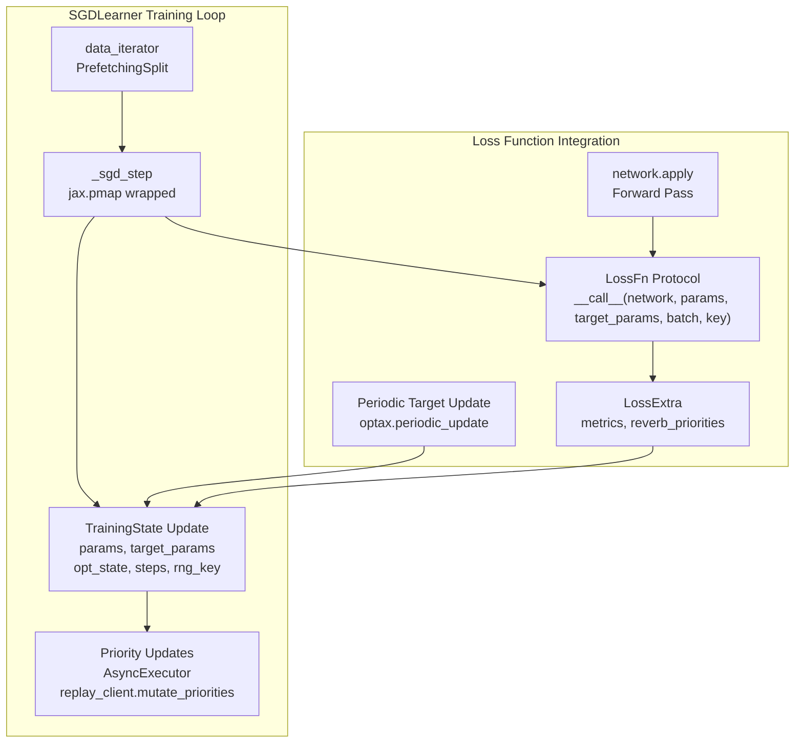
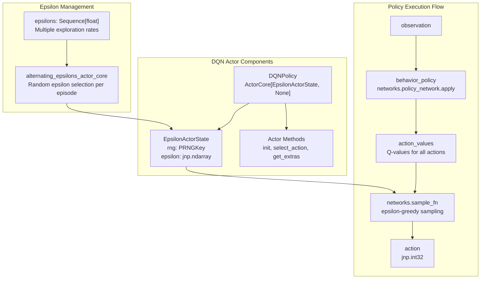
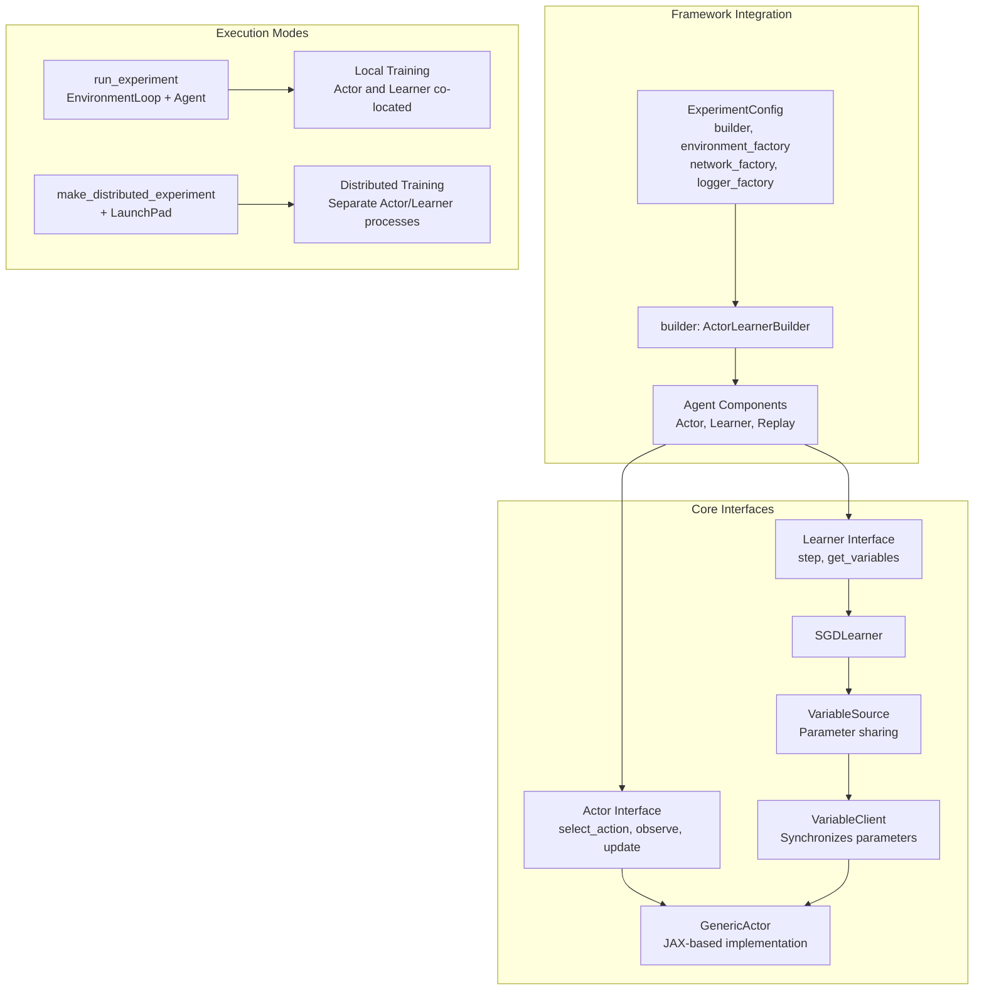

<!-- source: DeepWiki mcp.deepwiki.com · repo google-deepmind/acme · page 4 Reinforcement Learning Agents · fetched 2026-10-26 -->

# Reinforcement Learning Agents

<details>
<summary>Relevant source files</summary>

The following files were used as context for generating this wiki page:

- [acme/agents/jax/dqn/__init__.py](acme/agents/jax/dqn/__init__.py)
- [acme/agents/jax/dqn/actor.py](acme/agents/jax/dqn/actor.py)
- [acme/agents/jax/dqn/builder.py](acme/agents/jax/dqn/builder.py)
- [acme/agents/jax/dqn/config.py](acme/agents/jax/dqn/config.py)
- [acme/agents/jax/dqn/learning.py](acme/agents/jax/dqn/learning.py)
- [acme/agents/jax/dqn/learning_lib.py](acme/agents/jax/dqn/learning_lib.py)
- [acme/agents/jax/dqn/losses.py](acme/agents/jax/dqn/losses.py)

</details>


This document covers the implemented reinforcement learning algorithms and their architectures in the Acme framework. It focuses on the common patterns, interfaces, and components used across all agent implementations, with detailed examples from the DQN family. For information about core framework interfaces like `Actor` and `Learner`, see [Core Interfaces and Agent Composition](#2.1). For experiment configuration and execution details, see [Experiment Management and Execution](#6).

## Agent Architecture Overview

Acme agents follow a consistent architectural pattern built around three core abstractions: `Actor` for policy execution, `Learner` for parameter updates, and `VariableSource` for parameter sharing. All agents are constructed using a builder pattern that composes these components with algorithm-specific networks, loss functions, and replay systems.



Sources: [acme/agents/jax/dqn/builder.py:40-104](), [acme/agents/jax/dqn/learning_lib.py:76-163]()

## Builder Pattern for Agent Construction

Acme implements a consistent builder pattern across all agents through the `ActorLearnerBuilder` interface. Each algorithm provides a concrete builder that assembles the required components with algorithm-specific configurations.



The `DQNBuilder` exemplifies this pattern, taking a `DQNConfig` and loss function to construct all necessary components:

| Method | Purpose | Returns |
|--------|---------|---------|
| `make_learner()` | Creates SGD-based learner with loss function | `SGDLearner` |
| `make_actor()` | Creates actor with epsilon-greedy policy | `GenericActor` |
| `make_replay_tables()` | Creates prioritized replay tables | `List[reverb.Table]` |
| `make_dataset_iterator()` | Creates multi-device dataset iterator | `Iterator[PrefetchingSplit]` |
| `make_adder()` | Creates n-step transition adder | `NStepTransitionAdder` |
| `make_policy()` | Creates epsilon-greedy behavior policy | `DQNPolicy` |

Sources: [acme/agents/jax/dqn/builder.py:40-200]()

## Learning Components

The learning system is built around a flexible `SGDLearner` that accepts configurable loss functions. This design allows multiple algorithms to share the same learning infrastructure while implementing algorithm-specific loss computations.

### SGD Learner Architecture

The `SGDLearner` implements the core training loop with support for:
- Multi-device training with `jax.pmap`
- Prioritized replay updates
- Target network periodic updates
- Configurable SGD steps per training step



### Loss Function Implementations

Acme provides multiple loss function implementations following the `LossFn` protocol:

| Loss Function | Algorithm | Key Features |
|---------------|-----------|--------------|
| `PrioritizedDoubleQLearning` | DQN | Double Q-learning, prioritized replay, Huber loss |
| `QLearning` | DQN | Basic Q-learning with squared loss |
| `QrDqn` | QR-DQN | Quantile regression for distributional RL |
| `PrioritizedCategoricalDoubleQLearning` | C51 | Categorical distributions, double Q-learning |
| `RegularizedQLearning` | DQNReg | Q-learning with regularization term |
| `MunchausenQLearning` | M-DQN | Entropy-regularized Q-learning |

Sources: [acme/agents/jax/dqn/learning_lib.py:53-222](), [acme/agents/jax/dqn/losses.py:29-348]()

## Actor Components

Acme actors implement the `ActorCore` pattern, providing stateful policy execution with exploration strategies. The DQN family uses epsilon-greedy exploration with support for alternating epsilon values.

### DQN Policy Structure



The `behavior_policy` function creates an epsilon-greedy policy from `DQNNetworks`:

```python
def behavior_policy(networks: dqn_networks.DQNNetworks) -> EpsilonPolicy
```

This policy applies the network to get Q-values and uses the configured sampling function for action selection with parameterized epsilon.

Sources: [acme/agents/jax/dqn/actor.py:44-114]()

## Configuration System

Acme agents use dataclass-based configuration objects to specify hyperparameters and algorithm variants. The `DQNConfig` exemplifies the configuration pattern used across all agents.

### DQN Configuration Parameters

| Category | Parameters | Description |
|----------|------------|-------------|
| Exploration | `epsilon`, `eval_epsilon` | Epsilon-greedy exploration rates |
| Learning | `learning_rate`, `discount`, `n_step` | Basic RL hyperparameters |
| Networks | `target_update_period` | Target network update frequency |
| Replay | `batch_size`, `min_replay_size`, `max_replay_size` | Experience replay configuration |
| Prioritization | `importance_sampling_exponent`, `priority_exponent` | Prioritized replay parameters |
| Performance | `prefetch_size`, `num_sgd_steps_per_step` | Training efficiency settings |

The configuration supports flexible epsilon schedules through the `logspace_epsilons` utility:

```python
def logspace_epsilons(num_epsilons: int, epsilon: float = 0.017) -> Sequence[float]
```

This generates logarithmically spaced epsilon values for population-based exploration strategies.

Sources: [acme/agents/jax/dqn/config.py:25-88]()

## Integration with Core Framework

RL agents integrate with the core Acme framework through standardized interfaces that enable both single-threaded and distributed execution:



All agents implement the same core interfaces, ensuring they work seamlessly with the experiment framework, environment loops, and distributed execution systems. The builder pattern provides a consistent way to construct agents with algorithm-specific components while maintaining compatibility with the broader Acme ecosystem.

Sources: [acme/agents/jax/dqn/builder.py:86-104](), [acme/agents/jax/dqn/learning_lib.py:212-214]()

---

