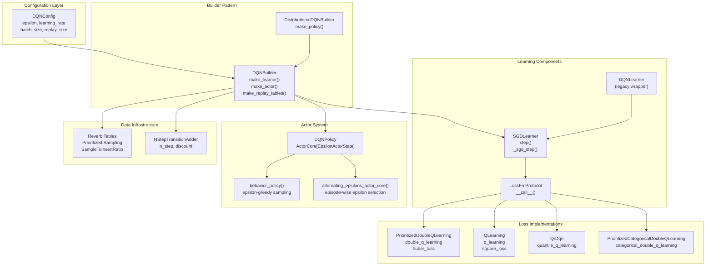
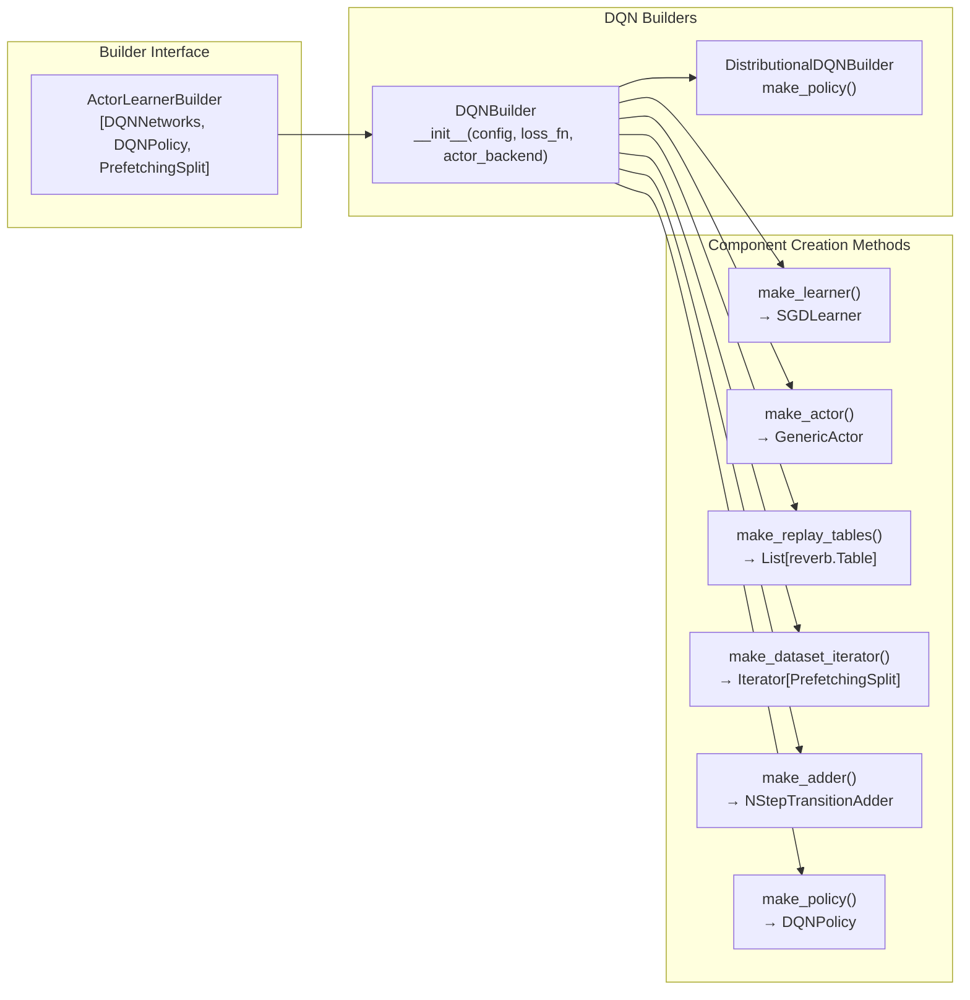
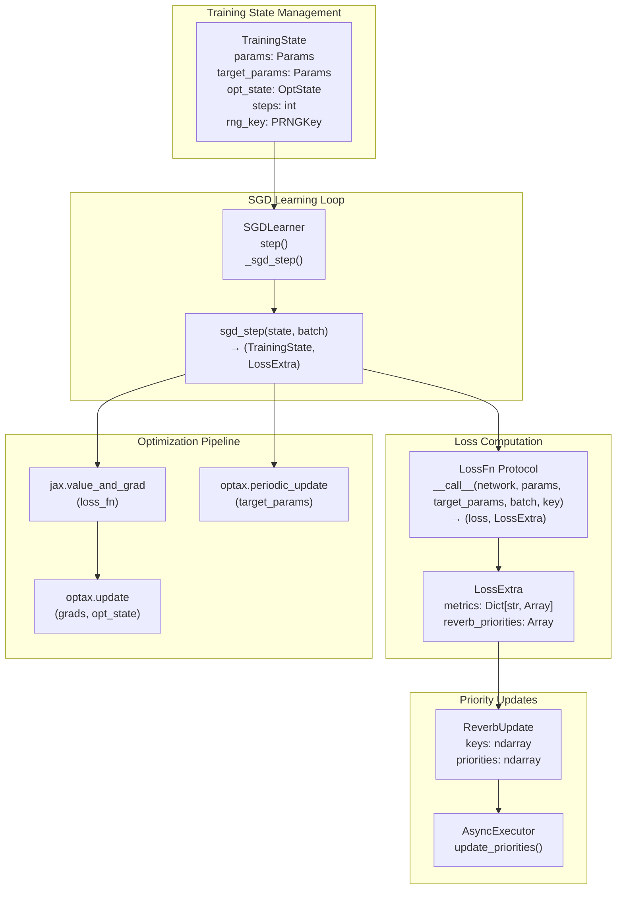
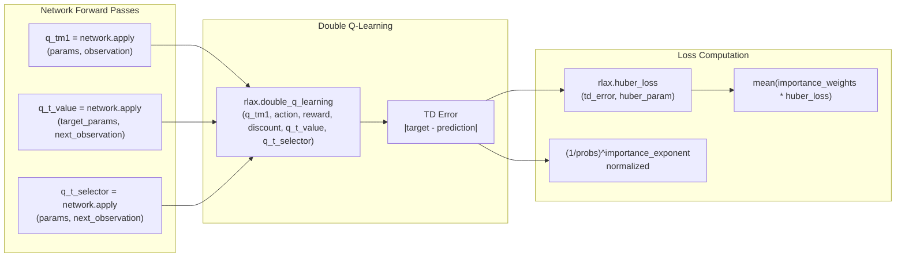
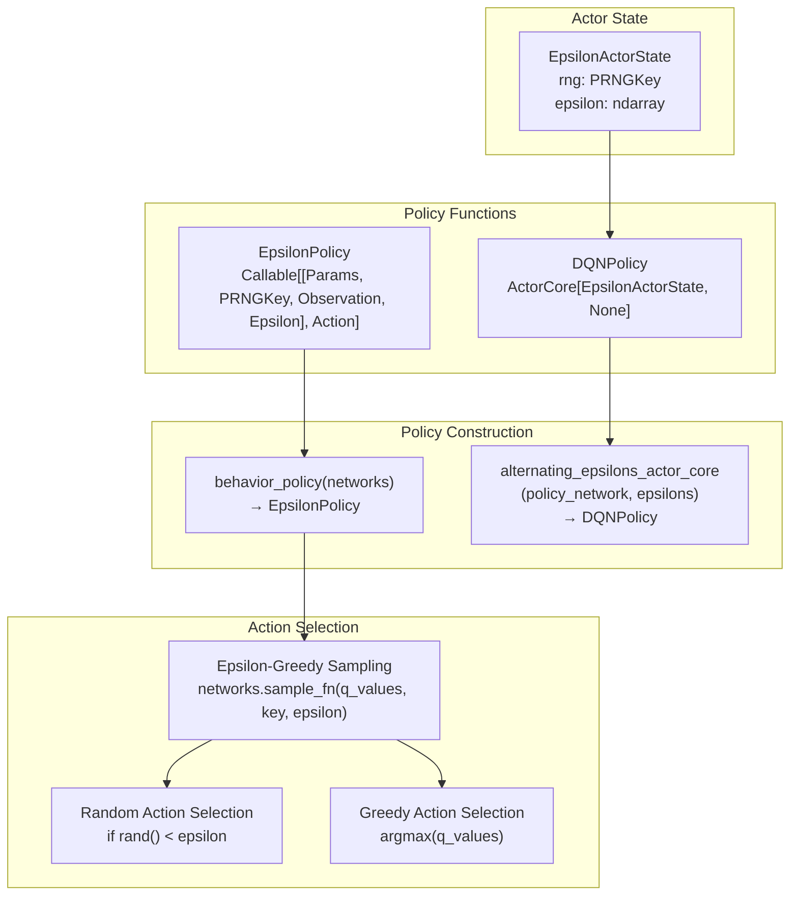
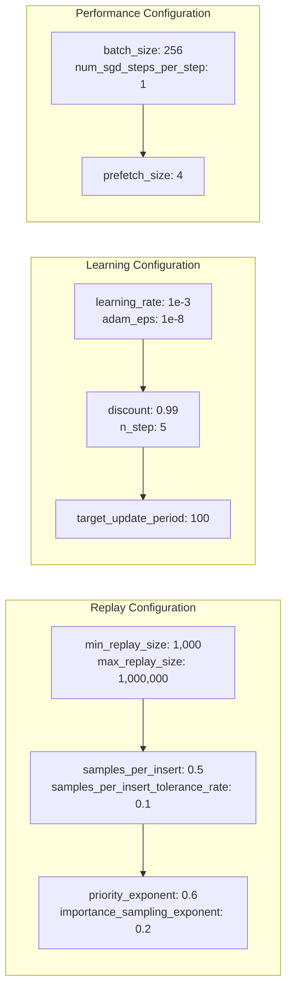

<!-- source: DeepWiki mcp.deepwiki.com · repo google-deepmind/acme · page 4.1 DQN Family · fetched 2026-10-26 -->

# DQN Family

Relevant source files

The following files were used as context for generating this wiki page:

- [acme/agents/jax/dqn/__init__.py](acme/agents/jax/dqn/__init__.py)
- [acme/agents/jax/dqn/actor.py](acme/agents/jax/dqn/actor.py)
- [acme/agents/jax/dqn/builder.py](acme/agents/jax/dqn/builder.py)
- [acme/agents/jax/dqn/config.py](acme/agents/jax/dqn/config.py)
- [acme/agents/jax/dqn/learning.py](acme/agents/jax/dqn/learning.py)
- [acme/agents/jax/dqn/learning_lib.py](acme/agents/jax/dqn/learning_lib.py)
- [acme/agents/jax/dqn/losses.py](acme/agents/jax/dqn/losses.py)

This document covers the Deep Q-Networks (DQN) family of reinforcement learning agents implemented in Acme. The DQN family includes the base DQN algorithm and several advanced variants including Double DQN, Prioritized Experience Replay, Distributional DQN, Quantile Regression DQN, and other extensions. For policy-based methods, see [PPO](#4.3). For recurrent DQN variants, see [R2D2](#4.4).

## Architecture Overview

The DQN system follows Acme's modular architecture with clear separation between building, learning, and acting components:

**Sources:** [acme/agents/jax/dqn/builder.py:40-243](), [acme/agents/jax/dqn/learning_lib.py:76-222](), [acme/agents/jax/dqn/losses.py:29-349](), [acme/agents/jax/dqn/actor.py:28-115]()

## Builder Pattern Implementation

The DQN system uses the builder pattern to compose agent components. The `DQNBuilder` class implements the `ActorLearnerBuilder` interface:

The `DQNBuilder` creates all necessary components:

- **Learner Creation**: Returns `SGDLearner` with Adam optimizer and configurable target update period
- **Replay Tables**: Creates Reverb tables with prioritized sampling and rate limiting
- **Dataset Iterator**: Configures multi-device batch processing with prefetching
- **Actor Creation**: Wraps policy in `GenericActor` with variable synchronization
- **Adder Creation**: Creates `NStepTransitionAdder` for experience collection

**Sources:** [acme/agents/jax/dqn/builder.py:40-181]()

## Learning System Architecture

The learning system centers around the `SGDLearner` class, which implements the generic SGD training loop:

**Key Components:**

- **TrainingState**: Holds network parameters, target parameters, optimizer state, and training step counter
- **SGD Step**: Performs loss computation, gradient calculation, parameter updates, and periodic target network updates
- **Priority Updates**: Asynchronously updates Reverb priorities based on TD errors

**Sources:** [acme/agents/jax/dqn/learning_lib.py:67-222]()

## Loss Functions

The DQN family supports multiple loss function variants, all implementing the `LossFn` protocol:

### PrioritizedDoubleQLearning

The primary loss function implementing Double DQN with prioritized experience replay:

**Sources:** [acme/agents/jax/dqn/losses.py:29-78]()

### Other Loss Variants

| Loss Function | Key Features | Use Case |
|---------------|--------------|----------|
| `QLearning` | Basic Q-learning with square loss | Original DQN algorithm |
| `QrDqn` | Quantile regression with distributional outputs | Risk-sensitive learning |
| `PrioritizedCategoricalDoubleQLearning` | Categorical distributions with prioritization | Distributional RL |
| `RegularizedQLearning` | DQNReg with L2 regularization | Improved stability |
| `MunchausenQLearning` | M-DQN with entropy regularization | Enhanced exploration |

**Sources:** [acme/agents/jax/dqn/losses.py:81-349]()

## Actor System

The actor system implements epsilon-greedy exploration with support for alternating epsilon values:

### Policy Components

**Key Features:**

- **Episode-wise Epsilon Selection**: `alternating_epsilons_actor_core` randomly selects epsilon values per episode for diverse exploration
- **Parameterized Exploration**: `behavior_policy` creates epsilon-greedy policies with configurable epsilon values
- **State Management**: `EpsilonActorState` tracks RNG state and current epsilon value

**Sources:** [acme/agents/jax/dqn/actor.py:28-115]()

## Configuration System

The `DQNConfig` dataclass provides comprehensive configuration for DQN agents:

### Core Configuration Groups

| Parameter Group | Key Settings | Purpose |
|-----------------|--------------|---------|
| **Exploration** | `epsilon`, `eval_epsilon` | Epsilon-greedy exploration control |
| **Learning** | `learning_rate`, `adam_eps`, `discount`, `n_step` | Optimization and temporal difference learning |
| **Target Updates** | `target_update_period` | Frequency of target network synchronization |
| **Replay** | `batch_size`, `min_replay_size`, `max_replay_size` | Experience replay configuration |
| **Prioritization** | `importance_sampling_exponent`, `priority_exponent` | Prioritized experience replay |
| **Performance** | `prefetch_size`, `num_sgd_steps_per_step` | Training efficiency optimization |

### Advanced Configuration

The `logspace_epsilons` utility function generates logarithmically-spaced epsilon values for multi-epsilon exploration strategies.

**Sources:** [acme/agents/jax/dqn/config.py:25-89]()

## Integration with Acme Framework

The DQN family integrates seamlessly with Acme's experiment framework:

- **Builder Pattern**: Implements `ActorLearnerBuilder` for component assembly
- **Variable Synchronization**: Uses `VariableClient` for actor-learner parameter sharing
- **Reverb Integration**: Leverages prioritized sampling and rate-limited replay
- **JAX Infrastructure**: Utilizes multi-device training and JIT compilation
- **Logging**: Integrates with Acme's logger system for metrics tracking

For experiment configuration, see [Experiment Configuration Framework](#6.1). For distributed training, see [Distributed Execution with LaunchPad](#6.2).

**Sources:** [acme/agents/jax/dqn/__init__.py:15-35]()

---

