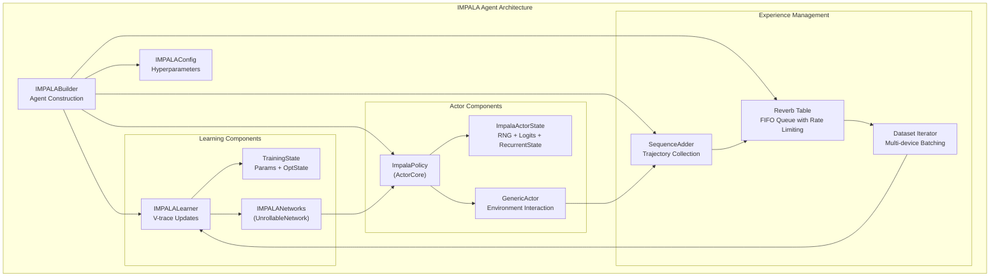

<!-- source: DeepWiki mcp.deepwiki.com · repo google-deepmind/acme · page 4.2 IMPALA · fetched 2026-10-26 -->

# IMPALA

<details>
<summary>Relevant source files</summary>

The following files were used as context for generating this wiki page:

- [acme/agents/jax/impala/__init__.py](acme/agents/jax/impala/__init__.py)
- [acme/agents/jax/impala/acting.py](acme/agents/jax/impala/acting.py)
- [acme/agents/jax/impala/builder.py](acme/agents/jax/impala/builder.py)
- [acme/agents/jax/impala/config.py](acme/agents/jax/impala/config.py)
- [acme/agents/jax/impala/learning.py](acme/agents/jax/impala/learning.py)
- [acme/agents/jax/impala/networks.py](acme/agents/jax/impala/networks.py)
- [acme/agents/jax/impala/types.py](acme/agents/jax/impala/types.py)

</details>


This document covers the Importance Weighted Actor-Learner Architecture (IMPALA) implementation in Acme. IMPALA is a distributed reinforcement learning algorithm that uses importance sampling to correct for the policy lag between actors and the learner. The implementation follows Acme's standard agent architecture pattern with separate actor and learner components connected through experience replay.

For information about other policy gradient methods, see [PPO](#4.3). For recurrent Q-learning approaches, see [R2D2](#4.4).

## Architecture Overview

The IMPALA implementation consists of several key components that work together in a distributed actor-learner setup:



Sources: [acme/agents/jax/impala/__init__.py:1-22](), [acme/agents/jax/impala/builder.py:42-46](), [acme/agents/jax/impala/learning.py:43-44]()

## Component Interaction Flow

The following diagram shows how data flows through the IMPALA system during training:

```mermaid
sequenceDiagram
    participant Actor as "GenericActor"
    participant Policy as "ImpalaPolicy"
    participant Adder as "SequenceAdder"
    participant Reverb as "Reverb Table"
    participant Dataset as "Dataset Iterator"
    participant Learner as "IMPALALearner"
    participant Networks as "IMPALANetworks"
    
    Actor->>Policy: "select_action(params, obs, state)"
    Policy->>Policy: "networks.apply(params, rng, obs, recurrent_state)"
    Policy-->>Actor: "action, new_state"
    Actor->>Adder: "add(timestep, extras={'logits', 'core_state'})"
    Adder->>Reverb: "insert trajectory sequences"
    
    Dataset->>Reverb: "sample batches"
    Dataset-->>Learner: "reverb.ReplaySample"
    Learner->>Learner: "sgd_step(state, sample)"
    Learner->>Networks: "impala_loss(params, sample)"
    Learner->>Learner: "update TrainingState"
    Learner-->>Actor: "get_variables() → updated params"
```

Sources: [acme/agents/jax/impala/acting.py:64-88](), [acme/agents/jax/impala/learning.py:132-149](), [acme/agents/jax/impala/builder.py:121-137]()

## Builder Implementation

The `IMPALABuilder` class implements the standard Acme builder pattern for constructing IMPALA agents:

| Method | Purpose | Key Configuration |
|--------|---------|-------------------|
| `make_replay_tables` | Creates Reverb table with FIFO sampling | `max_queue_size`, `samples_per_insert` ratio |
| `make_dataset_iterator` | Multi-device batch creation | `batch_size` divided across devices |
| `make_adder` | Sequence collection with overlap | `sequence_length`, `sequence_period` |
| `make_learner` | V-trace learner with Adam optimizer | `learning_rate`, `entropy_cost`, `baseline_cost` |
| `make_actor` | Generic actor with variable sync | `variable_update_period` |
| `make_policy` | ActorCore for action selection | Evaluation vs training mode |

The builder ensures proper sequence overlap for bootstrapping by setting the sequence period to `sequence_length - 1` when not explicitly configured [acme/agents/jax/impala/builder.py:130-136]().

Sources: [acme/agents/jax/impala/builder.py:42-193]()

## Learner Implementation

The `IMPALALearner` class handles distributed training using V-trace importance sampling correction:

### Training State Management

The learner maintains a `TrainingState` containing network parameters and optimizer state [acme/agents/jax/impala/learning.py:37-41]():

```python
class TrainingState(NamedTuple):
  params: networks_lib.Params
  opt_state: optax.OptState
```

### Distributed SGD Step

The core learning loop uses JAX `pmap` for multi-device training [acme/agents/jax/impala/learning.py:87-112]():

- Computes V-trace loss using `losses.impala_loss`
- Averages gradients across replicas with `jax.lax.pmean`
- Updates parameters using Adam optimizer
- Logs training metrics including loss and parameter norms

### Key Configuration Parameters

| Parameter | Default | Purpose |
|-----------|---------|---------|
| `discount` | 0.99 | Reward discount factor |
| `entropy_cost` | 0.0 | Entropy regularization weight |
| `baseline_cost` | 1.0 | Value function loss weight |
| `max_abs_reward` | np.inf | Reward clipping threshold |

Sources: [acme/agents/jax/impala/learning.py:43-161]()

## Actor Implementation

The IMPALA actor uses a recurrent policy with importance sampling:

### Actor State

`ImpalaActorState` tracks the complete actor state [acme/agents/jax/impala/acting.py:32-38]():

```python
@chex.dataclass(frozen=True, mappable_dataclass=False)
class ImpalaActorState(Generic[actor_core_lib.RecurrentState]):
  rng: jax_types.PRNGKey
  logits: networks_lib.Logits  
  recurrent_state: actor_core_lib.RecurrentState
  prev_recurrent_state: actor_core_lib.RecurrentState
```

### Action Selection

The `select_action` function performs forward inference and stochastic action sampling [acme/agents/jax/impala/acting.py:64-88]():

- Calls `networks.apply` with current recurrent state
- Uses `jax.random.categorical` for stochastic sampling (training)
- Uses `jnp.argmax` for deterministic selection (evaluation)
- Returns both action and updated actor state

### Extras for Experience Replay

The actor provides logits and recurrent state as extras for V-trace computation [acme/agents/jax/impala/acting.py:90-92]():

```python
def get_extras(state: ImpalaActorState) -> ImpalaExtras:
  return {'logits': state.logits, 'core_state': state.prev_recurrent_state}
```

Sources: [acme/agents/jax/impala/acting.py:1-96]()

## Network Architecture

IMPALA uses `UnrollableNetwork` for recurrent policy-value networks:

```python
IMPALANetworks = networks_lib.UnrollableNetwork
```

For Atari environments, the default network is `DeepIMPALAAtariNetwork` which combines:
- Convolutional feature extraction
- LSTM recurrent processing  
- Policy and value heads

The `make_atari_networks` function creates the standard architecture [acme/agents/jax/impala/networks.py:24-30]().

Sources: [acme/agents/jax/impala/networks.py:1-31]()

## Configuration Options

The `IMPALAConfig` dataclass centralizes all hyperparameters:

### Core Algorithm Settings
- `discount`: Reward discount factor (default: 0.99)
- `entropy_cost`: Policy entropy regularization (default: 0.01)
- `baseline_cost`: Value function loss weight (default: 0.5)
- `max_abs_reward`: Reward clipping threshold

### Sequence Processing  
- `sequence_length`: Trajectory length for V-trace (default: 20)
- `sequence_period`: Overlap between sequences for bootstrapping
- `variable_update_period`: Actor parameter sync frequency (default: 1000)

### Training Configuration
- `batch_size`: Learner batch size (default: 32)
- `learning_rate`: Adam learning rate (default: 2e-4)
- `max_gradient_norm`: Gradient clipping threshold (default: 40.0)

### Experience Replay
- `max_queue_size`: Reverb table capacity (default: 10 batches)
- `samples_per_insert`: Rate limiting ratio for dropping stale data (default: 1.0)

Sources: [acme/agents/jax/impala/config.py:25-64]()

---

