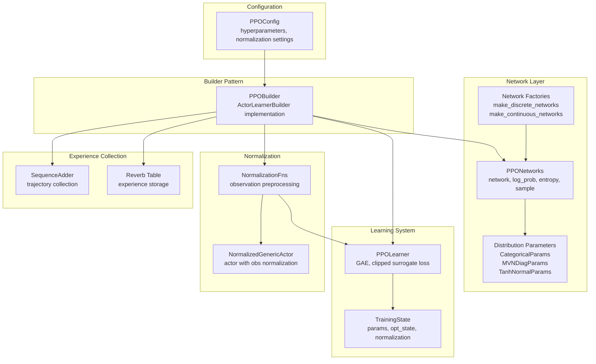
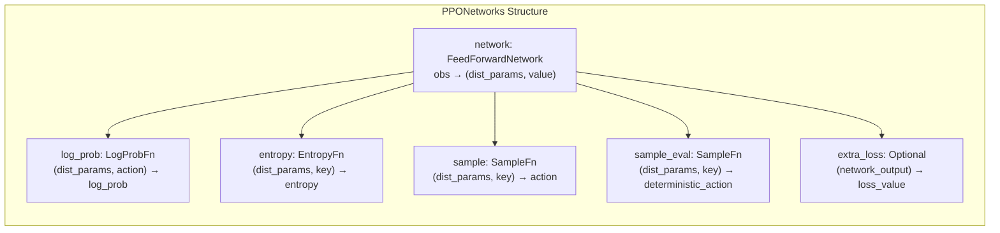
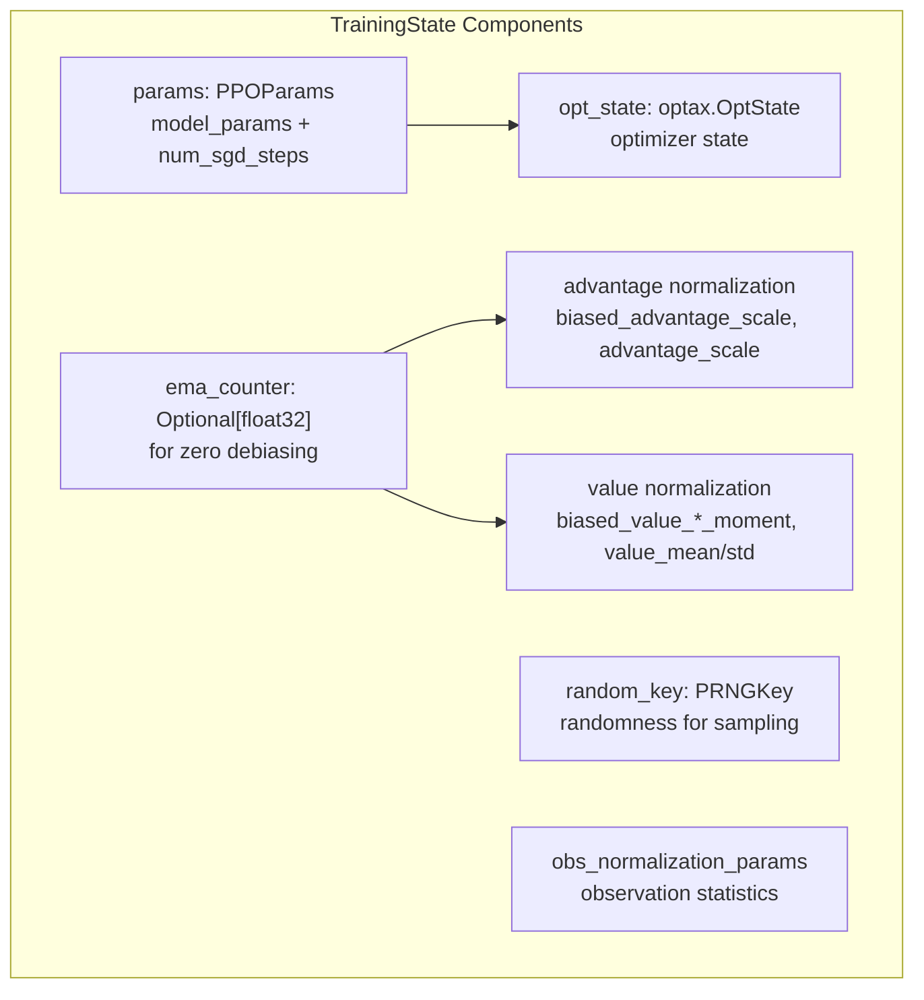
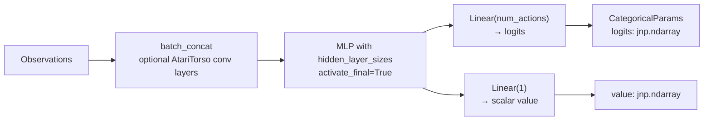
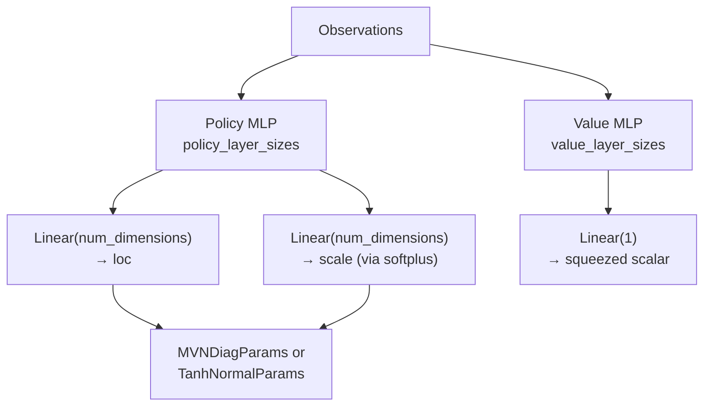
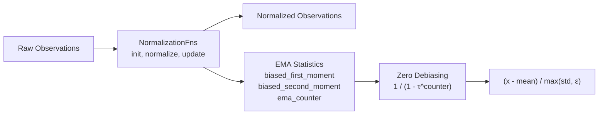
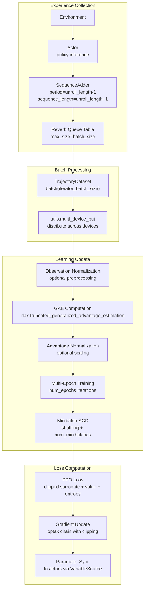

<!-- source: DeepWiki mcp.deepwiki.com · repo google-deepmind/acme · page 4.3 PPO · fetched 2026-10-26 -->

# PPO

Relevant source files

The following files were used as context for generating this wiki page:

- [acme/agents/jax/ppo/README.md](acme/agents/jax/ppo/README.md)
- [acme/agents/jax/ppo/__init__.py](acme/agents/jax/ppo/__init__.py)
- [acme/agents/jax/ppo/builder.py](acme/agents/jax/ppo/builder.py)
- [acme/agents/jax/ppo/config.py](acme/agents/jax/ppo/config.py)
- [acme/agents/jax/ppo/learning.py](acme/agents/jax/ppo/learning.py)
- [acme/agents/jax/ppo/networks.py](acme/agents/jax/ppo/networks.py)
- [acme/agents/jax/ppo/normalization.py](acme/agents/jax/ppo/normalization.py)
- [examples/multiagent/multigrid/helpers.py](examples/multiagent/multigrid/helpers.py)

This document covers the Proximal Policy Optimization (PPO) implementation in Acme, including its architecture, components, and usage patterns. PPO is an on-policy reinforcement learning algorithm that uses a clipped surrogate objective to stabilize policy updates while maintaining sample efficiency.

For information about other reinforcement learning algorithms, see [DQN Family](#4.1), [IMPALA](#4.2), [R2D2](#4.4), and [MPO and Advanced Policy Methods](#4.5).

## Architecture Overview

The PPO implementation follows Acme's modular design pattern with clear separation between builder, networks, learner, and configuration components.

**Sources:** [acme/agents/jax/ppo/builder.py:40-234](), [acme/agents/jax/ppo/networks.py:61-83](), [acme/agents/jax/ppo/learning.py:78-106](), [acme/agents/jax/ppo/config.py:24-89]()

## Core Components

### PPOBuilder

The `PPOBuilder` class implements the `ActorLearnerBuilder` interface and orchestrates the creation of all PPO components.

| Method | Purpose | Key Implementation Details |
|--------|---------|---------------------------|
| `make_replay_tables` | Creates Reverb tables | Queue-based table with `batch_size` capacity |
| `make_dataset_iterator` | Creates data iterator | Multi-device batching with `utils.multi_device_put` |
| `make_adder` | Creates sequence adder | `SequenceAdder` with `unroll_length + 1` for bootstrapping |
| `make_learner` | Creates PPO learner | Configures optimizer, normalization, and learning parameters |
| `make_actor` | Creates actor | `GenericActor` or `NormalizedGenericActor` based on config |
| `make_policy` | Creates inference function | `make_inference_fn` with evaluation mode support |

The builder handles the complexity of distributed training by computing appropriate batch sizes across devices: `iterator_batch_size = config.batch_size // jax.device_count()`.

**Sources:** [acme/agents/jax/ppo/builder.py:40-242]()

### PPONetworks

The `PPONetworks` dataclass encapsulates the policy network and associated distribution functions.

The design allows flexibility in distribution types while maintaining a consistent interface. Three main distribution parameter types are supported:

- **CategoricalParams**: `logits` for discrete action spaces
- **MVNDiagParams**: `loc` and `scale_diag` for continuous actions with diagonal covariance
- **TanhNormalParams**: `loc` and `scale` for bounded continuous actions

**Sources:** [acme/agents/jax/ppo/networks.py:54-83](), [acme/agents/jax/ppo/networks.py:37-52]()

### PPOLearner

The `PPOLearner` implements the core PPO learning algorithm with support for multiple epochs, minibatches, and normalization schemes.

#### Training State Management

#### Learning Process

The learning process consists of several stages executed in `single_device_update`:

1. **Data Processing**: Extract trajectories, apply observation normalization, clip rewards
2. **Advantage Computation**: Use GAE (Generalized Advantage Estimation) with `rlax.truncated_generalized_advantage_estimation`
3. **Normalization Updates**: Update running statistics for advantages and values using exponential moving averages
4. **Multi-Epoch Training**: Perform `num_epochs` of updates, each with `num_minibatches` SGD steps

The PPO loss function combines:
- **Policy Loss**: Clipped surrogate objective using `rlax.clipped_surrogate_pg_loss`
- **Value Loss**: MSE between predicted and target values, optionally clipped
- **Entropy Loss**: Regularization term scaled by `entropy_cost`

**Sources:** [acme/agents/jax/ppo/learning.py:51-76](), [acme/agents/jax/ppo/learning.py:124-184](), [acme/agents/jax/ppo/learning.py:261-396]()

## Network Architectures

PPO supports both discrete and continuous action spaces with specialized network factories.

### Discrete Action Networks

For discrete action spaces, the network outputs categorical distribution parameters:

The `make_discrete_networks` function creates this architecture with optional convolutional layers for image observations (e.g., Atari environments).

**Sources:** [acme/agents/jax/ppo/networks.py:236-272](), [acme/agents/jax/ppo/networks.py:275-308]()

### Continuous Action Networks

For continuous action spaces, two distribution types are supported:

1. **Multivariate Normal Diagonal**: Standard Gaussian with diagonal covariance
2. **Tanh-Normal**: Bounded actions using tanh transformation

The choice between distribution types is controlled by `use_tanh_gaussian_policy` parameter in `make_continuous_networks`.

**Sources:** [acme/agents/jax/ppo/networks.py:311-385](), [acme/agents/jax/ppo/networks.py:150-187](), [acme/agents/jax/ppo/networks.py:190-233]()

## Configuration System

The `PPOConfig` dataclass centralizes all hyperparameters and settings:

| Parameter Category | Key Parameters | Default Values |
|-------------------|----------------|----------------|
| **Data Collection** | `unroll_length`, `batch_size` | 8, 256 |
| **Training Schedule** | `num_epochs`, `num_minibatches` | 2, 8 |
| **PPO Algorithm** | `ppo_clipping_epsilon`, `gae_lambda` | 0.2, 0.95 |
| **Optimization** | `learning_rate`, `max_gradient_norm` | 3e-4, 0.5 |
| **Regularization** | `entropy_cost`, `value_cost` | 3e-4, 1.0 |
| **Normalization** | `normalize_advantage`, `normalize_value` | False, False |

The configuration supports both static and scheduled learning rates through the `Union[float, Callable[[int], float]]` type.

**Sources:** [acme/agents/jax/ppo/config.py:24-89]()

## Normalization Features

PPO includes comprehensive normalization capabilities for improved training stability.

### Observation Normalization

The `obs_normalization_fns_factory` creates normalization functions that maintain running statistics of observations:

Two normalization implementations are provided:
- `build_mean_std_normalizer`: Uses `running_statistics` module
- `build_ema_mean_std_normalizer`: Custom EMA implementation with configurable `tau`

### Advantage and Value Normalization

During learning, advantages and value targets can be normalized using exponential moving averages:

- **Advantage Normalization**: Scales advantages by running estimate of absolute mean
- **Value Normalization**: Normalizes value targets using running mean and standard deviation

**Sources:** [acme/agents/jax/ppo/normalization.py:34-51](), [acme/agents/jax/ppo/normalization.py:105-220](), [acme/agents/jax/ppo/normalization.py:223-257](), [acme/agents/jax/ppo/learning.py:357-374]()

## Data Flow and Training Loop

The PPO training process involves several key data transformations and computations:

The extra step in sequence length (`unroll_length + 1`) is used for bootstrapping in GAE computation, with the last transition serving only to provide the terminal value estimate.

**Sources:** [acme/agents/jax/ppo/builder.py:53-75](), [acme/agents/jax/ppo/builder.py:135-141](), [acme/agents/jax/ppo/learning.py:326-333](), [acme/agents/jax/ppo/learning.py:225-256]()

---

