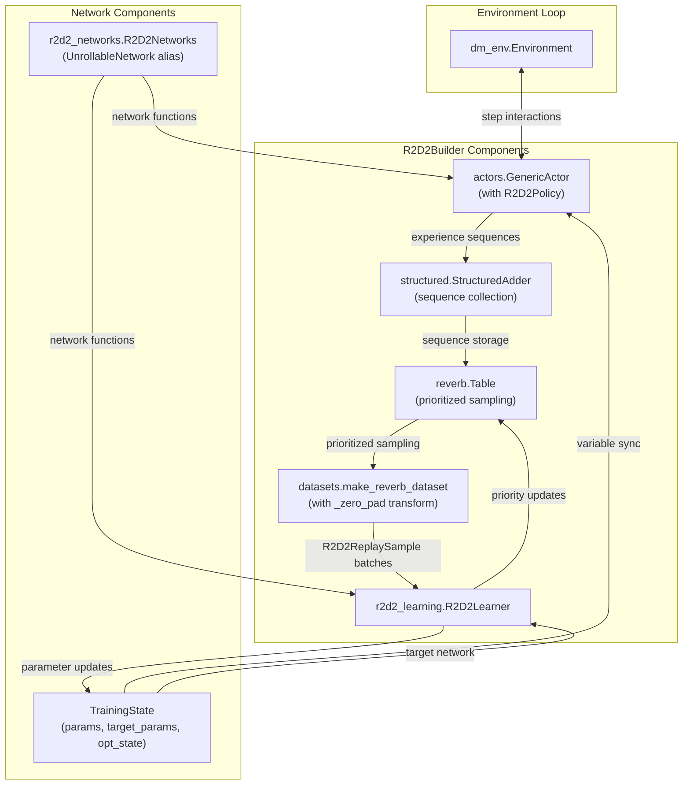
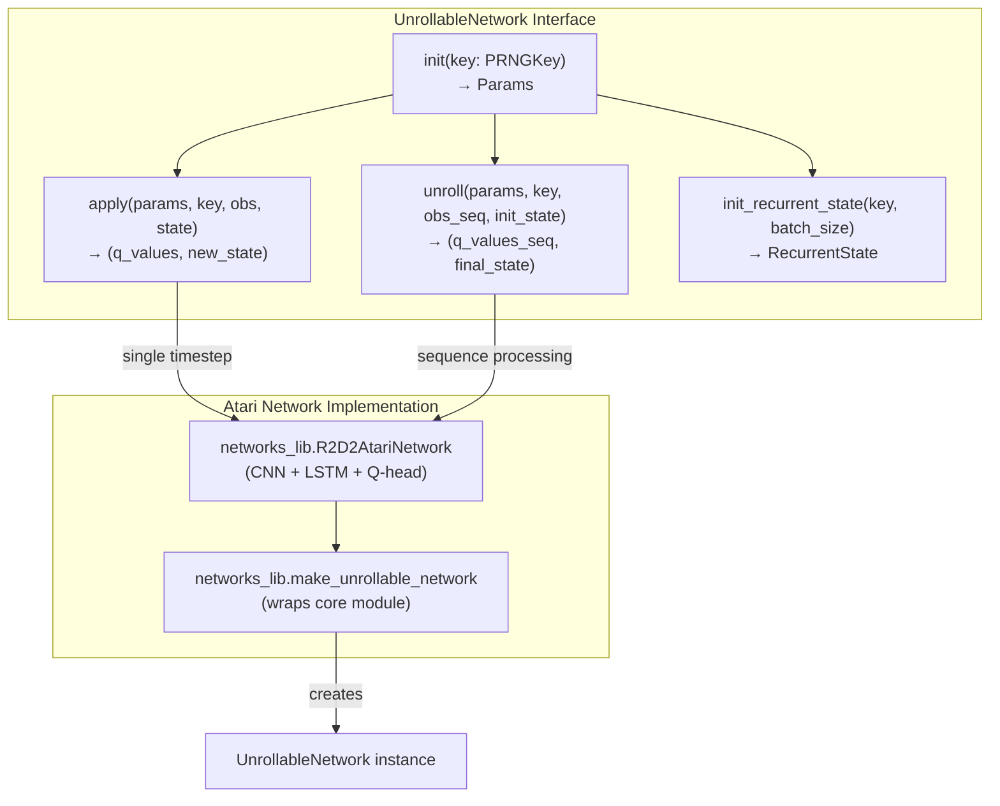
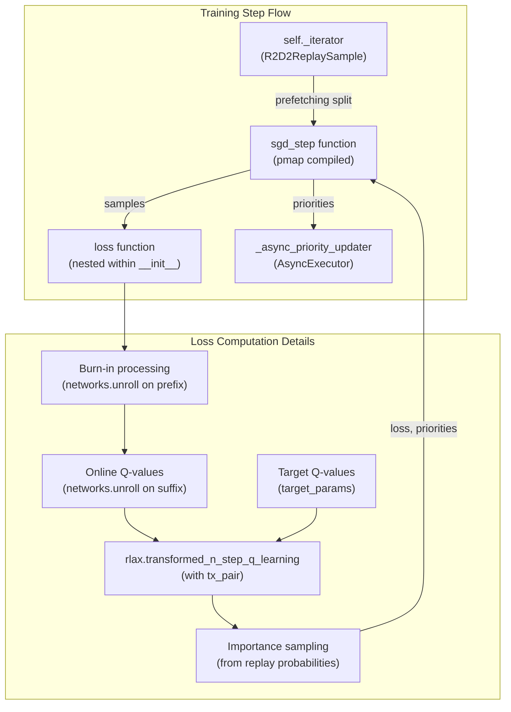
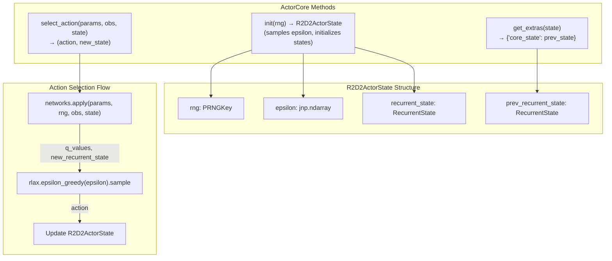
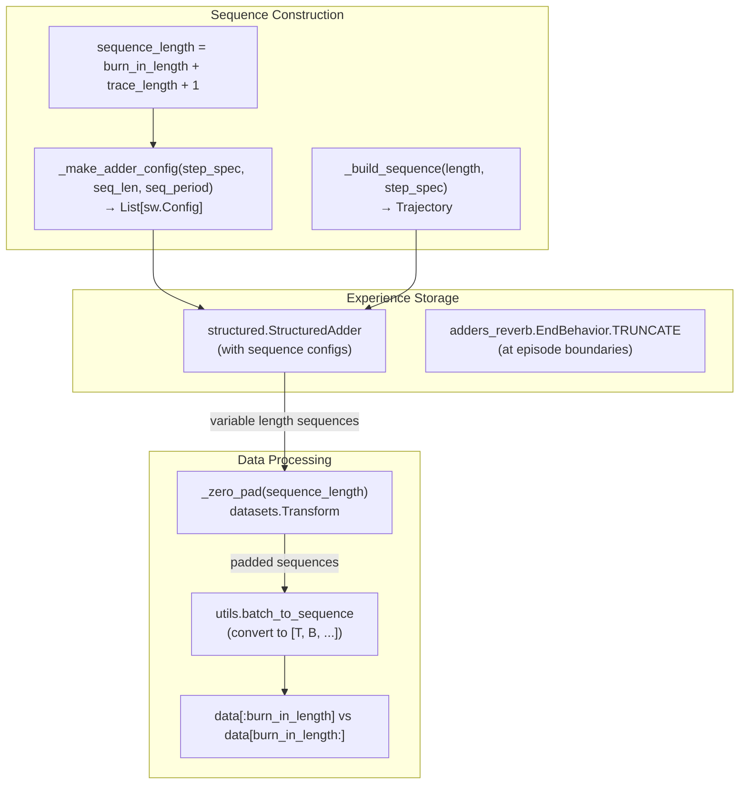
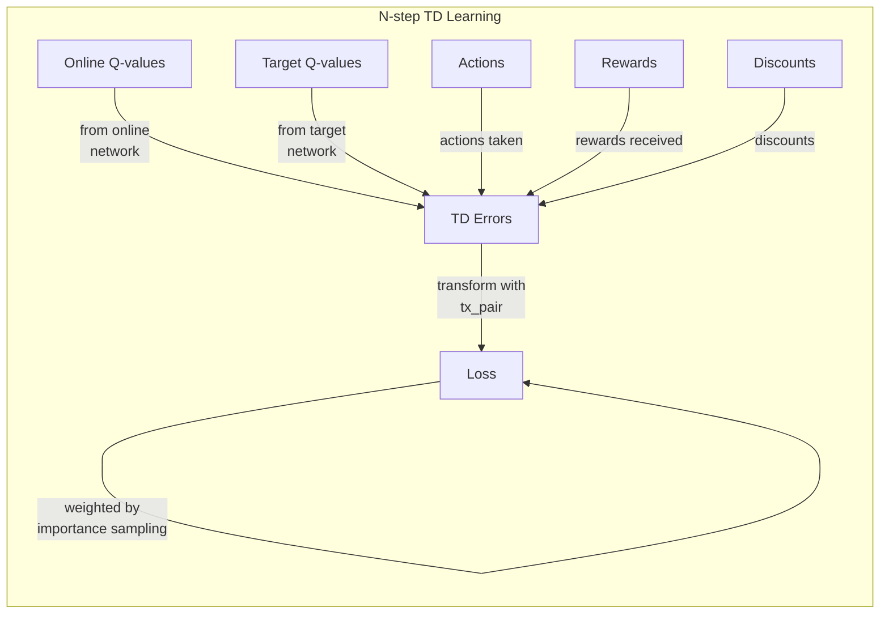
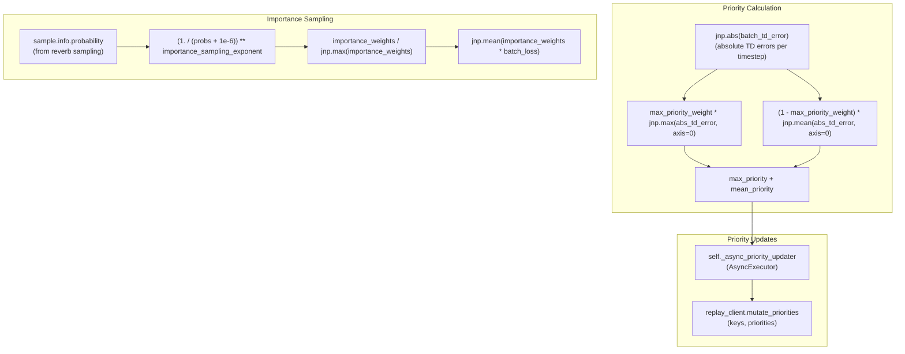
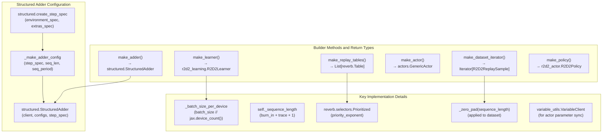
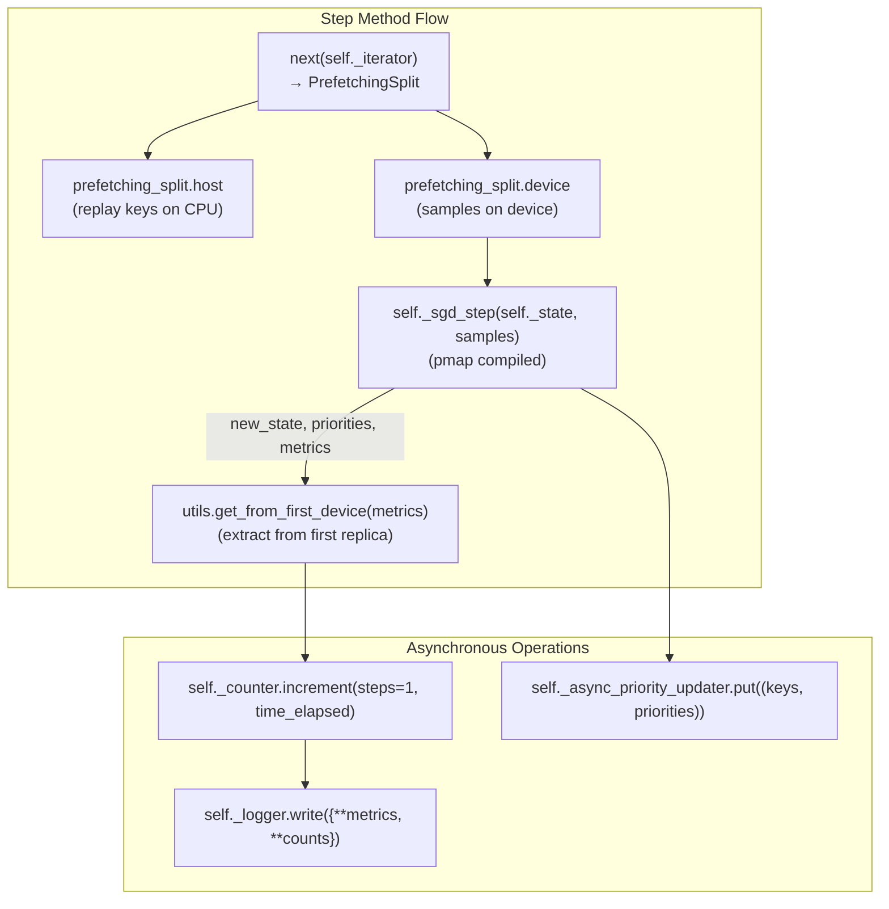

<!-- source: DeepWiki mcp.deepwiki.com · repo google-deepmind/acme · page 4.4 R2D2 · fetched 2026-10-26 -->

# R2D2

<details>
<summary>Relevant source files</summary>

The following files were used as context for generating this wiki page:

- [acme/agents/jax/r2d2/__init__.py](acme/agents/jax/r2d2/__init__.py)
- [acme/agents/jax/r2d2/actor.py](acme/agents/jax/r2d2/actor.py)
- [acme/agents/jax/r2d2/builder.py](acme/agents/jax/r2d2/builder.py)
- [acme/agents/jax/r2d2/learning.py](acme/agents/jax/r2d2/learning.py)
- [acme/agents/jax/r2d2/networks.py](acme/agents/jax/r2d2/networks.py)

</details>


This page documents the JAX implementation of Recurrent Replay Distributed DQN (R2D2) in Acme. R2D2 extends DQN with recurrent neural networks and sequence-based experience replay to handle partially observable environments.

## Overview

The R2D2 implementation in Acme provides:

1. **Recurrent Processing**: Uses `UnrollableNetwork` with LSTM cores for sequential processing
2. **Sequence Replay**: Stores and replays sequences rather than individual transitions using `StructuredAdder`
3. **Burn-in Mechanism**: Initializes recurrent states by processing prefix sequences without learning
4. **Prioritized Sampling**: Uses prioritized experience replay with sequence-level priorities
5. **N-step Learning**: Implements transformed n-step Q-learning with importance sampling
6. **Distributed Training**: Supports multi-device training via JAX pmap

The implementation follows Acme's standard `ActorLearnerBuilder` pattern with components for policy execution, experience collection, and learning.

Sources: [acme/agents/jax/r2d2/__init__.py:15-24](), [acme/agents/jax/r2d2/builder.py:107-116]()

## Architecture

R2D2 Component Interaction Flow:



Sources: [acme/agents/jax/r2d2/builder.py:235-251](), [acme/agents/jax/r2d2/learning.py:52-240](), [acme/agents/jax/r2d2/actor.py:46-47]()

## Key Components

### R2D2Networks

`R2D2Networks` is a type alias for `UnrollableNetwork`, providing both single-step and sequence processing capabilities:



The `make_atari_networks()` function creates an `UnrollableNetwork` using `R2D2AtariNetwork` as the core module, providing CNN feature extraction followed by LSTM processing and Q-value head.

Sources: [acme/agents/jax/r2d2/networks.py:21-30](), [acme/jax/networks.py]()

### R2D2Learner

The `R2D2Learner` class implements sequence-based learning with recurrent state management:



The learner uses JAX `pmap` for distributed training and maintains `TrainingState` containing network parameters, target parameters, optimizer state, and training steps.

Sources: [acme/agents/jax/r2d2/learning.py:43-50](), [acme/agents/jax/r2d2/learning.py:77-159](), [acme/agents/jax/r2d2/learning.py:161-193]()

### R2D2Policy and Actor

The R2D2 actor system uses `ActorCore` interface with recurrent state management:



The `get_actor_core()` function creates an `ActorCore` instance, with epsilon sampling based on `num_epsilons` for training or fixed `evaluation_epsilon` for evaluation.

Sources: [acme/agents/jax/r2d2/actor.py:38-47](), [acme/agents/jax/r2d2/actor.py:50-101]()

## Algorithm Details

### Sequence Processing and Data Flow

R2D2 processes sequences with burn-in and learning phases:



Sequences are collected using `StructuredAdder` with period-based sampling, zero-padded to uniform length, and split into burn-in and training portions during learning.

Sources: [acme/agents/jax/r2d2/builder.py:53-104](), [acme/agents/jax/r2d2/learning.py:99-111]()

### Transformed N-step TD Learning

R2D2 uses n-step returns with transformed TD errors for more stable learning:



R2D2 applies a transform (typically signed hyperbolic) to the TD errors before computing the loss, and weights the loss using importance sampling to correct for the prioritized sampling.

Sources: [acme/agents/jax/r2d2/learning.py:130-157]()

### Priority Updates and Importance Sampling

R2D2 uses sequence-level priorities and importance sampling correction:



Priorities combine max and mean absolute TD errors across sequence timesteps, while importance sampling corrects for prioritized sampling bias.

Sources: [acme/agents/jax/r2d2/learning.py:146-157](), [acme/agents/jax/r2d2/learning.py:195-204]()

## Configuration Options

The R2D2 agent has several configuration parameters that can be adjusted:

| Parameter | Type | Description | Default/Usage |
|-----------|------|-------------|---------------|
| `batch_size` | `int` | Number of sequences per batch | Divided across devices |
| `burn_in_length` | `int` | Timesteps for LSTM state warm-up | Used in sequence construction |
| `trace_length` | `int` | Timesteps for learning after burn-in | Combined with burn_in for total length |
| `sequence_period` | `int` | Period for sequence starts in adder | Used in `_make_adder_config` |
| `learning_rate` | `float` | Optimizer learning rate | Passed to `optax.adam` |
| `discount` | `float` | Discount factor γ | Applied in TD error computation |
| `importance_sampling_exponent` | `float` | IS weight exponent | Applied to `(1/prob)**exponent` |
| `target_update_period` | `int` | Target network update frequency | Used in `optax.periodic_update` |
| `max_priority_weight` | `float` | Weight for max vs mean TD error priority | Range [0,1] |
| `bootstrap_n` | `int` | N-step return horizon | Default: 5 |
| `tx_pair` | `rlax.TxPair` | TD error transform | Default: `SIGNED_HYPERBOLIC_PAIR` |
| `clip_rewards` | `bool` | Whether to clip rewards | Applied before loss computation |
| `max_abs_reward` | `float` | Reward clipping threshold | Default: 1.0 |
| `num_epsilons` | `Optional[int]` | Number of epsilon values for training | Sampled from logspace |
| `evaluation_epsilon` | `Optional[float]` | Fixed epsilon for evaluation | Used when `num_epsilons` is None |
| `variable_update_period` | `int` | Actor parameter sync frequency | Used in `VariableClient` |

Sources: [acme/agents/jax/r2d2/builder.py:118-123](), [acme/agents/jax/r2d2/learning.py:55-74]()

## Implementation Details

### R2D2Builder Implementation

The `R2D2Builder` implements `ActorLearnerBuilder` with specific R2D2 component creation:



The builder handles device-specific batching, sequence configuration, and component wiring according to R2D2's requirements.

Sources: [acme/agents/jax/r2d2/builder.py:107-264](), [acme/agents/jax/r2d2/builder.py:124-129]()

### R2D2Learner Step Function

The `R2D2Learner.step()` method implements the core training loop:



The learner uses `PrefetchingSplit` to keep replay keys on host while prefetching sample data on device, enabling efficient priority updates without device-host transfers.

Sources: [acme/agents/jax/r2d2/learning.py:241-265](), [acme/agents/jax/r2d2/learning.py:37-40]()

## Usage Example

Creating and using R2D2 components:

```python
import jax
from acme import specs
from acme.agents.jax.r2d2 import R2D2Config, R2D2Builder, make_atari_networks

# Create configuration
config = R2D2Config(
    batch_size=64,
    burn_in_length=40,
    trace_length=80,  
    sequence_period=40,
    learning_rate=1e-4,
    discount=0.997,
    target_update_period=2500,
    importance_sampling_exponent=0.6,
    max_priority_weight=0.9,
    bootstrap_n=5,
    num_epsilons=32,
    evaluation_epsilon=0.001,
)

# Create networks for environment
environment_spec = specs.make_environment_spec(environment)
networks = make_atari_networks(environment_spec)

# Create builder and components
builder = R2D2Builder(config)
replay_tables = builder.make_replay_tables(environment_spec, policy)
dataset = builder.make_dataset_iterator(replay_client)
learner = builder.make_learner(
    random_key=jax.random.PRNGKey(0),
    networks=networks,
    dataset=dataset,
    logger_fn=logger_factory,
    environment_spec=environment_spec,
)
```

The `R2D2Builder` provides all necessary components for integration with Acme's experiment framework through `ExperimentConfig`.

Sources: [acme/agents/jax/r2d2/config.py](), [acme/agents/jax/r2d2/networks.py:24-30](), [acme/agents/jax/r2d2/builder.py:131-161]()

## Performance Considerations

R2D2 is a more computationally intensive algorithm compared to standard DQN due to:

1. **Recurrent Processing**: The use of LSTMs increases computational requirements
2. **Sequence Processing**: Handling sequences rather than individual transitions
3. **Burn-in Computation**: Computing burn-in for proper state initialization

However, these additional computational costs enable R2D2 to handle partially observable environments more effectively by maintaining state information across timesteps.

Sources: [acme/agents/jax/r2d2/learning.py](), [acme/agents/jax/r2d2/builder.py]()

---

