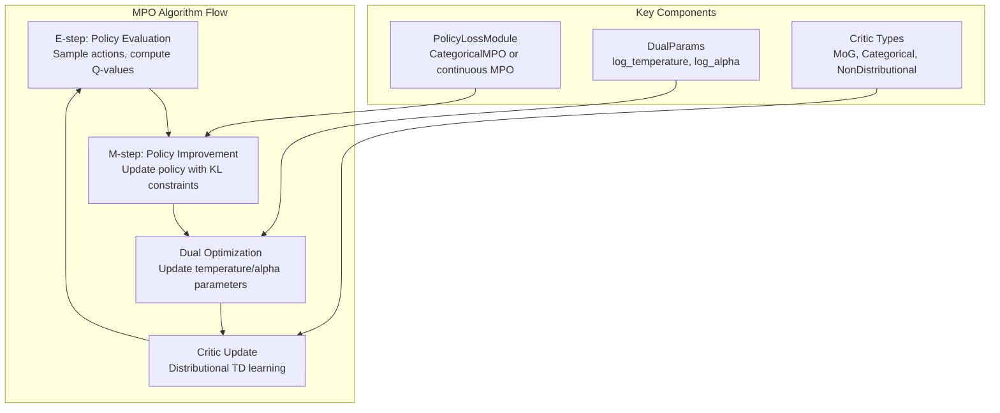
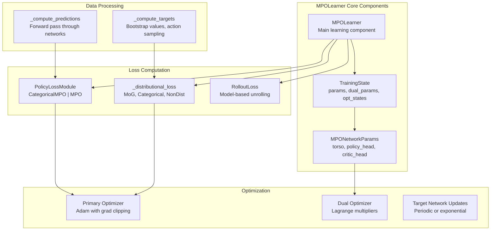
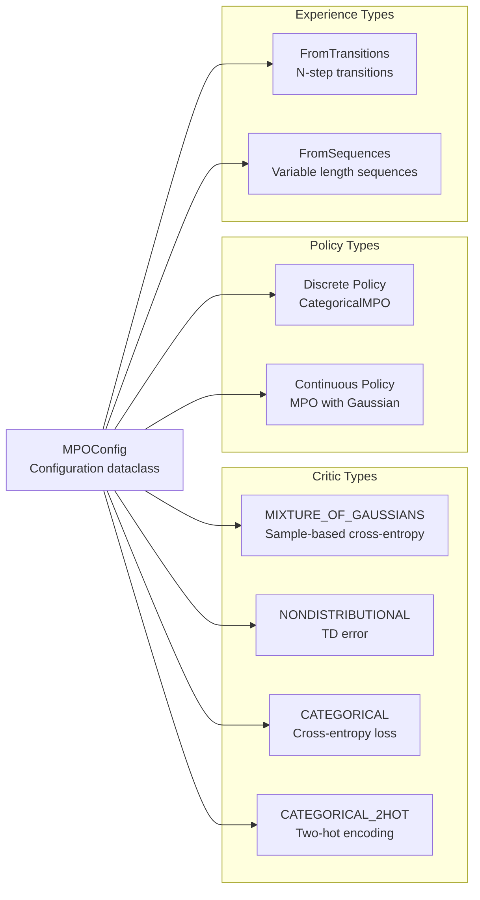
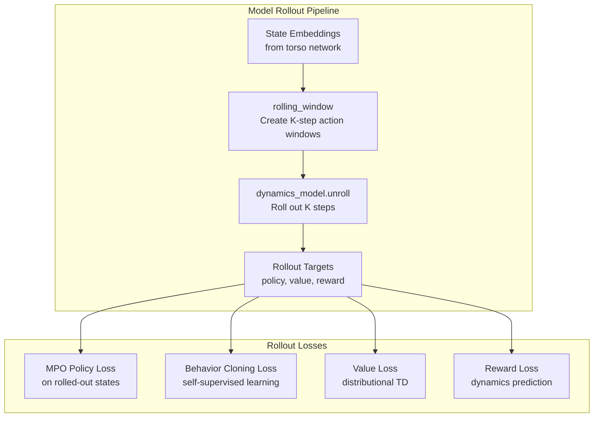
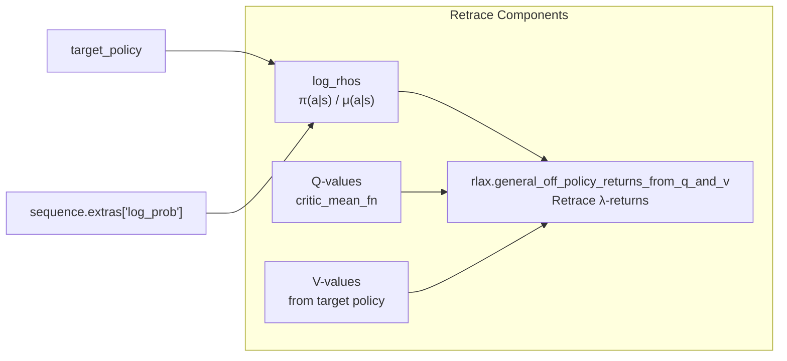
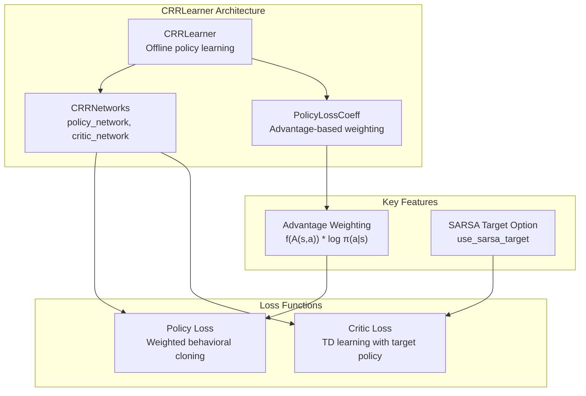
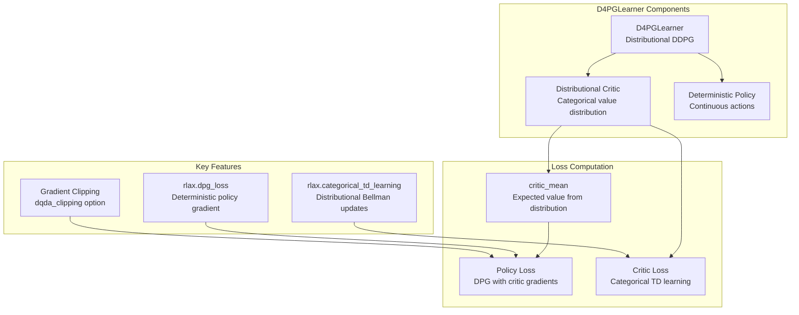
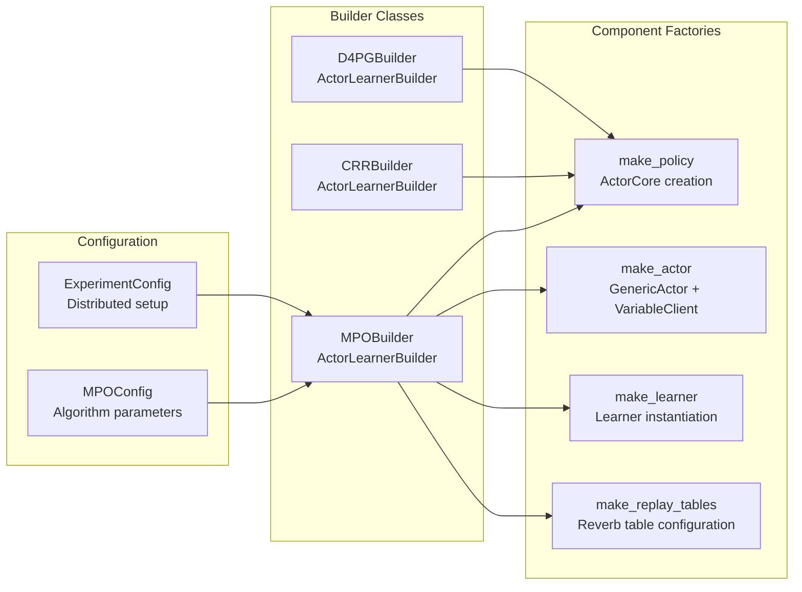

<!-- source: DeepWiki mcp.deepwiki.com · repo google-deepmind/acme · page 4.5 MPO and Advanced Policy Methods · fetched 2026-10-26 -->

# MPO and Advanced Policy Methods

Relevant source files

The following files were used as context for generating this wiki page:

- [acme/agents/jax/crr/learning.py](acme/agents/jax/crr/learning.py)
- [acme/agents/jax/d4pg/learning.py](acme/agents/jax/d4pg/learning.py)
- [acme/agents/jax/mpo/builder.py](acme/agents/jax/mpo/builder.py)
- [acme/agents/jax/mpo/config.py](acme/agents/jax/mpo/config.py)
- [acme/agents/jax/mpo/learning.py](acme/agents/jax/mpo/learning.py)
- [acme/agents/jax/mpo/rollout_loss.py](acme/agents/jax/mpo/rollout_loss.py)

This document covers Maximum a Posteriori Policy Optimization (MPO) and other advanced policy methods implemented in Acme's JAX-based agents. MPO is a sophisticated policy optimization algorithm that supports both discrete and continuous action spaces with advanced features like distributional critics, model-based rollouts, and constraint optimization. This page also covers other advanced continuous control agents like CRR and D4PG.

For basic policy gradient methods like PPO, see [PPO](#4.3). For value-based methods, see [DQN Family](#4.1).

## MPO Algorithm Overview

MPO formulates policy optimization as a constrained optimization problem using KL-divergence constraints and dual variables. The algorithm alternates between an E-step (policy evaluation) and M-step (policy improvement) while maintaining distributional critics for robust value estimation.

**Sources:** [acme/agents/jax/mpo/learning.py:81-283](), [acme/agents/jax/mpo/types.py]()

## MPO Implementation Architecture

The MPO implementation follows Acme's standard actor-learner pattern with specialized components for constraint optimization and distributional critics.

**Sources:** [acme/agents/jax/mpo/learning.py:51-60](), [acme/agents/jax/mpo/learning.py:315-344](), [acme/agents/jax/mpo/learning.py:345-529]()

## MPO Configuration and Network Types

MPO supports multiple critic architectures and experience types with extensive configuration options.

| Configuration | Options | Description |
|---------------|---------|-------------|
| `critic_type` | `MIXTURE_OF_GAUSSIANS`, `NONDISTRIBUTIONAL`, `CATEGORICAL`, `CATEGORICAL_2HOT` | Distributional critic architecture |
| `discrete_policy` | `True`, `False` | Discrete vs continuous action spaces |
| `experience_type` | `FromTransitions`, `FromSequences` | Data format for learning |
| `use_retrace` | `True`, `False` | Off-policy correction mechanism |
| `model_rollout_length` | `int` | Model-based rollout steps |

**Sources:** [acme/agents/jax/mpo/config.py:26-147](), [acme/agents/jax/mpo/learning.py:285-314](), [acme/agents/jax/mpo/types.py]()

## Advanced MPO Features

### Model-Based Rollouts

MPO supports learning dynamics models and performing multi-step rollouts for improved sample efficiency.

**Sources:** [acme/agents/jax/mpo/rollout_loss.py:52-238](), [acme/agents/jax/mpo/learning.py:197-207]()

### Retrace Off-Policy Correction

For improved off-policy learning, MPO implements Retrace λ-returns with importance sampling.

**Sources:** [acme/agents/jax/mpo/learning.py:450-473](), [acme/agents/jax/mpo/config.py:55-56]()

## Advanced Policy Methods: CRR

Critic Regularized Regression (CRR) is an offline RL algorithm that performs policy improvement through weighted behavioral cloning.

**Sources:** [acme/agents/jax/crr/learning.py:45-263](), [acme/agents/jax/crr/learning.py:90-106]()

## Advanced Policy Methods: D4PG

Distributed Distributional Deep Deterministic Policy Gradient combines distributional RL with deterministic policy gradients for continuous control.

**Sources:** [acme/agents/jax/d4pg/learning.py:46-261](), [acme/agents/jax/d4pg/learning.py:70-117]()

## Builder Pattern and Component Assembly

All advanced policy methods follow Acme's builder pattern for flexible component assembly and distributed execution.

**Sources:** [acme/agents/jax/mpo/builder.py:52-339](), [acme/agents/jax/crr/builder.py](), [acme/agents/jax/d4pg/builder.py]()

---

