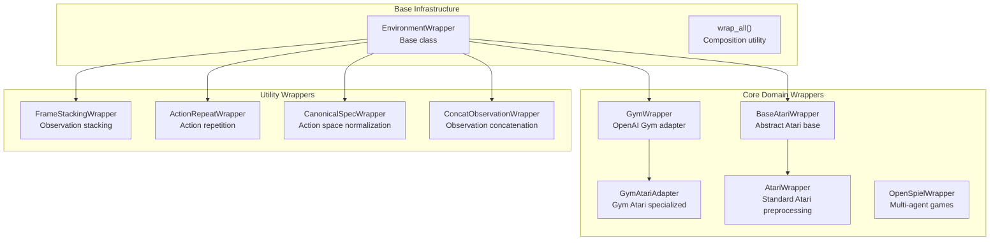
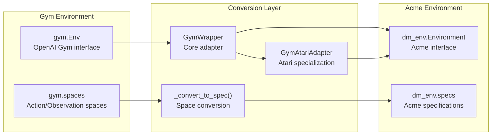
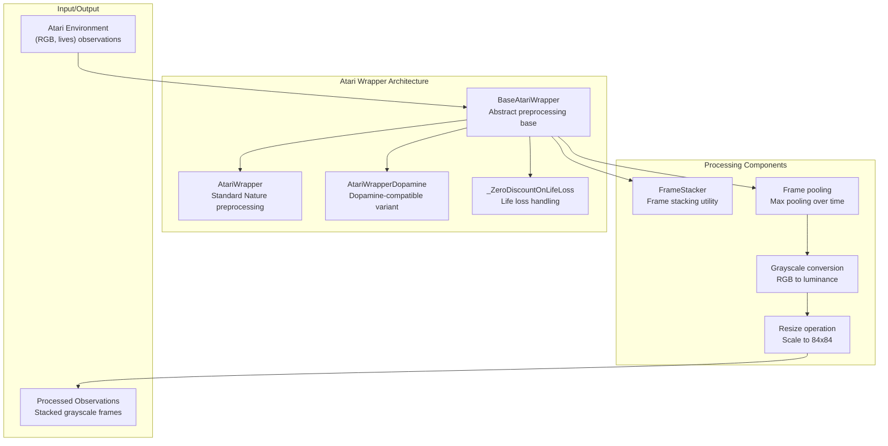
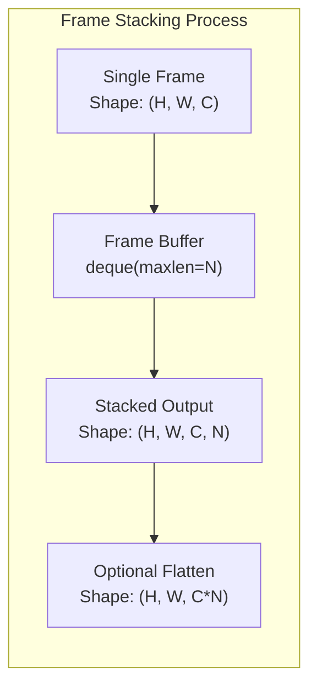
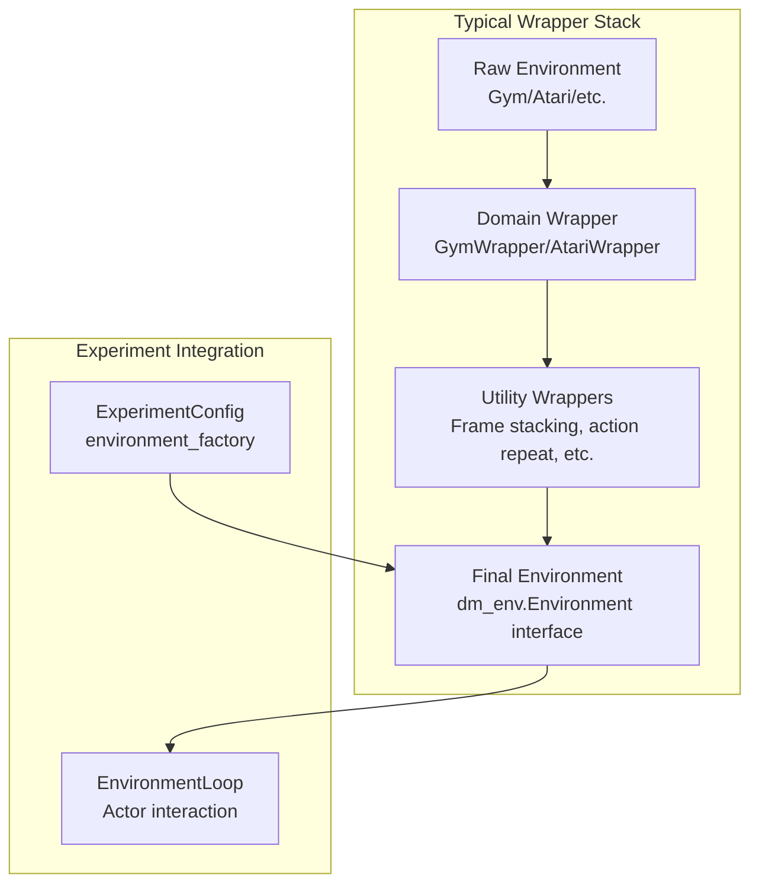

<!-- source: DeepWiki mcp.deepwiki.com · repo google-deepmind/acme · page 5 Environment Wrappers · fetched 2026-10-26 -->

# Environment Wrappers

Relevant source files

The following files were used as context for generating this wiki page:

- [acme/wrappers/action_repeat.py](acme/wrappers/action_repeat.py)
- [acme/wrappers/atari_wrapper.py](acme/wrappers/atari_wrapper.py)
- [acme/wrappers/atari_wrapper_dopamine.py](acme/wrappers/atari_wrapper_dopamine.py)
- [acme/wrappers/atari_wrapper_test.py](acme/wrappers/atari_wrapper_test.py)
- [acme/wrappers/base.py](acme/wrappers/base.py)
- [acme/wrappers/base_test.py](acme/wrappers/base_test.py)
- [acme/wrappers/canonical_spec.py](acme/wrappers/canonical_spec.py)
- [acme/wrappers/concatenate_observations.py](acme/wrappers/concatenate_observations.py)
- [acme/wrappers/frame_stacking.py](acme/wrappers/frame_stacking.py)
- [acme/wrappers/frame_stacking_test.py](acme/wrappers/frame_stacking_test.py)
- [acme/wrappers/gym_wrapper.py](acme/wrappers/gym_wrapper.py)
- [acme/wrappers/gym_wrapper_test.py](acme/wrappers/gym_wrapper_test.py)
- [acme/wrappers/open_spiel_wrapper.py](acme/wrappers/open_spiel_wrapper.py)
- [acme/wrappers/open_spiel_wrapper_test.py](acme/wrappers/open_spiel_wrapper_test.py)
- [acme/wrappers/single_precision_test.py](acme/wrappers/single_precision_test.py)

Environment wrappers provide a standardized adaptation layer that transforms various external environment formats (OpenAI Gym, Atari, OpenSpiel) into the consistent `dm_env.Environment` interface used throughout Acme. This system enables agents to work seamlessly across different domains while providing domain-specific preprocessing, observation transformations, and action space conversions.

For information about the core environment loop execution, see [Environment Loop and Execution](#2.2). For details about agent-environment interaction patterns, see [Actor System and Policy Execution](#2.3).

## Base Wrapper Infrastructure

The wrapper system is built around the `EnvironmentWrapper` base class in [acme/wrappers/base.py:22-70](), which provides the foundational wrapper pattern for the entire system.

**Sources:** [acme/wrappers/base.py:22-81](), [acme/wrappers/gym_wrapper.py:29-207](), [acme/wrappers/atari_wrapper.py:33-394]()

The `EnvironmentWrapper` provides attribute forwarding through `__getattr__` [acme/wrappers/base.py:35-39]() and explicit method delegation for core `dm_env.Environment` methods [acme/wrappers/base.py:50-69](). The `wrap_all` utility function [acme/wrappers/base.py:72-80]() enables composition of multiple wrappers in sequence.

## OpenAI Gym Integration

The `GymWrapper` class [acme/wrappers/gym_wrapper.py:29-107]() serves as the primary adapter for OpenAI Gym environments, converting Gym's interface to the `dm_env.Environment` standard.

**Sources:** [acme/wrappers/gym_wrapper.py:29-163](), [acme/wrappers/gym_wrapper.py:109-162]()

### Gym Space Conversion

The wrapper handles comprehensive space type conversions through `_convert_to_spec`:

| Gym Space Type | Acme Spec Type | Conversion Details |
|---|---|---|
| `spaces.Discrete` | `specs.DiscreteArray` | Direct mapping with `num_values=space.n` |
| `spaces.Box` | `specs.BoundedArray` | Preserves shape, dtype, and bounds |
| `spaces.MultiBinary` | `specs.BoundedArray` | Binary values with bounds [0, 1] |
| `spaces.MultiDiscrete` | `specs.BoundedArray` | Multiple discrete ranges |
| `spaces.Tuple` | Tuple of specs | Recursive conversion |
| `spaces.Dict` | Dict of specs | Recursive conversion |

**Sources:** [acme/wrappers/gym_wrapper.py:109-162]()

### Atari-Specific Gym Adaptation

The `GymAtariAdapter` [acme/wrappers/gym_wrapper.py:165-207]() extends `GymWrapper` to expose Atari-specific functionality, particularly the lives count observation that enables life-loss detection for proper episode termination handling.

**Sources:** [acme/wrappers/gym_wrapper.py:165-207]()

## Atari Preprocessing Pipeline

The Atari wrapper system implements the standard "Nature Atari" preprocessing pipeline through a sophisticated inheritance hierarchy anchored by `BaseAtariWrapper` [acme/wrappers/atari_wrapper.py:33-302]().

**Sources:** [acme/wrappers/atari_wrapper.py:33-394](), [acme/wrappers/atari_wrapper_dopamine.py:37-71]()

### Atari Preprocessing Steps

The `BaseAtariWrapper` implements a comprehensive preprocessing pipeline [acme/wrappers/atari_wrapper.py:40-48]():

1. **Soft-termination on life loss** - Zero discount when lives decrease [acme/wrappers/atari_wrapper.py:70-71]()
2. **Action repeats** - Repeat actions multiple times [acme/wrappers/atari_wrapper.py:69](), [acme/wrappers/atari_wrapper.py:201-217]()
3. **Frame pooling** - Max pooling over recent frames [acme/wrappers/atari_wrapper.py:88-89]()
4. **Grayscale conversion** - RGB to luminance transformation [acme/wrappers/atari_wrapper.py:104-106]()
5. **Downscaling** - Resize to 84x84 pixels [acme/wrappers/atari_wrapper.py:67-68]()
6. **Reward clipping** - Clip rewards to specified range [acme/wrappers/atari_wrapper.py:66-67]()
7. **Observation stacking** - Stack recent frames [acme/wrappers/atari_wrapper.py:73]()

**Sources:** [acme/wrappers/atari_wrapper.py:64-107]()

### Frame Processing Variations

The codebase provides two frame processing variants:

- **Standard (`AtariWrapper`)**: Max pooling → RGB to grayscale → Pillow BILINEAR resize [acme/wrappers/atari_wrapper.py:328-351]()
- **Dopamine (`AtariWrapperDopamine`)**: RGB to grayscale → Max pooling → OpenCV INTER_AREA resize [acme/wrappers/atari_wrapper_dopamine.py:44-70]()

**Sources:** [acme/wrappers/atari_wrapper.py:304-352](), [acme/wrappers/atari_wrapper_dopamine.py:37-71]()

## Utility Wrappers

The framework includes several specialized utility wrappers for common preprocessing tasks.

### Frame Stacking

The `FrameStackingWrapper` [acme/wrappers/frame_stacking.py:27-63]() and `FrameStacker` [acme/wrappers/frame_stacking.py:65-99]() provide temporal context by stacking recent observations along a new axis.

**Sources:** [acme/wrappers/frame_stacking.py:65-99]()

### Action Space Normalization

The `CanonicalSpecWrapper` [acme/wrappers/canonical_spec.py:33-55]() normalizes bounded action spaces to the canonical range [-1, 1], enabling consistent agent interfaces across different environments.

**Sources:** [acme/wrappers/canonical_spec.py:33-99]()

### Action Repetition

The `ActionRepeatWrapper` [acme/wrappers/action_repeat.py:22-47]() repeats actions for multiple environment steps, accumulating rewards and discounts appropriately while respecting episode boundaries.

**Sources:** [acme/wrappers/action_repeat.py:22-47]()

### Observation Concatenation

The `ConcatObservationWrapper` [acme/wrappers/concatenate_observations.py:47-97]() flattens nested observation dictionaries into single arrays, useful for algorithms requiring flat observation spaces.

**Sources:** [acme/wrappers/concatenate_observations.py:47-97]()

## Wrapper Composition and Usage Patterns

Environment wrappers are typically composed in sequences to build complete preprocessing pipelines. The `wrap_all` utility [acme/wrappers/base.py:72-80]() facilitates this composition pattern.

**Sources:** [acme/wrappers/base.py:72-80]()

Common composition patterns include:

1. **Atari environments**: `GymAtariAdapter` → `AtariWrapper` with various configuration options
2. **Continuous control**: `GymWrapper` → `CanonicalSpecWrapper` for action normalization  
3. **Custom preprocessing**: `GymWrapper` → `FrameStackingWrapper` → `ActionRepeatWrapper`

The wrapper system integrates seamlessly with the experiment configuration framework, where `environment_factory` functions construct complete wrapper stacks for specific domains and algorithms.

**Sources:** [acme/wrappers/base.py:72-80](), [acme/wrappers/atari_wrapper.py:64-107](), [acme/wrappers/gym_wrapper.py:29-107]()

---

