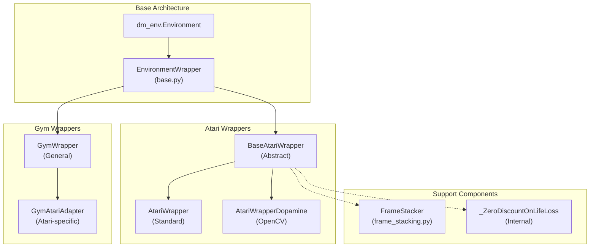
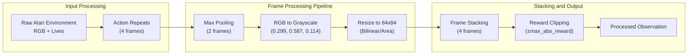
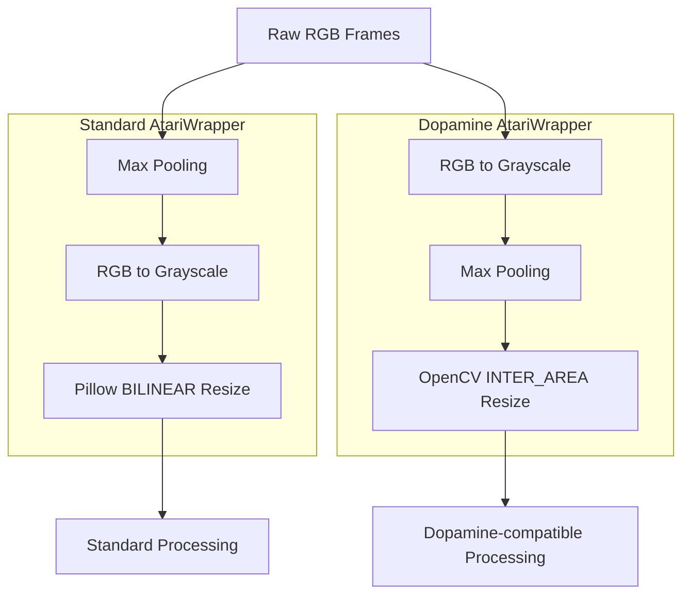
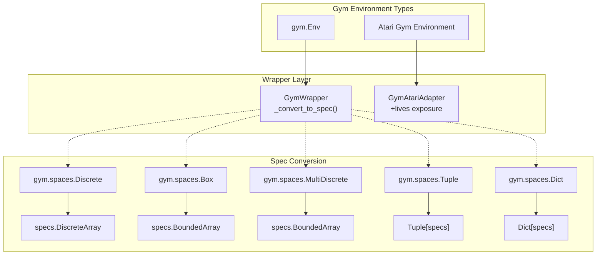
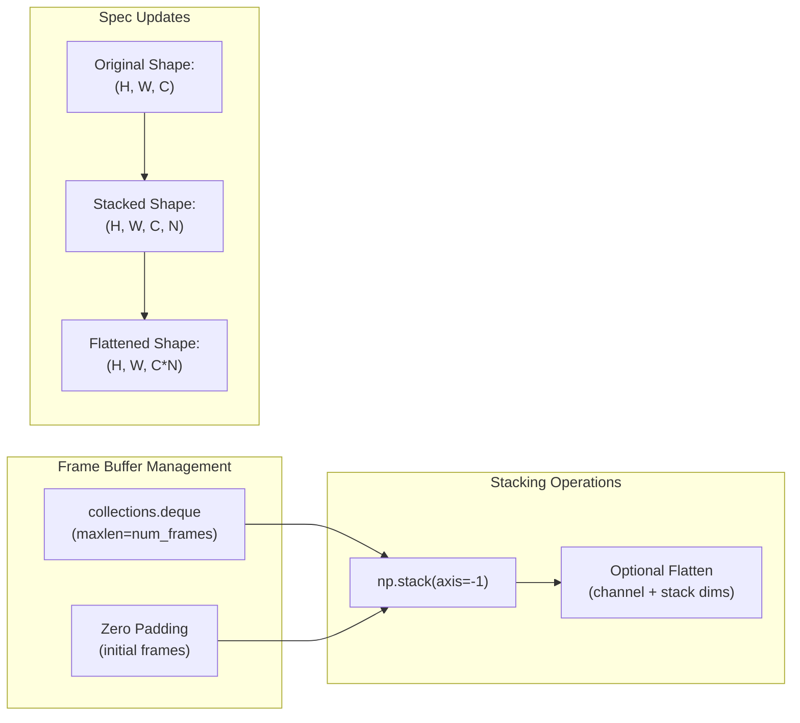
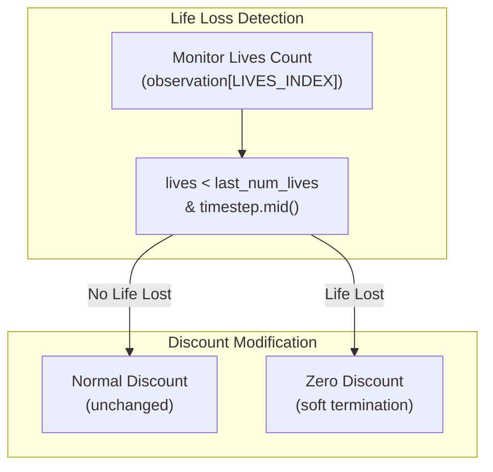

<!-- source: DeepWiki mcp.deepwiki.com · repo google-deepmind/acme · page 5.1 Atari and Gym Wrappers · fetched 2026-10-26 -->

# Atari and Gym Wrappers

<details>
<summary>Relevant source files</summary>

The following files were used as context for generating this wiki page:

- [acme/wrappers/action_repeat.py](acme/wrappers/action_repeat.py)
- [acme/wrappers/atari_wrapper.py](acme/wrappers/atari_wrapper.py)
- [acme/wrappers/atari_wrapper_dopamine.py](acme/wrappers/atari_wrapper_dopamine.py)
- [acme/wrappers/atari_wrapper_test.py](acme/wrappers/atari_wrapper_test.py)
- [acme/wrappers/base.py](acme/wrappers/base.py)
- [acme/wrappers/base_test.py](acme/wrappers/base_test.py)
- [acme/wrappers/canonical_spec.py](acme/wrappers/canonical_spec.py)
- [acme/wrappers/concatenate_observations.py](acme/wrappers/concatenate_observations.py)
- [acme/wrappers/frame_stacking.py](acme/wrappers/frame_stacking.py)
- [acme/wrappers/frame_stacking_test.py](acme/wrappers/frame_stacking_test.py)
- [acme/wrappers/gym_wrapper.py](acme/wrappers/gym_wrapper.py)
- [acme/wrappers/gym_wrapper_test.py](acme/wrappers/gym_wrapper_test.py)
- [acme/wrappers/open_spiel_wrapper.py](acme/wrappers/open_spiel_wrapper.py)
- [acme/wrappers/open_spiel_wrapper_test.py](acme/wrappers/open_spiel_wrapper_test.py)
- [acme/wrappers/single_precision_test.py](acme/wrappers/single_precision_test.py)

</details>


This document covers the environment wrappers that adapt Atari and OpenAI Gym environments for use with Acme agents. These wrappers handle domain-specific preprocessing, observation transformations, and interface standardization. For general environment wrapper utilities and video recording capabilities, see [Video, Reward, and Utility Wrappers](#5.2).

## Core Wrapper Architecture

The wrapper system is built around a common base class that provides delegation and composition patterns for environment transformation.



**Sources:** [acme/wrappers/base.py:22-81](), [acme/wrappers/atari_wrapper.py:33-62](), [acme/wrappers/gym_wrapper.py:29-34]()

The `EnvironmentWrapper` class provides automatic attribute forwarding and a consistent interface for wrapping `dm_env.Environment` instances. All domain-specific wrappers inherit from this base to ensure proper delegation of environment methods.

## Atari Wrapper System

The Atari wrapper system implements the standard "Nature Atari" preprocessing pipeline with configurable variations.



**Sources:** [acme/wrappers/atari_wrapper.py:304-351](), [acme/wrappers/atari_wrapper.py:64-110]()

### BaseAtariWrapper Configuration

The `BaseAtariWrapper` class provides extensive configuration options:

| Parameter | Default | Description |
|-----------|---------|-------------|
| `max_abs_reward` | `None` | Clips rewards to `±max_abs_reward` |
| `scale_dims` | `(84, 84)` | Target image dimensions |
| `action_repeats` | `4` | Number of environment steps per action |
| `pooled_frames` | `2` | Frames to max-pool over |
| `zero_discount_on_life_loss` | `False` | Sets discount=0 on life loss |
| `num_stacked_frames` | `4` | Number of frames to stack |
| `to_float` | `False` | Converts pixels to [0,1] range |
| `grayscaling` | `True` | Converts RGB to grayscale |

**Sources:** [acme/wrappers/atari_wrapper.py:64-77]()

### Preprocessing Variations

Two preprocessing styles are available:



**Sources:** [acme/wrappers/atari_wrapper.py:328-351](), [acme/wrappers/atari_wrapper_dopamine.py:44-70]()

The standard wrapper [acme/wrappers/atari_wrapper.py:304-352]() performs max pooling before grayscale conversion and uses Pillow for resizing. The Dopamine variant [acme/wrappers/atari_wrapper_dopamine.py:37-71]() reverses the order and uses OpenCV, matching the preprocessing in Google's Dopamine library.

## Gym Integration

The Gym wrapper system provides seamless integration with OpenAI Gym environments, handling spec conversion and interface adaptation.



**Sources:** [acme/wrappers/gym_wrapper.py:109-162](), [acme/wrappers/gym_wrapper.py:165-207]()

### Spec Conversion Details

The `_convert_to_spec()` function [acme/wrappers/gym_wrapper.py:109-162]() handles comprehensive conversion between Gym spaces and Acme specifications:

- **Discrete spaces**: Converted to `DiscreteArray` with `num_values=space.n`
- **Box spaces**: Converted to `BoundedArray` with `minimum=space.low`, `maximum=space.high`
- **MultiBinary**: Converted to `BoundedArray` with bounds `[0, 1]`
- **MultiDiscrete**: Converted to `BoundedArray` with `maximum=space.nvec - 1`
- **Nested spaces**: Recursively converted maintaining structure

### GymAtariAdapter Specialization

The `GymAtariAdapter` [acme/wrappers/gym_wrapper.py:165-207]() extends `GymWrapper` specifically for Atari environments by:

1. Exposing the lives count as part of the observation tuple
2. Adapting the action interface to expect list inputs
3. Providing access to the ALE (Arcade Learning Environment) lives counter

**Sources:** [acme/wrappers/gym_wrapper.py:174-206]()

## Frame Stacking Implementation

Frame stacking is handled by the `FrameStacker` utility class, which maintains a circular buffer of recent observations.



**Sources:** [acme/wrappers/frame_stacking.py:65-99]()

The `FrameStacker.step()` method [acme/wrappers/frame_stacking.py:80-92]() automatically handles initialization by zero-padding the buffer for the first frame, then maintains a sliding window of the most recent frames.

## Life Loss Handling

Atari environments support optional soft-termination on life loss through the internal `_ZeroDiscountOnLifeLoss` wrapper.



**Sources:** [acme/wrappers/atari_wrapper.py:354-394]()

This wrapper [acme/wrappers/atari_wrapper.py:376-393]() intercepts timesteps and sets `discount=0.0` when a life is lost during mid-episode transitions, enabling agents to treat life loss as episode termination for learning purposes while maintaining episode continuity.

## Usage Patterns

### Basic Atari Setup

```python
# Standard Nature Atari preprocessing
env = gym.make('PongNoFrameskip-v4')
env = GymAtariAdapter(env)
env = AtariWrapper(env)
```

### Customized Atari Configuration

```python
# Custom Atari configuration
env = AtariWrapper(
    env,
    max_abs_reward=1.0,
    scale_dims=(84, 84),
    action_repeats=4,
    zero_discount_on_life_loss=True,
    num_stacked_frames=4
)
```

**Sources:** [acme/wrappers/atari_wrapper_test.py:60-87](), [acme/wrappers/gym_wrapper_test.py:114-136]()

The wrapper system provides a modular approach to environment preprocessing, allowing researchers to customize the preprocessing pipeline while maintaining compatibility with Acme's agent implementations.

---

