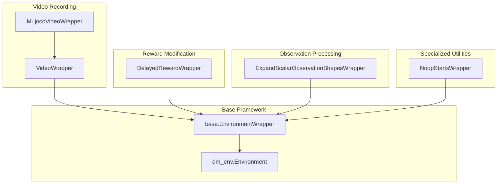
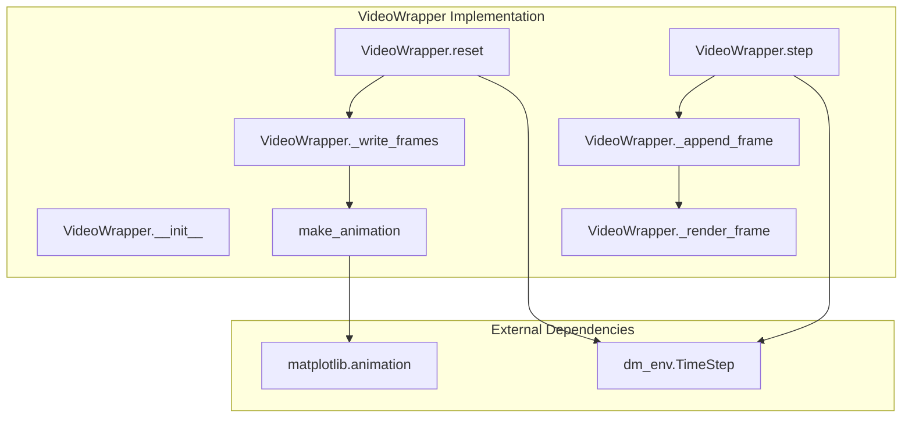
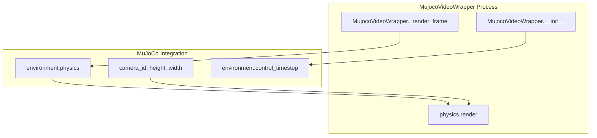
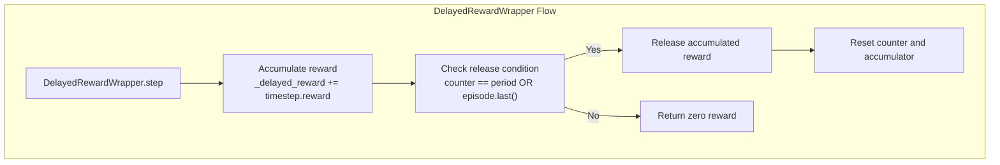
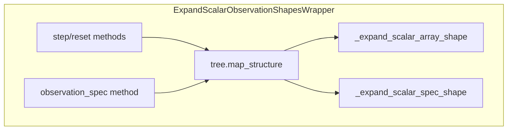
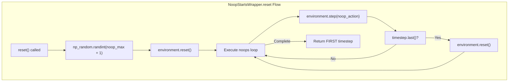
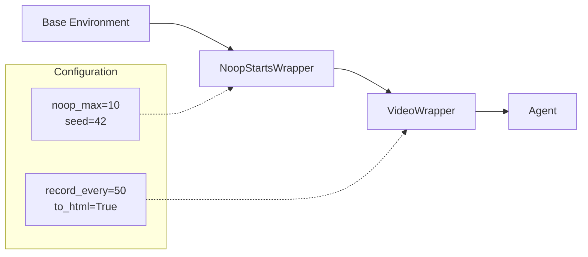
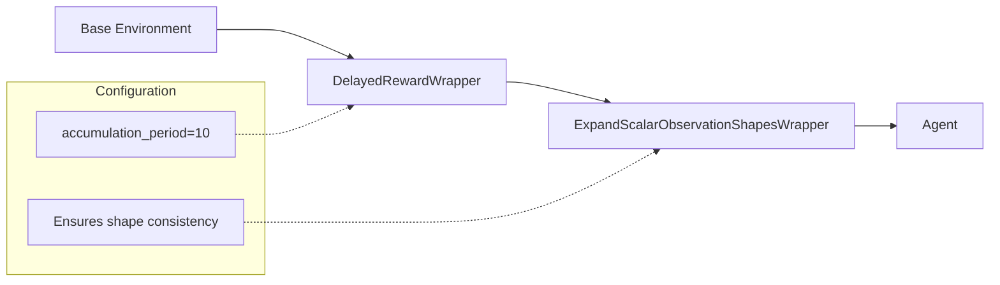

<!-- source: DeepWiki mcp.deepwiki.com · repo google-deepmind/acme · page 5.2 Video, Reward, and Utility Wrappers · fetched 2026-10-26 -->

# Video, Reward, and Utility Wrappers

<details>
<summary>Relevant source files</summary>

The following files were used as context for generating this wiki page:

- [acme/wrappers/__init__.py](acme/wrappers/__init__.py)
- [acme/wrappers/delayed_reward.py](acme/wrappers/delayed_reward.py)
- [acme/wrappers/delayed_reward_test.py](acme/wrappers/delayed_reward_test.py)
- [acme/wrappers/expand_scalar_observation_shapes.py](acme/wrappers/expand_scalar_observation_shapes.py)
- [acme/wrappers/noop_starts.py](acme/wrappers/noop_starts.py)
- [acme/wrappers/noop_starts_test.py](acme/wrappers/noop_starts_test.py)
- [acme/wrappers/video.py](acme/wrappers/video.py)

</details>


This page documents specialized environment wrappers in Acme that handle video recording, reward modification, observation processing, and other utility functions. These wrappers provide essential functionality for debugging, experimentation, and environment adaptation beyond the domain-specific wrappers covered in [Atari and Gym Wrappers](#5.1).

## Overview of Specialized Wrappers

This page focuses on four key categories of environment wrappers that provide specialized functionality:



Sources:
- [acme/wrappers/__init__.py:17-41]()
- [acme/wrappers/video.py]()
- [acme/wrappers/delayed_reward.py]()
- [acme/wrappers/expand_scalar_observation_shapes.py]()
- [acme/wrappers/noop_starts.py]()

## Base Wrapper Interface

All wrappers derive from the `EnvironmentWrapper` base class, which implements the dm_env.Environment interface by delegating to the wrapped environment:

```python
class EnvironmentWrapper(dm_env.Environment):
  def __init__(self, environment: dm_env.Environment):
    self._environment = environment
    
  def step(self, action) -> dm_env.TimeStep:
    return self._environment.step(action)

  def reset(self) -> dm_env.TimeStep:
    return self._environment.reset()
    
  def observation_spec(self):
    return self._environment.observation_spec()
    
  def action_spec(self):
    return self._environment.action_spec()
```

The utility function `wrap_all` allows for convenient application of multiple wrappers:

```python
def wrap_all(environment, wrappers):
  """Given an environment, wrap it in a list of wrappers."""
  for w in wrappers:
    environment = w(environment)
  return environment
```

Sources:
- [acme/wrappers/base.py:22-70]()

## Video Recording

### VideoWrapper

The `VideoWrapper` records videos from environment observations using matplotlib animations. It provides configurable recording intervals and output formats for debugging and visualization.

#### Video Recording Architecture



#### Key Components

The `VideoWrapper` class implements the following workflow:

| Method | Purpose | Key Logic |
|--------|---------|-----------|
| `__init__` | Initialize recording parameters | Sets up `_record_every`, `_frame_rate`, `_path` |
| `step` | Capture frames during episodes | Calls `_append_frame` on each timestep |
| `reset` | Flush frames to video on episode end | Calls `_write_frames` if frames exist |
| `_append_frame` | Store frames for current episode | Only stores if `_counter % _record_every == 0` |
| `_render_frame` | Convert observation to renderable frame | Default returns observation as-is |
| `_write_frames` | Generate video from accumulated frames | Uses `make_animation` and saves to HTML/M4V |

Configuration parameters:
- `path`: Directory for video output (default: '~/acme')
- `filename`: Base filename for videos (default: '')
- `record_every`: Record every N episodes (default: 100)
- `frame_rate`: Video framerate (default: 30)
- `figsize`: Video dimensions as tuple or diagonal (default: None)
- `to_html`: Output format - HTML if True, M4V if False (default: True)

Sources:
- [acme/wrappers/video.py:81-175]()
- [acme/wrappers/video.py:38-79]()

### MujocoVideoWrapper

The `MujocoVideoWrapper` extends `VideoWrapper` for MuJoCo physics environments, rendering directly from the physics engine rather than observations.

#### MuJoCo Rendering Process



#### MuJoCo-Specific Features

The `MujocoVideoWrapper` provides enhanced rendering capabilities:

- **Physics-based rendering**: Uses `physics.render()` instead of observations
- **Multi-camera support**: Can render from all cameras when `camera_id=None`
- **Automatic framerate**: Computes framerate from `control_timestep()` if not specified
- **Camera grid layout**: Arranges multiple cameras in a grid layout

Key parameters:
- `camera_id`: Camera to render from (default: 0), or None for all cameras
- `height`: Render height in pixels (default: 240)
- `width`: Render width in pixels (default: 320)
- `playback_speed`: Video playback speed multiplier (default: 1.0)
- `frame_rate`: Override automatic framerate calculation (default: None)

Multi-camera rendering logic:
```python
# Creates grid layout: num_columns = ceil(sqrt(num_cameras))
num_cameras = physics.model.ncam
num_columns = int(np.ceil(np.sqrt(num_cameras)))
num_rows = int(np.ceil(float(num_cameras)/num_columns))
```

Sources:
- [acme/wrappers/video.py:177-256]()

## Reward Modification

### DelayedRewardWrapper

The `DelayedRewardWrapper` creates sparse reward environments by accumulating rewards over multiple timesteps and releasing them periodically. This encourages longer-term planning by reducing the frequency of reward signals.

#### Reward Accumulation Process



#### Implementation Details

The wrapper maintains internal state to track reward accumulation:

| State Variable | Purpose | Type |
|---------------|---------|------|
| `_delayed_reward` | Accumulated reward buffer | Same structure as `reward_spec()` |
| `_accumulation_counter` | Steps since last reward release | Integer |
| `_accumulation_period` | Steps between reward releases | Integer or None |

Accumulation logic from [acme/wrappers/delayed_reward.py:73-89]():
```python
# Accumulate current reward
self._delayed_reward = tree.map_structure(
    operator.iadd, self._delayed_reward, timestep.reward)
self._accumulation_counter += 1

# Release condition: period reached OR episode ending
if ((self._accumulation_period is not None and 
     self._accumulation_counter == self._accumulation_period) or 
    timestep.last()):
    # Release accumulated reward
    timestep = timestep._replace(reward=self._delayed_reward)
    # Reset for next accumulation period
    self._accumulation_counter = 0
    self._delayed_reward = self._zero_reward
else:
    # Return zero reward
    timestep = timestep._replace(reward=self._zero_reward)
```

#### Configuration Options

- `accumulation_period`: Controls reward sparsity
  - `None`: Rewards only at episode termination
  - `1`: No-op wrapper (rewards every step)
  - `N > 1`: Rewards every N steps + episode termination

The `_zero_reward` property ensures proper reward structure:
```python
@property
def _zero_reward(self):
    return tree.map_structure(
        lambda s: np.zeros(s.shape, s.dtype),
        self._environment.reward_spec())
```

Sources:
- [acme/wrappers/delayed_reward.py:27-89]()

## Observation Processing

### ExpandScalarObservationShapesWrapper

The `ExpandScalarObservationShapesWrapper` ensures scalar observations have non-trivial shapes by adding a dimension. This prevents issues when manipulating arrays with axis operations and enables proper stacking or concatenation of observations.

#### Shape Expansion Process



#### Implementation Functions

The wrapper uses two core transformation functions:

**Array Transformation** ([acme/wrappers/expand_scalar_observation_shapes.py:67-68]()):
```python
def _expand_scalar_array_shape(array: np.ndarray) -> np.ndarray:
    return array if array.shape else np.expand_dims(array, axis=-1)
```

**Spec Transformation** ([acme/wrappers/expand_scalar_observation_shapes.py:59-64]()):
```python
def _expand_scalar_spec_shape(spec: specs.Array) -> specs.Array:
    if not spec.shape:
        # Upcasts to Array to avoid edge cases with DiscreteSpec
        spec = specs.Array(shape=(1,), dtype=spec.dtype, name=spec.name)
    return spec
```

#### Usage Examples

| Before | After | Use Case |
|--------|-------|----------|
| `shape=()` | `shape=(1,)` | Enable axis=-1 operations |
| `scalar_action` | `[scalar_action]` | Concatenation with other observations |
| `DiscreteSpec(shape=())` | `Array(shape=(1,))` | Consistent spec types |

The wrapper applies transformations during:
- `step()`: Expands observation arrays in returned timestep
- `reset()`: Expands observation arrays in initial timestep  
- `observation_spec()`: Returns expanded observation specifications

Sources:
- [acme/wrappers/expand_scalar_observation_shapes.py:33-68]()

## Specialized Utilities

### NoopStartsWrapper

The `NoopStartsWrapper` introduces stochasticity into deterministic environments by executing random no-op actions at episode start. This helps with exploration and prevents overfitting to deterministic initial conditions.

#### Noop Randomization Process



#### Implementation Details

The wrapper uses a dedicated random state for reproducibility:

```python
# From __init__ method
self.np_random = np.random.RandomState(seed)
self._noop_max = noop_max
self._noop_action = noop_action
```

Reset logic ([acme/wrappers/noop_starts.py:59-68]()):
```python
def reset(self) -> dm_env.TimeStep:
    noops = self.np_random.randint(self._noop_max + 1)  # [0, noop_max]
    timestep = self.environment.reset()
    
    for _ in range(noops):
        timestep = self.environment.step(self._noop_action)
        if timestep.last():  # Episode ended during noop
            timestep = self.environment.reset()
    
    # Ensure returned timestep is marked as FIRST
    return timestep._replace(step_type=dm_env.StepType.FIRST)
```

#### Configuration Parameters

| Parameter | Purpose | Default | Validation |
|-----------|---------|---------|------------|
| `noop_action` | Action representing no-operation | 0 | Must be valid for environment |
| `noop_max` | Maximum number of no-op actions | 30 | Must be >= 0 |
| `seed` | Random seed for reproducibility | None | Optional integer |

The wrapper validates `noop_max >= 0` and raises `ValueError` otherwise:
```python
if noop_max < 0:
    raise ValueError(
        'Maximal number of no-ops after reset cannot be negative. '
        f'Received noop_max={noop_max}')
```

#### Episode Termination Handling

If an episode terminates during no-op execution (e.g., environments with time limits or lives), the wrapper automatically resets the environment and continues the no-op sequence. This ensures agents always start with a meaningful state.

Sources:
- [acme/wrappers/noop_starts.py:25-68]()

## Wrapper Integration Patterns

### Common Combinations

These specialized wrappers are often used together to create robust training environments:

#### Debugging and Visualization Setup


#### Sparse Reward Training


### Usage Guidelines

| Wrapper | Best Used When | Avoid When |
|---------|---------------|------------|
| `VideoWrapper` | Debugging policies, creating demos | Production training (performance cost) |
| `MujocoVideoWrapper` | MuJoCo environments with physics visualization | Non-MuJoCo environments |
| `DelayedRewardWrapper` | Training long-term planning, sparse environments | Environments already sparse |
| `ExpandScalarObservationShapesWrapper` | Stacking/concatenating scalar observations | All observations already have shape |
| `NoopStartsWrapper` | Deterministic environments, Atari games | Environments with sufficient natural stochasticity |

Sources:
- [acme/wrappers/__init__.py:17-41]()

## Data Type Conversion

### SinglePrecisionWrapper

The `SinglePrecisionWrapper` converts environment arrays to single precision (float32, int32). This can improve memory efficiency and compatibility with neural networks that typically operate on single-precision values.

Conversion rules:
- float64 → float32
- int64 → int32
- No change for other types

Sources:
- Not explicitly provided in the file list, but mentioned in [acme/wrappers/__init__.py:31]()

## Common Usage Patterns

### Basic Wrapping

```python
from acme import wrappers
import gym

# Create a Gym environment and wrap it for use with Acme
env = gym.make('CartPole-v1')
env = wrappers.GymWrapper(env)
env = wrappers.SinglePrecisionWrapper(env)
```

### Using wrap_all for Multiple Wrappers

```python
from acme import wrappers
import gym

# Create a Gym environment
env = gym.make('CartPole-v1')

# Apply multiple wrappers using wrap_all
env = wrappers.wrap_all(
    wrappers.GymWrapper(env),
    [
        lambda e: wrappers.SinglePrecisionWrapper(e),
        lambda e: wrappers.StepLimitWrapper(e, step_limit=1000),
        lambda e: wrappers.FrameStackingWrapper(e, num_frames=2)
    ]
)
```

### Common Wrapper Combinations

For standard Atari preprocessing:

```python
env = wrappers.GymAtariAdapter(gym.make('PongNoFrameskip-v4'))
env = wrappers.AtariWrapper(
    env,
    max_abs_reward=1.0,             # Clip rewards to [-1, 1]
    scale_dims=(84, 84),            # Resize to 84x84
    action_repeats=4,               # Repeat each action 4 times
    pooled_frames=2,                # Max-pool over last 2 frames
    zero_discount_on_life_loss=True,# End episodes on life loss
    num_stacked_frames=4            # Stack 4 frames
)
```

For MuJoCo environments with video recording:

```python
from dm_control import suite

env = suite.load(domain_name='cartpole', task_name='swingup')
env = wrappers.MujocoVideoWrapper(
    env,
    record_every=100,  # Record every 100 episodes
    frame_rate=60      # 60 FPS video
)
env = wrappers.SinglePrecisionWrapper(env)
env = wrappers.ActionRepeatWrapper(env, num_repeats=2)
```

## Wrapper Selection Guidelines

When selecting wrappers for your environment, consider the following:

| Problem | Recommended Wrapper |
|---------|---------------------|
| Agent needs to see motion | `FrameStackingWrapper` |
| Environment actions too fine-grained | `ActionRepeatWrapper` |
| Episodes too long | `StepLimitWrapper` |
| Agent exploits deterministic start | `NoopStartsWrapper` |
| Rewards too frequent/distracting | `DelayedRewardWrapper` |
| Need to debug agent behavior | `VideoWrapper` |
| Different action ranges across envs | `CanonicalSpecWrapper` |
| Mixed precision causing errors | `SinglePrecisionWrapper` |
| Structuring complex observations | `ConcatObservationWrapper` |

Sources:
- All the wrappers documented above

## Wrapper Composition Order

The order in which wrappers are applied matters. A general rule of thumb is:

1. Environment adapters (GymWrapper, OpenSpielWrapper)
2. Data type conversion (SinglePrecisionWrapper)
3. Episode structure (NoopStartsWrapper, StepLimitWrapper)
4. Action processing (CanonicalSpecWrapper, ActionRepeatWrapper)
5. Reward modification (DelayedRewardWrapper)
6. Observation processing (FrameStackingWrapper, ConcatObservationWrapper)
7. Monitoring (VideoWrapper)

```mermaid
graph LR
    Env["Raw Environment"]
    Adapt["Environment Adapters"]
    DataType["Data Type Conversion"]
    EpStruct["Episode Structure"]
    Action["Action Processing"]
    Reward["Reward Modification"]
    Obs["Observation Processing"]
    Monitor["Monitoring"]
    Agent["Agent"]
    
    Env --> Adapt
    Adapt --> DataType
    DataType --> EpStruct
    EpStruct --> Action
    Action --> Reward
    Reward --> Obs
    Obs --> Monitor
    Monitor --> Agent
```



Sources:
- Common practice derived from the wrapper implementations and their dependencies

---

