<!-- source: DeepWiki mcp.deepwiki.com · repo google-deepmind/acme · page 6 Experiment Management and Execution · fetched 2026-10-26 -->

# Experiment Management and Execution

Relevant source files

The following files were used as context for generating this wiki page:

- [acme/jax/experiments/__init__.py](acme/jax/experiments/__init__.py)
- [acme/jax/experiments/config.py](acme/jax/experiments/config.py)
- [acme/jax/experiments/make_distributed_experiment.py](acme/jax/experiments/make_distributed_experiment.py)
- [acme/jax/experiments/make_distributed_offline_experiment.py](acme/jax/experiments/make_distributed_offline_experiment.py)
- [acme/jax/experiments/run_experiment.py](acme/jax/experiments/run_experiment.py)
- [acme/jax/experiments/run_experiment_test.py](acme/jax/experiments/run_experiment_test.py)
- [acme/jax/experiments/run_offline_experiment.py](acme/jax/experiments/run_offline_experiment.py)
- [acme/jax/experiments/run_offline_experiment_test.py](acme/jax/experiments/run_offline_experiment_test.py)
- [acme/jax/experiments/test_utils.py](acme/jax/experiments/test_utils.py)

This document covers Acme's experiment management and execution framework, which provides a unified interface for configuring, running, and scaling reinforcement learning experiments. The system handles component assembly, environment setup, distributed execution, and experiment lifecycle management through a declarative configuration approach.

For information about individual agent implementations and their specific builders, see [Reinforcement Learning Agents](#4). For details about environment wrappers and preprocessing, see [Environment Wrappers](#5).

## Core Configuration System

The experiment management system is built around the `ExperimentConfig` class, which serves as a declarative specification for all aspects of an RL experiment. This configuration-driven approach separates experiment definition from execution details.

### ExperimentConfig Architecture

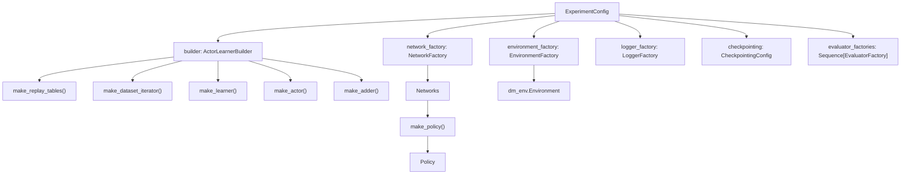

The `ExperimentConfig` class in [acme/jax/experiments/config.py:123-174]() uses the builder pattern to decouple experiment specification from component instantiation. Key attributes include:

| Attribute | Type | Purpose |
|-----------|------|---------|
| `builder` | `ActorLearnerBuilder` | Constructs agent components (actor, learner, replay tables) |
| `network_factory` | `NetworkFactory` | Creates neural network architectures |
| `environment_factory` | `EnvironmentFactory` | Instantiates training environments |
| `max_num_actor_steps` | `int` | Training duration limit |
| `seed` | `int` | Random seed for reproducibility |
| `checkpointing` | `CheckpointingConfig` | Persistence and recovery configuration |

Sources: [acme/jax/experiments/config.py:123-174]()

### Factory Protocol System

The framework uses protocol-based factories to provide flexible component creation while maintaining type safety:

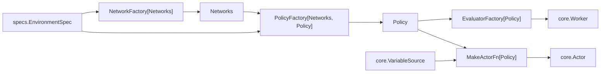

These protocols enable dependency injection and component composition. The `NetworkFactory` protocol in [acme/jax/experiments/config.py:43-47]() creates networks from environment specifications, while `PolicyFactory` in [acme/jax/experiments/config.py:57-62]() constructs policies with evaluation mode support.

Sources: [acme/jax/experiments/config.py:43-47](), [acme/jax/experiments/config.py:57-62](), [acme/jax/experiments/config.py:35-40](), [acme/jax/experiments/config.py:65-70]()

## Single-Threaded Experiment Execution

The `run_experiment()` function provides a simple, single-threaded execution environment suitable for local development and testing. It orchestrates the entire experiment lifecycle from component creation to training loop execution.

### Execution Flow Architecture

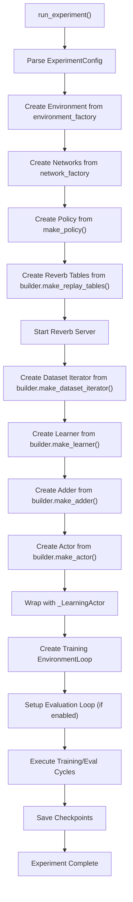

The `run_experiment()` function in [acme/jax/experiments/run_experiment.py:34-179]() creates components in reverse dependency order. The learner is created first as a `VariableSource`, then the adder, and finally the actor which depends on both.

### Learning Actor Integration

A key innovation is the `_LearningActor` wrapper in [acme/jax/experiments/run_experiment.py:183-260]() that combines environment interaction with learning:

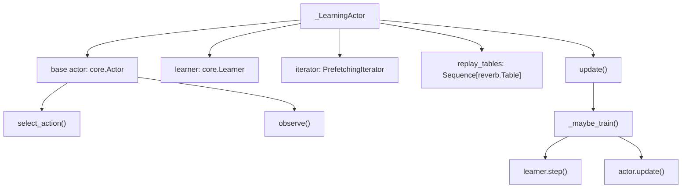

The `_LearningActor.update()` method in [acme/jax/experiments/run_experiment.py:254-259]() checks for available data and performs learner steps when the replay tables have sufficient samples, ensuring efficient single-threaded learning.

Sources: [acme/jax/experiments/run_experiment.py:34-179](), [acme/jax/experiments/run_experiment.py:183-260]()

## Distributed Experiment Execution

The `make_distributed_experiment()` function creates LaunchPad programs for scalable, distributed training across multiple machines and accelerators. It decomposes the experiment into separate processes for replay storage, learning, and environment interaction.

### Distributed System Architecture

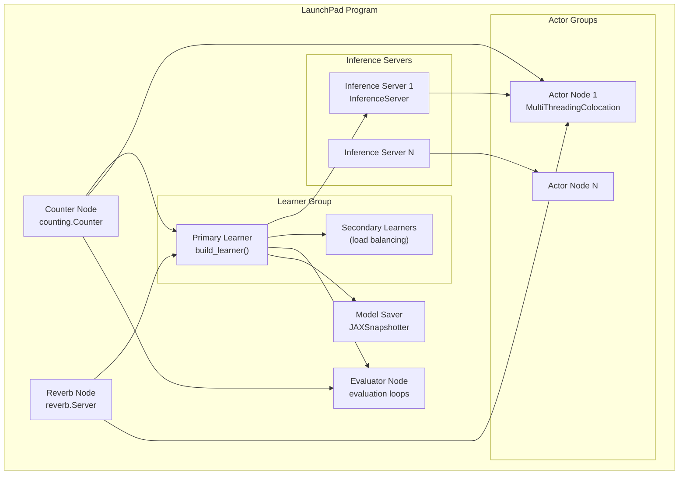

The distributed system in [acme/jax/experiments/make_distributed_experiment.py:47-421]() supports several key features:

- **Multi-learner scaling**: Primary learner handles checkpointing while secondary learners provide load balancing for variable requests
- **Inference server optimization**: Batched inference using JAX transformations for efficient GPU/TPU utilization  
- **Actor colocation**: Configurable process vs. thread colocation for actor groups
- **Component isolation**: Separate processes for replay, learning, and environment interaction

### Inference Server Integration

For high-throughput action selection, the framework supports inference servers that batch policy computations:

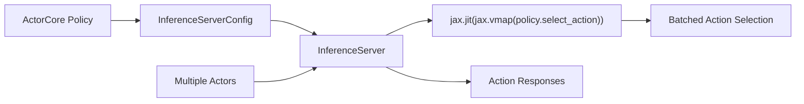

The inference server in [acme/jax/experiments/make_distributed_experiment.py:211-245]() uses `jax.vmap()` to vectorize policy computations across multiple actor requests, maximizing accelerator utilization.

Sources: [acme/jax/experiments/make_distributed_experiment.py:47-421](), [acme/jax/experiments/make_distributed_experiment.py:211-245]()

## Offline Reinforcement Learning Support

The framework provides specialized support for offline RL through `OfflineExperimentConfig` and related execution functions that learn from pre-collected datasets rather than environment interaction.

### Offline Experiment Configuration

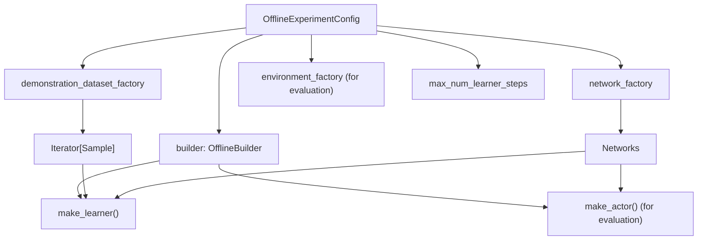

The `OfflineExperimentConfig` class in [acme/jax/experiments/config.py:206-255]() replaces environment interaction components with dataset specifications. Key differences from online experiments include:

- `demonstration_dataset_factory`: Creates iterators over pre-collected transitions
- `max_num_learner_steps`: Training duration measured in learning steps rather than environment steps  
- `OfflineBuilder`: Specialized builder for offline learning components

### Offline Execution Flow

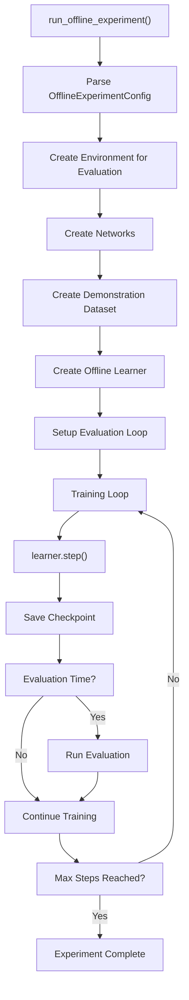

The `run_offline_experiment()` function in [acme/jax/experiments/run_offline_experiment.py:25-120]() focuses on learner progression rather than environment interaction, with periodic evaluation to assess learned policy performance.

Sources: [acme/jax/experiments/config.py:206-255](), [acme/jax/experiments/run_offline_experiment.py:25-120](), [acme/jax/experiments/make_distributed_offline_experiment.py:33-157]()

## Checkpointing and Persistence

The framework provides comprehensive checkpointing capabilities through `CheckpointingConfig`, supporting both periodic snapshots and crash recovery across distributed components.

### Checkpointing System Architecture

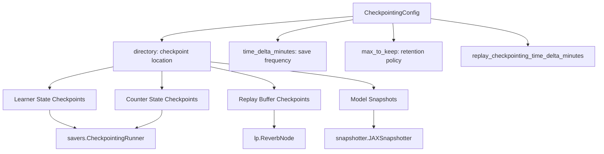

The `CheckpointingConfig` class in [acme/jax/experiments/config.py:83-120]() provides fine-grained control over persistence behavior:

| Option | Purpose | Default |
|--------|---------|---------|
| `time_delta_minutes` | Checkpoint save frequency | 5 minutes |
| `max_to_keep` | Number of checkpoints retained | 1 |
| `directory` | Checkpoint storage location | `~/acme` |
| `add_uid` | Unique identifier for parallel runs | `True` |
| `replay_checkpointing_time_delta_minutes` | Replay buffer checkpoint frequency | `None` (disabled) |

### Distributed Checkpointing Strategy

In distributed setups, checkpointing is coordinated across components:

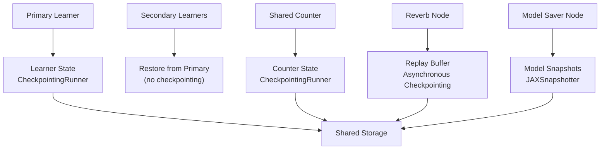

Only the primary learner creates checkpoints in [acme/jax/experiments/make_distributed_experiment.py:189-202](), while secondary learners restore from the primary's state to maintain consistency.

Sources: [acme/jax/experiments/config.py:83-120](), [acme/jax/experiments/make_distributed_experiment.py:189-202]()

## Component Factory Integration

The experiment framework integrates with Acme's broader component ecosystem through standardized factory interfaces that enable flexible agent composition and customization.

### Builder Pattern Integration

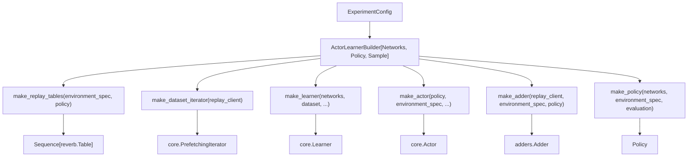

The builder pattern in [acme/agents/jax/builders.py]() provides a consistent interface for agent construction. Each experiment configuration specifies a builder that knows how to create all necessary agent components from the provided networks and environment specification.

### Factory Composition Flow

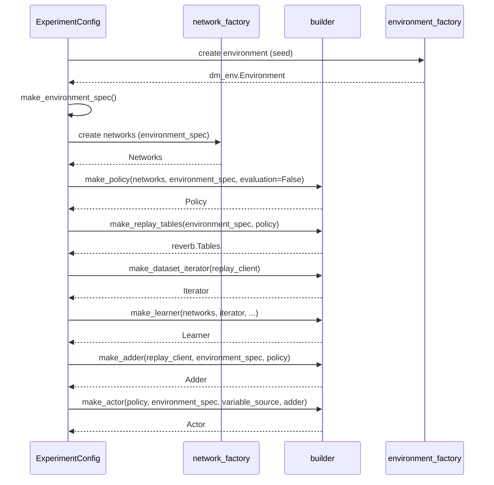

This composition flow in [acme/jax/experiments/run_experiment.py:49-106]() ensures that components are created in the correct dependency order, with each component receiving the dependencies it requires.

Sources: [acme/jax/experiments/run_experiment.py:49-106](), [acme/jax/experiments/config.py:278-312]()

---

