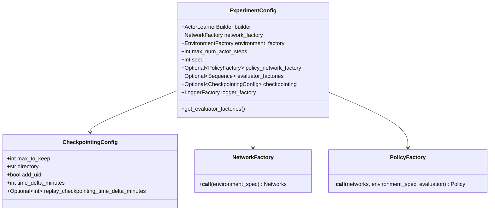
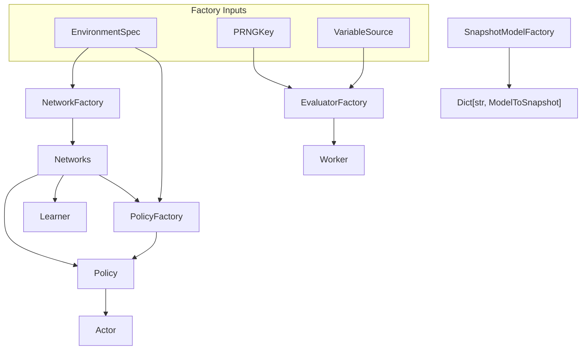
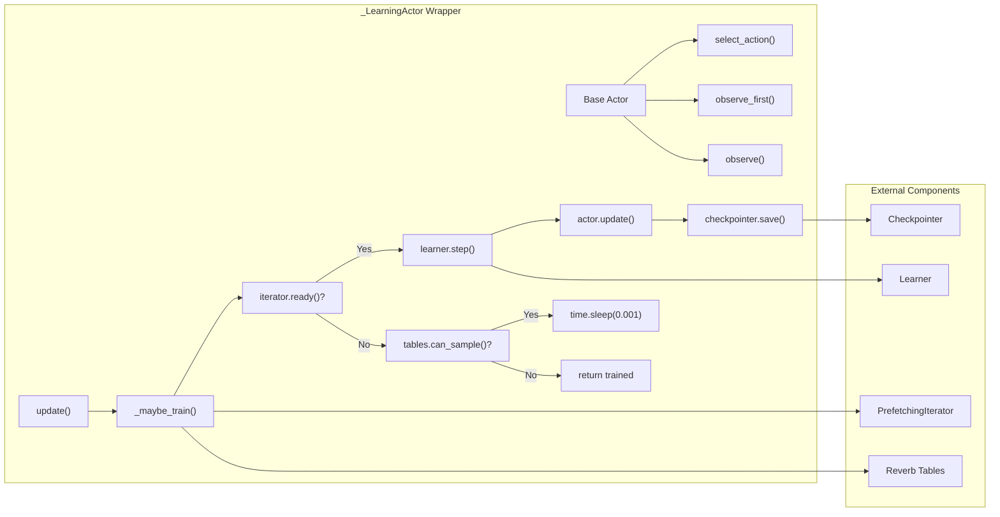
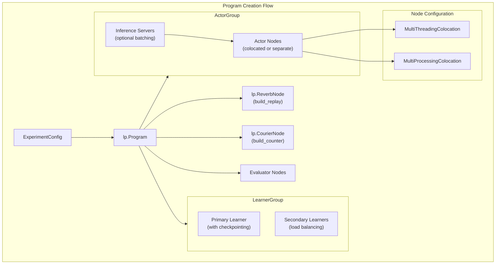
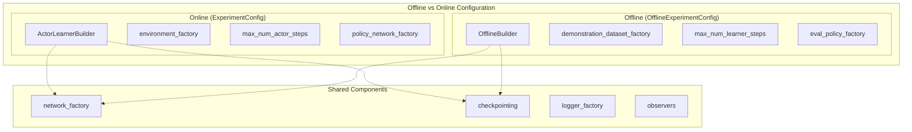
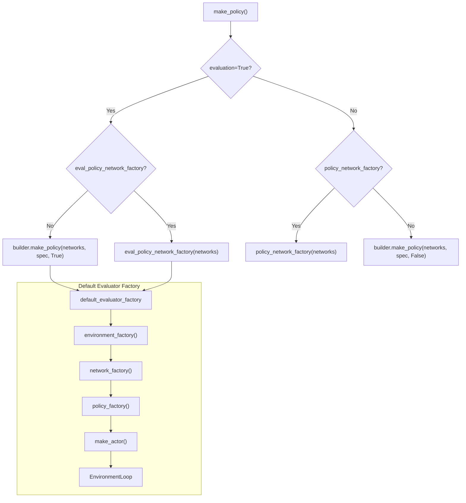

<!-- source: DeepWiki mcp.deepwiki.com · repo google-deepmind/acme · page 6.1 Experiment Configuration Framework · fetched 2026-10-26 -->

# Experiment Configuration Framework

<details>
<summary>Relevant source files</summary>

The following files were used as context for generating this wiki page:

- [acme/jax/experiments/__init__.py](acme/jax/experiments/__init__.py)
- [acme/jax/experiments/config.py](acme/jax/experiments/config.py)
- [acme/jax/experiments/make_distributed_experiment.py](acme/jax/experiments/make_distributed_experiment.py)
- [acme/jax/experiments/make_distributed_offline_experiment.py](acme/jax/experiments/make_distributed_offline_experiment.py)
- [acme/jax/experiments/run_experiment.py](acme/jax/experiments/run_experiment.py)
- [acme/jax/experiments/run_experiment_test.py](acme/jax/experiments/run_experiment_test.py)
- [acme/jax/experiments/run_offline_experiment.py](acme/jax/experiments/run_offline_experiment.py)
- [acme/jax/experiments/run_offline_experiment_test.py](acme/jax/experiments/run_offline_experiment_test.py)
- [acme/jax/experiments/test_utils.py](acme/jax/experiments/test_utils.py)

</details>


The Experiment Configuration Framework provides a unified interface for defining, configuring, and executing reinforcement learning experiments in Acme. It abstracts the complexity of setting up distributed training runs, single-threaded experiments, and offline learning scenarios through standardized configuration classes and execution functions.

For distributed execution details using LaunchPad, see [6.2](#6.2). For specific baseline experiment implementations, see [6.3](#6.3).

## Overview and Core Components

The framework consists of two main configuration classes and their corresponding execution functions:

| Configuration Class | Execution Function | Use Case |
|---------------------|-------------------|----------|
| `ExperimentConfig` | `run_experiment` / `make_distributed_experiment` | Online RL with environment interaction |
| `OfflineExperimentConfig` | `run_offline_experiment` / `make_distributed_offline_experiment` | Offline RL from demonstration data |

Both configurations use the builder pattern to assemble agent components and provide factory functions for creating networks, environments, and policies.

Sources: [acme/jax/experiments/config.py:122-174](), [acme/jax/experiments/config.py:206-256]()

## ExperimentConfig Structure



The `ExperimentConfig` serves as the central configuration hub, containing all necessary factories and parameters for experiment execution. The `builder` field uses the ActorLearnerBuilder pattern to create agent components, while factory functions provide flexible component creation.

Sources: [acme/jax/experiments/config.py:122-174](), [acme/jax/experiments/config.py:83-120]()

## Component Factory Protocols

The framework defines several protocol interfaces for component creation:



Each factory protocol defines a specific interface for creating components with the appropriate dependencies and configurations.

Sources: [acme/jax/experiments/config.py:43-79](), [acme/jax/experiments/config.py:35-41]()

## Single-Threaded Experiment Execution

The `run_experiment` function implements single-threaded experiment execution with the following workflow:

```mermaid
sequenceDiagram
    participant Config as "ExperimentConfig"
    participant Env as "Environment"
    participant Networks as "Networks"
    participant Policy as "Policy"
    participant Replay as "Reverb Server"
    participant Learner as "Learner"
    participant Actor as "LearningActor"
    participant Loop as "EnvironmentLoop"
    
    Config->>Env: environment_factory(seed)
    Config->>Networks: network_factory(environment_spec)
    Config->>Policy: make_policy(networks, spec, evaluation=False)
    Config->>Replay: builder.make_replay_tables(spec, policy)
    
    Note over Replay: Start Reverb server locally
    
    Config->>Learner: builder.make_learner(networks, dataset, ...)
    Config->>Actor: builder.make_actor(policy, variable_source=learner, ...)
    
    Note over Actor: Wrap with LearningActor for integrated learning
    
    Actor->>Loop: Create training EnvironmentLoop
    Loop->>Env: Run episodes with actor
    Actor->>Learner: Trigger learning steps when data available
```

The key innovation is the `_LearningActor` wrapper, which integrates learning steps directly into the actor's update cycle, ensuring tight coupling between data collection and learning in single-threaded execution.

Sources: [acme/jax/experiments/run_experiment.py:34-181](), [acme/jax/experiments/run_experiment.py:183-260]()

## LearningActor Integration Pattern

The `_LearningActor` class demonstrates a critical pattern for single-threaded execution:



This pattern ensures learning occurs whenever sufficient data is available while preventing deadlocks in single-threaded execution.

Sources: [acme/jax/experiments/run_experiment.py:183-260]()

## Distributed Experiment Creation

The `make_distributed_experiment` function creates LaunchPad programs for distributed execution:



The function supports various deployment configurations including colocation strategies, inference server batching, and multi-learner setups for distributed training.

Sources: [acme/jax/experiments/make_distributed_experiment.py:47-421]()

## Offline Experiment Configuration

`OfflineExperimentConfig` adapts the framework for offline RL scenarios:



The offline configuration removes actor-environment interaction components and replaces them with demonstration data sources and learner-centric execution.

Sources: [acme/jax/experiments/config.py:206-276](), [acme/jax/experiments/run_offline_experiment.py:25-120]()

## Policy Creation and Evaluation

The framework provides flexible policy creation through the `make_policy` function and default evaluator factories:



This design supports both legacy factory-based policy creation and modern builder-pattern policy creation with automatic fallbacks.

Sources: [acme/jax/experiments/config.py:315-330](), [acme/jax/experiments/config.py:278-312]()

## Integration with Agent Builders

The configuration framework integrates seamlessly with the ActorLearnerBuilder pattern used throughout Acme:

| Builder Method | Purpose | Configuration Usage |
|---------------|---------|-------------------|
| `make_replay_tables` | Create Reverb tables for experience storage | Used in both single-threaded and distributed setup |
| `make_dataset_iterator` | Create data iterator from replay client | Feeds into learner creation |
| `make_learner` | Create learner component | Central to both execution modes |
| `make_actor` | Create actor component | Used for both training and evaluation |
| `make_adder` | Create experience adder | Connects actor to replay system |
| `make_policy` | Create policy from networks | Used for actor and evaluator creation |

This integration allows the experiment framework to work with any agent that implements the ActorLearnerBuilder interface, providing consistent experiment setup across different algorithms.

Sources: [acme/jax/experiments/run_experiment.py:66-106](), [acme/jax/experiments/make_distributed_experiment.py:118-131]()

---

