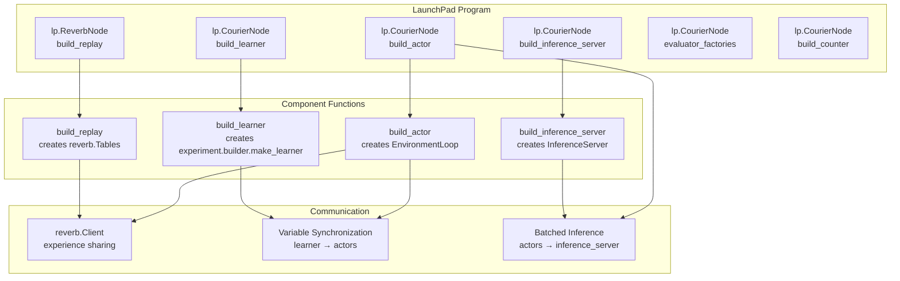
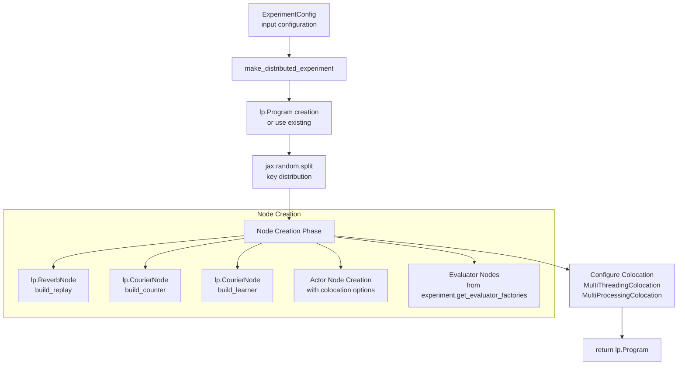
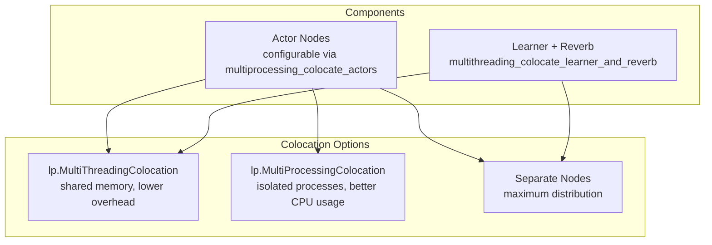

<!-- source: DeepWiki mcp.deepwiki.com · repo google-deepmind/acme · page 6.2 Distributed Execution with LaunchPad · fetched 2026-10-26 -->

# Distributed Execution with LaunchPad

<details>
<summary>Relevant source files</summary>

The following files were used as context for generating this wiki page:

- [acme/jax/experiments/__init__.py](acme/jax/experiments/__init__.py)
- [acme/jax/experiments/config.py](acme/jax/experiments/config.py)
- [acme/jax/experiments/make_distributed_experiment.py](acme/jax/experiments/make_distributed_experiment.py)
- [acme/jax/experiments/make_distributed_offline_experiment.py](acme/jax/experiments/make_distributed_offline_experiment.py)
- [acme/jax/experiments/run_experiment.py](acme/jax/experiments/run_experiment.py)
- [acme/jax/experiments/run_experiment_test.py](acme/jax/experiments/run_experiment_test.py)
- [acme/jax/experiments/run_offline_experiment.py](acme/jax/experiments/run_offline_experiment.py)
- [acme/jax/experiments/run_offline_experiment_test.py](acme/jax/experiments/run_offline_experiment_test.py)
- [acme/jax/experiments/test_utils.py](acme/jax/experiments/test_utils.py)

</details>


This document covers how Acme implements distributed reinforcement learning using Google's LaunchPad framework. It explains the architecture, components, and scaling mechanisms for running RL experiments across multiple processes and machines.

For information about single-threaded experiment execution, see [Experiment Configuration Framework](#6.1). For details about the underlying agent implementations, see [Reinforcement Learning Agents](#4).

## Overview

Acme's distributed execution system allows RL experiments to scale beyond single-machine limitations by distributing computational workload across multiple processes and nodes. The system uses LaunchPad to orchestrate distributed programs where different components (learners, actors, replay buffers) run as separate processes that communicate via network protocols.

The main entry point is the `make_distributed_experiment` function, which converts an `ExperimentConfig` into a distributed `lp.Program` that can be executed across multiple machines.

Sources: [acme/jax/experiments/make_distributed_experiment.py:47-106]()

## Distributed Architecture Components



The distributed architecture separates the traditional RL training loop into specialized components that can run independently and scale horizontally.

Sources: [acme/jax/experiments/make_distributed_experiment.py:118-421]()

## LaunchPad Program Construction

The `make_distributed_experiment` function creates a LaunchPad program through several key steps:

### Core Program Setup



The function systematically builds each component with proper dependency injection and handles different deployment configurations.

Sources: [acme/jax/experiments/make_distributed_experiment.py:292-421]()

## Node Types and Responsibilities

| Node Type | Function | Purpose | Scaling |
|-----------|----------|---------|---------|
| **ReverbNode** | `build_replay()` | Distributed experience storage using Reverb tables | Single node with checkpointing |
| **Learner** | `build_learner()` | Neural network training and gradient updates | Multiple nodes via `num_learner_nodes` |
| **Actor** | `build_actor()` | Environment interaction and experience collection | Multiple nodes via `num_actors` |
| **InferenceServer** | `build_inference_server()` | Batched policy inference for actors | Multiple servers via `num_inference_servers` |
| **Counter** | `build_counter()` | Step tracking and synchronization | Single shared counter |
| **Evaluator** | `evaluator_factories` | Policy evaluation during training | Multiple independent evaluators |

### Replay Storage

The replay component uses Reverb for distributed experience storage:

```python
def build_replay():
    # Creates Reverb tables based on agent builder specifications
    dummy_seed = 1
    spec = experiment.environment_spec or specs.make_environment_spec(...)
    network = experiment.network_factory(spec)
    policy = config.make_policy(...)
    return experiment.builder.make_replay_tables(spec, policy)
```

Sources: [acme/jax/experiments/make_distributed_experiment.py:118-130]()

### Learner Nodes

Learner nodes handle the core training logic with support for multi-host setups:

```python
def build_learner(random_key, replay, counter=None, primary_learner=None):
    # Creates networks, dataset iterator, and learner
    networks = experiment.network_factory(spec)
    iterator = experiment.builder.make_dataset_iterator(replay)
    iterator = utils.prefetch(iterable=iterator, buffer_size=1)
    learner = experiment.builder.make_learner(...)
    
    # Handle checkpointing and secondary learner synchronization
    if primary_learner is None:
        # Primary learner with checkpointing
    else:
        # Secondary learner synchronized with primary
        learner.restore(primary_learner.save())
```

Sources: [acme/jax/experiments/make_distributed_experiment.py:163-208]()

### Actor Nodes

Actor nodes run environment interactions with flexible deployment options:

```python
def build_actor(random_key, replay, variable_source, counter, actor_id, inference_server):
    environment = experiment.environment_factory(utils.sample_uint32(environment_key))
    networks = experiment.network_factory(environment_spec)
    policy_network = config.make_policy(...)
    
    # Optional inference server integration
    if inference_server is not None:
        policy_network = actor_core.ActorCore(
            init=policy_network.init,
            select_action=inference_server.handler,  # Batched inference
            get_extras=policy_network.get_extras,
        )
    
    actor = experiment.builder.make_actor(...)
    return environment_loop.EnvironmentLoop(environment, actor, ...)
```

Sources: [acme/jax/experiments/make_distributed_experiment.py:247-290]()

## Scaling and Deployment Configurations

### Actor Scaling Options

The system provides flexible actor deployment through several parameters:

| Parameter | Description | Use Case |
|-----------|-------------|----------|
| `num_actors` | Total number of actor processes | Scale environment interaction |
| `num_actors_per_node` | Actors per compute node | Resource optimization |
| `multiprocessing_colocate_actors` | Use subprocesses vs threads | CPU-intensive environments |

### Colocation Strategies



Sources: [acme/jax/experiments/make_distributed_experiment.py:57-92](), [acme/jax/experiments/make_distributed_experiment.py:317-320](), [acme/jax/experiments/make_distributed_experiment.py:405-408]()

### Inference Server Integration

For computationally expensive policy networks, the system supports centralized inference servers:

```python
# Inference server configuration
inference_server_config = inference_server_lib.InferenceServerConfig(
    batch_size=32,
    # ... other config options
)

# Creates batched inference handler
inference_server = InferenceServer(
    handler=jax.jit(
        jax.vmap(
            policy.select_action,
            in_axes=(None, 0, 0),  # Batch observations and actor state
        )
    ),
    variable_source=variable_source,
    devices=jax.local_devices(),
    config=inference_server_config,
)
```

Sources: [acme/jax/experiments/make_distributed_experiment.py:211-245]()

## Comparison with Single-Threaded Execution

| Aspect | Single-Threaded (`run_experiment`) | Distributed (`make_distributed_experiment`) |
|--------|-----------------------------------|-------------------------------------------|
| **Execution Model** | Sequential actor-learner updates | Parallel independent processes |
| **Scaling** | Limited to single machine resources | Horizontal scaling across machines |
| **Complexity** | Simple linear execution flow | Requires process orchestration |
| **Performance** | Lower overhead, simpler debugging | Higher throughput, better resource utilization |
| **Use Case** | Development, small-scale experiments | Production, large-scale training |

The single-threaded version uses a `_LearningActor` wrapper that combines acting and learning in one process, while the distributed version separates these concerns into independent nodes.

Sources: [acme/jax/experiments/run_experiment.py:183-260](), [acme/jax/experiments/make_distributed_experiment.py:47-421]()

## Configuration Parameters

The `make_distributed_experiment` function provides extensive configuration options:

```python
def make_distributed_experiment(
    experiment: config.ExperimentConfig,
    num_actors: int,
    *,
    inference_server_config: Optional[InferenceServerConfig] = None,
    num_learner_nodes: int = 1,
    num_actors_per_node: int = 1,
    num_inference_servers: int = 1,
    multiprocessing_colocate_actors: bool = False,
    multithreading_colocate_learner_and_reverb: bool = False,
    # ... additional parameters
) -> lp.Program:
```

### Key Configuration Considerations

- **Multi-learner setups** require proper gradient synchronization via pmap/pmean operations
- **Inference server usage** requires `ActorCore`-compatible policies
- **Colocation options** affect memory usage and inter-process communication overhead
- **Checkpointing** is handled only by primary learners in multi-learner configurations

Sources: [acme/jax/experiments/make_distributed_experiment.py:47-106](), [acme/jax/experiments/make_distributed_experiment.py:108-116]()

---

