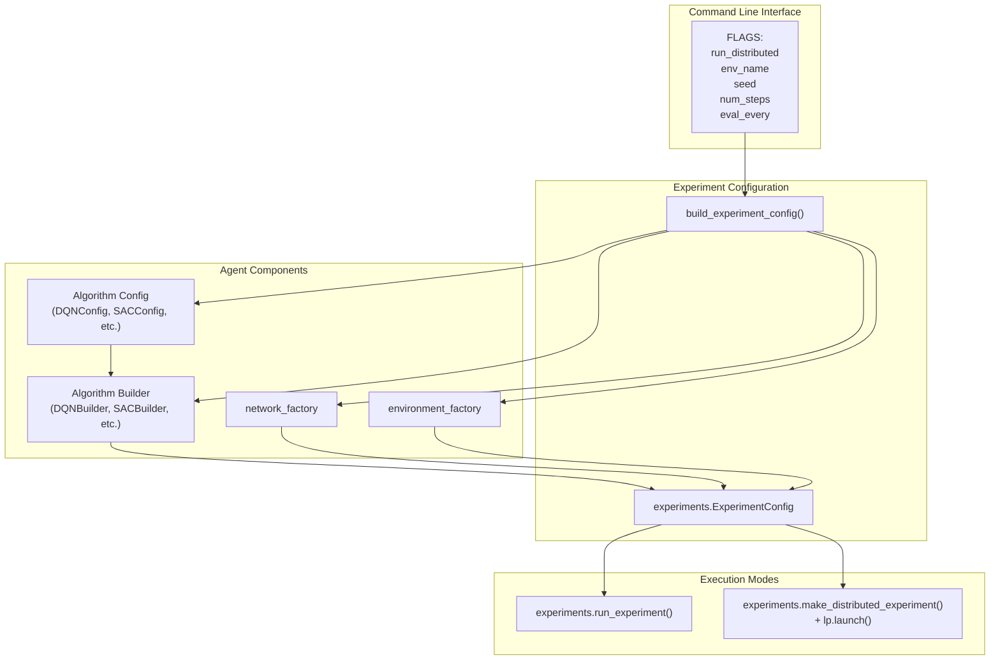
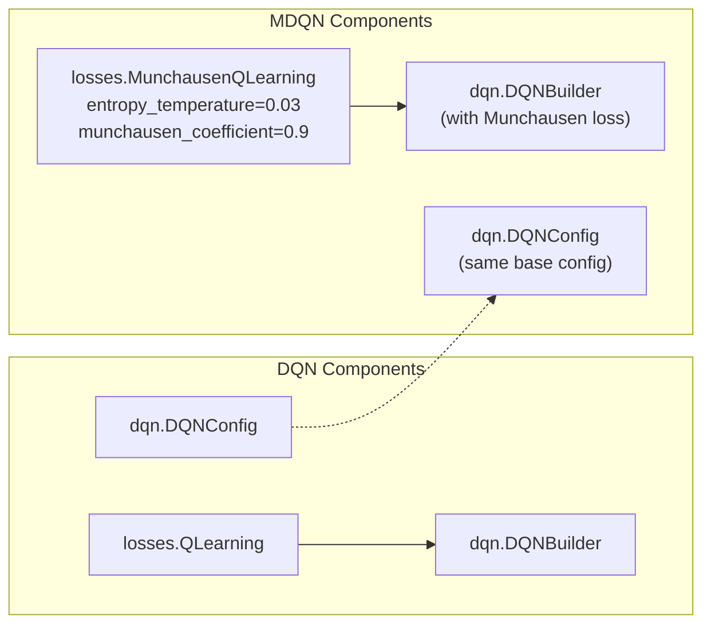
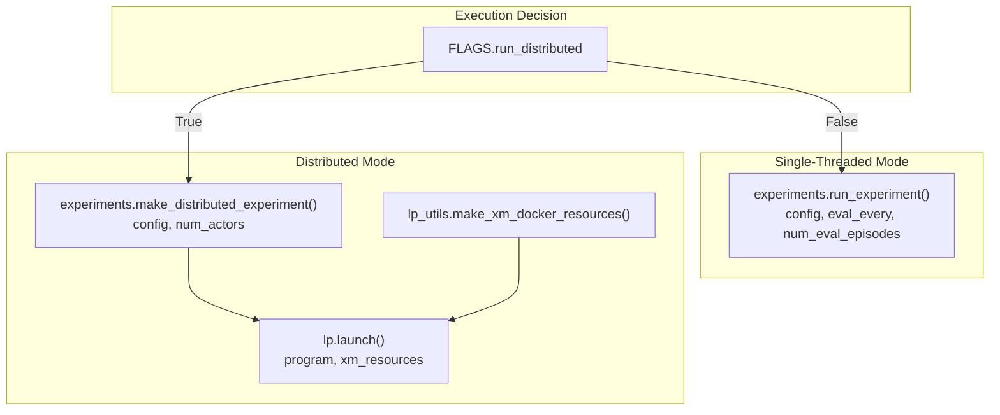
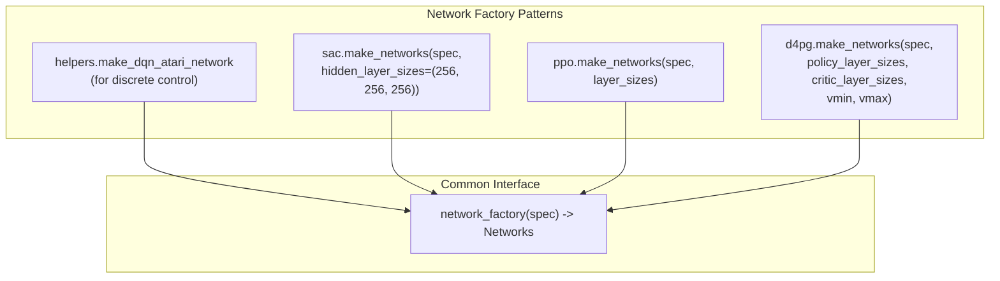

<!-- source: DeepWiki mcp.deepwiki.com · repo google-deepmind/acme · page 6.3 Example Baseline Experiments · fetched 2026-10-26 -->

# Example Baseline Experiments

<details>
<summary>Relevant source files</summary>

The following files were used as context for generating this wiki page:

- [examples/baselines/rl_continuous/run_d4pg.py](examples/baselines/rl_continuous/run_d4pg.py)
- [examples/baselines/rl_continuous/run_ppo.py](examples/baselines/rl_continuous/run_ppo.py)
- [examples/baselines/rl_continuous/run_sac.py](examples/baselines/rl_continuous/run_sac.py)
- [examples/baselines/rl_continuous/run_td3.py](examples/baselines/rl_continuous/run_td3.py)
- [examples/baselines/rl_discrete/run_dqn.py](examples/baselines/rl_discrete/run_dqn.py)
- [examples/baselines/rl_discrete/run_mdqn.py](examples/baselines/rl_discrete/run_mdqn.py)

</details>


## Purpose and Scope

This page documents the ready-to-use baseline experiment scripts provided in Acme for various reinforcement learning algorithms. These examples demonstrate how to configure and run different RL agents on standard benchmarks with competitive hyperparameters. The scripts serve as both working implementations and templates for creating custom experiments.

For information about the underlying experiment framework and configuration system, see [Experiment Configuration Framework](#6.1). For details about distributed execution mechanics, see [Distributed Execution with LaunchPad](#6.2).

## Baseline Experiment Structure

All baseline experiment scripts follow a consistent architectural pattern that leverages the Acme experiment framework. Each script implements the same core components with algorithm-specific configurations.



**Sources: [examples/baselines/rl_discrete/run_dqn.py:36-69](), [examples/baselines/rl_continuous/run_sac.py:40-64]()**

Each baseline script implements three key functions:

| Function | Purpose | Returns |
|----------|---------|---------|
| `build_experiment_config()` | Constructs agent configuration, builder, and factories | `experiments.ExperimentConfig` |
| `main()` | Parses flags and chooses execution mode | None |
| Command-line interface | Defines configurable parameters via `absl.flags` | None |

## Discrete Control Baselines

The discrete control baselines focus on Atari environments and implement value-based methods. These experiments use the `helpers.make_atari_environment()` function and specialized DQN network architectures.

### DQN Baseline

The standard DQN implementation provides a foundation for value-based learning on discrete action spaces:

**Configuration:**
- Learning rate: 5e-5
- Epsilon: 0.01 (training), 0.0 (evaluation)
- Target update period: 2000 steps
- Replay buffer: 1M transitions, minimum 20K
- Batch size: 32, samples per insert: 8

**Sources: [examples/baselines/rl_discrete/run_dqn.py:47-57]()**

### Munchausen DQN Baseline

The Munchausen DQN variant incorporates entropy regularization and modified Q-learning updates:



**Sources: [examples/baselines/rl_discrete/run_mdqn.py:58-61](), [examples/baselines/rl_discrete/run_dqn.py:58-61]()**

**Key Differences:**
- `MunchausenQLearning` loss with entropy temperature 0.03
- Munchausen coefficient 0.9
- Huber loss parameter 1.0
- Max absolute reward clipping at 1.0

## Continuous Control Baselines

Continuous control baselines target locomotion and manipulation tasks, implementing policy gradient and actor-critic methods. These use `helpers.make_environment()` to support both Gym and DeepMind Control Suite environments.

### Algorithm Configuration Matrix

| Algorithm | Learning Rate | Network Architecture | Special Features |
|-----------|---------------|---------------------|------------------|
| **SAC** | 3e-4 | (256, 256, 256) | Automatic entropy tuning, input normalization |
| **PPO** | Default | (256, 256, 256) | Advantage/value normalization, observation normalization |
| **D4PG** | 3e-4 | Policy/Critic: (256, 256, 256) | Distributional critic, environment-specific vmax |
| **TD3** | Policy: 3e-4, Critic: 3e-4 | (256, 256, 256) | Twin critics, delayed policy updates |

### SAC Configuration Details

The SAC baseline demonstrates advanced configuration patterns including automatic target entropy and input normalization:

```python
config = sac.SACConfig(
    learning_rate=3e-4,
    n_step=2,
    target_entropy=sac.target_entropy_from_env_spec(environment_spec),
    input_normalization=normalization.NormalizationConfig())
```

**Sources: [examples/baselines/rl_continuous/run_sac.py:52-56]()**

### PPO Configuration Details

PPO includes comprehensive normalization strategies for stable policy optimization:

```python
config = ppo.PPOConfig(
    normalize_advantage=True,
    normalize_value=True,
    obs_normalization_fns_factory=ppo.build_mean_std_normalizer)
```

**Sources: [examples/baselines/rl_continuous/run_ppo.py:44-47]()**

### D4PG Environment-Specific Configuration

D4PG adapts its distributional critic bounds based on the environment suite:

```python
vmax_values = {
    'gym': 1000.,
    'control': 150.,
}
vmax = vmax_values[suite]
```

**Sources: [examples/baselines/rl_continuous/run_d4pg.py:45-49]()**

## Execution Modes and Scaling

All baseline experiments support both single-threaded and distributed execution modes through a unified interface pattern.

### Execution Mode Selection



**Sources: [examples/baselines/rl_continuous/run_sac.py:68-77](), [examples/baselines/rl_discrete/run_dqn.py:71-79]()**

### Actor Scaling Configuration

Different algorithms use different default actor counts for distributed execution:

| Script | Local Run Actors | Production Actors | Configuration |
|--------|------------------|-------------------|---------------|
| **DQN/MDQN** | 4 | 128 | `lp_utils.is_local_run()` detection |
| **SAC/D4PG/TD3** | 4 | 4 | Fixed actor count |
| **PPO** | Configurable | 64 (default) | `FLAGS.num_distributed_actors` |

**Sources: [examples/baselines/rl_discrete/run_dqn.py:74-77](), [examples/baselines/rl_continuous/run_ppo.py:35-36]()**

## Common Configuration Patterns

### Environment Factory Pattern

All baselines implement environment factories that handle suite-specific initialization:

**Discrete Control:**
```python
def env_factory(seed):
    del seed
    return helpers.make_atari_environment(
        level=env_name, sticky_actions=True, zero_discount_on_life_loss=False)
```

**Continuous Control:**
```python
environment_factory=lambda seed: helpers.make_environment(suite, task)
```

**Sources: [examples/baselines/rl_discrete/run_dqn.py:41-44](), [examples/baselines/rl_continuous/run_sac.py:61]()**

### Network Factory Standardization

Network factories provide algorithm-specific architectures while maintaining consistent interfaces:



**Sources: [examples/baselines/rl_discrete/run_dqn.py:67](), [examples/baselines/rl_continuous/run_sac.py:48-49](), [examples/baselines/rl_continuous/run_d4pg.py:51-58]()**

### Flag-Based Configuration

All baselines use consistent command-line flag patterns for easy customization:

| Flag Category | Common Flags | Purpose |
|---------------|--------------|---------|
| **Execution** | `run_distributed`, `seed` | Control execution mode and reproducibility |
| **Environment** | `env_name` | Specify task (e.g., 'Pong', 'gym:HalfCheetah-v2') |
| **Training** | `num_steps` | Set total environment steps |
| **Evaluation** | `eval_every`, `evaluation_episodes` | Configure evaluation schedule |

**Sources: [examples/baselines/rl_continuous/run_ppo.py:27-36](), [examples/baselines/rl_discrete/run_dqn.py:27-33]()**

---

