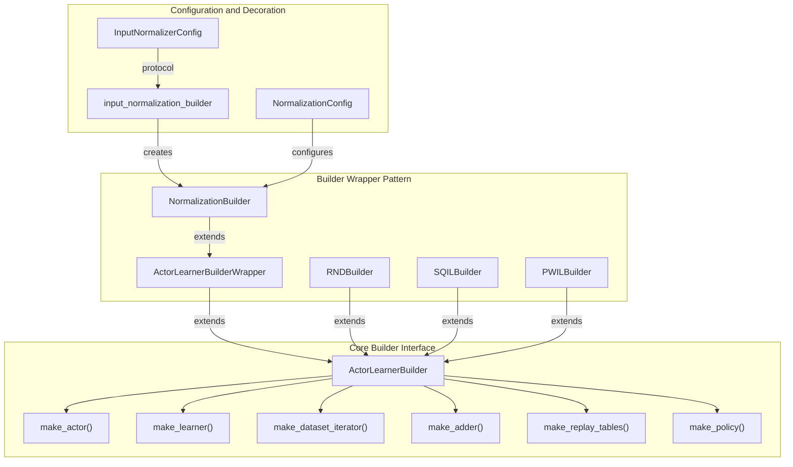
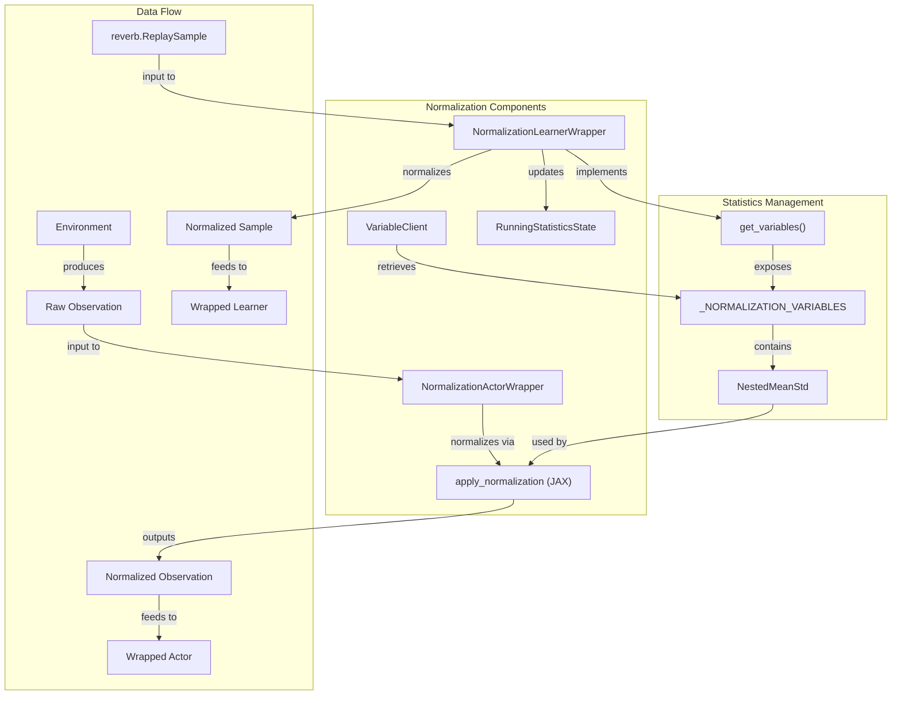
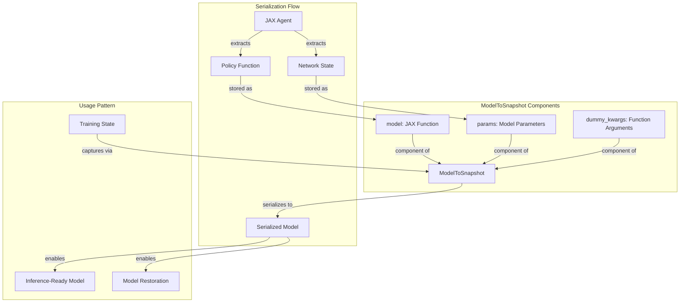
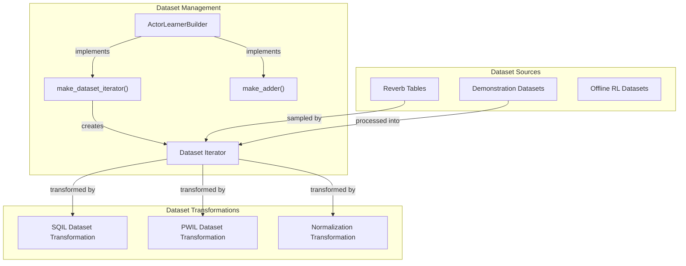
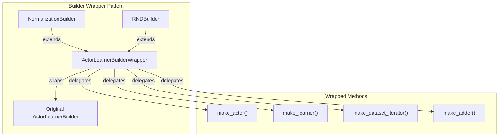

<!-- source: DeepWiki mcp.deepwiki.com · repo google-deepmind/acme · page 7 Advanced Topics and Patterns · fetched 2026-10-26 -->

# Advanced Topics and Patterns

<details>
<summary>Relevant source files</summary>

The following files were used as context for generating this wiki page:

- [acme/agents/jax/builders.py](acme/agents/jax/builders.py)
- [acme/agents/jax/normalization.py](acme/agents/jax/normalization.py)
- [acme/agents/jax/pwil/builder.py](acme/agents/jax/pwil/builder.py)
- [acme/agents/jax/rnd/builder.py](acme/agents/jax/rnd/builder.py)
- [acme/agents/jax/sqil/builder.py](acme/agents/jax/sqil/builder.py)
- [acme/jax/types.py](acme/jax/types.py)

</details>


This page covers advanced usage patterns, optimization techniques, and framework extension capabilities in Acme. It focuses on three key areas: input normalization with builder patterns, model persistence strategies, and variable synchronization mechanisms. These patterns enable researchers to build robust, scalable RL systems while maintaining clean abstractions.

## Input Normalization and Builder Patterns

Acme implements sophisticated patterns for extending agent functionality through builder wrappers, with input normalization serving as a prime example of this design approach.

### Builder Pattern Architecture

Title: ActorLearnerBuilder Pattern and Extension Mechanism



Sources: [acme/agents/jax/builders.py:106-289](), [acme/agents/jax/normalization.py:168-344]()

### Input Normalization System

The normalization system demonstrates advanced composition patterns for extending agent capabilities without modifying core implementations.

Title: Normalization Component Integration and Data Flow



Sources: [acme/agents/jax/normalization.py:44-166]()

### Normalization Implementation Details

The normalization system provides four key components:

| Component | Purpose | Key Methods |
|-----------|---------|-------------|
| `NormalizationActorWrapper` | Normalizes observations during policy execution | `select_action()`, `observe()` |
| `NormalizationLearnerWrapper` | Normalizes training samples and maintains statistics | `step()`, `get_variables()` |
| `NormalizationBuilder` | Wraps any agent builder with normalization | All `ActorLearnerBuilder` methods |
| `input_normalization_builder` | Decorator for configuration-based normalization | Class decoration |

Sources: [acme/agents/jax/normalization.py:44-82](), [acme/agents/jax/normalization.py:90-166](), [acme/agents/jax/normalization.py:168-244](), [acme/agents/jax/normalization.py:271-344]()

### Builder Wrapper Examples

The framework includes several examples of the builder wrapper pattern:

#### RND (Random Network Distillation) Builder

```python
class RNDBuilder(Generic[rnd_networks.DirectRLNetworks, Policy],
                 builders.ActorLearnerBuilder[rnd_networks.RNDNetworks, Policy,
                                              reverb.ReplaySample]):
```

This builder wraps another RL agent to add curiosity-driven exploration through random network distillation.

Sources: [acme/agents/jax/rnd/builder.py:36-134]()

#### SQIL (Soft Q Imitation Learning) Builder

```python
class SQILBuilder(Generic[DirectRLNetworks, DirectPolicyNetwork],
                  builders.ActorLearnerBuilder[DirectRLNetworks,
                                               DirectPolicyNetwork,
                                               reverb.ReplaySample]):
```

This builder modifies dataset generation to mix demonstration data with agent experiences, relabeling rewards appropriately.

Sources: [acme/agents/jax/sqil/builder.py:71-171]()

#### PWIL (Primal Wasserstein Imitation Learning) Builder

```python
class PWILBuilder(builders.ActorLearnerBuilder[DirectRLNetworks,
                                               DirectPolicyNetwork,
                                               reverb.ReplaySample],
                  Generic[DirectRLNetworks, DirectPolicyNetwork]):
```

This builder adds imitation learning capabilities by prefilling replay buffers with demonstrations and modifying reward computation.

Sources: [acme/agents/jax/pwil/builder.py:94-204]()

### Configuration-Based Extension Pattern

The `input_normalization_builder` decorator demonstrates how to add optional functionality through configuration:

```python
@dataclasses.dataclass(frozen=True)
class NormalizationConfig:
  max_abs: int = 10
  statistics_update_period: int = 100

class InputNormalizerConfig(Protocol):
  @property
  def input_normalization(self) -> Optional[NormalizationConfig]:
    ...

@input_normalization_builder
class MyAgentBuilder(InputNormalizerConfig):
  # Builder automatically gains normalization capability
```

Sources: [acme/agents/jax/normalization.py:246-269]()

## Model Persistence and Checkpointing

Acme provides mechanisms for saving and restoring model state, with particular support for JAX-based agents through structured model serialization.

### JAX Model Serialization

For JAX agents, Acme defines a standardized way to capture model state for persistence through the `ModelToSnapshot` dataclass:

Title: JAX Model Serialization Structure



Sources: [acme/jax/types.py:60-72]()

### ModelToSnapshot Implementation

```python
@dataclasses.dataclass
class ModelToSnapshot:
  """Stores all necessary info to be able to save a model.
  
  Attributes:
    model: a jax function to be saved.
    params: fixed params to be passed to the function.
    dummy_kwargs: arguments to be passed to the function.
  """
  model: Any  # Callable[params, **dummy_kwargs]
  params: Any
  dummy_kwargs: Dict[str, Any]
```

This structure captures three essential components:

| Component | Purpose | Content |
|-----------|---------|---------|
| `model` | The JAX function implementing the model | Compiled JAX function or pure function |
| `params` | Model parameters (weights, biases) | Nested structure of JAX arrays |
| `dummy_kwargs` | Function signature and example inputs | Dictionary of argument names and example values |

Sources: [acme/jax/types.py:60-72]()

### Integration with Agent State

The `ModelToSnapshot` pattern integrates with the broader Acme type system:

```python
# Example usage pattern
TrainingState = TypeVar('TrainingState')
Variables = Mapping[str, types.NestedArray]

# Agent creates model snapshots
model_snapshot = ModelToSnapshot(
    model=policy_network.apply,
    params=network_params,
    dummy_kwargs={'observation': sample_observation}
)
```

This allows for consistent model serialization across different agent implementations while maintaining compatibility with JAX's functional programming paradigm.

Sources: [acme/jax/types.py:33-47]()

## Working with Datasets

Acme provides mechanisms for working with different types of datasets, particularly important for offline reinforcement learning and imitation learning.



Sources: [acme/agents/jax/builders.py:15-289]()

### Dataset Integration with Agent Builders

The `ActorLearnerBuilder` interface defines standard methods for working with datasets in Acme:

```python
@abc.abstractmethod
def make_dataset_iterator(self, replay_client: reverb.Client) -> Iterator[Sample]:
    """Create a dataset iterator to use for learning/updating the agent."""

@abc.abstractmethod
def make_adder(self, replay_client: reverb.Client, 
              environment_spec: Optional[specs.EnvironmentSpec],
              policy: Optional[Policy]) -> Optional[adders.Adder]:
    """Create an adder which records data generated by the actor/environment."""
```

Sources: [acme/agents/jax/builders.py:133-154]()

### Advanced Dataset Manipulations

#### SQIL (Soft Q Imitation Learning)

SQIL combines demonstration data with agent experiences by labeling demonstration transitions with reward 1 and agent transitions with reward 0, then mixing them in the dataset:

```python
def _generate_sqil_samples(
    demonstration_iterator: Iterator[types.Transition],
    replay_iterator: Iterator[reverb.ReplaySample]
) -> Iterator[reverb.ReplaySample]:
    for demonstrations, replay_sample in zip(demonstration_iterator, replay_iterator):
        # Set demonstration rewards to 1
        demonstrations = demonstrations._replace(
            reward=np.ones_like(demonstrations.reward))
        
        # Set replay rewards to 0
        replay_transitions = replay_sample.data
        replay_transitions = replay_transitions._replace(
            reward=np.zeros_like(replay_transitions.reward))
        
        # Combine and interleave samples
        double_batch = tree.map_structure(lambda x, y: np.concatenate([x, y]),
                                          demonstrations, replay_transitions)
        
        # Split and yield batches
        yield reverb.ReplaySample(
            info=replay_sample.info,
            data=tree.map_structure(lambda x: x[0::2], double_batch))
        yield reverb.ReplaySample(
            info=replay_sample.info,
            data=tree.map_structure(lambda x: x[1::2], double_batch))
```

Sources: [acme/agents/jax/sqil/builder.py:35-68]()

#### PWIL (Primal Wasserstein Imitation Learning)

PWIL demonstrates how to prefill a replay buffer with demonstrations and modify the reward calculation:

```python
def prefill_thread():
    # Populating the replay buffer with demonstrations
    _prefill_with_demonstrations(
        adder=self._rl_agent.make_adder(replay_client, None, None),
        demonstrations=list(self._demonstrations_fn().demonstrations),
        min_num_transitions=self._config.num_transitions_rb,
        reward=self._config.alpha if self._config.prefill_constant_reward else None)
    
# Populate the replay buffer in a background thread
threading.Thread(target=prefill_thread, daemon=True).start()
```

Sources: [acme/agents/jax/pwil/builder.py:153-166]()

### Utility Functions for Dataset Processing

Acme provides utilities for manipulating nested structures of arrays, which is particularly useful for processing datasets:

1. **stack_sequence_fields** - Stacks a list of identically nested objects
2. **unstack_sequence_fields** - Converts a struct of batched arrays to a list of structs
3. **fast_map_structure** - Optimized version of tree.map_structure for nested structures

```python
# Example of stacking sequences from trajectories
stacked_data = stack_sequence_fields(trajectories)
# Example of unstacking a batch
unstacked_data = unstack_sequence_fields(batch, batch_size)
```

Sources: [acme/utils/tree_utils.py:49-127]()

## Model Serialization for JAX Agents

For JAX-based agents, Acme provides the `ModelToSnapshot` dataclass for storing model information that needs to be serialized:

```python
@dataclasses.dataclass
class ModelToSnapshot:
  """Stores all necessary info to be able to save a model.
  
  Attributes:
    model: a jax function to be saved.
    params: fixed params to be passed to the function.
    dummy_kwargs: arguments to be passed to the function.
  """
  model: Any  # Callable[params, **dummy_kwargs]
  params: Any
  dummy_kwargs: Dict[str, Any]
```

This can be used to create snapshots of JAX models and their parameters for later reuse.

Sources: [acme/jax/types.py:60-72]()

## Builder Wrappers for Advanced Features

Acme provides a pattern for extending agent functionality through builder wrappers:



Sources: [acme/agents/jax/builders.py:228-288](), [acme/agents/jax/normalization.py:168-244]()

This wrapper pattern is used by various advanced features like normalization, RND (Random Network Distillation), and imitation learning approaches to extend agent functionality without modifying the original agent implementation.

---

