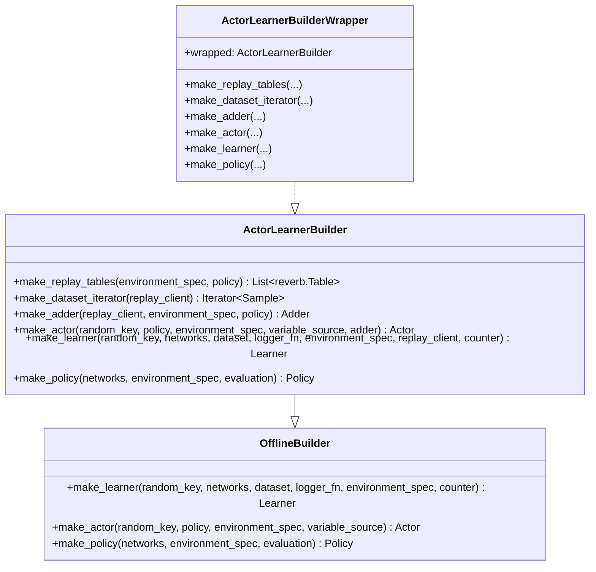
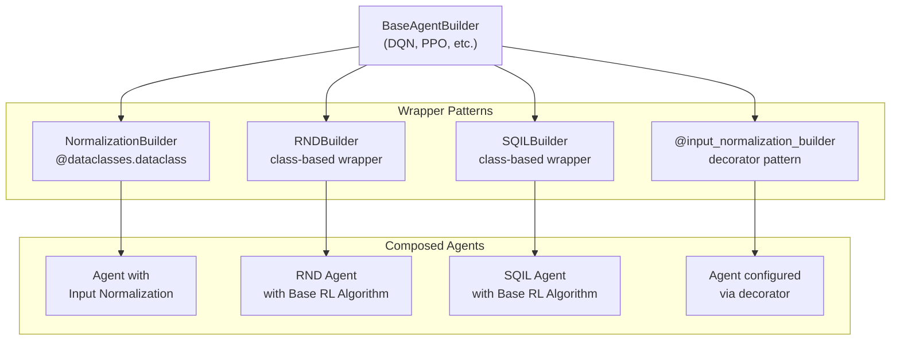
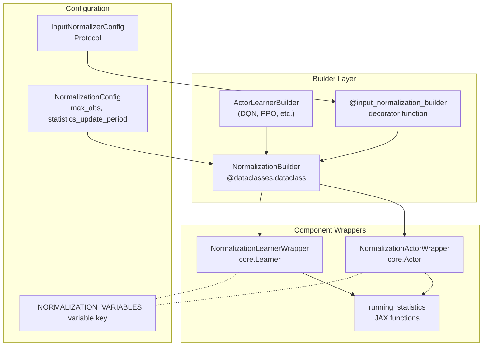
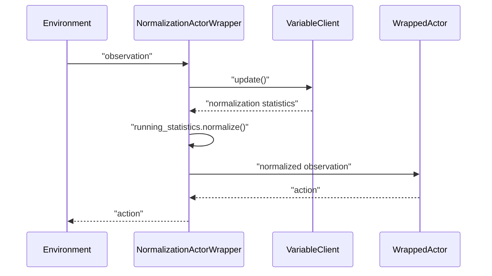
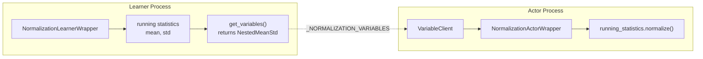
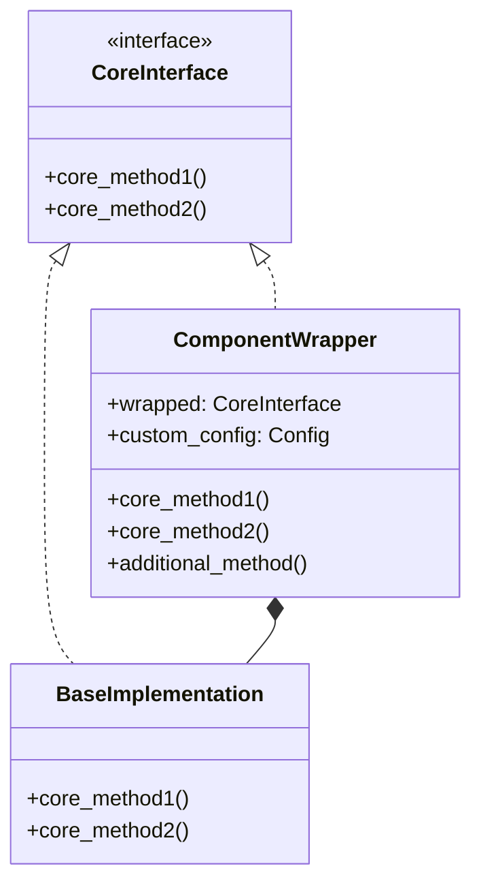

<!-- source: DeepWiki mcp.deepwiki.com · repo google-deepmind/acme · page 7.1 Input Normalization and Builder Patterns · fetched 2026-10-26 -->

# Input Normalization and Builder Patterns

<details>
<summary>Relevant source files</summary>

The following files were used as context for generating this wiki page:

- [acme/agents/jax/builders.py](acme/agents/jax/builders.py)
- [acme/agents/jax/normalization.py](acme/agents/jax/normalization.py)
- [acme/agents/jax/pwil/builder.py](acme/agents/jax/pwil/builder.py)
- [acme/agents/jax/rnd/builder.py](acme/agents/jax/rnd/builder.py)
- [acme/agents/jax/sqil/builder.py](acme/agents/jax/sqil/builder.py)
- [acme/jax/types.py](acme/jax/types.py)

</details>


This page covers Acme's builder pattern architecture and demonstrates how it enables modular agent construction through input normalization as a key example. The builder pattern allows for composable agent components that can be mixed, matched, and extended without modifying core agent implementations.

## Builder Pattern Architecture

Acme uses the builder pattern extensively to construct RL agents in a modular, composable way. The core abstraction is `ActorLearnerBuilder`, which defines a standard interface for creating all components of an RL agent.

### Core Builder Interface



Sources:
- [acme/agents/jax/builders.py:35-104]()
- [acme/agents/jax/builders.py:106-226]()
- [acme/agents/jax/builders.py:228-285]()

### Builder Composition Patterns

Acme supports several patterns for composing and extending agent builders:



Sources:
- [acme/agents/jax/normalization.py:169-243]()
- [acme/agents/jax/rnd/builder.py:36-134]()
- [acme/agents/jax/sqil/builder.py:71-171]()
- [acme/agents/jax/normalization.py:271-344]()

## Input Normalization as Builder Pattern Example

Input normalization demonstrates Acme's builder pattern architecture by wrapping existing agent builders to add observation normalization capabilities. This system tracks running statistics of observations and normalizes inputs across both actors and learners.

### Normalization Architecture



Sources:
- [acme/agents/jax/normalization.py:169-243]()
- [acme/agents/jax/normalization.py:44-82]()
- [acme/agents/jax/normalization.py:90-166]()
- [acme/agents/jax/normalization.py:271-344]()

## Normalization Implementation Details

### Component Wrappers

The normalization system uses two key wrapper classes that implement Acme's core interfaces:

| Component | Interface | Purpose | Key Methods |
|-----------|-----------|---------|-------------|
| `NormalizationActorWrapper` | `core.Actor` | Normalize observations before action selection | `select_action()`, `observe()` |
| `NormalizationLearnerWrapper` | `core.Learner`, `core.Saveable` | Normalize training data and maintain statistics | `step()`, `get_variables()` |



Sources:
- [acme/agents/jax/normalization.py:44-82]()
- [acme/agents/jax/normalization.py:90-166]()

### Builder Wrapper Pattern

The `NormalizationBuilder` demonstrates the wrapper pattern for builders by delegating most method calls to a wrapped builder while adding normalization logic:

```python
@dataclasses.dataclass
class NormalizationBuilder(Generic[Networks, Policy],
                          builders.ActorLearnerBuilder[Networks, Policy, reverb.ReplaySample]):
  builder: builders.ActorLearnerBuilder[Networks, Policy, reverb.ReplaySample]
  max_abs_observation: Optional[float] = 10.0
  statistics_update_period: int = 100
```

The builder wraps the actor and learner creation methods:
- `make_actor()`: Returns `NormalizationActorWrapper` around the base actor
- `make_learner()`: Returns `NormalizationLearnerWrapper` around the base learner
- Other methods: Delegate directly to the wrapped builder

Sources:
- [acme/agents/jax/normalization.py:169-243]()

### Variable Synchronization Pattern

The normalization system demonstrates Acme's variable synchronization pattern using the `_NORMALIZATION_VARIABLES` key:



Sources:
- [acme/agents/jax/normalization.py:38]()
- [acme/agents/jax/normalization.py:140-156]()
- [acme/agents/jax/normalization.py:47-62]()

## Additional Builder Pattern Examples

Beyond input normalization, Acme includes several other builder patterns that demonstrate different composition strategies.

### RND Builder Pattern

The `RNDBuilder` wraps another RL agent to add Random Network Distillation for exploration:

```python
class RNDBuilder(Generic[rnd_networks.DirectRLNetworks, Policy],
                builders.ActorLearnerBuilder[rnd_networks.RNDNetworks, Policy, reverb.ReplaySample]):
  def __init__(self, rl_agent: builders.ActorLearnerBuilder, config: rnd_config.RNDConfig):
    self._rl_agent = rl_agent
    self._config = config
```

Key patterns:
- Delegates most methods to `_rl_agent` 
- Wraps `make_learner()` to create composite `RNDLearner`
- Uses `make_policy()` to extract base policy from composite networks

Sources:
- [acme/agents/jax/rnd/builder.py:36-134]()

### SQIL Builder Pattern

The `SQILBuilder` demonstrates imitation learning by modifying the dataset iterator:

```python
def make_dataset_iterator(self, replay_client: reverb.Client) -> Iterator[reverb.ReplaySample]:
  demonstration_iterator = self._make_demonstrations(self._rl_agent_batch_size)
  rb_iterator = self._rl_agent.make_dataset_iterator(replay_client)
  return utils.device_put(_generate_sqil_samples(demonstration_iterator, rb_iterator))
```

Key patterns:
- Modifies data pipeline while preserving builder interface
- Combines demonstration and replay data in custom iterator
- Delegates component creation to wrapped builder

Sources:
- [acme/agents/jax/sqil/builder.py:71-171]()

### Decorator Pattern for Configuration

The `input_normalization_builder` decorator dynamically adds normalization based on agent configuration:

```python
def input_normalization_builder(actor_learner_builder_class: Callable[[InputNormalizerConfig], builders.ActorLearnerBuilder]):
  class InputNormalizationBuilder(builders.ActorLearnerBuilder):
    def __init__(self, config: InputNormalizerConfig):
      builder = actor_learner_builder_class(config)
      if config.input_normalization:
        builder = NormalizationBuilder(builder, ...)
      self.wrapped = builder
```

Key patterns:
- Conditional wrapping based on configuration
- Protocol-based configuration interface (`InputNormalizerConfig`)
- Runtime composition of builder components

Sources:
- [acme/agents/jax/normalization.py:271-344]()

## Builder Pattern Implementation Guide

### Creating Custom Builder Wrappers

To implement custom builder wrappers, follow these patterns:

1. **Dataclass-based Wrapper** (like `NormalizationBuilder`):
```python
@dataclasses.dataclass
class MyCustomBuilder(builders.ActorLearnerBuilder[Networks, Policy, Sample]):
  builder: builders.ActorLearnerBuilder[Networks, Policy, Sample]
  custom_config: MyConfig
  
  def make_actor(self, ...):
    base_actor = self.builder.make_actor(...)
    return MyCustomActorWrapper(base_actor, self.custom_config)
```

2. **Class-based Wrapper** (like `RNDBuilder`):
```python
class MyCustomBuilder(builders.ActorLearnerBuilder):
  def __init__(self, base_builder: builders.ActorLearnerBuilder, config: MyConfig):
    self._base_builder = base_builder
    self._config = config
```

3. **Decorator Pattern** (like `input_normalization_builder`):
```python
def my_custom_builder_decorator(builder_class):
  class WrappedBuilder(builders.ActorLearnerBuilder):
    def __init__(self, config):
      base_builder = builder_class(config)
      if config.enable_custom_feature:
        base_builder = MyCustomBuilder(base_builder, config.custom_config)
      self.wrapped = base_builder
  return WrappedBuilder
```

Sources:
- [acme/agents/jax/normalization.py:169-243]()
- [acme/agents/jax/rnd/builder.py:36-134]()
- [acme/agents/jax/normalization.py:271-344]()

### Builder Wrapper Best Practices

| Pattern | Use Case | Benefits | Example |
|---------|----------|----------|---------|
| **Dataclass Wrapper** | Simple parameter modification | Clean configuration, immutable | `NormalizationBuilder` |
| **Class-based Wrapper** | Complex composition logic | Full control over initialization | `RNDBuilder`, `SQILBuilder` |
| **Decorator Pattern** | Conditional feature addition | Configuration-driven composition | `@input_normalization_builder` |
| **Protocol-based Config** | Standardized configuration interfaces | Type safety, extensibility | `InputNormalizerConfig` |

### Component Wrapper Patterns

When wrapping individual components (actors, learners), follow these patterns:



Key principles:
- Implement the same interface as the wrapped component
- Delegate core functionality to the wrapped component
- Add custom behavior before/after delegation
- Maintain state separation between wrapper and wrapped component

Sources:
- [acme/agents/jax/normalization.py:44-82]()
- [acme/agents/jax/normalization.py:90-166]()

## Usage Example

Here's how you would implement input normalization in an agent:

### 1. Update Agent Config

```python
@dataclasses.dataclass
class MyAgentConfig:
  # Existing agent configuration fields...
  
  # Add input normalization config
  input_normalization: Optional[NormalizationConfig] = NormalizationConfig(
      max_abs=10,
      statistics_update_period=100
  )
```

### 2. Decorate Agent Builder

```python
@input_normalization_builder
class MyAgentBuilder(ActorLearnerBuilder):
  """My reinforcement learning agent builder."""
  
  def __init__(self, config: MyAgentConfig):
    # Agent initialization...
    
  # Builder implementation...
```

### 3. Use Agent Normally

The agent will now automatically apply input normalization during both acting and learning phases.

Sources:
- [acme/agents/jax/normalization.py:271-344](acme/agents/jax/normalization.py:271-344)

## Performance Considerations

- The statistics calculation introduces minimal overhead but provides significant training benefits
- The `statistics_update_period` parameter can be increased to reduce computation cost
- For environments with known observation distributions, you can skip normalization for better performance

Sources:
- [acme/jax/running_statistics.py:129-141](acme/jax/running_statistics.py:129-141)

## Related Topics

- For information about general JAX utilities in Acme, see the JAX Utilities page.
- For information about environment wrappers that can also preprocess observations, see the Environment Wrappers page.

---

