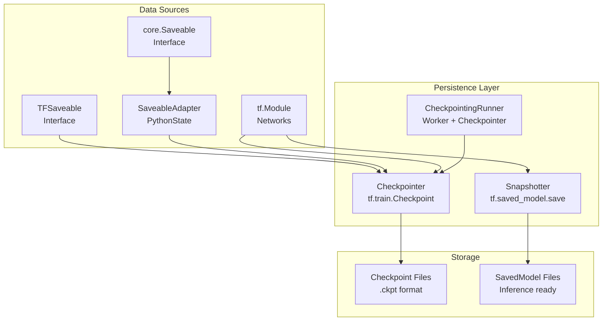
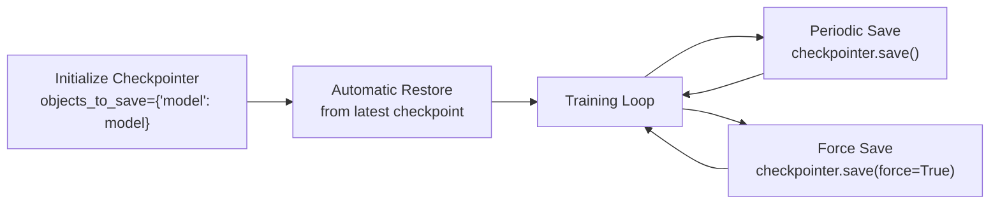
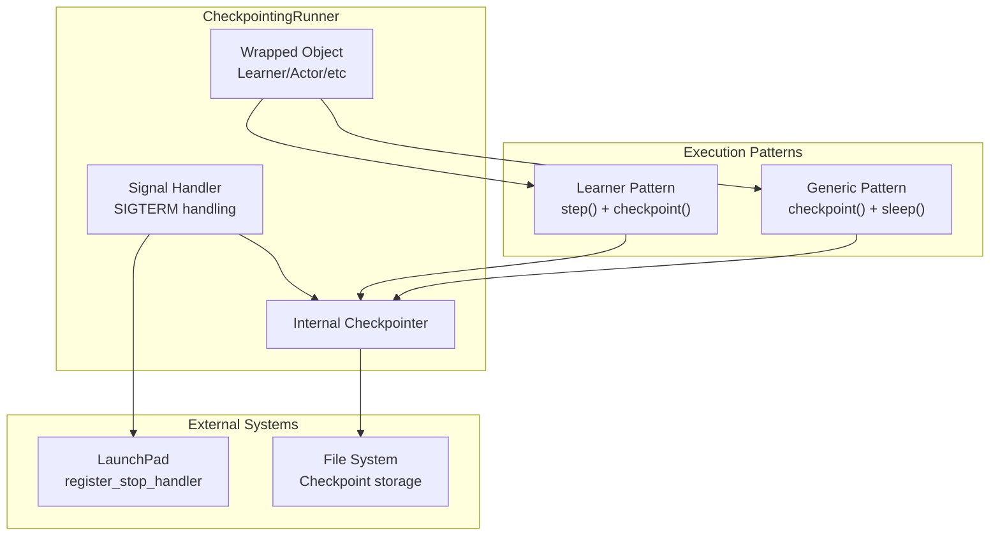
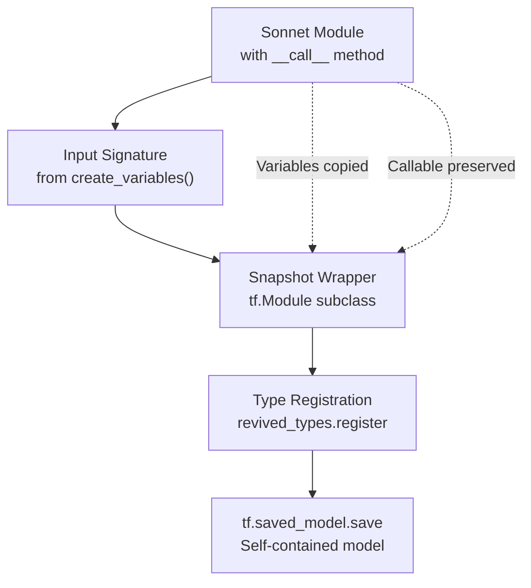
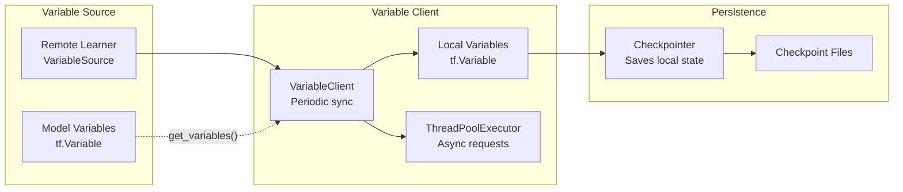
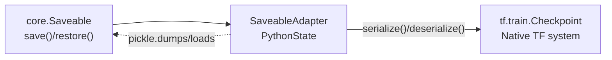

<!-- source: DeepWiki mcp.deepwiki.com · repo google-deepmind/acme · page 7.2 Model Persistence and Checkpointing · fetched 2026-10-26 -->

# Model Persistence and Checkpointing

<details>
<summary>Relevant source files</summary>

The following files were used as context for generating this wiki page:

- [acme/tf/savers.py](acme/tf/savers.py)
- [acme/tf/savers_test.py](acme/tf/savers_test.py)
- [acme/tf/utils.py](acme/tf/utils.py)
- [acme/tf/utils_test.py](acme/tf/utils_test.py)
- [acme/tf/variable_utils.py](acme/tf/variable_utils.py)
- [acme/tf/variable_utils_test.py](acme/tf/variable_utils_test.py)
- [acme/types.py](acme/types.py)
- [acme/utils/signals.py](acme/utils/signals.py)
- [acme/utils/tree_utils.py](acme/utils/tree_utils.py)
- [acme/utils/tree_utils_test.py](acme/utils/tree_utils_test.py)

</details>


This page covers Acme's TensorFlow-based model persistence infrastructure, including checkpointing for recovery from interruptions and snapshotting for permanent model storage. The system provides automated periodic saving, restoration capabilities, and integration with distributed training workflows.

For information about variable synchronization between distributed components, see [Variable Synchronization and Distribution](#7.3). For details on the core `Saveable` interface used throughout Acme, see [Core Interfaces and Agent Composition](#2.1).

## Core Persistence Concepts

Acme distinguishes between two primary persistence mechanisms:

**Checkpointing**: Frequent, automatic saving of model state for recovery from preemption or failures during training. Checkpoints use TensorFlow's native checkpoint format and are optimized for fast save/restore cycles.

**Snapshotting**: Infrequent, permanent storage of complete, self-contained models using TensorFlow's SavedModel format. Snapshots can be loaded independently for inference or analysis.



Sources: [acme/tf/savers.py:41-469]()

## Checkpointer System

The `Checkpointer` class provides automated, time-based checkpointing of TensorFlow state:

### Key Features

| Feature | Description | Configuration |
|---------|-------------|---------------|
| **Periodic Saving** | Automatic saves based on time intervals | `time_delta_minutes` parameter |
| **State Management** | Handles TF variables, modules, and Saveable objects | `objects_to_save` mapping |
| **TTL Support** | Automatic cleanup of old checkpoints | `checkpoint_ttl_seconds` |
| **Restoration** | Automatic restore from latest checkpoint on init | `restore()` method |

### Usage Pattern



The checkpointer automatically manages TensorFlow's `tf.train.CheckpointManager` and provides integration with Acme's `core.Saveable` interface through the `SaveableAdapter`.

Sources: [acme/tf/savers.py:50-185]()

## CheckpointingRunner Integration

The `CheckpointingRunner` wraps any object and adds automated checkpointing with signal handling:



The runner automatically detects object types and adapts its execution pattern:
- **Learners**: Alternates between `step()` calls and checkpointing
- **Other objects**: Performs checkpointing followed by sleep intervals

Sources: [acme/tf/savers.py:187-256](), [acme/utils/signals.py:27-49]()

## Snapshotter System

The `Snapshotter` creates permanent, self-contained model snapshots using TensorFlow's SavedModel format:

### Snapshot Creation Process



### Snapshot Wrapper Architecture

The system creates a thin `Snapshot` wrapper that preserves the original module's interface while making it SavedModel-compatible:

| Component | Purpose | Implementation |
|-----------|---------|----------------|
| `_module` | Wrapped original module | `tf.function` decorated |
| `_variables` | All module variables | Direct reference copy |
| `_trainable_variables` | Trainable subset | Direct reference copy |
| `__call__` | Preserved interface | `tf.function` with signature |
| `initial_state` | RNN support | Added for `snt.RNNCore` |

Sources: [acme/tf/savers.py:258-416]()

## Variable Synchronization Integration

The persistence system integrates with Acme's distributed variable synchronization through the `VariableClient`:



The `VariableClient` provides asynchronous variable synchronization with configurable update periods, supporting both blocking and non-blocking update modes.

Sources: [acme/tf/variable_utils.py:26-109]()

## Framework Integration Patterns

### Learner Integration

Most Acme learners integrate checkpointing through the `CheckpointingRunner` pattern:

```python
# Typical learner checkpointing setup
checkpointing_runner = CheckpointingRunner(
    wrapped=learner,  # Any core.Learner
    time_delta_minutes=30,
    directory=experiment_config.checkpoint_dir
)
```

### TFSaveable Interface

Objects can implement `TFSaveable` to expose their checkpointable state:

```python
class CustomLearner(TFSaveable):
    @property
    def state(self) -> Mapping[str, Checkpointable]:
        return {
            'network': self._network,
            'optimizer': self._optimizer,
            'step_count': self._step_count
        }
```

### SaveableAdapter Pattern

The `SaveableAdapter` bridges Acme's `core.Saveable` interface with TensorFlow's checkpoint system using pickle serialization:



Sources: [acme/tf/savers.py:456-469](), [acme/tf/savers_test.py:37-47]()

---

