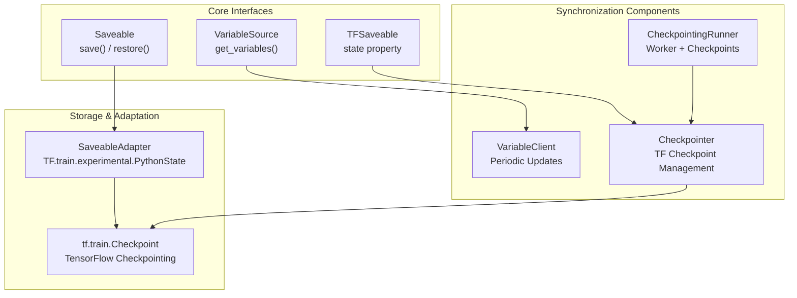
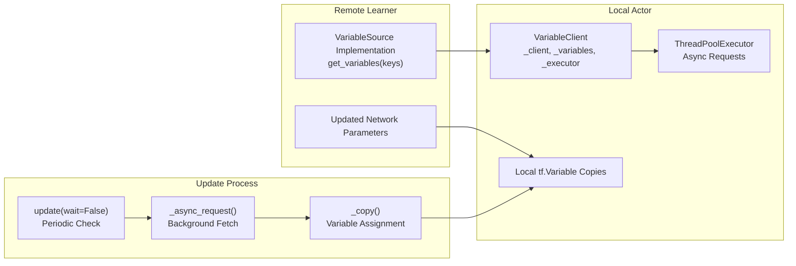
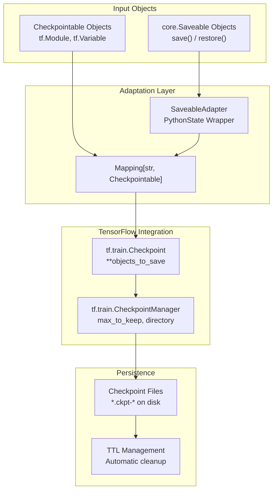
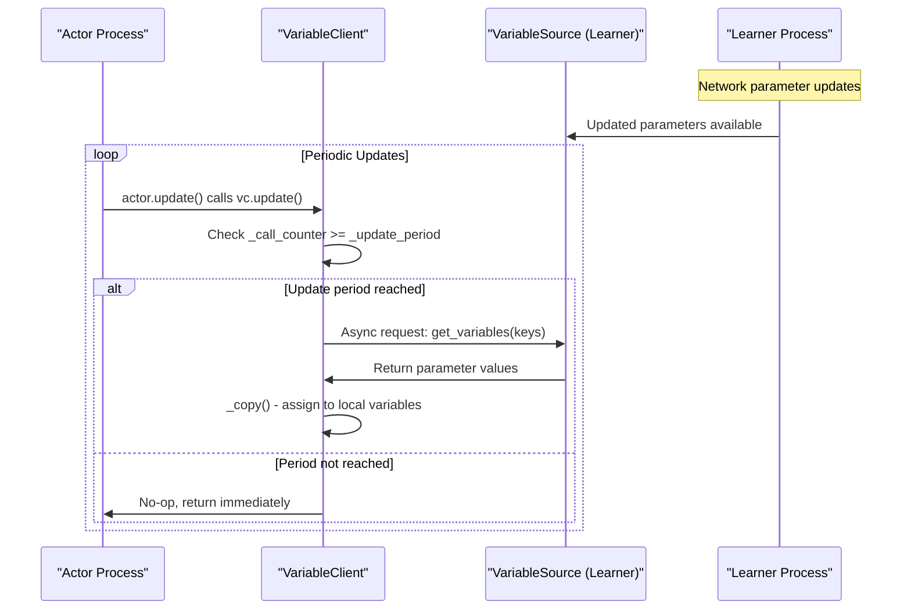
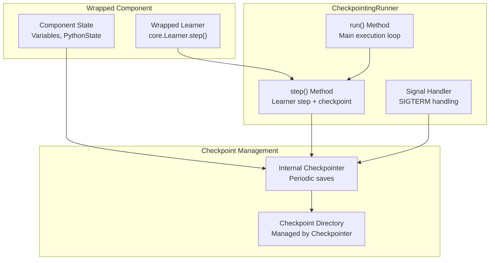
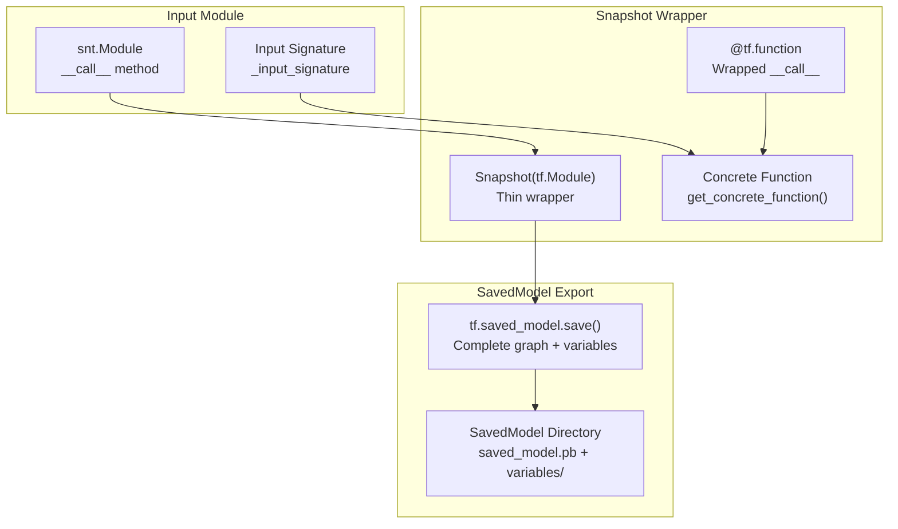
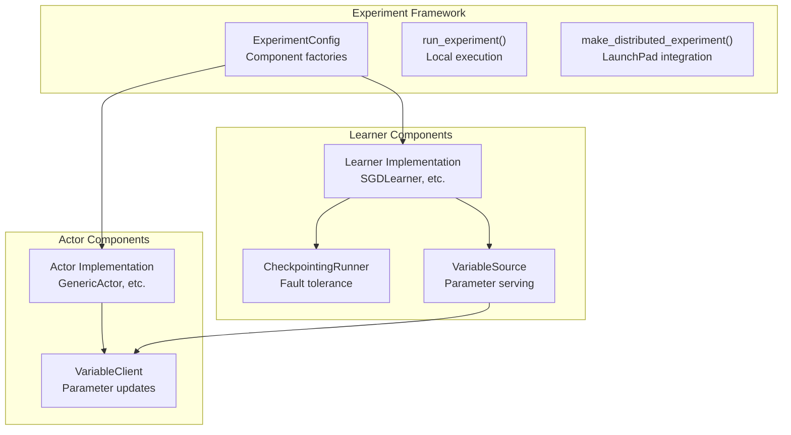

<!-- source: DeepWiki mcp.deepwiki.com · repo google-deepmind/acme · page 7.3 Variable Synchronization and Distribution · fetched 2026-10-26 -->

# Variable Synchronization and Distribution

<details>
<summary>Relevant source files</summary>

The following files were used as context for generating this wiki page:

- [acme/tf/savers.py](acme/tf/savers.py)
- [acme/tf/savers_test.py](acme/tf/savers_test.py)
- [acme/tf/utils.py](acme/tf/utils.py)
- [acme/tf/utils_test.py](acme/tf/utils_test.py)
- [acme/tf/variable_utils.py](acme/tf/variable_utils.py)
- [acme/tf/variable_utils_test.py](acme/tf/variable_utils_test.py)
- [acme/types.py](acme/types.py)
- [acme/utils/signals.py](acme/utils/signals.py)
- [acme/utils/tree_utils.py](acme/utils/tree_utils.py)
- [acme/utils/tree_utils_test.py](acme/utils/tree_utils_test.py)

</details>


This page covers the mechanisms for synchronizing and distributing neural network parameters across distributed reinforcement learning components in Acme. The framework provides several patterns for sharing variables between learners and actors, persisting model state, and handling distributed parameter servers.

For information about model persistence and checkpointing workflows, see [Model Persistence and Checkpointing](#7.2). For distributed execution frameworks, see [Distributed Execution with LaunchPad](#6.2).

## Core Variable Synchronization Components

Acme's variable synchronization system is built around several key interfaces and classes that handle parameter sharing between distributed components.



**Sources:** [acme/tf/variable_utils.py:26-109](), [acme/tf/savers.py:41-48](), [acme/tf/savers.py:456-468]()

## Variable Client Pattern

The `VariableClient` class provides the primary mechanism for actors to periodically fetch updated parameters from learners in distributed settings.

### VariableClient Architecture



**Sources:** [acme/tf/variable_utils.py:26-109]()

### Usage Pattern

The `VariableClient` implements a non-blocking update pattern with configurable update periods:

| Parameter | Purpose | Default Behavior |
|-----------|---------|------------------|
| `client` | `core.VariableSource` | Remote source of variables |
| `variables` | `Mapping[str, Sequence[tf.Variable]]` | Local variables to update |
| `update_period` | `int` | Updates every N calls |

The client tracks call counts and uses a background thread executor for asynchronous fetching:

```python
# Key implementation details from VariableClient
self._executor = futures.ThreadPoolExecutor(max_workers=1)
self._async_request = lambda: self._executor.submit(self._request)
```

**Sources:** [acme/tf/variable_utils.py:29-43]()

## Checkpointing and State Persistence

The checkpointing system provides fault tolerance and model persistence through TensorFlow's checkpoint mechanism.

### Checkpointer Implementation



**Sources:** [acme/tf/savers.py:50-185](), [acme/tf/savers.py:456-468]()

### Checkpointer Configuration

The `Checkpointer` class supports extensive configuration for different persistence needs:

| Parameter | Type | Purpose |
|-----------|------|---------|
| `objects_to_save` | `Mapping[str, Union[Checkpointable, core.Saveable]]` | Objects to checkpoint |
| `directory` | `str` | Base checkpoint directory |
| `time_delta_minutes` | `float` | Checkpoint frequency |
| `max_to_keep` | `int` | Number of checkpoints to retain |
| `checkpoint_ttl_seconds` | `Optional[int]` | Time-to-live for cleanup |

**Sources:** [acme/tf/savers.py:74-101]()

## Distributed Synchronization Patterns

### Actor-Learner Variable Synchronization



**Sources:** [acme/tf/variable_utils.py:49-95]()

### CheckpointingRunner Pattern

The `CheckpointingRunner` wraps learners and other components to provide automatic checkpointing:



**Sources:** [acme/tf/savers.py:187-256]()

## Advanced Persistence: Snapshotter

The `Snapshotter` class provides permanent model snapshots using TensorFlow's SavedModel format, distinct from temporary checkpoints.

### Snapshot vs Checkpoint Comparison

| Aspect | Checkpointer | Snapshotter |
|--------|-------------|-------------|
| Format | TensorFlow Checkpoint (`.ckpt`) | TensorFlow SavedModel |
| Purpose | Recovery from preemption | Permanent model storage |
| Loading | `tf.train.Checkpoint.restore()` | `tf.saved_model.load()` |
| Self-contained | No, requires code | Yes, includes graph |
| TTL | Short (5 days default) | Long (90 days default) |

**Sources:** [acme/tf/savers.py:258-338]()

### Snapshot Creation Process



**Sources:** [acme/tf/savers.py:340-416](), [acme/tf/savers.py:385-416]()

## Integration with Core Framework

Variable synchronization integrates tightly with Acme's core actor-learner architecture:

### Framework Integration Points



**Sources:** [acme/tf/variable_utils.py:26-32](), [acme/tf/savers.py:187-217]()

## Tree Structure Utilities

Variable synchronization leverages tree utilities for handling nested parameter structures:

The `tree_utils` module provides optimized operations for nested variable structures:
- `fast_map_structure()` for efficient parameter copying
- `stack_sequence_fields()` / `unstack_sequence_fields()` for batch operations
- Structure manipulation utilities that preserve parameter hierarchies

**Sources:** [acme/utils/tree_utils.py:25-46](), [acme/utils/tree_utils.py:49-127]()