# Page: Overview

# Overview

<details>
<summary>Relevant source files</summary>

The following files were used as context for generating this wiki page:

- [.github/workflows/ci.yml](.github/workflows/ci.yml)
- [README.md](README.md)
- [docs/imgs/configure-and-run-experiments.png](docs/imgs/configure-and-run-experiments.png)
- [examples/README.md](examples/README.md)
- [examples/baselines/offline_rl/README.md](examples/baselines/offline_rl/README.md)
- [examples/baselines/rlfd/README.md](examples/baselines/rlfd/README.md)
- [examples/quickstart.ipynb](examples/quickstart.ipynb)
- [examples/tutorial.ipynb](examples/tutorial.ipynb)
- [setup.py](setup.py)
- [test.sh](test.sh)

</details>


Acme is a library of reinforcement learning (RL) agents and agent building blocks that strives to expose simple, efficient, and readable agents. These agents serve both as reference implementations of popular algorithms and as strong baselines, while providing enough flexibility to do novel research. The design of Acme provides multiple entry points to the RL problem at differing levels of complexity.

The framework is distributed as the `dm-acme` package and supports both JAX and TensorFlow backends for neural network computation.

For information about installing and setting up Acme, see [Installation and Setup](#1.2).

Sources: [README.md:16-24](), [setup.py:106-113](), [setup.py:143-146]()

## Framework Design Philosophy

Acme's design offers multiple entry points to reinforcement learning at different levels of abstraction:

1. **High-level experiment runners** - For quickly configuring and running experiments
2. **Mid-level agent implementations** - For using specific RL algorithms
3. **Low-level components** - For building custom agents from reusable pieces

The framework focuses on clarity and readability while maintaining flexibility for research. Acme provides a common, stable interface to environments and agents, which enables consistent experimentation across a variety of algorithms.

Sources: [README.md:25-35](), [README.md:38-41]()

## Core Architecture

The following diagram shows Acme's high-level architecture:

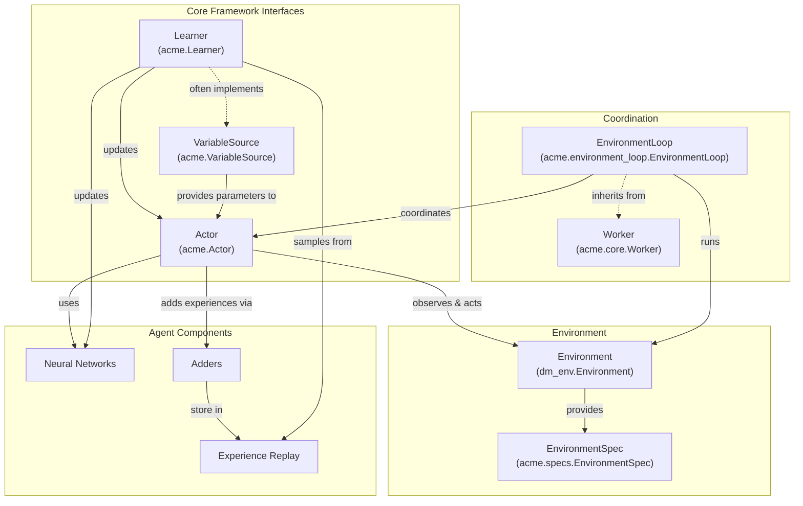

Sources: [acme/__init__.py:27-31](), [acme/environment_loop.py:33-75](), [examples/tutorial.ipynb](), [examples/quickstart.ipynb]()

## Key Components

### Core Interfaces

- **Actor**: Interacts with the environment by selecting actions based on observations
- **Learner**: Performs parameter updates to improve agent behavior
- **VariableSource**: Provides network parameters to actors (many Learners implement this interface)
- **Worker**: Base interface for components that can be run (e.g., EnvironmentLoop)

Sources: [acme/__init__.py:27-31](), [acme/environment_loop.py:33-75]()

### EnvironmentLoop

The `EnvironmentLoop` is a core component that coordinates the interaction between an Actor and an Environment. It handles the flow of actions, observations, and rewards, and keeps track of metrics like episode return and steps per second.

```mermaid
sequenceDiagram
    participant Loop as EnvironmentLoop
    participant Env as Environment
    participant Actor
    participant Counter
    participant Logger

    Loop->>Env: reset()
    Env-->>Loop: first_timestep
    Loop->>Actor: observe_first(timestep)
    
    loop Until episode ends
        Loop->>Actor: select_action(observation)
        Actor-->>Loop: action
        Loop->>Env: step(action)
        Env-->>Loop: timestep
        Loop->>Actor: observe(action, timestep)
        alt should_update is True
            Loop->>Actor: update()
        end
    end
    
    Loop->>Counter: increment(episodes, steps)
    Loop->>Logger: write(results)
```

The environment loop also supports running for a specified number of episodes or steps, making it easy to coordinate training and evaluation.

Sources: [acme/environment_loop.py:76-204](), [acme/environment_loop_test.py]()

### Experience Collection and Replay

Acme uses a system for collecting and replaying experience data through the following components:

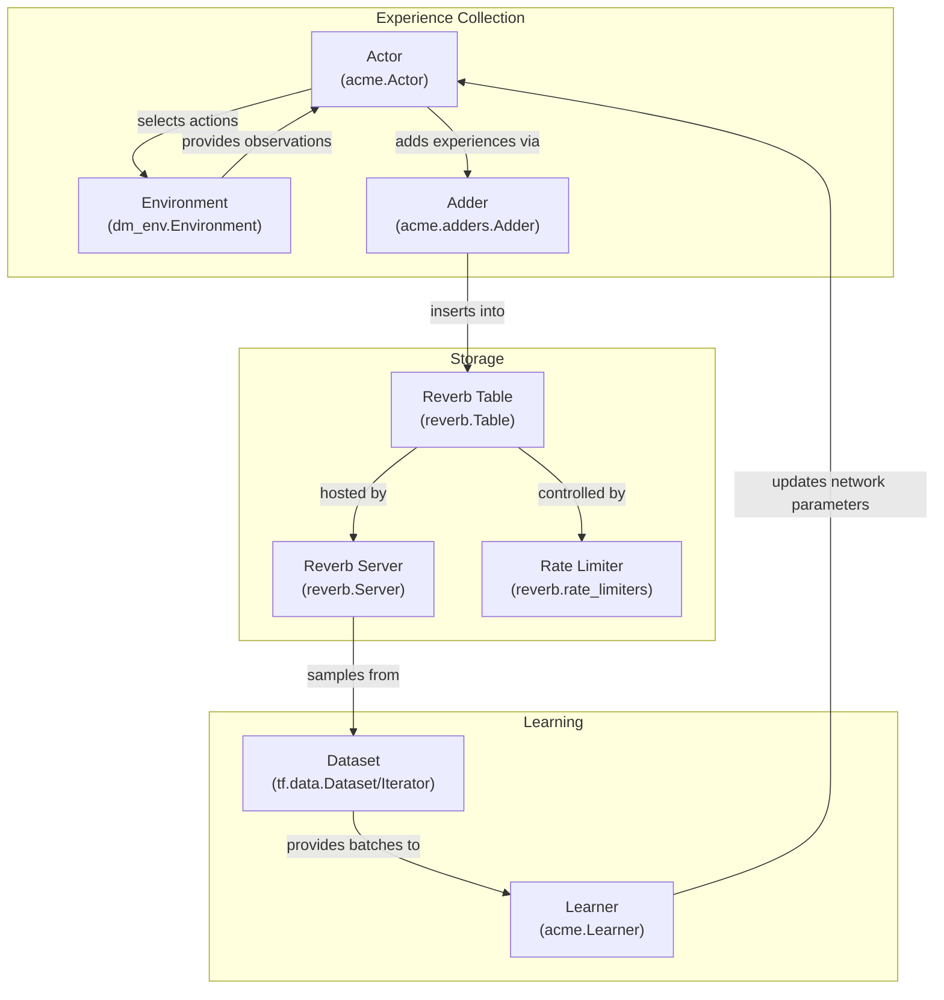

The adders take different forms depending on the agent's needs:
- **NStepTransitionAdder**: Adds n-step transitions (used in D4PG, DQN)
- **SequenceAdder**: Adds fixed-length sequences (used in R2D2)
- **EpisodeAdder**: Adds entire episodes (used for some offline methods)

Sources: [examples/tutorial.ipynb:558-563](), [examples/tutorial.ipynb:307-455]()

## Agent Building System

Acme provides a builder pattern to facilitate the construction of agents:

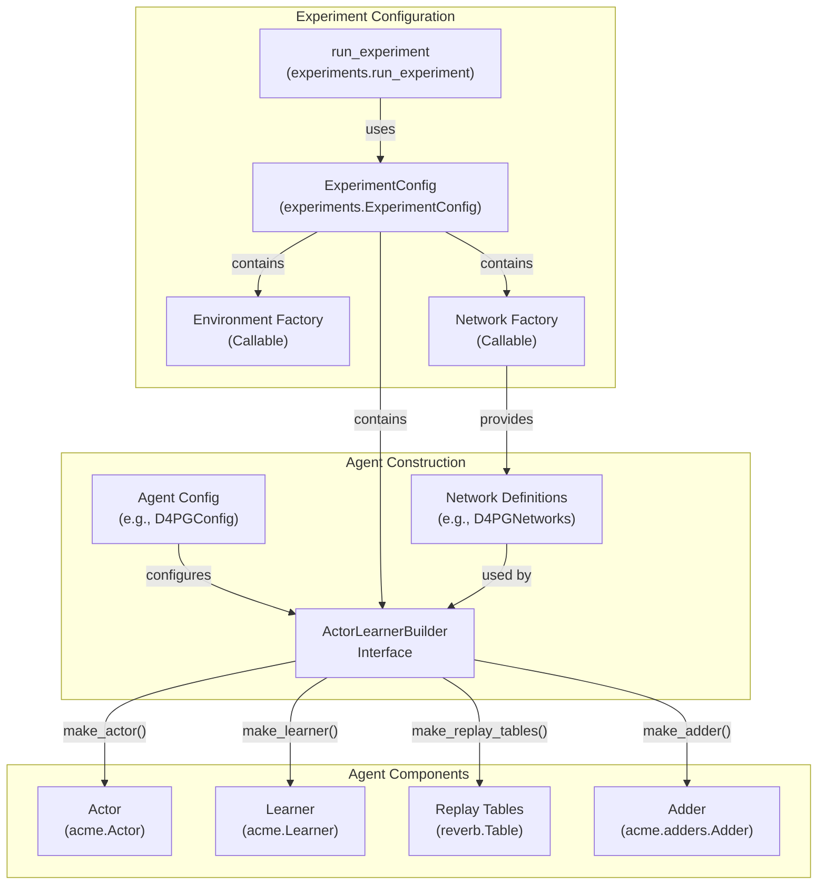

This pattern makes it easy to configure and run experiments with different agents, environments, and networks.

Sources: [examples/quickstart.ipynb:153-171](), [examples/quickstart.ipynb:223-229]()

## Experiment Execution System

Acme's experiment system standardizes the process of setting up and running RL experiments:

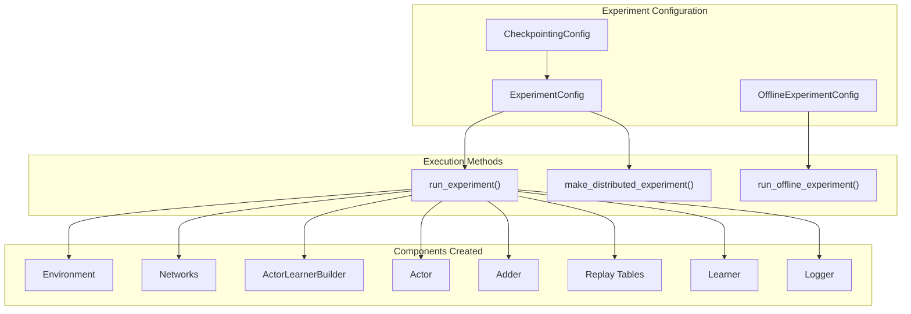

The experiment system provides:
- A consistent way to configure experiments
- Support for both online and offline RL
- Easy transition between local and distributed execution
- Common logging and checkpointing functionality

Sources: [examples/quickstart.ipynb:216-261]()

## Implemented Agents

Acme includes implementations of many RL algorithms:

| Agent | Type | Action Space | Key Features |
|-------|------|-------------|--------------|
| DQN Family | Value-based | Discrete | Q-learning with neural networks |
| D4PG | Policy Gradient | Continuous | Distributed, deterministic policy with distributional critic |
| IMPALA | Actor-Critic | Both | Importance-weighted actor-learner architecture |
| R2D2 | Value-based | Discrete | Recurrent replay distributed DQN |
| PPO | Policy Gradient | Both | Proximal policy optimization |
| SAC | Policy Gradient | Continuous | Soft actor-critic with entropy regularization |

Sources: [README.md:18-24](), [acme/agents/tf/r2d2/agent.py:36-43](), [examples/README.md:28-33](), [examples/README.md:42-48]()

## Environment Integration

Acme works with environments following the `dm_env` interface and provides wrappers for adapting common environment formats:

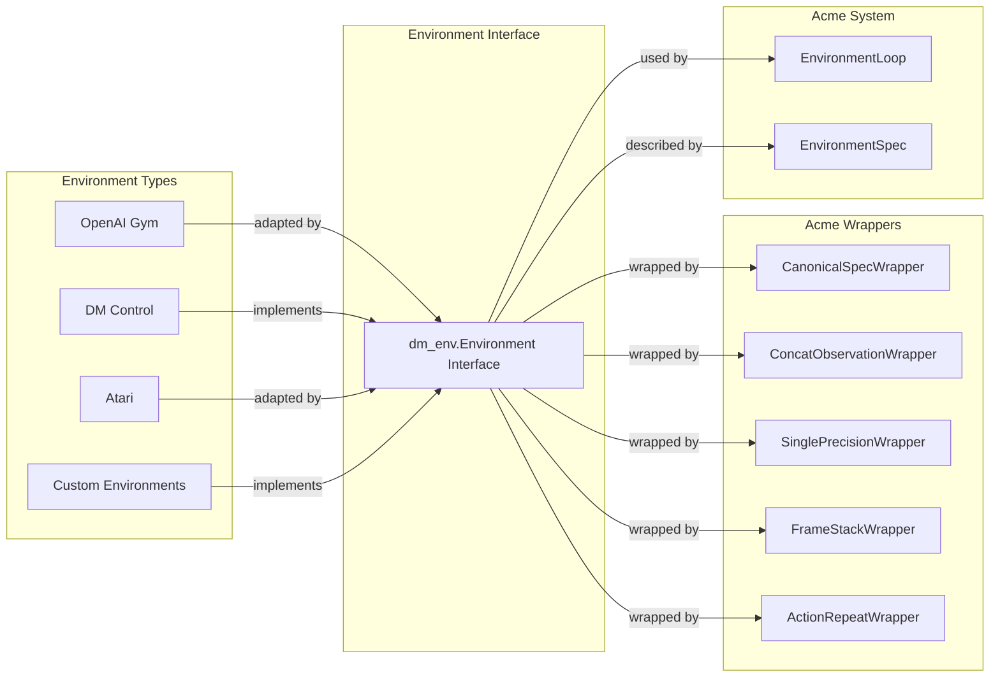

These wrappers help standardize environment interfaces, process observations, and handle different action spaces.

Sources: [examples/quickstart.ipynb:90-103](), [examples/tutorial.ipynb:145-158](), [acme/specs.py:32-48]()

## Neural Network System

Acme provides a flexible system for defining neural networks for RL agents:

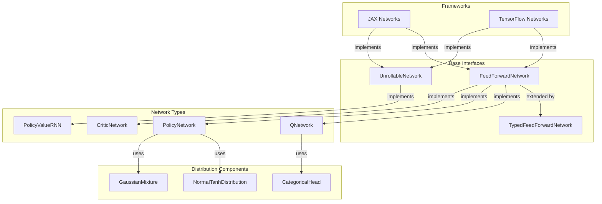

This system allows for flexible definition of neural network architectures for RL, with support for both JAX and TensorFlow.

Sources: [examples/tutorial.ipynb:209-246](), [examples/quickstart.ipynb:137-144]()

## Getting Started

To use Acme, you typically:

1. Define an environment (or environment factory)
2. Create network definitions for your chosen agent
3. Configure the agent with appropriate hyperparameters
4. Use the experiment system to run the agent

A simplified example:

```python
# 1. Define environment factory
def make_environment():
    return wrappers.SinglePrecisionWrapper(
        wrappers.CanonicalSpecWrapper(
            wrappers.ConcatObservationWrapper(
                dm_suite.load('cartpole', 'balance'))))

# 2. Define networks
def network_factory(spec):
    return d4pg.make_networks(
        spec,
        policy_layer_sizes=(256, 256),
        critic_layer_sizes=(256, 256))

# 3. Configure the agent
d4pg_config = d4pg.D4PGConfig(learning_rate=3e-4, sigma=0.2)
d4pg_builder = d4pg.D4PGBuilder(d4pg_config)

# 4. Configure and run the experiment
experiment_config = experiments.ExperimentConfig(
    builder=d4pg_builder,
    environment_factory=make_environment,
    network_factory=network_factory,
    seed=0,
    max_num_actor_steps=50_000)

experiments.run_experiment(experiment=experiment_config)
```

For more detailed examples and usage patterns, see the tutorial and quickstart notebooks provided in the examples directory.

Sources: [examples/quickstart.ipynb](), [examples/tutorial.ipynb](), [examples/README.md:3-15]()

---

# Page: Key Concepts and Architecture

# Key Concepts and Architecture

<details>
<summary>Relevant source files</summary>

The following files were used as context for generating this wiki page:

- [README.md](README.md)
- [acme/agents/agent.py](acme/agents/agent.py)
- [acme/agents/jax/ail/builder.py](acme/agents/jax/ail/builder.py)
- [acme/core.py](acme/core.py)
- [acme/jax/variable_utils.py](acme/jax/variable_utils.py)
- [acme/jax/variable_utils_test.py](acme/jax/variable_utils_test.py)
- [acme/testing/fakes.py](acme/testing/fakes.py)
- [docs/imgs/configure-and-run-experiments.png](docs/imgs/configure-and-run-experiments.png)
- [examples/README.md](examples/README.md)
- [examples/quickstart.ipynb](examples/quickstart.ipynb)
- [examples/tutorial.ipynb](examples/tutorial.ipynb)

</details>


This document explains the fundamental design principles and core abstractions that form the backbone of the Acme reinforcement learning framework. It covers the primary interfaces, their relationships, and how they compose into complete RL agents.

For information about specific agent implementations like DQN or PPO, see [Reinforcement Learning Agents](#4). For details about the experiment execution system, see [Experiment Management and Execution](#6).

## Core Abstractions

Acme is built around several key interfaces that define clear separation of concerns in reinforcement learning systems. These abstractions enable modular composition and support both single-process and distributed execution.

### Primary Interfaces

```mermaid
graph TB
    subgraph "Core Interface Hierarchy"
        Actor[Actor<br/>"select_action()<br/>observe_first()<br/>observe()<br/>update()"]
        VariableSource[VariableSource<br/>"get_variables()"]
        Worker[Worker<br/>"run()"]
        Saveable[Saveable<br/>"save()<br/>restore()"]
        Learner[Learner<br/>"step()"]
        Agent[Agent<br/>"Composition Pattern"]
    end
    
    VariableSource --> Learner
    Worker --> Learner
    Saveable --> Learner
    Actor --> Agent
    Learner --> Agent
```

The **Actor** interface ([acme/core.py:32-87]()) defines components responsible for action selection and environment observation. Actors implement `select_action()` to choose actions given observations, and `observe_first()`/`observe()` to process environment transitions.

The **VariableSource** interface ([acme/core.py:89-109]()) provides neural network parameters to other components. The `get_variables()` method returns named collections of parameters as nested numpy arrays.

The **Learner** interface ([acme/core.py:132-165]()) combines `VariableSource`, `Worker`, and `Saveable` to define components that learn from data. Learners implement `step()` for single learning updates and `run()` for continuous learning loops.

The **Agent** class ([acme/agents/agent.py:43-137]()) composes an `Actor` and `Learner` to create complete RL agents. It controls the ratio of environment interactions to learning steps through the `observations_per_step` parameter.

Sources: [acme/core.py:1-177](), [acme/agents/agent.py:1-137]()

### Component Interaction Pattern

```mermaid
graph LR
    subgraph "Environment Interaction"
        Env[Environment<br/>"dm_env.Environment"]
        EnvLoop[EnvironmentLoop<br/>"acme.EnvironmentLoop"]
    end
    
    subgraph "Agent Components"
        ActorImpl[GenericActor<br/>"actors.GenericActor"]
        LearnerImpl[SGDLearner<br/>"Base learner class"]
        VarClient[VariableClient<br/>"variable_utils.VariableClient"]
    end
    
    subgraph "Data Management"
        Adder[Reverb Adders<br/>"reverb_adders.NStepTransitionAdder"]
        ReplayTable[Reverb Tables<br/>"reverb.Table"]
        Dataset[Dataset Iterator<br/>"datasets.make_reverb_dataset"]
    end
    
    EnvLoop <--> Env
    EnvLoop <--> ActorImpl
    ActorImpl --> Adder
    Adder --> ReplayTable
    ReplayTable --> Dataset
    Dataset --> LearnerImpl
    LearnerImpl --> VarClient
    VarClient --> ActorImpl
```

The interaction pattern shows how components coordinate during RL training. The `EnvironmentLoop` orchestrates actor-environment interaction, while the actor adds experience to replay tables via **Adders**. Learners sample from these tables through dataset iterators, and parameter updates flow back to actors via `VariableClient`.

Sources: [examples/tutorial.ipynb:646-655](), [acme/jax/variable_utils.py:46-155]()

## Agent Construction Architecture

### Builder Pattern

```mermaid
graph TB
    subgraph "Configuration Layer"
        Config[AgentConfig<br/>"d4pg.D4PGConfig<br/>ppo.PPOConfig"]
        ExperimentConfig[ExperimentConfig<br/>"experiments.ExperimentConfig"]
    end
    
    subgraph "Builder Interface"
        ActorLearnerBuilder[ActorLearnerBuilder<br/>"builders.ActorLearnerBuilder"]
        ConcreteBuilders[Concrete Builders<br/>"d4pg.D4PGBuilder<br/>ppo.PPOBuilder"]
    end
    
    subgraph "Component Factories"
        MakeActor[make_actor]
        MakeLearner[make_learner]
        MakePolicy[make_policy]
        MakeReplayTables[make_replay_tables]
        MakeDatasetIterator[make_dataset_iterator]
    end
    
    Config --> ExperimentConfig
    ExperimentConfig --> ActorLearnerBuilder
    ActorLearnerBuilder --> ConcreteBuilders
    ConcreteBuilders --> MakeActor
    ConcreteBuilders --> MakeLearner
    ConcreteBuilders --> MakePolicy
    ConcreteBuilders --> MakeReplayTables
    ConcreteBuilders --> MakeDatasetIterator
```

Acme uses the Builder pattern to construct agents with flexible component composition. Each algorithm implements an `ActorLearnerBuilder` that provides factory methods for creating actors, learners, policies, and data infrastructure. This pattern enables easy experimentation with different hyperparameters and component combinations.

The `ExperimentConfig` ([examples/quickstart.ipynb:223-230]()) brings together the builder, environment factory, network factory, and logging configuration. The `run_experiment` function ([examples/quickstart.ipynb:258-262]()) uses this configuration to instantiate and execute complete experiments.

Sources: [examples/quickstart.ipynb:223-262](), [acme/agents/jax/ail/builder.py:151-332]()

### Variable Synchronization

```mermaid
graph TB
    subgraph "Variable Management"
        Learner[Learner<br/>"learning.D4PGLearner<br/>Extends VariableSource"]
        VarClient[VariableClient<br/>"variable_utils.VariableClient"]
        RefVarSource[ReferenceVariableSource<br/>"variable_utils.ReferenceVariableSource"]
    end
    
    subgraph "Actor Components"
        Actor[Actor<br/>"actors.GenericActor"]
        PolicyNetwork[Policy Network<br/>"FeedForwardNetwork"]
    end
    
    subgraph "Synchronization Flow"
        GetVariables[get_variables]
        UpdateAndWait[update_and_wait]
        DevicePut[device_put]
    end
    
    Learner --> VarClient
    VarClient --> Actor
    Actor --> PolicyNetwork
    
    VarClient --> GetVariables
    GetVariables --> UpdateAndWait
    UpdateAndWait --> DevicePut
```

The **VariableClient** ([acme/jax/variable_utils.py:46-155]()) manages parameter synchronization between learners and actors. It provides periodic and on-demand updates with configurable update frequencies. The client can place variables on specific JAX devices and supports both blocking and asynchronous updates.

The `ReferenceVariableSource` ([acme/jax/variable_utils.py:31-44]()) enables efficient distributed inference by returning variable references instead of copying parameter values.

Sources: [acme/jax/variable_utils.py:1-155](), [examples/tutorial.ipynb:589-597]()

## Experience Management

### Reverb Integration

```mermaid
graph TB
    subgraph "Experience Collection"
        Actor[Actor]
        Adder[Adders<br/>"NStepTransitionAdder<br/>SequenceAdder<br/>EpisodeAdder"]
        ReverbTable[Reverb Table<br/>"reverb.Table"]
    end
    
    subgraph "Sampling Infrastructure"
        ReverbClient[Reverb Client<br/>"reverb.Client"]
        Dataset[Dataset Iterator<br/>"datasets.make_reverb_dataset"]
        PrefetchIterator[Prefetch Iterator<br/>"utils.prefetch"]
    end
    
    subgraph "Learning"
        Learner[Learner]
        SGDStep[SGD Step]
    end
    
    Actor --> Adder
    Adder --> ReverbTable
    ReverbTable --> ReverbClient
    ReverbClient --> Dataset
    Dataset --> PrefetchIterator
    PrefetchIterator --> Learner
    Learner --> SGDStep
```

Acme integrates deeply with **Reverb** for distributed experience replay. **Adders** ([examples/tutorial.ipynb:558-563]()) preprocess environment transitions and insert them into Reverb tables. The system supports various adder types for different data patterns like n-step transitions, sequences, and full episodes.

**Dataset iterators** ([examples/tutorial.ipynb:461-471]()) provide efficient sampling from Reverb tables with configurable batch sizes and prefetching. The `utils.prefetch` function ([examples/tutorial.ipynb:504]()) adds readiness checking for single-process execution coordination.

Sources: [examples/tutorial.ipynb:371-387](), [examples/tutorial.ipynb:558-563](), [examples/tutorial.ipynb:461-504]()

### Rate Limiting and Flow Control

The framework includes sophisticated flow control mechanisms to balance data generation and consumption. **Rate limiters** control the relative rates of sample insertion and retrieval, while the `_LearningActor` ([examples/tutorial.ipynb:634-636]()) coordinates learning steps with data availability in single-process execution.

The `Agent` class ([acme/agents/agent.py:85-119]()) implements adaptive learning by checking iterator readiness and replay table capacity before performing learning steps, preventing deadlocks in resource-constrained scenarios.

Sources: [acme/agents/agent.py:85-119](), [examples/tutorial.ipynb:634-636]()

## Network Architectures

Acme provides a standardized approach to neural network definition and usage across different algorithms. Networks are typically defined as **Haiku** transforms and wrapped in framework-specific abstractions.

### Network Interface Pattern

```mermaid
graph TB
    subgraph "Network Definition"
        HaikuTransform[Haiku Transform<br/>"hk.transform(policy_fn)"]
        FeedForwardNetwork[FeedForwardNetwork<br/>"networks_lib.FeedForwardNetwork"]
        NetworkInit[Network Init<br/>"init(rng, dummy_inputs)"]
    end
    
    subgraph "Algorithm Networks"
        D4PGNetworks[D4PGNetworks<br/>"policy_network<br/>critic_network"]
        PPONetworks[PPONetworks<br/>"network<br/>parametric_action_distribution"]
    end
    
    subgraph "Usage Pattern"
        NetworkApply[Network Apply<br/>"apply(params, inputs)"]
        PolicyExecution[Policy Execution]
        LossComputation[Loss Computation]
    end
    
    HaikuTransform --> FeedForwardNetwork
    FeedForwardNetwork --> NetworkInit
    FeedForwardNetwork --> D4PGNetworks
    FeedForwardNetwork --> PPONetworks
    
    D4PGNetworks --> NetworkApply
    NetworkApply --> PolicyExecution
    NetworkApply --> LossComputation
```

Networks are defined using functional programming patterns with **Haiku**. The `FeedForwardNetwork` class ([examples/tutorial.ipynb:273-278]()) wraps Haiku transforms with prebound initialization functions. This pattern enables easy parameter sharing and device placement across different components.

Algorithm-specific network collections like `D4PGNetworks` group related networks and provide type safety for learner and actor construction.

Sources: [examples/tutorial.ipynb:208-278](), [examples/tutorial.ipynb:300-309]()

## Execution Modes

### Single-Process vs Distributed

```mermaid
graph TB
    subgraph "Single-Process Execution"
        RunExperiment[run_experiment<br/>"experiments.run_experiment"]
        LearningActor[_LearningActor<br/>"Coordination wrapper"]
        SequentialExecution[Sequential Learning<br/>"Actor -> Learner coordination"]
    end
    
    subgraph "Distributed Execution"
        MakeDistributedExperiment[make_distributed_experiment<br/>"LaunchPad integration"]
        SeparateProcesses[Separate Processes<br/>"Independent actors/learners"]
        ReverbServer[Reverb Server<br/>"Centralized replay"]
    end
    
    subgraph "Common Configuration"
        ExperimentConfig[ExperimentConfig]
        Builder[Agent Builder]
    end
    
    ExperimentConfig --> RunExperiment
    ExperimentConfig --> MakeDistributedExperiment
    Builder --> RunExperiment
    Builder --> MakeDistributedExperiment
    
    RunExperiment --> LearningActor
    LearningActor --> SequentialExecution
    
    MakeDistributedExperiment --> SeparateProcesses
    SeparateProcesses --> ReverbServer
```

Acme supports both single-process and distributed execution using the same agent configurations. Single-process mode uses the `_LearningActor` wrapper to coordinate learning with data availability. Distributed mode leverages **LaunchPad** for multi-process deployment with centralized replay servers.

The framework handles execution-specific details like rate limiting and iterator coordination internally, allowing the same agent code to run efficiently in both modes.

Sources: [examples/tutorial.ipynb:416-421](), [examples/tutorial.ipynb:630-636]()

This architectural design enables flexible experimentation, efficient resource utilization, and scalable deployment of reinforcement learning algorithms across diverse computational environments.

---

# Page: Installation and Setup

# Installation and Setup

<details>
<summary>Relevant source files</summary>

The following files were used as context for generating this wiki page:

- [.github/workflows/ci.yml](.github/workflows/ci.yml)
- [examples/baselines/offline_rl/README.md](examples/baselines/offline_rl/README.md)
- [examples/baselines/rlfd/README.md](examples/baselines/rlfd/README.md)
- [setup.py](setup.py)
- [test.sh](test.sh)

</details>


This document covers the installation procedures, dependency management, and development setup for the Acme reinforcement learning framework. It provides guidance on package installation, testing infrastructure, and the continuous integration pipeline used to ensure code quality.

For information about the core architectural concepts and framework components, see [Key Concepts and Architecture](#1.1). For details on experiment configuration and execution, see [Experiment Management and Execution](#6).

## Package Installation

The Acme framework is distributed as the `dm-acme` Python package with a modular dependency structure that allows users to install only the components they need.

### Core Installation

The base installation provides the core framework interfaces and utilities:

```bash
pip install dm-acme
```

This installs the core requirements defined in [setup.py:47-54](), which include essential libraries like `absl-py`, `dm-env`, `dm-tree`, `numpy`, and `pillow`.

### Backend-Specific Installations

Acme supports both JAX and TensorFlow backends through optional dependency groups:

**JAX Backend (Recommended):**
```bash
pip install dm-acme[jax]
```

**TensorFlow Backend:**
```bash
pip install dm-acme[tf]
```

**Full Installation with All Components:**
```bash
pip install dm-acme[jax,tf,testing,envs]
```

Sources: [setup.py:47-84](), [setup.py:155-161]()

## Dependency Architecture

The dependency structure is organized into distinct groups, each serving specific functionality within the framework.

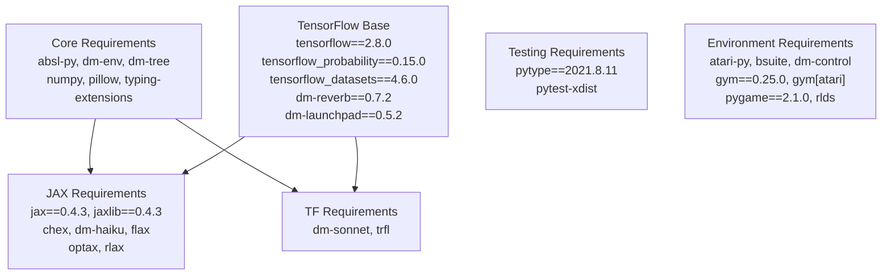

### Version Constraints

The framework maintains strict version pinning for compatibility, particularly between TensorFlow and Reverb components. The `tensorflow` dependency list in [setup.py:39-45]() ensures that Reverb (the distributed replay system) remains compatible with the specified TensorFlow version.

Sources: [setup.py:34-84]()

## Development Setup

### Local Development Environment

For development work, the repository includes a comprehensive setup script that creates an isolated testing environment:

```bash
# Create virtual environment and install all dependencies
./test.sh --deps_only
```

This script performs the following setup operations defined in [test.sh:40-47]():

1. Creates a Python virtual environment named `acme_testing`
2. Upgrades core packaging tools (`pip`, `setuptools`, `wheel`)
3. Installs Acme with all optional dependency groups
4. Includes additional development tools like `xmanager`

### Requirements File Generation

The setup system automatically generates a consolidated requirements file for deployment scenarios:

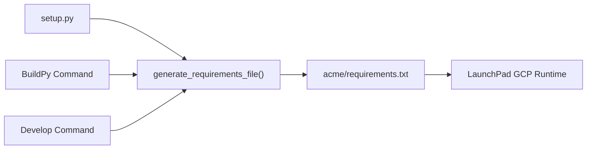

The `generate_requirements_file()` function in [setup.py:87-104]() creates a unified requirements file by combining all dependency groups, which is used by LaunchPad for distributed deployment scenarios.

Sources: [test.sh:40-47](), [setup.py:87-140]()

## Testing Infrastructure

### Test Execution Framework

The testing system provides comprehensive validation across multiple dimensions:

**Static Type Checking:**
```bash
# Run pytype across all modules
pytype -k -j "${N_CPU}" acme
pytype -k -j "${N_CPU}" examples/
```

**Unit Test Execution:**
```bash
# Run pytest with parallel execution
pytest --ignore-glob="*/*agent*_test.py" --durations=10 -n "${N_CPU}" acme
```

### Test Categories

The test suite is organized into several categories as defined in [test.sh:55-99]():

| Test Category | Scope | Execution Method |
|---------------|--------|------------------|
| Static Analysis | Type checking with `pytype` | Parallel across CPU cores |
| Unit Tests | Core framework components | Parallel `pytest` execution |
| Integration Tests | Baseline algorithm examples | Sequential execution |
| Distributed Tests | Multi-actor scenarios | LaunchPad coordination |

### Example Integration Testing

The testing framework validates baseline implementations by running abbreviated training sessions:

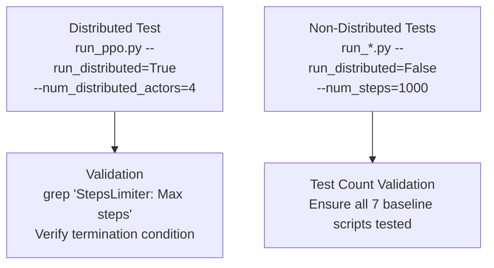

The integration tests in [test.sh:66-99]() verify that baseline algorithms can execute successfully with minimal training steps, ensuring the complete pipeline from environment setup to learning updates functions correctly.

Sources: [test.sh:52-99]()

## Continuous Integration Pipeline

### GitHub Actions Workflow

The CI system uses a matrix strategy to validate compatibility across Python versions:

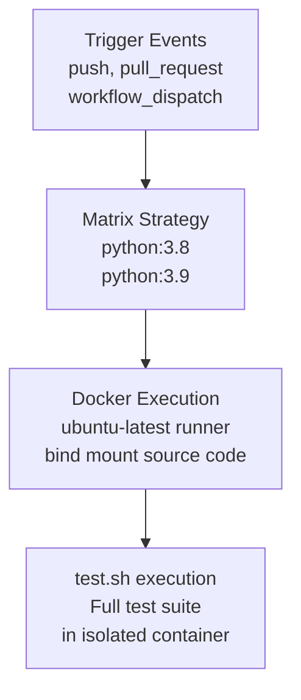

### CI Configuration Details

The GitHub Actions workflow in [.github/workflows/ci.yml:1-17]() implements the following strategy:

- **Trigger Events**: Executes on push, pull request, and manual dispatch
- **Python Versions**: Tests against Python 3.8 and 3.9 in separate matrix jobs
- **Isolation**: Uses Docker containers to ensure consistent, reproducible builds
- **Mount Strategy**: Bind mounts the source code to `/tmp/acme` within containers

### Build Commands Integration

The setup system includes custom build commands that integrate requirements generation:

```python
class BuildPy(setuptools.command.build_py.build_py):
  def run(self):
    generate_requirements_file()
    setuptools.command.build_py.build_py.run(self)

class Develop(setuptools.command.develop.develop):
  def run(self):
    generate_requirements_file()
    setuptools.command.develop.develop.run(self)
```

These custom commands in [setup.py:124-140]() ensure that the requirements file is regenerated during both package building and development installation, maintaining consistency between local development and deployment environments.

Sources: [.github/workflows/ci.yml:1-17](), [setup.py:124-140]()

---

# Page: Core Framework Components

# Core Framework Components

<details>
<summary>Relevant source files</summary>

The following files were used as context for generating this wiki page:

- [acme/agents/agent.py](acme/agents/agent.py)
- [acme/agents/jax/ail/builder.py](acme/agents/jax/ail/builder.py)
- [acme/core.py](acme/core.py)
- [acme/jax/variable_utils.py](acme/jax/variable_utils.py)
- [acme/jax/variable_utils_test.py](acme/jax/variable_utils_test.py)
- [acme/testing/fakes.py](acme/testing/fakes.py)

</details>


## Purpose and Scope

This document provides a deep dive into the fundamental building blocks of the Acme reinforcement learning framework. These core framework components establish the architectural foundation that enables modular composition of RL agents, distributed execution, and systematic experimentation.

The framework is built around key abstractions that separate concerns: `Actor` for policy execution, `Learner` for parameter updates, and `VariableSource` for parameter sharing. These interfaces compose into complete agents through the `Agent` class and integrate with environment interaction via `EnvironmentLoop`.

This page provides an overview of the core framework architecture. For detailed coverage of specific components, see:
- Core Interfaces and Agent Composition (page 2.1)
- Environment Loop and Execution (page 2.2) 
- Actor System and Policy Execution (page 2.3)
- Experience Collection and Replay (page 2.4)

## Framework Architecture Overview

The Acme framework separates reinforcement learning into distinct, composable components. The architecture enables both single-process and distributed deployments through clean interface abstractions.

### Core Framework Components

```mermaid
graph TB
    subgraph "Core Interfaces"
        Actor["core.Actor<br/>select_action()<br/>observe()<br/>update()"]
        Learner["core.Learner<br/>step()<br/>get_variables()"]
        VariableSource["core.VariableSource<br/>get_variables()"]
        Worker["core.Worker<br/>run()"]
        Saveable["core.Saveable<br/>save()<br/>restore()"]
    end
    
    subgraph "Agent Composition"
        Agent["agents.agent.Agent<br/>Combines Actor + Learner"]
        EnvironmentLoop["environment_loop.EnvironmentLoop<br/>Actor-Environment orchestration"]
    end
    
    subgraph "Parameter Synchronization"
        VariableClient["variable_utils.VariableClient<br/>Async parameter updates"]
        ReferenceVariableSource["variable_utils.ReferenceVariableSource<br/>Parameter references"]
    end
    
    subgraph "Experience Management"
        Adder["adders.Adder<br/>Experience collection"]
        PrefetchingIterator["core.PrefetchingIterator<br/>Async data loading"]
    end
    
    Learner --|"inherits"| VariableSource
    Learner --|"inherits"| Worker  
    Learner --|"inherits"| Saveable
    Agent --|"implements"| Actor
    Agent --|"implements"| VariableSource
    Agent --> Actor
    Agent --> Learner
    EnvironmentLoop --> Actor
    VariableClient --> VariableSource
    Actor --> Adder
    Learner --> PrefetchingIterator
```

Sources: [acme/core.py:31-177](), [acme/agents/agent.py:43-136](), [acme/jax/variable_utils.py:31-154]()

## Core Interface Definitions

The framework defines abstract interfaces that establish contracts between components. These interfaces enable modular composition and support both local and distributed deployments.

### Primary Interfaces

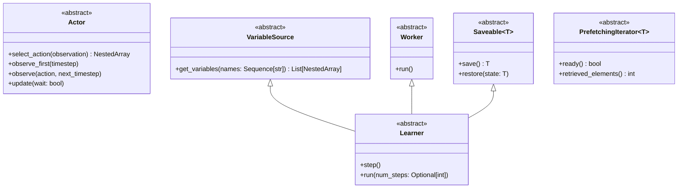

### Interface Responsibilities

| Interface | File Location | Primary Methods | Purpose |
|-----------|---------------|-----------------|---------|
| `core.Actor` | [acme/core.py:32-87]() | `select_action()`, `observe()`, `update()` | Policy execution and environment interaction |
| `core.Learner` | [acme/core.py:132-165]() | `step()`, `run()`, `get_variables()` | Parameter learning and training loops |
| `core.VariableSource` | [acme/core.py:89-109]() | `get_variables()` | Parameter access and sharing |
| `core.Worker` | [acme/core.py:112-118]() | `run()` | Distributed execution coordination |
| `core.Saveable` | [acme/core.py:120-130]() | `save()`, `restore()` | State persistence and recovery |

Sources: [acme/core.py:31-177]()

## Agent Composition Patterns

The framework provides several composition patterns to combine core interfaces into functional agents.

### Agent Class Composition

```mermaid
graph TD
    subgraph "agents.agent.Agent"
        AgentActor["_actor: core.Actor"]
        AgentLearner["_learner: core.Learner"]
        AgentLogic["Agent Logic<br/>_calculate_num_learner_steps()<br/>_has_data_for_training()"]
    end
    
    subgraph "Implements Interfaces"
        ActorInterface["core.Actor<br/>select_action()<br/>observe()<br/>update()"]
        VariableSourceInterface["core.VariableSource<br/>get_variables()"]
    end
    
    AgentActor --> ActorInterface
    AgentLearner --> VariableSourceInterface
    AgentLogic --> ActorInterface
    
    subgraph "Delegation Pattern"
        SelectAction["select_action(obs) → _actor.select_action(obs)"]
        ObserveFirst["observe_first(timestep) → _actor.observe_first(timestep)"]  
        Observe["observe(action, timestep) → _actor.observe(action, timestep)"]
        Update["update() → _learner.step() + _actor.update()"]
        GetVariables["get_variables(names) → _learner.get_variables(names)"]
    end
```

The `Agent` class implements the composition pattern by:
- Delegating `Actor` methods to an internal `_actor`
- Delegating `VariableSource` methods to an internal `_learner`
- Coordinating the learning-acting cycle in `update()`
- Managing data availability through `PrefetchingIterator` integration

Sources: [acme/agents/agent.py:43-136]()

## Parameter Synchronization Architecture

The framework provides mechanisms for transferring parameters between distributed components, enabling asynchronous learning and acting.

### VariableClient Integration Pattern

```mermaid
sequenceDiagram
    participant Actor as "core.Actor"
    participant VC as "VariableClient"
    participant VS as "VariableSource<br/>(Learner)"
    participant Device as "JAX Device"
    
    Actor->>VC: update(wait=False)
    VC->>VC: Check update_period
    alt Update period reached
        VC->>VS: get_variables(key)
        VS-->>VC: List[NestedArray]
        VC->>Device: jax.device_put(params)
        Device-->>VC: device_params
        VC->>VC: _params = device_params
    end
    Actor->>VC: params (property access)
    VC-->>Actor: current parameters
```

### Variable Reference System

For distributed inference, the framework provides reference-based parameter access:

```mermaid
graph LR
    subgraph "Distributed Inference"
        RefSource["ReferenceVariableSource"]
        RefVars["VariableReference<br/>variable_name: str"]
        InferenceServer["Centralized Inference Server"]
    end
    
    subgraph "Standard Local Access"
        VarClient["VariableClient"]
        LocalParams["Local Parameter Copy"]
    end
    
    Actor --> RefSource
    RefSource --> RefVars
    RefVars --> InferenceServer
    
    Actor2["Actor (local)"] --> VarClient
    VarClient --> LocalParams
```

Sources: [acme/jax/variable_utils.py:31-154]()

## Data Flow Integration

The framework integrates experience collection, learning, and parameter synchronization into a unified data flow.

### Experience Collection and Learning Pipeline

```mermaid
graph TD
    subgraph "Environment Interaction"
        Env["dm_env.Environment"]
        EnvLoop["EnvironmentLoop"]
        Actor["core.Actor"]
    end
    
    subgraph "Experience Management"  
        Adder["adders.Adder<br/>add_first()<br/>add()"]
        ReverbTables["Reverb Tables<br/>Experience storage"]
        Iterator["core.PrefetchingIterator<br/>ready()<br/>retrieved_elements()"]
    end
    
    subgraph "Learning System"
        Learner["core.Learner<br/>step()"]
        VarSource["core.VariableSource<br/>get_variables()"]
        VarClient["VariableClient<br/>update()"]
    end
    
    EnvLoop --> Actor
    EnvLoop --> Env
    Actor --> Adder
    Adder --> ReverbTables
    ReverbTables --> Iterator
    Iterator --> Learner
    Learner --> VarSource
    VarSource --> VarClient
    VarClient --> Actor
```

### Agent Update Control Logic

The `Agent` class implements sophisticated control logic for balancing data collection and learning:

```mermaid
flowchart TD
    Update["Agent.update()"] --> HasIterator{"_iterator exists?"}
    
    HasIterator -->|"Yes"| CheckData["_has_data_for_training()"]
    CheckData -->|"Data available"| LearnerStep["_learner.step()"]
    LearnerStep --> UpdateActor["_actor.update()"]
    CheckData -->|"No data"| End["Return"]
    
    HasIterator -->|"No"| CalcSteps["_calculate_num_learner_steps()"]
    CalcSteps --> DoSteps["Run learner steps"]
    DoSteps --> UpdateActorOld["_actor.update()"]
    
    UpdateActor --> End
    UpdateActorOld --> End
```

Sources: [acme/agents/agent.py:94-134]()

## Framework Testing and Validation

The framework provides comprehensive testing infrastructure through fake implementations that validate interface contracts.

### Testing Components Architecture

```mermaid
graph TB
    subgraph "testing.fakes Module"
        FakeActor["fakes.Actor<br/>validates specs<br/>generates random actions"]
        FakeVariableSource["fakes.VariableSource<br/>provides dummy variables"]
        FakeLearner["fakes.Learner<br/>increments step_counter"]
        FakeEnv["fakes.Environment<br/>generates fake episodes"]
    end
    
    subgraph "Interface Validation"
        SpecValidation["_validate_spec()<br/>tree.assert_same_structure()"]
        ValueGeneration["_generate_from_spec()<br/>creates valid test data"]
    end
    
    subgraph "Test Data Factories"
        TransitionDataset["transition_dataset_from_spec()"]
        TransitionIterator["transition_iterator_from_spec()"]
        RLDSDataset["rlds_dataset_from_env_spec()"]
    end
    
    FakeActor --> SpecValidation
    FakeEnv --> ValueGeneration
    SpecValidation --> TransitionDataset
    ValueGeneration --> TransitionIterator
    TransitionDataset --> RLDSDataset
```

The testing framework ensures:
- Spec validation for observations, actions, rewards, and discounts
- Interface compliance testing for all core components
- Consistent data generation for testing agent implementations
- Integration testing support through complete fake environments

Sources: [acme/testing/fakes.py:36-475]()

## Framework Extension Patterns

The core framework supports extension through well-defined patterns that maintain interface compatibility while enabling algorithm-specific customizations.

### Builder Pattern Integration

```mermaid
graph TD
    subgraph "builders.ActorLearnerBuilder"
        MakeActor["make_actor(random_key, policy, environment_spec)"]
        MakeLearner["make_learner(random_key, networks, dataset)"]
        MakePolicy["make_policy(networks, environment_spec)"]
        MakeDataset["make_dataset_iterator(replay_client)"]
        MakeReplay["make_replay_tables(environment_spec, policy)"]
        MakeAdder["make_adder(replay_client, environment_spec)"]
    end
    
    subgraph "Core Component Creation"
        ActorImpl["core.Actor implementation"]
        LearnerImpl["core.Learner implementation"] 
        PolicyImpl["Policy network"]
        IteratorImpl["core.PrefetchingIterator"]
        ReverbTables["List[reverb.Table]"]
        AdderImpl["adders.Adder"]
    end
    
    MakeActor --> ActorImpl
    MakeLearner --> LearnerImpl
    MakePolicy --> PolicyImpl
    MakeDataset --> IteratorImpl
    MakeReplay --> ReverbTables
    MakeAdder --> AdderImpl
```

### Component Lifecycle Management

The framework manages component lifecycles through standardized patterns:

| Component | Initialization | Runtime | Cleanup |
|-----------|---------------|---------|---------|
| `VariableClient` | Configure update period, device placement | Async parameter fetching via `ThreadPoolExecutor` | Executor shutdown |
| `core.Learner` | Initialize optimizers, networks | `step()` calls with data batching | `save()` state persistence |
| `core.Actor` | Load initial parameters | `select_action()`, `observe()` calls | Final `update()` call |

Sources: [acme/agents/jax/ail/builder.py:151-332](), [acme/jax/variable_utils.py:46-154]()

## Summary

The core components of Acme provide a modular framework for building reinforcement learning agents:

| Component | Purpose | Key Interfaces |
|-----------|---------|----------------|
| Actor | Policy execution and environment interaction | `select_action`, `observe`, `update` |
| Learner | Parameter updates and training | `step`, `run`, `get_variables` |
| VariableSource | Parameter access | `get_variables` |
| VariableClient | Parameter synchronization | `update`, `update_and_wait` |
| EnvironmentLoop | Agent-environment interaction orchestration | `run_episode`, `run` |

These components can be combined in various ways to create different types of agents, supporting both simple single-process deployments and complex distributed systems.

Sources: [acme/core.py](acme/core.py), [acme/environment_loop.py](acme/environment_loop.py), [acme/jax/variable_utils.py](acme/jax/variable_utils.py)

---

# Page: Core Interfaces and Agent Composition

# Core Interfaces and Agent Composition

<details>
<summary>Relevant source files</summary>

The following files were used as context for generating this wiki page:

- [acme/agents/agent.py](acme/agents/agent.py)
- [acme/agents/jax/ail/builder.py](acme/agents/jax/ail/builder.py)
- [acme/core.py](acme/core.py)
- [acme/jax/variable_utils.py](acme/jax/variable_utils.py)
- [acme/jax/variable_utils_test.py](acme/jax/variable_utils_test.py)
- [acme/testing/fakes.py](acme/testing/fakes.py)

</details>


This document covers the fundamental interfaces that define Acme's architecture and how they compose to form complete reinforcement learning agents. It explains the `Actor`, `Learner`, `VariableSource` abstractions and the `Agent` class that combines them into a cohesive system.

For environment interaction mechanics, see [Environment Loop and Execution](#2.2). For specific actor implementations, see [Actor System and Policy Execution](#2.3). For learning algorithm implementations, see [Reinforcement Learning Agents](#4).

## Core Interface Hierarchy

Acme's architecture is built around several key abstract interfaces that define clean separation of concerns for reinforcement learning components.

### Primary Interfaces

The core interfaces form a hierarchy of capabilities:

```mermaid
graph TB
    Actor["Actor<br/>select_action()<br/>observe_first()<br/>observe()<br/>update()"]
    VariableSource["VariableSource<br/>get_variables()"]
    Worker["Worker<br/>run()"]
    Saveable["Saveable<br/>save()<br/>restore()"]
    
    subgraph "Combined Interface"
        Learner["Learner<br/>step()<br/>run()<br/>get_variables()<br/>save()<br/>restore()"]
    end
    
    subgraph "Composition"
        Agent["Agent<br/>Combines Actor + Learner<br/>Controls observation/learning ratio"]
    end
    
    VariableSource --> Learner
    Worker --> Learner  
    Saveable --> Learner
    
    Actor --> Agent
    Learner --> Agent
    
    PrefetchingIterator["PrefetchingIterator<br/>ready()<br/>retrieved_elements()"]
```

**Sources:** [acme/core.py:32-177]()

| Interface | Purpose | Key Methods |
|-----------|---------|-------------|
| `Actor` | Policy execution and environment interaction | `select_action()`, `observe()`, `update()` |
| `VariableSource` | Provides access to model parameters | `get_variables()` |
| `Worker` | Defines runnable components | `run()` |
| `Saveable` | Checkpointing and persistence | `save()`, `restore()` |
| `Learner` | Combines learning, variables, and execution | `step()`, inherits from above |

### Actor Interface

The `Actor` interface defines the contract for policy execution:

```mermaid
sequenceDiagram
    participant E as "Environment"
    participant A as "Actor"
    participant L as "Learner"
    
    E->>A: "timestep = env.reset()"
    A->>A: "observe_first(timestep)"
    
    loop "Episode Steps"
        A->>A: "action = select_action(observation)"
        A->>E: "env.step(action)"
        E->>A: "next_timestep"
        A->>A: "observe(action, next_timestep)"
        
        opt "Periodic Updates"
            A->>L: "update() - sync parameters"
        end
    end
```

**Sources:** [acme/core.py:32-87](), [acme/testing/fakes.py:36-62]()

The `Actor` interface methods serve specific purposes:
- `select_action()`: Sample actions from the current policy
- `observe_first()`: Initialize trajectory recording
- `observe()`: Record environment transitions  
- `update()`: Synchronize with learner parameters

### Learner Interface

The `Learner` combines multiple interfaces to provide learning functionality:

```mermaid
graph LR
    subgraph "Data Flow"
        Dataset["Dataset Iterator<br/>Experience Replay"]
        Step["step()<br/>Single learning update"]
        Variables["get_variables()<br/>Updated parameters"]
    end
    
    subgraph "Execution"
        Run["run()<br/>Continuous learning loop"]  
        Worker["Worker interface<br/>Distributed execution"]
    end
    
    subgraph "Persistence"
        Save["save()<br/>Checkpoint state"]
        Restore["restore()<br/>Load from checkpoint"]
    end
    
    Dataset --> Step
    Step --> Variables
    Step --> Run
    Run --> Worker
    Variables --> Save
    Save --> Restore
```

**Sources:** [acme/core.py:132-165](), [acme/testing/fakes.py:84-95]()

## Agent Composition Pattern

The `Agent` class demonstrates Acme's composition-over-inheritance approach by combining `Actor` and `Learner` instances.

### Agent Architecture

```mermaid
graph TB
    subgraph "Agent Class"
        AgentClass["Agent<br/>implements Actor + VariableSource"]
        
        subgraph "Composed Components"
            ActorComp["_actor: Actor<br/>Policy execution"]
            LearnerComp["_learner: Learner<br/>Parameter updates"]
        end
        
        subgraph "Coordination Logic"
            ObsControl["Observation counting<br/>_num_observations"]
            UpdateControl["Update scheduling<br/>observations_per_step"]
            DataControl["Data availability checking<br/>_has_data_for_training()"]
        end
    end
    
    subgraph "External Components"
        Iterator["PrefetchingIterator<br/>Experience data"]
        ReplayTables["Reverb Tables<br/>Experience storage"]
    end
    
    ActorComp --> AgentClass
    LearnerComp --> AgentClass
    ObsControl --> AgentClass
    UpdateControl --> AgentClass
    DataControl --> AgentClass
    
    Iterator --> DataControl
    ReplayTables --> DataControl
```

**Sources:** [acme/agents/agent.py:43-137]()

### Agent Method Delegation

The `Agent` class delegates interface methods while adding coordination logic:

| Method | Implementation | Purpose |
|--------|----------------|---------|
| `select_action()` | `return self._actor.select_action(observation)` | Direct delegation |
| `observe_first()` | `self._actor.observe_first(timestep)` | Direct delegation |
| `observe()` | Increment counter + `self._actor.observe()` | Adds observation counting |
| `update()` | Complex logic coordinating actor/learner | Controls learning frequency |
| `get_variables()` | `return self._learner.get_variables(names)` | Direct delegation |

**Sources:** [acme/agents/agent.py:75-136]()

### Update Coordination Logic

The `Agent.update()` method implements sophisticated coordination between acting and learning:

```mermaid
flowchart TD
    Update["update() called"]
    
    HasIterator{"Has _iterator?"}
    Update --> HasIterator
    
    %% Iterator-based path
    HasIterator -->|"Yes"| CheckData["_has_data_for_training()"]
    CheckData -->|"Data available"| LearnerStep["_learner.step()"]
    LearnerStep --> UpdateActor1["_actor.update()"]
    CheckData -->|"No data"| End1["Return"]
    
    %% Legacy path  
    HasIterator -->|"No"| CalcSteps["_calculate_num_learner_steps()"]
    CalcSteps --> StepLoop["for _ in range(num_steps)"]
    StepLoop --> LearnerStep2["_learner.step()"]
    LearnerStep2 --> UpdateActor2["_actor.update()"]
    
    UpdateActor1 --> End2["Return"]
    UpdateActor2 --> End3["Return"]
    End1 --> End4["Complete"]
    End2 --> End4
    End3 --> End4
```

**Sources:** [acme/agents/agent.py:94-134](), [acme/agents/agent.py:27-41]()

## Variable Synchronization System

Acme provides a sophisticated system for sharing parameters between distributed components.

### VariableSource Implementations

```mermaid
graph TB
    subgraph "Variable Source Types"
        BaseVS["VariableSource<br/>Abstract interface"]
        
        LearnerVS["Learner<br/>Provides learned parameters"]
        FakeVS["testing.fakes.VariableSource<br/>Mock implementation"]
        RefVS["ReferenceVariableSource<br/>Returns parameter references"]
    end
    
    subgraph "Variable Clients"
        VC["VariableClient<br/>Periodic parameter fetching"]
        AsyncUpdate["Asynchronous updates<br/>ThreadPoolExecutor"]
        DevicePlacement["Device placement<br/>JAX device management"]
    end
    
    BaseVS --> LearnerVS
    BaseVS --> FakeVS  
    BaseVS --> RefVS
    
    LearnerVS --> VC
    RefVS --> VC
    VC --> AsyncUpdate
    VC --> DevicePlacement
```

**Sources:** [acme/core.py:89-109](), [acme/jax/variable_utils.py:31-44](), [acme/jax/variable_utils.py:46-155](), [acme/testing/fakes.py:64-82]()

### Variable Client Pattern

The `VariableClient` implements efficient parameter synchronization:

```mermaid
sequenceDiagram
    participant A as "Actor"
    participant VC as "VariableClient"  
    participant VS as "VariableSource"
    participant D as "JAX Device"
    
    A->>VC: "client.params (first access)"
    VC->>VC: "update_and_wait()"
    VC->>VS: "get_variables(keys)"
    VS->>VC: "parameter arrays"
    VC->>D: "jax.device_put(params)"
    D->>VC: "device-placed params"
    VC->>A: "return params"
    
    Note over VC: "Subsequent calls use cached params"
    
    loop "Periodic Updates"
        A->>VC: "client.update()"
        alt "Update period elapsed"
            VC->>VS: "async get_variables()"
            VS-->>VC: "new parameters (async)"
        else "Too early"
            VC->>A: "return (no-op)"
        end
    end
```

**Sources:** [acme/jax/variable_utils.py:88-155]()

## Interface Implementation Patterns

### Fake Implementations for Testing

Acme provides comprehensive fake implementations that demonstrate interface contracts:

```mermaid
graph LR
    subgraph "Testing Infrastructure"
        FakeActor["fakes.Actor<br/>Random actions<br/>Spec validation"]
        FakeLearner["fakes.Learner<br/>Step counter<br/>Mock variables"]
        FakeVS["fakes.VariableSource<br/>Configurable variables<br/>Barrier support"]
        FakeEnv["fakes.Environment<br/>Spec-compliant<br/>Configurable episodes"]
    end
    
    subgraph "Real Interfaces"
        ActorIF["Actor"]
        LearnerIF["Learner"]  
        VSIF["VariableSource"]
        EnvIF["dm_env.Environment"]
    end
    
    FakeActor -.->|"implements"| ActorIF
    FakeLearner -.->|"implements"| LearnerIF
    FakeVS -.->|"implements"| VSIF
    FakeEnv -.->|"implements"| EnvIF
```

**Sources:** [acme/testing/fakes.py:36-95](), [acme/testing/fakes.py:97-304]()

The fake implementations serve multiple purposes:
- **Contract validation**: Ensure proper interface compliance
- **Testing infrastructure**: Enable isolated component testing  
- **Development aids**: Provide working examples of interface implementation
- **Specification documentation**: Show expected behavior patterns

### Builder Pattern Integration

The core interfaces integrate with Acme's builder pattern for agent construction:

```mermaid
graph TB
    subgraph "Builder System"
        Builder["ActorLearnerBuilder<br/>Abstract factory"]
        
        MakeActor["make_actor()<br/>returns Actor"]
        MakeLearner["make_learner()<br/>returns Learner"]  
        MakePolicy["make_policy()<br/>returns policy function"]
    end
    
    subgraph "Core Interfaces"
        Actor2["Actor<br/>Environment interaction"]
        Learner2["Learner<br/>Parameter updates"]
        VariableSource2["VariableSource<br/>Parameter access"]
    end
    
    subgraph "Agent Assembly"
        AgentConstruction["Agent(actor, learner)<br/>Composition"]
    end
    
    Builder --> MakeActor
    Builder --> MakeLearner
    Builder --> MakePolicy
    
    MakeActor --> Actor2
    MakeLearner --> Learner2
    Learner2 --> VariableSource2
    
    Actor2 --> AgentConstruction
    Learner2 --> AgentConstruction
```

**Sources:** [acme/agents/jax/ail/builder.py:151-332]()

This demonstrates how the core interfaces provide the foundation for Acme's modular agent construction system, enabling flexible composition of different algorithms and components while maintaining clean abstractions.

---

# Page: Environment Loop and Execution

# Environment Loop and Execution

<details>
<summary>Relevant source files</summary>

The following files were used as context for generating this wiki page:

- [acme/__init__.py](acme/__init__.py)
- [acme/_metadata.py](acme/_metadata.py)
- [acme/agents/tf/r2d2/agent.py](acme/agents/tf/r2d2/agent.py)
- [acme/agents/tf/r2d2/agent_test.py](acme/agents/tf/r2d2/agent_test.py)
- [acme/agents/tf/r2d2/learning.py](acme/agents/tf/r2d2/learning.py)
- [acme/environment_loop.py](acme/environment_loop.py)
- [acme/environment_loop_test.py](acme/environment_loop_test.py)
- [acme/specs.py](acme/specs.py)

</details>


The `EnvironmentLoop` class is a core execution component in Acme that coordinates the interaction between `Actor` and `dm_env.Environment` instances. It implements the standard reinforcement learning loop with comprehensive timing metrics, episode management, and extensible observation patterns.

This page covers the `EnvironmentLoop` implementation, execution patterns, and metrics collection. For information about experiment frameworks that utilize environment loops, see [Experiment Management and Execution](#6).

## Core Concepts

The Environment Loop implements the standard reinforcement learning loop where:

1. The environment provides an observation
2. The agent selects an action based on that observation
3. The environment transitions based on the action, providing a new observation and reward
4. The agent observes this transition (and optionally updates its policy)
5. Steps 2-4 repeat until episode termination

This cycle is essential for any reinforcement learning agent to learn and improve its performance over time.

## Architecture

The Environment Loop connects an environment with an agent (actor) and manages their interaction.

### EnvironmentLoop Class Architecture

```mermaid
graph TD
    subgraph "Core Dependencies"
        Environment["dm_env.Environment"]
        Actor["core.Actor"]
        Counter["counting.Counter"]
        Logger["loggers.Logger"]
        Observers["observers_lib.EnvLoopObserver[]"]
    end
    
    subgraph "EnvironmentLoop Implementation"
        EnvironmentLoop["EnvironmentLoop(core.Worker)"]
        run_method["run(num_episodes, num_steps)"]
        run_episode_method["run_episode()"]
        
        EnvironmentLoop --> run_method
        EnvironmentLoop --> run_episode_method
    end
    
    Environment --> EnvironmentLoop
    Actor --> EnvironmentLoop
    Counter --> EnvironmentLoop
    Logger --> EnvironmentLoop
    Observers --> EnvironmentLoop
```

Sources: [acme/environment_loop.py:33-74]()

### Episode Execution Sequence

```mermaid
sequenceDiagram
    participant EnvironmentLoop
    participant "dm_env.Environment"
    participant "core.Actor"
    participant "observers_lib.EnvLoopObserver"
    participant "loggers.Logger"
    
    Note over EnvironmentLoop: "run_episode() starts"
    EnvironmentLoop->>+"dm_env.Environment": "reset()"
    "dm_env.Environment"-->>-EnvironmentLoop: "timestep"
    EnvironmentLoop->>"core.Actor": "observe_first(timestep)"
    EnvironmentLoop->>"observers_lib.EnvLoopObserver": "observe_first(env, timestep)"
    
    loop "while not timestep.last()"
        EnvironmentLoop->>+"core.Actor": "select_action(observation)"
        "core.Actor"-->>-EnvironmentLoop: "action"
        EnvironmentLoop->>+"dm_env.Environment": "step(action)"
        "dm_env.Environment"-->>-EnvironmentLoop: "timestep"
        EnvironmentLoop->>"core.Actor": "observe(action, timestep)"
        EnvironmentLoop->>"observers_lib.EnvLoopObserver": "observe(env, timestep, action)"
        
        alt "should_update == True"
            EnvironmentLoop->>"core.Actor": "update()"
        end
        
        Note over EnvironmentLoop: "episode_return += timestep.reward"
    end
    
    Note over EnvironmentLoop: "Collect timing & metrics"
    EnvironmentLoop->>"loggers.Logger": "write(result)"
```

Sources: [acme/environment_loop.py:96-157]()

## Usage in Acme Architecture

The Environment Loop is typically used as part of the broader Acme architecture:

```mermaid
graph TD
    subgraph "Acme Architecture"
        ExpRunner["ExperimentRunner"]
        EnvironmentLoop["EnvironmentLoop"]
        Environment["Environment"]
        Agent["Agent"]
        subgraph "Agent Components"
            Actor["Actor"]
            Learner["Learner"]
            ReplayBuffer["ReplayBuffer"]
        end
    end
    
    ExpRunner --> EnvironmentLoop
    ExpRunner --> Agent
    EnvironmentLoop --> Environment
    EnvironmentLoop --> Actor
    Actor --> Agent
    Learner --> Agent
    ReplayBuffer --> Agent
    Actor -.-> ReplayBuffer["Adds transitions"]
    Learner -.-> ReplayBuffer["Samples batches"]
```

Sources: [examples/tutorial.ipynb](https://github.com/google-deepmind/acme/blob/master/examples/tutorial.ipynb), [examples/quickstart.ipynb](https://github.com/google-deepmind/acme/blob/master/examples/quickstart.ipynb)

## Using the Environment Loop

### EnvironmentLoop Construction

The `EnvironmentLoop` constructor requires a `dm_env.Environment` and `core.Actor`:

```python
from acme import EnvironmentLoop

# Minimal construction  
loop = EnvironmentLoop(environment, actor)
```

Full constructor with optional components:

```python
loop = EnvironmentLoop(
    environment=environment,
    actor=actor,
    counter=counter,                    # counting.Counter for metrics
    logger=logger,                      # loggers.Logger for output
    should_update=True,                 # Enable actor.update() calls
    label='environment_loop',           # Logger label
    observers=observers                 # Sequence[EnvLoopObserver]
)
```

Sources: [acme/environment_loop.py:57-74]()

### Running Episodes

There are two main methods to run the Environment Loop:

#### `run_episode()` Method

The `run_episode()` method executes a single episode and returns comprehensive metrics:

```python
result: loggers.LoggingData = loop.run_episode()
# Returns dict with keys: episode_length, episode_return, steps_per_second, 
# env_reset_duration_sec, select_action_duration_sec, env_step_duration_sec
```

#### `run(num_episodes=None, num_steps=None)` Method

The `run()` method executes multiple episodes with termination control:

```python
# Run exactly 10 episodes
total_steps: int = loop.run(num_episodes=10)

# Run until at least 1000 steps (completing current episode)
total_steps: int = loop.run(num_steps=1000)
```

The method enforces mutual exclusion: exactly one of `num_episodes` or `num_steps` must be `None`. It uses `signals.runtime_terminator()` for graceful shutdown handling.

Sources: [acme/environment_loop.py:76-157](), [acme/environment_loop.py:159-205]()

## Environment Loop Parameters

### Constructor Parameters

| Parameter | Type | Description |
|-----------|------|-------------|
| `environment` | `dm_env.Environment` | Environment with which the agent interacts |
| `actor` | `acme.core.Actor` | Agent that interacts with the environment |
| `counter` | `counting.Counter` | Optional counter for metrics |
| `logger` | `loggers.Logger` | Optional logger for metrics |
| `should_update` | `bool` | Whether to update the agent after each step |
| `label` | `str` | Label for the default logger if none provided |
| `observers` | `Sequence[observers_lib.EnvLoopObserver]` | Optional observers for additional metrics |

Sources: [acme/environment_loop.py:57-74](https://github.com/google-deepmind/acme/blob/master/acme/environment_loop.py)

### Metrics Collection

The `EnvironmentLoop` collects detailed performance and timing metrics:

| Metric | Type | Description |
|--------|------|-------------|
| `episode_length` | `int` | Number of environment steps in episode |
| `episode_return` | `tree structure` | Cumulative reward (matches reward_spec shape) |
| `steps_per_second` | `float` | Environment interaction rate |
| `env_reset_duration_sec` | `float` | Time for environment.reset() |
| `select_action_duration_sec` | `float` | Mean time for actor.select_action() |
| `env_step_duration_sec` | `float` | Mean time for environment.step() |
| `episode_duration` | `float` | Total episode execution time |
| `episodes` | `int` | Counter: total episodes completed |
| `steps` | `int` | Counter: total steps executed |

Additional metrics from observers are merged via `observer.get_metrics()`.

Sources: [acme/environment_loop.py:88-157](), [acme/environment_loop.py:155-156]()

## Examples

### Basic Usage

```python
# Create environment and actor
environment = ...  # A dm_env.Environment instance
actor = ...       # An acme.core.Actor instance

# Create the loop
loop = EnvironmentLoop(environment, actor)

# Run for 10 episodes
loop.run(num_episodes=10)
```

### With Logging

```python
from acme.utils import loggers

# Create a logger
logger = loggers.InMemoryLogger()

# Create the loop with the logger
loop = EnvironmentLoop(environment, actor, logger=logger)

# Run episodes
loop.run(num_episodes=10)

# Access logged data
for entry in logger.data:
    print(entry)
```

Sources: [examples/tutorial.ipynb:645-653](https://github.com/google-deepmind/acme/blob/master/examples/tutorial.ipynb), [examples/tutorial.ipynb:677](https://github.com/google-deepmind/acme/blob/master/examples/tutorial.ipynb)

### In Experiment Context

Within the broader experiment framework, the Environment Loop is typically created and run by an experiment runner:

```python
from acme.jax import experiments

# Configure the experiment
experiment_config = experiments.ExperimentConfig(
    builder=agent_builder,
    environment_factory=make_environment,
    network_factory=network_factory,
    logger_factory=logger_factory,
    max_num_actor_steps=50_000
)

# Run the experiment (which creates and runs the environment loop)
experiments.run_experiment(experiment_config)
```

Sources: [examples/quickstart.ipynb:223-261](https://github.com/google-deepmind/acme/blob/master/examples/quickstart.ipynb)

## Observer Pattern Integration

### EnvLoopObserver Interface

The `observers_lib.EnvLoopObserver` protocol enables custom metric collection:

| Method | Signature | Purpose |
|--------|-----------|---------|
| `observe_first` | `(env, timestep) -> None` | Initialize observer state at episode start |
| `observe` | `(env, timestep, action) -> None` | Record step-level observations |
| `get_metrics` | `() -> Dict[str, Any]` | Return metrics dict for logging |

### Observer Integration Points

```mermaid
graph LR
    subgraph "Episode Lifecycle"
        reset["environment.reset()"]
        observe_first["observer.observe_first()"]
        step_loop["Step Loop"]
        observe_step["observer.observe()"]
        get_metrics["observer.get_metrics()"]
        log_write["logger.write()"]
    end
    
    reset --> observe_first
    observe_first --> step_loop
    step_loop --> observe_step
    observe_step --> step_loop
    step_loop --> get_metrics
    get_metrics --> log_write
```

Observers receive full environment access, enabling domain-specific monitoring beyond standard RL metrics.

Sources: [acme/environment_loop.py:101-104](), [acme/environment_loop.py:123-126](), [acme/environment_loop.py:155-156]()

## Summary

The Environment Loop is a central component in the Acme framework that orchestrates the interaction between agents and environments. It follows the standard reinforcement learning loop paradigm and provides flexible options for running experiments, collecting metrics, and monitoring performance. By understanding how to create and use Environment Loops, you can effectively set up and run reinforcement learning experiments with the Acme framework.

---

# Page: Actor System and Policy Execution

# Actor System and Policy Execution

<details>
<summary>Relevant source files</summary>

The following files were used as context for generating this wiki page:

- [acme/agents/jax/__init__.py](acme/agents/jax/__init__.py)
- [acme/agents/jax/actor_core.py](acme/agents/jax/actor_core.py)
- [acme/agents/jax/actors.py](acme/agents/jax/actors.py)
- [acme/agents/jax/actors_test.py](acme/agents/jax/actors_test.py)

</details>


This document covers the actor system implementation in Acme's JAX framework, focusing on the `GenericActor` class, the `ActorCore` interface, and policy adaptation patterns that enable different types of neural network policies to work within the actor-learner framework. For information about the abstract `Actor` interface and agent composition patterns, see [Core Interfaces and Agent Composition](#2.1). For details on how actors interact with environments through the coordination layer, see [Environment Loop and Execution](#2.2).

## ActorCore Interface and Adaptation Layer

The `ActorCore` interface serves as an adaptation layer that standardizes different types of neural network policies into a common interface that can be used by the `GenericActor` implementation.

### ActorCore Structure

The `ActorCore` interface defines three pure functions that encapsulate algorithm-specific actor functionality:

| Function | Purpose | Signature |
|----------|---------|-----------|
| `init` | Initialize actor state | `Callable[[PRNGKey], State]` |
| `select_action` | Select action given params, observation, state | `SelectActionFn` |
| `get_extras` | Extract extras from current state | `Callable[[State], Extras]` |

The interface is generic over two type parameters:
- `State`: The internal state of the actor (e.g., RNG keys, recurrent state)
- `Extras`: Additional data to be stored with experiences (e.g., action values, core states)

```mermaid
graph TB
    subgraph "Policy Types"
        FFPolicy["FeedForwardPolicy<br/>params, rng, obs -> action"]
        FFPolicyExtras["FeedForwardPolicyWithExtra<br/>params, rng, obs -> (action, extras)"]
        RecurrentPolicy["RecurrentPolicy<br/>params, rng, obs, state -> (action, state)"]
    end
    
    subgraph "Adaptation Functions"
        FFAdapter["batched_feed_forward_to_actor_core"]
        FFExtrasAdapter["batched_feed_forward_with_extras_to_actor_core"]
        RecurrentAdapter["batched_recurrent_to_actor_core"]
    end
    
    subgraph "ActorCore Interface"
        ActorCoreInterface["ActorCore[State, Extras]<br/>init: PRNGKey -> State<br/>select_action: (Params, Obs, State) -> (Action, State)<br/>get_extras: State -> Extras"]
    end
    
    FFPolicy --> FFAdapter
    FFPolicyExtras --> FFExtrasAdapter
    RecurrentPolicy --> RecurrentAdapter
    
    FFAdapter --> ActorCoreInterface
    FFExtrasAdapter --> ActorCoreInterface
    RecurrentAdapter --> ActorCoreInterface
```

Sources: [acme/agents/jax/actor_core.py:41-46](), [acme/agents/jax/actor_core.py:51-64]()

### Policy Adaptation Patterns

The framework provides three main adaptation patterns to convert different policy types into the `ActorCore` interface:

**Feed-Forward Policy Adaptation**
- Function: `batched_feed_forward_to_actor_core`
- Converts policies that take `(params, rng, observation) -> action`
- State type: `PRNGKey` 
- Extras type: `Tuple[()]` (empty)
- Handles batch dimension addition/removal and RNG splitting

**Feed-Forward with Extras Adaptation**  
- Function: `batched_feed_forward_with_extras_to_actor_core`
- Converts policies that return `(action, extras)` tuples
- State type: `SimpleActorCoreStateWithExtras`
- Extras type: `Mapping[str, jnp.ndarray]`
- Preserves additional information like action values for experience replay

**Recurrent Policy Adaptation**
- Function: `batched_recurrent_to_actor_core`
- Converts policies with internal recurrent state (e.g., LSTM)
- State type: `SimpleActorCoreRecurrentState[RecurrentState]`
- Extras type: `Mapping[str, jnp.ndarray]` with core state
- Manages both RNG state and recurrent network state

Sources: [acme/agents/jax/actor_core.py:67-86](), [acme/agents/jax/actor_core.py:113-134](), [acme/agents/jax/actor_core.py:143-170]()

## GenericActor Implementation

The `GenericActor` class provides a concrete implementation of the `core.Actor` interface built on top of the `ActorCore` abstraction. It handles parameter synchronization, experience collection, JIT compilation, and state management.

### GenericActor Architecture

```mermaid
graph TB
    subgraph "GenericActor Components"
        GenericActorClass["GenericActor[State, Extras]"]
        ActorCoreInstance["actor: ActorCore[State, Extras]"]
        VariableClient["variable_client: VariableClient"]
        Adder["adder: Adder"]
        RandomKey["random_key: PRNGKey"]
    end
    
    subgraph "JIT Compiled Functions"
        InitJIT["_init: jax.jit(actor.init)"]
        PolicyJIT["_policy: jax.jit(actor.select_action)"]
        GetExtras["_get_extras: actor.get_extras"]
    end
    
    subgraph "Core Actor Interface Methods"
        SelectAction["select_action(observation) -> action"]
        ObserveFirst["observe_first(timestep)"]
        Observe["observe(action, timestep)"]
        Update["update(wait=False)"]
    end
    
    GenericActorClass --> ActorCoreInstance
    GenericActorClass --> VariableClient
    GenericActorClass --> Adder
    GenericActorClass --> RandomKey
    
    ActorCoreInstance --> InitJIT
    ActorCoreInstance --> PolicyJIT
    ActorCoreInstance --> GetExtras
    
    GenericActorClass --> SelectAction
    GenericActorClass --> ObserveFirst
    GenericActorClass --> Observe
    GenericActorClass --> Update
    
    PolicyJIT --> SelectAction
    InitJIT --> ObserveFirst
    GetExtras --> Observe
    VariableClient --> Update
```

Sources: [acme/agents/jax/actors.py:30-36](), [acme/agents/jax/actors.py:38-73]()

### Key Features and Configuration

**JIT Compilation**
- Optional JIT compilation of `init` and `select_action` functions for performance
- Configurable backend selection (`'cpu'` by default)
- Controlled via `jit` and `backend` constructor parameters

**Variable Synchronization Modes**
- **Continuous Update**: Parameters updated on every `update()` call (default)
- **Per-Episode Update**: Parameters updated once per episode via `per_episode_update=True`
- Synchronization handled through `VariableClient` integration

**Experience Collection Integration**
- Optional `Adder` for automatic experience replay integration
- Extras from `ActorCore` automatically included in stored experiences
- Seamless integration with Reverb-based replay systems

Sources: [acme/agents/jax/actors.py:44-46](), [acme/agents/jax/actors.py:66-73](), [acme/agents/jax/actors.py:87-99]()

## Actor Execution Flow

The following diagram illustrates how the `GenericActor` executes during environment interaction, showing the integration between policy execution, state management, parameter updates, and experience collection:

```mermaid
sequenceDiagram
    participant EnvLoop as "EnvironmentLoop"
    participant Actor as "GenericActor"
    participant ActorCore as "ActorCore"
    participant VarClient as "VariableClient"
    participant Adder as "Adder"
    
    Note over EnvLoop: Episode Start
    EnvLoop->>Actor: observe_first(timestep)
    Actor->>Actor: split random_key
    Actor->>ActorCore: init(rng) -> state
    Actor->>Adder: add_first(timestep)
    
    alt per_episode_update=True
        Actor->>VarClient: update_and_wait()
    end
    
    loop Environment Steps
        EnvLoop->>Actor: select_action(observation)
        Actor->>VarClient: get params
        Actor->>ActorCore: select_action(params, obs, state)
        ActorCore-->>Actor: (action, new_state)
        Actor->>Actor: to_numpy(action)
        Actor-->>EnvLoop: action
        
        EnvLoop->>Actor: observe(action, next_timestep)
        Actor->>ActorCore: get_extras(state)
        Actor->>Adder: add(action, timestep, extras)
        
        alt per_episode_update=False
            EnvLoop->>Actor: update()
            Actor->>VarClient: update(wait=False)
        end
    end
```

Sources: [acme/agents/jax/actors.py:79-99](), [acme/agents/jax/actors.py:84-95]()

## State Management and Batching

The `ActorCore` interface and its adaptations handle the complexity of managing different types of actor state while providing consistent batching behavior:

### State Types and Management

| Adaptation Pattern | State Type | State Contents | Batch Handling |
|-------------------|------------|----------------|----------------|
| Feed-Forward | `PRNGKey` | Random number generator state | Auto-batching via `utils.add_batch_dim` |
| Feed-Forward + Extras | `SimpleActorCoreStateWithExtras` | RNG + extras mapping | Batch dimension handling in select_action |
| Recurrent | `SimpleActorCoreRecurrentState` | RNG + recurrent network state | Batch/unbatch recurrent state automatically |

**Batch Dimension Management**
The adaptation functions automatically handle batch dimension addition and removal, allowing policies to be written assuming batched inputs while the `GenericActor` works with unbatched observations from the environment.

**Unvectorized Operation**
The `unvectorize_select_action` utility function can convert batched `ActorCore` implementations to work with unbatched inputs, providing flexibility in how policies are implemented and used.

Sources: [acme/agents/jax/actor_core.py:89-93](), [acme/agents/jax/actor_core.py:137-141](), [acme/agents/jax/actor_core.py:95-110]()

## Integration Patterns

The actor system integrates with several other framework components through well-defined interfaces:

**Variable Synchronization**
- Uses `VariableClient` for parameter synchronization with learners
- Supports both immediate and lazy parameter updates
- Thread-safe parameter access through the client abstraction

**Experience Collection** 
- Integrates with Reverb through the `Adder` interface
- Automatically includes extras from `ActorCore` in experience data
- Supports different adder types (N-step, sequence, episode-based)

**Network Integration**
- Works with JAX/Haiku neural networks through the adaptation layer
- Supports both stateless and stateful (recurrent) network architectures
- Automatic JIT compilation for performance optimization

Sources: [acme/agents/jax/actors.py:40-43](), [acme/agents/jax/actors.py:92-95](), [acme/agents/jax/actors.py:66-71]()

---

# Page: Experience Collection and Replay

# Experience Collection and Replay

<details>
<summary>Relevant source files</summary>

The following files were used as context for generating this wiki page:

- [acme/adders/reverb/base.py](acme/adders/reverb/base.py)
- [acme/adders/reverb/episode.py](acme/adders/reverb/episode.py)
- [acme/adders/reverb/episode_test.py](acme/adders/reverb/episode_test.py)
- [acme/adders/reverb/sequence.py](acme/adders/reverb/sequence.py)
- [acme/adders/reverb/sequence_test.py](acme/adders/reverb/sequence_test.py)
- [acme/adders/reverb/test_cases.py](acme/adders/reverb/test_cases.py)
- [acme/adders/reverb/test_utils.py](acme/adders/reverb/test_utils.py)
- [acme/adders/reverb/transition.py](acme/adders/reverb/transition.py)
- [acme/adders/reverb/transition_test.py](acme/adders/reverb/transition_test.py)
- [acme/adders/reverb/utils.py](acme/adders/reverb/utils.py)
- [acme/datasets/reverb.py](acme/datasets/reverb.py)

</details>


This page covers the experience collection and replay system in Acme, which manages the storage and retrieval of agent experience for reinforcement learning. The system consists of **adders** that collect and structure experience data, and **dataset factories** that create training data iterators for learners.

For information about how actors interact with environments and generate experience, see [Actor System and Policy Execution](#2.3). For details about learner components that consume this data, see [Core Interfaces and Agent Composition](#2.1).

## System Overview

The experience collection and replay system bridges the gap between online environment interaction and offline learning. It uses [Reverb](https://github.com/deepmind/reverb) as the backend storage and prioritized sampling system.

## Experience Collection and Replay Flow

```mermaid
graph TD
    Actor["Actor<br/>select_action()"] --> Adder["ReverbAdder<br/>add(), add_first()"]
    Environment["Environment"] --> Actor
    
    subgraph "Adder Types"
        SequenceAdder["SequenceAdder<br/>Fixed-length sequences"]
        NStepAdder["NStepTransitionAdder<br/>N-step transitions"] 
        EpisodeAdder["EpisodeAdder<br/>Full episodes"]
    end
    
    Adder --> ReverbClient["reverb.Client<br/>trajectory_writer()"]
    ReverbClient --> ReverbTables["Reverb Tables<br/>Prioritized sampling"]
    
    ReverbTables --> DatasetFactory["make_reverb_dataset()"]
    DatasetFactory --> TFDataset["tf.data.Dataset<br/>Batched experience"]
    TFDataset --> Learner["Learner<br/>SGD steps"]
    
    Learner --> VariableSync["Variable Sync"]
    VariableSync --> Actor
```

Sources: [acme/adders/reverb/base.py:71-255](), [acme/datasets/reverb.py:30-157]()

## Reverb Adders

Adders are responsible for collecting agent experience and writing it to Reverb tables in structured formats. All adders inherit from the `ReverbAdder` base class.

### Base ReverbAdder Class

The `ReverbAdder` class provides the core functionality for all experience collection:

```mermaid
graph TB
    subgraph "ReverbAdder Core Methods"
        AddFirst["add_first(timestep)<br/>Record initial observation"]
        Add["add(action, next_timestep, extras)<br/>Record transition"]
        Reset["reset()<br/>End episode, flush data"]
    end
    
    subgraph "Internal Components"
        Writer["TrajectoryWriter<br/>Reverb buffer management"]
        PriorityFns["PriorityFnMapping<br/>Priority computation"]
        Client["reverb.Client<br/>Connection to server"]
    end
    
    AddFirst --> Writer
    Add --> Writer
    Reset --> Writer
    Writer --> Client
    PriorityFns --> Client
```

Key features:
- **Trajectory Writing**: Uses `reverb.TrajectoryWriter` to buffer experience before writing to tables
- **Priority Functions**: Optional `PriorityFnMapping` to compute sampling priorities for experiences
- **Automatic Flushing**: Manages in-flight items and flushes data when buffers are full
- **Signature Generation**: Provides `signature()` class methods for Reverb table creation

Sources: [acme/adders/reverb/base.py:71-255]()

### Sequence Adder

The `SequenceAdder` creates fixed-length sequences of consecutive timesteps with configurable overlap.

```mermaid
graph LR
    subgraph "Sequence Creation"
        Episode["Episode Steps:<br/>1 → 2 → 3 → 4 → 5 → 6"]
        SeqLen["sequence_length = 3<br/>period = 2"]
    end
    
    subgraph "Generated Sequences"
        Seq1["Sequence 1:<br/>[1, 2, 3]"]
        Seq2["Sequence 2:<br/>[3, 4, 5]"] 
        Seq3["Sequence 3:<br/>[5, 6, pad]"]
    end
    
    Episode --> Seq1
    Episode --> Seq2
    Episode --> Seq3
    SeqLen --> Seq1
    SeqLen --> Seq2
    SeqLen --> Seq3
```

**End-of-Episode Behaviors**:
- `ZERO_PAD`: Pad incomplete sequences with zeros
- `TRUNCATE`: Write incomplete sequences without padding
- `CONTINUE`: Continue sequences across episode boundaries
- `WRITE`: Only write complete sequences

Sources: [acme/adders/reverb/sequence.py:71-296]()

### N-Step Transition Adder

The `NStepTransitionAdder` creates transitions with N-step returns, computing cumulative rewards and discounts over multiple timesteps.

**N-Step Transition Structure**:
- **State**: Initial observation `s_t`
- **Action**: Action taken `a_t` 
- **N-Step Return**: `R_{t:t+n} = r_t + γ*d_t*r_{t+1} + ... + γ^{n-1}*∏d_i*r_{t+n-1}`
- **N-Step Discount**: `D_{t:t+n} = γ^{n-1}*∏d_i` 
- **Next State**: Arrival state `s_{t+n}`

```mermaid
graph TB
    subgraph "N-Step Computation"
        Steps["Episode Steps<br/>with rewards & discounts"]
        Window["Sliding Window<br/>n_step length"]
        Compute["Cumulative Return<br/>& Discount Calculation"]
    end
    
    subgraph "Output"
        Transition["types.Transition<br/>(s_t, a_t, R_n, D_n, s_{t+n}, extras)"]
    end
    
    Steps --> Window
    Window --> Compute
    Compute --> Transition
```

Sources: [acme/adders/reverb/transition.py:35-308]()

### Episode Adder  

The `EpisodeAdder` stores complete episodes as single trajectory sequences, with optional padding to fixed lengths.

Key features:
- **Whole Episodes**: Writes entire episodes as single items
- **Padding Support**: Optional `padding_fn` to extend short episodes
- **Deferred Writing**: Only writes to Reverb at episode end

Sources: [acme/adders/reverb/episode.py:36-152]()

## Dataset Creation

The dataset creation system converts stored Reverb data into `tf.data.Dataset` objects for learner consumption.

### make_reverb_dataset Function

```mermaid
graph TB
    subgraph "Dataset Configuration"
        ServerAddr["server_address<br/>Reverb server location"]
        TableConfig["table: str | Mapping[str, float]<br/>Single table or weighted mix"]
        BatchConfig["batch_size, prefetch_size<br/>Performance tuning"]
    end
    
    subgraph "Dataset Pipeline"
        ReverbDS["reverb.TrajectoryDataset<br/>from_table_signature()"]
        Postprocess["postprocess: Transform<br/>User transformations"]
        Batching["Batching & Prefetching<br/>Performance optimization"]
    end
    
    subgraph "Output"
        TFDataset["tf.data.Dataset<br/>Ready for learner"]
    end
    
    ServerAddr --> ReverbDS
    TableConfig --> ReverbDS
    ReverbDS --> Postprocess
    Postprocess --> Batching
    BatchConfig --> Batching
    Batching --> TFDataset
```

**Key Parameters**:
- `table`: Single table name or mapping of `{table_name: weight}` for mixing multiple tables
- `postprocess`: Optional transformation function applied to each sample
- `num_parallel_calls`: Controls parallelism for dataset creation
- `max_in_flight_samples_per_worker`: Reverb-specific performance tuning

Sources: [acme/datasets/reverb.py:30-157]()

## Integration Patterns

### Priority Functions

Priority functions compute sampling priorities for experiences stored in Reverb:

```python
PriorityFn = Callable[['PriorityFnInput'], float]
PriorityFnMapping = Mapping[str, Optional[PriorityFn]]
```

The `PriorityFnInput` provides structured access to experience data for priority computation.

### Signature Management

All adders provide `signature()` class methods that generate `tf.TensorSpec` signatures for Reverb table creation:

```python
signature = SequenceAdder.signature(
    environment_spec=env_spec,
    extras_spec=extras_spec, 
    sequence_length=10
)
```

These signatures ensure type safety and shape compatibility between adders and datasets.

### Multi-Table Support

The system supports multiple Reverb tables with different sampling strategies:

```python
dataset = make_reverb_dataset(
    server_address="localhost:8000",
    table={
        "priority_table": 0.8,    # 80% from priority table
        "uniform_table": 0.2      # 20% from uniform table  
    },
    batch_size=32
)
```

Sources: [acme/adders/reverb/base.py:62-64](), [acme/adders/reverb/utils.py:68-97](), [acme/datasets/reverb.py:98-113]()

# Experience Collection and Replay

This page covers the experience collection and replay system in Acme, which manages the storage and retrieval of agent experience for reinforcement learning. The system consists of **adders** that collect and structure experience data, and **dataset factories** that create training data iterators for learners.

For information about how actors interact with environments and generate experience, see [Actor System and Policy Execution](#2.3). For details about learner components that consume this data, see [Core Interfaces and Agent Composition](#2.1).

## System Overview

The experience collection and replay system bridges the gap between online environment interaction and offline learning. It uses [Reverb](https://github.com/deepmind/reverb) as the backend storage and prioritized sampling system.

## Experience Collection and Replay Flow

```mermaid
graph TD
    Actor["Actor<br/>select_action()"] --> Adder["ReverbAdder<br/>add(), add_first()"]
    Environment["Environment"] --> Actor
    
    subgraph "Adder Types"
        SequenceAdder["SequenceAdder<br/>Fixed-length sequences"]
        NStepAdder["NStepTransitionAdder<br/>N-step transitions"] 
        EpisodeAdder["EpisodeAdder<br/>Full episodes"]
    end
    
    Adder --> ReverbClient["reverb.Client<br/>trajectory_writer()"]
    ReverbClient --> ReverbTables["Reverb Tables<br/>Prioritized sampling"]
    
    ReverbTables --> DatasetFactory["make_reverb_dataset()"]
    DatasetFactory --> TFDataset["tf.data.Dataset<br/>Batched experience"]
    TFDataset --> Learner["Learner<br/>SGD steps"]
    
    Learner --> VariableSync["Variable Sync"]
    VariableSync --> Actor
```

Sources: [acme/adders/reverb/base.py:71-255](), [acme/datasets/reverb.py:30-157]()

## Reverb Adders

Adders are responsible for collecting agent experience and writing it to Reverb tables in structured formats. All adders inherit from the `ReverbAdder` base class.

### Base ReverbAdder Class

The `ReverbAdder` class provides the core functionality for all experience collection:

```mermaid
graph TB
    subgraph "ReverbAdder Core Methods"
        AddFirst["add_first(timestep)<br/>Record initial observation"]
        Add["add(action, next_timestep, extras)<br/>Record transition"]
        Reset["reset()<br/>End episode, flush data"]
    end
    
    subgraph "Internal Components"
        Writer["TrajectoryWriter<br/>Reverb buffer management"]
        PriorityFns["PriorityFnMapping<br/>Priority computation"]
        Client["reverb.Client<br/>Connection to server"]
    end
    
    AddFirst --> Writer
    Add --> Writer
    Reset --> Writer
    Writer --> Client
    PriorityFns --> Client
```

Key features:
- **Trajectory Writing**: Uses `reverb.TrajectoryWriter` to buffer experience before writing to tables
- **Priority Functions**: Optional `PriorityFnMapping` to compute sampling priorities for experiences
- **Automatic Flushing**: Manages in-flight items and flushes data when buffers are full
- **Signature Generation**: Provides `signature()` class methods for Reverb table creation

Sources: [acme/adders/reverb/base.py:71-255]()

### Sequence Adder

The `SequenceAdder` creates fixed-length sequences of consecutive timesteps with configurable overlap.

```mermaid
graph LR
    subgraph "Sequence Creation"
        Episode["Episode Steps:<br/>1 → 2 → 3 → 4 → 5 → 6"]
        SeqLen["sequence_length = 3<br/>period = 2"]
    end
    
    subgraph "Generated Sequences"
        Seq1["Sequence 1:<br/>[1, 2, 3]"]
        Seq2["Sequence 2:<br/>[3, 4, 5]"] 
        Seq3["Sequence 3:<br/>[5, 6, pad]"]
    end
    
    Episode --> Seq1
    Episode --> Seq2
    Episode --> Seq3
    SeqLen --> Seq1
    SeqLen --> Seq2
    SeqLen --> Seq3
```

**End-of-Episode Behaviors**:
- `ZERO_PAD`: Pad incomplete sequences with zeros
- `TRUNCATE`: Write incomplete sequences without padding
- `CONTINUE`: Continue sequences across episode boundaries
- `WRITE`: Only write complete sequences

Sources: [acme/adders/reverb/sequence.py:71-296]()

### N-Step Transition Adder

The `NStepTransitionAdder` creates transitions with N-step returns, computing cumulative rewards and discounts over multiple timesteps.

**N-Step Transition Structure**:
- **State**: Initial observation `s_t`
- **Action**: Action taken `a_t` 
- **N-Step Return**: `R_{t:t+n} = r_t + γ*d_t*r_{t+1} + ... + γ^{n-1}*∏d_i*r_{t+n-1}`
- **N-Step Discount**: `D_{t:t+n} = γ^{n-1}*∏d_i` 
- **Next State**: Arrival state `s_{t+n}`

```mermaid
graph TB
    subgraph "N-Step Computation"
        Steps["Episode Steps<br/>with rewards & discounts"]
        Window["Sliding Window<br/>n_step length"]
        Compute["Cumulative Return<br/>& Discount Calculation"]
    end
    
    subgraph "Output"
        Transition["types.Transition<br/>(s_t, a_t, R_n, D_n, s_{t+n}, extras)"]
    end
    
    Steps --> Window
    Window --> Compute
    Compute --> Transition
```

Sources: [acme/adders/reverb/transition.py:35-308]()

### Episode Adder  

The `EpisodeAdder` stores complete episodes as single trajectory sequences, with optional padding to fixed lengths.

Key features:
- **Whole Episodes**: Writes entire episodes as single items
- **Padding Support**: Optional `padding_fn` to extend short episodes
- **Deferred Writing**: Only writes to Reverb at episode end

Sources: [acme/adders/reverb/episode.py:36-152]()

## Dataset Creation

The dataset creation system converts stored Reverb data into `tf.data.Dataset` objects for learner consumption.

### make_reverb_dataset Function

```mermaid
graph TB
    subgraph "Dataset Configuration"
        ServerAddr["server_address<br/>Reverb server location"]
        TableConfig["table: str | Mapping[str, float]<br/>Single table or weighted mix"]
        BatchConfig["batch_size, prefetch_size<br/>Performance tuning"]
    end
    
    subgraph "Dataset Pipeline"
        ReverbDS["reverb.TrajectoryDataset<br/>from_table_signature()"]
        Postprocess["postprocess: Transform<br/>User transformations"]
        Batching["Batching & Prefetching<br/>Performance optimization"]
    end
    
    subgraph "Output"
        TFDataset["tf.data.Dataset<br/>Ready for learner"]
    end
    
    ServerAddr --> ReverbDS
    TableConfig --> ReverbDS
    ReverbDS --> Postprocess
    Postprocess --> Batching
    BatchConfig --> Batching
    Batching --> TFDataset
```

**Key Parameters**:
- `table`: Single table name or mapping of `{table_name: weight}` for mixing multiple tables
- `postprocess`: Optional transformation function applied to each sample
- `num_parallel_calls`: Controls parallelism for dataset creation
- `max_in_flight_samples_per_worker`: Reverb-specific performance tuning

Sources: [acme/datasets/reverb.py:30-157]()

## Integration Patterns

### Priority Functions

Priority functions compute sampling priorities for experiences stored in Reverb:

```python
PriorityFn = Callable[['PriorityFnInput'], float]
PriorityFnMapping = Mapping[str, Optional[PriorityFn]]
```

The `PriorityFnInput` provides structured access to experience data for priority computation.

### Signature Management

All adders provide `signature()` class methods that generate `tf.TensorSpec` signatures for Reverb table creation:

```python
signature = SequenceAdder.signature(
    environment_spec=env_spec,
    extras_spec=extras_spec, 
    sequence_length=10
)
```

These signatures ensure type safety and shape compatibility between adders and datasets.

### Multi-Table Support

The system supports multiple Reverb tables with different sampling strategies:

```python
dataset = make_reverb_dataset(
    server_address="localhost:8000",
    table={
        "priority_table": 0.8,    # 80% from priority table
        "uniform_table": 0.2      # 20% from uniform table  
    },
    batch_size=32
)
```

Sources: [acme/adders/reverb/base.py:62-64](), [acme/adders/reverb/utils.py:68-97](), [acme/datasets/reverb.py:98-113]()

---

# Page: JAX Infrastructure and Utilities

# JAX Infrastructure and Utilities

<details>
<summary>Relevant source files</summary>

The following files were used as context for generating this wiki page:

- [acme/jax/inference_server.py](acme/jax/inference_server.py)
- [acme/jax/observation_stacking.py](acme/jax/observation_stacking.py)
- [acme/jax/running_statistics.py](acme/jax/running_statistics.py)
- [acme/jax/running_statistics_test.py](acme/jax/running_statistics_test.py)
- [acme/jax/utils.py](acme/jax/utils.py)
- [acme/jax/utils_test.py](acme/jax/utils_test.py)
- [acme/utils/reverb_utils.py](acme/utils/reverb_utils.py)
- [acme/utils/reverb_utils_test.py](acme/utils/reverb_utils_test.py)
- [acme/wrappers/multigrid_wrapper.py](acme/wrappers/multigrid_wrapper.py)

</details>


The JAX Infrastructure provides the foundation for high-performance reinforcement learning in Acme through specialized numerical computing utilities, device management systems, and distributed computing infrastructure. This infrastructure enables efficient training and inference of RL agents using JAX's just-in-time compilation and automatic differentiation capabilities across single and multi-device setups.

## Infrastructure Overview

The JAX infrastructure in Acme provides a comprehensive ecosystem for high-performance reinforcement learning that addresses several key computational challenges:

1. **Device Management and Data Flow**: Efficient placement and movement of data across CPUs, GPUs, and TPUs
2. **Numerical Computing**: Specialized utilities for array operations, batch processing, and statistical computations
3. **Distributed Training**: Infrastructure for scaling training across multiple devices and machines
4. **Network Architectures**: Modular neural network components optimized for RL tasks
5. **Inference Systems**: Centralized batched inference for efficient policy evaluation

### JAX Infrastructure Architecture

```mermaid
graph TB
    subgraph "JAX Infrastructure Layer"
        JaxUtils["utils.py<br/>Device Management<br/>Prefetching<br/>Batch Processing"]
        RunStats["running_statistics.py<br/>Online Normalization<br/>Welford's Algorithm"]
        InfServer["inference_server.py<br/>Batched Inference<br/>Variable Sync"]
        ObsStack["observation_stacking.py<br/>Frame Stacking<br/>ActorCore Wrapping"]
    end
    
    subgraph "Agent Implementation Layer"
        DQNAgent["DQN Agents"]
        PPOAgent["PPO Agents"]
        IMPALAAgent["IMPALA Agents"]
        OtherAgents["Other RL Agents"]
    end
    
    subgraph "Core Framework Layer"
        Actor["Actor Interface"]
        Learner["Learner Interface"]
        Networks["Network Interfaces"]
    end
    
    JaxUtils --> Actor
    JaxUtils --> Learner
    RunStats --> Actor
    InfServer --> Actor
    ObsStack --> Actor
    
    Actor --> DQNAgent
    Learner --> DQNAgent
    Actor --> PPOAgent
    Learner --> PPOAgent
    Actor --> IMPALAAgent
    Learner --> IMPALAAgent
    Actor --> OtherAgents
    Learner --> OtherAgents
    
    Networks --> DQNAgent
    Networks --> PPOAgent
    Networks --> IMPALAAgent
    Networks --> OtherAgents
```

Sources: [acme/jax/utils.py:15-40](), [acme/jax/running_statistics.py:15-28](), [acme/jax/inference_server.py:15-26](), [acme/jax/observation_stacking.py:15-30]()

### Core Infrastructure Components

The JAX infrastructure is organized into several specialized modules, each documented in detail in the following sections:

| Component | Purpose | Key Classes/Functions |
|-----------|---------|----------------------|
| **JAX Utilities and Device Management** (Section 3.1) | Device placement, prefetching, batch operations | `PrefetchIterator`, `device_put`, `multi_device_put` |
| **Neural Network Architectures** (Section 3.2) | Network interfaces and implementations | `FeedForwardNetwork`, `UnrollableNetwork` |
| **Running Statistics and Normalization** (Section 3.3) | Online statistics computation | `RunningStatisticsState`, `update`, `normalize` |
| **Distributional Networks and Advanced Components** (Section 3.4) | Advanced network heads and loss functions | Distributional heads, MPO loss implementations |

Sources: [acme/jax/utils.py:1-50](), [acme/jax/running_statistics.py:1-50](), [acme/jax/inference_server.py:1-50](), [acme/jax/observation_stacking.py:1-50]()

## Key Infrastructure Patterns

The JAX infrastructure implements several critical patterns that enable high-performance RL training and inference:

### Data Flow and Device Management Pattern

```mermaid
graph LR
    subgraph "Data Pipeline"
        Iterator["Dataset Iterator"]
        Prefetch["PrefetchIterator"]
        DevicePut["device_put"]
        MultiDevice["multi_device_put"]
    end
    
    subgraph "Processing"
        SingleDevice["Single Device<br/>Training/Inference"]
        MultiDeviceProc["Multi-Device<br/>pmap Operations"]
    end
    
    Iterator --> Prefetch
    Prefetch --> DevicePut
    Prefetch --> MultiDevice
    
    DevicePut --> SingleDevice
    MultiDevice --> MultiDeviceProc
```

### Statistical Computation Pattern

The infrastructure uses Welford's algorithm for numerically stable online computation of statistics:

```mermaid
graph TD
    subgraph "Statistical Processing"
        InitState["init_state"]
        Batch["New Batch"]
        Update["update"]
        Normalize["normalize"]
    end
    
    subgraph "State Components"
        Mean["mean"]
        Variance["summed_variance"]
        Count["count"]
        Std["std"]
    end
    
    InitState --> Mean
    InitState --> Variance
    InitState --> Count
    InitState --> Std
    
    Batch --> Update
    Mean --> Update
    Variance --> Update
    Count --> Update
    Std --> Update
    
    Update --> Mean
    Update --> Variance
    Update --> Count
    Update --> Std
    
    Mean --> Normalize
    Std --> Normalize
```

Sources: [acme/jax/utils.py:151-388](), [acme/jax/running_statistics.py:91-251]()

## Distributed Computing Infrastructure

The JAX infrastructure provides comprehensive support for distributed training and inference across multiple devices and machines.

### Centralized Inference System

```mermaid
graph TD
    subgraph "InferenceServer System"
        Server["InferenceServer"]
        Config["InferenceServerConfig"]
        Handler["handler"]
        VarSource["variable_source"]
    end
    
    subgraph "Client Requests"
        Client1["Actor 1"]
        Client2["Actor 2"]
        ClientN["Actor N"]
    end
    
    subgraph "Device Management"
        Device1["Device 1"]
        Device2["Device 2"]
        DeviceN["Device N"]
    end
    
    Client1 --> Server
    Client2 --> Server
    ClientN --> Server
    
    Server --> Device1
    Server --> Device2
    Server --> DeviceN
    
    VarSource --> Server
    Config --> Server
    Handler --> Server
```

The `InferenceServer` class provides centralized, batched inference capabilities with:
- Automatic batching of inference requests
- Parameter synchronization across devices
- Round-robin device selection for load balancing
- Timeout handling for incomplete batches

### Multi-Device Training Support

The infrastructure supports both single-device and multi-device training scenarios through specialized utilities in `utils.py`:

| Pattern | Key Functions | Use Case |
|---------|---------------|----------|
| **Single Device** | `device_put`, `prefetch` | Development, small models |
| **Multi-Device (pmap)** | `multi_device_put`, `sharded_prefetch` | Production training |
| **Device Replication** | `replicate_in_all_devices` | Parameter sharing |
| **Data Extraction** | `get_from_first_device` | Checkpoint saving |

Sources: [acme/jax/inference_server.py:48-149](), [acme/jax/utils.py:184-388]()

## Integration with RL Agents

The JAX infrastructure integrates seamlessly with Acme's RL agents through well-defined interfaces and patterns.

### Agent Integration Pattern

```mermaid
graph TB
    subgraph "Agent Components"
        ActorCore["ActorCore"]
        LearnerCore["Learner"]
        Networks["Networks"]
    end
    
    subgraph "JAX Infrastructure"
        Utils["jax/utils.py"]
        Stats["running_statistics.py"]
        Stack["observation_stacking.py"]
        Inference["inference_server.py"]
    end
    
    subgraph "Usage Patterns"
        DevicePlace["Device Placement"]
        Normalize["Observation Normalization"]
        BatchProcess["Batch Processing"]
        ObsStack["Frame Stacking"]
    end
    
    Utils --> DevicePlace
    Stats --> Normalize
    Utils --> BatchProcess
    Stack --> ObsStack
    
    DevicePlace --> ActorCore
    DevicePlace --> LearnerCore
    Normalize --> ActorCore
    BatchProcess --> LearnerCore
    ObsStack --> ActorCore
    
    Inference --> ActorCore
```

### Common Usage Patterns in Agents

The infrastructure supports several common patterns used across different RL algorithms:

1. **Observation Processing**: Using `running_statistics.py` for normalization and `observation_stacking.py` for frame stacking
2. **Distributed Training**: Using `utils.py` device management for multi-device setups
3. **Efficient Inference**: Using `inference_server.py` for centralized policy evaluation
4. **Batch Processing**: Using `utils.py` batch utilities for efficient gradient computation

Sources: [acme/jax/utils.py:391-500](), [acme/jax/observation_stacking.py:132-177](), [acme/jax/running_statistics.py:253-297]()

## Performance and Optimization

The JAX infrastructure is designed with performance as a primary consideration, implementing several optimization strategies:

### Memory and Computation Efficiency

| Optimization | Implementation | Benefit |
|--------------|----------------|---------|
| **Prefetching** | `PrefetchIterator` with threading | Overlaps data loading with computation |
| **Device Placement** | `device_put`, `multi_device_put` | Minimizes data movement |
| **Batch Processing** | `process_multiple_batches`, `mapreduce` | Amortizes function call overhead |
| **Online Statistics** | Welford's algorithm in `running_statistics` | Numerically stable streaming computation |

### Distributed Training Optimizations

```mermaid
graph LR
    subgraph "Single Device Training"
        SingleData["Data"]
        SingleDevice["Device"]
        SingleCompute["Computation"]
    end
    
    subgraph "Multi-Device Training"
        MultiData["Sharded Data"]
        Device1["Device 1"]
        Device2["Device 2"]
        DeviceN["Device N"]
        Sync["Parameter Sync"]
    end
    
    SingleData --> SingleDevice
    SingleDevice --> SingleCompute
    
    MultiData --> Device1
    MultiData --> Device2
    MultiData --> DeviceN
    
    Device1 --> Sync
    Device2 --> Sync
    DeviceN --> Sync
```

The infrastructure automatically scales from single-device development to multi-device production training through consistent APIs and transparent device management.

Sources: [acme/jax/utils.py:518-602](), [acme/jax/running_statistics.py:129-251]()

## Detailed Component Documentation

The JAX infrastructure components are documented in detail across the following sections:

### Section 3.1: JAX Utilities and Device Management
Covers core array operations, device placement, prefetching systems, and batch processing utilities. This includes the fundamental `utils.py` module that provides the building blocks for efficient JAX-based RL training.

### Section 3.2: Neural Network Architectures  
Details the network interfaces and implementations used throughout Acme's JAX-based agents, including feed-forward networks, recurrent networks, and modular network components.

### Section 3.3: Running Statistics and Normalization
Focuses on the `running_statistics.py` module, which provides numerically stable online computation of statistics for observation normalization and other preprocessing tasks.

### Section 3.4: Distributional Networks and Advanced Components
Covers advanced network architectures including distributional reinforcement learning heads, specialized loss functions, and other sophisticated network components used in state-of-the-art RL algorithms.

Sources: [acme/jax/utils.py:1-50](), [acme/jax/running_statistics.py:1-50](), [acme/jax/observation_stacking.py:1-50](), [acme/jax/inference_server.py:1-50]()

## Inference Server

The inference server module provides a centralized inference system for efficient batch processing, particularly useful in distributed settings.

```mermaid
graph TD
    subgraph "Inference Server System"
        InferenceServer["InferenceServer"]
        Config["InferenceServerConfig"]
        
        subgraph "Server Components"
            Handler["handler"]
            VarSource["variable_source"]
            VarClient["_variable_client"]
            Devices["devices"]
            BuildHandler["_build_handler()"]
        end
    end
    
    Config --> InferenceServer
    InferenceServer --> Handler
    InferenceServer --> VarSource
    InferenceServer --> VarClient
    InferenceServer --> Devices
    InferenceServer --> BuildHandler
    
    Handler --> BuildHandler
```

| Class | Description |
|-------|-------------|
| `InferenceServer` | Server for centralized, batched inference |
| `InferenceServerConfig` | Configuration for the inference server |

The inference server provides efficient batched inference by:
1. Managing parameters across devices
2. Handling batching of inference requests
3. Updating parameters from a variable source
4. Supporting parallel execution across multiple devices

Sources: [acme/jax/inference_server.py:15-149](acme/jax/inference_server.py:15-149)

## Utility Functions

Several other utility functions are provided for common operations:

| Function | Description |
|----------|-------------|
| `weighted_softmax` | Computes weighted softmax over inputs |
| `sample_uint32` | Returns an integer uniformly distributed in 0..2^32-1 |
| `maybe_recover_lstm_type` | Recovers the type hk.LSTMState if needed |

Sources: [acme/jax/utils.py:503-516](acme/jax/utils.py:503-516), [acme/jax/utils.py:131-149](acme/jax/utils.py:131-149)

## Usage Patterns

The JAX utilities are used throughout the Acme framework to support reinforcement learning agents. Common usage patterns include:

1. **Normalizing observations**: Using `running_statistics` to compute and apply normalization
   ```python
   # Initialize state
   state = running_statistics.init_state(environment_spec.observations)
   
   # Update running statistics with new observations
   state = running_statistics.update(state, observations)
   
   # Normalize observations using current statistics
   normalized_observations = running_statistics.normalize(observations, state)
   ```

2. **Efficient data loading**: Using prefetching to load data in parallel
   ```python
   # Create a prefetching iterator
   prefetched_iterator = utils.prefetch(
       dataset_iterator, buffer_size=5, num_threads=1)
   
   # For multi-device training
   sharded_iterator = utils.sharded_prefetch(
       dataset_iterator, num_threads=1, devices=jax.local_devices())
   ```

3. **Device management**: Placing data on specific devices
   ```python
   # Replicate data across all devices
   replicated_data = utils.replicate_in_all_devices(data)
   
   # Get data from first device
   first_device_data = utils.get_from_first_device(sharded_data)
   ```

These utilities form the foundation for efficient JAX-based reinforcement learning in the Acme framework, providing essential functionality for data handling, normalization, and device management.

---

# Page: JAX Utilities and Device Management

# JAX Utilities and Device Management

<details>
<summary>Relevant source files</summary>

The following files were used as context for generating this wiki page:

- [acme/jax/inference_server.py](acme/jax/inference_server.py)
- [acme/jax/observation_stacking.py](acme/jax/observation_stacking.py)
- [acme/jax/running_statistics.py](acme/jax/running_statistics.py)
- [acme/jax/running_statistics_test.py](acme/jax/running_statistics_test.py)
- [acme/jax/utils.py](acme/jax/utils.py)
- [acme/jax/utils_test.py](acme/jax/utils_test.py)
- [acme/utils/reverb_utils.py](acme/utils/reverb_utils.py)
- [acme/utils/reverb_utils_test.py](acme/utils/reverb_utils_test.py)
- [acme/wrappers/multigrid_wrapper.py](acme/wrappers/multigrid_wrapper.py)

</details>


This document covers the JAX-specific utilities and device management infrastructure in Acme. These utilities provide efficient data placement, prefetching, batch processing, and distributed computing capabilities that form the computational backbone of JAX-based agents and learners.

For neural network architectures and network-specific utilities, see [Neural Network Architectures](#3.2). For running statistics and normalization, see [Running Statistics and Normalization](#3.3).

## Purpose and Scope

The JAX utilities system provides:
- **Device Management**: Functions for placing data across multiple devices and managing distributed computation
- **Prefetching Infrastructure**: Asynchronous data loading and buffering for training pipelines  
- **Batch Processing**: Utilities for processing multiple batches efficiently with proper aggregation
- **Array Transformations**: Helper functions for common tensor operations and data format conversions
- **Distributed Computing Support**: Integration with JAX's parallelization primitives

## Device Management and Data Placement

The core device management functionality centers around three main operations: single-device placement, multi-device distribution, and device replication.

### Core Device Functions

The `device_put` function places data on a specific device, while `multi_device_put` distributes data across multiple devices for parallel processing. The `replicate_in_all_devices` function creates identical copies across all available devices.

```mermaid
graph TD
    Data["Input Data"] --> DevicePut["device_put()"]
    Data --> MultiDevicePut["multi_device_put()"]  
    Data --> Replicate["replicate_in_all_devices()"]
    
    DevicePut --> SingleDevice["Single Device<br/>jax.device_put(item, device)"]
    MultiDevicePut --> MultiDevice["Multiple Devices<br/>PutToDevicesIterable"]
    Replicate --> AllDevices["All Devices<br/>jax.device_put_sharded()"]
    
    MultiDevice --> ShardedArray["ShardedDeviceArray<br/>for pmap usage"]
    SingleDevice --> DeviceArray["DeviceArray<br/>for single-device computation"]
    AllDevices --> ReplicatedArray["Replicated Arrays<br/>across all devices"]
```

Sources: [acme/jax/utils.py:184-207](), [acme/jax/utils.py:365-371](), [acme/jax/utils.py:373-389]()

### PutToDevicesIterable Architecture

The `PutToDevicesIterable` class handles the complex logic of distributing data samples across devices, supporting both single-device and multi-device (pmapped) usage patterns.

| Mode | Usage | Output Format |
|------|-------|---------------|
| `pmapped_user=False` | Single device | `DeviceArray` on specified device |
| `pmapped_user=True` | Multiple devices | `ShardedDeviceArray` across devices |
| With `split_fn` | Host/device split | `PrefetchingSplit` with separate host/device data |

The class supports optional splitting of data between host and device memory using a `split_fn` parameter, commonly used with Reverb samples to keep keys on host while moving data to devices.

Sources: [acme/jax/utils.py:209-320](), [acme/jax/utils.py:170-182]()

## Prefetching and Asynchronous Data Loading

The prefetching system provides efficient asynchronous data loading with configurable buffering to prevent training pipelines from waiting on data.

### PrefetchIterator Implementation

```mermaid
graph LR
    Iterable["Data Source<br/>Iterable"] --> Producer["Producer Thread<br/>producer()"]
    Producer --> Queue["Queue Buffer<br/>maxsize=buffer_size"]
    Queue --> Consumer["Consumer<br/>__next__()"]
    
    subgraph "Threading Model"
        Producer 
        MainThread["Main Thread<br/>Consumer"] 
        Producer -.->|"Async Population"| MainThread
    end
    
    Queue --> Ready["ready()<br/>buffer status"]
    Consumer --> DeviceData["Device Data<br/>Optional device placement"]
```

The `PrefetchIterator` uses producer threads to populate a queue buffer asynchronously, allowing the main thread to consume data without blocking. The `ready()` method enables checking buffer status for adaptive scheduling.

Sources: [acme/jax/utils.py:518-602]()

### Sharded Prefetching

The `sharded_prefetch` function combines device distribution with prefetching for distributed training scenarios. It creates `PutToDevicesIterable` instances and wraps them with prefetching capabilities.

```mermaid
graph TD
    ShardedPrefetch["sharded_prefetch()"] --> PutToDevices["PutToDevicesIterable<br/>pmapped_user=True"]
    PutToDevices --> PrefetchIterator["PrefetchIterator<br/>with buffer_size"]
    
    LocalDevices["jax.local_devices()"] --> PutToDevices
    Iterable["Data Iterator"] --> PutToDevices
    SplitFn["Optional split_fn<br/>host/device separation"] --> PutToDevices
    
    PrefetchIterator --> ShardedOutput["Sharded Arrays<br/>for jax.pmap usage"]
```

Sources: [acme/jax/utils.py:322-363]()

## Batch Processing Utilities

### MapReduce Pattern

The `mapreduce` decorator transforms single-example functions into batch-processing functions using JAX's `vmap` and a configurable reduction operation.

```python
# Transform signature: [H, W] -> [N] becomes [B, H, W] -> [N]
@mapreduce
def loss_fn(example):
    return compute_loss(example)

# Equivalent to: jnp.mean(jax.vmap(loss_fn)(batch), axis=0)
```

The default reduction is `jnp.mean` over the batch axis, but custom reduction functions can be provided.

Sources: [acme/jax/utils.py:391-422]()

### Multi-Batch Processing

The `process_multiple_batches` and `process_many_batches` functions enable processing several batches in a single step, useful for gradient accumulation and stability.

```mermaid
graph LR
    SingleBatch["process_one_batch<br/>(state, data) -> (state, aux)"] --> MultiBatch["process_multiple_batches<br/>num_batches parameter"]
    MultiBatch --> Reshape["Reshape Data<br/>(B, ...) -> (N, B//N, ...)"] 
    Reshape --> Scan["jax.lax.scan<br/>over num_batches"]
    Scan --> PostProcess["postprocess_aux<br/>default: jnp.mean"]
    PostProcess --> Output["(final_state, aggregated_aux)"]
```

The `process_many_batches` variant provides stronger typing using `TrainingStepOutput` containers.

Sources: [acme/jax/utils.py:431-501]()

## Array and Tensor Utilities

### Data Format Transformations

| Function | Purpose | Usage |
|----------|---------|-------|
| `add_batch_dim` | Add leading batch dimension | Converting single examples to batch format |
| `squeeze_batch_dim` | Remove leading batch dimension | Converting batch back to single examples |
| `batch_concat` | Flatten and concatenate nested arrays | Creating flat feature vectors |
| `batch_to_sequence` | Transpose batch and sequence dims | Converting B×T format to T×B format |

### Type Conversion and Device Transfer

The utilities handle conversion between JAX arrays, NumPy arrays, and device placement:

```mermaid
graph TD
    JAXArray["jax.Array<br/>Device Memory"] --> FetchDevice["fetch_devicearray()"]
    FetchDevice --> NumPyArray["np.ndarray<br/>Host Memory"]
    
    NestedData["Nested Data"] --> ToNumpy["to_numpy()<br/>to_numpy_squeeze()"]
    ToNumpy --> HostData["Host Arrays"]
    
    HostData --> ZerosLike["zeros_like()<br/>ones_like()"]
    ZerosLike --> InitializedArrays["Initialized Arrays<br/>Same Structure"]
```

The `fetch_devicearray` function specifically handles JAX's `Array` types, while `to_numpy` variants provide general conversion utilities.

Sources: [acme/jax/utils.py:43-102](), [acme/jax/utils.py:103-112]()

### Specialized Operations

The utilities include several specialized operations for neural network and RL-specific use cases:

- `tile_array` and `tile_nested`: Replicate arrays along new dimensions for ensemble methods
- `maybe_recover_lstm_type`: Handle LSTM state deserialization issues with Haiku
- `weighted_softmax`: Compute weighted softmax with numerical stability
- `sample_uint32`: Generate random integers for seeding

Sources: [acme/jax/utils.py:120-149](), [acme/jax/utils.py:503-516]()

## Integration with Acme Framework

### Reverb Integration

The device management utilities integrate closely with Reverb replay buffers through the `keep_key_on_host` function and `PrefetchingSplit` mechanism:

```mermaid
graph LR
    ReverbSample["reverb.ReplaySample"] --> SplitFn["keep_key_on_host()"]
    SplitFn --> PrefetchingSplit["PrefetchingSplit<br/>host: sample.info.key<br/>device: sample"]
    PrefetchingSplit --> DevicePlacement["device_put() or<br/>multi_device_put()"]
    DevicePlacement --> Training["Training Pipeline"]
    
    uint64Key["uint64 Reverb Key<br/>Avoid JAX truncation"] -.->|"Keep on Host"| SplitFn
```

This pattern prevents truncation of 64-bit Reverb keys while efficiently moving training data to accelerators.

Sources: [acme/jax/utils.py:170-182]()

### Learner and Actor Integration

The utilities support the distributed actor-learner architecture by providing device-aware data loading and batch processing:

- **Learners** use `sharded_prefetch` and `process_multiple_batches` for efficient training
- **Actors** use `device_put` and `replicate_in_all_devices` for inference
- **Variable synchronization** uses `get_from_first_device` to extract parameters

Sources: [acme/jax/utils.py:322-363](), [acme/jax/utils.py:431-501](), [acme/jax/utils.py:373-389]()

---

# Page: Neural Network Architectures

# Neural Network Architectures

<details>
<summary>Relevant source files</summary>

The following files were used as context for generating this wiki page:

- [acme/jax/networks/__init__.py](acme/jax/networks/__init__.py)
- [acme/jax/networks/atari.py](acme/jax/networks/atari.py)
- [acme/jax/networks/base.py](acme/jax/networks/base.py)
- [acme/jax/networks/continuous.py](acme/jax/networks/continuous.py)
- [acme/jax/networks/duelling.py](acme/jax/networks/duelling.py)
- [acme/jax/networks/embedding.py](acme/jax/networks/embedding.py)
- [acme/jax/networks/policy_value.py](acme/jax/networks/policy_value.py)
- [acme/jax/networks/rescaling.py](acme/jax/networks/rescaling.py)

</details>


This document covers the neural network architectures and components provided by Acme's JAX implementation. The networks module provides a comprehensive set of base interfaces, domain-specific architectures (Atari, continuous control), and modular components that can be composed to build complex reinforcement learning networks.

For information about JAX utilities and device management, see [JAX Utilities and Device Management](#3.1). For details about distributional network heads and advanced components, see [Distributional Networks and Advanced Components](#3.4).

## Base Network Interfaces

Acme defines several core interfaces that standardize how neural networks are constructed and used across different algorithms. The fundamental building blocks include `FeedForwardNetwork`, `TypedFeedForwardNetwork`, and `UnrollableNetwork`.

```mermaid
graph TD
    subgraph "Core Network Types"
        FFN[FeedForwardNetwork]
        TFFN[TypedFeedForwardNetwork] 
        UN[UnrollableNetwork]
    end
    
    subgraph "Network Function Signatures"
        QNetwork["QNetwork = Callable[[Observation], QValues]"]
        PolicyValueRNN["PolicyValueRNN = Callable[[Observation, LSTMState], LSTMOutputs]"]
        RecurrentQNetwork["RecurrentQNetwork = Callable[[Observation, LSTMState], Tuple[QValues, LSTMState]]"]
    end
    
    subgraph "Core Types"
        Observation["Observation = types.NestedArray"]
        Action["Action = types.NestedArray"] 
        Params["Params = types.NestedArray"]
        NetworkOutput["NetworkOutput = types.NestedArray"]
        QValues["QValues = jnp.ndarray"]
        Logits["Logits = jnp.ndarray"]
        Value["Value = jnp.ndarray"]
    end
    
    FFN --> TFFN
    FFN --> UN
    QNetwork --> QValues
    PolicyValueRNN --> Logits
    PolicyValueRNN --> Value
    RecurrentQNetwork --> QValues
```

**Title: Core Network Interface Hierarchy**

The `FeedForwardNetwork` dataclass holds pure functions for initialization and forward passes:

| Component | Type | Purpose |
|-----------|------|---------|
| `init` | `Callable[..., Params]` | Initialize network parameters |
| `apply` | `Callable[..., NetworkOutput]` | Forward pass computation |

The `UnrollableNetwork` extends this for recurrent networks with sequence processing capabilities, including `unroll` and `init_recurrent_state` functions.

**Sources:** [acme/jax/networks/base.py:55-67](), [acme/jax/networks/base.py:119-130]()

## Atari Network Architectures

Acme provides specialized network architectures optimized for Atari environments, ranging from simple convolutional stacks to deep recurrent networks for distributed training.

```mermaid
graph TD
    subgraph "Atari Network Components"
        AtariTorso["AtariTorso"]
        DeepAtariTorso["DeepAtariTorso"] 
        OAREmbedding["OAREmbedding"]
    end
    
    subgraph "Complete Atari Networks"
        DQNAtari["dqn_atari_network"]
        DeepIMPALA["DeepIMPALAAtariNetwork"]
        R2D2Atari["R2D2AtariNetwork"]
    end
    
    subgraph "Network Heads"
        DuellingMLP["DuellingMLP"]
        PolicyValueHead["PolicyValueHead"]
    end
    
    subgraph "Recurrent Cores"
        GRU["hk.GRU(256)"]
        LSTM["hk.LSTM(512)"]
    end
    
    AtariTorso --> DQNAtari
    DeepAtariTorso --> DeepIMPALA
    DeepAtariTorso --> R2D2Atari
    OAREmbedding --> DeepIMPALA
    OAREmbedding --> R2D2Atari
    
    DQNAtari --> DuellingMLP
    DeepIMPALA --> PolicyValueHead
    DeepIMPALA --> GRU
    R2D2Atari --> DuellingMLP
    R2D2Atari --> LSTM
```

**Title: Atari Network Architecture Components**

### AtariTorso

The basic `AtariTorso` implements the standard convolutional architecture commonly used for Atari games:

| Layer | Configuration | Output Shape |
|-------|--------------|--------------|
| Conv2D | 32 filters, 8x8, stride 4 | `[B, H/4, W/4, 32]` |
| Conv2D | 64 filters, 4x4, stride 2 | `[B, H/8, W/8, 64]` |
| Conv2D | 64 filters, 3x3, stride 1 | `[B, H/8, W/8, 64]` |
| Flatten | - | `[B, D]` |

### Deep Networks

The `DeepAtariTorso` provides a deeper architecture based on ResNet blocks for more complex learning, as used in IMPALA. The `DeepIMPALAAtariNetwork` combines this with GRU recurrence and policy-value heads for distributed actor-critic training.

The `R2D2AtariNetwork` uses LSTM recurrence with duelling Q-value heads, designed for distributed Q-learning with experience replay.

**Sources:** [acme/jax/networks/atari.py:41-63](), [acme/jax/networks/atari.py:78-107](), [acme/jax/networks/atari.py:109-145](), [acme/jax/networks/atari.py:147-185]()

## Continuous Control Networks

For continuous control tasks, Acme provides specialized MLP architectures with layer normalization and careful initialization schemes.

```mermaid
graph TD
    subgraph "Continuous Control Components"
        LayerNormMLP["LayerNormMLP"]
        NearZeroLinear["NearZeroInitializedLinear"]
    end
    
    subgraph "Initialization Strategies"
        UniformInit["uniform_initializer (scale=0.333)"]
        VarianceScaling["VarianceScaling (scale=1e-4)"]
    end
    
    subgraph "Activation Functions"
        TanhFirst["jax.lax.tanh (first layer)"]
        ELU["jax.nn.elu (subsequent layers)"]
    end
    
    subgraph "Network Structure"
        LinearLayer1["hk.Linear + LayerNorm + tanh"]
        MLPRest["hk.nets.MLP (remaining layers)"]
    end
    
    LayerNormMLP --> LinearLayer1
    LayerNormMLP --> MLPRest
    UniformInit --> LayerNormMLP
    TanhFirst --> LinearLayer1
    ELU --> MLPRest
    
    NearZeroLinear --> VarianceScaling
```

**Title: Continuous Control Network Architecture**

The `LayerNormMLP` implements a feedforward network with initial layer normalization:

1. **First Layer**: Linear → LayerNorm → tanh activation
2. **Subsequent Layers**: Standard MLP with ELU activation (default)
3. **Initialization**: Uniform scaling with careful variance control

This architecture is particularly effective for continuous control environments where input normalization and stable gradients are important.

**Sources:** [acme/jax/networks/continuous.py:33-77](), [acme/jax/networks/continuous.py:26-31]()

## Modular Network Components

Acme provides a rich set of modular components that can be composed to build complex network architectures.

### Network Heads

| Component | Purpose | Input/Output |
|-----------|---------|--------------|
| `DuellingMLP` | Q-value estimation with advantage decomposition | `[B, D]` → `[B, A]` |
| `PolicyValueHead` | Joint policy and value estimation | `[B, D]` → `(logits, value)` |
| `CategoricalHead` | Distributional value heads | `[B, D]` → `[B, A, N_atoms]` |

### Rescaling and Action Adaptation

```mermaid
graph LR
    subgraph "Action Rescaling"
        RawOutputs["Raw Network Output"]
        TanhToSpec["TanhToSpec"]
        ClipToSpec["ClipToSpec"]
        RescaleToSpec["RescaleToSpec"]
        ActionSpec["BoundedArray Spec"]
    end
    
    RawOutputs --> TanhToSpec
    RawOutputs --> ClipToSpec
    RawOutputs --> RescaleToSpec
    ActionSpec --> TanhToSpec
    ActionSpec --> ClipToSpec  
    ActionSpec --> RescaleToSpec
    
    TanhToSpec --> ValidActions["Valid Actions"]
    ClipToSpec --> ValidActions
    RescaleToSpec --> ValidActions
```

**Title: Action Space Rescaling Components**

### Embedding Modules

The `OAREmbedding` module processes observation-action-reward tuples commonly used in recurrent agents:

1. **Observation Processing**: Applied through configurable torso network
2. **Action Embedding**: One-hot encoding for discrete actions  
3. **Reward Processing**: Tanh normalization to `[-1, 1]` range
4. **Concatenation**: All embeddings combined along final dimension

**Sources:** [acme/jax/networks/duelling.py:26-61](), [acme/jax/networks/policy_value.py:23-37](), [acme/jax/networks/rescaling.py:24-58](), [acme/jax/networks/embedding.py:25-62]()

## Network Assembly Patterns

Networks in Acme follow consistent assembly patterns that enable flexible composition and reuse across different algorithms.

```mermaid
graph TD
    subgraph "Network Factory Pattern"
        EnvironmentSpec["specs.EnvironmentSpec"]
        NetworkFactory["network_factory(spec) -> FeedForwardNetwork"]
        ConcreteNetwork["Concrete Network Implementation"]
    end
    
    subgraph "Unrollable Network Creation"
        CoreModule["hk.RNNCore Implementation"]
        MakeUnrollable["make_unrollable_network()"]
        UnrollableNet["UnrollableNetwork"]
    end
    
    subgraph "Common Assembly"
        Torso["Feature Extraction (Torso)"]
        Head["Task-specific Head"]
        Complete["Complete Network"]
    end
    
    EnvironmentSpec --> NetworkFactory
    NetworkFactory --> ConcreteNetwork
    
    CoreModule --> MakeUnrollable
    MakeUnrollable --> UnrollableNet
    
    Torso --> Complete
    Head --> Complete
    
    ConcreteNetwork --> Torso
    ConcreteNetwork --> Head
```

**Title: Network Assembly and Factory Patterns**

### Standard Assembly Flow

1. **Environment Specification**: Networks are created based on `specs.EnvironmentSpec`
2. **Torso Selection**: Choose appropriate feature extraction (AtariTorso, LayerNormMLP, etc.)
3. **Head Selection**: Add task-specific output layers (DuellingMLP, PolicyValueHead, etc.)
4. **Transformation**: Convert to appropriate network interface (`FeedForwardNetwork`, `UnrollableNetwork`)

The `make_unrollable_network` function automatically handles the transformation from Haiku RNN modules to the standard `UnrollableNetwork` interface, managing state initialization and sequence unrolling.

**Sources:** [acme/jax/networks/base.py:132-160](), [acme/jax/networks/__init__.py:15-61]()

---

# Page: Running Statistics and Normalization

# Running Statistics and Normalization

<details>
<summary>Relevant source files</summary>

The following files were used as context for generating this wiki page:

- [acme/agents/jax/builders.py](acme/agents/jax/builders.py)
- [acme/agents/jax/normalization.py](acme/agents/jax/normalization.py)
- [acme/agents/jax/pwil/builder.py](acme/agents/jax/pwil/builder.py)
- [acme/agents/jax/rnd/builder.py](acme/agents/jax/rnd/builder.py)
- [acme/agents/jax/sqil/builder.py](acme/agents/jax/sqil/builder.py)
- [acme/jax/inference_server.py](acme/jax/inference_server.py)
- [acme/jax/observation_stacking.py](acme/jax/observation_stacking.py)
- [acme/jax/running_statistics.py](acme/jax/running_statistics.py)
- [acme/jax/running_statistics_test.py](acme/jax/running_statistics_test.py)
- [acme/jax/types.py](acme/jax/types.py)
- [acme/jax/utils.py](acme/jax/utils.py)
- [acme/jax/utils_test.py](acme/jax/utils_test.py)
- [acme/utils/reverb_utils.py](acme/utils/reverb_utils.py)
- [acme/utils/reverb_utils_test.py](acme/utils/reverb_utils_test.py)
- [acme/wrappers/multigrid_wrapper.py](acme/wrappers/multigrid_wrapper.py)

</details>


This document covers Acme's JAX-based infrastructure for computing running statistics and performing observation normalization in reinforcement learning agents. These utilities enable online computation of mean and variance statistics during training, which are essential for normalizing observations to improve training stability and convergence.

For general JAX device management and batch processing utilities, see [3.1](#3.1). For neural network architectures that may use normalized inputs, see [3.2](#3.2).

## Core Components Overview

The running statistics and normalization system consists of three main layers: core statistical computation, normalization wrappers, and configuration management.

```mermaid
graph TB
    subgraph "Core Statistics Layer"
        RunningStatisticsState["RunningStatisticsState<br/>count, mean, std, summed_variance"]
        NestedMeanStd["NestedMeanStd<br/>mean, std"]
        init_state["init_state()"]
        update["update()"]
        normalize["normalize()"]
        denormalize["denormalize()"]
    end
    
    subgraph "Normalization Components"
        NormalizationActorWrapper["NormalizationActorWrapper<br/>wraps Actor.select_action()"]
        NormalizationLearnerWrapper["NormalizationLearnerWrapper<br/>wraps Learner.step()"]
        NormalizationBuilder["NormalizationBuilder<br/>ActorLearnerBuilder wrapper"]
    end
    
    subgraph "Configuration Management"
        NestStatisticsConfig["NestStatisticsConfig<br/>which paths to track"]
        NestClippingConfig["NestClippingConfig<br/>clipping parameters"]
        NormalizationConfig["NormalizationConfig<br/>max_abs, update_period"]
    end
    
    subgraph "Integration Layer"
        input_normalization_builder["input_normalization_builder<br/>decorator function"]
        VariableClient["VariableClient<br/>syncs normalization params"]
    end
    
    init_state --> RunningStatisticsState
    update --> RunningStatisticsState
    RunningStatisticsState --> normalize
    RunningStatisticsState --> denormalize
    NestedMeanStd --> normalize
    
    NormalizationActorWrapper --> VariableClient
    NormalizationLearnerWrapper --> update
    NormalizationLearnerWrapper --> normalize
    NormalizationBuilder --> NormalizationActorWrapper
    NormalizationBuilder --> NormalizationLearnerWrapper
    
    NestStatisticsConfig --> update
    NestClippingConfig --> clip
    NormalizationConfig --> NormalizationBuilder
    
    input_normalization_builder --> NormalizationBuilder
```

Sources: [acme/jax/running_statistics.py:65-101](), [acme/agents/jax/normalization.py:44-82](), [acme/agents/jax/normalization.py:168-244]()

## Running Statistics Computation

The core statistical computation is implemented using Welford's online algorithm for numerically stable calculation of running mean and variance over batches of data.

### State Management

The `RunningStatisticsState` dataclass maintains the complete state needed for online statistics computation:

| Field | Type | Description |
|-------|------|-------------|
| `count` | `int` or `jnp.ndarray` | Total number of data points processed |
| `mean` | `types.NestedArray` | Running mean of the data |
| `std` | `types.NestedArray` | Running standard deviation |
| `summed_variance` | `types.NestedArray` | Accumulated variance for Welford's algorithm |

The simpler `NestedMeanStd` container holds only mean and standard deviation, used for variable synchronization between distributed components.

### Core Operations

```mermaid
graph LR
    subgraph "Statistics Lifecycle"
        InitState["`init_state(nest)
        Creates initial state`"]
        UpdateBatch["`update(state, batch)
        Welford's algorithm`"]
        Normalize["`normalize(data, mean_std)
        Z-score normalization`"]
        Denormalize["`denormalize(data, mean_std)
        Reverse transformation`"]
    end
    
    subgraph "Configuration"
        StatsConfig["`NestStatisticsConfig
        paths: Tuple[Path, ...]`"]
        ClipConfig["`NestClippingConfig
        path_map: Tuple[...]`"]
    end
    
    InitState --> UpdateBatch
    UpdateBatch --> Normalize
    Normalize --> Denormalize
    
    StatsConfig --> UpdateBatch
    ClipConfig --> Normalize
```

The `update` function implements Welford's algorithm with support for:
- Weighted samples via the `weights` parameter
- Distributed training via `pmap_axis_name`
- Nested data structures with selective path-based statistics
- Numerical stability controls (`std_min_value`, `std_max_value`)

Sources: [acme/jax/running_statistics.py:129-251](), [acme/jax/running_statistics.py:253-271](), [acme/jax/running_statistics.py:91-102]()

## Normalization Infrastructure

The normalization infrastructure provides wrapper components that integrate running statistics with Acme's actor-learner architecture.

### Actor-Side Normalization

The `NormalizationActorWrapper` applies normalization to observations before they reach the policy network:

```mermaid
graph LR
    subgraph "Actor Normalization Flow"
        RawObservation["Raw Observation<br/>from Environment"]
        VariableClient["VariableClient<br/>fetches stats periodically"]
        ApplyNormalization["apply_normalization<br/>JAX JIT compiled"]
        WrappedActor["Wrapped Actor<br/>select_action()"]
    end
    
    RawObservation --> ApplyNormalization
    VariableClient --> ApplyNormalization
    ApplyNormalization --> WrappedActor
    
    VariableClient -.-> LearnerStats["Learner Statistics<br/>via VariableSource"]
```

The wrapper maintains a `VariableClient` that periodically synchronizes normalization parameters from the learner, ensuring actors use up-to-date statistics.

### Learner-Side Statistics Collection

The `NormalizationLearnerWrapper` computes and maintains running statistics during training:

```mermaid
graph TB
    subgraph "Learner Normalization Flow"
        ReplaySample["reverb.ReplaySample<br/>from replay buffer"]
        NormalizeSample["normalize_sample<br/>JAX JIT compiled"]
        UpdateStats["Update Statistics<br/>observation_running_statistics"]
        NormalizeData["Normalize observation<br/>and next_observation"]
        WrappedLearner["Wrapped Learner<br/>step()"]
    end
    
    subgraph "Variable Synchronization"
        GetVariables["get_variables()<br/>returns normalization stats"]
        NormalizationVariables["NORMALIZATION_VARIABLES<br/>key in variable dict"]
    end
    
    ReplaySample --> NormalizeSample
    NormalizeSample --> UpdateStats
    NormalizeSample --> NormalizeData
    NormalizeData --> WrappedLearner
    
    UpdateStats --> GetVariables
    GetVariables --> NormalizationVariables
```

Sources: [acme/agents/jax/normalization.py:44-82](), [acme/agents/jax/normalization.py:90-166]()

## Integration Patterns

### Builder Pattern Integration

The `NormalizationBuilder` wraps existing `ActorLearnerBuilder` implementations to add normalization capabilities:

| Method | Behavior |
|--------|----------|
| `make_learner()` | Creates `NormalizationLearnerWrapper` around base learner |
| `make_actor()` | Creates `NormalizationActorWrapper` around base actor |
| `make_policy()`, `make_adder()` | Delegates to wrapped builder unchanged |

### Decorator Pattern for Agent Configuration

The `input_normalization_builder` decorator provides a clean way to add normalization to existing agent builders:

```python
@input_normalization_builder
class MyAgentBuilder(ActorLearnerBuilder):
    # Existing builder implementation
```

The decorator checks the agent configuration for `input_normalization` settings and conditionally wraps the builder with normalization capabilities.

Sources: [acme/agents/jax/normalization.py:168-244](), [acme/agents/jax/normalization.py:271-344]()

## Configuration and Customization

### Path-Based Statistics Configuration

The `NestStatisticsConfig` allows selective statistics computation for nested observation structures:

```python
# Only compute statistics for 'image' observations
config = NestStatisticsConfig(paths=(('image',),))

# Compute statistics for multiple observation types  
config = NestStatisticsConfig(paths=(('image',), ('vector',)))
```

### Clipping Configuration

The `NestClippingConfig` defines per-path clipping limits for normalized values:

```python
# Clip 'image' observations to [-5, 5] after normalization
config = NestClippingConfig(path_map=((('image',), 5.0),))
```

### Runtime Parameters

Key normalization parameters include:

| Parameter | Default | Description |
|-----------|---------|-------------|
| `max_abs_observation` | `10.0` | Maximum absolute value after normalization |
| `statistics_update_period` | `100` | How often actors fetch updated statistics |
| `std_min_value` | `1e-6` | Minimum standard deviation to prevent division by zero |
| `std_max_value` | `1e6` | Maximum standard deviation for numerical stability |

Sources: [acme/jax/running_statistics.py:71-81](), [acme/jax/running_statistics.py:300-360](), [acme/agents/jax/normalization.py:246-257]()

---

# Page: Distributional Networks and Advanced Components

# Distributional Networks and Advanced Components

<details>
<summary>Relevant source files</summary>

The following files were used as context for generating this wiki page:

- [acme/jax/losses/__init__.py](acme/jax/losses/__init__.py)
- [acme/jax/losses/mpo.py](acme/jax/losses/mpo.py)
- [acme/jax/networks/distributional.py](acme/jax/networks/distributional.py)
- [acme/jax/networks/multiplexers.py](acme/jax/networks/multiplexers.py)
- [examples/baselines/rl_continuous/run_wpo.py](examples/baselines/rl_continuous/run_wpo.py)

</details>


This document covers the specialized neural network components and advanced loss functions in Acme's JAX infrastructure, focusing on distributional reinforcement learning network heads, sophisticated policy optimization losses like MPO, and advanced network utilities. These components enable implementation of state-of-the-art algorithms that work with probability distributions rather than point estimates.

For basic neural network architectures and standard network interfaces, see [Neural Network Architectures](#3.2). For JAX device management and basic utilities, see [JAX Utilities and Device Management](#3.1).

## Distributional Network Heads

The distributional networks module provides Haiku-based network heads that output TensorFlow Probability distributions, enabling distributional reinforcement learning approaches.

### Categorical Distribution Heads

The `CategoricalHead` class creates discrete categorical distributions for policy networks or Q-value distributions.

```mermaid
graph TB
    subgraph "CategoricalHead Components"
        CategoricalHead["CategoricalHead"]
        Linear["hk.Linear"]
        Reshape["hk.Reshape"]
        TfdCategorical["tfd.Categorical"]
    end
    
    subgraph "Specialized Categorical Heads"
        CategoricalValueHead["CategoricalValueHead<br/>Policy + Value Output"]
        DiscreteValued["DiscreteValued<br/>C51-style Q-Distribution"]
        CategoricalCriticHead["CategoricalCriticHead<br/>Distributional Critic"]
    end
    
    CategoricalHead --> Linear
    Linear --> Reshape
    Reshape --> TfdCategorical
    
    CategoricalHead --> CategoricalValueHead
    CategoricalHead --> DiscreteValued
    CategoricalHead --> CategoricalCriticHead
```

Sources: [acme/jax/networks/distributional.py:33-52](), [acme/jax/networks/distributional.py:300-315](), [acme/jax/networks/distributional.py:318-346](), [acme/jax/networks/distributional.py:349-370]()

The `CategoricalValueHead` combines policy and value outputs for actor-critic methods:

| Component | Purpose | Output |
|-----------|---------|--------|
| `_logit_layer` | Action logits | `tfd.Categorical` |
| `_value_layer` | State value | Scalar value |

The `DiscreteValued` head implements C51-style distributional Q-learning:

| Parameter | Default | Purpose |
|-----------|---------|---------|
| `num_actions` | - | Number of discrete actions |
| `num_atoms` | 51 | Distribution support size |
| `v_min` | -1.0 | Minimum value |
| `v_max` | 1.0 | Maximum value |

### Gaussian Distribution Networks

Multiple classes handle continuous action spaces with Gaussian distributions:

```mermaid
graph TB
    subgraph "Gaussian Distribution Heads"
        GaussianMixture["GaussianMixture<br/>Mixture of Gaussians"]
        NormalTanhDistribution["NormalTanhDistribution<br/>Tanh-Transformed Normal"]
        MultivariateNormalDiagHead["MultivariateNormalDiagHead<br/>Diagonal Covariance MVN"]
    end
    
    subgraph "Distribution Components"
        TfdNormal["tfd.Normal"]
        TfdMVNDiag["tfd.MultivariateNormalDiag"]
        TanhTransform["TanhTransformedDistribution"]
        MixtureSameFamily["tfd.MixtureSameFamily"]
    end
    
    GaussianMixture --> MixtureSameFamily
    NormalTanhDistribution --> TanhTransform
    MultivariateNormalDiagHead --> TfdMVNDiag
    
    TanhTransform --> TfdNormal
    MixtureSameFamily --> TfdNormal
    MixtureSameFamily --> TfdMVNDiag
```

Sources: [acme/jax/networks/distributional.py:55-176](), [acme/jax/networks/distributional.py:237-265](), [acme/jax/networks/distributional.py:268-297]()

The `GaussianMixture` class supports both univariate and multivariate mixture components:

| Parameter | Purpose |
|-----------|---------|
| `num_components` | Number of mixture components |
| `multivariate` | Whether to use multivariate normal components |
| `init_scale` | Initial scale for components |
| `transformation_fn` | Optional transformation (e.g., Tanh) |

### Discrete-Valued Distribution Infrastructure

The `DiscreteValuedTfpDistribution` extends categorical distributions to support arbitrary real-valued supports:

```mermaid
graph TB
    subgraph "DiscreteValuedTfpDistribution"
        DVTD["DiscreteValuedTfpDistribution"]
        Values["values: chex.Array<br/>Support Values"]
        Logits["logits: chex.Array<br/>Log Probabilities"]
    end
    
    subgraph "Categorical Base"
        TfdCategorical["tfd.Categorical<br/>Base Distribution"]
        Methods["sample()<br/>mean()<br/>variance()"]
    end
    
    subgraph "Head Integration"
        DVTHead["DiscreteValuedTfpHead"]
        LinearLayer["hk.Linear"]
        ReshapeLayer["hk.Reshape"]
    end
    
    DVTD --> TfdCategorical
    TfdCategorical --> Methods
    
    DVTHead --> LinearLayer
    LinearLayer --> ReshapeLayer
    ReshapeLayer --> DVTD
    
    DVTD --> Values
    DVTD --> Logits
```

Sources: [acme/jax/networks/distributional.py:373-414](), [acme/jax/networks/distributional.py:417-494]()

## Advanced Loss Functions: MPO Implementation

The Maximum a Posteriori Policy Optimization (MPO) loss implements sophisticated policy optimization with KL constraints and dual variable adaptation.

### MPO Architecture and Components

```mermaid
graph TB
    subgraph "MPO Class Structure"
        MPO["MPO<br/>Main Loss Class"]
        MPOParams["MPOParams<br/>log_temperature<br/>log_alpha_mean<br/>log_alpha_stddev<br/>log_penalty_temperature"]
        MPOStats["MPOStats<br/>Diagnostics and Metrics"]
    end
    
    subgraph "Core Computations"
        WeightsTemp["compute_weights_and_temperature_loss()<br/>Importance Weights"]
        CrossEntropy["compute_cross_entropy_loss()<br/>Policy Loss"]
        KLPenalty["compute_parametric_kl_penalty_and_dual_loss()<br/>KL Constraints"]
    end
    
    subgraph "Configuration"
        Epsilon["epsilon: KL constraint"]
        EpsilonMean["epsilon_mean: Mean constraint"]
        EpsilonStddev["epsilon_stddev: Stddev constraint"]
        PerDimConstraining["per_dim_constraining: bool"]
        ActionPenalization["action_penalization: bool"]
    end
    
    MPO --> MPOParams
    MPO --> MPOStats
    
    MPO --> WeightsTemp
    MPO --> CrossEntropy
    MPO --> KLPenalty
    
    MPO --> Epsilon
    MPO --> EpsilonMean
    MPO --> EpsilonStddev
    MPO --> PerDimConstraining
    MPO --> ActionPenalization
```

Sources: [acme/jax/losses/mpo.py:74-173](), [acme/jax/losses/mpo.py:42-72]()

### MPO Loss Computation Pipeline

The MPO loss implements a multi-stage optimization process:

| Stage | Function | Purpose |
|-------|----------|---------|
| **Importance Weighting** | `compute_weights_and_temperature_loss()` | Convert Q-values to normalized importance weights |
| **Policy Decomposition** | Internal logic | Split online policy into fixed-mean and fixed-stddev components |
| **Cross-Entropy Loss** | `compute_cross_entropy_loss()` | Compute policy gradient from weighted samples |
| **KL Penalty** | `compute_parametric_kl_penalty_and_dual_loss()` | Apply KL constraints with dual variables |

```mermaid
graph LR
    subgraph "MPO Loss Flow"
        QValues["Q-values<br/>[N, B]"]
        TemperedQ["Tempered Q-values<br/>q_values / temperature"]
        Weights["Normalized Weights<br/>softmax(tempered_q)"]
        
        PolicyDecomp["Policy Decomposition<br/>fixed_mean + fixed_stddev"]
        CrossEnt["Cross-Entropy Loss<br/>weighted log_prob"]
        
        KLMean["KL Mean Constraint<br/>alpha_mean penalty"]
        KLStddev["KL Stddev Constraint<br/>alpha_stddev penalty"]
        
        TotalLoss["Total Loss<br/>policy + kl + dual"]
    end
    
    QValues --> TemperedQ
    TemperedQ --> Weights
    
    Weights --> PolicyDecomp
    PolicyDecomp --> CrossEnt
    
    CrossEnt --> KLMean
    CrossEnt --> KLStddev
    
    KLMean --> TotalLoss
    KLStddev --> TotalLoss
```

Sources: [acme/jax/losses/mpo.py:174-332](), [acme/jax/losses/mpo.py:335-447]()

### Dual Variable Management

MPO uses dual variables to automatically adapt constraint strengths:

| Dual Variable | Constraint | Transform |
|---------------|------------|-----------|
| `log_temperature` | Q-value tempering | `softplus()` |
| `log_alpha_mean` | Mean KL constraint | `softplus()` |
| `log_alpha_stddev` | Stddev KL constraint | `softplus()` |
| `log_penalty_temperature` | Action penalization | `softplus()` |

The `clip_mpo_params()` function prevents numerical instabilities:

```python
# Minimum values prevent underflow
_MIN_LOG_TEMPERATURE = -18.0
_MIN_LOG_ALPHA = -18.0
```

Sources: [acme/jax/losses/mpo.py:450-461](), [acme/jax/losses/mpo.py:34-36]()

## Network Multiplexers and Composition

### CriticMultiplexer Architecture

The `CriticMultiplexer` enables flexible composition of critic networks with observation and action preprocessing:

```mermaid
graph LR
    subgraph "CriticMultiplexer Components"
        Observation["observation<br/>jnp.ndarray"]
        Action["action<br/>jnp.ndarray"]
        
        ObsNetwork["observation_network<br/>Optional Transform"]
        ActionNetwork["action_network<br/>Optional Transform"]
        
        BatchConcat["utils.batch_concat()<br/>Concatenation"]
        CriticNetwork["critic_network<br/>Optional Transform"]
        
        Output["output<br/>jnp.ndarray"]
    end
    
    Observation --> ObsNetwork
    Action --> ActionNetwork
    
    ObsNetwork --> BatchConcat
    ActionNetwork --> BatchConcat
    
    BatchConcat --> CriticNetwork
    CriticNetwork --> Output
```

Sources: [acme/jax/networks/multiplexers.py:28-71]()

The `CriticMultiplexer` supports optional transformations at each stage:

| Component | Type | Purpose |
|-----------|------|---------|
| `observation_network` | `Optional[ModuleOrArrayTransform]` | Preprocess observations |
| `action_network` | `Optional[ModuleOrArrayTransform]` | Preprocess actions |
| `critic_network` | `Optional[ModuleOrArrayTransform]` | Process concatenated inputs |

## Integration Patterns and Usage

### Distributional RL Integration

Distributional network heads integrate with standard Acme patterns:

```mermaid
graph TB
    subgraph "Network Factory Pattern"
        NetworkFactory["network_factory()"]
        EnvSpec["specs.EnvironmentSpec"]
        NetworksDataclass["Agent Networks Dataclass"]
    end
    
    subgraph "Distributional Heads"
        DiscreteHead["CategoricalHead<br/>Discrete Actions"]
        ContinuousHead["GaussianMixture<br/>Continuous Actions"]
        ValueHead["DiscreteValuedTfpHead<br/>Distributional Values"]
    end
    
    subgraph "Agent Integration"
        ActorCore["ActorCore"]
        LearnerCore["LearnerCore"]
        LossFunction["Loss Function"]
    end
    
    NetworkFactory --> EnvSpec
    EnvSpec --> NetworksDataclass
    
    NetworksDataclass --> DiscreteHead
    NetworksDataclass --> ContinuousHead
    NetworksDataclass --> ValueHead
    
    DiscreteHead --> ActorCore
    ContinuousHead --> ActorCore
    ValueHead --> LearnerCore
    LearnerCore --> LossFunction
```

Sources: [acme/jax/networks/distributional.py:1-495]()

### MPO Loss Integration

The MPO loss integrates with agent learners through parameter management:

| Integration Point | Component | Purpose |
|------------------|-----------|---------|
| **Initialization** | `MPO.init_params()` | Create initial dual variables |
| **Training Step** | `MPO.__call__()` | Compute loss and statistics |
| **Parameter Updates** | `clip_mpo_params()` | Prevent numerical issues |
| **Diagnostics** | `MPOStats` | Monitor constraint satisfaction |

Sources: [acme/jax/losses/mpo.py:145-172](), [acme/jax/losses/mpo.py:174-332](), [acme/jax/losses/__init__.py:18-20]()

The advanced components in this module enable implementation of sophisticated RL algorithms that leverage distributional representations, automatic constraint adaptation, and flexible network composition patterns essential for modern reinforcement learning research.

---

# Page: Reinforcement Learning Agents

# Reinforcement Learning Agents

<details>
<summary>Relevant source files</summary>

The following files were used as context for generating this wiki page:

- [acme/agents/jax/dqn/__init__.py](acme/agents/jax/dqn/__init__.py)
- [acme/agents/jax/dqn/actor.py](acme/agents/jax/dqn/actor.py)
- [acme/agents/jax/dqn/builder.py](acme/agents/jax/dqn/builder.py)
- [acme/agents/jax/dqn/config.py](acme/agents/jax/dqn/config.py)
- [acme/agents/jax/dqn/learning.py](acme/agents/jax/dqn/learning.py)
- [acme/agents/jax/dqn/learning_lib.py](acme/agents/jax/dqn/learning_lib.py)
- [acme/agents/jax/dqn/losses.py](acme/agents/jax/dqn/losses.py)

</details>


This document covers the implemented reinforcement learning algorithms and their architectures in the Acme framework. It focuses on the common patterns, interfaces, and components used across all agent implementations, with detailed examples from the DQN family. For information about core framework interfaces like `Actor` and `Learner`, see [Core Interfaces and Agent Composition](#2.1). For experiment configuration and execution details, see [Experiment Management and Execution](#6).

## Agent Architecture Overview

Acme agents follow a consistent architectural pattern built around three core abstractions: `Actor` for policy execution, `Learner` for parameter updates, and `VariableSource` for parameter sharing. All agents are constructed using a builder pattern that composes these components with algorithm-specific networks, loss functions, and replay systems.

```mermaid
graph TD
    subgraph "Agent Construction Pipeline"
        ConfigClass["DQNConfig<br/>PPOConfig<br/>IMPALAConfig"] --> Builder["DQNBuilder<br/>PPOBuilder<br/>IMPALABuilder"]
        Builder --> Components["Component Assembly"]
    end
    
    subgraph "Component Assembly"
        Components --> Networks["Neural Networks<br/>DQNNetworks<br/>PolicyValueNetworks"]
        Components --> ReplayTables["Reverb Tables<br/>Prioritized Sampling<br/>Rate Limiting"]
        Components --> Adder["Experience Adders<br/>NStepTransitionAdder<br/>SequenceAdder"]
        Components --> Dataset["Dataset Iterator<br/>PrefetchingSplit<br/>Device Placement"]
    end
    
    subgraph "Runtime Components"
        Networks --> Actor["Actor<br/>GenericActor<br/>Policy Execution"]
        Dataset --> Learner["Learner<br/>SGDLearner<br/>Parameter Updates"]
        ReplayTables --> Dataset
        Actor --> Adder
        Adder --> ReplayTables
        Learner --> VariableSync["Variable Synchronization"]
        VariableSync --> Actor
    end
```

Sources: [acme/agents/jax/dqn/builder.py:40-104](), [acme/agents/jax/dqn/learning_lib.py:76-163]()

## Builder Pattern for Agent Construction

Acme implements a consistent builder pattern across all agents through the `ActorLearnerBuilder` interface. Each algorithm provides a concrete builder that assembles the required components with algorithm-specific configurations.

```mermaid
graph LR
    subgraph "Builder Interface"
        ActorLearnerBuilder["ActorLearnerBuilder[Networks, Policy, BatchType]"]
    end
    
    subgraph "Concrete Builders"
        DQNBuilder["DQNBuilder<br/>DQNNetworks<br/>DQNPolicy<br/>PrefetchingSplit"]
        PPOBuilder["PPOBuilder<br/>PPONetworks<br/>PPOPolicy<br/>PPOBatch"]
        IMPALABuilder["IMPALABuilder<br/>IMPALANetworks<br/>IMPALAPolicy<br/>IMPALABatch"]
    end
    
    subgraph "Builder Methods"
        MakeLearner["make_learner()"]
        MakeActor["make_actor()"]
        MakeReplayTables["make_replay_tables()"]
        MakeDatasetIterator["make_dataset_iterator()"]
        MakeAdder["make_adder()"]
        MakePolicy["make_policy()"]
    end
    
    ActorLearnerBuilder --> DQNBuilder
    ActorLearnerBuilder --> PPOBuilder
    ActorLearnerBuilder --> IMPALABuilder
    
    DQNBuilder --> MakeLearner
    DQNBuilder --> MakeActor
    DQNBuilder --> MakeReplayTables
    DQNBuilder --> MakeDatasetIterator
    DQNBuilder --> MakeAdder
    DQNBuilder --> MakePolicy
```

The `DQNBuilder` exemplifies this pattern, taking a `DQNConfig` and loss function to construct all necessary components:

| Method | Purpose | Returns |
|--------|---------|---------|
| `make_learner()` | Creates SGD-based learner with loss function | `SGDLearner` |
| `make_actor()` | Creates actor with epsilon-greedy policy | `GenericActor` |
| `make_replay_tables()` | Creates prioritized replay tables | `List[reverb.Table]` |
| `make_dataset_iterator()` | Creates multi-device dataset iterator | `Iterator[PrefetchingSplit]` |
| `make_adder()` | Creates n-step transition adder | `NStepTransitionAdder` |
| `make_policy()` | Creates epsilon-greedy behavior policy | `DQNPolicy` |

Sources: [acme/agents/jax/dqn/builder.py:40-200]()

## Learning Components

The learning system is built around a flexible `SGDLearner` that accepts configurable loss functions. This design allows multiple algorithms to share the same learning infrastructure while implementing algorithm-specific loss computations.

### SGD Learner Architecture

The `SGDLearner` implements the core training loop with support for:
- Multi-device training with `jax.pmap`
- Prioritized replay updates
- Target network periodic updates
- Configurable SGD steps per training step

```mermaid
graph TD
    subgraph "SGDLearner Training Loop"
        DataIterator["data_iterator<br/>PrefetchingSplit"] --> SGDStep["_sgd_step<br/>jax.pmap wrapped"]
        SGDStep --> StateUpdate["TrainingState Update<br/>params, target_params<br/>opt_state, steps, rng_key"]
        StateUpdate --> PriorityUpdate["Priority Updates<br/>AsyncExecutor<br/>replay_client.mutate_priorities"]
    end
    
    subgraph "Loss Function Integration"
        LossFn["LossFn Protocol<br/>__call__(network, params, target_params, batch, key)"] --> LossExtra["LossExtra<br/>metrics, reverb_priorities"]
        NetworkApply["network.apply<br/>Forward Pass"] --> LossFn
        TargetUpdate["Periodic Target Update<br/>optax.periodic_update"] --> StateUpdate
    end
    
    SGDStep --> LossFn
    LossExtra --> StateUpdate
```

### Loss Function Implementations

Acme provides multiple loss function implementations following the `LossFn` protocol:

| Loss Function | Algorithm | Key Features |
|---------------|-----------|--------------|
| `PrioritizedDoubleQLearning` | DQN | Double Q-learning, prioritized replay, Huber loss |
| `QLearning` | DQN | Basic Q-learning with squared loss |
| `QrDqn` | QR-DQN | Quantile regression for distributional RL |
| `PrioritizedCategoricalDoubleQLearning` | C51 | Categorical distributions, double Q-learning |
| `RegularizedQLearning` | DQNReg | Q-learning with regularization term |
| `MunchausenQLearning` | M-DQN | Entropy-regularized Q-learning |

Sources: [acme/agents/jax/dqn/learning_lib.py:53-222](), [acme/agents/jax/dqn/losses.py:29-348]()

## Actor Components

Acme actors implement the `ActorCore` pattern, providing stateful policy execution with exploration strategies. The DQN family uses epsilon-greedy exploration with support for alternating epsilon values.

### DQN Policy Structure

```mermaid
graph TB
    subgraph "DQN Actor Components"
        DQNPolicy["DQNPolicy<br/>ActorCore[EpsilonActorState, None]"] --> EpsilonActorState["EpsilonActorState<br/>rng: PRNGKey<br/>epsilon: jnp.ndarray"]
        DQNPolicy --> ActorMethods["Actor Methods<br/>init, select_action, get_extras"]
    end
    
    subgraph "Policy Execution Flow"
        Observation["observation"] --> BehaviorPolicy["behavior_policy<br/>networks.policy_network.apply"]
        BehaviorPolicy --> ActionValues["action_values<br/>Q-values for all actions"]
        ActionValues --> SampleFn["networks.sample_fn<br/>epsilon-greedy sampling"]
        EpsilonActorState --> SampleFn
        SampleFn --> Action["action<br/>jnp.int32"]
    end
    
    subgraph "Epsilon Management"
        AlternatingEpsilons["alternating_epsilons_actor_core<br/>Random epsilon selection per episode"] --> EpsilonActorState
        EpsilonsSequence["epsilons: Sequence[float]<br/>Multiple exploration rates"] --> AlternatingEpsilons
    end
```

The `behavior_policy` function creates an epsilon-greedy policy from `DQNNetworks`:

```python
def behavior_policy(networks: dqn_networks.DQNNetworks) -> EpsilonPolicy
```

This policy applies the network to get Q-values and uses the configured sampling function for action selection with parameterized epsilon.

Sources: [acme/agents/jax/dqn/actor.py:44-114]()

## Configuration System

Acme agents use dataclass-based configuration objects to specify hyperparameters and algorithm variants. The `DQNConfig` exemplifies the configuration pattern used across all agents.

### DQN Configuration Parameters

| Category | Parameters | Description |
|----------|------------|-------------|
| Exploration | `epsilon`, `eval_epsilon` | Epsilon-greedy exploration rates |
| Learning | `learning_rate`, `discount`, `n_step` | Basic RL hyperparameters |
| Networks | `target_update_period` | Target network update frequency |
| Replay | `batch_size`, `min_replay_size`, `max_replay_size` | Experience replay configuration |
| Prioritization | `importance_sampling_exponent`, `priority_exponent` | Prioritized replay parameters |
| Performance | `prefetch_size`, `num_sgd_steps_per_step` | Training efficiency settings |

The configuration supports flexible epsilon schedules through the `logspace_epsilons` utility:

```python
def logspace_epsilons(num_epsilons: int, epsilon: float = 0.017) -> Sequence[float]
```

This generates logarithmically spaced epsilon values for population-based exploration strategies.

Sources: [acme/agents/jax/dqn/config.py:25-88]()

## Integration with Core Framework

RL agents integrate with the core Acme framework through standardized interfaces that enable both single-threaded and distributed execution:

```mermaid
graph TD
    subgraph "Framework Integration"
        ExperimentConfig["ExperimentConfig<br/>builder, environment_factory<br/>network_factory, logger_factory"] --> BuilderMethod["builder: ActorLearnerBuilder"]
        BuilderMethod --> AgentComponents["Agent Components<br/>Actor, Learner, Replay"]
    end
    
    subgraph "Execution Modes"
        SingleThreaded["run_experiment<br/>EnvironmentLoop + Agent"] --> LocalExecution["Local Training<br/>Actor and Learner co-located"]
        Distributed["make_distributed_experiment<br/>+ LaunchPad"] --> DistributedExecution["Distributed Training<br/>Separate Actor/Learner processes"]
    end
    
    subgraph "Core Interfaces"
        ActorInterface["Actor Interface<br/>select_action, observe, update"] --> GenericActor["GenericActor<br/>JAX-based implementation"]
        LearnerInterface["Learner Interface<br/>step, get_variables"] --> SGDLearner
        VariableSource["VariableSource<br/>Parameter sharing"] --> VariableClient["VariableClient<br/>Synchronizes parameters"]
    end
    
    AgentComponents --> ActorInterface
    AgentComponents --> LearnerInterface
    SGDLearner --> VariableSource
    VariableClient --> GenericActor
```

All agents implement the same core interfaces, ensuring they work seamlessly with the experiment framework, environment loops, and distributed execution systems. The builder pattern provides a consistent way to construct agents with algorithm-specific components while maintaining compatibility with the broader Acme ecosystem.

Sources: [acme/agents/jax/dqn/builder.py:86-104](), [acme/agents/jax/dqn/learning_lib.py:212-214]()

---

# Page: DQN Family

# DQN Family

<details>
<summary>Relevant source files</summary>

The following files were used as context for generating this wiki page:

- [acme/agents/jax/dqn/__init__.py](acme/agents/jax/dqn/__init__.py)
- [acme/agents/jax/dqn/actor.py](acme/agents/jax/dqn/actor.py)
- [acme/agents/jax/dqn/builder.py](acme/agents/jax/dqn/builder.py)
- [acme/agents/jax/dqn/config.py](acme/agents/jax/dqn/config.py)
- [acme/agents/jax/dqn/learning.py](acme/agents/jax/dqn/learning.py)
- [acme/agents/jax/dqn/learning_lib.py](acme/agents/jax/dqn/learning_lib.py)
- [acme/agents/jax/dqn/losses.py](acme/agents/jax/dqn/losses.py)

</details>


This document covers the Deep Q-Networks (DQN) family of reinforcement learning agents implemented in Acme. The DQN family includes the base DQN algorithm and several advanced variants including Double DQN, Prioritized Experience Replay, Distributional DQN, Quantile Regression DQN, and other extensions. For policy-based methods, see [PPO](#4.3). For recurrent DQN variants, see [R2D2](#4.4).

## Architecture Overview

The DQN system follows Acme's modular architecture with clear separation between building, learning, and acting components:

```mermaid
graph TB
    subgraph "Configuration Layer"
        DQNConfig["DQNConfig<br/>epsilon, learning_rate<br/>batch_size, replay_size"]
    end
    
    subgraph "Builder Pattern"
        DQNBuilder["DQNBuilder<br/>make_learner()<br/>make_actor()<br/>make_replay_tables()"]
        DistributionalDQNBuilder["DistributionalDQNBuilder<br/>make_policy()"]
    end
    
    subgraph "Learning Components"
        SGDLearner["SGDLearner<br/>step()<br/>_sgd_step()"]
        DQNLearner["DQNLearner<br/>(legacy wrapper)"]
        LossFn["LossFn Protocol<br/>__call__()"]
    end
    
    subgraph "Loss Implementations"
        PrioritizedDoubleQLearning["PrioritizedDoubleQLearning<br/>double_q_learning<br/>huber_loss"]
        QLearning["QLearning<br/>q_learning<br/>square_loss"]
        QrDqn["QrDqn<br/>quantile_q_learning"]
        CategoricalDQN["PrioritizedCategoricalDoubleQLearning<br/>categorical_double_q_learning"]
    end
    
    subgraph "Actor System"
        DQNPolicy["DQNPolicy<br/>ActorCore[EpsilonActorState]"]
        behavior_policy["behavior_policy()<br/>epsilon-greedy sampling"]
        alternating_epsilons_actor_core["alternating_epsilons_actor_core()<br/>episode-wise epsilon selection"]
    end
    
    subgraph "Data Infrastructure"
        ReverbTables["Reverb Tables<br/>Prioritized Sampling<br/>SampleToInsertRatio"]
        NStepTransitionAdder["NStepTransitionAdder<br/>n_step, discount"]
    end
    
    DQNConfig --> DQNBuilder
    DQNBuilder --> SGDLearner
    DQNBuilder --> DQNPolicy
    DQNBuilder --> ReverbTables
    DQNBuilder --> NStepTransitionAdder
    
    DistributionalDQNBuilder --> DQNBuilder
    
    SGDLearner --> LossFn
    DQNLearner --> SGDLearner
    
    LossFn --> PrioritizedDoubleQLearning
    LossFn --> QLearning
    LossFn --> QrDqn
    LossFn --> CategoricalDQN
    
    DQNPolicy --> behavior_policy
    DQNPolicy --> alternating_epsilons_actor_core
```

**Sources:** [acme/agents/jax/dqn/builder.py:40-243](), [acme/agents/jax/dqn/learning_lib.py:76-222](), [acme/agents/jax/dqn/losses.py:29-349](), [acme/agents/jax/dqn/actor.py:28-115]()

## Builder Pattern Implementation

The DQN system uses the builder pattern to compose agent components. The `DQNBuilder` class implements the `ActorLearnerBuilder` interface:

```mermaid
graph LR
    subgraph "Builder Interface"
        ActorLearnerBuilder["ActorLearnerBuilder<br/>[DQNNetworks, DQNPolicy, PrefetchingSplit]"]
    end
    
    subgraph "DQN Builders"
        DQNBuilder_impl["DQNBuilder<br/>__init__(config, loss_fn, actor_backend)"]
        DistributionalDQNBuilder_impl["DistributionalDQNBuilder<br/>make_policy()"]
    end
    
    subgraph "Component Creation Methods"
        make_learner["make_learner()<br/>→ SGDLearner"]
        make_actor["make_actor()<br/>→ GenericActor"]
        make_replay_tables["make_replay_tables()<br/>→ List[reverb.Table]"]
        make_dataset_iterator["make_dataset_iterator()<br/>→ Iterator[PrefetchingSplit]"]
        make_adder["make_adder()<br/>→ NStepTransitionAdder"]
        make_policy["make_policy()<br/>→ DQNPolicy"]
    end
    
    ActorLearnerBuilder --> DQNBuilder_impl
    DQNBuilder_impl --> DistributionalDQNBuilder_impl
    
    DQNBuilder_impl --> make_learner
    DQNBuilder_impl --> make_actor
    DQNBuilder_impl --> make_replay_tables
    DQNBuilder_impl --> make_dataset_iterator
    DQNBuilder_impl --> make_adder
    DQNBuilder_impl --> make_policy
```

The `DQNBuilder` creates all necessary components:

- **Learner Creation**: Returns `SGDLearner` with Adam optimizer and configurable target update period
- **Replay Tables**: Creates Reverb tables with prioritized sampling and rate limiting
- **Dataset Iterator**: Configures multi-device batch processing with prefetching
- **Actor Creation**: Wraps policy in `GenericActor` with variable synchronization
- **Adder Creation**: Creates `NStepTransitionAdder` for experience collection

**Sources:** [acme/agents/jax/dqn/builder.py:40-181]()

## Learning System Architecture

The learning system centers around the `SGDLearner` class, which implements the generic SGD training loop:

```mermaid
graph TD
    subgraph "Training State Management"
        TrainingState["TrainingState<br/>params: Params<br/>target_params: Params<br/>opt_state: OptState<br/>steps: int<br/>rng_key: PRNGKey"]
    end
    
    subgraph "SGD Learning Loop"
        SGDLearner_class["SGDLearner<br/>step()<br/>_sgd_step()"]
        sgd_step_fn["sgd_step(state, batch)<br/>→ (TrainingState, LossExtra)"]
    end
    
    subgraph "Loss Computation"
        LossFn_protocol["LossFn Protocol<br/>__call__(network, params, target_params, batch, key)<br/>→ (loss, LossExtra)"]
        LossExtra_class["LossExtra<br/>metrics: Dict[str, Array]<br/>reverb_priorities: Array"]
    end
    
    subgraph "Optimization Pipeline"
        jax_value_and_grad["jax.value_and_grad<br/>(loss_fn)"]
        optax_update["optax.update<br/>(grads, opt_state)"]
        periodic_update["optax.periodic_update<br/>(target_params)"]
    end
    
    subgraph "Priority Updates"
        ReverbUpdate["ReverbUpdate<br/>keys: ndarray<br/>priorities: ndarray"]
        AsyncExecutor["AsyncExecutor<br/>update_priorities()"]
    end
    
    TrainingState --> SGDLearner_class
    SGDLearner_class --> sgd_step_fn
    sgd_step_fn --> LossFn_protocol
    LossFn_protocol --> LossExtra_class
    
    sgd_step_fn --> jax_value_and_grad
    jax_value_and_grad --> optax_update
    sgd_step_fn --> periodic_update
    
    LossExtra_class --> ReverbUpdate
    ReverbUpdate --> AsyncExecutor
```

**Key Components:**

- **TrainingState**: Holds network parameters, target parameters, optimizer state, and training step counter
- **SGD Step**: Performs loss computation, gradient calculation, parameter updates, and periodic target network updates
- **Priority Updates**: Asynchronously updates Reverb priorities based on TD errors

**Sources:** [acme/agents/jax/dqn/learning_lib.py:67-222]()

## Loss Functions

The DQN family supports multiple loss function variants, all implementing the `LossFn` protocol:

### PrioritizedDoubleQLearning

The primary loss function implementing Double DQN with prioritized experience replay:

```mermaid
graph LR
    subgraph "Network Forward Passes"
        q_tm1["q_tm1 = network.apply<br/>(params, observation)"]
        q_t_value["q_t_value = network.apply<br/>(target_params, next_observation)"]
        q_t_selector["q_t_selector = network.apply<br/>(params, next_observation)"]
    end
    
    subgraph "Double Q-Learning"
        double_q_learning["rlax.double_q_learning<br/>(q_tm1, action, reward, discount, q_t_value, q_t_selector)"]
        td_error["TD Error<br/>|target - prediction|"]
    end
    
    subgraph "Loss Computation"
        huber_loss["rlax.huber_loss<br/>(td_error, huber_param)"]
        importance_weights["(1/probs)^importance_exponent<br/>normalized"]
        weighted_loss["mean(importance_weights * huber_loss)"]
    end
    
    q_tm1 --> double_q_learning
    q_t_value --> double_q_learning
    q_t_selector --> double_q_learning
    double_q_learning --> td_error
    td_error --> huber_loss
    huber_loss --> weighted_loss
    td_error --> importance_weights
```

**Sources:** [acme/agents/jax/dqn/losses.py:29-78]()

### Other Loss Variants

| Loss Function | Key Features | Use Case |
|---------------|--------------|----------|
| `QLearning` | Basic Q-learning with square loss | Original DQN algorithm |
| `QrDqn` | Quantile regression with distributional outputs | Risk-sensitive learning |
| `PrioritizedCategoricalDoubleQLearning` | Categorical distributions with prioritization | Distributional RL |
| `RegularizedQLearning` | DQNReg with L2 regularization | Improved stability |
| `MunchausenQLearning` | M-DQN with entropy regularization | Enhanced exploration |

**Sources:** [acme/agents/jax/dqn/losses.py:81-349]()

## Actor System

The actor system implements epsilon-greedy exploration with support for alternating epsilon values:

### Policy Components

```mermaid
graph TB
    subgraph "Actor State"
        EpsilonActorState["EpsilonActorState<br/>rng: PRNGKey<br/>epsilon: ndarray"]
    end
    
    subgraph "Policy Functions"
        DQNPolicy_type["DQNPolicy<br/>ActorCore[EpsilonActorState, None]"]
        EpsilonPolicy_type["EpsilonPolicy<br/>Callable[[Params, PRNGKey, Observation, Epsilon], Action]"]
    end
    
    subgraph "Policy Construction"
        behavior_policy_fn["behavior_policy(networks)<br/>→ EpsilonPolicy"]
        alternating_epsilons_actor_core_fn["alternating_epsilons_actor_core<br/>(policy_network, epsilons)<br/>→ DQNPolicy"]
    end
    
    subgraph "Action Selection"
        epsilon_greedy["Epsilon-Greedy Sampling<br/>networks.sample_fn(q_values, key, epsilon)"]
        random_action_selection["Random Action Selection<br/>if rand() < epsilon"]
        greedy_action_selection["Greedy Action Selection<br/>argmax(q_values)"]
    end
    
    EpsilonActorState --> DQNPolicy_type
    DQNPolicy_type --> alternating_epsilons_actor_core_fn
    EpsilonPolicy_type --> behavior_policy_fn
    
    behavior_policy_fn --> epsilon_greedy
    epsilon_greedy --> random_action_selection
    epsilon_greedy --> greedy_action_selection
```

**Key Features:**

- **Episode-wise Epsilon Selection**: `alternating_epsilons_actor_core` randomly selects epsilon values per episode for diverse exploration
- **Parameterized Exploration**: `behavior_policy` creates epsilon-greedy policies with configurable epsilon values
- **State Management**: `EpsilonActorState` tracks RNG state and current epsilon value

**Sources:** [acme/agents/jax/dqn/actor.py:28-115]()

## Configuration System

The `DQNConfig` dataclass provides comprehensive configuration for DQN agents:

### Core Configuration Groups

| Parameter Group | Key Settings | Purpose |
|-----------------|--------------|---------|
| **Exploration** | `epsilon`, `eval_epsilon` | Epsilon-greedy exploration control |
| **Learning** | `learning_rate`, `adam_eps`, `discount`, `n_step` | Optimization and temporal difference learning |
| **Target Updates** | `target_update_period` | Frequency of target network synchronization |
| **Replay** | `batch_size`, `min_replay_size`, `max_replay_size` | Experience replay configuration |
| **Prioritization** | `importance_sampling_exponent`, `priority_exponent` | Prioritized experience replay |
| **Performance** | `prefetch_size`, `num_sgd_steps_per_step` | Training efficiency optimization |

### Advanced Configuration

```mermaid
graph LR
    subgraph "Replay Configuration"
        replay_size["min_replay_size: 1,000<br/>max_replay_size: 1,000,000"]
        sampling["samples_per_insert: 0.5<br/>samples_per_insert_tolerance_rate: 0.1"]
        priorities["priority_exponent: 0.6<br/>importance_sampling_exponent: 0.2"]
    end
    
    subgraph "Learning Configuration"
        optimization["learning_rate: 1e-3<br/>adam_eps: 1e-8"]
        temporal["discount: 0.99<br/>n_step: 5"]
        targets["target_update_period: 100"]
    end
    
    subgraph "Performance Configuration"
        batching["batch_size: 256<br/>num_sgd_steps_per_step: 1"]
        prefetching["prefetch_size: 4"]
    end
    
    replay_size --> sampling
    sampling --> priorities
    optimization --> temporal
    temporal --> targets
    batching --> prefetching
```

The `logspace_epsilons` utility function generates logarithmically-spaced epsilon values for multi-epsilon exploration strategies.

**Sources:** [acme/agents/jax/dqn/config.py:25-89]()

## Integration with Acme Framework

The DQN family integrates seamlessly with Acme's experiment framework:

- **Builder Pattern**: Implements `ActorLearnerBuilder` for component assembly
- **Variable Synchronization**: Uses `VariableClient` for actor-learner parameter sharing
- **Reverb Integration**: Leverages prioritized sampling and rate-limited replay
- **JAX Infrastructure**: Utilizes multi-device training and JIT compilation
- **Logging**: Integrates with Acme's logger system for metrics tracking

For experiment configuration, see [Experiment Configuration Framework](#6.1). For distributed training, see [Distributed Execution with LaunchPad](#6.2).

**Sources:** [acme/agents/jax/dqn/__init__.py:15-35]()

---

# Page: IMPALA

# IMPALA

<details>
<summary>Relevant source files</summary>

The following files were used as context for generating this wiki page:

- [acme/agents/jax/impala/__init__.py](acme/agents/jax/impala/__init__.py)
- [acme/agents/jax/impala/acting.py](acme/agents/jax/impala/acting.py)
- [acme/agents/jax/impala/builder.py](acme/agents/jax/impala/builder.py)
- [acme/agents/jax/impala/config.py](acme/agents/jax/impala/config.py)
- [acme/agents/jax/impala/learning.py](acme/agents/jax/impala/learning.py)
- [acme/agents/jax/impala/networks.py](acme/agents/jax/impala/networks.py)
- [acme/agents/jax/impala/types.py](acme/agents/jax/impala/types.py)

</details>


This document covers the Importance Weighted Actor-Learner Architecture (IMPALA) implementation in Acme. IMPALA is a distributed reinforcement learning algorithm that uses importance sampling to correct for the policy lag between actors and the learner. The implementation follows Acme's standard agent architecture pattern with separate actor and learner components connected through experience replay.

For information about other policy gradient methods, see [PPO](#4.3). For recurrent Q-learning approaches, see [R2D2](#4.4).

## Architecture Overview

The IMPALA implementation consists of several key components that work together in a distributed actor-learner setup:

```mermaid
graph TB
    subgraph "IMPALA Agent Architecture"
        IMPALABuilder["IMPALABuilder<br/>Agent Construction"]
        IMPALAConfig["IMPALAConfig<br/>Hyperparameters"]
        
        subgraph "Actor Components"
            ImpalaPolicy["ImpalaPolicy<br/>(ActorCore)"]
            ImpalaActorState["ImpalaActorState<br/>RNG + Logits + RecurrentState"]
            GenericActor["GenericActor<br/>Environment Interaction"]
        end
        
        subgraph "Experience Management"
            SequenceAdder["SequenceAdder<br/>Trajectory Collection"]
            ReverbTable["Reverb Table<br/>FIFO Queue with Rate Limiting"]
            DatasetIterator["Dataset Iterator<br/>Multi-device Batching"]
        end
        
        subgraph "Learning Components"
            IMPALALearner["IMPALALearner<br/>V-trace Updates"]
            TrainingState["TrainingState<br/>Params + OptState"]
            IMPALANetworks["IMPALANetworks<br/>(UnrollableNetwork)"]
        end
    end
    
    IMPALABuilder --> IMPALAConfig
    IMPALABuilder --> ImpalaPolicy
    IMPALABuilder --> IMPALALearner
    IMPALABuilder --> SequenceAdder
    IMPALABuilder --> ReverbTable
    
    ImpalaPolicy --> ImpalaActorState
    ImpalaPolicy --> GenericActor
    GenericActor --> SequenceAdder
    SequenceAdder --> ReverbTable
    ReverbTable --> DatasetIterator
    DatasetIterator --> IMPALALearner
    IMPALALearner --> TrainingState
    IMPALALearner --> IMPALANetworks
    IMPALANetworks --> ImpalaPolicy
```

Sources: [acme/agents/jax/impala/__init__.py:1-22](), [acme/agents/jax/impala/builder.py:42-46](), [acme/agents/jax/impala/learning.py:43-44]()

## Component Interaction Flow

The following diagram shows how data flows through the IMPALA system during training:

```mermaid
sequenceDiagram
    participant Actor as "GenericActor"
    participant Policy as "ImpalaPolicy"
    participant Adder as "SequenceAdder"
    participant Reverb as "Reverb Table"
    participant Dataset as "Dataset Iterator"
    participant Learner as "IMPALALearner"
    participant Networks as "IMPALANetworks"
    
    Actor->>Policy: "select_action(params, obs, state)"
    Policy->>Policy: "networks.apply(params, rng, obs, recurrent_state)"
    Policy-->>Actor: "action, new_state"
    Actor->>Adder: "add(timestep, extras={'logits', 'core_state'})"
    Adder->>Reverb: "insert trajectory sequences"
    
    Dataset->>Reverb: "sample batches"
    Dataset-->>Learner: "reverb.ReplaySample"
    Learner->>Learner: "sgd_step(state, sample)"
    Learner->>Networks: "impala_loss(params, sample)"
    Learner->>Learner: "update TrainingState"
    Learner-->>Actor: "get_variables() → updated params"
```

Sources: [acme/agents/jax/impala/acting.py:64-88](), [acme/agents/jax/impala/learning.py:132-149](), [acme/agents/jax/impala/builder.py:121-137]()

## Builder Implementation

The `IMPALABuilder` class implements the standard Acme builder pattern for constructing IMPALA agents:

| Method | Purpose | Key Configuration |
|--------|---------|-------------------|
| `make_replay_tables` | Creates Reverb table with FIFO sampling | `max_queue_size`, `samples_per_insert` ratio |
| `make_dataset_iterator` | Multi-device batch creation | `batch_size` divided across devices |
| `make_adder` | Sequence collection with overlap | `sequence_length`, `sequence_period` |
| `make_learner` | V-trace learner with Adam optimizer | `learning_rate`, `entropy_cost`, `baseline_cost` |
| `make_actor` | Generic actor with variable sync | `variable_update_period` |
| `make_policy` | ActorCore for action selection | Evaluation vs training mode |

The builder ensures proper sequence overlap for bootstrapping by setting the sequence period to `sequence_length - 1` when not explicitly configured [acme/agents/jax/impala/builder.py:130-136]().

Sources: [acme/agents/jax/impala/builder.py:42-193]()

## Learner Implementation

The `IMPALALearner` class handles distributed training using V-trace importance sampling correction:

### Training State Management

The learner maintains a `TrainingState` containing network parameters and optimizer state [acme/agents/jax/impala/learning.py:37-41]():

```python
class TrainingState(NamedTuple):
  params: networks_lib.Params
  opt_state: optax.OptState
```

### Distributed SGD Step

The core learning loop uses JAX `pmap` for multi-device training [acme/agents/jax/impala/learning.py:87-112]():

- Computes V-trace loss using `losses.impala_loss`
- Averages gradients across replicas with `jax.lax.pmean`
- Updates parameters using Adam optimizer
- Logs training metrics including loss and parameter norms

### Key Configuration Parameters

| Parameter | Default | Purpose |
|-----------|---------|---------|
| `discount` | 0.99 | Reward discount factor |
| `entropy_cost` | 0.0 | Entropy regularization weight |
| `baseline_cost` | 1.0 | Value function loss weight |
| `max_abs_reward` | np.inf | Reward clipping threshold |

Sources: [acme/agents/jax/impala/learning.py:43-161]()

## Actor Implementation

The IMPALA actor uses a recurrent policy with importance sampling:

### Actor State

`ImpalaActorState` tracks the complete actor state [acme/agents/jax/impala/acting.py:32-38]():

```python
@chex.dataclass(frozen=True, mappable_dataclass=False)
class ImpalaActorState(Generic[actor_core_lib.RecurrentState]):
  rng: jax_types.PRNGKey
  logits: networks_lib.Logits  
  recurrent_state: actor_core_lib.RecurrentState
  prev_recurrent_state: actor_core_lib.RecurrentState
```

### Action Selection

The `select_action` function performs forward inference and stochastic action sampling [acme/agents/jax/impala/acting.py:64-88]():

- Calls `networks.apply` with current recurrent state
- Uses `jax.random.categorical` for stochastic sampling (training)
- Uses `jnp.argmax` for deterministic selection (evaluation)
- Returns both action and updated actor state

### Extras for Experience Replay

The actor provides logits and recurrent state as extras for V-trace computation [acme/agents/jax/impala/acting.py:90-92]():

```python
def get_extras(state: ImpalaActorState) -> ImpalaExtras:
  return {'logits': state.logits, 'core_state': state.prev_recurrent_state}
```

Sources: [acme/agents/jax/impala/acting.py:1-96]()

## Network Architecture

IMPALA uses `UnrollableNetwork` for recurrent policy-value networks:

```python
IMPALANetworks = networks_lib.UnrollableNetwork
```

For Atari environments, the default network is `DeepIMPALAAtariNetwork` which combines:
- Convolutional feature extraction
- LSTM recurrent processing  
- Policy and value heads

The `make_atari_networks` function creates the standard architecture [acme/agents/jax/impala/networks.py:24-30]().

Sources: [acme/agents/jax/impala/networks.py:1-31]()

## Configuration Options

The `IMPALAConfig` dataclass centralizes all hyperparameters:

### Core Algorithm Settings
- `discount`: Reward discount factor (default: 0.99)
- `entropy_cost`: Policy entropy regularization (default: 0.01)
- `baseline_cost`: Value function loss weight (default: 0.5)
- `max_abs_reward`: Reward clipping threshold

### Sequence Processing  
- `sequence_length`: Trajectory length for V-trace (default: 20)
- `sequence_period`: Overlap between sequences for bootstrapping
- `variable_update_period`: Actor parameter sync frequency (default: 1000)

### Training Configuration
- `batch_size`: Learner batch size (default: 32)
- `learning_rate`: Adam learning rate (default: 2e-4)
- `max_gradient_norm`: Gradient clipping threshold (default: 40.0)

### Experience Replay
- `max_queue_size`: Reverb table capacity (default: 10 batches)
- `samples_per_insert`: Rate limiting ratio for dropping stale data (default: 1.0)

Sources: [acme/agents/jax/impala/config.py:25-64]()

---

# Page: PPO

# PPO

<details>
<summary>Relevant source files</summary>

The following files were used as context for generating this wiki page:

- [acme/agents/jax/ppo/README.md](acme/agents/jax/ppo/README.md)
- [acme/agents/jax/ppo/__init__.py](acme/agents/jax/ppo/__init__.py)
- [acme/agents/jax/ppo/builder.py](acme/agents/jax/ppo/builder.py)
- [acme/agents/jax/ppo/config.py](acme/agents/jax/ppo/config.py)
- [acme/agents/jax/ppo/learning.py](acme/agents/jax/ppo/learning.py)
- [acme/agents/jax/ppo/networks.py](acme/agents/jax/ppo/networks.py)
- [acme/agents/jax/ppo/normalization.py](acme/agents/jax/ppo/normalization.py)
- [examples/multiagent/multigrid/helpers.py](examples/multiagent/multigrid/helpers.py)

</details>


This document covers the Proximal Policy Optimization (PPO) implementation in Acme, including its architecture, components, and usage patterns. PPO is an on-policy reinforcement learning algorithm that uses a clipped surrogate objective to stabilize policy updates while maintaining sample efficiency.

For information about other reinforcement learning algorithms, see [DQN Family](#4.1), [IMPALA](#4.2), [R2D2](#4.4), and [MPO and Advanced Policy Methods](#4.5).

## Architecture Overview

The PPO implementation follows Acme's modular design pattern with clear separation between builder, networks, learner, and configuration components.

```mermaid
graph TD
    subgraph "Configuration"
        PPOConfig["PPOConfig<br/>hyperparameters, normalization settings"]
    end
    
    subgraph "Builder Pattern"
        PPOBuilder["PPOBuilder<br/>ActorLearnerBuilder implementation"]
    end
    
    subgraph "Network Layer"
        PPONetworks["PPONetworks<br/>network, log_prob, entropy, sample"]
        NetworkFactories["Network Factories<br/>make_discrete_networks<br/>make_continuous_networks"]
        DistributionParams["Distribution Parameters<br/>CategoricalParams<br/>MVNDiagParams<br/>TanhNormalParams"]
    end
    
    subgraph "Learning System"
        PPOLearner["PPOLearner<br/>GAE, clipped surrogate loss"]
        TrainingState["TrainingState<br/>params, opt_state, normalization"]
    end
    
    subgraph "Normalization"
        NormalizationFns["NormalizationFns<br/>observation preprocessing"]
        NormalizedGenericActor["NormalizedGenericActor<br/>actor with obs normalization"]
    end
    
    subgraph "Experience Collection"
        SequenceAdder["SequenceAdder<br/>trajectory collection"]
        ReverbTable["Reverb Table<br/>experience storage"]
    end
    
    PPOConfig --> PPOBuilder
    PPOBuilder --> PPONetworks
    PPOBuilder --> PPOLearner
    PPOBuilder --> SequenceAdder
    PPOBuilder --> ReverbTable
    
    NetworkFactories --> PPONetworks
    PPONetworks --> DistributionParams
    
    PPOLearner --> TrainingState
    NormalizationFns --> NormalizedGenericActor
    NormalizationFns --> PPOLearner
    
    PPOBuilder --> NormalizationFns
```

**Sources:** [acme/agents/jax/ppo/builder.py:40-234](), [acme/agents/jax/ppo/networks.py:61-83](), [acme/agents/jax/ppo/learning.py:78-106](), [acme/agents/jax/ppo/config.py:24-89]()

## Core Components

### PPOBuilder

The `PPOBuilder` class implements the `ActorLearnerBuilder` interface and orchestrates the creation of all PPO components.

| Method | Purpose | Key Implementation Details |
|--------|---------|---------------------------|
| `make_replay_tables` | Creates Reverb tables | Queue-based table with `batch_size` capacity |
| `make_dataset_iterator` | Creates data iterator | Multi-device batching with `utils.multi_device_put` |
| `make_adder` | Creates sequence adder | `SequenceAdder` with `unroll_length + 1` for bootstrapping |
| `make_learner` | Creates PPO learner | Configures optimizer, normalization, and learning parameters |
| `make_actor` | Creates actor | `GenericActor` or `NormalizedGenericActor` based on config |
| `make_policy` | Creates inference function | `make_inference_fn` with evaluation mode support |

The builder handles the complexity of distributed training by computing appropriate batch sizes across devices: `iterator_batch_size = config.batch_size // jax.device_count()`.

**Sources:** [acme/agents/jax/ppo/builder.py:40-242]()

### PPONetworks

The `PPONetworks` dataclass encapsulates the policy network and associated distribution functions.

```mermaid
graph LR
    subgraph "PPONetworks Structure"
        Network["network: FeedForwardNetwork<br/>obs → (dist_params, value)"]
        LogProb["log_prob: LogProbFn<br/>(dist_params, action) → log_prob"]
        Entropy["entropy: EntropyFn<br/>(dist_params, key) → entropy"]
        Sample["sample: SampleFn<br/>(dist_params, key) → action"]
        SampleEval["sample_eval: SampleFn<br/>(dist_params, key) → deterministic_action"]
        ExtraLoss["extra_loss: Optional<br/>(network_output) → loss_value"]
    end
    
    Network --> LogProb
    Network --> Entropy
    Network --> Sample
    Network --> SampleEval
    Network --> ExtraLoss
```

The design allows flexibility in distribution types while maintaining a consistent interface. Three main distribution parameter types are supported:

- **CategoricalParams**: `logits` for discrete action spaces
- **MVNDiagParams**: `loc` and `scale_diag` for continuous actions with diagonal covariance
- **TanhNormalParams**: `loc` and `scale` for bounded continuous actions

**Sources:** [acme/agents/jax/ppo/networks.py:54-83](), [acme/agents/jax/ppo/networks.py:37-52]()

### PPOLearner

The `PPOLearner` implements the core PPO learning algorithm with support for multiple epochs, minibatches, and normalization schemes.

#### Training State Management

```mermaid
graph TD
    subgraph "TrainingState Components"
        Params["params: PPOParams<br/>model_params + num_sgd_steps"]
        OptState["opt_state: optax.OptState<br/>optimizer state"]
        RandomKey["random_key: PRNGKey<br/>randomness for sampling"]
        EMACounter["ema_counter: Optional[float32]<br/>for zero debiasing"]
        AdvantageStats["advantage normalization<br/>biased_advantage_scale, advantage_scale"]
        ValueStats["value normalization<br/>biased_value_*_moment, value_mean/std"]
        ObsNorm["obs_normalization_params<br/>observation statistics"]
    end
    
    Params --> OptState
    EMACounter --> AdvantageStats
    EMACounter --> ValueStats
```

#### Learning Process

The learning process consists of several stages executed in `single_device_update`:

1. **Data Processing**: Extract trajectories, apply observation normalization, clip rewards
2. **Advantage Computation**: Use GAE (Generalized Advantage Estimation) with `rlax.truncated_generalized_advantage_estimation`
3. **Normalization Updates**: Update running statistics for advantages and values using exponential moving averages
4. **Multi-Epoch Training**: Perform `num_epochs` of updates, each with `num_minibatches` SGD steps

The PPO loss function combines:
- **Policy Loss**: Clipped surrogate objective using `rlax.clipped_surrogate_pg_loss`
- **Value Loss**: MSE between predicted and target values, optionally clipped
- **Entropy Loss**: Regularization term scaled by `entropy_cost`

**Sources:** [acme/agents/jax/ppo/learning.py:51-76](), [acme/agents/jax/ppo/learning.py:124-184](), [acme/agents/jax/ppo/learning.py:261-396]()

## Network Architectures

PPO supports both discrete and continuous action spaces with specialized network factories.

### Discrete Action Networks

For discrete action spaces, the network outputs categorical distribution parameters:

```mermaid
graph LR
    Observations --> InputProcessing["batch_concat<br/>optional AtariTorso conv layers"]
    InputProcessing --> MLP["MLP with hidden_layer_sizes<br/>activate_final=True"]
    MLP --> PolicyHead["Linear(num_actions)<br/>→ logits"]
    MLP --> ValueHead["Linear(1)<br/>→ scalar value"]
    PolicyHead --> CategoricalParams["CategoricalParams<br/>logits: jnp.ndarray"]
    ValueHead --> Value["value: jnp.ndarray"]
```

The `make_discrete_networks` function creates this architecture with optional convolutional layers for image observations (e.g., Atari environments).

**Sources:** [acme/agents/jax/ppo/networks.py:236-272](), [acme/agents/jax/ppo/networks.py:275-308]()

### Continuous Action Networks

For continuous action spaces, two distribution types are supported:

1. **Multivariate Normal Diagonal**: Standard Gaussian with diagonal covariance
2. **Tanh-Normal**: Bounded actions using tanh transformation

```mermaid
graph TD
    Observations --> PolicyNetwork["Policy MLP<br/>policy_layer_sizes"]
    Observations --> ValueNetwork["Value MLP<br/>value_layer_sizes"]
    
    PolicyNetwork --> LocLayer["Linear(num_dimensions)<br/>→ loc"]
    PolicyNetwork --> ScaleLayer["Linear(num_dimensions)<br/>→ scale (via softplus)"]
    
    LocLayer --> DistParams["MVNDiagParams or<br/>TanhNormalParams"]
    ScaleLayer --> DistParams
    
    ValueNetwork --> ValueOutput["Linear(1)<br/>→ squeezed scalar"]
```

The choice between distribution types is controlled by `use_tanh_gaussian_policy` parameter in `make_continuous_networks`.

**Sources:** [acme/agents/jax/ppo/networks.py:311-385](), [acme/agents/jax/ppo/networks.py:150-187](), [acme/agents/jax/ppo/networks.py:190-233]()

## Configuration System

The `PPOConfig` dataclass centralizes all hyperparameters and settings:

| Parameter Category | Key Parameters | Default Values |
|-------------------|----------------|----------------|
| **Data Collection** | `unroll_length`, `batch_size` | 8, 256 |
| **Training Schedule** | `num_epochs`, `num_minibatches` | 2, 8 |
| **PPO Algorithm** | `ppo_clipping_epsilon`, `gae_lambda` | 0.2, 0.95 |
| **Optimization** | `learning_rate`, `max_gradient_norm` | 3e-4, 0.5 |
| **Regularization** | `entropy_cost`, `value_cost` | 3e-4, 1.0 |
| **Normalization** | `normalize_advantage`, `normalize_value` | False, False |

The configuration supports both static and scheduled learning rates through the `Union[float, Callable[[int], float]]` type.

**Sources:** [acme/agents/jax/ppo/config.py:24-89]()

## Normalization Features

PPO includes comprehensive normalization capabilities for improved training stability.

### Observation Normalization

The `obs_normalization_fns_factory` creates normalization functions that maintain running statistics of observations:

```mermaid
graph LR
    RawObs["Raw Observations"] --> NormFns["NormalizationFns<br/>init, normalize, update"]
    NormFns --> NormObs["Normalized Observations"]
    
    NormFns --> EMAStats["EMA Statistics<br/>biased_first_moment<br/>biased_second_moment<br/>ema_counter"]
    
    EMAStats --> ZeroDebias["Zero Debiasing<br/>1 / (1 - τ^counter)"]
    ZeroDebias --> FinalNorm["(x - mean) / max(std, ε)"]
```

Two normalization implementations are provided:
- `build_mean_std_normalizer`: Uses `running_statistics` module
- `build_ema_mean_std_normalizer`: Custom EMA implementation with configurable `tau`

### Advantage and Value Normalization

During learning, advantages and value targets can be normalized using exponential moving averages:

- **Advantage Normalization**: Scales advantages by running estimate of absolute mean
- **Value Normalization**: Normalizes value targets using running mean and standard deviation

**Sources:** [acme/agents/jax/ppo/normalization.py:34-51](), [acme/agents/jax/ppo/normalization.py:105-220](), [acme/agents/jax/ppo/normalization.py:223-257](), [acme/agents/jax/ppo/learning.py:357-374]()

## Data Flow and Training Loop

The PPO training process involves several key data transformations and computations:

```mermaid
graph TD
    subgraph "Experience Collection"
        Env["Environment"] --> Actor["Actor<br/>policy inference"]
        Actor --> SequenceAdder["SequenceAdder<br/>period=unroll_length-1<br/>sequence_length=unroll_length+1"]
        SequenceAdder --> ReverbTable["Reverb Queue Table<br/>max_size=batch_size"]
    end
    
    subgraph "Batch Processing"
        ReverbTable --> DatasetIterator["TrajectoryDataset<br/>batch(iterator_batch_size)"]
        DatasetIterator --> MultiDevicePut["utils.multi_device_put<br/>distribute across devices"]
    end
    
    subgraph "Learning Update"
        MultiDevicePut --> ObsNorm["Observation Normalization<br/>optional preprocessing"]
        ObsNorm --> GAE["GAE Computation<br/>rlax.truncated_generalized_advantage_estimation"]
        GAE --> AdvNorm["Advantage Normalization<br/>optional scaling"]
        AdvNorm --> EpochLoop["Multi-Epoch Training<br/>num_epochs iterations"]
        EpochLoop --> MinibatchSGD["Minibatch SGD<br/>shuffling + num_minibatches"]
    end
    
    subgraph "Loss Computation"
        MinibatchSGD --> PPOLoss["PPO Loss<br/>clipped surrogate + value + entropy"]
        PPOLoss --> GradUpdate["Gradient Update<br/>optax chain with clipping"]
        GradUpdate --> ParamSync["Parameter Sync<br/>to actors via VariableSource"]
    end
```

The extra step in sequence length (`unroll_length + 1`) is used for bootstrapping in GAE computation, with the last transition serving only to provide the terminal value estimate.

**Sources:** [acme/agents/jax/ppo/builder.py:53-75](), [acme/agents/jax/ppo/builder.py:135-141](), [acme/agents/jax/ppo/learning.py:326-333](), [acme/agents/jax/ppo/learning.py:225-256]()

---

# Page: R2D2

# R2D2

<details>
<summary>Relevant source files</summary>

The following files were used as context for generating this wiki page:

- [acme/agents/jax/r2d2/__init__.py](acme/agents/jax/r2d2/__init__.py)
- [acme/agents/jax/r2d2/actor.py](acme/agents/jax/r2d2/actor.py)
- [acme/agents/jax/r2d2/builder.py](acme/agents/jax/r2d2/builder.py)
- [acme/agents/jax/r2d2/learning.py](acme/agents/jax/r2d2/learning.py)
- [acme/agents/jax/r2d2/networks.py](acme/agents/jax/r2d2/networks.py)

</details>


This page documents the JAX implementation of Recurrent Replay Distributed DQN (R2D2) in Acme. R2D2 extends DQN with recurrent neural networks and sequence-based experience replay to handle partially observable environments.

## Overview

The R2D2 implementation in Acme provides:

1. **Recurrent Processing**: Uses `UnrollableNetwork` with LSTM cores for sequential processing
2. **Sequence Replay**: Stores and replays sequences rather than individual transitions using `StructuredAdder`
3. **Burn-in Mechanism**: Initializes recurrent states by processing prefix sequences without learning
4. **Prioritized Sampling**: Uses prioritized experience replay with sequence-level priorities
5. **N-step Learning**: Implements transformed n-step Q-learning with importance sampling
6. **Distributed Training**: Supports multi-device training via JAX pmap

The implementation follows Acme's standard `ActorLearnerBuilder` pattern with components for policy execution, experience collection, and learning.

Sources: [acme/agents/jax/r2d2/__init__.py:15-24](), [acme/agents/jax/r2d2/builder.py:107-116]()

## Architecture

R2D2 Component Interaction Flow:

```mermaid
graph TD
    subgraph "R2D2Builder Components"
        GenericActor["actors.GenericActor<br/>(with R2D2Policy)"]
        StructuredAdder["structured.StructuredAdder<br/>(sequence collection)"]
        ReverbTable["reverb.Table<br/>(prioritized sampling)"]
        DatasetIterator["datasets.make_reverb_dataset<br/>(with _zero_pad transform)"]
        R2D2Learner["r2d2_learning.R2D2Learner"]
    end

    subgraph "Environment Loop"
        Environment["dm_env.Environment"]
    end

    subgraph "Network Components"
        R2D2Networks["r2d2_networks.R2D2Networks<br/>(UnrollableNetwork alias)"]
        TrainingState["TrainingState<br/>(params, target_params, opt_state)"]
    end

    Environment <-->|"step interactions"| GenericActor
    GenericActor -->|"experience sequences"| StructuredAdder
    StructuredAdder -->|"sequence storage"| ReverbTable
    ReverbTable -->|"prioritized sampling"| DatasetIterator
    DatasetIterator -->|"R2D2ReplaySample batches"| R2D2Learner
    R2D2Learner -->|"priority updates"| ReverbTable
    R2D2Learner -->|"parameter updates"| TrainingState
    TrainingState -->|"variable sync"| GenericActor
    
    R2D2Networks -->|"network functions"| GenericActor
    R2D2Networks -->|"network functions"| R2D2Learner
    TrainingState -->|"target network"| R2D2Learner
```

Sources: [acme/agents/jax/r2d2/builder.py:235-251](), [acme/agents/jax/r2d2/learning.py:52-240](), [acme/agents/jax/r2d2/actor.py:46-47]()

## Key Components

### R2D2Networks

`R2D2Networks` is a type alias for `UnrollableNetwork`, providing both single-step and sequence processing capabilities:

```mermaid
graph TD
    subgraph "UnrollableNetwork Interface"
        init["init(key: PRNGKey)<br/>→ Params"]
        apply["apply(params, key, obs, state)<br/>→ (q_values, new_state)"]
        unroll["unroll(params, key, obs_seq, init_state)<br/>→ (q_values_seq, final_state)"]
        init_recurrent_state["init_recurrent_state(key, batch_size)<br/>→ RecurrentState"]
    end

    subgraph "Atari Network Implementation"
        R2D2AtariNetwork["networks_lib.R2D2AtariNetwork<br/>(CNN + LSTM + Q-head)"]
        make_unrollable_network["networks_lib.make_unrollable_network<br/>(wraps core module)"]
    end

    init --> apply
    init --> unroll
    init --> init_recurrent_state
    apply -->|"single timestep"| R2D2AtariNetwork
    unroll -->|"sequence processing"| R2D2AtariNetwork
    R2D2AtariNetwork --> make_unrollable_network
    make_unrollable_network -->|"creates"| UnrollableNetwork["UnrollableNetwork instance"]
```

The `make_atari_networks()` function creates an `UnrollableNetwork` using `R2D2AtariNetwork` as the core module, providing CNN feature extraction followed by LSTM processing and Q-value head.

Sources: [acme/agents/jax/r2d2/networks.py:21-30](), [acme/jax/networks.py]()

### R2D2Learner

The `R2D2Learner` class implements sequence-based learning with recurrent state management:

```mermaid
graph TD
    subgraph "Training Step Flow"
        iterator["self._iterator<br/>(R2D2ReplaySample)"]
        loss_fn["loss function<br/>(nested within __init__)"]
        sgd_step["sgd_step function<br/>(pmap compiled)"]
        priority_update["_async_priority_updater<br/>(AsyncExecutor)"]
    end

    subgraph "Loss Computation Details" 
        burn_in["Burn-in processing<br/>(networks.unroll on prefix)"]
        online_q["Online Q-values<br/>(networks.unroll on suffix)"]
        target_q["Target Q-values<br/>(target_params)"]
        td_error["rlax.transformed_n_step_q_learning<br/>(with tx_pair)"]
        importance_weighting["Importance sampling<br/>(from replay probabilities)"]
    end

    iterator -->|"prefetching split"| sgd_step
    sgd_step -->|"samples"| loss_fn
    loss_fn --> burn_in
    burn_in --> online_q
    online_q --> td_error
    target_q --> td_error
    td_error --> importance_weighting
    importance_weighting -->|"loss, priorities"| sgd_step
    sgd_step -->|"priorities"| priority_update
```

The learner uses JAX `pmap` for distributed training and maintains `TrainingState` containing network parameters, target parameters, optimizer state, and training steps.

Sources: [acme/agents/jax/r2d2/learning.py:43-50](), [acme/agents/jax/r2d2/learning.py:77-159](), [acme/agents/jax/r2d2/learning.py:161-193]()

### R2D2Policy and Actor

The R2D2 actor system uses `ActorCore` interface with recurrent state management:

```mermaid
graph TD
    subgraph "R2D2ActorState Structure"
        rng_field["rng: PRNGKey"]
        epsilon_field["epsilon: jnp.ndarray"]
        recurrent_state["recurrent_state: RecurrentState"]
        prev_recurrent_state["prev_recurrent_state: RecurrentState"]
    end

    subgraph "ActorCore Methods"
        init_method["init(rng) → R2D2ActorState<br/>(samples epsilon, initializes states)"]
        select_action["select_action(params, obs, state)<br/>→ (action, new_state)"]
        get_extras["get_extras(state)<br/>→ {'core_state': prev_state}"]
    end

    subgraph "Action Selection Flow"
        networks_apply["networks.apply(params, rng, obs, state)"]
        epsilon_greedy["rlax.epsilon_greedy(epsilon).sample"]
        state_update["Update R2D2ActorState"]
    end

    init_method --> rng_field
    init_method --> epsilon_field
    init_method --> recurrent_state
    select_action --> networks_apply
    networks_apply -->|"q_values, new_recurrent_state"| epsilon_greedy
    epsilon_greedy -->|"action"| state_update
    get_extras --> prev_recurrent_state
```

The `get_actor_core()` function creates an `ActorCore` instance, with epsilon sampling based on `num_epsilons` for training or fixed `evaluation_epsilon` for evaluation.

Sources: [acme/agents/jax/r2d2/actor.py:38-47](), [acme/agents/jax/r2d2/actor.py:50-101]()

## Algorithm Details

### Sequence Processing and Data Flow

R2D2 processes sequences with burn-in and learning phases:

```mermaid
flowchart TD
    subgraph "Sequence Construction"
        _build_sequence["_build_sequence(length, step_spec)<br/>→ Trajectory"]
        _make_adder_config["_make_adder_config(step_spec, seq_len, seq_period)<br/>→ List[sw.Config]"]
        sequence_length["sequence_length = burn_in_length + trace_length + 1"]
    end

    subgraph "Experience Storage"
        StructuredAdder["structured.StructuredAdder<br/>(with sequence configs)"]
        EndBehavior["adders_reverb.EndBehavior.TRUNCATE<br/>(at episode boundaries)"]
    end

    subgraph "Data Processing"
        _zero_pad["_zero_pad(sequence_length)<br/>datasets.Transform"]
        batch_to_sequence["utils.batch_to_sequence<br/>(convert to [T, B, ...])"]
        burn_in_split["data[:burn_in_length] vs data[burn_in_length:]"]
    end

    sequence_length --> _make_adder_config
    _make_adder_config --> StructuredAdder
    _build_sequence --> StructuredAdder
    StructuredAdder -->|"variable length sequences"| _zero_pad
    _zero_pad -->|"padded sequences"| batch_to_sequence
    batch_to_sequence --> burn_in_split
```

Sequences are collected using `StructuredAdder` with period-based sampling, zero-padded to uniform length, and split into burn-in and training portions during learning.

Sources: [acme/agents/jax/r2d2/builder.py:53-104](), [acme/agents/jax/r2d2/learning.py:99-111]()

### Transformed N-step TD Learning

R2D2 uses n-step returns with transformed TD errors for more stable learning:

```mermaid
flowchart LR
    subgraph "N-step TD Learning"
        Q1["Online Q-values"]
        Q2["Target Q-values"]
        A["Actions"]
        R["Rewards"]
        D["Discounts"]
        TD["TD Errors"]
        LOSS["Loss"]
    end

    Q1 -->|"from online<br/>network"| TD
    Q2 -->|"from target<br/>network"| TD
    A -->|"actions taken"| TD
    R -->|"rewards received"| TD
    D -->|"discounts"| TD
    TD -->|"transform with<br/>tx_pair"| LOSS
    LOSS -->|"weighted by<br/>importance sampling"| LOSS
```

R2D2 applies a transform (typically signed hyperbolic) to the TD errors before computing the loss, and weights the loss using importance sampling to correct for the prioritized sampling.

Sources: [acme/agents/jax/r2d2/learning.py:130-157]()

### Priority Updates and Importance Sampling

R2D2 uses sequence-level priorities and importance sampling correction:

```mermaid
flowchart TD
    subgraph "Priority Calculation"
        abs_td_error["jnp.abs(batch_td_error)<br/>(absolute TD errors per timestep)"]
        max_priority_calc["max_priority_weight * jnp.max(abs_td_error, axis=0)"]
        mean_priority_calc["(1 - max_priority_weight) * jnp.mean(abs_td_error, axis=0)"]
        final_priorities["max_priority + mean_priority"]
    end

    subgraph "Importance Sampling"
        replay_probs["sample.info.probability<br/>(from reverb sampling)"]
        importance_weights["(1. / (probs + 1e-6)) ** importance_sampling_exponent"]
        weight_normalize["importance_weights / jnp.max(importance_weights)"]
        weighted_loss["jnp.mean(importance_weights * batch_loss)"]
    end

    subgraph "Priority Updates"
        async_updater["self._async_priority_updater<br/>(AsyncExecutor)"]
        mutate_priorities["replay_client.mutate_priorities<br/>(keys, priorities)"]
    end

    abs_td_error --> max_priority_calc
    abs_td_error --> mean_priority_calc
    max_priority_calc --> final_priorities
    mean_priority_calc --> final_priorities
    
    replay_probs --> importance_weights
    importance_weights --> weight_normalize
    weight_normalize --> weighted_loss
    
    final_priorities --> async_updater
    async_updater --> mutate_priorities
```

Priorities combine max and mean absolute TD errors across sequence timesteps, while importance sampling corrects for prioritized sampling bias.

Sources: [acme/agents/jax/r2d2/learning.py:146-157](), [acme/agents/jax/r2d2/learning.py:195-204]()

## Configuration Options

The R2D2 agent has several configuration parameters that can be adjusted:

| Parameter | Type | Description | Default/Usage |
|-----------|------|-------------|---------------|
| `batch_size` | `int` | Number of sequences per batch | Divided across devices |
| `burn_in_length` | `int` | Timesteps for LSTM state warm-up | Used in sequence construction |
| `trace_length` | `int` | Timesteps for learning after burn-in | Combined with burn_in for total length |
| `sequence_period` | `int` | Period for sequence starts in adder | Used in `_make_adder_config` |
| `learning_rate` | `float` | Optimizer learning rate | Passed to `optax.adam` |
| `discount` | `float` | Discount factor γ | Applied in TD error computation |
| `importance_sampling_exponent` | `float` | IS weight exponent | Applied to `(1/prob)**exponent` |
| `target_update_period` | `int` | Target network update frequency | Used in `optax.periodic_update` |
| `max_priority_weight` | `float` | Weight for max vs mean TD error priority | Range [0,1] |
| `bootstrap_n` | `int` | N-step return horizon | Default: 5 |
| `tx_pair` | `rlax.TxPair` | TD error transform | Default: `SIGNED_HYPERBOLIC_PAIR` |
| `clip_rewards` | `bool` | Whether to clip rewards | Applied before loss computation |
| `max_abs_reward` | `float` | Reward clipping threshold | Default: 1.0 |
| `num_epsilons` | `Optional[int]` | Number of epsilon values for training | Sampled from logspace |
| `evaluation_epsilon` | `Optional[float]` | Fixed epsilon for evaluation | Used when `num_epsilons` is None |
| `variable_update_period` | `int` | Actor parameter sync frequency | Used in `VariableClient` |

Sources: [acme/agents/jax/r2d2/builder.py:118-123](), [acme/agents/jax/r2d2/learning.py:55-74]()

## Implementation Details

### R2D2Builder Implementation

The `R2D2Builder` implements `ActorLearnerBuilder` with specific R2D2 component creation:

```mermaid
flowchart TD
    subgraph "Builder Methods and Return Types"
        make_replay_tables["make_replay_tables()<br/>→ List[reverb.Table]"]
        make_dataset_iterator["make_dataset_iterator()<br/>→ Iterator[R2D2ReplaySample]"]
        make_adder["make_adder()<br/>→ structured.StructuredAdder"]
        make_actor["make_actor()<br/>→ actors.GenericActor"]
        make_learner["make_learner()<br/>→ r2d2_learning.R2D2Learner"]
        make_policy["make_policy()<br/>→ r2d2_actor.R2D2Policy"]
    end

    subgraph "Key Implementation Details"
        batch_size_per_device["_batch_size_per_device<br/>(batch_size // jax.device_count())"]
        sequence_length_calc["self._sequence_length<br/>(burn_in + trace + 1)"]
        prioritized_sampler["reverb.selectors.Prioritized<br/>(priority_exponent)"]
        zero_pad_transform["_zero_pad(sequence_length)<br/>(applied to dataset)"]
        variable_client["variable_utils.VariableClient<br/>(for actor parameter sync)"]
    end

    subgraph "Structured Adder Configuration"
        step_spec_creation["structured.create_step_spec<br/>(environment_spec, extras_spec)"]
        adder_config["_make_adder_config<br/>(step_spec, seq_len, seq_period)"]
        structured_adder_init["structured.StructuredAdder<br/>(client, configs, step_spec)"]
    end

    make_replay_tables --> prioritized_sampler
    make_dataset_iterator --> zero_pad_transform
    make_adder --> structured_adder_init
    make_learner --> batch_size_per_device
    step_spec_creation --> adder_config
    adder_config --> structured_adder_init
```

The builder handles device-specific batching, sequence configuration, and component wiring according to R2D2's requirements.

Sources: [acme/agents/jax/r2d2/builder.py:107-264](), [acme/agents/jax/r2d2/builder.py:124-129]()

### R2D2Learner Step Function

The `R2D2Learner.step()` method implements the core training loop:

```mermaid
flowchart TD
    subgraph "Step Method Flow"
        next_iterator["next(self._iterator)<br/>→ PrefetchingSplit"]
        extract_keys["prefetching_split.host<br/>(replay keys on CPU)"]
        extract_samples["prefetching_split.device<br/>(samples on device)"]
        sgd_step_call["self._sgd_step(self._state, samples)<br/>(pmap compiled)"]
        get_first_device["utils.get_from_first_device(metrics)<br/>(extract from first replica)"]
    end

    subgraph "Asynchronous Operations"
        counter_increment["self._counter.increment(steps=1, time_elapsed)"]
        async_priority_put["self._async_priority_updater.put((keys, priorities))"]
        logger_write["self._logger.write({**metrics, **counts})"]
    end

    next_iterator --> extract_keys
    next_iterator --> extract_samples
    extract_samples --> sgd_step_call
    sgd_step_call -->|"new_state, priorities, metrics"| get_first_device
    get_first_device --> counter_increment
    sgd_step_call --> async_priority_put
    counter_increment --> logger_write
```

The learner uses `PrefetchingSplit` to keep replay keys on host while prefetching sample data on device, enabling efficient priority updates without device-host transfers.

Sources: [acme/agents/jax/r2d2/learning.py:241-265](), [acme/agents/jax/r2d2/learning.py:37-40]()

## Usage Example

Creating and using R2D2 components:

```python
import jax
from acme import specs
from acme.agents.jax.r2d2 import R2D2Config, R2D2Builder, make_atari_networks

# Create configuration
config = R2D2Config(
    batch_size=64,
    burn_in_length=40,
    trace_length=80,  
    sequence_period=40,
    learning_rate=1e-4,
    discount=0.997,
    target_update_period=2500,
    importance_sampling_exponent=0.6,
    max_priority_weight=0.9,
    bootstrap_n=5,
    num_epsilons=32,
    evaluation_epsilon=0.001,
)

# Create networks for environment
environment_spec = specs.make_environment_spec(environment)
networks = make_atari_networks(environment_spec)

# Create builder and components
builder = R2D2Builder(config)
replay_tables = builder.make_replay_tables(environment_spec, policy)
dataset = builder.make_dataset_iterator(replay_client)
learner = builder.make_learner(
    random_key=jax.random.PRNGKey(0),
    networks=networks,
    dataset=dataset,
    logger_fn=logger_factory,
    environment_spec=environment_spec,
)
```

The `R2D2Builder` provides all necessary components for integration with Acme's experiment framework through `ExperimentConfig`.

Sources: [acme/agents/jax/r2d2/config.py](), [acme/agents/jax/r2d2/networks.py:24-30](), [acme/agents/jax/r2d2/builder.py:131-161]()

## Performance Considerations

R2D2 is a more computationally intensive algorithm compared to standard DQN due to:

1. **Recurrent Processing**: The use of LSTMs increases computational requirements
2. **Sequence Processing**: Handling sequences rather than individual transitions
3. **Burn-in Computation**: Computing burn-in for proper state initialization

However, these additional computational costs enable R2D2 to handle partially observable environments more effectively by maintaining state information across timesteps.

Sources: [acme/agents/jax/r2d2/learning.py](), [acme/agents/jax/r2d2/builder.py]()

---

# Page: MPO and Advanced Policy Methods

# MPO and Advanced Policy Methods

<details>
<summary>Relevant source files</summary>

The following files were used as context for generating this wiki page:

- [acme/agents/jax/crr/learning.py](acme/agents/jax/crr/learning.py)
- [acme/agents/jax/d4pg/learning.py](acme/agents/jax/d4pg/learning.py)
- [acme/agents/jax/mpo/builder.py](acme/agents/jax/mpo/builder.py)
- [acme/agents/jax/mpo/config.py](acme/agents/jax/mpo/config.py)
- [acme/agents/jax/mpo/learning.py](acme/agents/jax/mpo/learning.py)
- [acme/agents/jax/mpo/rollout_loss.py](acme/agents/jax/mpo/rollout_loss.py)

</details>


This document covers Maximum a Posteriori Policy Optimization (MPO) and other advanced policy methods implemented in Acme's JAX-based agents. MPO is a sophisticated policy optimization algorithm that supports both discrete and continuous action spaces with advanced features like distributional critics, model-based rollouts, and constraint optimization. This page also covers other advanced continuous control agents like CRR and D4PG.

For basic policy gradient methods like PPO, see [PPO](#4.3). For value-based methods, see [DQN Family](#4.1).

## MPO Algorithm Overview

MPO formulates policy optimization as a constrained optimization problem using KL-divergence constraints and dual variables. The algorithm alternates between an E-step (policy evaluation) and M-step (policy improvement) while maintaining distributional critics for robust value estimation.

```mermaid
graph TD
    subgraph "MPO Algorithm Flow"
        EStep["E-step: Policy Evaluation<br/>Sample actions, compute Q-values"]
        MStep["M-step: Policy Improvement<br/>Update policy with KL constraints"]
        DualOpt["Dual Optimization<br/>Update temperature/alpha parameters"]
        CriticUpdate["Critic Update<br/>Distributional TD learning"]
    end
    
    subgraph "Key Components"
        PolicyLoss["PolicyLossModule<br/>CategoricalMPO or continuous MPO"]
        DualParams["DualParams<br/>log_temperature, log_alpha"]
        CriticTypes["Critic Types<br/>MoG, Categorical, NonDistributional"]
    end
    
    EStep --> MStep
    MStep --> DualOpt
    DualOpt --> CriticUpdate
    CriticUpdate --> EStep
    
    PolicyLoss --> MStep
    DualParams --> DualOpt
    CriticTypes --> CriticUpdate
```

**Sources:** [acme/agents/jax/mpo/learning.py:81-283](), [acme/agents/jax/mpo/types.py]()

## MPO Implementation Architecture

The MPO implementation follows Acme's standard actor-learner pattern with specialized components for constraint optimization and distributional critics.

```mermaid
graph TB
    subgraph "MPOLearner Core Components"
        MPOLearner["MPOLearner<br/>Main learning component"]
        TrainingState["TrainingState<br/>params, dual_params, opt_states"]
        NetworkParams["MPONetworkParams<br/>torso, policy_head, critic_head"]
    end
    
    subgraph "Loss Computation"
        PolicyLossModule["PolicyLossModule<br/>CategoricalMPO | MPO"]
        DistributionalLoss["_distributional_loss<br/>MoG, Categorical, NonDist"]
        RolloutLoss["RolloutLoss<br/>Model-based unrolling"]
    end
    
    subgraph "Optimization"
        Optimizer["Primary Optimizer<br/>Adam with grad clipping"]
        DualOptimizer["Dual Optimizer<br/>Lagrange multipliers"]
        TargetUpdates["Target Network Updates<br/>Periodic or exponential"]
    end
    
    subgraph "Data Processing" 
        ComputePredictions["_compute_predictions<br/>Forward pass through networks"]
        ComputeTargets["_compute_targets<br/>Bootstrap values, action sampling"]
    end
    
    MPOLearner --> TrainingState
    MPOLearner --> PolicyLossModule
    MPOLearner --> DistributionalLoss
    MPOLearner --> RolloutLoss
    
    TrainingState --> NetworkParams
    
    PolicyLossModule --> Optimizer
    DistributionalLoss --> Optimizer
    NetworkParams --> DualOptimizer
    
    ComputePredictions --> PolicyLossModule
    ComputeTargets --> DistributionalLoss
```

**Sources:** [acme/agents/jax/mpo/learning.py:51-60](), [acme/agents/jax/mpo/learning.py:315-344](), [acme/agents/jax/mpo/learning.py:345-529]()

## MPO Configuration and Network Types

MPO supports multiple critic architectures and experience types with extensive configuration options.

| Configuration | Options | Description |
|---------------|---------|-------------|
| `critic_type` | `MIXTURE_OF_GAUSSIANS`, `NONDISTRIBUTIONAL`, `CATEGORICAL`, `CATEGORICAL_2HOT` | Distributional critic architecture |
| `discrete_policy` | `True`, `False` | Discrete vs continuous action spaces |
| `experience_type` | `FromTransitions`, `FromSequences` | Data format for learning |
| `use_retrace` | `True`, `False` | Off-policy correction mechanism |
| `model_rollout_length` | `int` | Model-based rollout steps |

```mermaid
graph LR
    subgraph "Critic Types"
        MoG["MIXTURE_OF_GAUSSIANS<br/>Sample-based cross-entropy"]
        NonDist["NONDISTRIBUTIONAL<br/>TD error"]  
        Cat["CATEGORICAL<br/>Cross-entropy loss"]
        Cat2Hot["CATEGORICAL_2HOT<br/>Two-hot encoding"]
    end
    
    subgraph "Policy Types"
        DiscretePol["Discrete Policy<br/>CategoricalMPO"]
        ContinuousPol["Continuous Policy<br/>MPO with Gaussian"]
    end
    
    subgraph "Experience Types"
        FromTrans["FromTransitions<br/>N-step transitions"]
        FromSeq["FromSequences<br/>Variable length sequences"]
    end
    
    MPOConfig["MPOConfig<br/>Configuration dataclass"] --> MoG
    MPOConfig --> NonDist
    MPOConfig --> Cat
    MPOConfig --> Cat2Hot
    
    MPOConfig --> DiscretePol
    MPOConfig --> ContinuousPol
    
    MPOConfig --> FromTrans
    MPOConfig --> FromSeq
```

**Sources:** [acme/agents/jax/mpo/config.py:26-147](), [acme/agents/jax/mpo/learning.py:285-314](), [acme/agents/jax/mpo/types.py]()

## Advanced MPO Features

### Model-Based Rollouts

MPO supports learning dynamics models and performing multi-step rollouts for improved sample efficiency.

```mermaid
graph TD
    subgraph "Model Rollout Pipeline"
        StateEmbedding["State Embeddings<br/>from torso network"]
        RollingWindow["rolling_window<br/>Create K-step action windows"]
        ModelUnroll["dynamics_model.unroll<br/>Roll out K steps"]
        RolloutTargets["Rollout Targets<br/>policy, value, reward"]
    end
    
    subgraph "Rollout Losses"
        PolicyRollout["MPO Policy Loss<br/>on rolled-out states"]
        BCRollout["Behavior Cloning Loss<br/>self-supervised learning"]
        ValueRollout["Value Loss<br/>distributional TD"]
        RewardRollout["Reward Loss<br/>dynamics prediction"]
    end
    
    StateEmbedding --> RollingWindow
    RollingWindow --> ModelUnroll  
    ModelUnroll --> RolloutTargets
    
    RolloutTargets --> PolicyRollout
    RolloutTargets --> BCRollout
    RolloutTargets --> ValueRollout
    RolloutTargets --> RewardRollout
```

**Sources:** [acme/agents/jax/mpo/rollout_loss.py:52-238](), [acme/agents/jax/mpo/learning.py:197-207]()

### Retrace Off-Policy Correction

For improved off-policy learning, MPO implements Retrace λ-returns with importance sampling.

```mermaid
graph LR
    subgraph "Retrace Components"
        LogRhos["log_rhos<br/>π(a|s) / μ(a|s)"]
        QValues["Q-values<br/>critic_mean_fn"]
        VValues["V-values<br/>from target policy"]
        RetraceReturns["rlax.general_off_policy_returns_from_q_and_v<br/>Retrace λ-returns"]
    end
    
    TargetPolicy["target_policy"] --> LogRhos
    BehaviorPolicy["sequence.extras['log_prob']"] --> LogRhos
    
    LogRhos --> RetraceReturns
    QValues --> RetraceReturns  
    VValues --> RetraceReturns
```

**Sources:** [acme/agents/jax/mpo/learning.py:450-473](), [acme/agents/jax/mpo/config.py:55-56]()

## Advanced Policy Methods: CRR

Critic Regularized Regression (CRR) is an offline RL algorithm that performs policy improvement through weighted behavioral cloning.

```mermaid
graph TB
    subgraph "CRRLearner Architecture"
        CRRLearner["CRRLearner<br/>Offline policy learning"]
        CRRNetworks["CRRNetworks<br/>policy_network, critic_network"]
        PolicyLossCoeff["PolicyLossCoeff<br/>Advantage-based weighting"]
    end
    
    subgraph "Loss Functions"
        PolicyLoss["Policy Loss<br/>Weighted behavioral cloning"]
        CriticLoss["Critic Loss<br/>TD learning with target policy"]
    end
    
    subgraph "Key Features"
        AdvantageWeight["Advantage Weighting<br/>f(A(s,a)) * log π(a|s)"]
        SARSATarget["SARSA Target Option<br/>use_sarsa_target"]
    end
    
    CRRLearner --> CRRNetworks
    CRRLearner --> PolicyLossCoeff
    
    PolicyLossCoeff --> AdvantageWeight
    CRRNetworks --> PolicyLoss
    CRRNetworks --> CriticLoss
    
    AdvantageWeight --> PolicyLoss
    SARSATarget --> CriticLoss
```

**Sources:** [acme/agents/jax/crr/learning.py:45-263](), [acme/agents/jax/crr/learning.py:90-106]()

## Advanced Policy Methods: D4PG

Distributed Distributional Deep Deterministic Policy Gradient combines distributional RL with deterministic policy gradients for continuous control.

```mermaid
graph TB
    subgraph "D4PGLearner Components"
        D4PGLearner["D4PGLearner<br/>Distributional DDPG"]
        DistributionalCritic["Distributional Critic<br/>Categorical value distribution"]
        DeterministicPolicy["Deterministic Policy<br/>Continuous actions"]
    end
    
    subgraph "Loss Computation"  
        PolicyLoss["Policy Loss<br/>DPG with critic gradients"]
        CriticLoss["Critic Loss<br/>Categorical TD learning"]
        CriticMean["critic_mean<br/>Expected value from distribution"]
    end
    
    subgraph "Key Features"
        CategoricalTD["rlax.categorical_td_learning<br/>Distributional Bellman updates"]
        DPGLoss["rlax.dpg_loss<br/>Deterministic policy gradient"]
        GradClipping["Gradient Clipping<br/>dqda_clipping option"]
    end
    
    D4PGLearner --> DistributionalCritic
    D4PGLearner --> DeterministicPolicy
    
    DistributionalCritic --> CriticMean
    CriticMean --> PolicyLoss
    DistributionalCritic --> CriticLoss
    
    CategoricalTD --> CriticLoss
    DPGLoss --> PolicyLoss
    GradClipping --> PolicyLoss
```

**Sources:** [acme/agents/jax/d4pg/learning.py:46-261](), [acme/agents/jax/d4pg/learning.py:70-117]()

## Builder Pattern and Component Assembly

All advanced policy methods follow Acme's builder pattern for flexible component assembly and distributed execution.

```mermaid
graph LR
    subgraph "Builder Classes"
        MPOBuilder["MPOBuilder<br/>ActorLearnerBuilder"]
        CRRBuilder["CRRBuilder<br/>ActorLearnerBuilder"]  
        D4PGBuilder["D4PGBuilder<br/>ActorLearnerBuilder"]
    end
    
    subgraph "Component Factories"
        MakePolicy["make_policy<br/>ActorCore creation"]
        MakeActor["make_actor<br/>GenericActor + VariableClient"]
        MakeLearner["make_learner<br/>Learner instantiation"]
        MakeReplayTables["make_replay_tables<br/>Reverb table configuration"]
    end
    
    subgraph "Configuration"
        MPOConfig["MPOConfig<br/>Algorithm parameters"]
        ExperimentConfig["ExperimentConfig<br/>Distributed setup"]
    end
    
    MPOBuilder --> MakePolicy
    MPOBuilder --> MakeActor
    MPOBuilder --> MakeLearner
    MPOBuilder --> MakeReplayTables
    
    MPOConfig --> MPOBuilder
    ExperimentConfig --> MPOBuilder
    
    CRRBuilder --> MakePolicy
    D4PGBuilder --> MakePolicy
```

**Sources:** [acme/agents/jax/mpo/builder.py:52-339](), [acme/agents/jax/crr/builder.py](), [acme/agents/jax/d4pg/builder.py]()

---

# Page: Environment Wrappers

# Environment Wrappers

<details>
<summary>Relevant source files</summary>

The following files were used as context for generating this wiki page:

- [acme/wrappers/action_repeat.py](acme/wrappers/action_repeat.py)
- [acme/wrappers/atari_wrapper.py](acme/wrappers/atari_wrapper.py)
- [acme/wrappers/atari_wrapper_dopamine.py](acme/wrappers/atari_wrapper_dopamine.py)
- [acme/wrappers/atari_wrapper_test.py](acme/wrappers/atari_wrapper_test.py)
- [acme/wrappers/base.py](acme/wrappers/base.py)
- [acme/wrappers/base_test.py](acme/wrappers/base_test.py)
- [acme/wrappers/canonical_spec.py](acme/wrappers/canonical_spec.py)
- [acme/wrappers/concatenate_observations.py](acme/wrappers/concatenate_observations.py)
- [acme/wrappers/frame_stacking.py](acme/wrappers/frame_stacking.py)
- [acme/wrappers/frame_stacking_test.py](acme/wrappers/frame_stacking_test.py)
- [acme/wrappers/gym_wrapper.py](acme/wrappers/gym_wrapper.py)
- [acme/wrappers/gym_wrapper_test.py](acme/wrappers/gym_wrapper_test.py)
- [acme/wrappers/open_spiel_wrapper.py](acme/wrappers/open_spiel_wrapper.py)
- [acme/wrappers/open_spiel_wrapper_test.py](acme/wrappers/open_spiel_wrapper_test.py)
- [acme/wrappers/single_precision_test.py](acme/wrappers/single_precision_test.py)

</details>


Environment wrappers provide a standardized adaptation layer that transforms various external environment formats (OpenAI Gym, Atari, OpenSpiel) into the consistent `dm_env.Environment` interface used throughout Acme. This system enables agents to work seamlessly across different domains while providing domain-specific preprocessing, observation transformations, and action space conversions.

For information about the core environment loop execution, see [Environment Loop and Execution](#2.2). For details about agent-environment interaction patterns, see [Actor System and Policy Execution](#2.3).

## Base Wrapper Infrastructure

The wrapper system is built around the `EnvironmentWrapper` base class in [acme/wrappers/base.py:22-70](), which provides the foundational wrapper pattern for the entire system.

```mermaid
graph TD
    subgraph "Base Infrastructure"
        EnvironmentWrapper["EnvironmentWrapper<br/>Base class"]
        wrap_all["wrap_all()<br/>Composition utility"]
    end
    
    subgraph "Core Domain Wrappers"
        GymWrapper["GymWrapper<br/>OpenAI Gym adapter"]
        GymAtariAdapter["GymAtariAdapter<br/>Gym Atari specialized"]
        BaseAtariWrapper["BaseAtariWrapper<br/>Abstract Atari base"]
        AtariWrapper["AtariWrapper<br/>Standard Atari preprocessing"]
        OpenSpielWrapper["OpenSpielWrapper<br/>Multi-agent games"]
    end
    
    subgraph "Utility Wrappers"
        FrameStackingWrapper["FrameStackingWrapper<br/>Observation stacking"]
        ActionRepeatWrapper["ActionRepeatWrapper<br/>Action repetition"]
        CanonicalSpecWrapper["CanonicalSpecWrapper<br/>Action space normalization"]
        ConcatObservationWrapper["ConcatObservationWrapper<br/>Observation concatenation"]
    end
    
    EnvironmentWrapper --> GymWrapper
    EnvironmentWrapper --> BaseAtariWrapper
    EnvironmentWrapper --> FrameStackingWrapper
    EnvironmentWrapper --> ActionRepeatWrapper
    EnvironmentWrapper --> CanonicalSpecWrapper
    EnvironmentWrapper --> ConcatObservationWrapper
    
    BaseAtariWrapper --> AtariWrapper
    GymWrapper --> GymAtariAdapter
```

**Sources:** [acme/wrappers/base.py:22-81](), [acme/wrappers/gym_wrapper.py:29-207](), [acme/wrappers/atari_wrapper.py:33-394]()

The `EnvironmentWrapper` provides attribute forwarding through `__getattr__` [acme/wrappers/base.py:35-39]() and explicit method delegation for core `dm_env.Environment` methods [acme/wrappers/base.py:50-69](). The `wrap_all` utility function [acme/wrappers/base.py:72-80]() enables composition of multiple wrappers in sequence.

## OpenAI Gym Integration

The `GymWrapper` class [acme/wrappers/gym_wrapper.py:29-107]() serves as the primary adapter for OpenAI Gym environments, converting Gym's interface to the `dm_env.Environment` standard.

```mermaid
graph LR
    subgraph "Gym Environment"
        GymEnv["gym.Env<br/>OpenAI Gym interface"]
        GymSpaces["gym.spaces<br/>Action/Observation spaces"]
    end
    
    subgraph "Conversion Layer"
        GymWrapper["GymWrapper<br/>Core adapter"]
        _convert_to_spec["_convert_to_spec()<br/>Space conversion"]
        GymAtariAdapter["GymAtariAdapter<br/>Atari specialization"]
    end
    
    subgraph "Acme Environment"
        dm_env_Environment["dm_env.Environment<br/>Acme interface"]
        dm_env_specs["dm_env.specs<br/>Acme specifications"]
    end
    
    GymEnv --> GymWrapper
    GymSpaces --> _convert_to_spec
    _convert_to_spec --> dm_env_specs
    GymWrapper --> dm_env_Environment
    GymWrapper --> GymAtariAdapter
    GymAtariAdapter --> dm_env_Environment
```

**Sources:** [acme/wrappers/gym_wrapper.py:29-163](), [acme/wrappers/gym_wrapper.py:109-162]()

### Gym Space Conversion

The wrapper handles comprehensive space type conversions through `_convert_to_spec`:

| Gym Space Type | Acme Spec Type | Conversion Details |
|---|---|---|
| `spaces.Discrete` | `specs.DiscreteArray` | Direct mapping with `num_values=space.n` |
| `spaces.Box` | `specs.BoundedArray` | Preserves shape, dtype, and bounds |
| `spaces.MultiBinary` | `specs.BoundedArray` | Binary values with bounds [0, 1] |
| `spaces.MultiDiscrete` | `specs.BoundedArray` | Multiple discrete ranges |
| `spaces.Tuple` | Tuple of specs | Recursive conversion |
| `spaces.Dict` | Dict of specs | Recursive conversion |

**Sources:** [acme/wrappers/gym_wrapper.py:109-162]()

### Atari-Specific Gym Adaptation

The `GymAtariAdapter` [acme/wrappers/gym_wrapper.py:165-207]() extends `GymWrapper` to expose Atari-specific functionality, particularly the lives count observation that enables life-loss detection for proper episode termination handling.

**Sources:** [acme/wrappers/gym_wrapper.py:165-207]()

## Atari Preprocessing Pipeline

The Atari wrapper system implements the standard "Nature Atari" preprocessing pipeline through a sophisticated inheritance hierarchy anchored by `BaseAtariWrapper` [acme/wrappers/atari_wrapper.py:33-302]().

```mermaid
graph TD
    subgraph "Atari Wrapper Architecture"
        BaseAtariWrapper["BaseAtariWrapper<br/>Abstract preprocessing base"]
        AtariWrapper["AtariWrapper<br/>Standard Nature preprocessing"]
        AtariWrapperDopamine["AtariWrapperDopamine<br/>Dopamine-compatible variant"]
        _ZeroDiscountOnLifeLoss["_ZeroDiscountOnLifeLoss<br/>Life loss handling"]
    end
    
    subgraph "Processing Components"
        FrameStacker["FrameStacker<br/>Frame stacking utility"]
        frame_pooling["Frame pooling<br/>Max pooling over time"]
        grayscale_conversion["Grayscale conversion<br/>RGB to luminance"]
        resize_operation["Resize operation<br/>Scale to 84x84"]
    end
    
    subgraph "Input/Output"
        AtariEnv["Atari Environment<br/>(RGB, lives) observations"]
        ProcessedObs["Processed Observations<br/>Stacked grayscale frames"]
    end
    
    BaseAtariWrapper --> AtariWrapper
    BaseAtariWrapper --> AtariWrapperDopamine
    BaseAtariWrapper --> _ZeroDiscountOnLifeLoss
    BaseAtariWrapper --> FrameStacker
    
    AtariEnv --> BaseAtariWrapper
    BaseAtariWrapper --> frame_pooling
    frame_pooling --> grayscale_conversion
    grayscale_conversion --> resize_operation
    resize_operation --> ProcessedObs
```

**Sources:** [acme/wrappers/atari_wrapper.py:33-394](), [acme/wrappers/atari_wrapper_dopamine.py:37-71]()

### Atari Preprocessing Steps

The `BaseAtariWrapper` implements a comprehensive preprocessing pipeline [acme/wrappers/atari_wrapper.py:40-48]():

1. **Soft-termination on life loss** - Zero discount when lives decrease [acme/wrappers/atari_wrapper.py:70-71]()
2. **Action repeats** - Repeat actions multiple times [acme/wrappers/atari_wrapper.py:69](), [acme/wrappers/atari_wrapper.py:201-217]()
3. **Frame pooling** - Max pooling over recent frames [acme/wrappers/atari_wrapper.py:88-89]()
4. **Grayscale conversion** - RGB to luminance transformation [acme/wrappers/atari_wrapper.py:104-106]()
5. **Downscaling** - Resize to 84x84 pixels [acme/wrappers/atari_wrapper.py:67-68]()
6. **Reward clipping** - Clip rewards to specified range [acme/wrappers/atari_wrapper.py:66-67]()
7. **Observation stacking** - Stack recent frames [acme/wrappers/atari_wrapper.py:73]()

**Sources:** [acme/wrappers/atari_wrapper.py:64-107]()

### Frame Processing Variations

The codebase provides two frame processing variants:

- **Standard (`AtariWrapper`)**: Max pooling → RGB to grayscale → Pillow BILINEAR resize [acme/wrappers/atari_wrapper.py:328-351]()
- **Dopamine (`AtariWrapperDopamine`)**: RGB to grayscale → Max pooling → OpenCV INTER_AREA resize [acme/wrappers/atari_wrapper_dopamine.py:44-70]()

**Sources:** [acme/wrappers/atari_wrapper.py:304-352](), [acme/wrappers/atari_wrapper_dopamine.py:37-71]()

## Utility Wrappers

The framework includes several specialized utility wrappers for common preprocessing tasks.

### Frame Stacking

The `FrameStackingWrapper` [acme/wrappers/frame_stacking.py:27-63]() and `FrameStacker` [acme/wrappers/frame_stacking.py:65-99]() provide temporal context by stacking recent observations along a new axis.

```mermaid
graph LR
    subgraph "Frame Stacking Process"
        Input["Single Frame<br/>Shape: (H, W, C)"]
        Buffer["Frame Buffer<br/>deque(maxlen=N)"]
        Stack["Stacked Output<br/>Shape: (H, W, C, N)"]
        Flatten["Optional Flatten<br/>Shape: (H, W, C*N)"]
    end
    
    Input --> Buffer
    Buffer --> Stack
    Stack --> Flatten
```

**Sources:** [acme/wrappers/frame_stacking.py:65-99]()

### Action Space Normalization

The `CanonicalSpecWrapper` [acme/wrappers/canonical_spec.py:33-55]() normalizes bounded action spaces to the canonical range [-1, 1], enabling consistent agent interfaces across different environments.

**Sources:** [acme/wrappers/canonical_spec.py:33-99]()

### Action Repetition

The `ActionRepeatWrapper` [acme/wrappers/action_repeat.py:22-47]() repeats actions for multiple environment steps, accumulating rewards and discounts appropriately while respecting episode boundaries.

**Sources:** [acme/wrappers/action_repeat.py:22-47]()

### Observation Concatenation

The `ConcatObservationWrapper` [acme/wrappers/concatenate_observations.py:47-97]() flattens nested observation dictionaries into single arrays, useful for algorithms requiring flat observation spaces.

**Sources:** [acme/wrappers/concatenate_observations.py:47-97]()

## Wrapper Composition and Usage Patterns

Environment wrappers are typically composed in sequences to build complete preprocessing pipelines. The `wrap_all` utility [acme/wrappers/base.py:72-80]() facilitates this composition pattern.

```mermaid
graph TD
    subgraph "Typical Wrapper Stack"
        RawEnv["Raw Environment<br/>Gym/Atari/etc."]
        DomainWrapper["Domain Wrapper<br/>GymWrapper/AtariWrapper"]
        UtilityWrappers["Utility Wrappers<br/>Frame stacking, action repeat, etc."]
        FinalEnv["Final Environment<br/>dm_env.Environment interface"]
    end
    
    subgraph "Experiment Integration"
        ExperimentConfig["ExperimentConfig<br/>environment_factory"]
        EnvironmentLoop["EnvironmentLoop<br/>Actor interaction"]
    end
    
    RawEnv --> DomainWrapper
    DomainWrapper --> UtilityWrappers
    UtilityWrappers --> FinalEnv
    
    ExperimentConfig --> FinalEnv
    FinalEnv --> EnvironmentLoop
```

**Sources:** [acme/wrappers/base.py:72-80]()

Common composition patterns include:

1. **Atari environments**: `GymAtariAdapter` → `AtariWrapper` with various configuration options
2. **Continuous control**: `GymWrapper` → `CanonicalSpecWrapper` for action normalization  
3. **Custom preprocessing**: `GymWrapper` → `FrameStackingWrapper` → `ActionRepeatWrapper`

The wrapper system integrates seamlessly with the experiment configuration framework, where `environment_factory` functions construct complete wrapper stacks for specific domains and algorithms.

**Sources:** [acme/wrappers/base.py:72-80](), [acme/wrappers/atari_wrapper.py:64-107](), [acme/wrappers/gym_wrapper.py:29-107]()

---

# Page: Atari and Gym Wrappers

# Atari and Gym Wrappers

<details>
<summary>Relevant source files</summary>

The following files were used as context for generating this wiki page:

- [acme/wrappers/action_repeat.py](acme/wrappers/action_repeat.py)
- [acme/wrappers/atari_wrapper.py](acme/wrappers/atari_wrapper.py)
- [acme/wrappers/atari_wrapper_dopamine.py](acme/wrappers/atari_wrapper_dopamine.py)
- [acme/wrappers/atari_wrapper_test.py](acme/wrappers/atari_wrapper_test.py)
- [acme/wrappers/base.py](acme/wrappers/base.py)
- [acme/wrappers/base_test.py](acme/wrappers/base_test.py)
- [acme/wrappers/canonical_spec.py](acme/wrappers/canonical_spec.py)
- [acme/wrappers/concatenate_observations.py](acme/wrappers/concatenate_observations.py)
- [acme/wrappers/frame_stacking.py](acme/wrappers/frame_stacking.py)
- [acme/wrappers/frame_stacking_test.py](acme/wrappers/frame_stacking_test.py)
- [acme/wrappers/gym_wrapper.py](acme/wrappers/gym_wrapper.py)
- [acme/wrappers/gym_wrapper_test.py](acme/wrappers/gym_wrapper_test.py)
- [acme/wrappers/open_spiel_wrapper.py](acme/wrappers/open_spiel_wrapper.py)
- [acme/wrappers/open_spiel_wrapper_test.py](acme/wrappers/open_spiel_wrapper_test.py)
- [acme/wrappers/single_precision_test.py](acme/wrappers/single_precision_test.py)

</details>


This document covers the environment wrappers that adapt Atari and OpenAI Gym environments for use with Acme agents. These wrappers handle domain-specific preprocessing, observation transformations, and interface standardization. For general environment wrapper utilities and video recording capabilities, see [Video, Reward, and Utility Wrappers](#5.2).

## Core Wrapper Architecture

The wrapper system is built around a common base class that provides delegation and composition patterns for environment transformation.

```mermaid
graph TB
    subgraph "Base Architecture"
        EnvironmentWrapper["EnvironmentWrapper<br/>(base.py)"]
        dmenv["dm_env.Environment"]
    end
    
    subgraph "Atari Wrappers"
        BaseAtariWrapper["BaseAtariWrapper<br/>(Abstract)"]
        AtariWrapper["AtariWrapper<br/>(Standard)"]
        AtariWrapperDopamine["AtariWrapperDopamine<br/>(OpenCV)"]
    end
    
    subgraph "Gym Wrappers"
        GymWrapper["GymWrapper<br/>(General)"]
        GymAtariAdapter["GymAtariAdapter<br/>(Atari-specific)"]
    end
    
    subgraph "Support Components"
        FrameStacker["FrameStacker<br/>(frame_stacking.py)"]
        ZeroDiscountOnLifeLoss["_ZeroDiscountOnLifeLoss<br/>(Internal)"]
    end
    
    dmenv --> EnvironmentWrapper
    EnvironmentWrapper --> BaseAtariWrapper
    EnvironmentWrapper --> GymWrapper
    
    BaseAtariWrapper --> AtariWrapper
    BaseAtariWrapper --> AtariWrapperDopamine
    GymWrapper --> GymAtariAdapter
    
    BaseAtariWrapper -.-> FrameStacker
    BaseAtariWrapper -.-> ZeroDiscountOnLifeLoss
```

**Sources:** [acme/wrappers/base.py:22-81](), [acme/wrappers/atari_wrapper.py:33-62](), [acme/wrappers/gym_wrapper.py:29-34]()

The `EnvironmentWrapper` class provides automatic attribute forwarding and a consistent interface for wrapping `dm_env.Environment` instances. All domain-specific wrappers inherit from this base to ensure proper delegation of environment methods.

## Atari Wrapper System

The Atari wrapper system implements the standard "Nature Atari" preprocessing pipeline with configurable variations.

```mermaid
graph LR
    subgraph "Input Processing"
        RawAtari["Raw Atari Environment<br/>RGB + Lives"]
        ActionRepeats["Action Repeats<br/>(4 frames)"]
    end
    
    subgraph "Frame Processing Pipeline"
        MaxPooling["Max Pooling<br/>(2 frames)"]
        RGBtoGray["RGB to Grayscale<br/>(0.299, 0.587, 0.114)"]
        Resize["Resize to 84x84<br/>(Bilinear/Area)"]
    end
    
    subgraph "Stacking and Output"
        FrameStack["Frame Stacking<br/>(4 frames)"]
        RewardClip["Reward Clipping<br/>(±max_abs_reward)"]
        Output["Processed Observation"]
    end
    
    RawAtari --> ActionRepeats
    ActionRepeats --> MaxPooling
    MaxPooling --> RGBtoGray
    RGBtoGray --> Resize
    Resize --> FrameStack
    FrameStack --> RewardClip
    RewardClip --> Output
```

**Sources:** [acme/wrappers/atari_wrapper.py:304-351](), [acme/wrappers/atari_wrapper.py:64-110]()

### BaseAtariWrapper Configuration

The `BaseAtariWrapper` class provides extensive configuration options:

| Parameter | Default | Description |
|-----------|---------|-------------|
| `max_abs_reward` | `None` | Clips rewards to `±max_abs_reward` |
| `scale_dims` | `(84, 84)` | Target image dimensions |
| `action_repeats` | `4` | Number of environment steps per action |
| `pooled_frames` | `2` | Frames to max-pool over |
| `zero_discount_on_life_loss` | `False` | Sets discount=0 on life loss |
| `num_stacked_frames` | `4` | Number of frames to stack |
| `to_float` | `False` | Converts pixels to [0,1] range |
| `grayscaling` | `True` | Converts RGB to grayscale |

**Sources:** [acme/wrappers/atari_wrapper.py:64-77]()

### Preprocessing Variations

Two preprocessing styles are available:

```mermaid
graph TB
    subgraph "Standard AtariWrapper"
        S1["Max Pooling"] --> S2["RGB to Grayscale"]
        S2 --> S3["Pillow BILINEAR Resize"]
    end
    
    subgraph "Dopamine AtariWrapper"  
        D1["RGB to Grayscale"] --> D2["Max Pooling"]
        D2 --> D3["OpenCV INTER_AREA Resize"]
    end
    
    Input["Raw RGB Frames"] --> S1
    Input --> D1
    
    S3 --> StandardOutput["Standard Processing"]
    D3 --> DopamineOutput["Dopamine-compatible Processing"]
```

**Sources:** [acme/wrappers/atari_wrapper.py:328-351](), [acme/wrappers/atari_wrapper_dopamine.py:44-70]()

The standard wrapper [acme/wrappers/atari_wrapper.py:304-352]() performs max pooling before grayscale conversion and uses Pillow for resizing. The Dopamine variant [acme/wrappers/atari_wrapper_dopamine.py:37-71]() reverses the order and uses OpenCV, matching the preprocessing in Google's Dopamine library.

## Gym Integration

The Gym wrapper system provides seamless integration with OpenAI Gym environments, handling spec conversion and interface adaptation.

```mermaid
graph TB
    subgraph "Gym Environment Types"
        GymEnv["gym.Env"]
        AtariGymEnv["Atari Gym Environment"]
    end
    
    subgraph "Wrapper Layer"
        GymWrapper["GymWrapper<br/>_convert_to_spec()"]
        GymAtariAdapter["GymAtariAdapter<br/>+lives exposure"]
    end
    
    subgraph "Spec Conversion"
        DiscreteSpace["gym.spaces.Discrete"] --> DiscreteArray["specs.DiscreteArray"]
        BoxSpace["gym.spaces.Box"] --> BoundedArray["specs.BoundedArray"]
        MultiDiscreteSpace["gym.spaces.MultiDiscrete"] --> BoundedArrayMD["specs.BoundedArray"]
        TupleSpace["gym.spaces.Tuple"] --> TupleSpec["Tuple[specs]"]
        DictSpace["gym.spaces.Dict"] --> DictSpec["Dict[specs]"]
    end
    
    GymEnv --> GymWrapper
    AtariGymEnv --> GymAtariAdapter
    
    GymWrapper -.-> DiscreteSpace
    GymWrapper -.-> BoxSpace
    GymWrapper -.-> MultiDiscreteSpace
    GymWrapper -.-> TupleSpace
    GymWrapper -.-> DictSpace
```

**Sources:** [acme/wrappers/gym_wrapper.py:109-162](), [acme/wrappers/gym_wrapper.py:165-207]()

### Spec Conversion Details

The `_convert_to_spec()` function [acme/wrappers/gym_wrapper.py:109-162]() handles comprehensive conversion between Gym spaces and Acme specifications:

- **Discrete spaces**: Converted to `DiscreteArray` with `num_values=space.n`
- **Box spaces**: Converted to `BoundedArray` with `minimum=space.low`, `maximum=space.high`
- **MultiBinary**: Converted to `BoundedArray` with bounds `[0, 1]`
- **MultiDiscrete**: Converted to `BoundedArray` with `maximum=space.nvec - 1`
- **Nested spaces**: Recursively converted maintaining structure

### GymAtariAdapter Specialization

The `GymAtariAdapter` [acme/wrappers/gym_wrapper.py:165-207]() extends `GymWrapper` specifically for Atari environments by:

1. Exposing the lives count as part of the observation tuple
2. Adapting the action interface to expect list inputs
3. Providing access to the ALE (Arcade Learning Environment) lives counter

**Sources:** [acme/wrappers/gym_wrapper.py:174-206]()

## Frame Stacking Implementation

Frame stacking is handled by the `FrameStacker` utility class, which maintains a circular buffer of recent observations.

```mermaid
graph LR
    subgraph "Frame Buffer Management"
        Deque["collections.deque<br/>(maxlen=num_frames)"]
        ZeroPad["Zero Padding<br/>(initial frames)"]
    end
    
    subgraph "Stacking Operations"
        Stack["np.stack(axis=-1)"]
        Flatten["Optional Flatten<br/>(channel + stack dims)"]
    end
    
    subgraph "Spec Updates"
        OriginalSpec["Original Shape:<br/>(H, W, C)"]
        StackedSpec["Stacked Shape:<br/>(H, W, C, N)"]
        FlattenedSpec["Flattened Shape:<br/>(H, W, C*N)"]
    end
    
    Deque --> Stack
    ZeroPad --> Stack
    Stack --> Flatten
    
    OriginalSpec --> StackedSpec
    StackedSpec --> FlattenedSpec
```

**Sources:** [acme/wrappers/frame_stacking.py:65-99]()

The `FrameStacker.step()` method [acme/wrappers/frame_stacking.py:80-92]() automatically handles initialization by zero-padding the buffer for the first frame, then maintains a sliding window of the most recent frames.

## Life Loss Handling

Atari environments support optional soft-termination on life loss through the internal `_ZeroDiscountOnLifeLoss` wrapper.

```mermaid
graph TB
    subgraph "Life Loss Detection"
        LivesCheck["Monitor Lives Count<br/>(observation[LIVES_INDEX])"]
        LifeLoss["lives < last_num_lives<br/>& timestep.mid()"]
    end
    
    subgraph "Discount Modification"
        NormalDiscount["Normal Discount<br/>(unchanged)"]
        ZeroDiscount["Zero Discount<br/>(soft termination)"]
    end
    
    LivesCheck --> LifeLoss
    LifeLoss -->|"Life Lost"| ZeroDiscount
    LifeLoss -->|"No Life Lost"| NormalDiscount
```

**Sources:** [acme/wrappers/atari_wrapper.py:354-394]()

This wrapper [acme/wrappers/atari_wrapper.py:376-393]() intercepts timesteps and sets `discount=0.0` when a life is lost during mid-episode transitions, enabling agents to treat life loss as episode termination for learning purposes while maintaining episode continuity.

## Usage Patterns

### Basic Atari Setup

```python
# Standard Nature Atari preprocessing
env = gym.make('PongNoFrameskip-v4')
env = GymAtariAdapter(env)
env = AtariWrapper(env)
```

### Customized Atari Configuration

```python
# Custom Atari configuration
env = AtariWrapper(
    env,
    max_abs_reward=1.0,
    scale_dims=(84, 84),
    action_repeats=4,
    zero_discount_on_life_loss=True,
    num_stacked_frames=4
)
```

**Sources:** [acme/wrappers/atari_wrapper_test.py:60-87](), [acme/wrappers/gym_wrapper_test.py:114-136]()

The wrapper system provides a modular approach to environment preprocessing, allowing researchers to customize the preprocessing pipeline while maintaining compatibility with Acme's agent implementations.

---

# Page: Video, Reward, and Utility Wrappers

# Video, Reward, and Utility Wrappers

<details>
<summary>Relevant source files</summary>

The following files were used as context for generating this wiki page:

- [acme/wrappers/__init__.py](acme/wrappers/__init__.py)
- [acme/wrappers/delayed_reward.py](acme/wrappers/delayed_reward.py)
- [acme/wrappers/delayed_reward_test.py](acme/wrappers/delayed_reward_test.py)
- [acme/wrappers/expand_scalar_observation_shapes.py](acme/wrappers/expand_scalar_observation_shapes.py)
- [acme/wrappers/noop_starts.py](acme/wrappers/noop_starts.py)
- [acme/wrappers/noop_starts_test.py](acme/wrappers/noop_starts_test.py)
- [acme/wrappers/video.py](acme/wrappers/video.py)

</details>


This page documents specialized environment wrappers in Acme that handle video recording, reward modification, observation processing, and other utility functions. These wrappers provide essential functionality for debugging, experimentation, and environment adaptation beyond the domain-specific wrappers covered in [Atari and Gym Wrappers](#5.1).

## Overview of Specialized Wrappers

This page focuses on four key categories of environment wrappers that provide specialized functionality:

```mermaid
graph TD
    subgraph "Video Recording"
        VideoWrapper["VideoWrapper"]
        MujocoVideoWrapper["MujocoVideoWrapper"]
    end
    
    subgraph "Reward Modification" 
        DelayedRewardWrapper["DelayedRewardWrapper"]
    end
    
    subgraph "Observation Processing"
        ExpandScalarObservationShapesWrapper["ExpandScalarObservationShapesWrapper"]
    end
    
    subgraph "Specialized Utilities"
        NoopStartsWrapper["NoopStartsWrapper"]
    end
    
    subgraph "Base Framework"
        BaseEnvWrapper["base.EnvironmentWrapper"]
        DmEnv["dm_env.Environment"]
    end
    
    VideoWrapper --> BaseEnvWrapper
    MujocoVideoWrapper --> VideoWrapper
    DelayedRewardWrapper --> BaseEnvWrapper
    ExpandScalarObservationShapesWrapper --> BaseEnvWrapper
    NoopStartsWrapper --> BaseEnvWrapper
    BaseEnvWrapper --> DmEnv
```

Sources:
- [acme/wrappers/__init__.py:17-41]()
- [acme/wrappers/video.py]()
- [acme/wrappers/delayed_reward.py]()
- [acme/wrappers/expand_scalar_observation_shapes.py]()
- [acme/wrappers/noop_starts.py]()

## Base Wrapper Interface

All wrappers derive from the `EnvironmentWrapper` base class, which implements the dm_env.Environment interface by delegating to the wrapped environment:

```python
class EnvironmentWrapper(dm_env.Environment):
  def __init__(self, environment: dm_env.Environment):
    self._environment = environment
    
  def step(self, action) -> dm_env.TimeStep:
    return self._environment.step(action)

  def reset(self) -> dm_env.TimeStep:
    return self._environment.reset()
    
  def observation_spec(self):
    return self._environment.observation_spec()
    
  def action_spec(self):
    return self._environment.action_spec()
```

The utility function `wrap_all` allows for convenient application of multiple wrappers:

```python
def wrap_all(environment, wrappers):
  """Given an environment, wrap it in a list of wrappers."""
  for w in wrappers:
    environment = w(environment)
  return environment
```

Sources:
- [acme/wrappers/base.py:22-70]()

## Video Recording

### VideoWrapper

The `VideoWrapper` records videos from environment observations using matplotlib animations. It provides configurable recording intervals and output formats for debugging and visualization.

#### Video Recording Architecture

```mermaid
graph TD
    subgraph "VideoWrapper Implementation"
        VideoWrapper_init["VideoWrapper.__init__"]
        VideoWrapper_reset["VideoWrapper.reset"]
        VideoWrapper_step["VideoWrapper.step"]
        _append_frame["VideoWrapper._append_frame"]
        _render_frame["VideoWrapper._render_frame"]
        _write_frames["VideoWrapper._write_frames"]
        make_animation["make_animation"]
    end
    
    subgraph "External Dependencies"
        matplotlib_anim["matplotlib.animation"]
        dm_env_timestep["dm_env.TimeStep"]
    end
    
    VideoWrapper_step --> _append_frame
    VideoWrapper_reset --> _write_frames
    _append_frame --> _render_frame
    _write_frames --> make_animation
    make_animation --> matplotlib_anim
    VideoWrapper_step --> dm_env_timestep
    VideoWrapper_reset --> dm_env_timestep
```

#### Key Components

The `VideoWrapper` class implements the following workflow:

| Method | Purpose | Key Logic |
|--------|---------|-----------|
| `__init__` | Initialize recording parameters | Sets up `_record_every`, `_frame_rate`, `_path` |
| `step` | Capture frames during episodes | Calls `_append_frame` on each timestep |
| `reset` | Flush frames to video on episode end | Calls `_write_frames` if frames exist |
| `_append_frame` | Store frames for current episode | Only stores if `_counter % _record_every == 0` |
| `_render_frame` | Convert observation to renderable frame | Default returns observation as-is |
| `_write_frames` | Generate video from accumulated frames | Uses `make_animation` and saves to HTML/M4V |

Configuration parameters:
- `path`: Directory for video output (default: '~/acme')
- `filename`: Base filename for videos (default: '')
- `record_every`: Record every N episodes (default: 100)
- `frame_rate`: Video framerate (default: 30)
- `figsize`: Video dimensions as tuple or diagonal (default: None)
- `to_html`: Output format - HTML if True, M4V if False (default: True)

Sources:
- [acme/wrappers/video.py:81-175]()
- [acme/wrappers/video.py:38-79]()

### MujocoVideoWrapper

The `MujocoVideoWrapper` extends `VideoWrapper` for MuJoCo physics environments, rendering directly from the physics engine rather than observations.

#### MuJoCo Rendering Process

```mermaid
graph TD
    subgraph "MujocoVideoWrapper Process"
        MujocoVideoWrapper_init["MujocoVideoWrapper.__init__"]
        _render_frame_mujoco["MujocoVideoWrapper._render_frame"]
        physics_render["physics.render"]
    end
    
    subgraph "MuJoCo Integration"
        physics_attr["environment.physics"]
        camera_config["camera_id, height, width"]
        control_timestep["environment.control_timestep"]
    end
    
    MujocoVideoWrapper_init --> control_timestep
    _render_frame_mujoco --> physics_attr
    physics_attr --> physics_render
    camera_config --> physics_render
```

#### MuJoCo-Specific Features

The `MujocoVideoWrapper` provides enhanced rendering capabilities:

- **Physics-based rendering**: Uses `physics.render()` instead of observations
- **Multi-camera support**: Can render from all cameras when `camera_id=None`
- **Automatic framerate**: Computes framerate from `control_timestep()` if not specified
- **Camera grid layout**: Arranges multiple cameras in a grid layout

Key parameters:
- `camera_id`: Camera to render from (default: 0), or None for all cameras
- `height`: Render height in pixels (default: 240)
- `width`: Render width in pixels (default: 320)
- `playback_speed`: Video playback speed multiplier (default: 1.0)
- `frame_rate`: Override automatic framerate calculation (default: None)

Multi-camera rendering logic:
```python
# Creates grid layout: num_columns = ceil(sqrt(num_cameras))
num_cameras = physics.model.ncam
num_columns = int(np.ceil(np.sqrt(num_cameras)))
num_rows = int(np.ceil(float(num_cameras)/num_columns))
```

Sources:
- [acme/wrappers/video.py:177-256]()

## Reward Modification

### DelayedRewardWrapper

The `DelayedRewardWrapper` creates sparse reward environments by accumulating rewards over multiple timesteps and releasing them periodically. This encourages longer-term planning by reducing the frequency of reward signals.

#### Reward Accumulation Process

```mermaid
graph TD
    subgraph "DelayedRewardWrapper Flow"
        step_method["DelayedRewardWrapper.step"]
        accumulate["Accumulate reward<br>_delayed_reward += timestep.reward"]
        check_release["Check release condition<br>counter == period OR episode.last()"]
        release_reward["Release accumulated reward"]
        zero_reward["Return zero reward"]
        reset_counter["Reset counter and accumulator"]
    end
    
    step_method --> accumulate
    accumulate --> check_release
    check_release -->|"Yes"| release_reward
    check_release -->|"No"| zero_reward
    release_reward --> reset_counter
```

#### Implementation Details

The wrapper maintains internal state to track reward accumulation:

| State Variable | Purpose | Type |
|---------------|---------|------|
| `_delayed_reward` | Accumulated reward buffer | Same structure as `reward_spec()` |
| `_accumulation_counter` | Steps since last reward release | Integer |
| `_accumulation_period` | Steps between reward releases | Integer or None |

Accumulation logic from [acme/wrappers/delayed_reward.py:73-89]():
```python
# Accumulate current reward
self._delayed_reward = tree.map_structure(
    operator.iadd, self._delayed_reward, timestep.reward)
self._accumulation_counter += 1

# Release condition: period reached OR episode ending
if ((self._accumulation_period is not None and 
     self._accumulation_counter == self._accumulation_period) or 
    timestep.last()):
    # Release accumulated reward
    timestep = timestep._replace(reward=self._delayed_reward)
    # Reset for next accumulation period
    self._accumulation_counter = 0
    self._delayed_reward = self._zero_reward
else:
    # Return zero reward
    timestep = timestep._replace(reward=self._zero_reward)
```

#### Configuration Options

- `accumulation_period`: Controls reward sparsity
  - `None`: Rewards only at episode termination
  - `1`: No-op wrapper (rewards every step)
  - `N > 1`: Rewards every N steps + episode termination

The `_zero_reward` property ensures proper reward structure:
```python
@property
def _zero_reward(self):
    return tree.map_structure(
        lambda s: np.zeros(s.shape, s.dtype),
        self._environment.reward_spec())
```

Sources:
- [acme/wrappers/delayed_reward.py:27-89]()

## Observation Processing

### ExpandScalarObservationShapesWrapper

The `ExpandScalarObservationShapesWrapper` ensures scalar observations have non-trivial shapes by adding a dimension. This prevents issues when manipulating arrays with axis operations and enables proper stacking or concatenation of observations.

#### Shape Expansion Process

```mermaid
graph TD
    subgraph "ExpandScalarObservationShapesWrapper"
        step_method["step/reset methods"]
        tree_map["tree.map_structure"]
        _expand_scalar_array["_expand_scalar_array_shape"]
        _expand_scalar_spec["_expand_scalar_spec_shape"]
        observation_spec["observation_spec method"]
    end
    
    step_method --> tree_map
    tree_map --> _expand_scalar_array
    observation_spec --> tree_map
    tree_map --> _expand_scalar_spec
```

#### Implementation Functions

The wrapper uses two core transformation functions:

**Array Transformation** ([acme/wrappers/expand_scalar_observation_shapes.py:67-68]()):
```python
def _expand_scalar_array_shape(array: np.ndarray) -> np.ndarray:
    return array if array.shape else np.expand_dims(array, axis=-1)
```

**Spec Transformation** ([acme/wrappers/expand_scalar_observation_shapes.py:59-64]()):
```python
def _expand_scalar_spec_shape(spec: specs.Array) -> specs.Array:
    if not spec.shape:
        # Upcasts to Array to avoid edge cases with DiscreteSpec
        spec = specs.Array(shape=(1,), dtype=spec.dtype, name=spec.name)
    return spec
```

#### Usage Examples

| Before | After | Use Case |
|--------|-------|----------|
| `shape=()` | `shape=(1,)` | Enable axis=-1 operations |
| `scalar_action` | `[scalar_action]` | Concatenation with other observations |
| `DiscreteSpec(shape=())` | `Array(shape=(1,))` | Consistent spec types |

The wrapper applies transformations during:
- `step()`: Expands observation arrays in returned timestep
- `reset()`: Expands observation arrays in initial timestep  
- `observation_spec()`: Returns expanded observation specifications

Sources:
- [acme/wrappers/expand_scalar_observation_shapes.py:33-68]()

## Specialized Utilities

### NoopStartsWrapper

The `NoopStartsWrapper` introduces stochasticity into deterministic environments by executing random no-op actions at episode start. This helps with exploration and prevents overfitting to deterministic initial conditions.

#### Noop Randomization Process

```mermaid
graph TD
    subgraph "NoopStartsWrapper.reset Flow"
        reset_call["reset() called"]
        sample_noops["np_random.randint(noop_max + 1)"]
        env_reset["environment.reset()"]
        noop_loop["Execute noops loop"]
        step_noop["environment.step(noop_action)"]
        check_termination["timestep.last()?"]
        re_reset["environment.reset()"]
        return_first["Return FIRST timestep"]
    end
    
    reset_call --> sample_noops
    sample_noops --> env_reset
    env_reset --> noop_loop
    noop_loop --> step_noop
    step_noop --> check_termination
    check_termination -->|"Yes"| re_reset
    check_termination -->|"No"| noop_loop
    re_reset --> noop_loop
    noop_loop -->|"Complete"| return_first
```

#### Implementation Details

The wrapper uses a dedicated random state for reproducibility:

```python
# From __init__ method
self.np_random = np.random.RandomState(seed)
self._noop_max = noop_max
self._noop_action = noop_action
```

Reset logic ([acme/wrappers/noop_starts.py:59-68]()):
```python
def reset(self) -> dm_env.TimeStep:
    noops = self.np_random.randint(self._noop_max + 1)  # [0, noop_max]
    timestep = self.environment.reset()
    
    for _ in range(noops):
        timestep = self.environment.step(self._noop_action)
        if timestep.last():  # Episode ended during noop
            timestep = self.environment.reset()
    
    # Ensure returned timestep is marked as FIRST
    return timestep._replace(step_type=dm_env.StepType.FIRST)
```

#### Configuration Parameters

| Parameter | Purpose | Default | Validation |
|-----------|---------|---------|------------|
| `noop_action` | Action representing no-operation | 0 | Must be valid for environment |
| `noop_max` | Maximum number of no-op actions | 30 | Must be >= 0 |
| `seed` | Random seed for reproducibility | None | Optional integer |

The wrapper validates `noop_max >= 0` and raises `ValueError` otherwise:
```python
if noop_max < 0:
    raise ValueError(
        'Maximal number of no-ops after reset cannot be negative. '
        f'Received noop_max={noop_max}')
```

#### Episode Termination Handling

If an episode terminates during no-op execution (e.g., environments with time limits or lives), the wrapper automatically resets the environment and continues the no-op sequence. This ensures agents always start with a meaningful state.

Sources:
- [acme/wrappers/noop_starts.py:25-68]()

## Wrapper Integration Patterns

### Common Combinations

These specialized wrappers are often used together to create robust training environments:

#### Debugging and Visualization Setup
```mermaid
graph LR
    BaseEnv["Base Environment"]
    Noop["NoopStartsWrapper"]
    Video["VideoWrapper"] 
    Agent["Agent"]
    
    BaseEnv --> Noop
    Noop --> Video
    Video --> Agent
    
    subgraph "Configuration"
        NoopConfig["noop_max=10<br>seed=42"]
        VideoConfig["record_every=50<br>to_html=True"]
    end
    
    NoopConfig -.-> Noop
    VideoConfig -.-> Video
```

#### Sparse Reward Training
```mermaid
graph LR
    BaseEnv["Base Environment"]
    DelayedReward["DelayedRewardWrapper"]
    ExpandObs["ExpandScalarObservationShapesWrapper"]
    Agent["Agent"]
    
    BaseEnv --> DelayedReward
    DelayedReward --> ExpandObs
    ExpandObs --> Agent
    
    subgraph "Configuration"
        DelayedConfig["accumulation_period=10"]
        ExpandConfig["Ensures shape consistency"]
    end
    
    DelayedConfig -.-> DelayedReward
    ExpandConfig -.-> ExpandObs
```

### Usage Guidelines

| Wrapper | Best Used When | Avoid When |
|---------|---------------|------------|
| `VideoWrapper` | Debugging policies, creating demos | Production training (performance cost) |
| `MujocoVideoWrapper` | MuJoCo environments with physics visualization | Non-MuJoCo environments |
| `DelayedRewardWrapper` | Training long-term planning, sparse environments | Environments already sparse |
| `ExpandScalarObservationShapesWrapper` | Stacking/concatenating scalar observations | All observations already have shape |
| `NoopStartsWrapper` | Deterministic environments, Atari games | Environments with sufficient natural stochasticity |

Sources:
- [acme/wrappers/__init__.py:17-41]()

## Data Type Conversion

### SinglePrecisionWrapper

The `SinglePrecisionWrapper` converts environment arrays to single precision (float32, int32). This can improve memory efficiency and compatibility with neural networks that typically operate on single-precision values.

Conversion rules:
- float64 → float32
- int64 → int32
- No change for other types

Sources:
- Not explicitly provided in the file list, but mentioned in [acme/wrappers/__init__.py:31]()

## Common Usage Patterns

### Basic Wrapping

```python
from acme import wrappers
import gym

# Create a Gym environment and wrap it for use with Acme
env = gym.make('CartPole-v1')
env = wrappers.GymWrapper(env)
env = wrappers.SinglePrecisionWrapper(env)
```

### Using wrap_all for Multiple Wrappers

```python
from acme import wrappers
import gym

# Create a Gym environment
env = gym.make('CartPole-v1')

# Apply multiple wrappers using wrap_all
env = wrappers.wrap_all(
    wrappers.GymWrapper(env),
    [
        lambda e: wrappers.SinglePrecisionWrapper(e),
        lambda e: wrappers.StepLimitWrapper(e, step_limit=1000),
        lambda e: wrappers.FrameStackingWrapper(e, num_frames=2)
    ]
)
```

### Common Wrapper Combinations

For standard Atari preprocessing:

```python
env = wrappers.GymAtariAdapter(gym.make('PongNoFrameskip-v4'))
env = wrappers.AtariWrapper(
    env,
    max_abs_reward=1.0,             # Clip rewards to [-1, 1]
    scale_dims=(84, 84),            # Resize to 84x84
    action_repeats=4,               # Repeat each action 4 times
    pooled_frames=2,                # Max-pool over last 2 frames
    zero_discount_on_life_loss=True,# End episodes on life loss
    num_stacked_frames=4            # Stack 4 frames
)
```

For MuJoCo environments with video recording:

```python
from dm_control import suite

env = suite.load(domain_name='cartpole', task_name='swingup')
env = wrappers.MujocoVideoWrapper(
    env,
    record_every=100,  # Record every 100 episodes
    frame_rate=60      # 60 FPS video
)
env = wrappers.SinglePrecisionWrapper(env)
env = wrappers.ActionRepeatWrapper(env, num_repeats=2)
```

## Wrapper Selection Guidelines

When selecting wrappers for your environment, consider the following:

| Problem | Recommended Wrapper |
|---------|---------------------|
| Agent needs to see motion | `FrameStackingWrapper` |
| Environment actions too fine-grained | `ActionRepeatWrapper` |
| Episodes too long | `StepLimitWrapper` |
| Agent exploits deterministic start | `NoopStartsWrapper` |
| Rewards too frequent/distracting | `DelayedRewardWrapper` |
| Need to debug agent behavior | `VideoWrapper` |
| Different action ranges across envs | `CanonicalSpecWrapper` |
| Mixed precision causing errors | `SinglePrecisionWrapper` |
| Structuring complex observations | `ConcatObservationWrapper` |

Sources:
- All the wrappers documented above

## Wrapper Composition Order

The order in which wrappers are applied matters. A general rule of thumb is:

1. Environment adapters (GymWrapper, OpenSpielWrapper)
2. Data type conversion (SinglePrecisionWrapper)
3. Episode structure (NoopStartsWrapper, StepLimitWrapper)
4. Action processing (CanonicalSpecWrapper, ActionRepeatWrapper)
5. Reward modification (DelayedRewardWrapper)
6. Observation processing (FrameStackingWrapper, ConcatObservationWrapper)
7. Monitoring (VideoWrapper)

```mermaid
graph LR
    Env["Raw Environment"]
    Adapt["Environment Adapters"]
    DataType["Data Type Conversion"]
    EpStruct["Episode Structure"]
    Action["Action Processing"]
    Reward["Reward Modification"]
    Obs["Observation Processing"]
    Monitor["Monitoring"]
    Agent["Agent"]
    
    Env --> Adapt
    Adapt --> DataType
    DataType --> EpStruct
    EpStruct --> Action
    Action --> Reward
    Reward --> Obs
    Obs --> Monitor
    Monitor --> Agent
```

Sources:
- Common practice derived from the wrapper implementations and their dependencies

---

# Page: Experiment Management and Execution

# Experiment Management and Execution

<details>
<summary>Relevant source files</summary>

The following files were used as context for generating this wiki page:

- [acme/jax/experiments/__init__.py](acme/jax/experiments/__init__.py)
- [acme/jax/experiments/config.py](acme/jax/experiments/config.py)
- [acme/jax/experiments/make_distributed_experiment.py](acme/jax/experiments/make_distributed_experiment.py)
- [acme/jax/experiments/make_distributed_offline_experiment.py](acme/jax/experiments/make_distributed_offline_experiment.py)
- [acme/jax/experiments/run_experiment.py](acme/jax/experiments/run_experiment.py)
- [acme/jax/experiments/run_experiment_test.py](acme/jax/experiments/run_experiment_test.py)
- [acme/jax/experiments/run_offline_experiment.py](acme/jax/experiments/run_offline_experiment.py)
- [acme/jax/experiments/run_offline_experiment_test.py](acme/jax/experiments/run_offline_experiment_test.py)
- [acme/jax/experiments/test_utils.py](acme/jax/experiments/test_utils.py)

</details>


This document covers Acme's experiment management and execution framework, which provides a unified interface for configuring, running, and scaling reinforcement learning experiments. The system handles component assembly, environment setup, distributed execution, and experiment lifecycle management through a declarative configuration approach.

For information about individual agent implementations and their specific builders, see [Reinforcement Learning Agents](#4). For details about environment wrappers and preprocessing, see [Environment Wrappers](#5).

## Core Configuration System

The experiment management system is built around the `ExperimentConfig` class, which serves as a declarative specification for all aspects of an RL experiment. This configuration-driven approach separates experiment definition from execution details.

### ExperimentConfig Architecture

```mermaid
graph TB
    ExperimentConfig["ExperimentConfig"] --> Builder["builder: ActorLearnerBuilder"]
    ExperimentConfig --> NetworkFactory["network_factory: NetworkFactory"]
    ExperimentConfig --> EnvironmentFactory["environment_factory: EnvironmentFactory"]
    ExperimentConfig --> LoggerFactory["logger_factory: LoggerFactory"]
    ExperimentConfig --> Checkpointing["checkpointing: CheckpointingConfig"]
    ExperimentConfig --> EvaluatorFactories["evaluator_factories: Sequence[EvaluatorFactory]"]
    
    Builder --> MakeReplayTables["make_replay_tables()"]
    Builder --> MakeDatasetIterator["make_dataset_iterator()"]
    Builder --> MakeLearner["make_learner()"]
    Builder --> MakeActor["make_actor()"]
    Builder --> MakeAdder["make_adder()"]
    
    NetworkFactory --> Networks["Networks"]
    EnvironmentFactory --> Environment["dm_env.Environment"]
    
    Networks --> MakePolicy["make_policy()"]
    MakePolicy --> Policy["Policy"]
```

The `ExperimentConfig` class in [acme/jax/experiments/config.py:123-174]() uses the builder pattern to decouple experiment specification from component instantiation. Key attributes include:

| Attribute | Type | Purpose |
|-----------|------|---------|
| `builder` | `ActorLearnerBuilder` | Constructs agent components (actor, learner, replay tables) |
| `network_factory` | `NetworkFactory` | Creates neural network architectures |
| `environment_factory` | `EnvironmentFactory` | Instantiates training environments |
| `max_num_actor_steps` | `int` | Training duration limit |
| `seed` | `int` | Random seed for reproducibility |
| `checkpointing` | `CheckpointingConfig` | Persistence and recovery configuration |

Sources: [acme/jax/experiments/config.py:123-174]()

### Factory Protocol System

The framework uses protocol-based factories to provide flexible component creation while maintaining type safety:

```mermaid
graph LR
    NetworkFactory["NetworkFactory[Networks]"] --> Networks["Networks"]
    PolicyFactory["PolicyFactory[Networks, Policy]"] --> Policy["Policy"]
    EvaluatorFactory["EvaluatorFactory[Policy]"] --> Worker["core.Worker"]
    MakeActorFn["MakeActorFn[Policy]"] --> Actor["core.Actor"]
    
    Networks --> PolicyFactory
    Policy --> EvaluatorFactory
    Policy --> MakeActorFn
    
    EnvironmentSpec["specs.EnvironmentSpec"] --> NetworkFactory
    EnvironmentSpec --> PolicyFactory
    VariableSource["core.VariableSource"] --> MakeActorFn
```

These protocols enable dependency injection and component composition. The `NetworkFactory` protocol in [acme/jax/experiments/config.py:43-47]() creates networks from environment specifications, while `PolicyFactory` in [acme/jax/experiments/config.py:57-62]() constructs policies with evaluation mode support.

Sources: [acme/jax/experiments/config.py:43-47](), [acme/jax/experiments/config.py:57-62](), [acme/jax/experiments/config.py:35-40](), [acme/jax/experiments/config.py:65-70]()

## Single-Threaded Experiment Execution

The `run_experiment()` function provides a simple, single-threaded execution environment suitable for local development and testing. It orchestrates the entire experiment lifecycle from component creation to training loop execution.

### Execution Flow Architecture

```mermaid
flowchart TD
    start["run_experiment()"] --> config["Parse ExperimentConfig"]
    config --> env["Create Environment from environment_factory"]
    env --> nets["Create Networks from network_factory"]
    nets --> policy["Create Policy from make_policy()"]
    policy --> replay["Create Reverb Tables from builder.make_replay_tables()"]
    
    replay --> server["Start Reverb Server"]
    server --> dataset["Create Dataset Iterator from builder.make_dataset_iterator()"]
    dataset --> learner["Create Learner from builder.make_learner()"]
    learner --> adder["Create Adder from builder.make_adder()"]
    adder --> actor["Create Actor from builder.make_actor()"]
    
    actor --> learning_actor["Wrap with _LearningActor"]
    learning_actor --> train_loop["Create Training EnvironmentLoop"]
    train_loop --> eval_setup["Setup Evaluation Loop (if enabled)"]
    eval_setup --> execution["Execute Training/Eval Cycles"]
    execution --> checkpoint["Save Checkpoints"]
    checkpoint --> done["Experiment Complete"]
```

The `run_experiment()` function in [acme/jax/experiments/run_experiment.py:34-179]() creates components in reverse dependency order. The learner is created first as a `VariableSource`, then the adder, and finally the actor which depends on both.

### Learning Actor Integration

A key innovation is the `_LearningActor` wrapper in [acme/jax/experiments/run_experiment.py:183-260]() that combines environment interaction with learning:

```mermaid
graph TB
    LearningActor["_LearningActor"] --> BaseActor["base actor: core.Actor"]
    LearningActor --> Learner["learner: core.Learner"]
    LearningActor --> Iterator["iterator: PrefetchingIterator"]
    LearningActor --> ReplayTables["replay_tables: Sequence[reverb.Table]"]
    
    BaseActor --> SelectAction["select_action()"]
    BaseActor --> Observe["observe()"]
    
    LearningActor --> Update["update()"]
    Update --> MaybeTrain["_maybe_train()"]
    MaybeTrain --> LearnerStep["learner.step()"]
    MaybeTrain --> ActorUpdate["actor.update()"]
```

The `_LearningActor.update()` method in [acme/jax/experiments/run_experiment.py:254-259]() checks for available data and performs learner steps when the replay tables have sufficient samples, ensuring efficient single-threaded learning.

Sources: [acme/jax/experiments/run_experiment.py:34-179](), [acme/jax/experiments/run_experiment.py:183-260]()

## Distributed Experiment Execution

The `make_distributed_experiment()` function creates LaunchPad programs for scalable, distributed training across multiple machines and accelerators. It decomposes the experiment into separate processes for replay storage, learning, and environment interaction.

### Distributed System Architecture

```mermaid
graph TB
    subgraph "LaunchPad Program"
        Counter["Counter Node<br/>counting.Counter"]
        ReplayNode["Reverb Node<br/>reverb.Server"]
        
        subgraph "Learner Group"
            PrimaryLearner["Primary Learner<br/>build_learner()"]
            SecondaryLearners["Secondary Learners<br/>(load balancing)"]
        end
        
        subgraph "Inference Servers"
            InferenceServer1["Inference Server 1<br/>InferenceServer"]
            InferenceServerN["Inference Server N"]
        end
        
        subgraph "Actor Groups"
            ActorNode1["Actor Node 1<br/>MultiThreadingColocation"]
            ActorNodeN["Actor Node N"]
        end
        
        EvaluatorNode["Evaluator Node<br/>evaluation loops"]
        ModelSaver["Model Saver<br/>JAXSnapshotter"]
    end
    
    Counter --> PrimaryLearner
    Counter --> ActorNode1
    Counter --> EvaluatorNode
    
    ReplayNode --> PrimaryLearner
    ReplayNode --> ActorNode1
    
    PrimaryLearner --> InferenceServer1
    PrimaryLearner --> SecondaryLearners
    
    InferenceServer1 --> ActorNode1
    InferenceServerN --> ActorNodeN
    
    PrimaryLearner --> EvaluatorNode
    PrimaryLearner --> ModelSaver
```

The distributed system in [acme/jax/experiments/make_distributed_experiment.py:47-421]() supports several key features:

- **Multi-learner scaling**: Primary learner handles checkpointing while secondary learners provide load balancing for variable requests
- **Inference server optimization**: Batched inference using JAX transformations for efficient GPU/TPU utilization  
- **Actor colocation**: Configurable process vs. thread colocation for actor groups
- **Component isolation**: Separate processes for replay, learning, and environment interaction

### Inference Server Integration

For high-throughput action selection, the framework supports inference servers that batch policy computations:

```mermaid
graph LR
    ActorCorePolicy["ActorCore Policy"] --> InferenceServerConfig["InferenceServerConfig"]
    InferenceServerConfig --> InferenceServer["InferenceServer"]
    
    InferenceServer --> JAXHandler["jax.jit(jax.vmap(policy.select_action))"]
    JAXHandler --> BatchedInference["Batched Action Selection"]
    
    MultipleActors["Multiple Actors"] --> InferenceServer
    InferenceServer --> ActionResponses["Action Responses"]
```

The inference server in [acme/jax/experiments/make_distributed_experiment.py:211-245]() uses `jax.vmap()` to vectorize policy computations across multiple actor requests, maximizing accelerator utilization.

Sources: [acme/jax/experiments/make_distributed_experiment.py:47-421](), [acme/jax/experiments/make_distributed_experiment.py:211-245]()

## Offline Reinforcement Learning Support

The framework provides specialized support for offline RL through `OfflineExperimentConfig` and related execution functions that learn from pre-collected datasets rather than environment interaction.

### Offline Experiment Configuration

```mermaid
graph TB
    OfflineExperimentConfig["OfflineExperimentConfig"] --> OfflineBuilder["builder: OfflineBuilder"]
    OfflineExperimentConfig --> NetworkFactory["network_factory"]
    OfflineExperimentConfig --> DemonstrationDataset["demonstration_dataset_factory"]
    OfflineExperimentConfig --> EnvironmentFactory["environment_factory (for evaluation)"]
    OfflineExperimentConfig --> MaxLearnerSteps["max_num_learner_steps"]
    
    DemonstrationDataset --> Iterator["Iterator[Sample]"]
    OfflineBuilder --> MakeLearner["make_learner()"]
    OfflineBuilder --> MakeActor["make_actor() (for evaluation)"]
    
    Iterator --> MakeLearner
    NetworkFactory --> Networks["Networks"]
    Networks --> MakeLearner
    Networks --> MakeActor
```

The `OfflineExperimentConfig` class in [acme/jax/experiments/config.py:206-255]() replaces environment interaction components with dataset specifications. Key differences from online experiments include:

- `demonstration_dataset_factory`: Creates iterators over pre-collected transitions
- `max_num_learner_steps`: Training duration measured in learning steps rather than environment steps  
- `OfflineBuilder`: Specialized builder for offline learning components

### Offline Execution Flow

```mermaid
flowchart TD
    start["run_offline_experiment()"] --> config["Parse OfflineExperimentConfig"]
    config --> env["Create Environment for Evaluation"]
    env --> nets["Create Networks"]
    nets --> dataset["Create Demonstration Dataset"]
    dataset --> learner["Create Offline Learner"]
    learner --> eval_setup["Setup Evaluation Loop"]
    eval_setup --> train_loop["Training Loop"]
    train_loop --> learner_step["learner.step()"]
    learner_step --> checkpoint["Save Checkpoint"]
    checkpoint --> eval_check["Evaluation Time?"]
    eval_check -->|Yes| eval_run["Run Evaluation"]
    eval_check -->|No| continue_train["Continue Training"]
    eval_run --> continue_train
    continue_train --> done_check["Max Steps Reached?"]
    done_check -->|No| train_loop
    done_check -->|Yes| done["Experiment Complete"]
```

The `run_offline_experiment()` function in [acme/jax/experiments/run_offline_experiment.py:25-120]() focuses on learner progression rather than environment interaction, with periodic evaluation to assess learned policy performance.

Sources: [acme/jax/experiments/config.py:206-255](), [acme/jax/experiments/run_offline_experiment.py:25-120](), [acme/jax/experiments/make_distributed_offline_experiment.py:33-157]()

## Checkpointing and Persistence

The framework provides comprehensive checkpointing capabilities through `CheckpointingConfig`, supporting both periodic snapshots and crash recovery across distributed components.

### Checkpointing System Architecture

```mermaid
graph TB
    CheckpointingConfig["CheckpointingConfig"] --> Directory["directory: checkpoint location"]
    CheckpointingConfig --> TimeDelta["time_delta_minutes: save frequency"]
    CheckpointingConfig --> MaxToKeep["max_to_keep: retention policy"]
    CheckpointingConfig --> ReplayCheckpointing["replay_checkpointing_time_delta_minutes"]
    
    Directory --> LearnerCheckpoints["Learner State Checkpoints"]
    Directory --> CounterCheckpoints["Counter State Checkpoints"]
    Directory --> ReplayCheckpoints["Replay Buffer Checkpoints"]
    Directory --> Snapshots["Model Snapshots"]
    
    LearnerCheckpoints --> CheckpointingRunner["savers.CheckpointingRunner"]
    CounterCheckpoints --> CheckpointingRunner
    ReplayCheckpoints --> ReverbNode["lp.ReverbNode"]
    Snapshots --> JAXSnapshotter["snapshotter.JAXSnapshotter"]
```

The `CheckpointingConfig` class in [acme/jax/experiments/config.py:83-120]() provides fine-grained control over persistence behavior:

| Option | Purpose | Default |
|--------|---------|---------|
| `time_delta_minutes` | Checkpoint save frequency | 5 minutes |
| `max_to_keep` | Number of checkpoints retained | 1 |
| `directory` | Checkpoint storage location | `~/acme` |
| `add_uid` | Unique identifier for parallel runs | `True` |
| `replay_checkpointing_time_delta_minutes` | Replay buffer checkpoint frequency | `None` (disabled) |

### Distributed Checkpointing Strategy

In distributed setups, checkpointing is coordinated across components:

```mermaid
graph TB
    PrimaryLearner["Primary Learner"] --> LearnerCheckpoint["Learner State<br/>CheckpointingRunner"]
    SecondaryLearners["Secondary Learners"] --> RestoreOnly["Restore from Primary<br/>(no checkpointing)"]
    
    Counter["Shared Counter"] --> CounterCheckpoint["Counter State<br/>CheckpointingRunner"]
    
    ReverbNode["Reverb Node"] --> ReplayCheckpoint["Replay Buffer<br/>Asynchronous Checkpointing"]
    
    ModelSaver["Model Saver Node"] --> Snapshots["Model Snapshots<br/>JAXSnapshotter"]
    
    LearnerCheckpoint --> SharedStorage["Shared Storage"]
    CounterCheckpoint --> SharedStorage
    ReplayCheckpoint --> SharedStorage
    Snapshots --> SharedStorage
```

Only the primary learner creates checkpoints in [acme/jax/experiments/make_distributed_experiment.py:189-202](), while secondary learners restore from the primary's state to maintain consistency.

Sources: [acme/jax/experiments/config.py:83-120](), [acme/jax/experiments/make_distributed_experiment.py:189-202]()

## Component Factory Integration

The experiment framework integrates with Acme's broader component ecosystem through standardized factory interfaces that enable flexible agent composition and customization.

### Builder Pattern Integration

```mermaid
graph TB
    ExperimentConfig --> ActorLearnerBuilder["ActorLearnerBuilder[Networks, Policy, Sample]"]
    
    ActorLearnerBuilder --> MakeReplayTables["make_replay_tables(environment_spec, policy)"]
    ActorLearnerBuilder --> MakeDatasetIterator["make_dataset_iterator(replay_client)"]  
    ActorLearnerBuilder --> MakeLearner["make_learner(networks, dataset, ...)"]
    ActorLearnerBuilder --> MakeActor["make_actor(policy, environment_spec, ...)"]
    ActorLearnerBuilder --> MakeAdder["make_adder(replay_client, environment_spec, policy)"]
    ActorLearnerBuilder --> MakePolicy["make_policy(networks, environment_spec, evaluation)"]
    
    MakeReplayTables --> ReverbTables["Sequence[reverb.Table]"]
    MakeDatasetIterator --> Iterator["core.PrefetchingIterator"]
    MakeLearner --> Learner["core.Learner"]
    MakeActor --> Actor["core.Actor"]
    MakeAdder --> Adder["adders.Adder"]
    MakePolicy --> Policy["Policy"]
```

The builder pattern in [acme/agents/jax/builders.py]() provides a consistent interface for agent construction. Each experiment configuration specifies a builder that knows how to create all necessary agent components from the provided networks and environment specification.

### Factory Composition Flow

```mermaid
sequenceDiagram
    participant Config as ExperimentConfig
    participant NetFactory as network_factory
    participant Builder as builder
    participant EnvFactory as environment_factory
    
    Config->>EnvFactory: create environment (seed)
    EnvFactory-->>Config: dm_env.Environment
    Config->>Config: make_environment_spec()
    Config->>NetFactory: create networks (environment_spec)
    NetFactory-->>Config: Networks
    Config->>Builder: make_policy(networks, environment_spec, evaluation=False)
    Builder-->>Config: Policy
    Config->>Builder: make_replay_tables(environment_spec, policy)
    Builder-->>Config: reverb.Tables
    Config->>Builder: make_dataset_iterator(replay_client)
    Builder-->>Config: Iterator
    Config->>Builder: make_learner(networks, iterator, ...)
    Builder-->>Config: Learner
    Config->>Builder: make_adder(replay_client, environment_spec, policy)
    Builder-->>Config: Adder  
    Config->>Builder: make_actor(policy, environment_spec, variable_source, adder)
    Builder-->>Config: Actor
```

This composition flow in [acme/jax/experiments/run_experiment.py:49-106]() ensures that components are created in the correct dependency order, with each component receiving the dependencies it requires.

Sources: [acme/jax/experiments/run_experiment.py:49-106](), [acme/jax/experiments/config.py:278-312]()

---

# Page: Experiment Configuration Framework

# Experiment Configuration Framework

<details>
<summary>Relevant source files</summary>

The following files were used as context for generating this wiki page:

- [acme/jax/experiments/__init__.py](acme/jax/experiments/__init__.py)
- [acme/jax/experiments/config.py](acme/jax/experiments/config.py)
- [acme/jax/experiments/make_distributed_experiment.py](acme/jax/experiments/make_distributed_experiment.py)
- [acme/jax/experiments/make_distributed_offline_experiment.py](acme/jax/experiments/make_distributed_offline_experiment.py)
- [acme/jax/experiments/run_experiment.py](acme/jax/experiments/run_experiment.py)
- [acme/jax/experiments/run_experiment_test.py](acme/jax/experiments/run_experiment_test.py)
- [acme/jax/experiments/run_offline_experiment.py](acme/jax/experiments/run_offline_experiment.py)
- [acme/jax/experiments/run_offline_experiment_test.py](acme/jax/experiments/run_offline_experiment_test.py)
- [acme/jax/experiments/test_utils.py](acme/jax/experiments/test_utils.py)

</details>


The Experiment Configuration Framework provides a unified interface for defining, configuring, and executing reinforcement learning experiments in Acme. It abstracts the complexity of setting up distributed training runs, single-threaded experiments, and offline learning scenarios through standardized configuration classes and execution functions.

For distributed execution details using LaunchPad, see [6.2](#6.2). For specific baseline experiment implementations, see [6.3](#6.3).

## Overview and Core Components

The framework consists of two main configuration classes and their corresponding execution functions:

| Configuration Class | Execution Function | Use Case |
|---------------------|-------------------|----------|
| `ExperimentConfig` | `run_experiment` / `make_distributed_experiment` | Online RL with environment interaction |
| `OfflineExperimentConfig` | `run_offline_experiment` / `make_distributed_offline_experiment` | Offline RL from demonstration data |

Both configurations use the builder pattern to assemble agent components and provide factory functions for creating networks, environments, and policies.

Sources: [acme/jax/experiments/config.py:122-174](), [acme/jax/experiments/config.py:206-256]()

## ExperimentConfig Structure

```mermaid
classDiagram
    class ExperimentConfig {
        +ActorLearnerBuilder builder
        +NetworkFactory network_factory
        +EnvironmentFactory environment_factory
        +int max_num_actor_steps
        +int seed
        +Optional~PolicyFactory~ policy_network_factory
        +Optional~Sequence~ evaluator_factories
        +Optional~CheckpointingConfig~ checkpointing
        +LoggerFactory logger_factory
        +get_evaluator_factories()
    }
    
    class CheckpointingConfig {
        +int max_to_keep
        +str directory
        +bool add_uid
        +int time_delta_minutes
        +Optional~int~ replay_checkpointing_time_delta_minutes
    }
    
    class NetworkFactory {
        +__call__(environment_spec) Networks
    }
    
    class PolicyFactory {
        +__call__(networks, environment_spec, evaluation) Policy
    }
    
    ExperimentConfig --> CheckpointingConfig
    ExperimentConfig --> NetworkFactory
    ExperimentConfig --> PolicyFactory
```

The `ExperimentConfig` serves as the central configuration hub, containing all necessary factories and parameters for experiment execution. The `builder` field uses the ActorLearnerBuilder pattern to create agent components, while factory functions provide flexible component creation.

Sources: [acme/jax/experiments/config.py:122-174](), [acme/jax/experiments/config.py:83-120]()

## Component Factory Protocols

The framework defines several protocol interfaces for component creation:

```mermaid
graph TD
    NetworkFactory["NetworkFactory"] --> Networks["Networks"]
    PolicyFactory["PolicyFactory"] --> Policy["Policy"]
    EvaluatorFactory["EvaluatorFactory"] --> Worker["Worker"]
    SnapshotModelFactory["SnapshotModelFactory"] --> ModelDict["Dict[str, ModelToSnapshot]"]
    
    Networks --> Policy
    Policy --> Actor["Actor"]
    Networks --> Learner["Learner"]
    
    subgraph "Factory Inputs"
        EnvironmentSpec["EnvironmentSpec"]
        RandomKey["PRNGKey"]
        VariableSource["VariableSource"]
    end
    
    EnvironmentSpec --> NetworkFactory
    Networks --> PolicyFactory
    EnvironmentSpec --> PolicyFactory
    RandomKey --> EvaluatorFactory
    VariableSource --> EvaluatorFactory
```

Each factory protocol defines a specific interface for creating components with the appropriate dependencies and configurations.

Sources: [acme/jax/experiments/config.py:43-79](), [acme/jax/experiments/config.py:35-41]()

## Single-Threaded Experiment Execution

The `run_experiment` function implements single-threaded experiment execution with the following workflow:

```mermaid
sequenceDiagram
    participant Config as "ExperimentConfig"
    participant Env as "Environment"
    participant Networks as "Networks"
    participant Policy as "Policy"
    participant Replay as "Reverb Server"
    participant Learner as "Learner"
    participant Actor as "LearningActor"
    participant Loop as "EnvironmentLoop"
    
    Config->>Env: environment_factory(seed)
    Config->>Networks: network_factory(environment_spec)
    Config->>Policy: make_policy(networks, spec, evaluation=False)
    Config->>Replay: builder.make_replay_tables(spec, policy)
    
    Note over Replay: Start Reverb server locally
    
    Config->>Learner: builder.make_learner(networks, dataset, ...)
    Config->>Actor: builder.make_actor(policy, variable_source=learner, ...)
    
    Note over Actor: Wrap with LearningActor for integrated learning
    
    Actor->>Loop: Create training EnvironmentLoop
    Loop->>Env: Run episodes with actor
    Actor->>Learner: Trigger learning steps when data available
```

The key innovation is the `_LearningActor` wrapper, which integrates learning steps directly into the actor's update cycle, ensuring tight coupling between data collection and learning in single-threaded execution.

Sources: [acme/jax/experiments/run_experiment.py:34-181](), [acme/jax/experiments/run_experiment.py:183-260]()

## LearningActor Integration Pattern

The `_LearningActor` class demonstrates a critical pattern for single-threaded execution:

```mermaid
graph LR
    subgraph "_LearningActor Wrapper"
        Actor["Base Actor"] --> SelectAction["select_action()"]
        Actor --> ObserveFirst["observe_first()"]
        Actor --> Observe["observe()"]
        
        Update["update()"] --> MaybeTrain["_maybe_train()"]
        MaybeTrain --> CheckIterator["iterator.ready()?"]
        CheckIterator -->|Yes| LearnerStep["learner.step()"]
        CheckIterator -->|No| CheckTables["tables.can_sample()?"]
        CheckTables -->|Yes| Sleep["time.sleep(0.001)"]
        CheckTables -->|No| Return["return trained"]
        LearnerStep --> UpdateActor["actor.update()"]
        UpdateActor --> Checkpoint["checkpointer.save()"]
    end
    
    subgraph "External Components"
        Iterator["PrefetchingIterator"]
        ReplayTables["Reverb Tables"]
        Learner["Learner"]
        Checkpointer["Checkpointer"]
    end
    
    MaybeTrain --> Iterator
    MaybeTrain --> ReplayTables
    LearnerStep --> Learner
    Checkpoint --> Checkpointer
```

This pattern ensures learning occurs whenever sufficient data is available while preventing deadlocks in single-threaded execution.

Sources: [acme/jax/experiments/run_experiment.py:183-260]()

## Distributed Experiment Creation

The `make_distributed_experiment` function creates LaunchPad programs for distributed execution:

```mermaid
graph TB
    subgraph "Program Creation Flow"
        ExperimentConfig["ExperimentConfig"] --> Program["lp.Program"]
        
        Program --> ReplayNode["lp.ReverbNode<br/>(build_replay)"]
        Program --> CounterNode["lp.CourierNode<br/>(build_counter)"]
        Program --> LearnerGroup["Learner Group"]
        Program --> ActorGroup["Actor Group"]
        Program --> EvaluatorNodes["Evaluator Nodes"]
        
        subgraph "LearnerGroup"
            PrimaryLearner["Primary Learner<br/>(with checkpointing)"]
            SecondaryLearners["Secondary Learners<br/>(load balancing)"]
        end
        
        subgraph "ActorGroup"
            ActorNodes["Actor Nodes<br/>(colocated or separate)"]
            InferenceServers["Inference Servers<br/>(optional batching)"]
        end
        
        subgraph "Node Configuration"
            MultiThreading["MultiThreadingColocation"]
            MultiProcessing["MultiProcessingColocation"]
        end
        
        ActorNodes --> MultiThreading
        ActorNodes --> MultiProcessing
        InferenceServers --> ActorNodes
    end
```

The function supports various deployment configurations including colocation strategies, inference server batching, and multi-learner setups for distributed training.

Sources: [acme/jax/experiments/make_distributed_experiment.py:47-421]()

## Offline Experiment Configuration

`OfflineExperimentConfig` adapts the framework for offline RL scenarios:

```mermaid
graph TD
    subgraph "Offline vs Online Configuration"
        subgraph "Online (ExperimentConfig)"
            OnlineBuilder["ActorLearnerBuilder"]
            EnvironmentFactory["environment_factory"]
            MaxActorSteps["max_num_actor_steps"]
            PolicyFactory["policy_network_factory"]
        end
        
        subgraph "Offline (OfflineExperimentConfig)"
            OfflineBuilder["OfflineBuilder"]
            DemoDataset["demonstration_dataset_factory"]
            MaxLearnerSteps["max_num_learner_steps"]
            EvalPolicy["eval_policy_factory"]
        end
    end
    
    subgraph "Shared Components"
        NetworkFactory["network_factory"]
        CheckpointingConf["checkpointing"]
        LoggerFactory["logger_factory"]
        Observers["observers"]
    end
    
    OnlineBuilder -.-> NetworkFactory
    OfflineBuilder -.-> NetworkFactory
    OnlineBuilder -.-> CheckpointingConf
    OfflineBuilder -.-> CheckpointingConf
```

The offline configuration removes actor-environment interaction components and replaces them with demonstration data sources and learner-centric execution.

Sources: [acme/jax/experiments/config.py:206-276](), [acme/jax/experiments/run_offline_experiment.py:25-120]()

## Policy Creation and Evaluation

The framework provides flexible policy creation through the `make_policy` function and default evaluator factories:

```mermaid
flowchart TD
    MakePolicy["make_policy()"] --> CheckEvaluation{"evaluation=True?"}
    CheckEvaluation -->|Yes| CheckEvalFactory{"eval_policy_network_factory?"}
    CheckEvaluation -->|No| CheckPolicyFactory{"policy_network_factory?"}
    
    CheckEvalFactory -->|Yes| EvalFactoryCall["eval_policy_network_factory(networks)"]
    CheckEvalFactory -->|No| BuilderEvalPolicy["builder.make_policy(networks, spec, True)"]
    
    CheckPolicyFactory -->|Yes| PolicyFactoryCall["policy_network_factory(networks)"]
    CheckPolicyFactory -->|No| BuilderPolicy["builder.make_policy(networks, spec, False)"]
    
    subgraph "Default Evaluator Factory"
        DefaultEval["default_evaluator_factory"] --> CreateEnv["environment_factory()"]
        CreateEnv --> CreateNetworks["network_factory()"]
        CreateNetworks --> CreatePolicy["policy_factory()"]
        CreatePolicy --> CreateActor["make_actor()"]
        CreateActor --> EnvironmentLoop["EnvironmentLoop"]
    end
    
    BuilderEvalPolicy --> DefaultEval
    EvalFactoryCall --> DefaultEval
```

This design supports both legacy factory-based policy creation and modern builder-pattern policy creation with automatic fallbacks.

Sources: [acme/jax/experiments/config.py:315-330](), [acme/jax/experiments/config.py:278-312]()

## Integration with Agent Builders

The configuration framework integrates seamlessly with the ActorLearnerBuilder pattern used throughout Acme:

| Builder Method | Purpose | Configuration Usage |
|---------------|---------|-------------------|
| `make_replay_tables` | Create Reverb tables for experience storage | Used in both single-threaded and distributed setup |
| `make_dataset_iterator` | Create data iterator from replay client | Feeds into learner creation |
| `make_learner` | Create learner component | Central to both execution modes |
| `make_actor` | Create actor component | Used for both training and evaluation |
| `make_adder` | Create experience adder | Connects actor to replay system |
| `make_policy` | Create policy from networks | Used for actor and evaluator creation |

This integration allows the experiment framework to work with any agent that implements the ActorLearnerBuilder interface, providing consistent experiment setup across different algorithms.

Sources: [acme/jax/experiments/run_experiment.py:66-106](), [acme/jax/experiments/make_distributed_experiment.py:118-131]()

---

# Page: Distributed Execution with LaunchPad

# Distributed Execution with LaunchPad

<details>
<summary>Relevant source files</summary>

The following files were used as context for generating this wiki page:

- [acme/jax/experiments/__init__.py](acme/jax/experiments/__init__.py)
- [acme/jax/experiments/config.py](acme/jax/experiments/config.py)
- [acme/jax/experiments/make_distributed_experiment.py](acme/jax/experiments/make_distributed_experiment.py)
- [acme/jax/experiments/make_distributed_offline_experiment.py](acme/jax/experiments/make_distributed_offline_experiment.py)
- [acme/jax/experiments/run_experiment.py](acme/jax/experiments/run_experiment.py)
- [acme/jax/experiments/run_experiment_test.py](acme/jax/experiments/run_experiment_test.py)
- [acme/jax/experiments/run_offline_experiment.py](acme/jax/experiments/run_offline_experiment.py)
- [acme/jax/experiments/run_offline_experiment_test.py](acme/jax/experiments/run_offline_experiment_test.py)
- [acme/jax/experiments/test_utils.py](acme/jax/experiments/test_utils.py)

</details>


This document covers how Acme implements distributed reinforcement learning using Google's LaunchPad framework. It explains the architecture, components, and scaling mechanisms for running RL experiments across multiple processes and machines.

For information about single-threaded experiment execution, see [Experiment Configuration Framework](#6.1). For details about the underlying agent implementations, see [Reinforcement Learning Agents](#4).

## Overview

Acme's distributed execution system allows RL experiments to scale beyond single-machine limitations by distributing computational workload across multiple processes and nodes. The system uses LaunchPad to orchestrate distributed programs where different components (learners, actors, replay buffers) run as separate processes that communicate via network protocols.

The main entry point is the `make_distributed_experiment` function, which converts an `ExperimentConfig` into a distributed `lp.Program` that can be executed across multiple machines.

Sources: [acme/jax/experiments/make_distributed_experiment.py:47-106]()

## Distributed Architecture Components

```mermaid
graph TB
    subgraph "LaunchPad Program"
        ReplayNode[lp.ReverbNode<br/>build_replay]
        LearnerNode[lp.CourierNode<br/>build_learner] 
        ActorNodes[lp.CourierNode<br/>build_actor]
        InferenceNodes[lp.CourierNode<br/>build_inference_server]
        EvaluatorNodes[lp.CourierNode<br/>evaluator_factories]
        CounterNode[lp.CourierNode<br/>build_counter]
    end
    
    subgraph "Component Functions"
        BuildReplay[build_replay<br/>creates reverb.Tables]
        BuildLearner[build_learner<br/>creates experiment.builder.make_learner]
        BuildActor[build_actor<br/>creates EnvironmentLoop]
        BuildInference[build_inference_server<br/>creates InferenceServer]
    end
    
    subgraph "Communication"
        ReverbClient[reverb.Client<br/>experience sharing]
        VariableSync[Variable Synchronization<br/>learner → actors]
        InferenceCalls[Batched Inference<br/>actors → inference_server]
    end
    
    ReplayNode --> BuildReplay
    LearnerNode --> BuildLearner
    ActorNodes --> BuildActor
    InferenceNodes --> BuildInference
    
    BuildReplay --> ReverbClient
    BuildLearner --> VariableSync
    BuildActor --> ReverbClient
    BuildActor --> VariableSync
    BuildInference --> InferenceCalls
    ActorNodes --> InferenceCalls
```

The distributed architecture separates the traditional RL training loop into specialized components that can run independently and scale horizontally.

Sources: [acme/jax/experiments/make_distributed_experiment.py:118-421]()

## LaunchPad Program Construction

The `make_distributed_experiment` function creates a LaunchPad program through several key steps:

### Core Program Setup

```mermaid
graph TD
    ExperimentConfig[ExperimentConfig<br/>input configuration] --> MakeDistributed[make_distributed_experiment]
    
    MakeDistributed --> CreateProgram[lp.Program creation<br/>or use existing]
    CreateProgram --> SeedSplit[jax.random.split<br/>key distribution]
    
    SeedSplit --> CreateNodes[Node Creation Phase]
    
    subgraph "Node Creation"
        CreateNodes --> ReplaySetup[lp.ReverbNode<br/>build_replay]
        CreateNodes --> CounterSetup[lp.CourierNode<br/>build_counter]
        CreateNodes --> LearnerSetup[lp.CourierNode<br/>build_learner]
        CreateNodes --> ActorSetup[Actor Node Creation<br/>with colocation options]
        CreateNodes --> EvaluatorSetup[Evaluator Nodes<br/>from experiment.get_evaluator_factories]
    end
    
    CreateNodes --> ConfigureColocation[Configure Colocation<br/>MultiThreadingColocation<br/>MultiProcessingColocation]
    ConfigureColocation --> ReturnProgram[return lp.Program]
```

The function systematically builds each component with proper dependency injection and handles different deployment configurations.

Sources: [acme/jax/experiments/make_distributed_experiment.py:292-421]()

## Node Types and Responsibilities

| Node Type | Function | Purpose | Scaling |
|-----------|----------|---------|---------|
| **ReverbNode** | `build_replay()` | Distributed experience storage using Reverb tables | Single node with checkpointing |
| **Learner** | `build_learner()` | Neural network training and gradient updates | Multiple nodes via `num_learner_nodes` |
| **Actor** | `build_actor()` | Environment interaction and experience collection | Multiple nodes via `num_actors` |
| **InferenceServer** | `build_inference_server()` | Batched policy inference for actors | Multiple servers via `num_inference_servers` |
| **Counter** | `build_counter()` | Step tracking and synchronization | Single shared counter |
| **Evaluator** | `evaluator_factories` | Policy evaluation during training | Multiple independent evaluators |

### Replay Storage

The replay component uses Reverb for distributed experience storage:

```python
def build_replay():
    # Creates Reverb tables based on agent builder specifications
    dummy_seed = 1
    spec = experiment.environment_spec or specs.make_environment_spec(...)
    network = experiment.network_factory(spec)
    policy = config.make_policy(...)
    return experiment.builder.make_replay_tables(spec, policy)
```

Sources: [acme/jax/experiments/make_distributed_experiment.py:118-130]()

### Learner Nodes

Learner nodes handle the core training logic with support for multi-host setups:

```python
def build_learner(random_key, replay, counter=None, primary_learner=None):
    # Creates networks, dataset iterator, and learner
    networks = experiment.network_factory(spec)
    iterator = experiment.builder.make_dataset_iterator(replay)
    iterator = utils.prefetch(iterable=iterator, buffer_size=1)
    learner = experiment.builder.make_learner(...)
    
    # Handle checkpointing and secondary learner synchronization
    if primary_learner is None:
        # Primary learner with checkpointing
    else:
        # Secondary learner synchronized with primary
        learner.restore(primary_learner.save())
```

Sources: [acme/jax/experiments/make_distributed_experiment.py:163-208]()

### Actor Nodes

Actor nodes run environment interactions with flexible deployment options:

```python
def build_actor(random_key, replay, variable_source, counter, actor_id, inference_server):
    environment = experiment.environment_factory(utils.sample_uint32(environment_key))
    networks = experiment.network_factory(environment_spec)
    policy_network = config.make_policy(...)
    
    # Optional inference server integration
    if inference_server is not None:
        policy_network = actor_core.ActorCore(
            init=policy_network.init,
            select_action=inference_server.handler,  # Batched inference
            get_extras=policy_network.get_extras,
        )
    
    actor = experiment.builder.make_actor(...)
    return environment_loop.EnvironmentLoop(environment, actor, ...)
```

Sources: [acme/jax/experiments/make_distributed_experiment.py:247-290]()

## Scaling and Deployment Configurations

### Actor Scaling Options

The system provides flexible actor deployment through several parameters:

| Parameter | Description | Use Case |
|-----------|-------------|----------|
| `num_actors` | Total number of actor processes | Scale environment interaction |
| `num_actors_per_node` | Actors per compute node | Resource optimization |
| `multiprocessing_colocate_actors` | Use subprocesses vs threads | CPU-intensive environments |

### Colocation Strategies

```mermaid
graph TB
    subgraph "Colocation Options"
        MultiThread[lp.MultiThreadingColocation<br/>shared memory, lower overhead]
        MultiProcess[lp.MultiProcessingColocation<br/>isolated processes, better CPU usage]
        NoColocation[Separate Nodes<br/>maximum distribution]
    end
    
    subgraph "Components"
        Actors[Actor Nodes<br/>configurable via multiprocessing_colocate_actors]
        LearnerReverb[Learner + Reverb<br/>multithreading_colocate_learner_and_reverb]
    end
    
    Actors --> MultiThread
    Actors --> MultiProcess
    Actors --> NoColocation
    
    LearnerReverb --> MultiThread
    LearnerReverb --> NoColocation
```

Sources: [acme/jax/experiments/make_distributed_experiment.py:57-92](), [acme/jax/experiments/make_distributed_experiment.py:317-320](), [acme/jax/experiments/make_distributed_experiment.py:405-408]()

### Inference Server Integration

For computationally expensive policy networks, the system supports centralized inference servers:

```python
# Inference server configuration
inference_server_config = inference_server_lib.InferenceServerConfig(
    batch_size=32,
    # ... other config options
)

# Creates batched inference handler
inference_server = InferenceServer(
    handler=jax.jit(
        jax.vmap(
            policy.select_action,
            in_axes=(None, 0, 0),  # Batch observations and actor state
        )
    ),
    variable_source=variable_source,
    devices=jax.local_devices(),
    config=inference_server_config,
)
```

Sources: [acme/jax/experiments/make_distributed_experiment.py:211-245]()

## Comparison with Single-Threaded Execution

| Aspect | Single-Threaded (`run_experiment`) | Distributed (`make_distributed_experiment`) |
|--------|-----------------------------------|-------------------------------------------|
| **Execution Model** | Sequential actor-learner updates | Parallel independent processes |
| **Scaling** | Limited to single machine resources | Horizontal scaling across machines |
| **Complexity** | Simple linear execution flow | Requires process orchestration |
| **Performance** | Lower overhead, simpler debugging | Higher throughput, better resource utilization |
| **Use Case** | Development, small-scale experiments | Production, large-scale training |

The single-threaded version uses a `_LearningActor` wrapper that combines acting and learning in one process, while the distributed version separates these concerns into independent nodes.

Sources: [acme/jax/experiments/run_experiment.py:183-260](), [acme/jax/experiments/make_distributed_experiment.py:47-421]()

## Configuration Parameters

The `make_distributed_experiment` function provides extensive configuration options:

```python
def make_distributed_experiment(
    experiment: config.ExperimentConfig,
    num_actors: int,
    *,
    inference_server_config: Optional[InferenceServerConfig] = None,
    num_learner_nodes: int = 1,
    num_actors_per_node: int = 1,
    num_inference_servers: int = 1,
    multiprocessing_colocate_actors: bool = False,
    multithreading_colocate_learner_and_reverb: bool = False,
    # ... additional parameters
) -> lp.Program:
```

### Key Configuration Considerations

- **Multi-learner setups** require proper gradient synchronization via pmap/pmean operations
- **Inference server usage** requires `ActorCore`-compatible policies
- **Colocation options** affect memory usage and inter-process communication overhead
- **Checkpointing** is handled only by primary learners in multi-learner configurations

Sources: [acme/jax/experiments/make_distributed_experiment.py:47-106](), [acme/jax/experiments/make_distributed_experiment.py:108-116]()

---

# Page: Example Baseline Experiments

# Example Baseline Experiments

<details>
<summary>Relevant source files</summary>

The following files were used as context for generating this wiki page:

- [examples/baselines/rl_continuous/run_d4pg.py](examples/baselines/rl_continuous/run_d4pg.py)
- [examples/baselines/rl_continuous/run_ppo.py](examples/baselines/rl_continuous/run_ppo.py)
- [examples/baselines/rl_continuous/run_sac.py](examples/baselines/rl_continuous/run_sac.py)
- [examples/baselines/rl_continuous/run_td3.py](examples/baselines/rl_continuous/run_td3.py)
- [examples/baselines/rl_discrete/run_dqn.py](examples/baselines/rl_discrete/run_dqn.py)
- [examples/baselines/rl_discrete/run_mdqn.py](examples/baselines/rl_discrete/run_mdqn.py)

</details>


## Purpose and Scope

This page documents the ready-to-use baseline experiment scripts provided in Acme for various reinforcement learning algorithms. These examples demonstrate how to configure and run different RL agents on standard benchmarks with competitive hyperparameters. The scripts serve as both working implementations and templates for creating custom experiments.

For information about the underlying experiment framework and configuration system, see [Experiment Configuration Framework](#6.1). For details about distributed execution mechanics, see [Distributed Execution with LaunchPad](#6.2).

## Baseline Experiment Structure

All baseline experiment scripts follow a consistent architectural pattern that leverages the Acme experiment framework. Each script implements the same core components with algorithm-specific configurations.

```mermaid
flowchart TD
    subgraph "Command Line Interface"
        FLAGS["FLAGS:\nrun_distributed\nenv_name\nseed\nnum_steps\neval_every"]
    end
    
    subgraph "Experiment Configuration"
        build_experiment_config["build_experiment_config()"]
        ExperimentConfig["experiments.ExperimentConfig"]
    end
    
    subgraph "Agent Components"
        AgentConfig["Algorithm Config\n(DQNConfig, SACConfig, etc.)"]
        AgentBuilder["Algorithm Builder\n(DQNBuilder, SACBuilder, etc.)"]
        NetworkFactory["network_factory"]
        EnvironmentFactory["environment_factory"]
    end
    
    subgraph "Execution Modes"
        SingleThreaded["experiments.run_experiment()"]
        Distributed["experiments.make_distributed_experiment()\n+ lp.launch()"]
    end
    
    FLAGS --> build_experiment_config
    build_experiment_config --> AgentConfig
    build_experiment_config --> AgentBuilder
    build_experiment_config --> NetworkFactory
    build_experiment_config --> EnvironmentFactory
    
    AgentConfig --> AgentBuilder
    AgentBuilder --> ExperimentConfig
    NetworkFactory --> ExperimentConfig
    EnvironmentFactory --> ExperimentConfig
    
    ExperimentConfig --> SingleThreaded
    ExperimentConfig --> Distributed
```

**Sources: [examples/baselines/rl_discrete/run_dqn.py:36-69](), [examples/baselines/rl_continuous/run_sac.py:40-64]()**

Each baseline script implements three key functions:

| Function | Purpose | Returns |
|----------|---------|---------|
| `build_experiment_config()` | Constructs agent configuration, builder, and factories | `experiments.ExperimentConfig` |
| `main()` | Parses flags and chooses execution mode | None |
| Command-line interface | Defines configurable parameters via `absl.flags` | None |

## Discrete Control Baselines

The discrete control baselines focus on Atari environments and implement value-based methods. These experiments use the `helpers.make_atari_environment()` function and specialized DQN network architectures.

### DQN Baseline

The standard DQN implementation provides a foundation for value-based learning on discrete action spaces:

**Configuration:**
- Learning rate: 5e-5
- Epsilon: 0.01 (training), 0.0 (evaluation)
- Target update period: 2000 steps
- Replay buffer: 1M transitions, minimum 20K
- Batch size: 32, samples per insert: 8

**Sources: [examples/baselines/rl_discrete/run_dqn.py:47-57]()**

### Munchausen DQN Baseline

The Munchausen DQN variant incorporates entropy regularization and modified Q-learning updates:

```mermaid
graph LR
    subgraph "DQN Components"
        DQNConfig["dqn.DQNConfig"]
        QLearning["losses.QLearning"]
        DQNBuilder["dqn.DQNBuilder"]
    end
    
    subgraph "MDQN Components" 
        MDQNConfig["dqn.DQNConfig\n(same base config)"]
        MunchausenQLearning["losses.MunchausenQLearning\nentropy_temperature=0.03\nmunchausen_coefficient=0.9"]
        MDQNBuilder["dqn.DQNBuilder\n(with Munchausen loss)"]
    end
    
    DQNConfig -.-> MDQNConfig
    QLearning --> DQNBuilder
    MunchausenQLearning --> MDQNBuilder
```

**Sources: [examples/baselines/rl_discrete/run_mdqn.py:58-61](), [examples/baselines/rl_discrete/run_dqn.py:58-61]()**

**Key Differences:**
- `MunchausenQLearning` loss with entropy temperature 0.03
- Munchausen coefficient 0.9
- Huber loss parameter 1.0
- Max absolute reward clipping at 1.0

## Continuous Control Baselines

Continuous control baselines target locomotion and manipulation tasks, implementing policy gradient and actor-critic methods. These use `helpers.make_environment()` to support both Gym and DeepMind Control Suite environments.

### Algorithm Configuration Matrix

| Algorithm | Learning Rate | Network Architecture | Special Features |
|-----------|---------------|---------------------|------------------|
| **SAC** | 3e-4 | (256, 256, 256) | Automatic entropy tuning, input normalization |
| **PPO** | Default | (256, 256, 256) | Advantage/value normalization, observation normalization |
| **D4PG** | 3e-4 | Policy/Critic: (256, 256, 256) | Distributional critic, environment-specific vmax |
| **TD3** | Policy: 3e-4, Critic: 3e-4 | (256, 256, 256) | Twin critics, delayed policy updates |

### SAC Configuration Details

The SAC baseline demonstrates advanced configuration patterns including automatic target entropy and input normalization:

```python
config = sac.SACConfig(
    learning_rate=3e-4,
    n_step=2,
    target_entropy=sac.target_entropy_from_env_spec(environment_spec),
    input_normalization=normalization.NormalizationConfig())
```

**Sources: [examples/baselines/rl_continuous/run_sac.py:52-56]()**

### PPO Configuration Details

PPO includes comprehensive normalization strategies for stable policy optimization:

```python
config = ppo.PPOConfig(
    normalize_advantage=True,
    normalize_value=True,
    obs_normalization_fns_factory=ppo.build_mean_std_normalizer)
```

**Sources: [examples/baselines/rl_continuous/run_ppo.py:44-47]()**

### D4PG Environment-Specific Configuration

D4PG adapts its distributional critic bounds based on the environment suite:

```python
vmax_values = {
    'gym': 1000.,
    'control': 150.,
}
vmax = vmax_values[suite]
```

**Sources: [examples/baselines/rl_continuous/run_d4pg.py:45-49]()**

## Execution Modes and Scaling

All baseline experiments support both single-threaded and distributed execution modes through a unified interface pattern.

### Execution Mode Selection

```mermaid
graph TD
    subgraph "Execution Decision"
        RUN_DISTRIBUTED["FLAGS.run_distributed"]
    end
    
    subgraph "Single-Threaded Mode"
        run_experiment["experiments.run_experiment()\nconfig, eval_every, num_eval_episodes"]
    end
    
    subgraph "Distributed Mode"
        make_distributed["experiments.make_distributed_experiment()\nconfig, num_actors"]
        lp_launch["lp.launch()\nprogram, xm_resources"]
        xm_resources["lp_utils.make_xm_docker_resources()"]
    end
    
    RUN_DISTRIBUTED -->|True| make_distributed
    RUN_DISTRIBUTED -->|False| run_experiment
    
    make_distributed --> lp_launch
    xm_resources --> lp_launch
```

**Sources: [examples/baselines/rl_continuous/run_sac.py:68-77](), [examples/baselines/rl_discrete/run_dqn.py:71-79]()**

### Actor Scaling Configuration

Different algorithms use different default actor counts for distributed execution:

| Script | Local Run Actors | Production Actors | Configuration |
|--------|------------------|-------------------|---------------|
| **DQN/MDQN** | 4 | 128 | `lp_utils.is_local_run()` detection |
| **SAC/D4PG/TD3** | 4 | 4 | Fixed actor count |
| **PPO** | Configurable | 64 (default) | `FLAGS.num_distributed_actors` |

**Sources: [examples/baselines/rl_discrete/run_dqn.py:74-77](), [examples/baselines/rl_continuous/run_ppo.py:35-36]()**

## Common Configuration Patterns

### Environment Factory Pattern

All baselines implement environment factories that handle suite-specific initialization:

**Discrete Control:**
```python
def env_factory(seed):
    del seed
    return helpers.make_atari_environment(
        level=env_name, sticky_actions=True, zero_discount_on_life_loss=False)
```

**Continuous Control:**
```python
environment_factory=lambda seed: helpers.make_environment(suite, task)
```

**Sources: [examples/baselines/rl_discrete/run_dqn.py:41-44](), [examples/baselines/rl_continuous/run_sac.py:61]()**

### Network Factory Standardization

Network factories provide algorithm-specific architectures while maintaining consistent interfaces:

```mermaid
graph TB
    subgraph "Network Factory Patterns"
        AtariDQN["helpers.make_dqn_atari_network\n(for discrete control)"]
        SACNetworks["sac.make_networks(spec,\nhidden_layer_sizes=(256, 256, 256))"]
        PPONetworks["ppo.make_networks(spec, layer_sizes)"]
        D4PGNetworks["d4pg.make_networks(spec,\npolicy_layer_sizes, critic_layer_sizes,\nvmin, vmax)"]
    end
    
    subgraph "Common Interface"
        NetworkFactory["network_factory(spec) -> Networks"]
    end
    
    AtariDQN --> NetworkFactory
    SACNetworks --> NetworkFactory
    PPONetworks --> NetworkFactory
    D4PGNetworks --> NetworkFactory
```

**Sources: [examples/baselines/rl_discrete/run_dqn.py:67](), [examples/baselines/rl_continuous/run_sac.py:48-49](), [examples/baselines/rl_continuous/run_d4pg.py:51-58]()**

### Flag-Based Configuration

All baselines use consistent command-line flag patterns for easy customization:

| Flag Category | Common Flags | Purpose |
|---------------|--------------|---------|
| **Execution** | `run_distributed`, `seed` | Control execution mode and reproducibility |
| **Environment** | `env_name` | Specify task (e.g., 'Pong', 'gym:HalfCheetah-v2') |
| **Training** | `num_steps` | Set total environment steps |
| **Evaluation** | `eval_every`, `evaluation_episodes` | Configure evaluation schedule |

**Sources: [examples/baselines/rl_continuous/run_ppo.py:27-36](), [examples/baselines/rl_discrete/run_dqn.py:27-33]()**

---

# Page: Advanced Topics and Patterns

# Advanced Topics and Patterns

<details>
<summary>Relevant source files</summary>

The following files were used as context for generating this wiki page:

- [acme/agents/jax/builders.py](acme/agents/jax/builders.py)
- [acme/agents/jax/normalization.py](acme/agents/jax/normalization.py)
- [acme/agents/jax/pwil/builder.py](acme/agents/jax/pwil/builder.py)
- [acme/agents/jax/rnd/builder.py](acme/agents/jax/rnd/builder.py)
- [acme/agents/jax/sqil/builder.py](acme/agents/jax/sqil/builder.py)
- [acme/jax/types.py](acme/jax/types.py)

</details>


This page covers advanced usage patterns, optimization techniques, and framework extension capabilities in Acme. It focuses on three key areas: input normalization with builder patterns, model persistence strategies, and variable synchronization mechanisms. These patterns enable researchers to build robust, scalable RL systems while maintaining clean abstractions.

## Input Normalization and Builder Patterns

Acme implements sophisticated patterns for extending agent functionality through builder wrappers, with input normalization serving as a prime example of this design approach.

### Builder Pattern Architecture

Title: ActorLearnerBuilder Pattern and Extension Mechanism

```mermaid
graph TD
    subgraph "Core Builder Interface"
        ALB["ActorLearnerBuilder"]
        make_actor["make_actor()"]
        make_learner["make_learner()"]
        make_dataset_iterator["make_dataset_iterator()"]
        make_adder["make_adder()"]
        make_replay_tables["make_replay_tables()"]
        make_policy["make_policy()"]
    end
    
    subgraph "Builder Wrapper Pattern"
        ALBWrapper["ActorLearnerBuilderWrapper"]
        NormBuilder["NormalizationBuilder"]
        RNDBuilder["RNDBuilder"]
        SQILBuilder["SQILBuilder"]
        PWILBuilder["PWILBuilder"]
    end
    
    subgraph "Configuration and Decoration"
        NormConfig["NormalizationConfig"]
        Decorator["input_normalization_builder"]
        InputNormalizerConfig["InputNormalizerConfig"]
    end
    
    ALB --> make_actor
    ALB --> make_learner
    ALB --> make_dataset_iterator
    ALB --> make_adder
    ALB --> make_replay_tables
    ALB --> make_policy
    
    ALBWrapper -->|"extends"| ALB
    NormBuilder -->|"extends"| ALBWrapper
    RNDBuilder -->|"extends"| ALB
    SQILBuilder -->|"extends"| ALB
    PWILBuilder -->|"extends"| ALB
    
    Decorator -->|"creates"| NormBuilder
    NormConfig -->|"configures"| NormBuilder
    InputNormalizerConfig -->|"protocol"| Decorator
```

Sources: [acme/agents/jax/builders.py:106-289](), [acme/agents/jax/normalization.py:168-344]()

### Input Normalization System

The normalization system demonstrates advanced composition patterns for extending agent capabilities without modifying core implementations.

Title: Normalization Component Integration and Data Flow

```mermaid
graph TD
    subgraph "Normalization Components"
        NormActorWrapper["NormalizationActorWrapper"]
        NormLearnerWrapper["NormalizationLearnerWrapper"]
        VariableClient["VariableClient"]
        RunningStats["RunningStatisticsState"]
        ApplyNorm["apply_normalization (JAX)"]
    end
    
    subgraph "Data Flow"
        Environment["Environment"]
        RawObs["Raw Observation"]
        NormObs["Normalized Observation"]
        WrappedActor["Wrapped Actor"]
        ReplaySample["reverb.ReplaySample"]
        NormSample["Normalized Sample"]
        WrappedLearner["Wrapped Learner"]
    end
    
    subgraph "Statistics Management"
        StatisticsKey["_NORMALIZATION_VARIABLES"]
        MeanStd["NestedMeanStd"]
        GetVariables["get_variables()"]
    end
    
    Environment -->|"produces"| RawObs
    RawObs -->|"input to"| NormActorWrapper
    NormActorWrapper -->|"normalizes via"| ApplyNorm
    ApplyNorm -->|"outputs"| NormObs
    NormObs -->|"feeds to"| WrappedActor
    
    ReplaySample -->|"input to"| NormLearnerWrapper
    NormLearnerWrapper -->|"updates"| RunningStats
    NormLearnerWrapper -->|"normalizes"| NormSample
    NormSample -->|"feeds to"| WrappedLearner
    
    VariableClient -->|"retrieves"| StatisticsKey
    StatisticsKey -->|"contains"| MeanStd
    MeanStd -->|"used by"| ApplyNorm
    
    NormLearnerWrapper -->|"implements"| GetVariables
    GetVariables -->|"exposes"| StatisticsKey
```

Sources: [acme/agents/jax/normalization.py:44-166]()

### Normalization Implementation Details

The normalization system provides four key components:

| Component | Purpose | Key Methods |
|-----------|---------|-------------|
| `NormalizationActorWrapper` | Normalizes observations during policy execution | `select_action()`, `observe()` |
| `NormalizationLearnerWrapper` | Normalizes training samples and maintains statistics | `step()`, `get_variables()` |
| `NormalizationBuilder` | Wraps any agent builder with normalization | All `ActorLearnerBuilder` methods |
| `input_normalization_builder` | Decorator for configuration-based normalization | Class decoration |

Sources: [acme/agents/jax/normalization.py:44-82](), [acme/agents/jax/normalization.py:90-166](), [acme/agents/jax/normalization.py:168-244](), [acme/agents/jax/normalization.py:271-344]()

### Builder Wrapper Examples

The framework includes several examples of the builder wrapper pattern:

#### RND (Random Network Distillation) Builder

```python
class RNDBuilder(Generic[rnd_networks.DirectRLNetworks, Policy],
                 builders.ActorLearnerBuilder[rnd_networks.RNDNetworks, Policy,
                                              reverb.ReplaySample]):
```

This builder wraps another RL agent to add curiosity-driven exploration through random network distillation.

Sources: [acme/agents/jax/rnd/builder.py:36-134]()

#### SQIL (Soft Q Imitation Learning) Builder

```python
class SQILBuilder(Generic[DirectRLNetworks, DirectPolicyNetwork],
                  builders.ActorLearnerBuilder[DirectRLNetworks,
                                               DirectPolicyNetwork,
                                               reverb.ReplaySample]):
```

This builder modifies dataset generation to mix demonstration data with agent experiences, relabeling rewards appropriately.

Sources: [acme/agents/jax/sqil/builder.py:71-171]()

#### PWIL (Primal Wasserstein Imitation Learning) Builder

```python
class PWILBuilder(builders.ActorLearnerBuilder[DirectRLNetworks,
                                               DirectPolicyNetwork,
                                               reverb.ReplaySample],
                  Generic[DirectRLNetworks, DirectPolicyNetwork]):
```

This builder adds imitation learning capabilities by prefilling replay buffers with demonstrations and modifying reward computation.

Sources: [acme/agents/jax/pwil/builder.py:94-204]()

### Configuration-Based Extension Pattern

The `input_normalization_builder` decorator demonstrates how to add optional functionality through configuration:

```python
@dataclasses.dataclass(frozen=True)
class NormalizationConfig:
  max_abs: int = 10
  statistics_update_period: int = 100

class InputNormalizerConfig(Protocol):
  @property
  def input_normalization(self) -> Optional[NormalizationConfig]:
    ...

@input_normalization_builder
class MyAgentBuilder(InputNormalizerConfig):
  # Builder automatically gains normalization capability
```

Sources: [acme/agents/jax/normalization.py:246-269]()

## Model Persistence and Checkpointing

Acme provides mechanisms for saving and restoring model state, with particular support for JAX-based agents through structured model serialization.

### JAX Model Serialization

For JAX agents, Acme defines a standardized way to capture model state for persistence through the `ModelToSnapshot` dataclass:

Title: JAX Model Serialization Structure

```mermaid
graph TD
    subgraph "ModelToSnapshot Components"
        MTS["ModelToSnapshot"]
        Model["model: JAX Function"]
        Params["params: Model Parameters"]
        DummyKwargs["dummy_kwargs: Function Arguments"]
    end
    
    subgraph "Serialization Flow"
        JAXAgent["JAX Agent"]
        NetworkState["Network State"]
        PolicyFunction["Policy Function"]
        SerializedModel["Serialized Model"]
    end
    
    subgraph "Usage Pattern"
        TrainingState["Training State"]
        InferenceReady["Inference-Ready Model"]
        Restoration["Model Restoration"]
    end
    
    JAXAgent -->|"extracts"| NetworkState
    JAXAgent -->|"extracts"| PolicyFunction
    NetworkState -->|"stored as"| Params
    PolicyFunction -->|"stored as"| Model
    
    Model -->|"component of"| MTS
    Params -->|"component of"| MTS
    DummyKwargs -->|"component of"| MTS
    
    MTS -->|"serializes to"| SerializedModel
    SerializedModel -->|"enables"| InferenceReady
    SerializedModel -->|"enables"| Restoration
    
    TrainingState -->|"captures via"| MTS
```

Sources: [acme/jax/types.py:60-72]()

### ModelToSnapshot Implementation

```python
@dataclasses.dataclass
class ModelToSnapshot:
  """Stores all necessary info to be able to save a model.
  
  Attributes:
    model: a jax function to be saved.
    params: fixed params to be passed to the function.
    dummy_kwargs: arguments to be passed to the function.
  """
  model: Any  # Callable[params, **dummy_kwargs]
  params: Any
  dummy_kwargs: Dict[str, Any]
```

This structure captures three essential components:

| Component | Purpose | Content |
|-----------|---------|---------|
| `model` | The JAX function implementing the model | Compiled JAX function or pure function |
| `params` | Model parameters (weights, biases) | Nested structure of JAX arrays |
| `dummy_kwargs` | Function signature and example inputs | Dictionary of argument names and example values |

Sources: [acme/jax/types.py:60-72]()

### Integration with Agent State

The `ModelToSnapshot` pattern integrates with the broader Acme type system:

```python
# Example usage pattern
TrainingState = TypeVar('TrainingState')
Variables = Mapping[str, types.NestedArray]

# Agent creates model snapshots
model_snapshot = ModelToSnapshot(
    model=policy_network.apply,
    params=network_params,
    dummy_kwargs={'observation': sample_observation}
)
```

This allows for consistent model serialization across different agent implementations while maintaining compatibility with JAX's functional programming paradigm.

Sources: [acme/jax/types.py:33-47]()

## Working with Datasets

Acme provides mechanisms for working with different types of datasets, particularly important for offline reinforcement learning and imitation learning.

```mermaid
graph TD
    subgraph "Dataset Sources"
        ReverbTables["Reverb Tables"]
        Demonstrations["Demonstration Datasets"]
        OfflineData["Offline RL Datasets"]
    end
    
    subgraph "Dataset Management"
        ActorLearnerBuilder["ActorLearnerBuilder"]
        MakeDataset["make_dataset_iterator()"]
        MakeAdder["make_adder()"]
        DatasetIter["Dataset Iterator"]
    end
    
    subgraph "Dataset Transformations"
        SQIL["SQIL Dataset Transformation"]
        PWIL["PWIL Dataset Transformation"]
        InputNorm["Normalization Transformation"]
    end
    
    ActorLearnerBuilder -->|"implements"| MakeDataset
    ActorLearnerBuilder -->|"implements"| MakeAdder
    
    MakeDataset -->|"creates"| DatasetIter
    ReverbTables -->|"sampled by"| DatasetIter
    Demonstrations -->|"processed into"| DatasetIter
    
    DatasetIter -->|"transformed by"| SQIL
    DatasetIter -->|"transformed by"| PWIL
    DatasetIter -->|"transformed by"| InputNorm
```

Sources: [acme/agents/jax/builders.py:15-289]()

### Dataset Integration with Agent Builders

The `ActorLearnerBuilder` interface defines standard methods for working with datasets in Acme:

```python
@abc.abstractmethod
def make_dataset_iterator(self, replay_client: reverb.Client) -> Iterator[Sample]:
    """Create a dataset iterator to use for learning/updating the agent."""

@abc.abstractmethod
def make_adder(self, replay_client: reverb.Client, 
              environment_spec: Optional[specs.EnvironmentSpec],
              policy: Optional[Policy]) -> Optional[adders.Adder]:
    """Create an adder which records data generated by the actor/environment."""
```

Sources: [acme/agents/jax/builders.py:133-154]()

### Advanced Dataset Manipulations

#### SQIL (Soft Q Imitation Learning)

SQIL combines demonstration data with agent experiences by labeling demonstration transitions with reward 1 and agent transitions with reward 0, then mixing them in the dataset:

```python
def _generate_sqil_samples(
    demonstration_iterator: Iterator[types.Transition],
    replay_iterator: Iterator[reverb.ReplaySample]
) -> Iterator[reverb.ReplaySample]:
    for demonstrations, replay_sample in zip(demonstration_iterator, replay_iterator):
        # Set demonstration rewards to 1
        demonstrations = demonstrations._replace(
            reward=np.ones_like(demonstrations.reward))
        
        # Set replay rewards to 0
        replay_transitions = replay_sample.data
        replay_transitions = replay_transitions._replace(
            reward=np.zeros_like(replay_transitions.reward))
        
        # Combine and interleave samples
        double_batch = tree.map_structure(lambda x, y: np.concatenate([x, y]),
                                          demonstrations, replay_transitions)
        
        # Split and yield batches
        yield reverb.ReplaySample(
            info=replay_sample.info,
            data=tree.map_structure(lambda x: x[0::2], double_batch))
        yield reverb.ReplaySample(
            info=replay_sample.info,
            data=tree.map_structure(lambda x: x[1::2], double_batch))
```

Sources: [acme/agents/jax/sqil/builder.py:35-68]()

#### PWIL (Primal Wasserstein Imitation Learning)

PWIL demonstrates how to prefill a replay buffer with demonstrations and modify the reward calculation:

```python
def prefill_thread():
    # Populating the replay buffer with demonstrations
    _prefill_with_demonstrations(
        adder=self._rl_agent.make_adder(replay_client, None, None),
        demonstrations=list(self._demonstrations_fn().demonstrations),
        min_num_transitions=self._config.num_transitions_rb,
        reward=self._config.alpha if self._config.prefill_constant_reward else None)
    
# Populate the replay buffer in a background thread
threading.Thread(target=prefill_thread, daemon=True).start()
```

Sources: [acme/agents/jax/pwil/builder.py:153-166]()

### Utility Functions for Dataset Processing

Acme provides utilities for manipulating nested structures of arrays, which is particularly useful for processing datasets:

1. **stack_sequence_fields** - Stacks a list of identically nested objects
2. **unstack_sequence_fields** - Converts a struct of batched arrays to a list of structs
3. **fast_map_structure** - Optimized version of tree.map_structure for nested structures

```python
# Example of stacking sequences from trajectories
stacked_data = stack_sequence_fields(trajectories)
# Example of unstacking a batch
unstacked_data = unstack_sequence_fields(batch, batch_size)
```

Sources: [acme/utils/tree_utils.py:49-127]()

## Model Serialization for JAX Agents

For JAX-based agents, Acme provides the `ModelToSnapshot` dataclass for storing model information that needs to be serialized:

```python
@dataclasses.dataclass
class ModelToSnapshot:
  """Stores all necessary info to be able to save a model.
  
  Attributes:
    model: a jax function to be saved.
    params: fixed params to be passed to the function.
    dummy_kwargs: arguments to be passed to the function.
  """
  model: Any  # Callable[params, **dummy_kwargs]
  params: Any
  dummy_kwargs: Dict[str, Any]
```

This can be used to create snapshots of JAX models and their parameters for later reuse.

Sources: [acme/jax/types.py:60-72]()

## Builder Wrappers for Advanced Features

Acme provides a pattern for extending agent functionality through builder wrappers:

```mermaid
graph TD
    subgraph "Builder Wrapper Pattern"
        OriginalBuilder["Original ActorLearnerBuilder"]
        WrapperClass["ActorLearnerBuilderWrapper"]
        NormBuilder["NormalizationBuilder"]
        RNDBuilder["RNDBuilder"]
    end
    
    WrapperClass -->|"wraps"| OriginalBuilder
    NormBuilder -->|"extends"| WrapperClass
    RNDBuilder -->|"extends"| WrapperClass
    
    subgraph "Wrapped Methods"
        make_actor["make_actor()"]
        make_learner["make_learner()"]
        make_dataset_iterator["make_dataset_iterator()"]
        make_adder["make_adder()"]
    end
    
    WrapperClass -->|"delegates"| make_actor
    WrapperClass -->|"delegates"| make_learner
    WrapperClass -->|"delegates"| make_dataset_iterator
    WrapperClass -->|"delegates"| make_adder
```

Sources: [acme/agents/jax/builders.py:228-288](), [acme/agents/jax/normalization.py:168-244]()

This wrapper pattern is used by various advanced features like normalization, RND (Random Network Distillation), and imitation learning approaches to extend agent functionality without modifying the original agent implementation.

---

# Page: Input Normalization and Builder Patterns

# Input Normalization and Builder Patterns

<details>
<summary>Relevant source files</summary>

The following files were used as context for generating this wiki page:

- [acme/agents/jax/builders.py](acme/agents/jax/builders.py)
- [acme/agents/jax/normalization.py](acme/agents/jax/normalization.py)
- [acme/agents/jax/pwil/builder.py](acme/agents/jax/pwil/builder.py)
- [acme/agents/jax/rnd/builder.py](acme/agents/jax/rnd/builder.py)
- [acme/agents/jax/sqil/builder.py](acme/agents/jax/sqil/builder.py)
- [acme/jax/types.py](acme/jax/types.py)

</details>


This page covers Acme's builder pattern architecture and demonstrates how it enables modular agent construction through input normalization as a key example. The builder pattern allows for composable agent components that can be mixed, matched, and extended without modifying core agent implementations.

## Builder Pattern Architecture

Acme uses the builder pattern extensively to construct RL agents in a modular, composable way. The core abstraction is `ActorLearnerBuilder`, which defines a standard interface for creating all components of an RL agent.

### Core Builder Interface

```mermaid
classDiagram
    class ActorLearnerBuilder {
        +make_replay_tables(environment_spec, policy) List~reverb.Table~
        +make_dataset_iterator(replay_client) Iterator~Sample~
        +make_adder(replay_client, environment_spec, policy) Adder
        +make_actor(random_key, policy, environment_spec, variable_source, adder) Actor
        +make_learner(random_key, networks, dataset, logger_fn, environment_spec, replay_client, counter) Learner
        +make_policy(networks, environment_spec, evaluation) Policy
    }
    
    class OfflineBuilder {
        +make_learner(random_key, networks, dataset, logger_fn, environment_spec, counter) Learner
        +make_actor(random_key, policy, environment_spec, variable_source) Actor
        +make_policy(networks, environment_spec, evaluation) Policy
    }
    
    class ActorLearnerBuilderWrapper {
        +wrapped: ActorLearnerBuilder
        +make_replay_tables(...) 
        +make_dataset_iterator(...)
        +make_adder(...)
        +make_actor(...)
        +make_learner(...)
        +make_policy(...)
    }
    
    ActorLearnerBuilder --|> OfflineBuilder
    ActorLearnerBuilderWrapper ..|> ActorLearnerBuilder
```

Sources:
- [acme/agents/jax/builders.py:35-104]()
- [acme/agents/jax/builders.py:106-226]()
- [acme/agents/jax/builders.py:228-285]()

### Builder Composition Patterns

Acme supports several patterns for composing and extending agent builders:

```mermaid
graph TD
    BaseAgent["BaseAgentBuilder<br/>(DQN, PPO, etc.)"]
    
    subgraph "Wrapper Patterns"
        NormalizationBuilder["NormalizationBuilder<br/>@dataclasses.dataclass"]
        RNDBuilder["RNDBuilder<br/>class-based wrapper"]  
        SQILBuilder["SQILBuilder<br/>class-based wrapper"]
        DecoratorBuilder["@input_normalization_builder<br/>decorator pattern"]
    end
    
    subgraph "Composed Agents"
        NormalizedAgent["Agent with<br/>Input Normalization"]
        RNDAgent["RND Agent<br/>with Base RL Algorithm"]
        SQILAgent["SQIL Agent<br/>with Base RL Algorithm"]
        ConfigAgent["Agent configured<br/>via decorator"]
    end
    
    BaseAgent --> NormalizationBuilder
    BaseAgent --> RNDBuilder
    BaseAgent --> SQILBuilder
    BaseAgent --> DecoratorBuilder
    
    NormalizationBuilder --> NormalizedAgent
    RNDBuilder --> RNDAgent
    SQILBuilder --> SQILAgent
    DecoratorBuilder --> ConfigAgent
```

Sources:
- [acme/agents/jax/normalization.py:169-243]()
- [acme/agents/jax/rnd/builder.py:36-134]()
- [acme/agents/jax/sqil/builder.py:71-171]()
- [acme/agents/jax/normalization.py:271-344]()

## Input Normalization as Builder Pattern Example

Input normalization demonstrates Acme's builder pattern architecture by wrapping existing agent builders to add observation normalization capabilities. This system tracks running statistics of observations and normalizes inputs across both actors and learners.

### Normalization Architecture

```mermaid
flowchart TD
    subgraph "Builder Layer"
        BaseBuilder["ActorLearnerBuilder<br/>(DQN, PPO, etc.)"]
        NormalizationBuilder["NormalizationBuilder<br/>@dataclasses.dataclass"]
        DecoratorBuilder["@input_normalization_builder<br/>decorator function"]
    end
    
    subgraph "Component Wrappers"
        NormalizationActorWrapper["NormalizationActorWrapper<br/>core.Actor"]
        NormalizationLearnerWrapper["NormalizationLearnerWrapper<br/>core.Learner"]
        RunningStats["running_statistics<br/>JAX functions"]
    end
    
    subgraph "Configuration"
        NormalizationConfig["NormalizationConfig<br/>max_abs, statistics_update_period"]
        InputNormalizerConfig["InputNormalizerConfig<br/>Protocol"]
        NORMALIZATION_VARIABLES["_NORMALIZATION_VARIABLES<br/>variable key"]
    end
    
    BaseBuilder --> NormalizationBuilder
    NormalizationBuilder --> NormalizationActorWrapper
    NormalizationBuilder --> NormalizationLearnerWrapper
    NormalizationActorWrapper --> RunningStats
    NormalizationLearnerWrapper --> RunningStats
    
    DecoratorBuilder --> NormalizationBuilder
    NormalizationConfig --> NormalizationBuilder
    InputNormalizerConfig --> DecoratorBuilder
    
    NormalizationLearnerWrapper -.- NORMALIZATION_VARIABLES
    NormalizationActorWrapper -.- NORMALIZATION_VARIABLES
```

Sources:
- [acme/agents/jax/normalization.py:169-243]()
- [acme/agents/jax/normalization.py:44-82]()
- [acme/agents/jax/normalization.py:90-166]()
- [acme/agents/jax/normalization.py:271-344]()

## Normalization Implementation Details

### Component Wrappers

The normalization system uses two key wrapper classes that implement Acme's core interfaces:

| Component | Interface | Purpose | Key Methods |
|-----------|-----------|---------|-------------|
| `NormalizationActorWrapper` | `core.Actor` | Normalize observations before action selection | `select_action()`, `observe()` |
| `NormalizationLearnerWrapper` | `core.Learner`, `core.Saveable` | Normalize training data and maintain statistics | `step()`, `get_variables()` |

```mermaid
sequenceDiagram
    participant Environment
    participant NormalizationActorWrapper
    participant VariableClient
    participant WrappedActor
    
    Environment->>NormalizationActorWrapper: "observation"
    NormalizationActorWrapper->>VariableClient: "update()"
    VariableClient-->>NormalizationActorWrapper: "normalization statistics"
    NormalizationActorWrapper->>NormalizationActorWrapper: "running_statistics.normalize()"
    NormalizationActorWrapper->>WrappedActor: "normalized observation"
    WrappedActor-->>NormalizationActorWrapper: "action"
    NormalizationActorWrapper-->>Environment: "action"
```

Sources:
- [acme/agents/jax/normalization.py:44-82]()
- [acme/agents/jax/normalization.py:90-166]()

### Builder Wrapper Pattern

The `NormalizationBuilder` demonstrates the wrapper pattern for builders by delegating most method calls to a wrapped builder while adding normalization logic:

```python
@dataclasses.dataclass
class NormalizationBuilder(Generic[Networks, Policy],
                          builders.ActorLearnerBuilder[Networks, Policy, reverb.ReplaySample]):
  builder: builders.ActorLearnerBuilder[Networks, Policy, reverb.ReplaySample]
  max_abs_observation: Optional[float] = 10.0
  statistics_update_period: int = 100
```

The builder wraps the actor and learner creation methods:
- `make_actor()`: Returns `NormalizationActorWrapper` around the base actor
- `make_learner()`: Returns `NormalizationLearnerWrapper` around the base learner
- Other methods: Delegate directly to the wrapped builder

Sources:
- [acme/agents/jax/normalization.py:169-243]()

### Variable Synchronization Pattern

The normalization system demonstrates Acme's variable synchronization pattern using the `_NORMALIZATION_VARIABLES` key:

```mermaid
graph LR
    subgraph "Learner Process"
        NormalizationLearnerWrapper --> RunningStatistics["running statistics<br/>mean, std"]
        RunningStatistics --> GetVariables["get_variables()<br/>returns NestedMeanStd"]
    end
    
    subgraph "Actor Process"  
        VariableClient --> NormalizationActorWrapper
        NormalizationActorWrapper --> ApplyNormalization["running_statistics.normalize()"]
    end
    
    GetVariables -.->|"_NORMALIZATION_VARIABLES"| VariableClient
```

Sources:
- [acme/agents/jax/normalization.py:38]()
- [acme/agents/jax/normalization.py:140-156]()
- [acme/agents/jax/normalization.py:47-62]()

## Additional Builder Pattern Examples

Beyond input normalization, Acme includes several other builder patterns that demonstrate different composition strategies.

### RND Builder Pattern

The `RNDBuilder` wraps another RL agent to add Random Network Distillation for exploration:

```python
class RNDBuilder(Generic[rnd_networks.DirectRLNetworks, Policy],
                builders.ActorLearnerBuilder[rnd_networks.RNDNetworks, Policy, reverb.ReplaySample]):
  def __init__(self, rl_agent: builders.ActorLearnerBuilder, config: rnd_config.RNDConfig):
    self._rl_agent = rl_agent
    self._config = config
```

Key patterns:
- Delegates most methods to `_rl_agent` 
- Wraps `make_learner()` to create composite `RNDLearner`
- Uses `make_policy()` to extract base policy from composite networks

Sources:
- [acme/agents/jax/rnd/builder.py:36-134]()

### SQIL Builder Pattern

The `SQILBuilder` demonstrates imitation learning by modifying the dataset iterator:

```python
def make_dataset_iterator(self, replay_client: reverb.Client) -> Iterator[reverb.ReplaySample]:
  demonstration_iterator = self._make_demonstrations(self._rl_agent_batch_size)
  rb_iterator = self._rl_agent.make_dataset_iterator(replay_client)
  return utils.device_put(_generate_sqil_samples(demonstration_iterator, rb_iterator))
```

Key patterns:
- Modifies data pipeline while preserving builder interface
- Combines demonstration and replay data in custom iterator
- Delegates component creation to wrapped builder

Sources:
- [acme/agents/jax/sqil/builder.py:71-171]()

### Decorator Pattern for Configuration

The `input_normalization_builder` decorator dynamically adds normalization based on agent configuration:

```python
def input_normalization_builder(actor_learner_builder_class: Callable[[InputNormalizerConfig], builders.ActorLearnerBuilder]):
  class InputNormalizationBuilder(builders.ActorLearnerBuilder):
    def __init__(self, config: InputNormalizerConfig):
      builder = actor_learner_builder_class(config)
      if config.input_normalization:
        builder = NormalizationBuilder(builder, ...)
      self.wrapped = builder
```

Key patterns:
- Conditional wrapping based on configuration
- Protocol-based configuration interface (`InputNormalizerConfig`)
- Runtime composition of builder components

Sources:
- [acme/agents/jax/normalization.py:271-344]()

## Builder Pattern Implementation Guide

### Creating Custom Builder Wrappers

To implement custom builder wrappers, follow these patterns:

1. **Dataclass-based Wrapper** (like `NormalizationBuilder`):
```python
@dataclasses.dataclass
class MyCustomBuilder(builders.ActorLearnerBuilder[Networks, Policy, Sample]):
  builder: builders.ActorLearnerBuilder[Networks, Policy, Sample]
  custom_config: MyConfig
  
  def make_actor(self, ...):
    base_actor = self.builder.make_actor(...)
    return MyCustomActorWrapper(base_actor, self.custom_config)
```

2. **Class-based Wrapper** (like `RNDBuilder`):
```python
class MyCustomBuilder(builders.ActorLearnerBuilder):
  def __init__(self, base_builder: builders.ActorLearnerBuilder, config: MyConfig):
    self._base_builder = base_builder
    self._config = config
```

3. **Decorator Pattern** (like `input_normalization_builder`):
```python
def my_custom_builder_decorator(builder_class):
  class WrappedBuilder(builders.ActorLearnerBuilder):
    def __init__(self, config):
      base_builder = builder_class(config)
      if config.enable_custom_feature:
        base_builder = MyCustomBuilder(base_builder, config.custom_config)
      self.wrapped = base_builder
  return WrappedBuilder
```

Sources:
- [acme/agents/jax/normalization.py:169-243]()
- [acme/agents/jax/rnd/builder.py:36-134]()
- [acme/agents/jax/normalization.py:271-344]()

### Builder Wrapper Best Practices

| Pattern | Use Case | Benefits | Example |
|---------|----------|----------|---------|
| **Dataclass Wrapper** | Simple parameter modification | Clean configuration, immutable | `NormalizationBuilder` |
| **Class-based Wrapper** | Complex composition logic | Full control over initialization | `RNDBuilder`, `SQILBuilder` |
| **Decorator Pattern** | Conditional feature addition | Configuration-driven composition | `@input_normalization_builder` |
| **Protocol-based Config** | Standardized configuration interfaces | Type safety, extensibility | `InputNormalizerConfig` |

### Component Wrapper Patterns

When wrapping individual components (actors, learners), follow these patterns:

```mermaid
classDiagram
    class CoreInterface {
        <<interface>>
        +core_method1()
        +core_method2()
    }
    
    class ComponentWrapper {
        +wrapped: CoreInterface
        +custom_config: Config
        +core_method1()
        +core_method2()
        +additional_method()
    }
    
    class BaseImplementation {
        +core_method1()
        +core_method2()
    }
    
    CoreInterface <|.. ComponentWrapper
    CoreInterface <|.. BaseImplementation
    ComponentWrapper *-- BaseImplementation
```

Key principles:
- Implement the same interface as the wrapped component
- Delegate core functionality to the wrapped component
- Add custom behavior before/after delegation
- Maintain state separation between wrapper and wrapped component

Sources:
- [acme/agents/jax/normalization.py:44-82]()
- [acme/agents/jax/normalization.py:90-166]()

## Usage Example

Here's how you would implement input normalization in an agent:

### 1. Update Agent Config

```python
@dataclasses.dataclass
class MyAgentConfig:
  # Existing agent configuration fields...
  
  # Add input normalization config
  input_normalization: Optional[NormalizationConfig] = NormalizationConfig(
      max_abs=10,
      statistics_update_period=100
  )
```

### 2. Decorate Agent Builder

```python
@input_normalization_builder
class MyAgentBuilder(ActorLearnerBuilder):
  """My reinforcement learning agent builder."""
  
  def __init__(self, config: MyAgentConfig):
    # Agent initialization...
    
  # Builder implementation...
```

### 3. Use Agent Normally

The agent will now automatically apply input normalization during both acting and learning phases.

Sources:
- [acme/agents/jax/normalization.py:271-344](acme/agents/jax/normalization.py:271-344)

## Performance Considerations

- The statistics calculation introduces minimal overhead but provides significant training benefits
- The `statistics_update_period` parameter can be increased to reduce computation cost
- For environments with known observation distributions, you can skip normalization for better performance

Sources:
- [acme/jax/running_statistics.py:129-141](acme/jax/running_statistics.py:129-141)

## Related Topics

- For information about general JAX utilities in Acme, see the JAX Utilities page.
- For information about environment wrappers that can also preprocess observations, see the Environment Wrappers page.

---

# Page: Model Persistence and Checkpointing

# Model Persistence and Checkpointing

<details>
<summary>Relevant source files</summary>

The following files were used as context for generating this wiki page:

- [acme/tf/savers.py](acme/tf/savers.py)
- [acme/tf/savers_test.py](acme/tf/savers_test.py)
- [acme/tf/utils.py](acme/tf/utils.py)
- [acme/tf/utils_test.py](acme/tf/utils_test.py)
- [acme/tf/variable_utils.py](acme/tf/variable_utils.py)
- [acme/tf/variable_utils_test.py](acme/tf/variable_utils_test.py)
- [acme/types.py](acme/types.py)
- [acme/utils/signals.py](acme/utils/signals.py)
- [acme/utils/tree_utils.py](acme/utils/tree_utils.py)
- [acme/utils/tree_utils_test.py](acme/utils/tree_utils_test.py)

</details>


This page covers Acme's TensorFlow-based model persistence infrastructure, including checkpointing for recovery from interruptions and snapshotting for permanent model storage. The system provides automated periodic saving, restoration capabilities, and integration with distributed training workflows.

For information about variable synchronization between distributed components, see [Variable Synchronization and Distribution](#7.3). For details on the core `Saveable` interface used throughout Acme, see [Core Interfaces and Agent Composition](#2.1).

## Core Persistence Concepts

Acme distinguishes between two primary persistence mechanisms:

**Checkpointing**: Frequent, automatic saving of model state for recovery from preemption or failures during training. Checkpoints use TensorFlow's native checkpoint format and are optimized for fast save/restore cycles.

**Snapshotting**: Infrequent, permanent storage of complete, self-contained models using TensorFlow's SavedModel format. Snapshots can be loaded independently for inference or analysis.

```mermaid
graph TB
    subgraph "Persistence Layer"
        Checkpointer["Checkpointer<br/>tf.train.Checkpoint"]
        Snapshotter["Snapshotter<br/>tf.saved_model.save"]
        CheckpointingRunner["CheckpointingRunner<br/>Worker + Checkpointer"]
    end
    
    subgraph "Data Sources"
        TFSaveable["TFSaveable<br/>Interface"]
        CoreSaveable["core.Saveable<br/>Interface"]
        TFModule["tf.Module<br/>Networks"]
        SaveableAdapter["SaveableAdapter<br/>PythonState"]
    end
    
    subgraph "Storage"
        CheckpointFiles["Checkpoint Files<br/>.ckpt format"]
        SavedModelFiles["SavedModel Files<br/>Inference ready"]
    end
    
    TFSaveable --> Checkpointer
    CoreSaveable --> SaveableAdapter
    SaveableAdapter --> Checkpointer
    TFModule --> Checkpointer
    TFModule --> Snapshotter
    
    Checkpointer --> CheckpointFiles
    Snapshotter --> SavedModelFiles
    
    CheckpointingRunner --> Checkpointer
```

Sources: [acme/tf/savers.py:41-469]()

## Checkpointer System

The `Checkpointer` class provides automated, time-based checkpointing of TensorFlow state:

### Key Features

| Feature | Description | Configuration |
|---------|-------------|---------------|
| **Periodic Saving** | Automatic saves based on time intervals | `time_delta_minutes` parameter |
| **State Management** | Handles TF variables, modules, and Saveable objects | `objects_to_save` mapping |
| **TTL Support** | Automatic cleanup of old checkpoints | `checkpoint_ttl_seconds` |
| **Restoration** | Automatic restore from latest checkpoint on init | `restore()` method |

### Usage Pattern

```mermaid
flowchart LR
    Init["Initialize Checkpointer<br/>objects_to_save={'model': model}"]
    AutoRestore["Automatic Restore<br/>from latest checkpoint"]
    Training["Training Loop"]
    PeriodicSave["Periodic Save<br/>checkpointer.save()"]
    ForceeSave["Force Save<br/>checkpointer.save(force=True)"]
    
    Init --> AutoRestore
    AutoRestore --> Training
    Training --> PeriodicSave
    Training --> ForceeSave
    PeriodicSave --> Training
    ForceeSave --> Training
```

The checkpointer automatically manages TensorFlow's `tf.train.CheckpointManager` and provides integration with Acme's `core.Saveable` interface through the `SaveableAdapter`.

Sources: [acme/tf/savers.py:50-185]()

## CheckpointingRunner Integration

The `CheckpointingRunner` wraps any object and adds automated checkpointing with signal handling:

```mermaid
graph TB
    subgraph "CheckpointingRunner"
        SignalHandler["Signal Handler<br/>SIGTERM handling"]
        WrappedObject["Wrapped Object<br/>Learner/Actor/etc"]
        InternalCheckpointer["Internal Checkpointer"]
    end
    
    subgraph "Execution Patterns"
        LearnerPattern["Learner Pattern<br/>step() + checkpoint()"]
        GenericPattern["Generic Pattern<br/>checkpoint() + sleep()"]
    end
    
    subgraph "External Systems"
        LaunchPad["LaunchPad<br/>register_stop_handler"]
        FileSystem["File System<br/>Checkpoint storage"]
    end
    
    SignalHandler --> LaunchPad
    SignalHandler --> InternalCheckpointer
    WrappedObject --> LearnerPattern
    WrappedObject --> GenericPattern
    InternalCheckpointer --> FileSystem
    
    LearnerPattern --> InternalCheckpointer
    GenericPattern --> InternalCheckpointer
```

The runner automatically detects object types and adapts its execution pattern:
- **Learners**: Alternates between `step()` calls and checkpointing
- **Other objects**: Performs checkpointing followed by sleep intervals

Sources: [acme/tf/savers.py:187-256](), [acme/utils/signals.py:27-49]()

## Snapshotter System

The `Snapshotter` creates permanent, self-contained model snapshots using TensorFlow's SavedModel format:

### Snapshot Creation Process

```mermaid
flowchart TD
    Module["Sonnet Module<br/>with __call__ method"]
    InputSig["Input Signature<br/>from create_variables()"]
    SnapshotWrapper["Snapshot Wrapper<br/>tf.Module subclass"]
    Registration["Type Registration<br/>revived_types.register"]
    SavedModel["tf.saved_model.save<br/>Self-contained model"]
    
    Module --> InputSig
    InputSig --> SnapshotWrapper
    SnapshotWrapper --> Registration
    Registration --> SavedModel
    
    Module -.->|"Variables copied"| SnapshotWrapper
    Module -.->|"Callable preserved"| SnapshotWrapper
```

### Snapshot Wrapper Architecture

The system creates a thin `Snapshot` wrapper that preserves the original module's interface while making it SavedModel-compatible:

| Component | Purpose | Implementation |
|-----------|---------|----------------|
| `_module` | Wrapped original module | `tf.function` decorated |
| `_variables` | All module variables | Direct reference copy |
| `_trainable_variables` | Trainable subset | Direct reference copy |
| `__call__` | Preserved interface | `tf.function` with signature |
| `initial_state` | RNN support | Added for `snt.RNNCore` |

Sources: [acme/tf/savers.py:258-416]()

## Variable Synchronization Integration

The persistence system integrates with Acme's distributed variable synchronization through the `VariableClient`:

```mermaid
graph LR
    subgraph "Variable Source"
        RemoteLearner["Remote Learner<br/>VariableSource"]
        Variables["Model Variables<br/>tf.Variable"]
    end
    
    subgraph "Variable Client"
        VariableClient["VariableClient<br/>Periodic sync"]
        LocalVariables["Local Variables<br/>tf.Variable"]
        ThreadPool["ThreadPoolExecutor<br/>Async requests"]
    end
    
    subgraph "Persistence"
        Checkpointer["Checkpointer<br/>Saves local state"]
        CheckpointFiles["Checkpoint Files"]
    end
    
    RemoteLearner --> VariableClient
    Variables -.->|"get_variables()"| VariableClient
    VariableClient --> LocalVariables
    VariableClient --> ThreadPool
    LocalVariables --> Checkpointer
    Checkpointer --> CheckpointFiles
```

The `VariableClient` provides asynchronous variable synchronization with configurable update periods, supporting both blocking and non-blocking update modes.

Sources: [acme/tf/variable_utils.py:26-109]()

## Framework Integration Patterns

### Learner Integration

Most Acme learners integrate checkpointing through the `CheckpointingRunner` pattern:

```python
# Typical learner checkpointing setup
checkpointing_runner = CheckpointingRunner(
    wrapped=learner,  # Any core.Learner
    time_delta_minutes=30,
    directory=experiment_config.checkpoint_dir
)
```

### TFSaveable Interface

Objects can implement `TFSaveable` to expose their checkpointable state:

```python
class CustomLearner(TFSaveable):
    @property
    def state(self) -> Mapping[str, Checkpointable]:
        return {
            'network': self._network,
            'optimizer': self._optimizer,
            'step_count': self._step_count
        }
```

### SaveableAdapter Pattern

The `SaveableAdapter` bridges Acme's `core.Saveable` interface with TensorFlow's checkpoint system using pickle serialization:

```mermaid
graph LR
    CoreSaveable["core.Saveable<br/>save()/restore()"]
    SaveableAdapter["SaveableAdapter<br/>PythonState"]
    TFCheckpoint["tf.train.Checkpoint<br/>Native TF system"]
    
    CoreSaveable --> SaveableAdapter
    SaveableAdapter -->|"serialize()/deserialize()"| TFCheckpoint
    SaveableAdapter -.->|"pickle.dumps/loads"| CoreSaveable
```

Sources: [acme/tf/savers.py:456-469](), [acme/tf/savers_test.py:37-47]()

---

# Page: Variable Synchronization and Distribution

# Variable Synchronization and Distribution

<details>
<summary>Relevant source files</summary>

The following files were used as context for generating this wiki page:

- [acme/tf/savers.py](acme/tf/savers.py)
- [acme/tf/savers_test.py](acme/tf/savers_test.py)
- [acme/tf/utils.py](acme/tf/utils.py)
- [acme/tf/utils_test.py](acme/tf/utils_test.py)
- [acme/tf/variable_utils.py](acme/tf/variable_utils.py)
- [acme/tf/variable_utils_test.py](acme/tf/variable_utils_test.py)
- [acme/types.py](acme/types.py)
- [acme/utils/signals.py](acme/utils/signals.py)
- [acme/utils/tree_utils.py](acme/utils/tree_utils.py)
- [acme/utils/tree_utils_test.py](acme/utils/tree_utils_test.py)

</details>


This page covers the mechanisms for synchronizing and distributing neural network parameters across distributed reinforcement learning components in Acme. The framework provides several patterns for sharing variables between learners and actors, persisting model state, and handling distributed parameter servers.

For information about model persistence and checkpointing workflows, see [Model Persistence and Checkpointing](#7.2). For distributed execution frameworks, see [Distributed Execution with LaunchPad](#6.2).

## Core Variable Synchronization Components

Acme's variable synchronization system is built around several key interfaces and classes that handle parameter sharing between distributed components.

```mermaid
graph TB
    subgraph "Core Interfaces"
        VariableSource["VariableSource<br/>get_variables()"]
        Saveable["Saveable<br/>save() / restore()"]
        TFSaveable["TFSaveable<br/>state property"]
    end
    
    subgraph "Synchronization Components"
        VariableClient["VariableClient<br/>Periodic Updates"]
        Checkpointer["Checkpointer<br/>TF Checkpoint Management"]
        CheckpointingRunner["CheckpointingRunner<br/>Worker + Checkpoints"]
    end
    
    subgraph "Storage & Adaptation"
        SaveableAdapter["SaveableAdapter<br/>TF.train.experimental.PythonState"]
        TFCheckpoint["tf.train.Checkpoint<br/>TensorFlow Checkpointing"]
    end
    
    VariableSource --> VariableClient
    Saveable --> SaveableAdapter
    TFSaveable --> Checkpointer
    SaveableAdapter --> TFCheckpoint
    Checkpointer --> TFCheckpoint
    CheckpointingRunner --> Checkpointer
```

**Sources:** [acme/tf/variable_utils.py:26-109](), [acme/tf/savers.py:41-48](), [acme/tf/savers.py:456-468]()

## Variable Client Pattern

The `VariableClient` class provides the primary mechanism for actors to periodically fetch updated parameters from learners in distributed settings.

### VariableClient Architecture

```mermaid
graph LR
    subgraph "Remote Learner"
        VariableSource_Impl["VariableSource Implementation<br/>get_variables(keys)"]
        LearnerVariables["Updated Network Parameters"]
    end
    
    subgraph "Local Actor"
        VariableClient_Instance["VariableClient<br/>_client, _variables, _executor"]
        LocalVariables["Local tf.Variable Copies"]
        ThreadPoolExecutor["ThreadPoolExecutor<br/>Async Requests"]
    end
    
    subgraph "Update Process"
        UpdateCall["update(wait=False)<br/>Periodic Check"]
        AsyncRequest["_async_request()<br/>Background Fetch"]
        CopyVariables["_copy()<br/>Variable Assignment"]
    end
    
    VariableSource_Impl --> VariableClient_Instance
    VariableClient_Instance --> ThreadPoolExecutor
    UpdateCall --> AsyncRequest
    AsyncRequest --> CopyVariables
    CopyVariables --> LocalVariables
    LearnerVariables --> LocalVariables
```

**Sources:** [acme/tf/variable_utils.py:26-109]()

### Usage Pattern

The `VariableClient` implements a non-blocking update pattern with configurable update periods:

| Parameter | Purpose | Default Behavior |
|-----------|---------|------------------|
| `client` | `core.VariableSource` | Remote source of variables |
| `variables` | `Mapping[str, Sequence[tf.Variable]]` | Local variables to update |
| `update_period` | `int` | Updates every N calls |

The client tracks call counts and uses a background thread executor for asynchronous fetching:

```python
# Key implementation details from VariableClient
self._executor = futures.ThreadPoolExecutor(max_workers=1)
self._async_request = lambda: self._executor.submit(self._request)
```

**Sources:** [acme/tf/variable_utils.py:29-43]()

## Checkpointing and State Persistence

The checkpointing system provides fault tolerance and model persistence through TensorFlow's checkpoint mechanism.

### Checkpointer Implementation

```mermaid
graph TB
    subgraph "Input Objects"
        CheckpointableObjects["Checkpointable Objects<br/>tf.Module, tf.Variable"]
        SaveableObjects["core.Saveable Objects<br/>save() / restore()"]
    end
    
    subgraph "Adaptation Layer"
        SaveableAdapter_Instance["SaveableAdapter<br/>PythonState Wrapper"]
        StateMapping["Mapping[str, Checkpointable]"]
    end
    
    subgraph "TensorFlow Integration"
        TFCheckpoint_Instance["tf.train.Checkpoint<br/>**objects_to_save"]
        CheckpointManager["tf.train.CheckpointManager<br/>max_to_keep, directory"]
    end
    
    subgraph "Persistence"
        CheckpointFiles["Checkpoint Files<br/>*.ckpt-* on disk"]
        TTLManagement["TTL Management<br/>Automatic cleanup"]
    end
    
    SaveableObjects --> SaveableAdapter_Instance
    CheckpointableObjects --> StateMapping
    SaveableAdapter_Instance --> StateMapping
    StateMapping --> TFCheckpoint_Instance
    TFCheckpoint_Instance --> CheckpointManager
    CheckpointManager --> CheckpointFiles
    CheckpointFiles --> TTLManagement
```

**Sources:** [acme/tf/savers.py:50-185](), [acme/tf/savers.py:456-468]()

### Checkpointer Configuration

The `Checkpointer` class supports extensive configuration for different persistence needs:

| Parameter | Type | Purpose |
|-----------|------|---------|
| `objects_to_save` | `Mapping[str, Union[Checkpointable, core.Saveable]]` | Objects to checkpoint |
| `directory` | `str` | Base checkpoint directory |
| `time_delta_minutes` | `float` | Checkpoint frequency |
| `max_to_keep` | `int` | Number of checkpoints to retain |
| `checkpoint_ttl_seconds` | `Optional[int]` | Time-to-live for cleanup |

**Sources:** [acme/tf/savers.py:74-101]()

## Distributed Synchronization Patterns

### Actor-Learner Variable Synchronization

```mermaid
sequenceDiagram
    participant A as "Actor Process"
    participant VC as "VariableClient"
    participant VS as "VariableSource (Learner)"
    participant L as "Learner Process"
    
    Note over L: Network parameter updates
    L->>VS: Updated parameters available
    
    loop Periodic Updates
        A->>VC: actor.update() calls vc.update()
        VC->>VC: Check _call_counter >= _update_period
        alt Update period reached
            VC->>VS: Async request: get_variables(keys)
            VS->>VC: Return parameter values
            VC->>VC: _copy() - assign to local variables
        else Period not reached
            VC->>A: No-op, return immediately
        end
    end
```

**Sources:** [acme/tf/variable_utils.py:49-95]()

### CheckpointingRunner Pattern

The `CheckpointingRunner` wraps learners and other components to provide automatic checkpointing:

```mermaid
graph TB
    subgraph "Wrapped Component"
        WrappedLearner["Wrapped Learner<br/>core.Learner.step()"]
        WrappedState["Component State<br/>Variables, PythonState"]
    end
    
    subgraph "CheckpointingRunner"
        RunMethod["run() Method<br/>Main execution loop"]
        StepMethod["step() Method<br/>Learner step + checkpoint"]
        SignalHandler["Signal Handler<br/>SIGTERM handling"]
    end
    
    subgraph "Checkpoint Management"
        CheckpointerInstance["Internal Checkpointer<br/>Periodic saves"]
        CheckpointDirectory["Checkpoint Directory<br/>Managed by Checkpointer"]
    end
    
    WrappedLearner --> StepMethod
    WrappedState --> CheckpointerInstance
    RunMethod --> StepMethod
    StepMethod --> CheckpointerInstance
    SignalHandler --> CheckpointerInstance
    CheckpointerInstance --> CheckpointDirectory
```

**Sources:** [acme/tf/savers.py:187-256]()

## Advanced Persistence: Snapshotter

The `Snapshotter` class provides permanent model snapshots using TensorFlow's SavedModel format, distinct from temporary checkpoints.

### Snapshot vs Checkpoint Comparison

| Aspect | Checkpointer | Snapshotter |
|--------|-------------|-------------|
| Format | TensorFlow Checkpoint (`.ckpt`) | TensorFlow SavedModel |
| Purpose | Recovery from preemption | Permanent model storage |
| Loading | `tf.train.Checkpoint.restore()` | `tf.saved_model.load()` |
| Self-contained | No, requires code | Yes, includes graph |
| TTL | Short (5 days default) | Long (90 days default) |

**Sources:** [acme/tf/savers.py:258-338]()

### Snapshot Creation Process

```mermaid
graph TB
    subgraph "Input Module"
        SonnetModule["snt.Module<br/>__call__ method"]
        InputSignature["Input Signature<br/>_input_signature"]
    end
    
    subgraph "Snapshot Wrapper"
        SnapshotClass["Snapshot(tf.Module)<br/>Thin wrapper"]
        TFFunction["@tf.function<br/>Wrapped __call__"]
        ConcreteFunction["Concrete Function<br/>get_concrete_function()"]
    end
    
    subgraph "SavedModel Export"
        SavedModelSave["tf.saved_model.save()<br/>Complete graph + variables"]
        SavedModelFiles["SavedModel Directory<br/>saved_model.pb + variables/"]
    end
    
    SonnetModule --> SnapshotClass
    InputSignature --> ConcreteFunction
    TFFunction --> ConcreteFunction
    SnapshotClass --> SavedModelSave
    SavedModelSave --> SavedModelFiles
```

**Sources:** [acme/tf/savers.py:340-416](), [acme/tf/savers.py:385-416]()

## Integration with Core Framework

Variable synchronization integrates tightly with Acme's core actor-learner architecture:

### Framework Integration Points

```mermaid
graph TB
    subgraph "Experiment Framework"
        ExperimentConfig["ExperimentConfig<br/>Component factories"]
        RunExperiment["run_experiment()<br/>Local execution"]
        DistributedExperiment["make_distributed_experiment()<br/>LaunchPad integration"]
    end
    
    subgraph "Actor Components"
        ActorInstance["Actor Implementation<br/>GenericActor, etc."]
        VariableClientUsage["VariableClient<br/>Parameter updates"]
    end
    
    subgraph "Learner Components"
        LearnerInstance["Learner Implementation<br/>SGDLearner, etc."]
        CheckpointingUsage["CheckpointingRunner<br/>Fault tolerance"]
        VariableSourceImpl["VariableSource<br/>Parameter serving"]
    end
    
    ExperimentConfig --> ActorInstance
    ExperimentConfig --> LearnerInstance
    ActorInstance --> VariableClientUsage
    LearnerInstance --> CheckpointingUsage
    LearnerInstance --> VariableSourceImpl
    VariableSourceImpl --> VariableClientUsage
```

**Sources:** [acme/tf/variable_utils.py:26-32](), [acme/tf/savers.py:187-217]()

## Tree Structure Utilities

Variable synchronization leverages tree utilities for handling nested parameter structures:

The `tree_utils` module provides optimized operations for nested variable structures:
- `fast_map_structure()` for efficient parameter copying
- `stack_sequence_fields()` / `unstack_sequence_fields()` for batch operations
- Structure manipulation utilities that preserve parameter hierarchies

**Sources:** [acme/utils/tree_utils.py:25-46](), [acme/utils/tree_utils.py:49-127]()