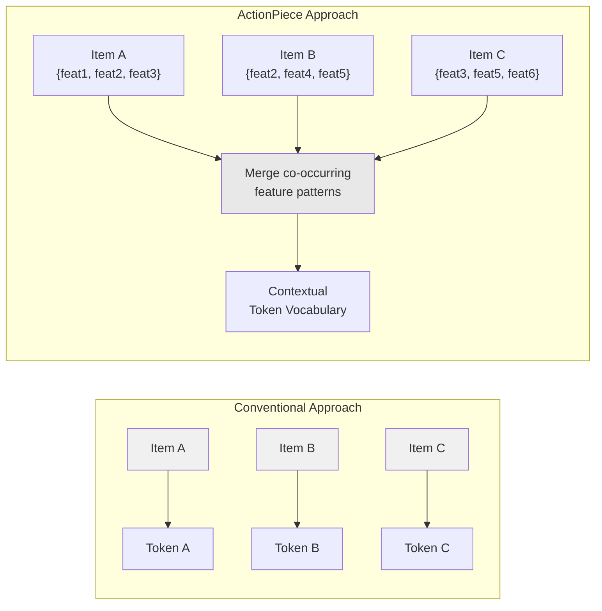
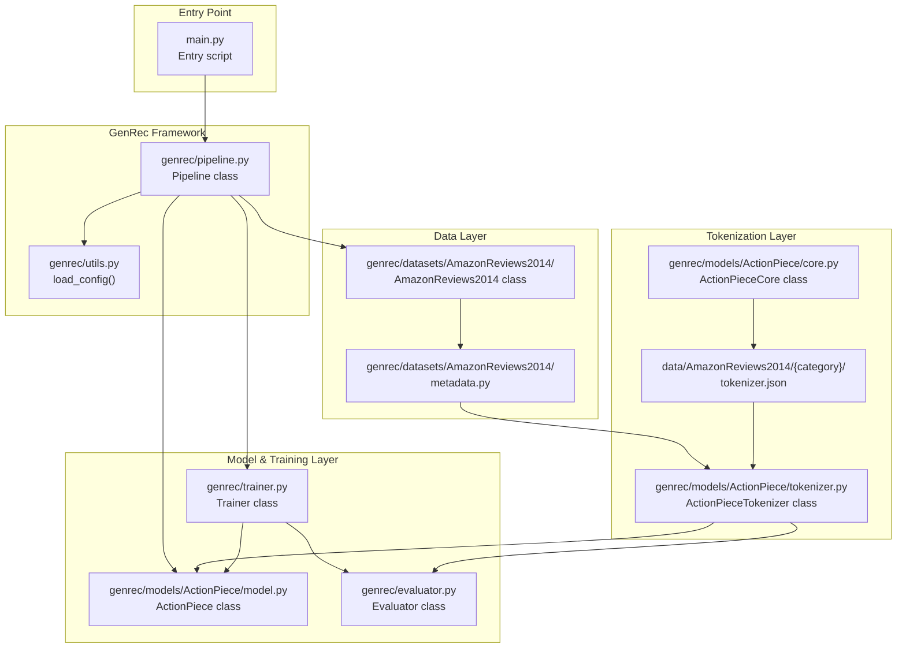
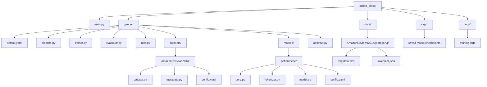
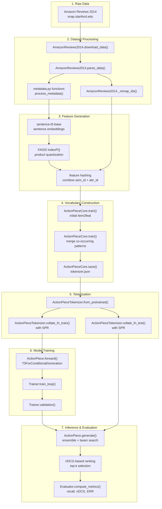

<!-- source: DeepWiki mcp.deepwiki.com · repo google-deepmind/action_piece · page 1 Overview · fetched 2026-10-26 -->

# Overview

<details>
<summary>Relevant source files</summary>

The following files were used as context for generating this wiki page:

- [README.md](README.md)

</details>


## Purpose and Scope

This page provides a high-level introduction to the ActionPiece system, explaining its purpose as a contextual action tokenization method for generative recommendation and summarizing the repository structure. For detailed installation and setup instructions, see [Getting Started](#2). For in-depth documentation of the core tokenization innovation, see [ActionPiece Tokenization System](#3).

**Sources:** [README.md:1-17]()

## What is ActionPiece?

ActionPiece is a contextual action tokenization method designed for generative recommendation systems. Unlike conventional generative recommendation (GR) models that tokenize each action independently, ActionPiece explicitly incorporates context into action sequence tokenization.

### Core Innovation

The key innovation is treating each action as a **set of item features** rather than a single atomic token. ActionPiece constructs a vocabulary by merging frequently co-occurring feature patterns in two ways:

1. **Within individual action sets** - Features that frequently appear together in the same item
2. **Across adjacent action sets** - Feature patterns that frequently appear in consecutive actions

This approach enables tokens to inherently capture contextual relationships between actions, rather than treating each action in isolation.



**Diagram: Conventional vs ActionPiece Tokenization Approach**

**Sources:** [README.md:3-16]()

## System Architecture

The ActionPiece system is organized into three primary layers, each implemented in specific Python modules and classes:



**Diagram: System Architecture with Code Entity Mapping**

**Sources:** [README.md:1-151](), Diagram 1 from system overview

## Key Components

The following table maps high-level system components to their concrete implementations in the codebase:

| Component | Implementation | Primary File | Purpose |
|-----------|---------------|--------------|---------|
| Entry Point | `main.py` | [main.py]() | Script entry point, initializes Pipeline |
| Orchestration | `Pipeline` class | [genrec/pipeline.py]() | Coordinates training/evaluation workflow |
| Configuration | `load_config()` function | [genrec/utils.py]() | Hierarchical YAML config merging |
| Dataset | `AmazonReviews2014` class | [genrec/datasets/AmazonReviews2014/dataset.py]() | Data loading, splitting, metadata processing |
| Feature Extraction | Metadata processing functions | [genrec/datasets/AmazonReviews2014/metadata.py]() | Sentence embeddings, FAISS indexing |
| Vocabulary Builder | `ActionPieceCore` class | [genrec/models/ActionPiece/core.py]() | BPE-like vocabulary construction via `train()` |
| Tokenizer | `ActionPieceTokenizer` class | [genrec/models/ActionPiece/tokenizer.py]() | Sequence segmentation, SPR implementation |
| Model | `ActionPiece` class | [genrec/models/ActionPiece/model.py]() | T5-based model, generation via `generate()` |
| Training | `Trainer` class | [genrec/trainer.py]() | Training loop, optimization, checkpointing |
| Evaluation | `Evaluator` class | [genrec/evaluator.py]() | Metrics calculation (recall, nDCG, ERR) |

For detailed API documentation of these classes, see [API Reference](#9).

**Sources:** [README.md:77-91](), Diagram 5 from system overview

## Repository Structure

The repository follows a modular package structure:



**Diagram: Repository Directory Structure**

### Key Directories

- **`genrec/`** - Main package containing the framework and implementations
  - `abstract.py` - Abstract base classes (`AbstractDataset`, `AbstractModel`, `AbstractTokenizer`)
  - `pipeline.py` - `Pipeline` class for orchestration
  - `trainer.py` / `evaluator.py` - Training and evaluation logic
  - `datasets/` - Dataset implementations
  - `models/` - Model implementations
- **`data/`** - Automatically downloaded datasets and cached tokenizers
- **`ckpt/`** - Saved model checkpoints from training
- **`logs/`** - Training logs and TensorBoard files

For more details on the framework architecture, see [GenRec Framework Architecture](#4).

**Sources:** [README.md:1-151](), Diagram 4 from system overview

## Data Flow

The following diagram traces data flow from raw Amazon reviews through the complete system pipeline to final evaluation metrics:



**Diagram: End-to-End Data Flow Through System Components**

### Processing Stages

1. **Raw Data** - Amazon Reviews 2014 dataset downloaded from snap.stanford.edu
2. **Dataset Processing** - Parse gzipped JSON, remap IDs, process metadata
3. **Feature Generation** - Extract sentence embeddings using `sentence-t5-base`, build FAISS index with product quantization, combine with attribute IDs via hashing
4. **Vocabulary Construction** - `ActionPieceCore.train()` builds vocabulary by merging co-occurring feature patterns, saved to `tokenizer.json`
5. **Tokenization** - `ActionPieceTokenizer` loads cached vocabulary, applies Set Permutation Regularization (SPR) during segmentation
6. **Model Training** - T5-based `ActionPiece` model trained with `Trainer` class using AdamW optimizer and cosine learning rate schedule
7. **Inference & Evaluation** - `ActionPiece.generate()` uses ensemble inference with beam search (50 beams), ranked by nDCG, evaluated with multiple metrics

For detailed documentation of each stage:
- Data processing: see [Data Processing Pipeline](#5)
- Tokenization: see [ActionPiece Tokenization System](#3)
- Model training: see [Training & Evaluation](#7)

**Sources:** [README.md:1-151](), Diagrams 2, 3, 4 from system overview

## Configuration System

ActionPiece uses a hierarchical YAML configuration system with four merge levels:

1. **Default configuration** - [genrec/default.yaml]() - Base parameters
2. **Dataset configuration** - [genrec/datasets/AmazonReviews2014/config.yaml]() - Dataset-specific settings
3. **Model configuration** - [genrec/models/ActionPiece/config.yaml]() - Model architecture and inference settings
4. **Command-line arguments** - Override any parameter via `--parameter=value`

Configuration parameters flow through the `load_config()` function in [genrec/utils.py](), which performs hierarchical merging. This design enables flexible experimentation while maintaining reproducibility.

Example command-line usage:

```bash
CUDA_VISIBLE_DEVICES=0 python main.py \
    --category=Sports_and_Outdoors \
    --rand_seed=2024 \
    --weight_decay=0.15 \
    --lr=0.005
```

For comprehensive configuration parameter documentation, see [Configuration Reference](#8).

**Sources:** [README.md:18-31](), [README.md:32-75]()

## Cached Tokenizer Structure

After the first run on each dataset, ActionPiece automatically constructs and caches the tokenizer vocabulary to `data/AmazonReviews2014/{category}/tokenizer.json`. The cached structure contains:

| Field | Type | Description |
|-------|------|-------------|
| `n_categories` | int | Number of feature categories (e.g., semantic ID, attributes) |
| `n_init_feats` | int | Number of initial features before merging |
| `token2feat` | list | Maps token IDs to their constituent features or merge operations |
| `priority` | list | Priority scores for each token used in segmentation |

The `token2feat` field uses two formats:
- `[a, b]` - Feature `b` from category `a`
- `[-1, u, v]` - Token `u` and token `v` merged into new token

This cached structure enables efficient vocabulary reuse across training runs. For details on vocabulary construction, see [Vocabulary Construction (ActionPieceCore)](#3.2). For the complete cached file format specification, see [Cached Tokenizer Structure](#3.4).

**Sources:** [README.md:92-115]()

## Getting Started

To run your first experiment with ActionPiece:

```bash
CUDA_VISIBLE_DEVICES=0 python main.py --category=Sports_and_Outdoors
```

The system will automatically:
1. Download the Amazon Reviews 2014 dataset for the specified category
2. Process metadata and extract features
3. Build and cache the ActionPiece vocabulary
4. Train the model
5. Evaluate on test data

For detailed installation instructions, see [Installation & Dependencies](#2.1). For step-by-step usage guide, see [Quick Start Guide](#2.2). To reproduce paper results, see [Reproducing Paper Results](#2.3).

**Sources:** [README.md:18-31]()

## Key Innovations

ActionPiece introduces two primary innovations in the generative recommendation space:

### 1. Contextual Tokenization via Feature Merging

Implemented in `ActionPieceCore.train()` ([genrec/models/ActionPiece/core.py]()), the vocabulary construction algorithm merges frequently co-occurring feature patterns using a BPE-like approach. This is fundamentally different from conventional approaches that treat each item as an independent token.

### 2. Set Permutation Regularization (SPR)

Implemented in:
- Training: `ActionPieceTokenizer.collate_fn_train()` ([genrec/models/ActionPiece/tokenizer.py:88-90]())
- Inference: `ActionPieceTokenizer.collate_fn_test()` and `ActionPiece.generate()` ([genrec/models/ActionPiece/model.py:90]())

SPR applies permutation augmentation during both training and inference to ensure the model learns robust contextual patterns regardless of feature ordering within action sets.

For comprehensive documentation of these innovations, see [ActionPiece Tokenization System](#3).

**Sources:** [README.md:3-16](), [README.md:77-91]()

## License and Citation

ActionPiece is released under the Apache 2.0 license for software and CC-BY 4.0 for other materials. This is not an official Google product.

When using ActionPiece, please cite:

```bibtex
@inproceedings{hou2025actionpiece,
  title={{ActionPiece}: Contextually Tokenizing Action Sequences for Generative Recommendation},
  author={Yupeng Hou and Jianmo Ni and Zhankui He and Noveen Sachdeva and Wang-Cheng Kang and Ed H. Chi and Julian McAuley and Derek Zhiyuan Cheng},
  booktitle={{ICML}},
  year={2025}
}
```

For complete license terms, see [License Information](#10.3).

**Sources:** [README.md:117-150]()

---

