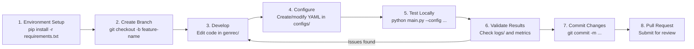
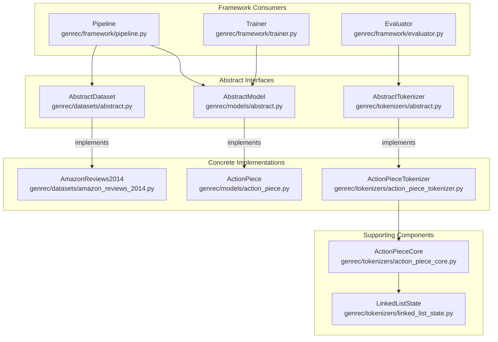
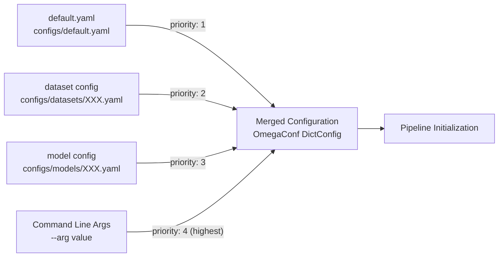
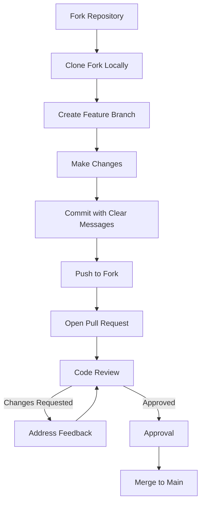

<!-- source: DeepWiki mcp.deepwiki.com · repo google-deepmind/action_piece · page 10 Development Guide · fetched 2026-10-26 -->

# Development Guide

Relevant source files

The following files were used as context for generating this wiki page:

- [.gitignore](.gitignore)
- [CONTRIBUTING.md](CONTRIBUTING.md)
- [LICENSE](LICENSE)

This document provides information for developers who want to contribute to or extend the ActionPiece system. It covers the repository structure, development workflow, extension points, and contribution guidelines.

For detailed API documentation of core classes, see [API Reference](#9). For installation and setup instructions, see [Installation & Dependencies](#2.1). For understanding the core ActionPiece innovation before extending it, see [ActionPiece Tokenization System](#3).

---

## Repository Organization

The ActionPiece codebase follows a modular architecture with clear separation between framework components, dataset implementations, tokenization logic, and model definitions. Understanding this structure is essential for effective development.

### Directory Structure

```mermaid
graph TD
    ROOT["Repository Root"]
    GENREC["genrec/"]
    CONFIGS["configs/"]
    CKPT["ckpt/"]
    DATA["data/"]
    LOGS["logs/"]
    
    ROOT --> GENREC
    ROOT --> CONFIGS
    ROOT --> CKPT
    ROOT --> DATA
    ROOT --> LOGS
    ROOT --> MAIN["main.py"]
    ROOT --> CONTRIB["CONTRIBUTING.md"]
    ROOT --> LICENSE["LICENSE"]
    ROOT --> README["README.md"]
    ROOT --> GITIGNORE[".gitignore"]
    
    GENREC --> DATASETS["datasets/"]
    GENREC --> MODELS["models/"]
    GENREC --> TOKENIZERS["tokenizers/"]
    GENREC --> FRAMEWORK["framework/"]
    GENREC --> UTILS["utils/"]
    
    DATASETS --> ABSTRACT_DS["abstract.py"]
    DATASETS --> AMAZON["amazon_reviews_2014.py"]
    
    MODELS --> ABSTRACT_M["abstract.py"]
    MODELS --> ACTION_M["action_piece.py"]
    
    TOKENIZERS --> ABSTRACT_T["abstract.py"]
    TOKENIZERS --> ACTION_T["action_piece_tokenizer.py"]
    TOKENIZERS --> CORE["action_piece_core.py"]
    TOKENIZERS --> LLIST["linked_list_state.py"]
    
    FRAMEWORK --> PIPELINE["pipeline.py"]
    FRAMEWORK --> TRAINER["trainer.py"]
    FRAMEWORK --> EVALUATOR["evaluator.py"]
    
    UTILS --> CONFIG_U["config.py"]
    UTILS --> LOGGING_U["logging.py"]
    UTILS --> INIT_U["init.py"]
    
    CONFIGS --> DEFAULT["default.yaml"]
    CONFIGS --> DATASET_C["datasets/"]
    CONFIGS --> MODEL_C["models/"]
```

**Sources:** [.gitignore:1-25](), [CONTRIBUTING.md:1-26](), [LICENSE:1-203]()

### Key Package Components

| Directory/File | Purpose |
|----------------|---------|
| `genrec/` | Main package containing all framework and implementation code |
| `genrec/datasets/` | Dataset implementations (abstract interface and concrete classes) |
| `genrec/models/` | Model implementations (abstract interface and concrete classes) |
| `genrec/tokenizers/` | Tokenization logic including ActionPieceCore and ActionPieceTokenizer |
| `genrec/framework/` | Core framework components (Pipeline, Trainer, Evaluator) |
| `genrec/utils/` | Utility functions for configuration, logging, and initialization |
| `configs/` | YAML configuration files organized by component type |
| `ckpt/` | Model checkpoints saved during training |
| `data/` | Downloaded and processed datasets |
| `logs/` | Training logs and TensorBoard events |
| `main.py` | Entry point for running experiments |

**Sources:** [.gitignore:1-25]()

---

## Development Workflow

The typical development workflow involves setting up the environment, making changes, running experiments to validate, and submitting contributions.

**Sources:** [CONTRIBUTING.md:1-26]()

### Prerequisites for Development

1. **Python Environment**: Python 3.8 or higher with dependencies from requirements.txt
2. **Git Setup**: Configured Git with access to GitHub
3. **CLA Signed**: Google Contributor License Agreement must be signed before first contribution
4. **Understanding**: Familiarity with the ActionPiece concept (see [Contextual Action Tokenization Concept](#3.1))

**Sources:** [CONTRIBUTING.md:3-13]()

---

## Extension Points and Abstract Interfaces

The ActionPiece system is designed for extensibility through abstract base classes. New datasets, models, and tokenizers can be added by implementing these interfaces.

### Abstract Class Architecture

**Sources:** [CONTRIBUTING.md:1-26]()

### Adding a New Dataset

To add a new dataset implementation:

1. **Create Implementation**: Create a new file in `genrec/datasets/` (e.g., `new_dataset.py`)
2. **Inherit AbstractDataset**: Implement all required methods including data loading, splitting, and feature extraction
3. **Add Configuration**: Create a YAML file in `configs/datasets/` with dataset-specific parameters
4. **Register Dataset**: Ensure the dataset class is importable and can be instantiated by the framework

**Required Methods:**
- `__init__()`: Initialize dataset with configuration
- `_load_data()`: Download and parse raw data
- `_split_data()`: Implement train/val/test splitting strategy
- `get_data()`: Return data splits as dictionaries
- `get_metadata()`: Return item metadata for feature extraction

For detailed interface documentation, see [AbstractDataset Interface](#5.1).

**Sources:** [CONTRIBUTING.md:1-26]()

### Adding a New Model

To add a new model implementation:

1. **Create Implementation**: Create a new file in `genrec/models/` (e.g., `new_model.py`)
2. **Inherit AbstractModel**: Implement forward pass and generation logic
3. **Add Configuration**: Create a YAML file in `configs/models/` with model architecture parameters
4. **Implement Generation**: Define how the model generates recommendations during inference

**Required Methods:**
- `__init__()`: Initialize model architecture with configuration
- `forward()`: Define forward pass for training
- `generate()`: Implement inference/generation logic

For detailed interface documentation, see [Abstract Base Classes](#4.2).

**Sources:** [CONTRIBUTING.md:1-26]()

### Adding a New Tokenizer

To add a new tokenizer implementation:

1. **Create Implementation**: Create a new file in `genrec/tokenizers/` (e.g., `new_tokenizer.py`)
2. **Inherit AbstractTokenizer**: Implement tokenization and collation logic
3. **Implement Core Logic**: Create vocabulary builder if needed (similar to ActionPieceCore)
4. **Define Collate Functions**: Implement `collate_fn_train`, `collate_fn_val`, and `collate_fn_test`

**Required Methods:**
- `__init__()`: Initialize tokenizer with configuration and vocabulary
- `tokenize()`: Convert action sequences to token IDs
- `collate_fn_train()`: Batch preparation for training with augmentation
- `collate_fn_val()`: Batch preparation for validation
- `collate_fn_test()`: Batch preparation for test/inference

For detailed interface documentation, see [ActionPieceTokenizer API](#9.2).

**Sources:** [CONTRIBUTING.md:1-26]()

---

## Configuration System Integration

When adding new components, proper integration with the configuration system is essential.

### Configuration Hierarchy

### Adding Configuration Parameters

1. **Default Values**: Add sensible defaults to `configs/default.yaml`
2. **Component-Specific**: Add component-specific values to appropriate config files
3. **Documentation**: Document parameters inline using YAML comments
4. **Validation**: Ensure parameters are validated in component `__init__` methods

For complete configuration reference, see [Configuration Reference](#8).

**Sources:** [CONTRIBUTING.md:1-26]()

---

## Testing and Validation

Before submitting changes, validate your implementation through local testing.

### Local Testing Checklist

| Test Type | Command | Expected Output |
|-----------|---------|-----------------|
| **Quick Run** | `python main.py --dataset AmazonReviews2014 --category Books --n_epochs 1` | Completes training for 1 epoch without errors |
| **Config Validation** | `python main.py --config configs/models/your_config.yaml --dry_run` | Prints merged configuration and exits |
| **Feature Extraction** | Check `data/AmazonReviews2014/XXX/` for generated files | Cached features and tokenizer JSON exist |
| **Model Checkpoints** | Check `ckpt/` directory | Model checkpoints saved with metrics |
| **Evaluation Metrics** | Check `logs/` or stdout | Metrics (recall@k, ndcg@k) are reasonable |

### Validation Best Practices

1. **Start Small**: Test with small dataset categories (e.g., Books) before large ones
2. **Check Logs**: Review `logs/` directory for errors or warnings
3. **Verify Caching**: Ensure preprocessed data is properly cached to avoid recomputation
4. **Compare Baselines**: If modifying existing components, compare metrics against baseline
5. **Document Changes**: Update relevant documentation pages for user-facing changes

**Sources:** [CONTRIBUTING.md:1-26]()

---

## Code Review Process

All contributions require code review via GitHub pull requests, even from project members.

### Pull Request Workflow

### Review Criteria

Pull requests are evaluated on:

1. **Correctness**: Code functions as intended without bugs
2. **Design**: Follows existing architecture patterns and abstract interfaces
3. **Readability**: Clear variable names, appropriate comments, consistent style
4. **Testing**: Changes are validated with local experiments
5. **Documentation**: User-facing changes include documentation updates
6. **CLA**: Contributor License Agreement is signed

For detailed guidelines, see [Contributing Guidelines](#10.1).

**Sources:** [CONTRIBUTING.md:14-20]()

---

## Ignored Files and Build Artifacts

The repository uses `.gitignore` to exclude generated files from version control.

### Commonly Ignored Patterns

| Pattern | Description |
|---------|-------------|
| `__pycache__/`, `*.pyc` | Python bytecode files |
| `data/` | Downloaded and processed datasets (too large for Git) |
| `ckpt/` | Model checkpoints (regenerated during training) |
| `logs/` | Training logs and TensorBoard events |
| `*.egg-info/` | Python package metadata |
| `build/`, `dist/` | Distribution artifacts |

**Important**: Do not commit large data files, model checkpoints, or cached features. These should be regenerated locally or stored in external storage.

**Sources:** [.gitignore:1-25]()

---

## Contributor License Agreement

Before your first contribution, you must sign Google's Contributor License Agreement (CLA).

### CLA Requirements

- **Individual Contributors**: Sign at https://cla.developers.google.com/
- **Corporate Contributors**: Your employer may need to sign on your behalf
- **One-Time Process**: CLA applies across all Google projects
- **Copyright Retention**: You retain copyright; CLA grants Google permission to use and redistribute

Once signed, you can contribute to this and other Google open-source projects without signing again.

For full details, see [Contributing Guidelines](#10.1).

**Sources:** [CONTRIBUTING.md:3-13]()

---

## Community Guidelines

This project follows Google's Open Source Community Guidelines, which promote:

1. **Respectful Communication**: Be considerate and constructive in discussions
2. **Inclusive Environment**: Welcome contributors of all backgrounds
3. **Collaborative Development**: Share knowledge and help others
4. **Quality Standards**: Maintain high code quality and documentation
5. **Transparency**: Open discussion of design decisions and tradeoffs

For complete guidelines, visit https://opensource.google/conduct/

**Sources:** [CONTRIBUTING.md:22-25]()

---

## License Information

The ActionPiece codebase is licensed under the Apache License 2.0.

### Key License Terms

| Aspect | Terms |
|--------|-------|
| **Usage** | Free to use, modify, and distribute |
| **Attribution** | Must retain copyright notices |
| **Modifications** | Must mark modified files |
| **Patent Grant** | Includes patent license from contributors |
| **Warranty** | Provided "as is" without warranties |
| **Liability** | Contributors not liable for damages |

### Applying the License

When contributing new files:

1. Include the Apache 2.0 license header
2. Update copyright year if applicable
3. Mark files as modified if changing existing files

For full license text and legal details, see [License Information](#10.3).

**Sources:** [LICENSE:1-203]()

---

## Additional Resources

### Related Documentation Pages

- **[Overview](#1)**: High-level system introduction
- **[Project Structure](#10.2)**: Detailed repository organization
- **[Contributing Guidelines](#10.1)**: Contribution process details
- **[License Information](#10.3)**: Complete license terms
- **[API Reference](#9)**: Technical API documentation
- **[Configuration Reference](#8)**: Complete configuration parameters

### External Resources

- **GitHub Repository**: https://github.com/google-deepmind/action_piece
- **Contributor License Agreement**: https://cla.developers.google.com/
- **Google Community Guidelines**: https://opensource.google/conduct/
- **GitHub Help on Pull Requests**: https://help.github.com/articles/about-pull-requests/

**Sources:** [CONTRIBUTING.md:1-26](), [LICENSE:1-203]()

---

