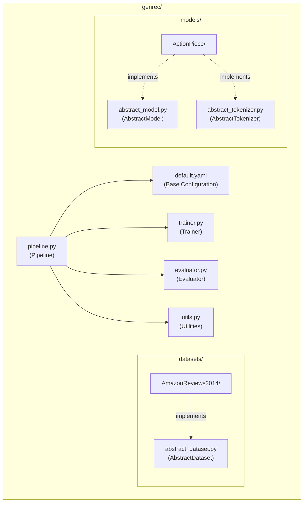
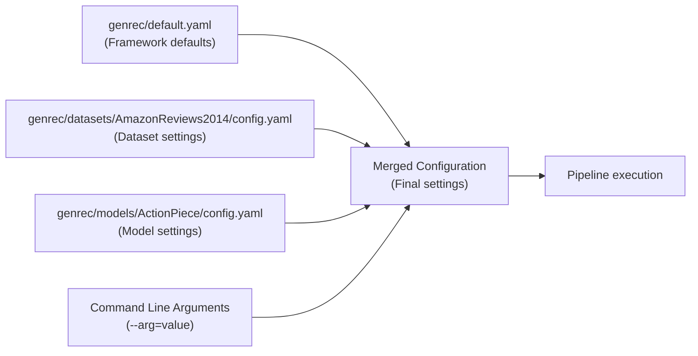
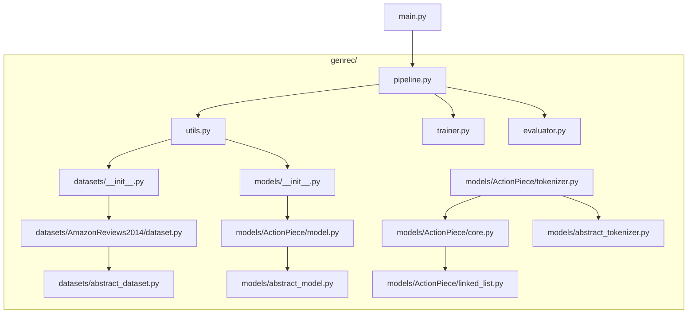

<!-- source: DeepWiki mcp.deepwiki.com · repo google-deepmind/action_piece · page 10.2 Project Structure · fetched 2026-10-26 -->

# Project Structure

<details>
<summary>Relevant source files</summary>

The following files were used as context for generating this wiki page:

- [README.md](README.md)
- [genrec/datasets/__init__.py](genrec/datasets/__init__.py)
- [genrec/models/__init__.py](genrec/models/__init__.py)

</details>


This page provides an overview of the ActionPiece repository organization, including the directory hierarchy, key files, and how components are organized within the `genrec/` package. For detailed information about specific components, see [GenRec Framework Architecture](#4), [ActionPiece Tokenization System](#3), and [Data Processing Pipeline](#5).

## Repository Overview

The ActionPiece repository follows a modular structure centered around the `genrec/` package, which implements a generalized recommendation framework. The ActionPiece-specific implementation is one concrete instantiation of this framework's abstract interfaces.

```
action_piece/
├── main.py                    # Entry point for training and evaluation
├── README.md                  # Repository documentation
├── genrec/                    # Core framework package
│   ├── default.yaml          # Default configuration settings
│   ├── pipeline.py           # Training/evaluation orchestration
│   ├── utils.py              # Utility functions
│   ├── trainer.py            # Training loop implementation
│   ├── evaluator.py          # Evaluation metrics
│   ├── datasets/             # Dataset implementations
│   └── models/               # Model implementations
├── ckpt/                     # Model checkpoints (created at runtime)
├── logs/                     # Training logs (created at runtime)
└── data/                     # Downloaded datasets (created at runtime)
```

**Sources:** [README.md:27-30](), [genrec/datasets/__init__.py](), [genrec/models/__init__.py]()

## Directory Structure

### Root Level Files

The repository root contains the main entry point and documentation:

| File | Purpose |
|------|---------|
| `main.py` | Command-line entry point that initializes the pipeline and starts training/evaluation |
| `README.md` | Primary documentation including quick start, reproduction commands, and code location guides |

**Sources:** [README.md:18-23](), [README.md:77-91]()

### genrec/ Package

The `genrec/` directory contains the core framework implementation. This package is designed as a modular system where abstract interfaces define contracts and concrete implementations provide functionality.



**Diagram: genrec/ Package Organization**

**Sources:** [genrec/datasets/__init__.py](), [genrec/models/__init__.py]()

#### Core Framework Files

| File | Key Components | Purpose |
|------|----------------|---------|
| `default.yaml` | Training hyperparameters, paths, evaluation settings | Provides default configuration values that can be overridden by dataset/model configs or CLI arguments |
| `pipeline.py` | `Pipeline` class | Orchestrates the complete training and evaluation workflow |
| `utils.py` | Configuration loading, device setup, component initialization | Provides utility functions used throughout the framework |
| `trainer.py` | `Trainer` class | Implements the training loop with AdamW optimizer and learning rate scheduling |
| `evaluator.py` | `Evaluator` class, metric calculation functions | Computes evaluation metrics including recall@k, ndcg@k, and err@k |

**Sources:** [README.md:27-30]()

### datasets/ Directory

The `datasets/` directory contains dataset implementations following the `AbstractDataset` interface:

```
genrec/datasets/
├── __init__.py              # Exports AmazonReviews2014
├── abstract_dataset.py      # AbstractDataset base class
└── AmazonReviews2014/
    ├── __init__.py
    ├── config.yaml          # Dataset-specific configuration
    ├── dataset.py           # AmazonReviews2014 implementation
    └── utils.py             # Download and parsing utilities
```

**Key Classes:**
- `AbstractDataset`: Base class defining the dataset interface with methods for data splitting, feature extraction, and sequence processing
- `AmazonReviews2014`: Concrete implementation for Amazon Reviews 2014 dataset with automatic downloading and metadata processing

**Sources:** [genrec/datasets/__init__.py:18](), [README.md:29]()

### models/ Directory

The `models/` directory contains model and tokenizer implementations following abstract interfaces:

```
genrec/models/
├── __init__.py              # Exports ActionPiece
├── abstract_model.py        # AbstractModel base class
├── abstract_tokenizer.py    # AbstractTokenizer base class
└── ActionPiece/
    ├── __init__.py
    ├── config.yaml          # Model-specific configuration
    ├── model.py             # ActionPiece T5-based model
    ├── tokenizer.py         # ActionPieceTokenizer
    ├── core.py              # ActionPieceCore (vocabulary construction)
    └── linked_list.py       # LinkedListState data structure
```

**Key Classes:**
- `AbstractModel`: Base class for generative recommendation models
- `AbstractTokenizer`: Base class for sequence tokenization
- `ActionPiece`: T5-based model implementation in [genrec/models/ActionPiece/model.py]()
- `ActionPieceTokenizer`: Tokenizer with SPR implementation in [genrec/models/ActionPiece/tokenizer.py]()
- `ActionPieceCore`: Vocabulary construction logic in [genrec/models/ActionPiece/core.py]()
- `LinkedListState`: Utility data structure for efficient token merging operations

**Sources:** [genrec/models/__init__.py:18](), [README.md:30](), [README.md:79-91]()

## Configuration Hierarchy

The system uses a three-level YAML configuration hierarchy that is merged at runtime:



**Diagram: Configuration Merge Hierarchy**

Each subsequent level can override parameters from previous levels, with CLI arguments having the highest priority. This design enables flexible experimentation while maintaining reproducible defaults.

| Configuration File | Scope | Example Parameters |
|-------------------|-------|-------------------|
| `genrec/default.yaml` | Framework-wide defaults | `batch_size`, `n_epochs`, `lr`, `weight_decay` |
| `genrec/datasets/AmazonReviews2014/config.yaml` | Dataset-specific settings | `category`, `metadata_mode`, `min_user_interactions` |
| `genrec/models/ActionPiece/config.yaml` | Model architecture settings | `d_model`, `n_layers`, `n_hash_buckets`, `n_inference_ensemble` |

**Sources:** [README.md:27-30]()

## Component Import Structure

The following diagram shows how Python modules import and depend on each other within the genrec package:



**Diagram: Module Import Dependencies**

**Sources:** [genrec/datasets/__init__.py:18](), [genrec/models/__init__.py:18]()

## Runtime Directory Creation

During execution, the system automatically creates the following directories for outputs:

| Directory | Purpose | Creation Trigger |
|-----------|---------|-----------------|
| `data/` | Downloaded and cached datasets | First run with `--category` argument |
| `ckpt/` | Model checkpoints and saved tokenizers | Training initialization |
| `logs/` | Training logs and TensorBoard events | Training initialization |

The cached tokenizer is saved at runtime to avoid redundant vocabulary construction. For example, after training on the Sports and Outdoors category, the tokenizer is cached at:
```
ckpt/AmazonReviews2014/Sports_and_Outdoors/ActionPiece/{hash}/tokenizer.json
```

**Sources:** [README.md:94-95]()

## Code Location Guide for Key Features

The README provides explicit pointers to where core algorithms are implemented:

| Feature | File Path | Function/Method |
|---------|-----------|-----------------|
| Vocabulary Construction | `genrec/models/ActionPiece/core.py` | `ActionPieceCore.train()` |
| SPR During Training | `genrec/models/ActionPiece/tokenizer.py` | `ActionPieceTokenizer.collate_fn_train()` |
| SPR During Inference (Tokenization) | `genrec/models/ActionPiece/tokenizer.py` | `ActionPieceTokenizer.collate_fn_test()` |
| SPR During Inference (Generation) | `genrec/models/ActionPiece/model.py` | `ActionPiece.generate()` |

**Sources:** [README.md:79-91]()

## Modular Design Pattern

The repository follows an extensible design where new components can be added by:

1. **Adding a new dataset:** Implement `AbstractDataset` in `genrec/datasets/NewDataset/dataset.py` and export it in `genrec/datasets/__init__.py`
2. **Adding a new model:** Implement `AbstractModel` in `genrec/models/NewModel/model.py` and export it in `genrec/models/__init__.py`
3. **Adding a new tokenizer:** Implement `AbstractTokenizer` alongside the model

This pattern allows the ActionPiece implementation to coexist with future model implementations without modification to the core framework.

**Sources:** [genrec/datasets/__init__.py](), [genrec/models/__init__.py]()

---

