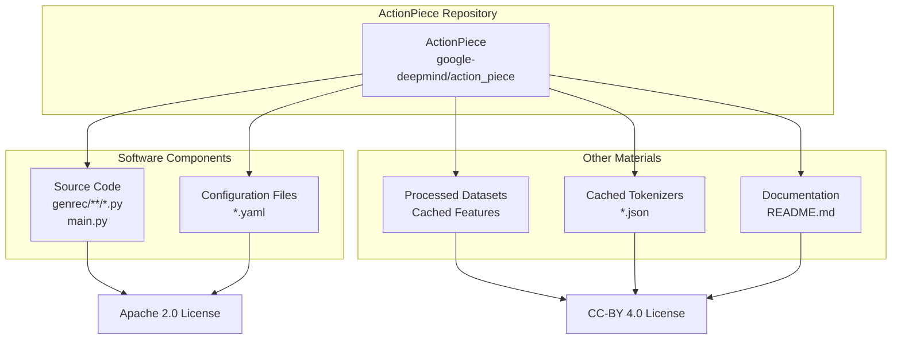
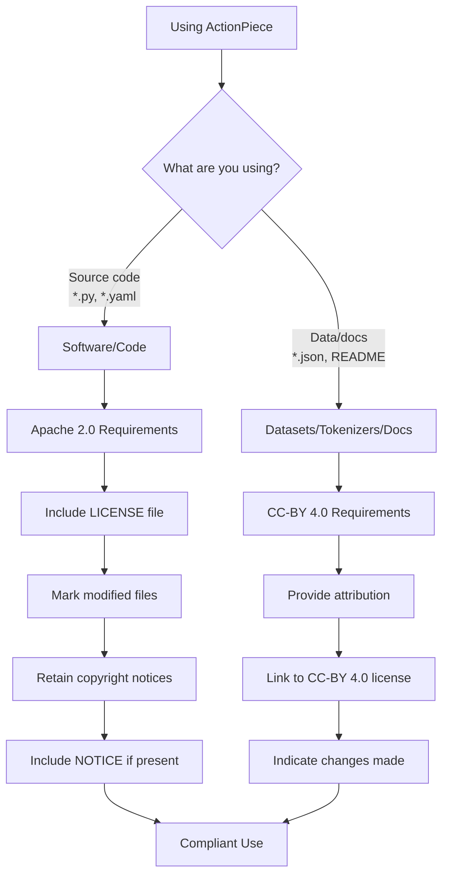

<!-- source: DeepWiki mcp.deepwiki.com · repo google-deepmind/action_piece · page 10.3 License Information · fetched 2026-10-26 -->

# License Information

<details>
<summary>Relevant source files</summary>

The following files were used as context for generating this wiki page:

- [LICENSE](LICENSE)
- [README.md](README.md)

</details>


This page documents the licensing terms and copyright information for the ActionPiece repository. The project uses a dual-licensing approach: software code is licensed under Apache License 2.0, while other materials (datasets, tokenizers, documentation) are licensed under Creative Commons Attribution 4.0 International (CC-BY 4.0).

For information about contributing code and the Contributor License Agreement (CLA), see [Contributing Guidelines](#10.1).

---

## Overview

The ActionPiece repository employs a dual-licensing structure to differentiate between executable software components and other intellectual property such as processed datasets, cached tokenizers, and documentation materials.

**Dual Licensing Structure**



Sources: [README.md:131-150]()

---

## License Coverage Summary

The following table summarizes which license applies to different components of the repository:

| Component Type | Examples | License | Permissions |
|---|---|---|---|
| **Software** | Python source code (`.py` files), configuration files (`.yaml`) | Apache 2.0 | Use, modify, distribute, sublicense, sell |
| **Datasets** | Processed Amazon Reviews data, cached features | CC-BY 4.0 | Use, modify, distribute with attribution |
| **Tokenizers** | Cached tokenizer vocabularies (`.json`) | CC-BY 4.0 | Use, modify, distribute with attribution |
| **Documentation** | README.md, wiki content, examples | CC-BY 4.0 | Use, modify, distribute with attribution |

Sources: [README.md:135-142]()

---

## Software License: Apache 2.0

All software in the repository is licensed under the Apache License, Version 2.0 (Apache 2.0). This includes:

- All Python source code in `genrec/` package
- Main entry point [`main.py`]()
- Configuration files (`*.yaml`)
- Build and deployment scripts

### Key Terms

The Apache 2.0 license grants:

1. **Copyright License**: Perpetual, worldwide, non-exclusive, no-charge, royalty-free, irrevocable copyright license to reproduce, prepare derivative works, publicly display, publicly perform, sublicense, and distribute the work ([LICENSE:67-72]())

2. **Patent License**: Perpetual, worldwide, non-exclusive, no-charge, royalty-free, irrevocable patent license to make, have made, use, offer to sell, sell, import, and otherwise transfer the work ([LICENSE:74-88]())

3. **Redistribution Rights**: Permission to reproduce and distribute copies with or without modifications, subject to specific conditions ([LICENSE:90-129]())

### Redistribution Requirements

When redistributing the work or derivative works, you must:

- Provide a copy of the Apache 2.0 license ([LICENSE:95-96]())
- Mark modified files with prominent notices ([LICENSE:98-99]())
- Retain all copyright, patent, trademark, and attribution notices ([LICENSE:101-105]())
- Include attribution notices from any NOTICE file, if present ([LICENSE:107-122]())

### License Location

The full Apache 2.0 license text is available at:
- **Repository**: [`LICENSE`]() file in the repository root
- **Online**: https://www.apache.org/licenses/LICENSE-2.0

Sources: [LICENSE:1-203](), [README.md:135-138]()

---

## Other Materials License: CC-BY 4.0

All materials that are not software are licensed under the Creative Commons Attribution 4.0 International License (CC-BY 4.0). This includes:

- Processed datasets derived from Amazon Reviews 2014
- Cached tokenizer vocabularies (e.g., stored in `ckpt/` directories)
- Documentation and examples
- Research artifacts and supplementary materials

### Key Terms

CC-BY 4.0 allows you to:

- **Share**: Copy and redistribute the material in any medium or format
- **Adapt**: Remix, transform, and build upon the material for any purpose, even commercially

**Under the following terms**:

- **Attribution**: You must give appropriate credit, provide a link to the license, and indicate if changes were made

### License Location

The full CC-BY 4.0 license text is available at:
- **Online**: https://creativecommons.org/licenses/by/4.0/legalcode

Sources: [README.md:140-142]()

---

## Copyright Information

**Copyright Holder**: Google LLC  
**Copyright Year**: 2025

The copyright statement appears in the README as:

```
Copyright 2025 Google LLC
```

This copyright applies to all original work created as part of the ActionPiece project, including both software and other materials.

Sources: [README.md:133]()

---

## Warranty Disclaimer and Limitations

Both licenses include important disclaimers:

### "AS IS" Basis

All software and materials are distributed on an **"AS IS" BASIS, WITHOUT WARRANTIES OR CONDITIONS OF ANY KIND**, either express or implied ([README.md:144-148]()). This includes, but is not limited to:

- No warranty of title
- No warranty of non-infringement  
- No warranty of merchantability
- No warranty of fitness for a particular purpose

Users are solely responsible for:
- Determining the appropriateness of using or redistributing the work
- Assuming all risks associated with exercising permissions under the licenses

### Limitation of Liability

The Apache 2.0 license limits contributor liability for damages, including direct, indirect, special, incidental, or consequential damages arising from use or inability to use the work ([LICENSE:154-164]()).

Sources: [LICENSE:144-152](), [LICENSE:154-164](), [README.md:144-148]()

---

## Official Product Status

The ActionPiece repository is **not an official Google product** ([README.md:150]()). This designation means:

- The project is released as a research artifact
- Google does not provide official product support
- The project is maintained as open-source research code
- Use in production environments is at the user's discretion

Sources: [README.md:150]()

---

## License Compliance Checklist

When using or redistributing ActionPiece code or materials:



Sources: [LICENSE:90-129](), [README.md:135-148]()

---

## File Locations in Repository

The licensing information is located in the following files:

| File | Location | Content |
|---|---|---|
| **LICENSE** | Repository root | Full Apache 2.0 license text |
| **README.md** | Repository root | License summary and disclaimer (lines 131-150) |
| **Source files** | Throughout `genrec/` | Apache 2.0 header comments (where applicable) |

### License Header Example

Source files may contain license headers. While not all files currently have headers, the standard Apache 2.0 header format is:

```python
# Copyright 2025 Google LLC
#
# Licensed under the Apache License, Version 2.0 (the "License");
# you may not use this file except in compliance with the License.
# You may obtain a copy of the License at
#
#     https://www.apache.org/licenses/LICENSE-2.0
#
# Unless required by applicable law or agreed to in writing, software
# distributed under the License is distributed on an "AS IS" BASIS,
# WITHOUT WARRANTIES OR CONDITIONS OF ANY KIND, either express or implied.
# See the License for the specific language governing permissions and
# limitations under the License.
```

Sources: [LICENSE:179-202](), [README.md:131-150]()

---

## Third-Party Dependencies

ActionPiece depends on several third-party libraries, each with their own licenses:

- **PyTorch**: BSD-style license
- **Transformers (Hugging Face)**: Apache 2.0
- **sentence-transformers**: Apache 2.0  
- **FAISS**: MIT License
- **Accelerate**: Apache 2.0

Users must comply with the licenses of these dependencies when using ActionPiece. For detailed dependency information, see [Installation & Dependencies](#2.1).

---

## Summary

The ActionPiece repository uses a clear dual-licensing structure:

1. **Software components** (code, scripts, configurations) are licensed under **Apache 2.0**
2. **Non-software materials** (datasets, tokenizers, documentation) are licensed under **CC-BY 4.0**
3. **Copyright** is held by Google LLC (2025)
4. All materials are provided **"AS IS"** without warranties
5. The project is **not an official Google product**

For questions about licensing or to report license compliance issues, please file an issue on the GitHub repository.

Sources: [README.md:131-150](), [LICENSE:1-203]()