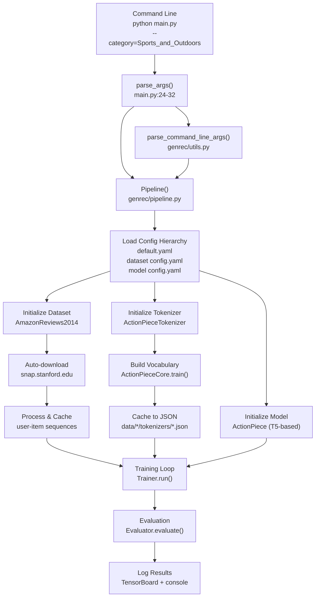
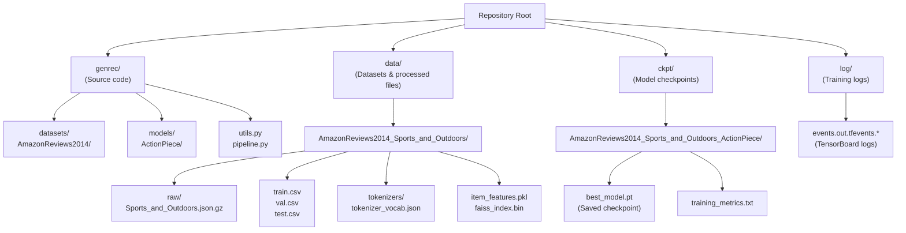

<!-- source: DeepWiki mcp.deepwiki.com · repo google-deepmind/action_piece · page 2 Getting Started · fetched 2026-10-26 -->

# Getting Started

<details>
<summary>Relevant source files</summary>

The following files were used as context for generating this wiki page:

- [README.md](README.md)
- [main.py](main.py)
- [requirements.txt](requirements.txt)

</details>


This page guides users through the initial setup and execution of the ActionPiece system for generative recommendation. It covers the prerequisites, system overview, and high-level workflow needed to run your first experiment. For detailed installation instructions, see [Installation & Dependencies](#2.1). For step-by-step usage instructions, see [Quick Start Guide](#2.2). For reproducing paper results, see [Reproducing Paper Results](#2.3).

## Overview

The ActionPiece system requires three main steps to get started:

1. **Installation**: Install Python dependencies listed in `requirements.txt`
2. **Configuration**: Understand the hierarchical configuration system (default → dataset → model → CLI)
3. **Execution**: Run `main.py` which automatically downloads datasets, builds tokenizers, trains models, and evaluates results

The system is designed to minimize manual setup—datasets download automatically, tokenizer vocabularies are cached after first construction, and all hyperparameters have sensible defaults.

Sources: [README.md:1-151](), [main.py:1-45]()

## Prerequisites

Before getting started, ensure your system meets the following requirements:

| Requirement | Details |
|------------|---------|
| Python Version | 3.8 or higher (tested with 3.10+) |
| GPU | CUDA-compatible GPU recommended (training runs on GPU if available) |
| Disk Space | ~5GB for datasets, models, and cached tokenizers per category |
| Memory | Minimum 16GB RAM recommended for dataset processing |
| Network | Internet connection for automatic dataset downloads |

Sources: [requirements.txt:1-10](), [README.md:18-30]()

## System Entry Point and Execution Flow

The following diagram shows how the `main.py` entry point orchestrates the system:



**Execution Flow Description**:

1. **Entry Point** ([main.py:35-44]()): Parses model/dataset names and command-line arguments
2. **Pipeline Initialization** ([genrec/pipeline.py]()): Creates `Pipeline` object with merged configuration
3. **Component Initialization**: 
   - Dataset downloads automatically if not present
   - Tokenizer vocabulary is built on first run, then cached
   - Model initializes with T5-based architecture
4. **Training & Evaluation**: Trainer executes training loop with early stopping, then evaluates on test set

Sources: [main.py:1-45](), [README.md:18-30]()

## Minimal Quick Start

The simplest way to start is with a single command:

```bash
CUDA_VISIBLE_DEVICES=0 python main.py --category=Sports_and_Outdoors
```

This command:
- Downloads the Sports and Outdoors dataset from Stanford SNAP (automatic)
- Builds the ActionPiece tokenizer vocabulary (~10-15 minutes on first run)
- Trains the model with default hyperparameters (~2-4 hours depending on GPU)
- Evaluates performance metrics (recall@k, ndcg@k, err@k)
- Saves best checkpoint to `ckpt/AmazonReviews2014_Sports_and_Outdoors_ActionPiece/`

Sources: [README.md:18-30]()

## Configuration Hierarchy

The system uses a four-level configuration merge strategy:

```mermaid
graph LR
    DEFAULT["default.yaml<br/>genrec/default.yaml<br/>(Base settings)"]
    DATASET["dataset config<br/>genrec/datasets/<br/>AmazonReviews2014/config.yaml<br/>(Dataset-specific)"]
    MODEL["model config<br/>genrec/models/<br/>ActionPiece/config.yaml<br/>(Model-specific)"]
    CLI["Command Line Args<br/>--category=...<br/>--rand_seed=...<br/>--lr=..."]
    
    MERGED["Merged Config<br/>(Priority: CLI > Model > Dataset > Default)"]
    
    DEFAULT --> MERGED
    DATASET --> MERGED
    MODEL --> MERGED
    CLI --> MERGED
```



**Configuration Priority** (highest to lowest):
1. Command-line arguments (e.g., `--lr=0.005`)
2. Model configuration (`genrec/models/ActionPiece/config.yaml`)
3. Dataset configuration (`genrec/datasets/AmazonReviews2014/config.yaml`)
4. Default configuration (`genrec/default.yaml`)

This design allows you to override any parameter without modifying configuration files. For comprehensive configuration reference, see [Configuration Reference](#8).

Sources: [README.md:27-30](), [main.py:24-44]()

## Directory Structure and Generated Artifacts

Understanding where the system stores data and outputs is essential:



**Key Directories**:

| Directory | Purpose | Generated When |
|-----------|---------|----------------|
| `data/AmazonReviews2014_<category>/raw/` | Raw downloaded dataset files | First run with `--category` |
| `data/AmazonReviews2014_<category>/tokenizers/` | Cached tokenizer vocabularies (JSON) | After vocabulary construction |
| `data/AmazonReviews2014_<category>/` | Processed train/val/test splits (CSV) | After dataset processing |
| `ckpt/AmazonReviews2014_<category>_ActionPiece/` | Model checkpoints and training logs | During training |
| `log/` | TensorBoard event files | During training |

**Important Cached Files**:
- **Tokenizer**: `data/AmazonReviews2014_<category>/tokenizers/tokenizer_vocab.json` - Contains `token2feat` and `priority` mappings (see [Cached Tokenizer Structure](#3.4))
- **Features**: `item_features.pkl`, `faiss_index.bin` - Pre-computed item embeddings and FAISS index
- **Best Model**: `ckpt/.../best_model.pt` - Checkpoint with best validation metric

Sources: [README.md:92-115]()

## First Run Behavior

On the first execution with a new dataset category, the system performs several one-time setup operations:

| Stage | Operation | Time Estimate | Cached For Subsequent Runs? |
|-------|-----------|---------------|----------------------------|
| 1. Dataset Download | Download from snap.stanford.edu | 1-3 minutes | ✓ Yes |
| 2. Data Processing | Parse, remap IDs, split train/val/test | 2-5 minutes | ✓ Yes |
| 3. Feature Extraction | Generate sentence embeddings, build FAISS index | 5-10 minutes | ✓ Yes |
| 4. Vocabulary Construction | Build ActionPiece vocabulary via pattern merging | 10-20 minutes | ✓ Yes |
| 5. Model Training | Train with default hyperparameters | 2-4 hours | ✗ No (retrains each run) |

**Progress Tracking**: The system outputs detailed progress logs to console. Training progress is also logged to TensorBoard (viewable via `tensorboard --logdir=log/`).

Sources: [README.md:25-30](), [README.md:92-115]()

## Common Parameters

While all parameters have defaults, these are frequently overridden:

| Parameter | Description | Default | Example Override |
|-----------|-------------|---------|------------------|
| `--category` | Dataset category | None (required) | `--category=Beauty` |
| `--rand_seed` | Random seed for reproducibility | 2024 | `--rand_seed=2025` |
| `--lr` | Learning rate | 0.001 | `--lr=0.005` |
| `--weight_decay` | L2 regularization | 0.1 | `--weight_decay=0.15` |
| `--n_hash_buckets` | Feature hashing buckets | 128 | `--n_hash_buckets=256` |
| `--d_model` | Model hidden dimension | 512 | `--d_model=256` |
| `--num_epochs` | Maximum training epochs | 300 | `--num_epochs=500` |

For complete parameter reference, see [Default Configuration](#8.1), [Dataset Configuration](#8.2), and [Model Configuration](#8.3).

Sources: [README.md:27-30](), [README.md:38-75]()

## Typical Output

During execution, you will see output similar to:

```
Loading configuration from genrec/default.yaml...
Loading dataset configuration from genrec/datasets/AmazonReviews2014/config.yaml...
Loading model configuration from genrec/models/ActionPiece/config.yaml...
Downloading dataset: Sports_and_Outdoors.json.gz...
Processing dataset: remapping user/item IDs...
Building FAISS index for semantic similarity...
Constructing ActionPiece vocabulary...
  Initial features: 1153
  Vocabulary size after merging: 31547
Training model...
Epoch 1/300: loss=3.245, val_ndcg@10=0.0123
Epoch 2/300: loss=2.891, val_ndcg@10=0.0145
...
Best checkpoint saved to ckpt/.../best_model.pt
Evaluation Results:
  recall@10=0.0543, ndcg@10=0.0312, err@10=0.0156
```

Sources: [README.md:18-30]()

## Next Steps

After completing initial setup:

1. **Run your first experiment**: Follow [Quick Start Guide](#2.2) for detailed command examples
2. **Reproduce paper results**: See [Reproducing Paper Results](#2.3) for exact hyperparameters
3. **Understand tokenization**: Read [ActionPiece Tokenization System](#3) to learn about the core innovation
4. **Customize configuration**: Explore [Configuration Reference](#8) for all available parameters
5. **Modify the model**: See [Development Guide](#10) for extending the system

Sources: [README.md:1-151]()

---

