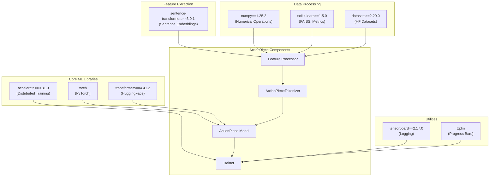
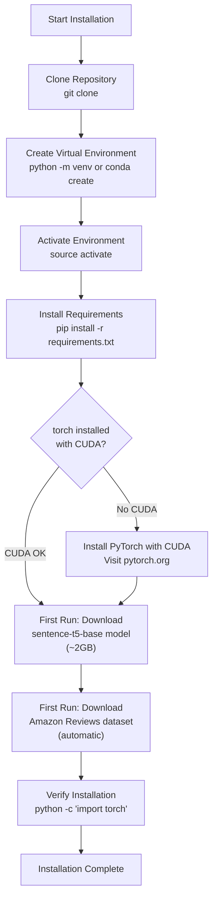
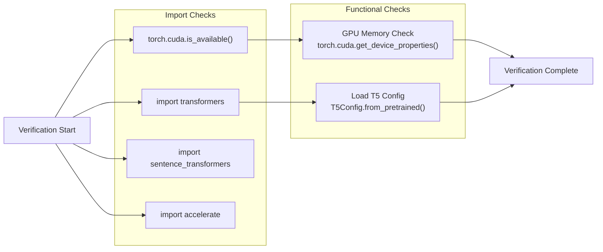

<!-- source: DeepWiki mcp.deepwiki.com · repo google-deepmind/action_piece · page 2.1 Installation & Dependencies · fetched 2026-10-26 -->

# Installation & Dependencies

<details>
<summary>Relevant source files</summary>

The following files were used as context for generating this wiki page:

- [README.md](README.md)
- [requirements.txt](requirements.txt)

</details>


This document details the required dependencies and installation process for the ActionPiece system. It covers system requirements, Python package dependencies, and verification steps needed to run experiments.

For running your first experiment after installation, see [Quick Start Guide](#2.2). For reproducing specific paper results with exact hyperparameters, see [Reproducing Paper Results](#2.3).

## Purpose and Scope

This page provides:
- System and hardware requirements
- Complete list of Python dependencies with their purposes
- Step-by-step installation instructions
- Verification procedures to ensure correct setup

## System Requirements

### Hardware Requirements

The ActionPiece system is designed to run on GPU-accelerated hardware:

| Requirement | Specification | Notes |
|-------------|--------------|-------|
| **GPU** | CUDA-compatible GPU | Required for training and inference |
| **VRAM** | 8GB+ recommended | Depends on model size and batch size |
| **CPU** | Multi-core processor | Used for data preprocessing |
| **RAM** | 16GB+ recommended | Feature extraction and dataset processing |
| **Storage** | 10GB+ free space | For datasets, models, and cached tokenizers |

**Sources:** [README.md:21-23]()

### Software Requirements

| Component | Version | Notes |
|-----------|---------|-------|
| **Python** | 3.8+ | Tested with Python 3.8-3.10 |
| **CUDA** | 11.0+ | For GPU acceleration |
| **Operating System** | Linux/macOS | Windows may require adjustments |

## Python Dependencies

The system relies on several key Python packages, each serving specific purposes within the architecture:



**Dependency Graph: Python Packages and Component Usage**

**Sources:** [requirements.txt:1-10]()

### Dependency Details

| Package | Version | Purpose in ActionPiece |
|---------|---------|------------------------|
| `numpy` | 1.25.2 | Numerical operations for feature vectors and matrix operations |
| `scikit-learn` | 1.5.0 | FAISS indexing support, PCA dimensionality reduction, evaluation metrics |
| `torch` | latest | Core deep learning framework for model training and inference |
| `transformers` | 4.41.2 | T5-based model architecture (`T5ForConditionalGeneration`) |
| `tqdm` | latest | Progress bars for training loops and data processing |
| `sentence-transformers` | 3.0.1 | Pre-trained sentence-t5-base model for semantic feature extraction |
| `datasets` | 2.20.0 | HuggingFace datasets library for data loading utilities |
| `accelerate` | 0.31.0 | Distributed training support and mixed precision training |
| `tensorboard` | 2.17.0 | Training metrics logging and visualization |

**Sources:** [requirements.txt:1-10]()

## Installation Process

### Step 1: Clone Repository

```bash
git clone https://github.com/google-deepmind/action_piece.git
cd action_piece
```

### Step 2: Create Virtual Environment (Recommended)

```bash
# Using venv
python -m venv actionpiece_env
source actionpiece_env/bin/activate  # On Windows: actionpiece_env\Scripts\activate

# Or using conda
conda create -n actionpiece python=3.9
conda activate actionpiece
```

### Step 3: Install Dependencies

```bash
pip install -r requirements.txt
```

This command installs all packages listed in `requirements.txt` with their specified versions.

**Sources:** [requirements.txt:1-10]()

### Installation Workflow



**Installation Workflow with First-Run Downloads**

**Sources:** [README.md:20-26](), [requirements.txt:1-10]()

## First-Run Downloads

On the first execution, the system automatically downloads required resources:

### Sentence Transformer Model

The `sentence-transformers` library downloads the `sentence-t5-base` model (~2GB) during first use for semantic feature extraction. This is cached locally.

### Dataset Downloads

When a `--category` argument is specified, the system automatically downloads the corresponding Amazon Reviews 2014 dataset from `snap.stanford.edu`. For example:

```bash
CUDA_VISIBLE_DEVICES=0 python main.py --category=Sports_and_Outdoors
```

This automatic download process is handled by the `AmazonReviews2014` dataset class.

**Sources:** [README.md:26-27]()

## Verification

### Basic Verification

Verify the installation by checking key dependencies:

```bash
# Check PyTorch installation and CUDA availability
python -c "import torch; print(f'PyTorch: {torch.__version__}'); print(f'CUDA available: {torch.cuda.is_available()}')"

# Check Transformers
python -c "import transformers; print(f'Transformers: {transformers.__version__}')"

# Check sentence-transformers
python -c "import sentence_transformers; print(f'Sentence-Transformers: {sentence_transformers.__version__}')"
```

Expected output should show:
- PyTorch version
- CUDA availability: `True` (if GPU is present)
- Transformers version: 4.41.2
- Sentence-Transformers version: 3.0.1

### Component Verification



**Verification Process: Checking Critical Dependencies**

**Sources:** [requirements.txt:3-8]()

### Running Test Command

The simplest verification is to run a quick training command:

```bash
CUDA_VISIBLE_DEVICES=0 python main.py --category=Sports_and_Outdoors --max_steps=10
```

This command:
1. Downloads the Sports_and_Outdoors dataset (first run only)
2. Constructs or loads cached tokenizer
3. Initializes the ActionPiece model
4. Runs 10 training steps
5. Terminates early

If this completes without errors, the installation is successful.

**Sources:** [README.md:20-23]()

## Common Issues and Solutions

### CUDA Not Available

**Issue:** `torch.cuda.is_available()` returns `False`

**Solutions:**
- Reinstall PyTorch with CUDA support: Visit [pytorch.org](https://pytorch.org) and select appropriate CUDA version
- Verify NVIDIA drivers are installed: `nvidia-smi`
- Check CUDA toolkit version matches PyTorch requirements

### Version Conflicts

**Issue:** Package version conflicts during installation

**Solutions:**
- Use a fresh virtual environment
- Install packages in the order specified in `requirements.txt`
- For `torch`, install it separately first, then install remaining packages

### Out of Memory Errors

**Issue:** CUDA out of memory during first run

**Solutions:**
- Reduce batch size: `--batch_size=32` (default may be higher)
- Use gradient accumulation: `--accumulate_grad_batches=2`
- Reduce model size: `--d_model=256 --d_ff=2048`

## Directory Structure After Installation

After installation and first run, the directory structure includes:

```
action_piece/
├── genrec/                    # Main package
│   ├── datasets/             # Dataset implementations
│   ├── models/               # Model implementations
│   ├── default.yaml          # Default configuration
│   └── utils/                # Utility functions
├── requirements.txt          # Dependencies
├── main.py                   # Entry point
├── data/                     # Created on first run
│   └── AmazonReviews2014/   # Downloaded datasets
├── tokenizer/                # Created on first run
│   └── *.json               # Cached tokenizers
└── ckpt/                     # Created during training
    └── */                    # Model checkpoints
```

**Sources:** [README.md:1-151]()

## Next Steps

After successful installation:
1. See [Quick Start Guide](#2.2) to run your first experiment
2. See [Reproducing Paper Results](#2.3) for exact hyperparameters from the paper
3. See [Configuration System](#4.3) to understand available configuration options

## Configuration Files Reference

While not part of installation, understanding the configuration hierarchy helps with setup:

| Configuration File | Purpose | Override Priority |
|-------------------|---------|------------------|
| `genrec/default.yaml` | System-wide defaults | Lowest (1) |
| `genrec/datasets/AmazonReviews2014/config.yaml` | Dataset-specific settings | Medium (2) |
| `genrec/models/ActionPiece/config.yaml` | Model-specific settings | High (3) |
| Command-line arguments | Runtime overrides | Highest (4) |

Configuration files are automatically loaded and merged. Command-line arguments always take precedence.

**Sources:** [README.md:27-30]()

---

