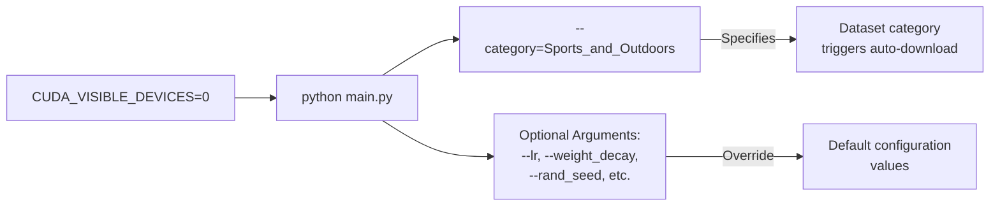
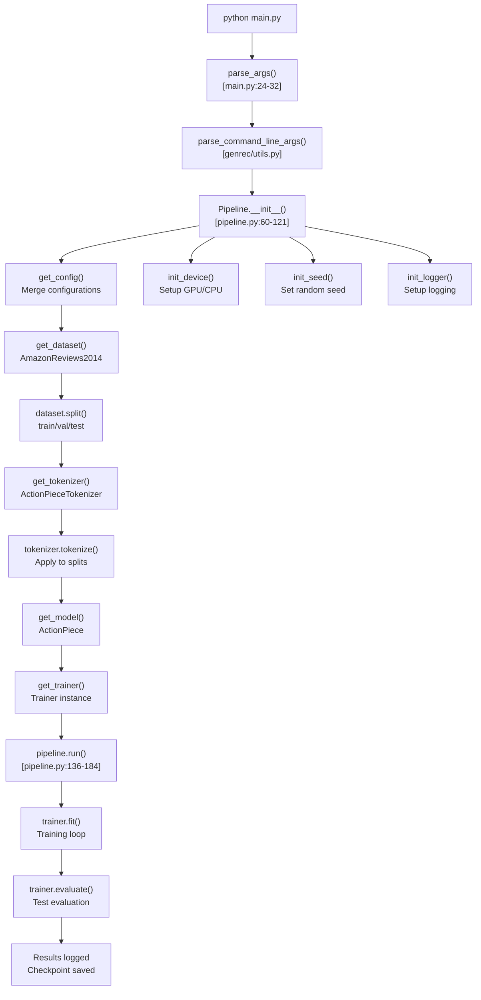
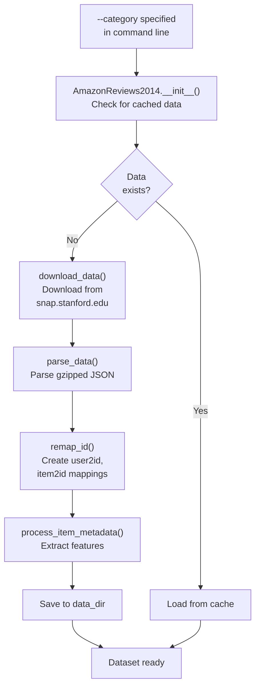
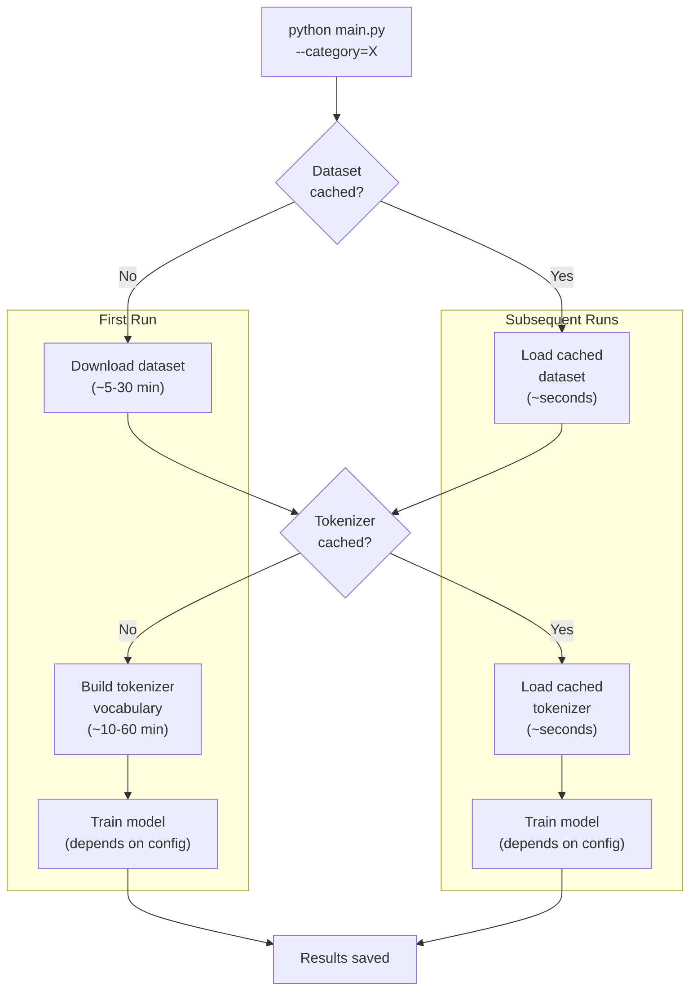

<!-- source: DeepWiki mcp.deepwiki.com · repo google-deepmind/action_piece · page 2.2 Quick Start Guide · fetched 2026-10-26 -->

# Quick Start Guide

<details>
<summary>Relevant source files</summary>

The following files were used as context for generating this wiki page:

- [README.md](README.md)
- [genrec/pipeline.py](genrec/pipeline.py)
- [main.py](main.py)

</details>


## Purpose and Scope

This page provides a step-by-step guide to running your first experiments with ActionPiece. It covers the basic command-line usage, explains what happens during execution, and describes how the system automatically handles dataset downloads and caching. For detailed installation instructions and dependency management, see [Installation & Dependencies](#2.1). For reproducing specific paper results with exact hyperparameters, see [Reproducing Paper Results](#2.3).

## Basic Command

The simplest way to run an ActionPiece experiment is:

```bash
CUDA_VISIBLE_DEVICES=0 python main.py --category=Sports_and_Outdoors
```

This command will:
1. Automatically download the Sports_and_Outdoors dataset from Amazon Reviews 2014
2. Build the ActionPiece tokenizer vocabulary (cached for future runs)
3. Train the model using default hyperparameters
4. Evaluate on validation and test sets
5. Save results and checkpoints to the configured directories

**Sources:** [README.md:18-23](), [main.py:35-44]()

## Command Structure Breakdown



**Components:**
- **Environment Variable**: `CUDA_VISIBLE_DEVICES=0` specifies which GPU to use
- **Entry Point**: `python main.py` executes the main script at [main.py:35-44]()
- **Required Argument**: `--category` specifies the Amazon Reviews 2014 dataset category
- **Optional Arguments**: Any parameter from the configuration hierarchy can be overridden

**Sources:** [main.py:24-32](), [README.md:18-30]()

## Configuration Hierarchy

ActionPiece uses a hierarchical configuration system where settings are merged in priority order:

| Priority | Source | Location | Description |
|----------|--------|----------|-------------|
| 1 (Highest) | Command Line Args | `--arg=value` | Runtime overrides |
| 2 | Model Config | `genrec/models/ActionPiece/config.yaml` | Model-specific settings |
| 3 | Dataset Config | `genrec/datasets/AmazonReviews2014/config.yaml` | Dataset-specific settings |
| 4 (Lowest) | Default Config | `genrec/default.yaml` | Framework defaults |

Command-line arguments override all configuration files. The merging happens in [genrec/utils.py]() via the `get_config()` function called by [genrec/pipeline.py:69-74]().

**Sources:** [README.md:27-30](), [genrec/pipeline.py:69-74]()

## Execution Flow: From Command to Results



**Sources:** [main.py:35-44](), [genrec/pipeline.py:60-121](), [genrec/pipeline.py:136-184]()

## Step-by-Step Execution Breakdown

### Phase 1: Initialization ([main.py:35-37]())

The `parse_args()` function at [main.py:24-32]() extracts two primary arguments:
- `--model` (default: `'ActionPiece'`)
- `--dataset` (default: `'AmazonReviews2014'`)

All other arguments are collected as unparsed and converted to a configuration dictionary via `parse_command_line_args()`.

### Phase 2: Pipeline Setup ([genrec/pipeline.py:60-121]())

The `Pipeline.__init__()` method orchestrates component initialization:

1. **Configuration Merging** ([pipeline.py:69-74]()):
   - Calls `utils.get_config()` to merge default, dataset, model, and command-line configurations
   - Automatically sets `device` and `use_ddp` via `utils.init_device()` at [pipeline.py:76]()

2. **Accelerator Initialization** ([pipeline.py:79-81]()):
   - Creates `accelerate.Accelerator` instance for distributed training support
   - Configures TensorBoard logging with `project_dir` property at [pipeline.py:122-129]()

3. **Seed and Logger Setup** ([pipeline.py:84-87]()):
   - Sets random seed for reproducibility via `utils.init_seed()`
   - Initializes Python logger via `utils.init_logger()`

4. **Dataset Loading** ([pipeline.py:90-92]()):
   - Instantiates dataset class using `utils.get_dataset(dataset_name)()` 
   - For `AmazonReviews2014`, triggers automatic download if not cached
   - Calls `dataset.split()` to create train/val/test splits using leave-one-out strategy

5. **Tokenizer Creation** ([pipeline.py:95-104]()):
   - Instantiates `ActionPieceTokenizer` using `utils.get_tokenizer(model_name)()`
   - Calls `tokenizer.tokenize(split_datasets)` to apply tokenization to all splits
   - **Important**: First run builds and caches the vocabulary; subsequent runs load from cache

6. **Model Initialization** ([pipeline.py:107-112]()):
   - Instantiates `ActionPiece` model using `utils.get_model(model_name)()`
   - Uses `accelerator.main_process_first()` context to prevent race conditions in distributed training
   - Logs model architecture and parameter count

7. **Trainer Setup** ([pipeline.py:115-120]()):
   - Instantiates `Trainer` using `utils.get_trainer(model_name)()`
   - Configures optimizer, learning rate scheduler, and evaluation metrics

### Phase 3: Training and Evaluation ([genrec/pipeline.py:136-184]())

The `Pipeline.run()` method executes the training loop:

1. **DataLoader Creation** ([pipeline.py:143-162]()):
   - Creates separate `DataLoader` instances for train, validation, and test splits
   - Uses tokenizer's `collate_fn` dictionary for split-specific batching
   - Adjusts batch size for ensemble inference mode

2. **Training** ([pipeline.py:164]()):
   - Calls `trainer.fit(train_dataloader, val_dataloader)`
   - Performs gradient updates with early stopping based on validation metrics
   - Saves best model checkpoint

3. **Test Evaluation** ([pipeline.py:166-177]()):
   - Loads best checkpoint from `trainer.saved_model_ckpt`
   - Evaluates on test set via `trainer.evaluate(test_dataloader)`
   - Logs metrics to TensorBoard and console

**Sources:** [genrec/pipeline.py:60-121](), [genrec/pipeline.py:136-184]()

## Automatic Dataset Downloads



When you specify `--category=Sports_and_Outdoors`, the system:

1. **Checks Cache**: Looks for processed data in `config['data_dir']` (typically `./data/`)
2. **Downloads if Missing**: Automatically downloads from `http://snap.stanford.edu/data/amazon/productGraph/categoryFiles/`
3. **Parses Data**: Extracts user-item interactions from gzipped JSON files
4. **Remaps IDs**: Creates contiguous integer mappings for users and items
5. **Processes Metadata**: Extracts item features (categories, descriptions, titles)
6. **Caches Results**: Saves processed files for future runs

**Available Categories:**
- Sports_and_Outdoors
- Beauty
- CDs_and_Vinyl
- (Any Amazon Reviews 2014 category with sufficient data)

**Sources:** [README.md:26](), [genrec/datasets/AmazonReviews2014/]()

## Common Command Variations

### Specify Random Seed for Reproducibility
```bash
python main.py --category=Sports_and_Outdoors --rand_seed=2024
```

### Adjust Hyperparameters
```bash
python main.py --category=Beauty \
    --lr=0.001 \
    --weight_decay=0.15 \
    --n_hash_buckets=64
```

### Use Different Model Dimensions
```bash
python main.py --category=CDs_and_Vinyl \
    --d_model=256 \
    --d_ff=2048 \
    --n_hash_buckets=256
```

### Specify Output Directories
```bash
python main.py --category=Sports_and_Outdoors \
    --data_dir=./my_data/ \
    --ckpt_dir=./my_checkpoints/ \
    --tensorboard_log_dir=./my_logs/
```

**Sources:** [README.md:38-75]()

## Output and Artifacts

### Directory Structure

| Path | Contents | Created When |
|------|----------|--------------|
| `data/` | Raw and processed datasets | First run with `--category` |
| `ckpt/` | Model checkpoints | During training |
| `tensorboard_log/` | TensorBoard logs | During training |
| `log/` | Text logs | At startup |

### Generated Files

**Dataset Files** (in `data/AmazonReviews2014/{category}/`):
- `reviews_{category}.json.gz` - Raw downloaded reviews
- `metadata_{category}.json.gz` - Raw item metadata
- `{category}.pkl` - Processed dataset cache

**Tokenizer Cache** (in `data/AmazonReviews2014/{category}/`):
- `tokenizer_{hash}.json` - Cached vocabulary (see structure at [README.md:92-115]())

**Model Checkpoints** (in `ckpt/{dataset}/{model}/`):
- `{timestamp}_best.pth` - Best model weights
- Checkpoint includes model state_dict only

**TensorBoard Logs** (in `tensorboard_log/{dataset}/{model}/`):
- Training loss curves
- Validation metrics (recall@k, ndcg@k)
- Test metrics (logged at end)

**Sources:** [genrec/pipeline.py:122-129](), [README.md:92-115]()

## First Run vs. Subsequent Runs



**Time Estimates for Sports_and_Outdoors on Single GPU:**
- **First Run**: ~45-90 minutes (dataset download + tokenizer construction + training)
- **Subsequent Runs**: ~30-60 minutes (training only)

The tokenizer vocabulary is deterministically cached based on:
- Dataset contents
- `n_init_feats` parameter
- `n_hash_buckets` parameter  
- `item_metadata` mode

Changing these parameters will trigger vocabulary reconstruction.

**Sources:** [README.md:94-95](), [genrec/models/ActionPiece/tokenizer.py]()

## Monitoring Progress

### Console Output
The system logs to both console and file. Example output:
```
Device: cuda:0
AmazonReviews2014 Dataset Statistics:
  - Users: 35598
  - Items: 18357
  - Interactions: 296337
ActionPiece Model (12345678 parameters)
Training: 100%|██████████| 1234/1234 [10:23<00:00, 1.98it/s]
Validation ndcg@10: 0.1234
Best model saved to ckpt/.../model_best.pth
Test Results: {'recall@10': 0.0789, 'ndcg@10': 0.1234, ...}
```

### TensorBoard Visualization
Launch TensorBoard to view live training metrics:
```bash
tensorboard --logdir=tensorboard_log/AmazonReviews2014/ActionPiece/
```

Tracked metrics include:
- `Train/loss` - Training loss per step
- `Val_Metric/recall@k` - Validation recall
- `Val_Metric/ndcg@k` - Validation nDCG
- `Test_Metric/*` - Final test metrics

**Sources:** [genrec/pipeline.py:79-81](), [genrec/pipeline.py:186-189]()

## Next Steps

After running your first experiment:
- To reproduce exact paper results with tuned hyperparameters, see [Reproducing Paper Results](#2.3)
- To understand the ActionPiece tokenization mechanism, see [ActionPiece Tokenization System](#3)
- To customize the configuration, see [Configuration Reference](#8)
- To understand the model architecture, see [ActionPiece Model Architecture](#6)

---

