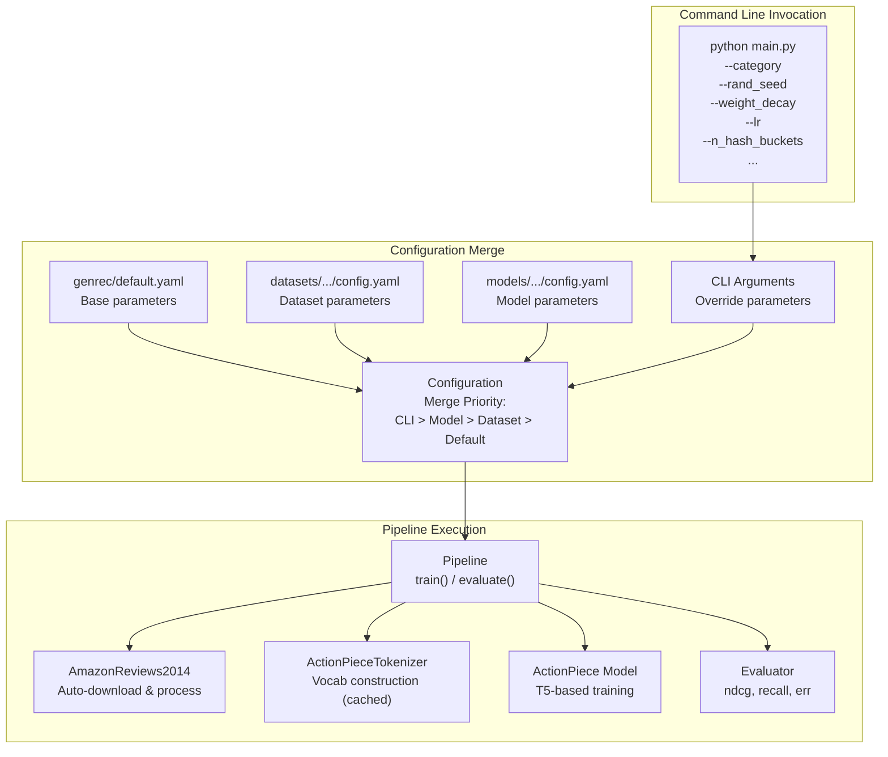
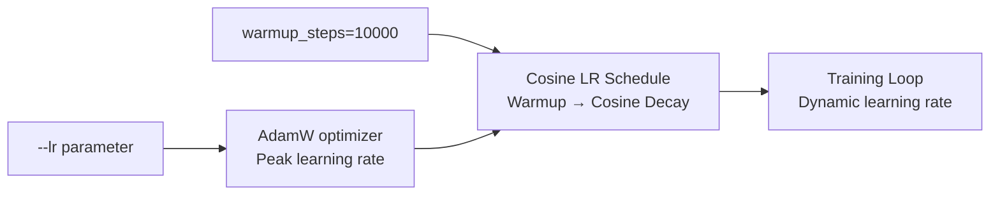
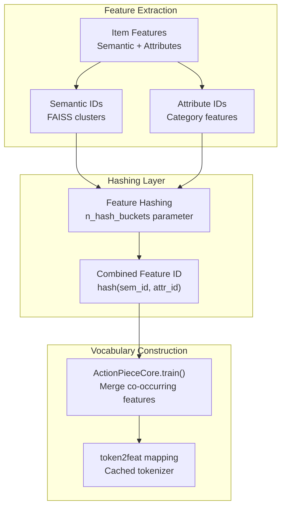
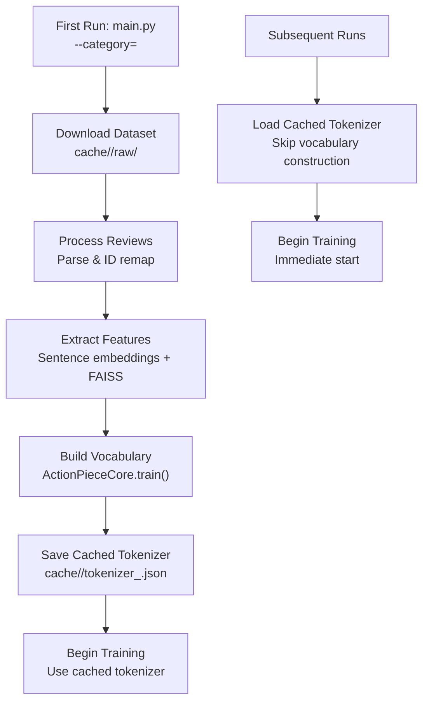
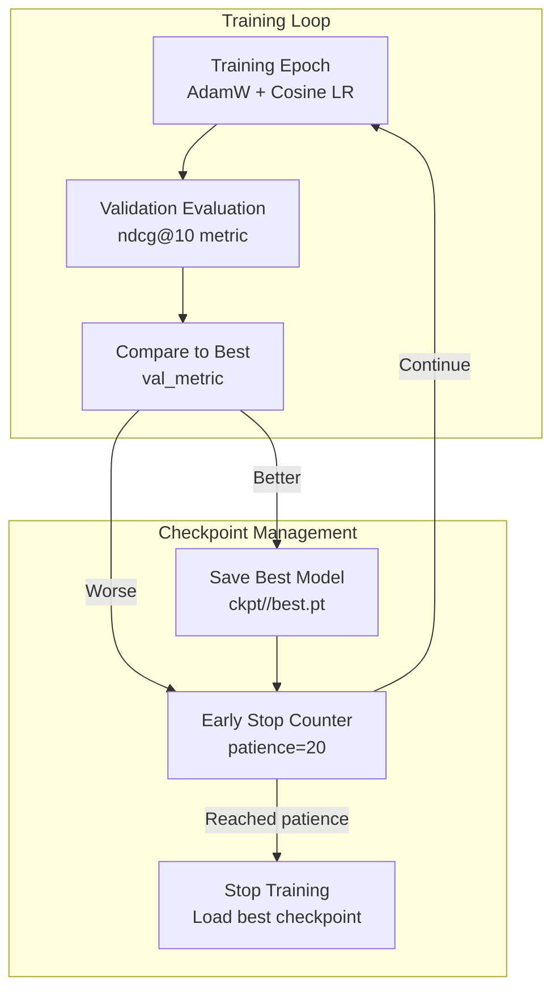

<!-- source: DeepWiki mcp.deepwiki.com · repo google-deepmind/action_piece · page 2.3 Reproducing Paper Results · fetched 2026-10-26 -->

# Reproducing Paper Results

<details>
<summary>Relevant source files</summary>

The following files were used as context for generating this wiki page:

- [README.md](README.md)
- [genrec/default.yaml](genrec/default.yaml)
- [genrec/models/ActionPiece/config.yaml](genrec/models/ActionPiece/config.yaml)

</details>


## Purpose and Scope

This page documents the exact commands and hyperparameters needed to reproduce the experimental results reported in the ICML 2025 Spotlight paper "Contextually Tokenizing Action Sequences for Generative Recommendation". It provides dataset-specific reproduction scripts for the three evaluation domains: Sports and Outdoors, Beauty, and CDs and Vinyl.

For general usage and quick start instructions, see [Quick Start Guide](#2.2). For detailed explanation of all available configuration parameters, see [Configuration Reference](#8). For understanding the training process, see [Training & Evaluation](#7).

## Reproduction Overview

The paper reports results averaged over 5 random seeds (2024-2028) for each of the three Amazon Reviews 2014 dataset categories. Each dataset requires slightly different hyperparameters that have been tuned for optimal performance. The reproduction process involves:

1. Running training with specified hyperparameters for each seed
2. Automatic vocabulary construction and caching on first run
3. Training with early stopping based on validation metrics
4. Evaluation on test set using ensemble inference with beam search

The system automatically downloads datasets, constructs tokenizer vocabularies, trains models, and evaluates performance metrics including nDCG@k, recall@k, and ERR@k.

**Sources:** [README.md:32-75]()

## Command Structure and Execution

### Basic Command Template

All reproduction commands follow this structure:

```bash
CUDA_VISIBLE_DEVICES=<gpu_id> python main.py \
    --category=<dataset_name> \
    --rand_seed=<seed_value> \
    --weight_decay=<value> \
    --lr=<value> \
    --n_hash_buckets=<value> \
    [additional_parameters]
```

The `main.py` entry point orchestrates the entire pipeline, merging command-line arguments with default configurations and dataset-specific settings.



**Sources:** [README.md:20-31](), [genrec/default.yaml:1-39](), [genrec/models/ActionPiece/config.yaml:1-50]()

## Dataset-Specific Reproduction Scripts

### Sports and Outdoors

This is the main benchmark dataset used in the paper. It uses relatively high learning rate (0.005) and moderate feature hashing (128 buckets).

```bash
for seed in {2024..2028}; do
    CUDA_VISIBLE_DEVICES=0 python main.py \
        --category=Sports_and_Outdoors \
        --rand_seed=${seed} \
        --weight_decay=0.15 \
        --lr=0.005 \
        --n_hash_buckets=128
done
```

**Key Parameters:**
- `weight_decay=0.15` - L2 regularization coefficient
- `lr=0.005` - Peak learning rate (highest among all datasets)
- `n_hash_buckets=128` - Feature hash bucket size for collision prevention

**Sources:** [README.md:38-46]()

### Beauty

The Beauty dataset uses lower learning rate (0.001) and fewer hash buckets (64), suitable for its smaller scale and feature space.

```bash
for seed in {2024..2028}; do
    CUDA_VISIBLE_DEVICES=0 python main.py \
        --category=Beauty \
        --rand_seed=${seed} \
        --weight_decay=0.15 \
        --lr=0.001 \
        --n_hash_buckets=64
done
```

**Key Parameters:**
- `weight_decay=0.15` - Same regularization as Sports and Outdoors
- `lr=0.001` - Lower learning rate due to dataset characteristics
- `n_hash_buckets=64` - Reduced hash space to match feature distribution

**Sources:** [README.md:51-59]()

### CDs and Vinyl

This dataset requires a smaller model architecture (d_model=256, d_ff=2048) and the most hash buckets (256) to handle its unique item distribution.

```bash
for seed in {2024..2028}; do
    CUDA_VISIBLE_DEVICES=0 python main.py \
        --category=CDs_and_Vinyl \
        --rand_seed=${seed} \
        --weight_decay=0.07 \
        --lr=0.001 \
        --d_model=256 \
        --d_ff=2048 \
        --n_hash_buckets=256
done
```

**Key Parameters:**
- `weight_decay=0.07` - Reduced regularization (half of other datasets)
- `lr=0.001` - Conservative learning rate
- `d_model=256` - Larger embedding dimension (default: 128)
- `d_ff=2048` - Larger feed-forward dimension (default: 1024)
- `n_hash_buckets=256` - Maximum hash space for complex feature distribution

**Sources:** [README.md:64-74]()

## Hyperparameter Mapping

The following table shows how command-line arguments override default configurations:

| Parameter | Sports & Outdoors | Beauty | CDs & Vinyl | Default | Config File |
|-----------|-------------------|--------|-------------|---------|-------------|
| `weight_decay` | 0.15 | 0.15 | 0.07 | 0.1 | [genrec/default.yaml:28]() |
| `lr` | 0.005 | 0.001 | 0.001 | 0.003 | [genrec/default.yaml:27]() |
| `n_hash_buckets` | 128 | 64 | 256 | 128 | [genrec/models/ActionPiece/config.yaml:26]() |
| `d_model` | 128 (default) | 128 (default) | 256 | 128 | [genrec/models/ActionPiece/config.yaml:43]() |
| `d_ff` | 1024 (default) | 1024 (default) | 2048 | 1024 | [genrec/models/ActionPiece/config.yaml:44]() |
| `rand_seed` | 2024-2028 | 2024-2028 | 2024-2028 | 2024 | [genrec/default.yaml:22]() |

**Fixed Parameters Across All Datasets:**

These parameters remain constant and are inherited from configuration files:

- `train_batch_size=256` - Training batch size
- `eval_batch_size=32` - Evaluation batch size
- `num_beams=50` - Beam search width during inference
- `n_inference_ensemble=5` - Number of ensemble generations
- `actionpiece_vocab_size=40000` - Maximum vocabulary size
- `max_item_seq_len=20` - Maximum input sequence length
- `epochs=200` - Maximum training epochs
- `patience=20` - Early stopping patience
- `val_metric=ndcg@10` - Validation metric for model selection

**Sources:** [genrec/default.yaml:25-38](), [genrec/models/ActionPiece/config.yaml:29-46]()

## Understanding Key Reproduction Parameters

### Learning Rate (`lr`)

The learning rate controls the step size during gradient descent optimization. It works in conjunction with cosine annealing schedule:

- **Sports and Outdoors (0.005):** Highest learning rate enables faster convergence on the largest dataset
- **Beauty (0.001):** Lower rate for more cautious optimization on smaller dataset
- **CDs and Vinyl (0.001):** Conservative rate compensates for reduced regularization

The actual learning rate during training follows a cosine schedule with warmup (10,000 steps by default).



**Sources:** [genrec/default.yaml:27-29]()

### Weight Decay

L2 regularization penalty applied to model weights during optimization:

- **Sports and Outdoors & Beauty (0.15):** Strong regularization prevents overfitting
- **CDs and Vinyl (0.07):** Reduced regularization compensates for larger model capacity (d_model=256)

**Sources:** [genrec/default.yaml:28]()

### Hash Buckets (`n_hash_buckets`)

Controls the feature hashing space size used to prevent hash collisions when combining item attributes:

- **Beauty (64):** Smallest feature space due to simpler attribute distribution
- **Sports and Outdoors (128):** Moderate space balances collision prevention and memory
- **CDs and Vinyl (256):** Largest space handles complex item metadata in music domain

Hash collisions can cause different features to map to the same representation, so larger hash spaces improve feature distinctiveness.



**Sources:** [genrec/models/ActionPiece/config.yaml:26]()

### Model Dimensions (`d_model`, `d_ff`)

T5 architecture parameters that control model capacity:

- **d_model:** Hidden dimension of encoder/decoder layers
  - Default: 128 (Sports and Outdoors, Beauty)
  - CDs and Vinyl: 256 (doubled capacity for complex music metadata)

- **d_ff:** Feed-forward network dimension
  - Default: 1024 (Sports and Outdoors, Beauty)
  - CDs and Vinyl: 2048 (doubled capacity)

The larger model for CDs and Vinyl compensates for the reduced weight decay, maintaining model capacity while allowing more flexible fitting.

**Sources:** [genrec/models/ActionPiece/config.yaml:43-44]()

## Random Seed Range

All reproduction scripts iterate over seeds 2024-2028 (5 seeds total) using bash loop:

```bash
for seed in {2024..2028}; do
    # ... training command with --rand_seed=${seed}
done
```

This produces 5 independent training runs per dataset. The paper reports metrics averaged over these 5 runs with standard deviation. Each seed affects:

1. Dataset shuffling during training
2. Model weight initialization
3. Dropout mask sampling
4. Set Permutation Regularization (SPR) random walks

The `reproducibility=True` setting in default configuration ensures deterministic behavior given the same seed.

**Sources:** [README.md:39-46](), [genrec/default.yaml:22-23]()

## Execution Flow and Output Locations

### First Run: Vocabulary Construction

On the first execution for each dataset, the system performs one-time setup:



**Cached Tokenizer Location:**
```
cache/<category>/tokenizer_sentence_128_40000_128.json
```

The filename components: `tokenizer_<metadata_mode>_<pca_dim>_<vocab_size>_<n_hash_buckets>.json`

**Sources:** [README.md:92-114]()

### Training and Checkpoint Output

During training, the system saves artifacts to organized directories:

| Output Type | Location | Description |
|-------------|----------|-------------|
| Logs | `logs/<run_id>/` | Training progress logs |
| TensorBoard | `tensorboard/<run_id>/` | Training metrics visualization |
| Checkpoints | `ckpt/<run_id>/` | Model checkpoints and best model |
| Cached Data | `cache/<category>/` | Dataset and tokenizer cache |

**Checkpoint Saving:**
- Best model saved based on `val_metric=ndcg@10`
- Early stopping after `patience=20` epochs without improvement
- Full checkpoint includes model weights, optimizer state, and configuration



**Sources:** [genrec/default.yaml:17-20](), [genrec/default.yaml:32-38]()

### Test Evaluation Output

After training completes, the system evaluates on the test set and reports metrics:

**Metrics Computed:**
- `recall@k` for k ∈ {5, 10, 20, 50}
- `ndcg@k` for k ∈ {5, 10, 20, 50}
- `err@k` for k ∈ {5, 10, 20, 50}

**Evaluation Process:**
1. Load best checkpoint based on validation metric
2. Generate predictions using ensemble inference (5 runs)
3. Beam search with 50 beams per ensemble run
4. Rank candidates using nDCG scoring
5. Compute metrics on held-out test items

Results are logged to both console and TensorBoard for visualization.

**Sources:** [genrec/default.yaml:36-38](), [genrec/models/ActionPiece/config.yaml:33-34]()

## Running Multiple Datasets Sequentially

To reproduce all paper results, execute the three dataset scripts sequentially:

```bash
# Sports and Outdoors (5 seeds)
for seed in {2024..2028}; do
    CUDA_VISIBLE_DEVICES=0 python main.py \
        --category=Sports_and_Outdoors \
        --rand_seed=${seed} \
        --weight_decay=0.15 \
        --lr=0.005 \
        --n_hash_buckets=128
done

# Beauty (5 seeds)
for seed in {2024..2028}; do
    CUDA_VISIBLE_DEVICES=0 python main.py \
        --category=Beauty \
        --rand_seed=${seed} \
        --weight_decay=0.15 \
        --lr=0.001 \
        --n_hash_buckets=64
done

# CDs and Vinyl (5 seeds)
for seed in {2024..2028}; do
    CUDA_VISIBLE_DEVICES=0 python main.py \
        --category=CDs_and_Vinyl \
        --rand_seed=${seed} \
        --weight_decay=0.07 \
        --lr=0.001 \
        --d_model=256 \
        --d_ff=2048 \
        --n_hash_buckets=256
done
```

**Total Runs:** 15 (3 datasets × 5 seeds)

**Estimated Time:** 
- First run per dataset: Longer due to vocabulary construction
- Subsequent runs: Faster using cached tokenizer
- Actual training time depends on GPU hardware and convergence speed (early stopping)

**Sources:** [README.md:32-75]()

## Verifying Reproduction Results

### Expected Behavior

1. **First Run Per Dataset:**
   - Downloads raw data from snap.stanford.edu
   - Processes reviews and metadata
   - Constructs sentence embeddings using sentence-t5-base
   - Builds FAISS index
   - Trains ActionPiece vocabulary (40,000 tokens)
   - Caches tokenizer JSON file
   - Begins model training

2. **Subsequent Runs:**
   - Loads cached tokenizer immediately
   - Begins model training
   - Uses different random seed for weight initialization

3. **Training Convergence:**
   - Early stopping typically triggers before 200 epochs
   - Best model selected based on ndcg@10 on validation set
   - Final test evaluation on held-out items

### Result Aggregation

To compute paper-reported metrics, aggregate results across the 5 seeds:

1. Extract test metrics from logs or TensorBoard for each seed
2. Compute mean and standard deviation across 5 runs
3. Report as: mean ± std

The paper reports primary metrics on test set using the model checkpoint with best validation performance.

**Sources:** [README.md:32-75](), [genrec/default.yaml:34-38]()

## Troubleshooting Reproduction Issues

### Common Issues

**Issue: Out of Memory (OOM)**
- **Solution:** Reduce `train_batch_size` (default: 256) or `eval_batch_size` (default: 32)
- **Command:** Add `--train_batch_size=128` to reproduction script

**Issue: Dataset Download Failure**
- **Solution:** Manually download from snap.stanford.edu and place in `cache/<category>/raw/`
- **Expected files:** `reviews_<category>_5.json.gz` and `meta_<category>.json.gz`

**Issue: Different Results with Same Seed**
- **Verify:** `reproducibility=True` in configuration
- **Check:** PyTorch and CUDA versions match paper environment
- **Note:** Small numerical differences across hardware are expected

**Issue: Slow Vocabulary Construction**
- **Expected:** First run takes longer (vocabulary construction is one-time cost)
- **Verify:** Cached tokenizer JSON file created in `cache/<category>/`
- **Future runs:** Will skip vocabulary construction and load from cache

**Sources:** [genrec/default.yaml:16-23]()

## Parameter Sensitivity

The reproduction scripts use tuned hyperparameters. Deviating from these values may affect performance:

**Critical Parameters (maintain as specified):**
- `num_beams=50` - Beam search width (reducing hurts performance significantly)
- `n_inference_ensemble=5` - Ensemble size (reducing hurts robustness)
- `actionpiece_vocab_size=40000` - Vocabulary size (reducing may underfit)

**Tunable Parameters (dataset-specific):**
- `lr` - Dataset-specific optimal learning rate
- `weight_decay` - Balances regularization with model capacity
- `n_hash_buckets` - Must match feature distribution complexity

**Architectural Parameters:**
- `d_model`, `d_ff` - Only modified for CDs and Vinyl
- Changing these requires retuning learning rate and regularization

**Sources:** [genrec/models/ActionPiece/config.yaml:29-46]()

---

