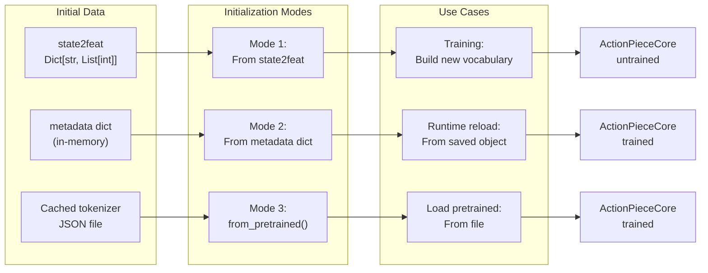
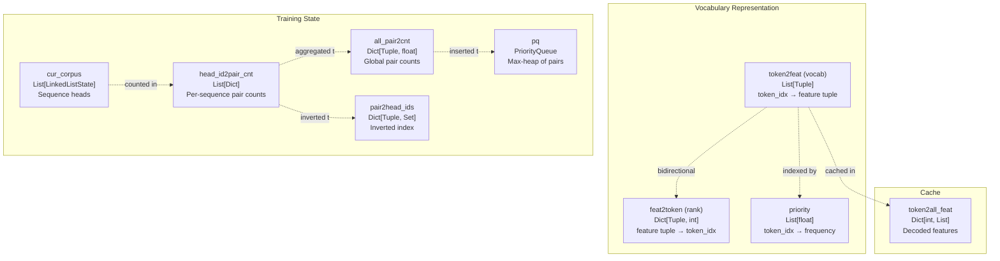
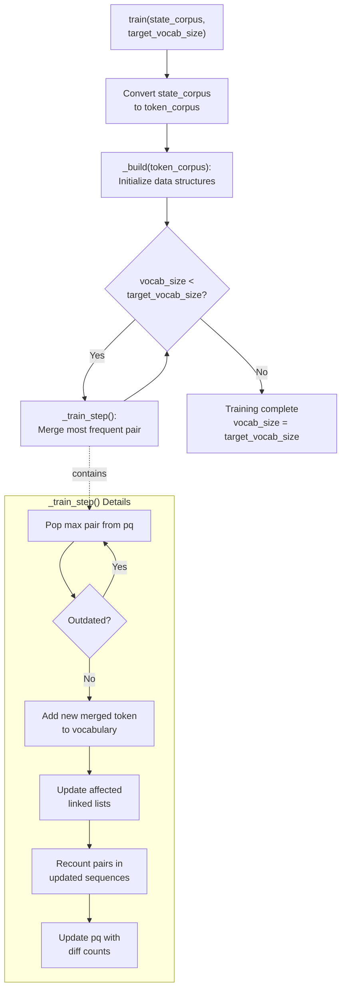
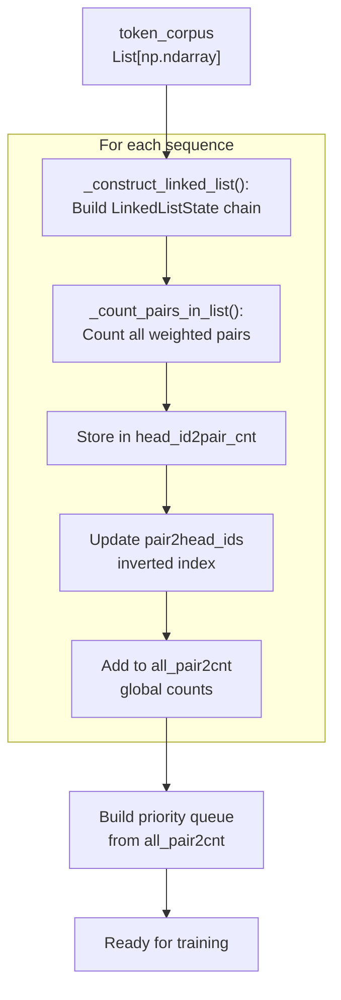
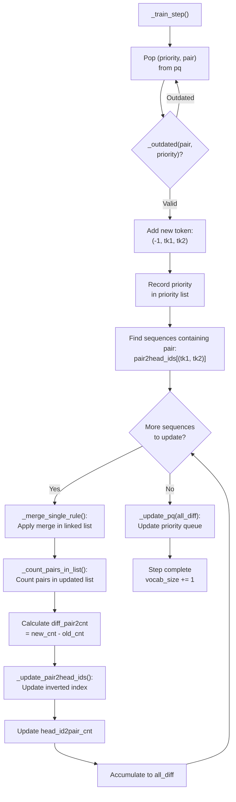
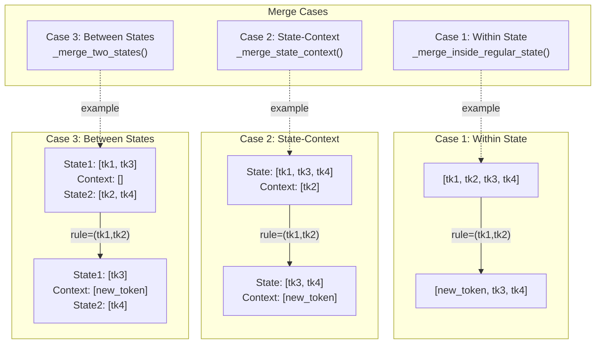
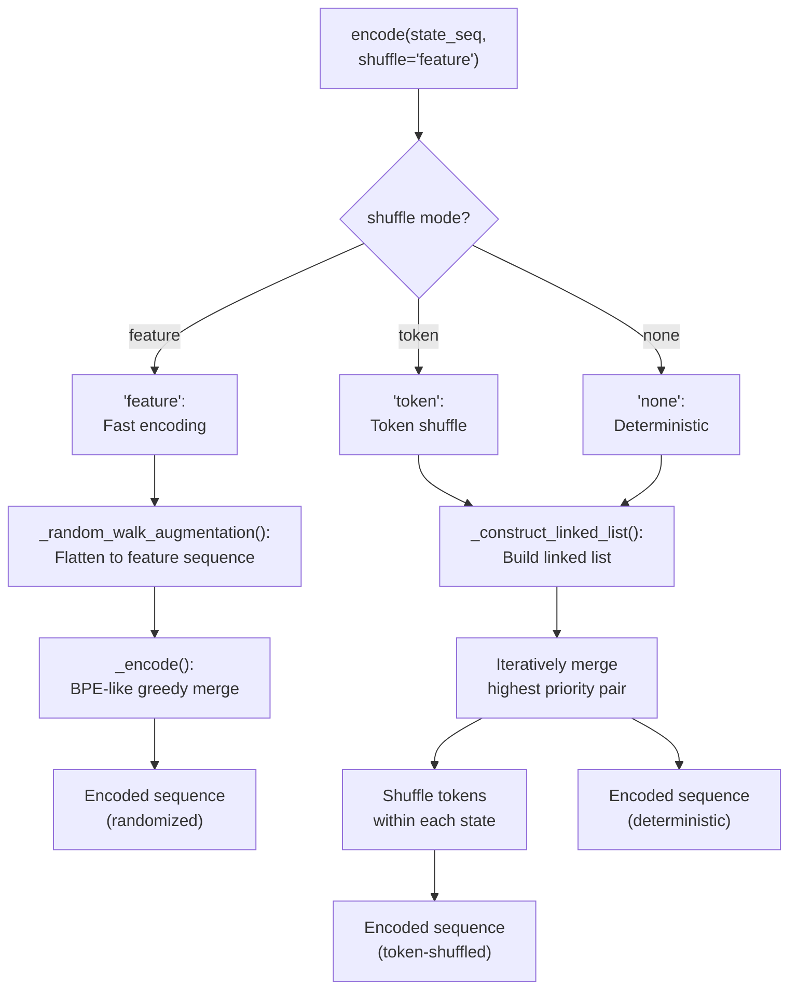
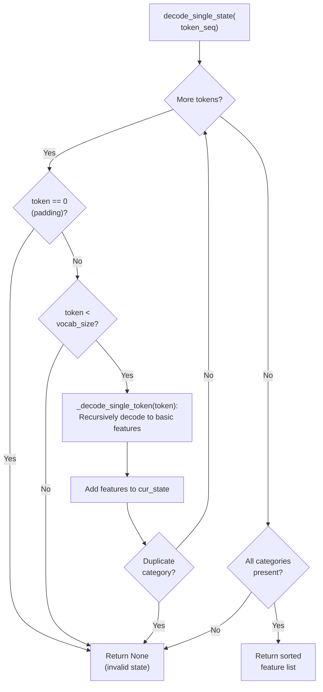

<!-- source: DeepWiki mcp.deepwiki.com · repo google-deepmind/action_piece · page 3.2 Vocabulary Construction (ActionPieceCore) · fetched 2026-10-26 -->

# Vocabulary Construction (ActionPieceCore)

<details>
<summary>Relevant source files</summary>

The following files were used as context for generating this wiki page:

- [README.md](README.md)
- [genrec/models/ActionPiece/core.py](genrec/models/ActionPiece/core.py)
- [genrec/models/ActionPiece/utils.py](genrec/models/ActionPiece/utils.py)

</details>


## Purpose and Scope

This page documents the `ActionPieceCore` class, which implements the core vocabulary construction algorithm for ActionPiece tokenization. The class builds a vocabulary by identifying and merging frequently co-occurring feature patterns using a BPE-like algorithm adapted for action sequences.

This page covers:
- Vocabulary initialization from initial features
- The iterative merging algorithm that constructs tokens from co-occurring patterns
- Data structures used for efficient pair counting and updates
- Token encoding and decoding operations

For information about how this vocabulary is used during sequence segmentation and Set Permutation Regularization (SPR), see [Sequence Segmentation & Set Permutation Regularization](#3.3). For the complete tokenizer implementation that wraps `ActionPieceCore`, see [ActionPieceTokenizer API](#9.2).

**Sources:** [genrec/models/ActionPiece/core.py:1-853](), [README.md:79-82]()

## Initialization Modes

The `ActionPieceCore` class supports three initialization modes, each serving a different use case in the training and inference pipeline.



**Sources:** [genrec/models/ActionPiece/core.py:50-117](), [genrec/models/ActionPiece/core.py:183-210]()

### Mode 1: From state2feat (Training)

Initializes an untrained `ActionPieceCore` from a mapping of states to their initial features. Each state is represented by a list of integers where each position corresponds to a feature category.

```python
# state2feat: Dict[str, List[int]]
# Maps state identifier to feature vector
# Example: {"item_123": [0, 42, 15, 89, 3]}
#          category_idx:  [0,  1,  2,  3, 4]
```

The initialization process in `_init_from_state2feat()` [genrec/models/ActionPiece/core.py:132-157]():
1. Creates the padding token `(-1, -1)` at index 0
2. Extracts unique features from each category
3. Builds initial vocabulary as `(category_idx, feature_idx)` tuples
4. Initializes all priorities to 0 (will be updated during training)

**Sources:** [genrec/models/ActionPiece/core.py:96-105](), [genrec/models/ActionPiece/core.py:132-157]()

### Mode 2: From metadata dict (Runtime)

Reconstructs a trained `ActionPieceCore` from a metadata dictionary containing the learned vocabulary structure. This is used internally when passing tokenizers between components.

**Sources:** [genrec/models/ActionPiece/core.py:106-113](), [genrec/models/ActionPiece/core.py:159-166]()

### Mode 3: from_pretrained() (Production)

The recommended approach for loading a trained tokenizer from disk. Supports vocabulary size adjustment through truncation.

```python
actionpiece = ActionPieceCore.from_pretrained(
    save_path="path/to/cached_tokenizer.json",
    vocab_size=10000  # Optional: truncate to specific size
)
```

**Sources:** [genrec/models/ActionPiece/core.py:183-210](), [README.md:94-115]()

## Core Data Structures

The `ActionPieceCore` class maintains several interconnected data structures that enable efficient vocabulary construction and token operations.



**Sources:** [genrec/models/ActionPiece/core.py:69-94]()

### Vocabulary Storage

| Data Structure | Type | Purpose |
|---|---|---|
| `token2feat` (alias: `vocab`) | `List[Tuple]` | Maps token index to feature representation. Initial tokens are `(category_idx, feature_idx)`, merged tokens are `(-1, token1_idx, token2_idx)` |
| `feat2token` (alias: `rank`) | `Dict[Tuple, int]` | Reverse mapping from features to token index for fast lookup |
| `priority` | `List[float]` | Stores the merge frequency/priority for each token. Higher values indicate more frequent patterns |
| `n_categories` | `int` | Number of feature categories per state |
| `n_init_feats` | `int` | Size of initial vocabulary before any merging |

**Sources:** [genrec/models/ActionPiece/core.py:69-80](), [genrec/models/ActionPiece/core.py:120-130]()

### Training Data Structures

These structures are only populated during the `train()` method and enable efficient pair counting and updates:

| Data Structure | Type | Purpose |
|---|---|---|
| `cur_corpus` | `List[LinkedListState]` | Head nodes of linked list representations of all training sequences. Each linked list allows efficient in-place merging operations |
| `head_id2pair_cnt` | `List[Dict[Tuple, float]]` | Per-sequence pair counts. `head_id2pair_cnt[i]` contains weighted counts of all token pairs in sequence `i` |
| `pair2head_ids` | `Dict[Tuple, Set[int]]` | Inverted index mapping each token pair to the set of sequence IDs containing that pair. Enables selective updates |
| `all_pair2cnt` | `Dict[Tuple, float]` | Global aggregated counts of all token pairs across all sequences |
| `pq` | `PriorityQueue` | Max-heap (negated in Python) storing `(-count, (token1, token2))` for finding the most frequent pair in O(log H) |

**Sources:** [genrec/models/ActionPiece/core.py:82-93](), [genrec/models/ActionPiece/core.py:299-340]()

## Training Algorithm Overview

The `train()` method implements a BPE-like algorithm adapted for action sequences. Unlike standard BPE which operates on linear token sequences, ActionPieceCore considers both intra-state and inter-state co-occurrences with different weighting schemes.



**Sources:** [genrec/models/ActionPiece/core.py:577-601](), [genrec/models/ActionPiece/core.py:603-644]()

### Pair Weighting Scheme

ActionPieceCore uses a normalized weighting scheme to balance pair counts from different contexts:

**Within a single state (intra-state):**
- Weight = `2 / M` where M is the number of tokens in the state
- Counts all pairs (combination of 2 tokens) within the state
- Implementation: [genrec/models/ActionPiece/core.py:233-248]()

**Between adjacent states (inter-state):**
- Weight = `1 / (M1 * M2)` where M1, M2 are token counts in the two states
- Counts all pairs where one token comes from each state
- Implementation: [genrec/models/ActionPiece/core.py:250-258]()

**Context slots:**
The linked list structure includes special "context slots" between regular states that can hold merged tokens from inter-state patterns. This preserves positional information during merging.

**Sources:** [genrec/models/ActionPiece/core.py:64-68](), [genrec/models/ActionPiece/core.py:260-297]()

## Build Phase

The `_build()` method [genrec/models/ActionPiece/core.py:299-340]() initializes all training data structures from the token corpus:



**Sources:** [genrec/models/ActionPiece/core.py:299-340]()

### Linked List Construction

Each sequence is converted to a linked list with alternating regular state nodes and context slot nodes:

```
Regular State → Context Slot → Regular State → Context Slot → Regular State
   [t1, t2]         []            [t3, t4]         []            [t5, t6]
```

The linked list structure (`LinkedListState` class) provides:
- `state`: List of tokens in this node
- `context`: Boolean indicating if this is a context slot
- `next`, `prev`: Pointers for bidirectional traversal
- `head_id`: Reference to the sequence this node belongs to

**Sources:** [genrec/models/ActionPiece/core.py:212-231](), [genrec/models/ActionPiece/utils.py:21-119]()

## Training Step Details

Each training step (`_train_step()`) merges the most frequent pair and updates all affected data structures.



**Sources:** [genrec/models/ActionPiece/core.py:603-644]()

### Lazy Priority Queue Updates

The priority queue uses a lazy update strategy for efficiency:
- When a pair's count changes, a new entry is inserted but old entries are not removed
- The `_outdated()` method checks if a popped entry is stale by comparing with `all_pair2cnt`
- If outdated, the entry is discarded and the next entry is popped
- This trades memory for avoiding O(H) removal operations

**Sources:** [genrec/models/ActionPiece/core.py:342-363](), [genrec/models/ActionPiece/core.py:536-555]()

### Selective Updates

The inverted index `pair2head_ids` enables selective updates: only sequences containing the merged pair need to be processed. This is critical for efficiency:

```
If merging pair (token_5, token_7):
1. Lookup pair2head_ids[(5, 7)] → {seq_1, seq_15, seq_89, ...}
2. Only update these sequences' linked lists
3. Recount only affected sequences
4. Update global counts with the diff
```

**Sources:** [genrec/models/ActionPiece/core.py:508-534](), [genrec/models/ActionPiece/core.py:621-642]()

## Linked List Merge Operations

The `_merge_single_rule()` method [genrec/models/ActionPiece/core.py:472-506]() applies a merge rule to a linked list by handling three cases:



**Sources:** [genrec/models/ActionPiece/core.py:413-506]()

### Merge Implementation Details

**Within State** [genrec/models/ActionPiece/core.py:413-422]():
- Checks if both tokens exist in the state
- Removes both original tokens
- Inserts new merged token at the beginning (coarse-to-fine ordering)

**State-Context** [genrec/models/ActionPiece/core.py:424-443]():
- Context slot must contain exactly one token
- Removes matching token from the adjacent state
- Replaces context token with the merged token

**Between States** [genrec/models/ActionPiece/core.py:445-470]():
- Context slot must be empty
- Removes one token from each adjacent state
- Inserts merged token into the context slot

After merging, `_merge_empty_nodes()` [genrec/models/ActionPiece/core.py:365-411]() cleans up:
1. Moves tokens from empty regular states to previous context slots
2. Removes consecutive pairs of empty regular state and empty context slot

**Sources:** [genrec/models/ActionPiece/core.py:365-506]()

## Encoding Process

The `encode()` method [genrec/models/ActionPiece/core.py:697-796]() converts a state sequence into a token sequence. It supports three shuffle modes that balance encoding quality with speed:



**Sources:** [genrec/models/ActionPiece/core.py:693-796]()

### Shuffle Modes

| Mode | Speed | Quality | Use Case |
|---|---|---|---|
| `'feature'` | Fastest | Good | Training and inference with SPR |
| `'token'` | Medium | Better | Reserved for special cases |
| `'none'` | Slowest | Best | Deterministic encoding without randomization |

**Feature shuffle** [genrec/models/ActionPiece/core.py:646-664](), [genrec/models/ActionPiece/core.py:666-691]():
1. Random walk augmentation: randomly permute features within each state
2. Flatten the 2D state sequence to 1D feature sequence
3. Apply greedy BPE-like merging on the flattened sequence

**Token/None** [genrec/models/ActionPiece/core.py:711-796]():
1. Construct full linked list with context slots
2. Iteratively find and merge the highest-priority pair
3. Priority calculated using the learned `priority` values
4. Token mode shuffles within each state after merging

**Sources:** [genrec/models/ActionPiece/core.py:646-796]()

## Decoding Process

The `decode_single_state()` method [genrec/models/ActionPiece/core.py:821-852]() converts a token sequence back to a valid state representation.



**Sources:** [genrec/models/ActionPiece/core.py:821-852]()

### Token Decoding

The `_decode_single_token()` method [genrec/models/ActionPiece/core.py:798-819]() recursively expands merged tokens:

```python
# Initial token: (category_idx, feature_idx) → [(category_idx, feature_idx)]
# Merged token: (-1, token1, token2) → decode(token1) + decode(token2)
```

Results are cached in `token2all_feat` to avoid redundant computation. The decoding validates:
1. No padding tokens (token 0)
2. All tokens are within vocabulary size
3. No duplicate categories (each category appears exactly once)
4. All `n_categories` categories are present

**Sources:** [genrec/models/ActionPiece/core.py:798-852]()

## Persistence

### Saving

The `save()` method [genrec/models/ActionPiece/core.py:168-181]() serializes the learned vocabulary to JSON:

```json
{
  "n_categories": 5,
  "n_init_feats": 1153,
  "token2feat": [
    [-1, -1],
    [0, 0], [0, 1], ...,
    [-1, 363, 763], [-1, 269, 515], ...
  ],
  "priority": [0, 0, ..., 723.6, 670.04, ...]
}
```

**Sources:** [genrec/models/ActionPiece/core.py:168-181](), [README.md:98-115]()

### Loading

The `from_pretrained()` class method [genrec/models/ActionPiece/core.py:183-210]() loads from JSON with optional vocabulary size truncation:

```python
# Load full vocabulary
ap = ActionPieceCore.from_pretrained("tokenizer.json")

# Load and truncate to 10000 tokens
ap = ActionPieceCore.from_pretrained("tokenizer.json", vocab_size=10000)
```

Truncation constraints:
- `vocab_size >= n_init_feats` (cannot truncate below initial features)
- `vocab_size <= len(token2feat)` (cannot exceed learned vocabulary)

**Sources:** [genrec/models/ActionPiece/core.py:183-210]()

## Key Properties and Methods Summary

| Property/Method | Type | Purpose |
|---|---|---|
| `vocab` | `@property` | Alias for `token2feat`, returns vocabulary list |
| `rank` | `@property` | Alias for `feat2token`, returns feature-to-token mapping |
| `vocab_size` | `@property` | Returns current vocabulary size |
| `train(state_corpus, target_vocab_size)` | method | Main training method, builds vocabulary through iterative merging |
| `encode(state_seq, shuffle)` | method | Converts state sequence to token sequence with specified shuffle mode |
| `decode_single_state(token_seq)` | method | Converts token sequence back to state features, validates completeness |
| `save(save_path)` | method | Serializes vocabulary to JSON file |
| `from_pretrained(save_path, vocab_size)` | classmethod | Loads vocabulary from JSON with optional truncation |

**Sources:** [genrec/models/ActionPiece/core.py:120-210](), [genrec/models/ActionPiece/core.py:577-852]()

---

