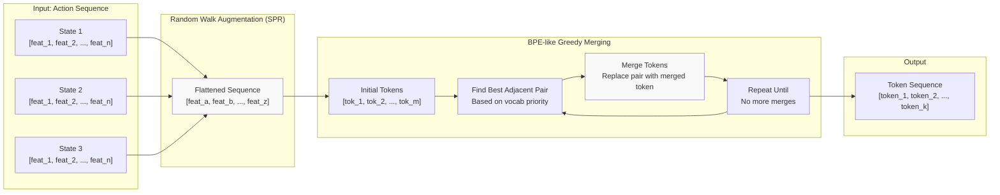
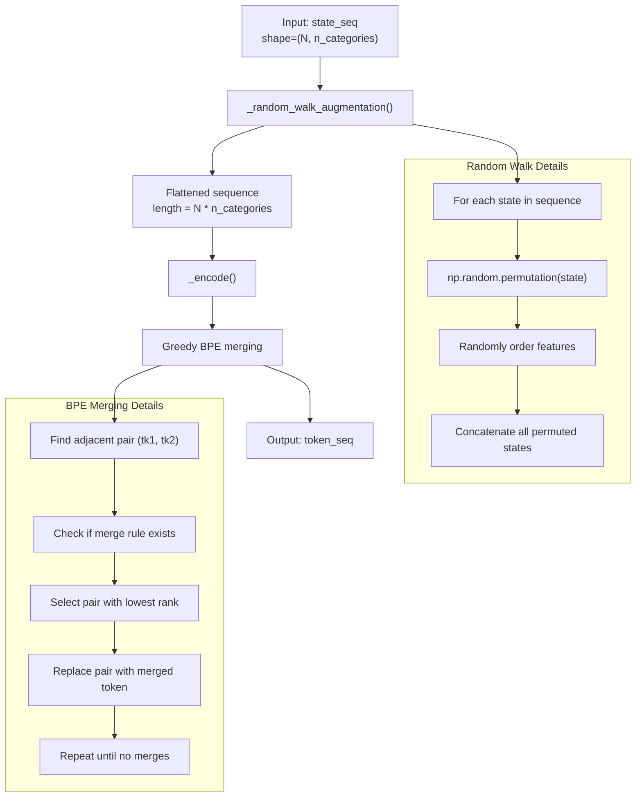
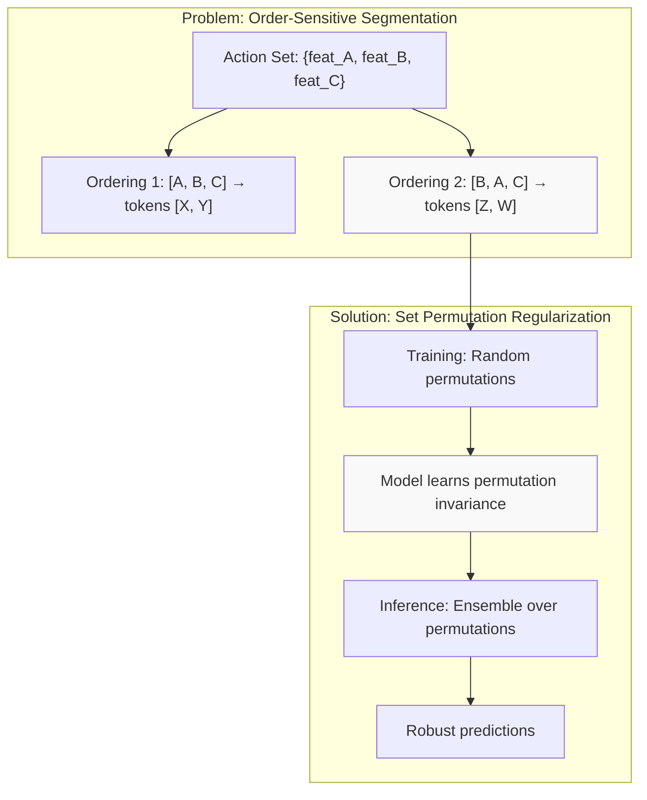
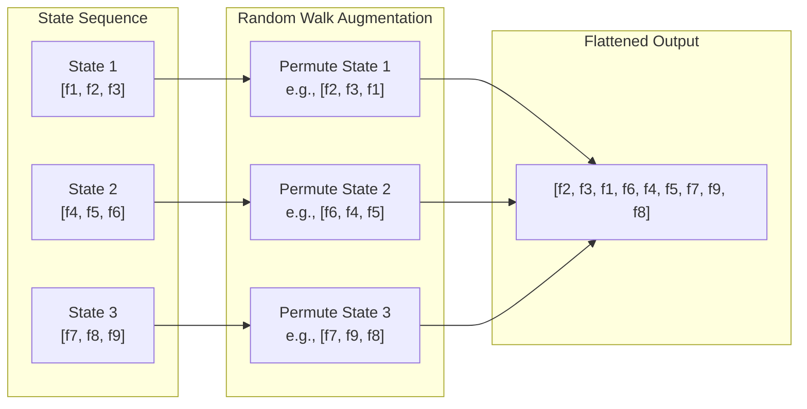
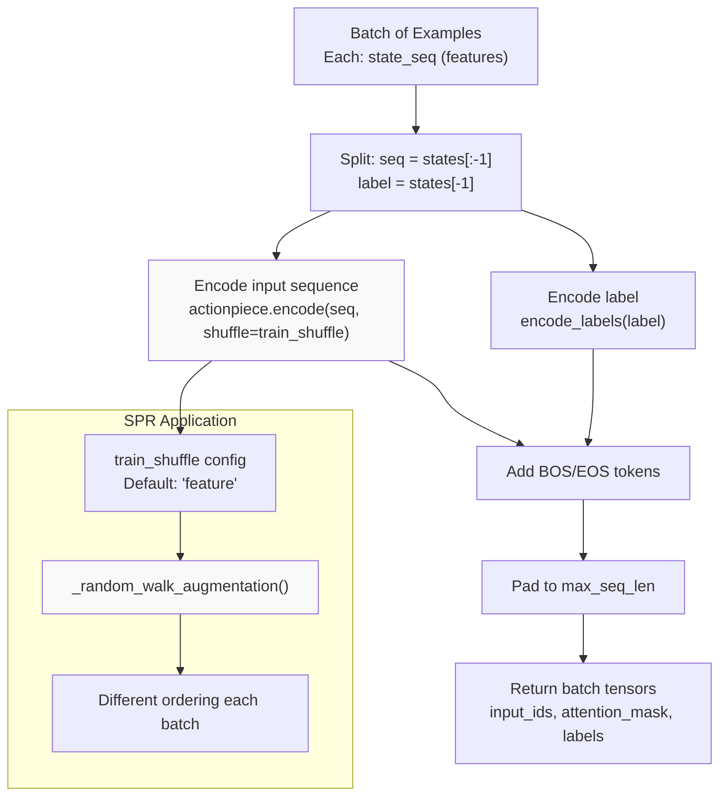
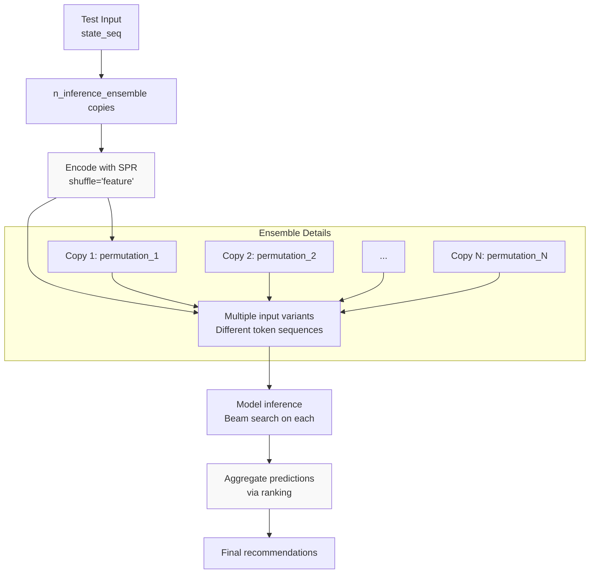
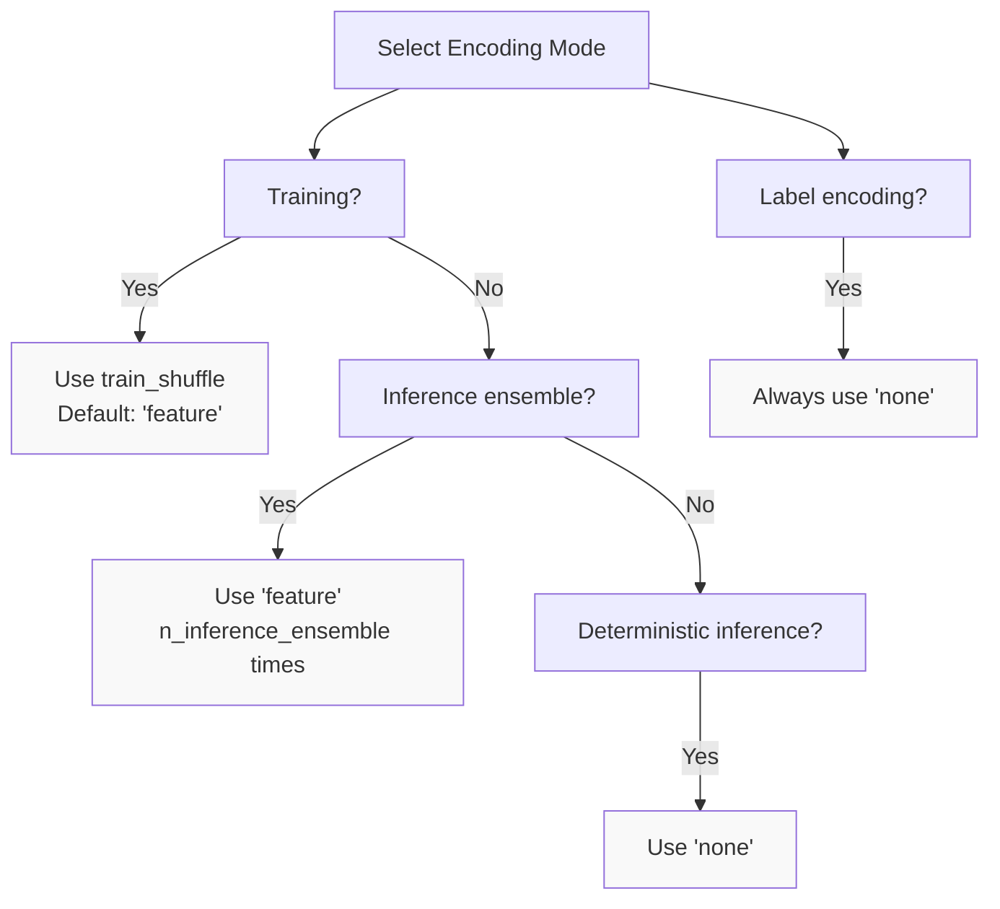

<!-- source: DeepWiki mcp.deepwiki.com · repo google-deepmind/action_piece · page 3.3 Sequence Segmentation & Set Permutation Regularization · fetched 2026-10-26 -->

# Sequence Segmentation & Set Permutation Regularization

<details>
<summary>Relevant source files</summary>

The following files were used as context for generating this wiki page:

- [README.md](README.md)
- [genrec/models/ActionPiece/core.py](genrec/models/ActionPiece/core.py)
- [genrec/models/ActionPiece/tokenizer.py](genrec/models/ActionPiece/tokenizer.py)

</details>


## Purpose and Scope

This page documents how ActionPiece segments action sequences into tokens and applies Set Permutation Regularization (SPR) during training and inference. Segmentation converts action sequences (represented as sequences of feature sets) into token sequences using a BPE-like greedy merging algorithm. SPR is a regularization technique that randomly permutes features within action sets to encourage permutation-invariant representations.

For vocabulary construction that produces the merge rules used during segmentation, see [Vocabulary Construction (ActionPieceCore)](#3.2). For the overall tokenization concept, see [Contextual Action Tokenization Concept](#3.1). For inference strategies that leverage SPR for ensemble generation, see [Generation & Inference Strategy](#6.2).

---

## Segmentation Process Overview

Segmentation transforms a sequence of action states (where each state is a set of features) into a sequence of tokens by iteratively merging adjacent tokens according to learned merge rules stored in the ActionPiece vocabulary.



**Diagram: Segmentation Pipeline with SPR**

Sources: [genrec/models/ActionPiece/core.py:646-696](), [genrec/models/ActionPiece/core.py:697-796]()

---

## The encode() Method: Core Segmentation Logic

The `ActionPieceCore.encode()` method performs segmentation with three different modes controlled by the `shuffle` parameter:

| Mode | Description | Use Case | SPR Applied |
|------|-------------|----------|-------------|
| `'feature'` | Fast encoding with random walk augmentation | Training, inference ensemble | Yes |
| `'token'` | Structured encoding with token-level shuffling | Experimental | Partial |
| `'none'` | Deterministic encoding without shuffling | Deterministic inference, label encoding | No |

### Mode: 'feature' (Default for Training/Inference)

This is the primary mode that implements SPR through random walk augmentation:



**Diagram: 'feature' Mode Encoding Flow**

Sources: [genrec/models/ActionPiece/core.py:697-710](), [genrec/models/ActionPiece/core.py:646-664](), [genrec/models/ActionPiece/core.py:666-691]()

### The _random_walk_augmentation() Method

This method implements the core SPR mechanism by randomly permuting features within each action set:

```python
# From genrec/models/ActionPiece/core.py:646-664
def _random_walk_augmentation(self, state_seq: np.ndarray):
    """Random walk augmentation, flatten the state sequence into a sequence of initial tokens.
    
    Each random walk will cover all features,
    i.e. length(random walk seq) == n_categories.
    """
    aug_state_seq = []
    for seq in state_seq:
        aug_state_seq.extend(np.random.permutation(seq).tolist())
    return aug_state_seq
```

**Key Properties:**
- Each state's features are independently permuted
- All features are preserved (permutation, not sampling)
- Results in a flattened sequence of length `N * n_categories`

Sources: [genrec/models/ActionPiece/core.py:646-664]()

### The _encode() Method: BPE-like Greedy Merging

After random walk augmentation, the flattened sequence is segmented using greedy merging:

```python
# From genrec/models/ActionPiece/core.py:666-691
def _encode(self, seq):
    """Encode a flattened feature sequence into a token sequence.
    
    The encoding process is just like BPE encoding.
    """
    while True:
        min_idx = None
        min_rank = float('inf')
        for i, (tk1, tk2) in enumerate(zip(seq[:-1], seq[1:])):
            tk1, tk2 = min(tk1, tk2), max(tk1, tk2)
            cur_rank = self.rank.get((-1, tk1, tk2))
            if cur_rank is not None and cur_rank < min_rank:
                min_idx = i
                min_rank = cur_rank
        if min_idx is None:
            break
        seq = seq[:min_idx] + [min_rank] + seq[min_idx + 2 :]
    return seq
```

**Algorithm:**
1. Iterate through all adjacent token pairs in the sequence
2. For each pair `(tk1, tk2)`, check if a merge rule `(-1, tk1, tk2)` exists in the vocabulary
3. Select the pair with the **lowest rank** (highest priority, learned earliest during vocabulary training)
4. Replace the selected pair with the merged token
5. Repeat until no more merge rules can be applied

**Note:** Lower rank = higher priority. Tokens learned earlier in vocabulary construction have lower indices and are merged first.

Sources: [genrec/models/ActionPiece/core.py:666-691]()

---

## Set Permutation Regularization (SPR)

### Conceptual Foundation

SPR addresses a fundamental property of action sets: **features within a single action are unordered**. For example, when a user purchases a product with features `[semantic_id=42, category=sports, hash=7]`, these features have no inherent ordering. The tokenizer should be invariant to feature permutation.

However, the BPE-like segmentation algorithm operates on **sequences**, which are inherently ordered. SPR resolves this mismatch by:

1. **Training Time:** Randomly permuting features within each action to expose the model to all possible orderings
2. **Inference Time:** Generating multiple encodings with different random permutations (ensemble augmentation)



**Diagram: SPR Motivation and Solution**

Sources: [README.md:6-12](), [genrec/models/ActionPiece/core.py:646-664]()

### Random Walk Augmentation Implementation

The random walk process ensures complete feature coverage while introducing ordering variation:



**Diagram: Random Walk Augmentation Process**

Each state's features are independently permuted using `np.random.permutation()`, ensuring that:
- All features appear exactly once per state
- No information is lost
- Different random seeds produce different orderings

Sources: [genrec/models/ActionPiece/core.py:646-664]()

---

## Training-Time SPR

During training, SPR is applied through the `collate_fn_train()` method, which processes batches on-the-fly:



**Diagram: Training Batch Collation with SPR**

Sources: [genrec/models/ActionPiece/tokenizer.py:434-472]()

### Code Implementation: collate_fn_train()

```python
# From genrec/models/ActionPiece/tokenizer.py:434-472
def collate_fn_train(self, batch):
    """Tokenizing a batch of examples on-the-fly while training."""
    input_ids = []
    attention_mask = []
    labels = []
    for data in batch:
        seq = data['state_seq'][:-1]  # Input sequence (history)
        lb = data['state_seq'][-1:]    # Label (next action)
        
        # Apply SPR during encoding
        input_ids.append(
            [self.bos_token]
            + self.actionpiece.encode(seq, shuffle=self.train_shuffle)
            + [self.eos_token]
        )
        
        # Labels are encoded deterministically for consistency
        labels.append(self.encode_labels(lb) + [self.eos_token])
    
    # Padding logic...
    return {
        'input_ids': torch.LongTensor(input_ids),
        'attention_mask': torch.LongTensor(attention_mask),
        'labels': torch.LongTensor(labels),
    }
```

**Key Configuration:**
- `train_shuffle`: Defaults to `'feature'` (random walk augmentation)
- Can be set to `'token'` or `'none'` for different training strategies
- Labels are encoded with `shuffle='none'` for consistency (via `encode_labels()`)

Sources: [genrec/models/ActionPiece/tokenizer.py:434-472](), [genrec/models/ActionPiece/tokenizer.py:418-432]()

---

## Inference-Time SPR: Ensemble Augmentation

During inference, SPR is leveraged to create multiple encodings of the same input sequence, improving robustness through ensemble prediction:



**Diagram: Inference Ensemble Generation via SPR**

Sources: [genrec/models/ActionPiece/tokenizer.py:515-559](), [genrec/models/ActionPiece/model.py]()

### Code Implementation: collate_fn_test()

```python
# From genrec/models/ActionPiece/tokenizer.py:515-559
def collate_fn_test(self, batch):
    """Tokenizing a batch of examples on-the-fly while evaluating."""
    input_ids = []
    attention_mask = []
    labels = []
    for data in batch:
        seq = data['state_seq'][:-1]
        lb = data['state_seq'][-1]
        
        # Deterministic baseline if n_inference_ensemble == -1
        if self.n_inference_ensemble == -1:
            input_ids.append(
                [self.bos_token]
                + self.actionpiece.encode(seq, shuffle='none')
                + [self.eos_token]
            )
            labels.append(lb)
        
        # Generate ensemble with SPR
        for _ in range(self.n_inference_ensemble):
            input_ids.append(
                [self.bos_token]
                + self.actionpiece.encode(seq, shuffle='feature')
                + [self.eos_token]
            )
        labels.append(lb)
    
    # Return padded tensors...
    return {
        'input_ids': torch.LongTensor(input_ids),
        'attention_mask': torch.LongTensor(attention_mask),
        'labels': torch.LongTensor(np.array(labels)),
    }
```

**Ensemble Configuration:**
- `n_inference_ensemble`: Number of random permutations to generate
- Default: 20 (configured in model config)
- Set to `-1` for deterministic inference without ensemble
- Each permutation creates a different token sequence from the same action sequence

Sources: [genrec/models/ActionPiece/tokenizer.py:515-559]()

### Validation-Time Behavior

The `collate_fn_val()` method uses a simplified strategy:

```python
# From genrec/models/ActionPiece/tokenizer.py:474-513
def collate_fn_val(self, batch):
    """Tokenizing a batch of examples on-the-fly while evaluating."""
    # ...
    input_ids.append(
        [self.bos_token]
        + self.actionpiece.encode(
            seq,
            shuffle='none' if self.n_inference_ensemble == -1 else 'feature',
        )
        + [self.eos_token]
    )
    # ...
```

**Validation Strategy:**
- Single encoding per input (no ensemble)
- Uses `shuffle='feature'` if ensemble is enabled (for consistency with test behavior)
- Uses `shuffle='none'` if ensemble is disabled (deterministic)

Sources: [genrec/models/ActionPiece/tokenizer.py:474-513]()

---

## Encoding Mode Comparison

### 'feature' Mode (Primary)

**Implementation:** `encode() with shuffle='feature'` → `_random_walk_augmentation()` → `_encode()`

**Characteristics:**
- Fast: O(N * n_categories) for flattening + O(M²) for merging (where M = flattened length)
- Complete SPR: All features randomly ordered
- Used in training and inference ensemble

**Typical Output Length:** Variable, depends on vocabulary merge rules

Sources: [genrec/models/ActionPiece/core.py:693-695](), [genrec/models/ActionPiece/core.py:646-664](), [genrec/models/ActionPiece/core.py:666-691]()

### 'token' Mode (Experimental)

**Implementation:** `encode() with shuffle='token'` → Structured linked-list merging with shuffling

**Characteristics:**
- Maintains state structure during merging
- Uses `LinkedListState` data structure
- Applies SPR at token level after merging within states
- Slower: O(N * M²) where M = tokens per state

**Typical Output Length:** Variable, preserves some state boundaries

Sources: [genrec/models/ActionPiece/core.py:747-796]()

### 'none' Mode (Deterministic)

**Implementation:** `encode() with shuffle='none'` → Structured linked-list merging without shuffling

**Characteristics:**
- Deterministic: Same input → same output
- Maintains state structure throughout
- No SPR applied
- Used for label encoding to ensure consistency

**Typical Output Length:** Variable, deterministic

Sources: [genrec/models/ActionPiece/core.py:747-796](), [genrec/models/ActionPiece/tokenizer.py:418-432]()

### Mode Selection Summary



**Diagram: Encoding Mode Decision Tree**

Sources: [genrec/models/ActionPiece/tokenizer.py:434-559](), [genrec/models/ActionPiece/core.py:697-796]()

---

## Configuration Parameters

| Parameter | Location | Default | Description |
|-----------|----------|---------|-------------|
| `train_shuffle` | `genrec/models/ActionPiece/config.yaml` | `'feature'` | Shuffle mode for training encoding |
| `n_inference_ensemble` | `genrec/models/ActionPiece/config.yaml` | `20` | Number of ensemble augmentations at inference |
| `n_prob_encode_plus` | `genrec/models/ActionPiece/config.yaml` | Not used | Reserved for probabilistic encoding |
| `max_item_seq_len` | `genrec/default.yaml` | Dataset-specific | Maximum number of items in input sequence |

Sources: [genrec/models/ActionPiece/config.yaml](), [genrec/default.yaml](), [genrec/models/ActionPiece/tokenizer.py:53-69]()

---

## Key Implementation Details

### Linked List Data Structure for Structured Merging

When using `shuffle='token'` or `shuffle='none'`, the encoder uses a `LinkedListState` structure to maintain action boundaries during merging:

**Structure:**
- Each node represents either a **regular state** (action) or a **context slot** (merged cross-state tokens)
- Nodes alternate: `[regular] → [context] → [regular] → [context] → [regular]`
- Context slots start empty and are populated when cross-state tokens are merged

**Example Flow:**
```
Initial:  [A B C] → [] → [D E F] → [] → [G H I]
After merge within [A B C]:  [X C] → [] → [D E F] → [] → [G H I]
After merge between [A B C] and [D E F]:  [X] → [Y] → [E F] → [] → [G H I]
```

Sources: [genrec/models/ActionPiece/core.py:712-796](), [genrec/models/ActionPiece/utils.py]()

### Label Encoding Cache

To avoid redundant computation during training, encoded labels are cached:

```python
# From genrec/models/ActionPiece/tokenizer.py:418-432
def encode_labels(self, labels):
    """Cache the encoded labels for faster inference."""
    key = labels.tostring()
    if key in self.encoded_labels:
        return self.encoded_labels[key]
    encoded_labels = self.actionpiece.encode(labels, shuffle='none')
    self.encoded_labels[key] = encoded_labels
    return encoded_labels
```

**Rationale:** Labels are always encoded deterministically (`shuffle='none'`), so caching avoids repeated encoding of the same target actions.

Sources: [genrec/models/ActionPiece/tokenizer.py:418-432]()

### BOS/EOS Token Handling

Every encoded sequence is wrapped with special tokens:
- **BOS (Beginning of Sequence):** `self.bos_token = self.actionpiece.vocab_size`
- **EOS (End of Sequence):** `self.eos_token = self.actionpiece.vocab_size + 1`

These tokens enable the T5 model to distinguish sequence boundaries during generation.

Sources: [genrec/models/ActionPiece/tokenizer.py:59-60]()

---

## Relationship to Other Components

### Vocabulary Construction

Segmentation relies on the learned vocabulary from `ActionPieceCore.train()`:
- Merge rules (`token2feat`) define which token pairs can be merged
- Priority scores determine which pairs are merged first
- See [Vocabulary Construction (ActionPieceCore)](#3.2) for details

### Model Generation

The segmented token sequences serve as input to the T5-based model:
- Training: Teacher forcing with shifted labels
- Inference: Beam search generates token sequences
- See [Generation & Inference Strategy](#6.2) for details

### Evaluation

SPR ensemble predictions are aggregated during evaluation:
- Multiple token sequences generate multiple predictions
- Predictions are ranked and combined using nDCG
- See [Evaluation Metrics](#7.2) for details

Sources: [README.md:77-91](), [genrec/models/ActionPiece/tokenizer.py](), [genrec/models/ActionPiece/core.py]()

---

