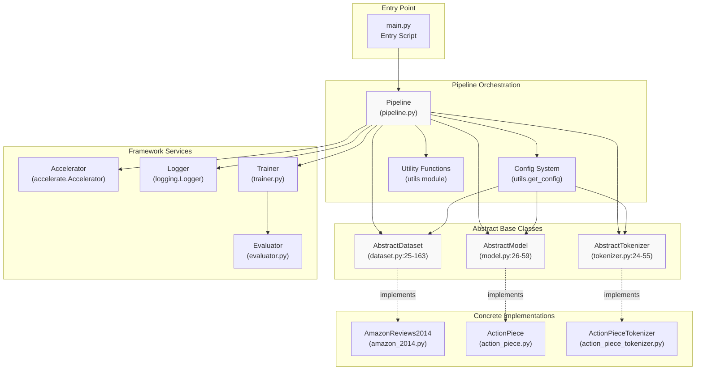
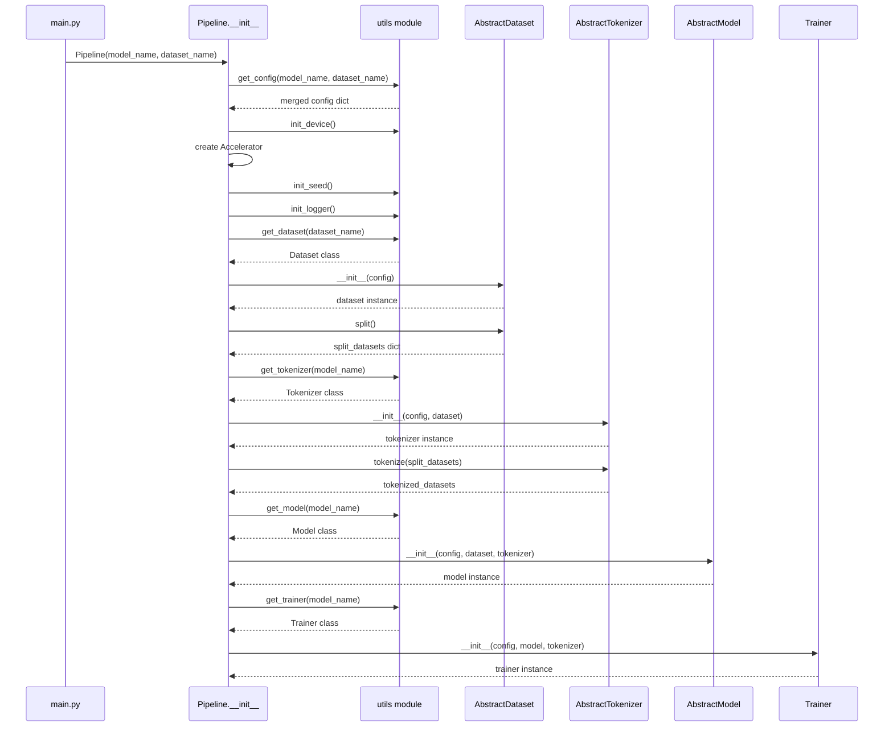
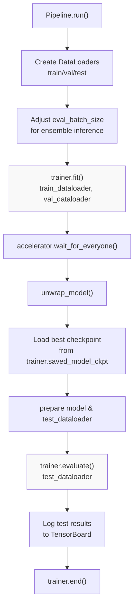
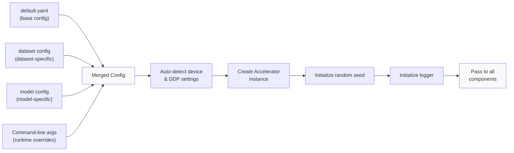
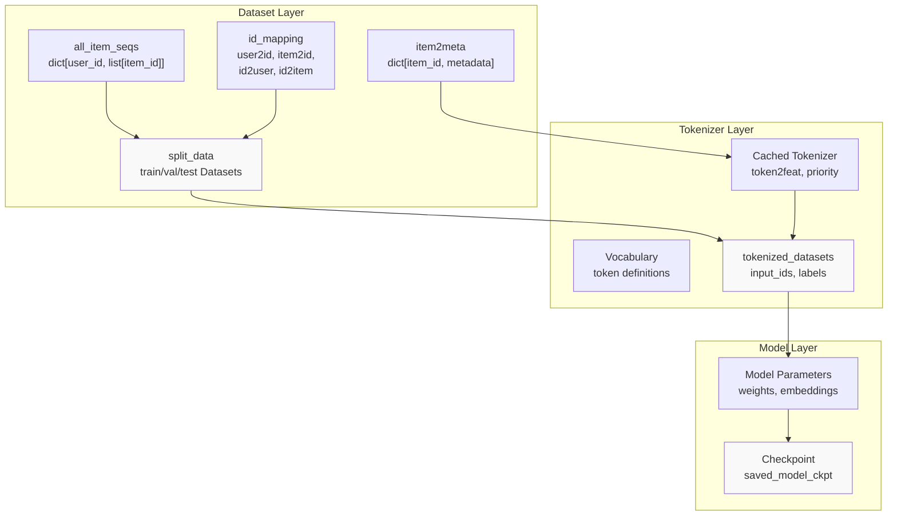

<!-- source: DeepWiki mcp.deepwiki.com · repo google-deepmind/action_piece · page 4 GenRec Framework Architecture · fetched 2026-10-26 -->

# GenRec Framework Architecture

<details>
<summary>Relevant source files</summary>

The following files were used as context for generating this wiki page:

- [genrec/dataset.py](genrec/dataset.py)
- [genrec/model.py](genrec/model.py)
- [genrec/pipeline.py](genrec/pipeline.py)
- [genrec/tokenizer.py](genrec/tokenizer.py)

</details>


## Purpose and Scope

This document describes the GenRec framework architecture, which provides the foundational infrastructure for the ActionPiece system. GenRec is a modular, extensible framework built around abstract base classes that define contracts for datasets, models, and tokenizers. The framework handles configuration management, pipeline orchestration, training/evaluation workflows, and logging infrastructure.

For details on the ActionPiece-specific tokenization system built on this framework, see [ActionPiece Tokenization System](#3). For information about specific implementations like the Amazon dataset or ActionPiece model, see [Data Processing Pipeline](#5) and [ActionPiece Model Architecture](#6).

## Framework Design Pattern

GenRec follows a **plugin-based architecture** where core functionality is defined through abstract base classes, and specific implementations provide concrete behavior. This design enables:

1. **Modularity**: New datasets, models, or tokenizers can be added by implementing abstract interfaces
2. **Reproducibility**: Configuration-driven experimentation with hierarchical parameter merging
3. **Scalability**: Integration with HuggingFace Accelerate for distributed training
4. **Extensibility**: Framework services (logging, checkpointing, metrics) are available to all components

The framework consists of three primary abstract base classes and a central pipeline orchestrator:

- `AbstractDataset` - Defines data loading, processing, and splitting contracts
- `AbstractModel` - Defines model architecture and training/inference interfaces  
- `AbstractTokenizer` - Defines sequence tokenization and batch collation contracts
- `Pipeline` - Orchestrates component initialization and training/evaluation workflow

**Sources:** [genrec/dataset.py:25-163](), [genrec/model.py:26-59](), [genrec/tokenizer.py:24-55](), [genrec/pipeline.py:34-190]()

## Core Architecture Diagram



**Sources:** [genrec/pipeline.py:34-190](), [genrec/dataset.py:25-163](), [genrec/model.py:26-59](), [genrec/tokenizer.py:24-55]()

## Component Initialization Flow

The `Pipeline` class orchestrates the initialization of all framework components in a specific order to ensure dependencies are satisfied:



This initialization sequence ensures that:
1. Configuration is loaded and merged before component creation
2. The dataset is loaded before the tokenizer (tokenizer needs dataset metadata)
3. Both dataset and tokenizer are available before model creation
4. All components are ready before trainer initialization

**Sources:** [genrec/pipeline.py:60-121]()

## Abstract Base Class Contracts

Each abstract base class defines a contract that concrete implementations must fulfill. These contracts establish the interface between the framework and specific implementations.

### AbstractDataset Contract

| Property/Method | Return Type | Purpose |
|----------------|-------------|---------|
| `n_users` | `int` | Total number of users in dataset |
| `n_items` | `int` | Total number of items in dataset |
| `n_interactions` | `int` | Total number of user-item interactions |
| `avg_item_seq_len` | `float` | Average length of item sequences |
| `user2id` | `dict[str, int]` | User-to-ID mapping |
| `item2id` | `dict[str, int]` | Item-to-ID mapping |
| `_download_and_process_raw()` | `None` | Download and process raw data (must implement) |
| `split()` | `dict[str, Dataset]` | Split into train/val/test sets |

The `AbstractDataset` maintains these core data structures:
- `all_item_seqs`: Dictionary mapping users to their item sequences
- `id_mapping`: Bidirectional mappings between users/items and integer IDs
- `item2meta`: Metadata associated with each item (optional)
- `split_data`: Cached split datasets

**Sources:** [genrec/dataset.py:25-163]()

### AbstractModel Contract

| Property/Method | Type | Purpose |
|----------------|------|---------|
| `n_parameters` | `str` | Returns count of trainable parameters |
| `calculate_loss(batch)` | To implement | Compute loss for a batch during training |
| `generate(batch, n_return_sequences)` | To implement | Generate predictions for inference |

The `AbstractModel` inherits from `torch.nn.Module` and maintains references to:
- `config`: Configuration dictionary
- `dataset`: Dataset instance for accessing metadata
- `tokenizer`: Tokenizer instance for encoding/decoding

**Sources:** [genrec/model.py:26-59]()

### AbstractTokenizer Contract

| Property/Method | Type | Purpose |
|----------------|------|---------|
| `vocab_size` | `int` | Size of the vocabulary (must implement) |
| `padding_token` | `int` | Token ID for padding (default: 0) |
| `max_token_seq_len` | `int` | Maximum sequence length (must implement) |
| `eos_token` | Token ID for end-of-sequence marker |
| `collate_fn` | `dict` | Batch collation functions for train/val/test |
| `_init_tokenizer()` | `None` | Initialize tokenizer (must implement) |
| `tokenize(datasets)` | Dataset dict | Tokenize split datasets (must implement) |

The tokenizer is responsible for:
1. Building/loading vocabulary from dataset
2. Tokenizing sequences for training and inference
3. Providing collation functions that handle batching, padding, and augmentation

**Sources:** [genrec/tokenizer.py:24-55]()

## Pipeline Orchestration Workflow

The `Pipeline.run()` method executes the complete training and evaluation workflow:



Key aspects of the pipeline execution:

1. **DataLoader Creation**: Uses `tokenizer.collate_fn[split]` to handle batch-specific processing
2. **Batch Size Adjustment**: For ensemble inference, divides `eval_batch_size` by `n_inference_ensemble`
3. **Distributed Synchronization**: `accelerator.wait_for_everyone()` ensures all processes complete training
4. **Model Unwrapping**: Extracts model from Accelerate wrapper before loading checkpoint
5. **Checkpoint Loading**: Loads the best model based on validation metrics
6. **Test Evaluation**: Evaluates on test set with the best checkpoint
7. **Logging**: Records all metrics to TensorBoard

**Sources:** [genrec/pipeline.py:136-189]()

## Configuration Flow

The framework uses a hierarchical configuration system that merges settings from multiple sources:



The configuration dictionary is passed to all components during initialization and contains:

| Key Categories | Examples |
|---------------|----------|
| Training | `train_batch_size`, `learning_rate`, `epochs`, `early_stopping_patience` |
| Model | Model architecture parameters, generation settings |
| Dataset | `dataset`, `category`, `split` strategy, metadata processing |
| Tokenizer | Vocabulary size, sequence length, augmentation settings |
| Infrastructure | `device`, `accelerator`, `tensorboard_log_dir`, `checkpoint_dir` |

For detailed configuration parameters, see [Configuration Reference](#8).

**Sources:** [genrec/pipeline.py:69-76]()

## Framework Services

GenRec provides several cross-cutting services available to all components:

### Accelerate Integration

The framework uses HuggingFace Accelerate for:
- Automatic device placement (CPU/GPU/TPU)
- Distributed data parallel (DDP) training
- Gradient accumulation
- Mixed precision training
- TensorBoard logging integration

The `Accelerator` instance is created during pipeline initialization and stored in `config['accelerator']`, making it accessible to all components via `self.config['accelerator']`.

**Sources:** [genrec/pipeline.py:79-81](), [genrec/dataset.py:73-75]()

### Logging System

All components inherit a `log()` method that wraps standard Python logging with Accelerate-aware behavior:

```python
def log(self, message, level='info'):
    return utils.log(
        message, self.config['accelerator'], self.logger, level=level
    )
```

This ensures log messages are only printed from the main process in distributed settings, avoiding duplicate output.

**Sources:** [genrec/dataset.py:158-162](), [genrec/tokenizer.py:51-54](), [genrec/pipeline.py:186-189]()

### Utility Functions

The `utils` module provides factory functions for component creation:

| Function | Purpose |
|----------|---------|
| `get_config()` | Merge configurations from multiple sources |
| `get_dataset()` | Return dataset class by name |
| `get_tokenizer()` | Return tokenizer class by name |
| `get_model()` | Return model class by name |
| `get_trainer()` | Return trainer class by name |
| `init_device()` | Auto-detect device and DDP settings |
| `init_seed()` | Set random seed for reproducibility |
| `init_logger()` | Configure logging infrastructure |

These factory functions enable the plugin-based architecture, allowing new implementations to be registered and instantiated by name.

**Sources:** [genrec/pipeline.py:69-120]()

## Data Structure Relationships

The framework maintains several key data structures that are shared across components:



**Data Flow:**
1. Raw data is processed into `all_item_seqs` with ID mappings
2. Leave-one-out splitting creates train/val/test datasets
3. Tokenizer uses item metadata to build vocabulary
4. Split datasets are tokenized using the vocabulary
5. Model trains on tokenized data and saves checkpoints

**Sources:** [genrec/dataset.py:53-61](), [genrec/pipeline.py:92-104]()

## Extension Points

The framework provides several extension points for customization:

### Adding New Datasets

Implement `AbstractDataset` and override:
- `_download_and_process_raw()`: Data acquisition and parsing
- Optionally `split()`: Custom splitting strategies beyond leave-one-out

Register the dataset class in the utils module to enable instantiation by name.

### Adding New Tokenizers

Implement `AbstractTokenizer` and override:
- `_init_tokenizer()`: Vocabulary construction/loading
- `tokenize()`: Convert sequences to token IDs
- `vocab_size`, `max_token_seq_len`: Return vocabulary and sequence properties
- Set `collate_fn['train']`, `collate_fn['val']`, `collate_fn['test']`: Batch collation functions

### Adding New Models

Implement `AbstractModel` and override:
- `calculate_loss()`: Loss computation for training
- `generate()`: Inference/prediction logic
- Optionally add custom layers in `__init__()`

### Adding New Trainers

Create a custom trainer class that implements:
- `fit()`: Training loop with validation
- `evaluate()`: Evaluation on test set
- `end()`: Cleanup and final logging

**Sources:** [genrec/dataset.py:107-114](), [genrec/tokenizer.py:33-49](), [genrec/model.py:54-58]()

## Component Lifecycle

Each component follows a defined lifecycle managed by the pipeline:

| Phase | Dataset | Tokenizer | Model | Trainer |
|-------|---------|-----------|-------|---------|
| **Initialization** | Load/download data, build ID mappings | Build/load vocabulary | Initialize architecture, load pretrained weights | Setup optimizer, scheduler |
| **Preparation** | Split into train/val/test | Tokenize sequences | Wrap with Accelerate | Prepare dataloaders |
| **Training** | Provide data via DataLoader | Collate batches, apply SPR | Forward pass, loss calculation | Training loop, validation |
| **Evaluation** | Provide test data | Collate test batches | Generate predictions | Calculate metrics |
| **Finalization** | - | - | Save best checkpoint | Log final results, cleanup |

**Sources:** [genrec/pipeline.py:60-189]()

## Summary

The GenRec framework provides a modular, extensible architecture for generative recommendation systems. Key design principles include:

1. **Abstraction**: Core functionality is defined through abstract base classes
2. **Configuration-Driven**: All parameters are specified via hierarchical YAML configs
3. **Distributed-Ready**: Built-in support for multi-GPU training via Accelerate
4. **Reproducible**: Deterministic seeding, logging, and checkpointing
5. **Extensible**: New datasets, models, and tokenizers can be added via plugin pattern

The Pipeline orchestrator manages component initialization, training workflow, and evaluation, while framework services provide logging, configuration management, and distributed training infrastructure. This architecture enables the ActionPiece system to focus on its core innovation—contextual action tokenization—while leveraging robust framework capabilities for training and evaluation.

For detailed information on specific components:
- Pipeline orchestration: [Pipeline Orchestration](#4.1)
- Abstract interfaces: [Abstract Base Classes](#4.2)
- Configuration details: [Configuration System](#4.3)
- Utility functions: [Utility Functions & Logging](#4.4)

---

