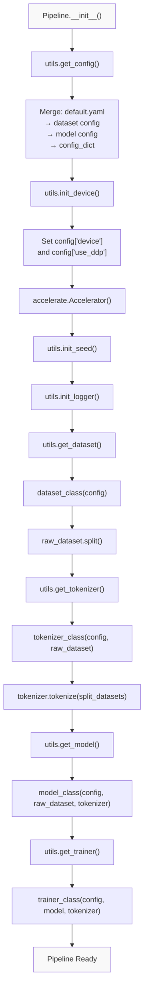
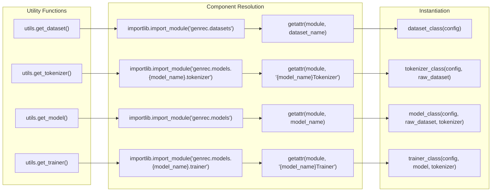
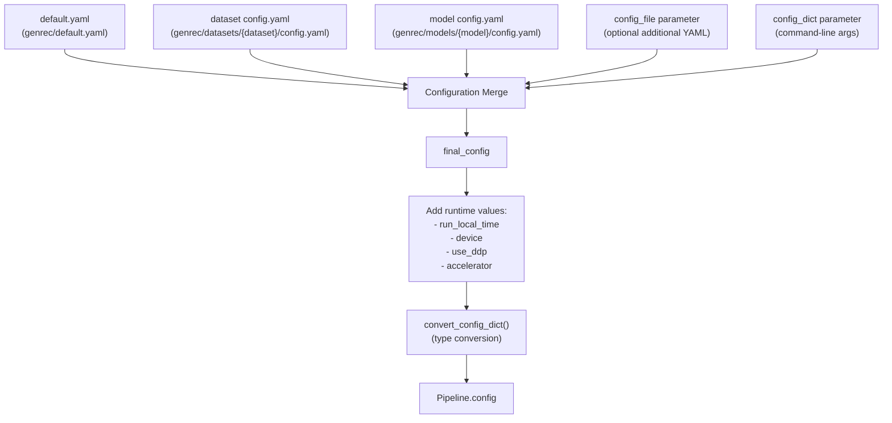
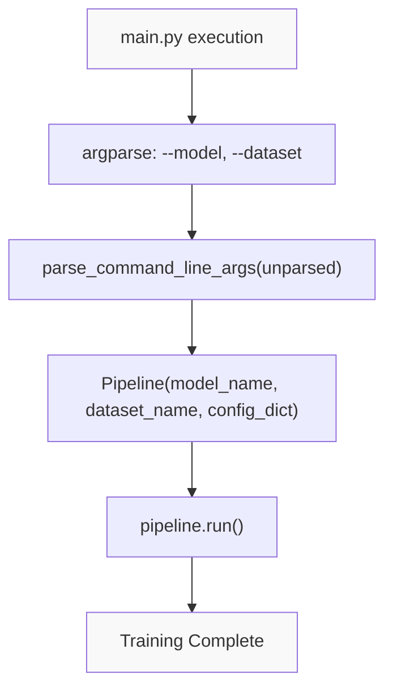

<!-- source: DeepWiki mcp.deepwiki.com · repo google-deepmind/action_piece · page 4.1 Pipeline Orchestration · fetched 2026-10-26 -->

# Pipeline Orchestration

<details>
<summary>Relevant source files</summary>

The following files were used as context for generating this wiki page:

- [genrec/pipeline.py](genrec/pipeline.py)
- [genrec/utils.py](genrec/utils.py)
- [main.py](main.py)

</details>


## Purpose and Scope

This page documents the `Pipeline` class, which serves as the main orchestrator for the ActionPiece training and evaluation workflow. The Pipeline coordinates the entire lifecycle: loading configurations, initializing components (dataset, tokenizer, model, trainer), creating data loaders, executing training, and evaluating results.

For details on the abstract interfaces that Pipeline uses, see [Abstract Base Classes](#4.2). For configuration management specifics, see [Configuration System](#4.3). For training and evaluation implementation details, see [Trainer & Training Loop](#7.1) and [Evaluation Metrics](#7.2).

**Sources:** [genrec/pipeline.py:1-190](), [main.py:1-45]()

---

## Pipeline Class Overview

The `Pipeline` class is defined in [genrec/pipeline.py:34-190]() and serves as the top-level orchestrator. It receives model and dataset specifications (as strings or class instances), loads configuration hierarchically, initializes all system components, and executes the complete training-evaluation cycle.

The class maintains the following key attributes:

| Attribute | Type | Description |
|-----------|------|-------------|
| `config` | `dict[str, Any]` | Merged configuration from all sources |
| `project_dir` | `str` | Directory path for TensorBoard logs |
| `accelerator` | `accelerate.Accelerator` | Distributed training coordinator |
| `logger` | `logging.Logger` | Logging instance |
| `raw_dataset` | `AbstractDataset` | Raw dataset before splitting |
| `split_datasets` | `dict` | Train/val/test dataset splits |
| `tokenizer` | `AbstractTokenizer` | Tokenizer instance |
| `tokenized_datasets` | `dict` | Tokenized train/val/test datasets |
| `model` | `AbstractModel` | Model instance |
| `trainer` | `Trainer` | Trainer instance |

**Sources:** [genrec/pipeline.py:34-58]()

---

## Pipeline Initialization Sequence

The Pipeline initialization follows a specific order to ensure dependencies are properly resolved:



**Initialization Sequence Diagram**

The initialization process in [genrec/pipeline.py:60-121]() follows these steps:

1. **Configuration Loading** ([genrec/pipeline.py:69-76]()): Calls `utils.get_config()` which merges configurations hierarchically (default → dataset → model → CLI args)

2. **Device Setup** ([genrec/pipeline.py:76]()): Initializes device (CPU/GPU) and determines if distributed data parallel (DDP) is enabled

3. **Accelerator Creation** ([genrec/pipeline.py:79-81]()): Creates `accelerate.Accelerator` instance for distributed training support, configured with TensorBoard logging

4. **Seed and Logger Initialization** ([genrec/pipeline.py:84-86]()): Sets random seeds for reproducibility and initializes file/console logging

5. **Dataset Loading** ([genrec/pipeline.py:90-92]()): Uses `utils.get_dataset()` to retrieve the dataset class and instantiates it. Splits dataset using `raw_dataset.split()`

6. **Tokenizer Creation** ([genrec/pipeline.py:95-104]()): Instantiates tokenizer (either provided or auto-selected) and tokenizes all dataset splits

7. **Model Instantiation** ([genrec/pipeline.py:107-112]()): Creates model within `accelerator.main_process_first()` context to coordinate multi-process initialization

8. **Trainer Setup** ([genrec/pipeline.py:115-120]()): Creates trainer instance (either provided or auto-selected based on model name)

**Sources:** [genrec/pipeline.py:60-121](), [genrec/utils.py:324-413]()

---

## Training and Evaluation Workflow

The `Pipeline.run()` method [genrec/pipeline.py:136-185]() executes the complete training and evaluation workflow:

```mermaid
graph TD
    Start["Pipeline.run()"] --> CreateDL["Create DataLoaders"]
    CreateDL --> TrainDL["train_dataloader<br/>(batch_size=train_batch_size, shuffle=True)"]
    CreateDL --> ValDL["val_dataloader<br/>(batch_size=eval_batch_size, shuffle=False)"]
    CreateDL --> TestDL["test_dataloader<br/>(batch_size=eval_batch_size, shuffle=False)"]
    
    TrainDL --> TrainerFit["trainer.fit(train_dataloader, val_dataloader)"]
    ValDL --> TrainerFit
    
    TrainerFit --> WaitSync["accelerator.wait_for_everyone()"]
    WaitSync --> UnwrapModel["accelerator.unwrap_model(model)"]
    UnwrapModel --> LoadBest["Load Best Checkpoint<br/>torch.load(trainer.saved_model_ckpt)"]
    LoadBest --> PrepareTest["accelerator.prepare(model, test_dataloader)"]
    
    TestDL --> PrepareTest
    PrepareTest --> Evaluate["trainer.evaluate(test_dataloader)"]
    Evaluate --> LogResults["Log Test Results to TensorBoard"]
    LogResults --> TrainerEnd["trainer.end()"]
    TrainerEnd --> End["Pipeline Complete"]

    style Start fill:#f9f9f9
    style End fill:#f9f9f9
```



**Training and Evaluation Workflow Diagram**

### DataLoader Creation

The `run()` method creates three DataLoaders using an internal helper function [genrec/pipeline.py:143-149]():

```python
def get_dataloader(split, batch_size, shuffle):
    return DataLoader(
        self.tokenized_datasets[split],
        batch_size=batch_size,
        shuffle=shuffle,
        collate_fn=self.tokenizer.collate_fn[split],
    )
```

Key aspects:
- **Training DataLoader** [genrec/pipeline.py:151-153](): Uses `train_batch_size`, shuffles data, applies `collate_fn['train']` (includes Set Permutation Regularization)
- **Validation/Test DataLoaders** [genrec/pipeline.py:154-162](): Batch size adjusted for ensemble inference if `n_inference_ensemble != -1`, no shuffling, uses split-specific collate functions

**Sources:** [genrec/pipeline.py:136-162]()

### Training Phase

The training phase [genrec/pipeline.py:164]() delegates to `trainer.fit()`, which:
- Iterates through epochs/steps
- Performs forward/backward passes
- Updates model parameters
- Validates on validation set
- Saves best checkpoint based on validation metrics

After training completes, the pipeline synchronizes all processes with `accelerator.wait_for_everyone()` [genrec/pipeline.py:166]().

**Sources:** [genrec/pipeline.py:164-166]()

### Model Loading and Evaluation

The evaluation phase [genrec/pipeline.py:167-177]() follows these steps:

1. **Unwrap Model** [genrec/pipeline.py:167](): Extracts the raw model from accelerator wrapper
2. **Load Best Checkpoint** [genrec/pipeline.py:169](): Loads state dict from `trainer.saved_model_ckpt` 
3. **Prepare for Testing** [genrec/pipeline.py:170-172](): Re-wraps model and test dataloader with accelerator for distributed evaluation
4. **Evaluate** [genrec/pipeline.py:177](): Calls `trainer.evaluate(test_dataloader)` to compute test metrics
5. **Log Results** [genrec/pipeline.py:179-182](): Logs metrics to TensorBoard if main process

**Sources:** [genrec/pipeline.py:167-184]()

---

## Component Initialization via Utility Functions

The Pipeline uses several utility functions from [genrec/utils.py]() to dynamically load and instantiate components:



**Component Resolution and Instantiation Diagram**

### Dynamic Component Loading

| Function | Purpose | Module Path | Class Name |
|----------|---------|-------------|------------|
| `utils.get_dataset()` | Load dataset class | `genrec.datasets` | `{dataset_name}` |
| `utils.get_tokenizer()` | Load tokenizer class | `genrec.models.{model_name}.tokenizer` | `{model_name}Tokenizer` |
| `utils.get_model()` | Load model class | `genrec.models` | `{model_name}` |
| `utils.get_trainer()` | Load trainer class | `genrec.models.{model_name}.trainer` | `{model_name}Trainer` |

These functions support both string names and direct class instances. When a string is provided, the function uses `importlib.import_module()` and `getattr()` to dynamically load the appropriate class. This design enables the framework to support custom implementations by following naming conventions.

**Sources:** [genrec/utils.py:169-257]()

---

## Configuration Management in Pipeline

The Pipeline receives configuration from multiple sources and merges them hierarchically:



**Configuration Flow Diagram**

The configuration merge follows this priority order (later sources override earlier ones):
1. `genrec/default.yaml` - Framework defaults
2. `genrec/datasets/{dataset_name}/config.yaml` - Dataset-specific settings
3. `genrec/models/{model_name}/config.yaml` - Model-specific settings  
4. `config_file` parameter - Additional YAML files (optional)
5. `config_dict` parameter - Direct dictionary overrides (typically from CLI)

The `utils.get_config()` function [genrec/utils.py:324-413]() performs this merge and adds runtime values:
- `run_local_time`: Timestamp when pipeline was created
- `device`: Computed torch device (CPU/CUDA)
- `use_ddp`: Whether distributed data parallel is enabled
- `accelerator`: The accelerate.Accelerator instance

**Sources:** [genrec/pipeline.py:69-76](), [genrec/utils.py:324-413]()

---

## Distributed Training Coordination

The Pipeline integrates with Hugging Face Accelerate for distributed training support:

### Accelerator Setup

The accelerator is created with [genrec/pipeline.py:79-81]():
```python
self.config['accelerator'] = accelerate_lib.Accelerator(
    log_with='tensorboard', project_dir=self.project_dir
)
```

The `project_dir` property [genrec/pipeline.py:122-129]() constructs the path:
```
{tensorboard_log_dir}/{dataset}/{model}/
```

### Multi-Process Coordination

The Pipeline uses accelerator methods for process coordination:

| Method | Location | Purpose |
|--------|----------|---------|
| `accelerator.main_process_first()` | [genrec/pipeline.py:107]() | Ensures model initialization happens on main process first |
| `accelerator.wait_for_everyone()` | [genrec/pipeline.py:166]() | Synchronizes all processes after training |
| `accelerator.prepare()` | [genrec/pipeline.py:170-172]() | Wraps model and dataloader for distributed execution |
| `accelerator.unwrap_model()` | [genrec/pipeline.py:167]() | Extracts raw model from wrapper |
| `accelerator.is_main_process` | [genrec/pipeline.py:173, 179]() | Guards logging/saving to occur only on main process |

### Device Detection

The `utils.init_device()` function [genrec/utils.py:503-516]() automatically detects:
- Available CUDA devices
- Whether DDP is enabled (via `WORLD_SIZE` environment variable)

Returns: `(torch.device, use_ddp)` tuple

**Sources:** [genrec/pipeline.py:76-81, 107-112, 166-182](), [genrec/utils.py:503-516]()

---

## Logging Infrastructure

The Pipeline establishes a comprehensive logging system:

### Logger Initialization

The `utils.init_logger()` function [genrec/utils.py:119-149]() sets up:

1. **Directory Structure**:
   ```
   {log_dir}/{dataset}/{model}/{logfile}
   ```

2. **Log File Naming** [genrec/utils.py:100-116]():
   - Includes run ID, command-line args hash, timestamp, and config hash
   - Format: `{run_id}-{command_line_args}-{run_local_time}-{md5}-{suffix}`

3. **Dual Handlers**:
   - `FileHandler`: Writes to log file with timestamp formatting
   - `StreamHandler`: Outputs to console

4. **Progress Bars**: Disabled on non-main processes to avoid cluttered output

### Logging During Execution

The `Pipeline.log()` method [genrec/pipeline.py:186-189]() provides a convenience wrapper:
```python
def log(self, message, level='info'):
    return utils.log(
        message, self.config['accelerator'], self.logger, level=level
    )
```

This ensures logging only occurs on the main process in distributed settings [genrec/utils.py:151-167]().

**Sources:** [genrec/pipeline.py:84-87, 186-189](), [genrec/utils.py:119-167]()

---

## Entry Point Integration

The `main.py` script [main.py:1-45]() demonstrates typical Pipeline usage:



**Main Entry Point Flow**

The entry point [main.py:35-44]():
1. Parses `--model` and `--dataset` arguments
2. Parses remaining unparsed arguments as config overrides (e.g., `--learning_rate=0.001`)
3. Creates Pipeline instance with parsed configurations
4. Calls `pipeline.run()` to execute training and evaluation

Example command:
```bash
python main.py --model=ActionPiece --dataset=AmazonReviews2014 --epochs=50 --learning_rate=0.001
```

**Sources:** [main.py:24-44](), [genrec/utils.py:416-446]()

---

## Summary

The `Pipeline` class provides a complete orchestration framework that:
- Loads and merges hierarchical configurations from multiple sources
- Initializes system components in the correct dependency order
- Coordinates distributed training via Accelerate
- Manages the complete training-evaluation lifecycle
- Provides comprehensive logging and checkpointing
- Serves as the main entry point for all experiments

This design separates concerns cleanly: Pipeline handles orchestration, while specific implementations of dataset, tokenizer, model, and trainer handle domain logic.

**Sources:** [genrec/pipeline.py:1-190](), [genrec/utils.py:1-534](), [main.py:1-45]()

---

