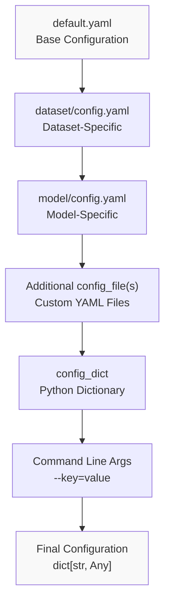
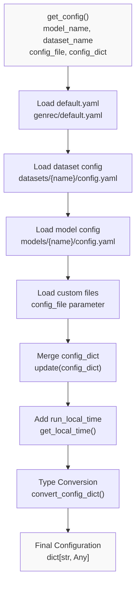
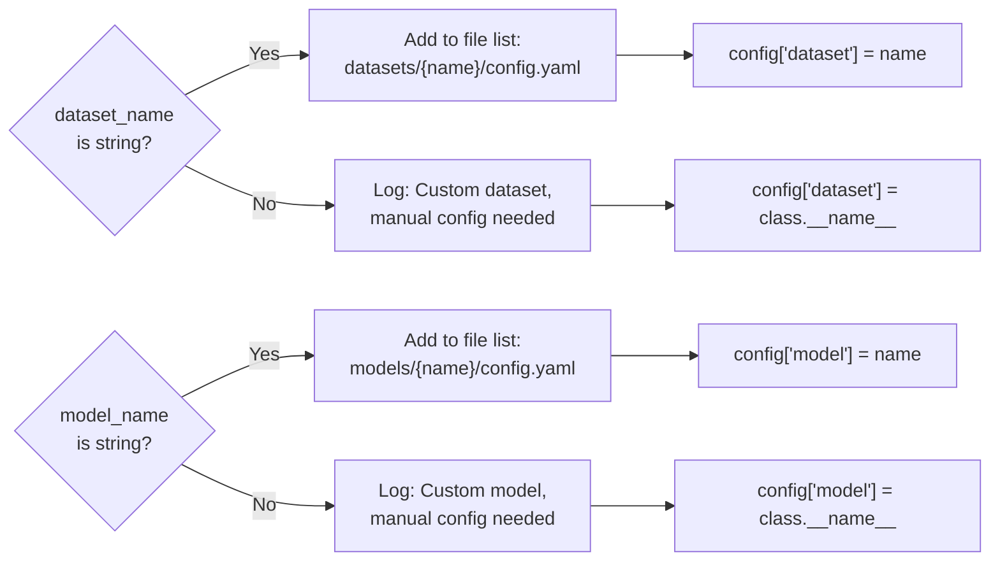
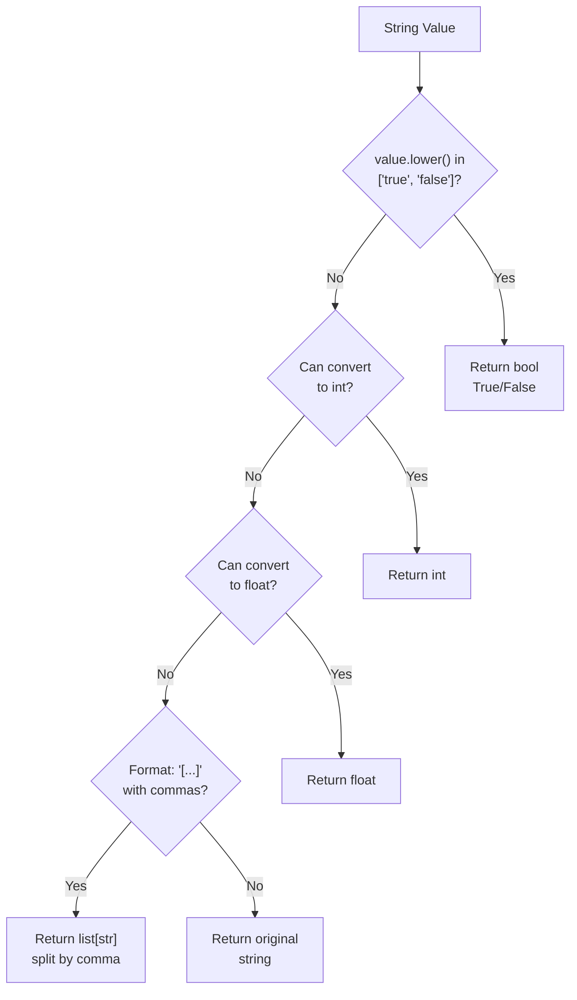
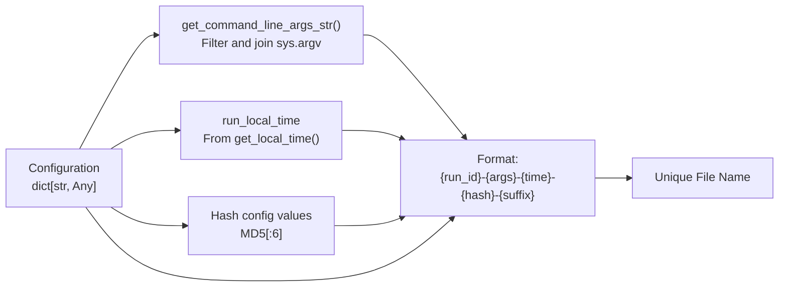
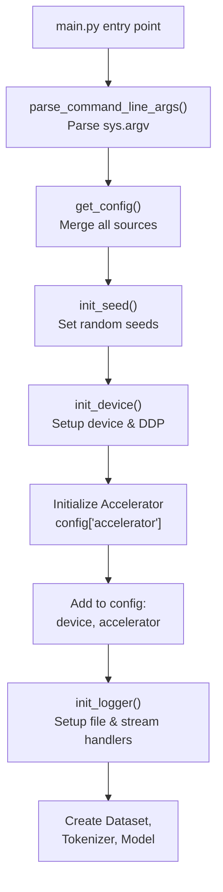

<!-- source: DeepWiki mcp.deepwiki.com · repo google-deepmind/action_piece · page 4.3 Configuration System · fetched 2026-10-26 -->

# Configuration System

<details>
<summary>Relevant source files</summary>

The following files were used as context for generating this wiki page:

- [genrec/datasets/AmazonReviews2014/config.yaml](genrec/datasets/AmazonReviews2014/config.yaml)
- [genrec/default.yaml](genrec/default.yaml)
- [genrec/models/ActionPiece/config.yaml](genrec/models/ActionPiece/config.yaml)
- [genrec/utils.py](genrec/utils.py)

</details>


## Purpose and Scope

The Configuration System manages all parameters and settings for the ActionPiece framework through a hierarchical YAML-based configuration structure. This system implements a priority-based merging strategy where settings from multiple sources (default values, dataset-specific values, model-specific values, custom files, and command-line arguments) are combined to produce a final configuration dictionary used throughout the pipeline.

This page documents the configuration loading mechanism, merge hierarchy, type conversion, and usage patterns. For information about specific configuration parameters and their meanings, see [Default Configuration](#8.1), [Dataset Configuration](#8.2), and [Model Configuration](#8.3). For how configurations are used during pipeline execution, see [Pipeline Orchestration](#4.1).

## Configuration Hierarchy

The configuration system implements a five-level hierarchy where later sources override earlier ones:



**Merge Priority**: Each level overrides keys from previous levels. If a parameter is defined in multiple sources, the value from the highest-priority source takes precedence.

**Sources**: [genrec/utils.py:324-413]()

## Configuration Sources

### Default Configuration

The base configuration file `genrec/default.yaml` defines framework-level defaults applicable to all models and datasets. This file establishes:

| Category | Parameters | Purpose |
|----------|-----------|---------|
| **Directories** | `cache_dir`, `log_dir`, `tensorboard_log_dir`, `ckpt_dir` | File system paths for data, logs, and checkpoints |
| **Training** | `train_batch_size`, `eval_batch_size`, `lr`, `weight_decay`, `warmup_steps`, `epochs`, `max_grad_norm` | Optimization and training loop parameters |
| **Evaluation** | `topk`, `metrics`, `val_metric`, `eval_interval`, `patience` | Metric computation and early stopping |
| **System** | `num_proc`, `rand_seed`, `reproducibility`, `run_id` | System behavior and experiment tracking |

**Key Parameters**:
- `run_id`: Identifier for the experiment run, used in log and checkpoint file names
- `rand_seed`: Random seed for reproducibility (default: 2024)
- `reproducibility`: Boolean flag to enable deterministic behavior
- `patience`: Early stopping patience in epochs (default: 20)

**Sources**: [genrec/default.yaml:1-39]()

### Dataset Configuration

Each dataset has a `config.yaml` file in its directory (e.g., `genrec/datasets/AmazonReviews2014/config.yaml`) that specifies dataset-specific parameters:

```yaml
category: Sports_and_Outdoors
metadata: sentence  # none / raw / sentence
split: leave_one_out  # leave_one_out
```

| Parameter | Type | Description |
|-----------|------|-------------|
| `category` | string | Amazon product category to use |
| `metadata` | enum | Metadata processing mode: `none`, `raw`, or `sentence` |
| `split` | enum | Data splitting strategy: `leave_one_out` |

These parameters are dataset-specific and would differ for other datasets in the framework.

**Sources**: [genrec/datasets/AmazonReviews2014/config.yaml:1-19]()

### Model Configuration

Model-specific configuration files (e.g., `genrec/models/ActionPiece/config.yaml`) define parameters for the model architecture, tokenizer, and inference strategy:

```yaml
# Sentence embedding configuration
sent_emb_model: sentence-transformers/sentence-t5-base
sent_emb_batch_size: 512
sent_emb_dim: 768
sent_emb_pca: 128

# Feature extraction
n_threads: 32
pq_n_codebooks: 4
pq_codebook_size: 256
n_hash_buckets: 128

# ActionPiece tokenizer
actionpiece_vocab_size: 40000

# Model architecture (T5)
num_layers: 4
num_decoder_layers: 4
d_model: 128
d_ff: 1024
num_heads: 6
d_kv: 64
dropout_rate: 0.1

# Inference
num_beams: 50
n_inference_ensemble: 5
train_shuffle: feature  # none / feature / token
```

These parameters control the ActionPiece-specific behavior including feature extraction, vocabulary construction, model architecture, and inference ensemble.

**Sources**: [genrec/models/ActionPiece/config.yaml:1-50]()

### Additional Configuration Files

Users can provide additional YAML configuration files via the `config_file` parameter in `get_config()`. This parameter accepts either a single file path or a list of file paths:

```python
config = get_config(
    model_name='ActionPiece',
    dataset_name='AmazonReviews2014',
    config_file='experiments/my_experiment.yaml',  # or ['file1.yaml', 'file2.yaml']
    config_dict=None
)
```

These files are processed in order, with later files overriding earlier ones.

**Sources**: [genrec/utils.py:397-400]()

### Configuration Dictionary

A Python dictionary can be passed via the `config_dict` parameter to programmatically override configuration values:

```python
config = get_config(
    model_name='ActionPiece',
    dataset_name='AmazonReviews2014',
    config_file=None,
    config_dict={'lr': 0.001, 'train_batch_size': 128}
)
```

This is useful for hyperparameter sweeps and programmatic experimentation.

**Sources**: [genrec/utils.py:407-408]()

### Command Line Arguments

Command-line arguments have the highest priority and follow the format `--key=value`. These are parsed by `parse_command_line_args()`:

```bash
python main.py --model=ActionPiece --dataset=AmazonReviews2014 --lr=0.001 --epochs=100
```

The parser converts string values to appropriate types (boolean, int, float, list) automatically.

**Sources**: [genrec/utils.py:416-445]()

## Configuration Loading Process



The `get_config()` function in `genrec/utils.py` orchestrates the loading and merging process:

1. **Initialize**: Create empty `final_config` dictionary
2. **Build file list**: Construct ordered list of configuration files to load
3. **Determine dataset**: Set `config['dataset']` from dataset_name (string or class name)
4. **Determine model**: Set `config['model']` from model_name (string or class name)
5. **Load YAML files**: Read each file in order, merging into `final_config`
6. **Merge dictionary**: Apply `config_dict` if provided
7. **Add timestamp**: Set `run_local_time` using `get_local_time()`
8. **Convert types**: Process string values into appropriate types

**Sources**: [genrec/utils.py:324-413]()

### Configuration File Discovery



For custom datasets or models (passed as class instances rather than strings), the system logs a message that configuration should be manually provided via `config_file` or `config_dict`.

**Sources**: [genrec/utils.py:371-395]()

## Type Conversion System

Configuration values are initially loaded as strings from YAML files and command-line arguments. The type conversion system automatically converts these to appropriate Python types.

### Conversion Logic

The `_convert_value()` function implements the following conversion rules:



**Conversion Examples**:

| Input String | Converted Value | Type |
|--------------|-----------------|------|
| `"true"` | `True` | `bool` |
| `"false"` | `False` | `bool` |
| `"100"` | `100` | `int` |
| `"0.001"` | `0.001` | `float` |
| `"[5,10,20]"` | `['5', '10', '20']` | `list[str]` |
| `"Sports_and_Outdoors"` | `"Sports_and_Outdoors"` | `str` |

The `convert_config_dict()` function applies `_convert_value()` to all string values in the configuration dictionary. If conversion fails, a warning is logged but processing continues with the original string value.

**Sources**: [genrec/utils.py:276-321]()

## Configuration-Based File Naming

The configuration system generates unique identifiers for log files, checkpoints, and tensorboard runs using configuration values.

### File Name Generation



The `get_file_name()` function creates unique identifiers by combining:

1. **run_id**: From configuration (e.g., `genrec_default`)
2. **Command-line args**: Filtered and joined arguments (paths sanitized)
3. **Timestamp**: From `run_local_time` (format: `%b-%d-%Y_%H-%M-%S`)
4. **Config hash**: First 6 characters of MD5 hash of configuration values
5. **Suffix**: File type identifier (e.g., `.log`, `.pt`)

**Argument Filtering**: The function filters out path-related flags (`--model`, `--dataset`, `--category`, `--cache_dir`, etc.) and sanitizes paths by replacing `/` with `|` to prevent directory structure issues.

**Sources**: [genrec/utils.py:73-116]()

## Configuration in Pipeline

### Initialization Sequence



The configuration dictionary is used throughout initialization:

1. **Random Seeds**: `config['rand_seed']` and `config['reproducibility']` control random number generators
2. **Device Setup**: Determines CUDA availability and DDP mode
3. **Accelerator**: Configuration passed to HuggingFace Accelerate for distributed training
4. **Logging**: `config['log_dir']` and other paths used to create log directories
5. **Component Creation**: Dataset, tokenizer, and model classes use config parameters

**Sources**: [genrec/utils.py:40-149]()

### Configuration Preparation for Logging

The `config_for_log()` function prepares the configuration dictionary for logging by:

1. Creating a copy of the configuration
2. Removing non-serializable keys (`device`, `accelerator`)
3. Converting list values to strings for TensorBoard compatibility

```python
def config_for_log(config: dict[str, Any]) -> dict[str, Any]:
  config = config.copy()
  config.pop('device', None)
  config.pop('accelerator', None)
  for k, v in config.items():
    if isinstance(v, list):
      config[k] = str(v)
  return config
```

This cleaned configuration is logged to TensorBoard and written to log files for experiment tracking and reproducibility.

**Sources**: [genrec/utils.py:518-533]()

## Parameter Access Patterns

Throughout the codebase, configuration parameters are accessed directly from the config dictionary passed to component constructors:

| Component | Configuration Keys Used | File Reference |
|-----------|-------------------------|----------------|
| **Dataset** | `cache_dir`, `category`, `metadata`, `split` | Dataset implementations |
| **Tokenizer** | `actionpiece_vocab_size`, `sent_emb_model`, `n_hash_buckets`, `train_shuffle` | Tokenizer implementations |
| **Model** | `num_layers`, `d_model`, `num_heads`, `dropout_rate`, `num_beams` | Model implementations |
| **Trainer** | `lr`, `weight_decay`, `warmup_steps`, `epochs`, `max_grad_norm`, `patience` | Trainer class |
| **Evaluator** | `topk`, `metrics`, `val_metric` | Evaluator class |

Components typically extract only the parameters they need from the configuration dictionary, making the system modular and loosely coupled.

**Sources**: [genrec/utils.py:324-413]()

## Command Line Override Examples

Common command-line override patterns:

```bash
# Override learning rate and batch size
python main.py --lr=0.001 --train_batch_size=128

# Change dataset category
python main.py --category=Electronics

# Modify model architecture
python main.py --num_layers=6 --d_model=256

# Disable early stopping
python main.py --patience=None

# Set evaluation interval
python main.py --eval_interval=5

# Change inference parameters
python main.py --num_beams=100 --n_inference_ensemble=10

# Override directory paths
python main.py --cache_dir=my_cache --ckpt_dir=my_checkpoints

# Set custom run ID
python main.py --run_id=experiment_001
```

**Type Conversion**: Boolean, integer, float, and list values are automatically converted from string inputs.

**Sources**: [genrec/utils.py:416-445]()

---

